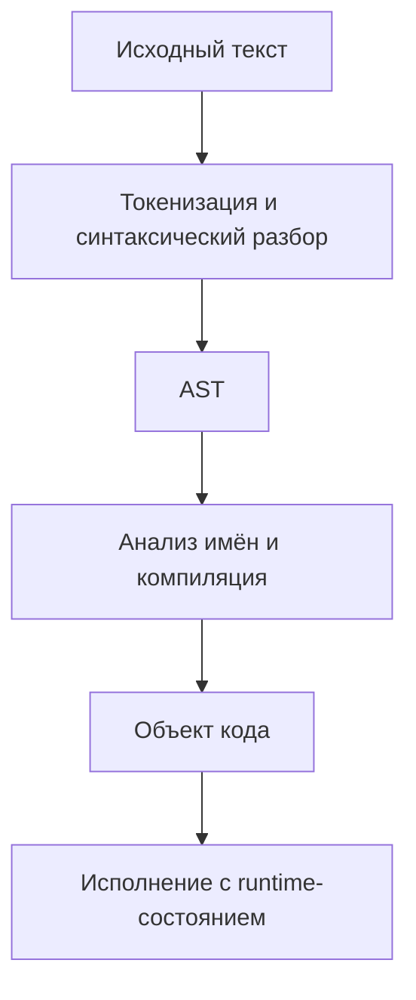

# 1. Фундамент Python

Эта глава объясняет, как Python выполняет программы, связывает имена с объектами, управляет памятью и взаимодействует с инструментами разработчика. Её цель — дать модель, с помощью которой можно самостоятельно объяснять поведение кода, находить ошибки и принимать инженерные решения.

Основной язык примеров — **Python**. Базовое учебное окружение — **CPython 3.14.8, обычная сборка с GIL**. Большинство примеров совместимо с Python 3.12; возможности 3.13–3.14 обозначены отдельно. Для экспериментов со свободной многопоточностью используется отдельная free-threaded-сборка CPython 3.14.8. Это зафиксированная база главы, а не требование всегда устанавливать именно этот патч-релиз: для другой версии нужно проверить её release notes и зависимости.

Материал разделяет **семантику языка Python** и **особенности CPython**. Если поведение связано с конкретной реализацией, сборкой или версией, это отмечено в тексте. При работе с памятью и конкурентностью имеет значение даже патч-версия интерпретатора. Ссылки на документацию Python зафиксированы на ветке 3.14, чтобы обновление сайта не меняло незаметно контекст объяснения.

Кодовые блоки — самостоятельные примеры, если прямо не сказано, что они являются несколькими файлами одного проекта. Команды выполняются в терминале, а блоки `pycon` показывают взаимодействие с REPL. Не нужно помещать терминальные команды в файл `.py`.

Во многих примерах ошибка специально перехватывается и объясняется: это часть эксперимента. Числа времени, размеры объектов и точный вывод `dis` зависят от среды. В самом конце есть сквозное CLI-приложение и тесты; его файлы нужно разместить рядом, как указано в тексте.

После главы ты должен уметь объяснить путь программы от исходника до выполнения, предсказывать последствия присваивания и копирования, находить владельцев ссылок, выбирать протокол для объекта и воспроизводимо запускать проверки. Основной критерий — способность объяснить результат до запуска и назвать условия, при которых он может измениться.

**Содержание**

1. [Введение в Python](#introduction)
2. [Установка и настройка IDE](#installation)
3. [Способы исполнения кода](#execution)
4. [Архитектура Python](#architecture)
5. [Байт-код и дизассемблирование](#bytecode)
6. [Директория `__pycache__`](#pycache)
7. [Объектная модель Python](#object-model)
8. [Встроенные функции](#builtins)
9. [Управление памятью](#memory)
10. [Пространства имен и области видимости](#namespaces)
11. [Модель данных](#data-model)
12. [Введение в магические методы](#special-methods)
13. [GIL (Global Interpreter Lock)](#gil)
14. [Практические инструменты](#tools)
15. [Лучшие практики с первого дня](#practices)

---

<a id="introduction"></a>

## Введение в Python

### Что такое Python?

Python — язык программирования высокого уровня с динамической типизацией, автоматическим управлением памятью и поддержкой нескольких способов организации программы: процедурного, объектно-ориентированного и функционального.

**Высокий уровень** означает, что обычная программа оперирует числами, строками, коллекциями, функциями и объектами, а не адресами памяти и регистрами процессора. Это не отменяет затрат: создание списка, вызов функции и поиск атрибута имеют конкретную стоимость.

**Динамическая типизация** означает, что тип принадлежит объекту, а имя может последовательно ссылаться на объекты разных типов. Она не означает отсутствие типов или автоматическую совместимость любых значений.

```python
value = 10
print(type(value).__name__)  # int

value = "десять"
print(type(value).__name__)  # str

try:
    print(10 + "20")
except TypeError as error:
    print(type(error).__name__)  # TypeError
```

Присваивание не преобразовало целое число в строку: второе присваивание изменило связь имени `value`. Для сложения числа и текстового представления числа нужно выбрать смысл операции: `10 + int("20")` даёт `30`, а `str(10) + "20"` даёт строку `"1020"`.

**Сильная и динамическая типизация описывают разные стороны языка.** Динамическая — момент разрешения типов и операций; сильная обычно означает, что несовместимые значения не смешиваются произвольно без правил преобразования. Термин «сильная» не является строгой универсальной шкалой языков. В Python некоторые преобразования предусмотрены: `1 + 2.5` допустимо, а `1 + "2.5"` — нет.

Аннотация `value: int` помогает инструментам, но не превращает имя в ячейку, которая на уровне runtime принимает только `int`. На границе с внешними данными нужна реальная проверка значений. Это отдельный вопрос от того, хранит ли редактор информацию об ожидаемом типе.

Термин «Python» может обозначать язык, интерпретатор, установленную среду или экосистему библиотек. Например, синтаксис `for` относится к языку, особенности GIL — к модели выполнения конкретной реализации, а `pandas` — к сторонней библиотеке.

### История создания

Язык создал Гвидо ван Россум. Работа началась в конце 1980-х годов, а первая публичная версия появилась в 1991 году. Название связано с комедийной группой Monty Python. На дизайн повлияли идеи языка ABC и потребность в удобном языке для практической автоматизации.

Python развивался как язык общего назначения. Его популярность в анализе данных и машинном обучении появилась благодаря сочетанию простого прикладного кода и библиотек, выполняющих тяжёлую работу на других языках.

Важные этапы развития: появление Python 2, переход к Python 3, развитие генераторов и асинхронности, расширение системы типов, специализация исполнения CPython и появление поддерживаемых free-threaded сборок. Это разные линии развития: новая возможность языка не обязательно меняет внутреннее представление объекта, а изменение интерпретатора может ускорить старую программу без изменения исходника.

Практический вывод из истории — проверять возраст материала. Статья про Python 2, CPython 3.8 или раннюю экспериментальную сборку без GIL может правильно описывать свой период и вводить в заблуждение при применении к другой версии.

### Философия Python (Zen of Python)

Zen of Python — набор ориентиров, оформленный как PEP 20. Посмотреть его можно командой:

```bash
python -c "import this"
```

Основные идеи для повседневной работы:

- Делать намерение программы понятным читателю.
- Предпочитать явные зависимости и действия неочевидным побочным эффектам.
- Начинать с простого решения и вводить сложность, когда она нужна задаче.
- Обрабатывать ошибки осознанно: скрытая потеря данных обычно хуже заметного отказа.
- Использовать понятные пространства имён и устойчивые соглашения.

Пример явного контракта:

```python
def mean(values):
    if not values:
        raise ValueError("Нужна хотя бы одна величина")
    return sum(values) / len(values)


print(mean([10, 20, 30]))  # 20.0
```

Проверка объясняет, что пустые данные не являются допустимым входом. Однако этот вариант предполагает коллекцию с длиной и возможностью повторного чтения. Для произвольного итератора нужен другой алгоритм. Читаемость включает понимание таких предположений, а не только короткую запись.

Zen — ориентир для суждения, а не механическое правило. Явность не требует перечислять сотню однотипных операций вручную, а простота не требует игнорировать реальные требования.

### Области применения

| Область | Типичные задачи | Что особенно важно |
|---|---|---|
| Автоматизация и CLI | Обработка файлов, отчёты, системные операции | Ошибки, кодировки, воспроизводимость, exit codes |
| Backend | HTTP API, бизнес-логика, фоновые задачи | Контракты, безопасность, транзакции, конкурентность |
| Data Engineering | ETL/ELT, загрузка и преобразование данных | Идемпотентность, схемы, память, восстановление |
| Аналитика и исследования | Статистика, notebooks, эксперименты | Корректность, происхождение данных, воспроизводимость |
| ML и научные вычисления | Обучение, inference, численные модели | Нативные библиотеки, массивы, вычислительные ресурсы |
| Инструменты разработчика | Тестирование, линтеры, генераторы | Анализ кода, стабильные интерфейсы, диагностика |

Одна и та же программа может принадлежать нескольким областям. Например, CLI загружает данные через HTTP, преобразует их и записывает в БД. Поэтому фундаментальные знания об объектах и ресурсах применимы независимо от выбранного фреймворка.

Для систем с жёсткими ограничениями задержки, памяти или доступности библиотек Python может быть только частью решения. Инженер оценивает требования, доступные инструменты и стоимость сопровождения.

### Версии Python: поддержка, совместимость и история Python 2/3

Версия записывается как `major.minor.micro`: например, `3.14.8`. Переход между минорными версиями может добавлять синтаксис и API; патч-релизы исправляют ошибки и иногда меняют важные детали реализации.

Python 2 — историческая ветка, для новых проектов используется Python 3. Между ними есть существенные различия, включая текстовую модель и поведение некоторых операций. Например, в Python 3 `str` представляет Unicode-текст, `bytes` — байтовые данные, а `/` выполняет настоящее деление.

```python
import platform
import sys

print(sys.version)
print(platform.python_implementation())
print(sys.executable)
print(sys.version_info[:3])

print(5 / 2)  # 2.5
print(5 // 2)  # 2
```

Совместимость проверяется по нескольким направлениям: синтаксис, стандартная библиотека, зависимости, нативные расширения, ОС и тип сборки. Программа может поддерживать Python 3.12 на Linux и Windows, но зависеть от расширения, которое ещё не поддерживает free-threaded сборку.

В проекте фиксируй минимальную поддерживаемую версию, проверяй код на заявленных версиях и читай release notes перед обновлением. Фраза «поддерживает Python 3» слишком широка для инженерного контракта. Свежий интерпретатор также не означает автоматически свежие версии всех установленных пакетов.

| Уровень совместимости | Пример вопроса | Как проверять |
| --- | --- | --- |
| Язык | Доступен ли используемый синтаксис? | Минимальная версия и компиляция на ней |
| Runtime | Когда вычисляются аннотации? | Документация ветки и эксперимент |
| Стандартная библиотека | Существует ли нужный API? | Раздел `Added in version` и тесты |
| Пакет | Заявлена ли поддержка этой версии? | Метаданные и CI пакета |
| Нативная сборка | Есть ли wheel для ОС, архитектуры и ABI? | Реальная установка в чистую среду |
| Режим выполнения | Поддерживается ли free-threading? | Сборка, расширения и состояние GIL после импортов |

Обратная совместимость не означает, что можно игнорировать предупреждения об устаревании. Удаление API обычно проходит через период deprecation. Полезно периодически запускать тесты с видимыми предупреждениями, а каждое предупреждение оценивать по тому, относится ли оно к твоему коду или зависимости.

### Плюсы и минусы Python

Сильные стороны: выразительный прикладной код, развитая экосистема, стандартная библиотека, удобная интроспекция и низкая стоимость создания первого работающего решения. Это помогает быстро проверять гипотезы и связывать системы.

Издержки: стоимость динамических операций, сравнительно большой расход памяти на многие объекты, ошибки типов во время выполнения при отсутствии проверок, сложности распространения окружений и зависимость ряда задач от нативных расширений.

Короткий код не обязательно выполняется быстро. Например, построение списка из миллионов объектов может быть короче потокового алгоритма, но потреблять значительно больше памяти. Строгая типизация, тестирование и профилирование компенсируют часть издержек, однако не отменяют физическую стоимость вычисления.

При выборе языка оценивай весь путь решения: разработку, эксплуатацию, команду, библиотеки и реальные ограничения. Универсального рейтинга «лучший язык» для всех задач нет.

**Источники:** [General Python FAQ](https://docs.python.org/3.14/faq/general.html), [PEP 20](https://peps.python.org/pep-0020/), [What's New in Python](https://docs.python.org/3.14/whatsnew/index.html).

<a id="installation"></a>

## Установка и настройка IDE

### Установка Python

Установить Python можно официальными средствами для ОС, менеджером пакетов системы или менеджером версий. Начни с поддерживаемой версии, совместимой с нужными библиотеками. Для этой главы достаточно обычной сборки CPython; эксперименты без GIL выполняются отдельно.

После установки проверь, какой интерпретатор фактически запускается:

```bash
python --version
python -VV
python -c "import sys; print(sys.executable)"
python -m pip --version
```

На некоторых системах команда называется `python3`. На Windows способ выбора версии зависит от установленного launcher или Python install manager. Дальше в примерах используется `python`; при необходимости замени его на подходящую команду своей системы.

Системный Python может использоваться средствами ОС. Установка зависимостей учебного проекта не должна превращаться в изменение его системного окружения: для проекта создай виртуальную среду.

**Практический маршрут установки.** В Windows используй актуальные официальные средства установки Python и проверь выбранную версию в новом терминале. В macOS можно использовать официальный установщик или осознанно выбранный менеджер версий. В Linux способ установки зависит от дистрибутива; у пакета `venv` иногда отдельная установка. Команду установки системного пакета нужно брать для своей ОС, а не переносить из инструкции другого семейства Linux.

Проверь ещё два свойства: процесс запускается с обычными пользовательскими правами, а путь к Python совпадает в терминале и IDE. Успешная загрузка установщика ещё не гарантирует, что команда `python` нашла именно его. На машине могут одновременно существовать системный Python, несколько пользовательских версий и несколько виртуальных сред.

Для ориентира:

```bash
python -c "import sys; print(sys.version_info[:3]); print(sys.prefix); print(sys.base_prefix)"
```

В стандартном `venv` значения `sys.prefix` и `sys.base_prefix` различаются. Это удобный признак виртуальной среды, но не полная спецификация всех возможных менеджеров окружений.

### Первая программа

Создай файл `hello.py`:

```python
name = "Python"
message = f"Привет, {name}!"
print(message)
```

Запусти его из директории, где находится файл:

```bash
python hello.py
```

Ожидаемый результат — `Привет, Python!`. Интерпретатор сначала разбирает код, а затем выполняет инструкции. `print()` выводит значение, а не возвращает его как результат функции: результат самого вызова `print()` — `None`.

```python
result = print("Сообщение")
print(result)  # None
```

Первый файл полезно запустить из терминала и из IDE. Если результаты отличаются, сравни интерпретатор, рабочую директорию, аргументы запуска и переменные окружения.

### Выбор и настройка IDE

Редактор и IDE помогают находить определения, дополнять код, запускать тесты и отладчик. Типичные варианты — VS Code с поддержкой Python и PyCharm. Возможностей обычного редактора тоже достаточно, если проверка и запуск организованы отдельно.

Главная настройка — интерпретатор проекта. Он должен совпадать с окружением, в котором устанавливаются зависимости и выполняются тесты. Подсветка импорта может показывать ошибку при рабочем коде, если анализатор смотрит в другую среду; обратная ситуация также возможна.

Настрой единый formatter, диагностику, проверку типов и запуск тестов. Сохраняй общие правила в конфигурации проекта, чтобы они действовали и у других участников, и в CI. Цветовая тема и раскладка панелей — личные предпочтения; требования к коду — общие правила.

### Настройка рабочего окружения

Создание виртуальной среды:

```bash
python -m venv .venv
```

Активация на Linux/macOS в bash или zsh:

```bash
source .venv/bin/activate
```

Активация в Windows PowerShell:

```powershell
.venv\Scripts\Activate.ps1
```

Если активация недоступна, можно вызвать интерпретатор прямо. Активация лишь меняет окружение shell, прежде всего `PATH`; она не является условием работы `venv`.

```bash
.venv/bin/python -m pip --version
```

```powershell
.venv\Scripts\python.exe -m pip --version
```

Внутри проекта используй `python -m pip`, чтобы явно связать установку пакетов с выбранным интерпретатором. `venv` изолирует установленные Python-пакеты, но не создаёт контейнер, не ограничивает права процесса и не является защитной песочницей. Среду обычно пересоздают, а не переносят как готовую папку на другую машину.

**Что именно изолировано.** По умолчанию окружение получает собственный набор устанавливаемых пакетов, но использует базовую установку Python. Оно по-прежнему видит файлы, переменные окружения, сеть и библиотеки ОС в рамках прав процесса. Уже установленная программа вне среды не становится недоступной просто из-за активации.

Чтобы проверить среду после установки учебных инструментов:

```bash
python -m pip --version
python -m pip check
python -c "import sys; print(sys.executable)"
```

`pip check` ищет несогласованные объявленные зависимости установленных пакетов. Он не доказывает, что все нативные библиотеки доступны, приложение запускается и библиотека правильно работает с твоими данными.

Если установка заблокирована сообщением об externally managed environment, сначала проверь, что используется виртуальная среда. Обход защиты системного окружения не нужен для обычного учебного проекта. И ещё одно различие: `deactivate` меняет текущую shell-сессию, а удаление каталога среды удаляет её пакеты; это разные действия.

### Управление версиями Python (pyenv)

`pyenv` позволяет выбирать интерпретатор через промежуточные команды — shims. Он управляет версиями Python; виртуальная среда управляет пакетами конкретного проекта. Это разные задачи.

После установки и настройки `pyenv` по его официальной инструкции:

```bash
pyenv versions
pyenv install --list
pyenv version
pyenv which python
```

Выбери нужную версию из списка, установи её командой `pyenv install VERSION`, а затем закрепи для проекта командой `pyenv local VERSION`. Здесь `VERSION` — текстовая заглушка: её нужно заменить фактическим номером. Локальный выбор записывается в `.python-version`.

После изменения интерпретатора пересоздай виртуальную среду. Уже созданная `.venv` не переключается на другую версию лишь потому, что поменялся результат команды `python` вне неё.

Основной проект `pyenv` ориентирован на Unix-подобные среды. В Windows нужно учитывать отдельные инструменты и варианты вроде WSL; инструкции для bash нельзя автоматически переносить в PowerShell.

### Работа в терминале

При запуске важны три отдельных понятия: путь к исполняемому интерпретатору, путь к исходному файлу и текущая рабочая директория процесса.

```python
from pathlib import Path
import sys

print("Интерпретатор:", sys.executable)
print("Рабочая директория:", Path.cwd())
print("Аргументы:", sys.argv)
```

Сохрани пример в `environment_info.py` и запусти `python environment_info.py one two`. Аргументы появятся в `sys.argv`; относительные пути в программе будут отсчитываться от рабочей директории, а не автоматически от папки скрипта.

Различай данные программы в `stdout` и диагностические сообщения в `stderr`. Тогда CLI можно использовать в конвейере без случайного смешивания результата и отладочных сообщений. Для остановки работающего процесса обычно применяется `Ctrl+C`, что в Python часто выражается как `KeyboardInterrupt`.

### Частые проблемы и их решение

| Симптом | Что проверить |
|---|---|
| Команда `python` не найдена | Установку, имя команды, `PATH`, настройки shell |
| Пакет установлен, но импорт не работает | `sys.executable` и вывод `python -m pip --version` |
| Работает в IDE, не работает в терминале | Интерпретатор, cwd, переменные окружения, аргументы |
| Импортируется «не тот» модуль | Имя собственного файла, `module.__file__`, пути импорта |
| Среда перестала работать после перемещения | Пересоздание `.venv` по описанным зависимостям |
| PowerShell не активирует среду | Способ активации; при необходимости прямой вызов её Python |

Не называй файл `json.py`, `typing.py` или именем используемой библиотеки без необходимости: такой файл может перекрыть ожидаемый импорт. При ошибке сначала собери факты, а затем меняй окружение. Переустановка всего подряд часто скрывает исходную причину.

### Чек-лист готового окружения

- Известны версия, реализация и путь к интерпретатору.
- У проекта есть отдельная виртуальная среда.
- Терминал и IDE используют нужную среду.
- Зависимости описаны в файлах проекта и могут быть установлены заново.
- Скрипт запускается из терминала предсказуемой командой.
- Проверены formatter, linting и тестирование.
- В Git не попадают `.venv`, временные файлы и секреты.
- Новый участник может повторить установку по README.

**Источники:** [Python Setup and Usage](https://docs.python.org/3.14/using/index.html), [venv](https://docs.python.org/3.14/library/venv.html), [pyenv](https://github.com/pyenv/pyenv).

<a id="execution"></a>

## Способы исполнения кода

### Интерактивный режим (REPL)

REPL выполняет цикл «прочитать выражение или инструкцию — выполнить — показать результат — повторить». Запускается командой `python` без имени файла.

```pycon
>>> 2 + 3
5
>>> values = [1, 2, 3]
>>> values.append(4)
>>> values
[1, 2, 3, 4]
```

REPL показывает представление результата выражения, если результат не равен `None`. Поэтому вызов `append()` не печатает ничего, а чтение имени `values` показывает список. Скрипт без `print()` такое представление автоматически не выводит.

Состояние сессии сохраняется. Эксперимент может работать из-за переменной или импорта, выполненного десять минут назад. Для проверки воспроизводимости перенеси его в файл и запусти в новом процессе. В обычном REPL имя `_` часто связано с последним показанным результатом; это тоже может удерживать объект в памяти.

### Скриптовый режим

При `python script.py` создаётся процесс, который выполняет верхнеуровневый код файла. Код размещён в пространстве имён главного модуля `__main__`.

```python
def main():
    print("Программа запущена")
    return 0


if __name__ == "__main__":
    raise SystemExit(main())
```

Такая структура отделяет определения от точки входа. Импорт файла не запускает `main()`, но всё остальное на верхнем уровне по-прежнему выполняется при импорте. Защита точки входа особенно важна при запуске дочерних процессов, когда среда может импортировать главный модуль.

`SystemExit` с кодом `0` обозначает успешное завершение для вызывающей среды; ненулевой код обычно сообщает о неуспехе. Возврат из `main()` сам по себе не задаёт код процесса, если никто этот результат не использует.

### Модуль vs Скрипт

Модуль — единица организации и импорта кода. Скрипт — роль файла при непосредственном запуске. Один файл способен выполнять обе роли, но способы поиска импортов и значение `__name__` различаются.

```bash
python package/tool.py
python -m package.tool
```

Во втором случае Python сначала находит модуль через механизм импорта и выполняет его как главный. Это сохраняет контекст пакета и обычно является подходящим способом запуска его внутренней команды. Прямой запуск вложенного файла может сломать относительные импорты.

Не смешивай рабочую директорию, `sys.path` и директорию файла. Они связаны со способом запуска, но не являются одним и тем же объектом. Проблема импорта часто решается корректной точкой входа или установкой пакета, а не добавлением произвольных путей в `sys.path`.

**Почему прямой запуск ломает относительный импорт.** У файла, запускаемого напрямую, может не быть пакетного контекста. Относительная запись `from .helpers import VALUE` требует знать, какой пакет обозначает точка. Ниже полностью воспроизводимый эксперимент, который создаёт собственный временный пакет:

```python
from pathlib import Path
from tempfile import TemporaryDirectory
import subprocess
import sys

with TemporaryDirectory() as directory:
    root = Path(directory)
    package = root / "demo_package"
    package.mkdir()
    (package / "__init__.py").write_text("", encoding="utf-8")
    (package / "helpers.py").write_text("VALUE = 42\n", encoding="utf-8")
    tool = package / "tool.py"
    tool.write_text(
        "from .helpers import VALUE\nprint(VALUE)\n",
        encoding="utf-8",
    )

    direct = subprocess.run(
        [sys.executable, str(tool)],
        cwd=root,
        capture_output=True,
        text=True,
        check=False,
    )
    as_module = subprocess.run(
        [sys.executable, "-m", "demo_package.tool"],
        cwd=root,
        capture_output=True,
        text=True,
        check=True,
    )
    print("Прямой запуск завершился ошибкой:", direct.returncode != 0)
    print("Запуск модуля:", as_module.stdout.strip())
    assert direct.returncode != 0
    assert as_module.stdout.strip() == "42"
```

Ожидается `True` и `42`. Изменение исходника не потребовалось: изменился способ запуска и контекст поиска. В установленном приложении аналогичную задачу решает правильно оформленная точка входа. Не запускай один библиотечный файл одновременно как `__main__` и как импортируемый модуль без необходимости: это способ получить два разных набора объектов модуля, включая классы и глобальное состояние.

### Другие способы исполнения

| Способ | Пример | Когда подходит |
|---|---|---|
| Однострочная команда | `python -c "print(2 + 3)"` | Небольшая проверка или диагностика |
| Код из stdin | `python -` | Передача исходника через поток |
| Модуль | `python -m module` | CLI модуля или пакета |
| Интерактивная среда | REPL, IPython, Jupyter | Эксперименты и исследование |
| Встраивание | Вызов Python из приложения-хоста | Интеграция с другой системой |
| Динамическое исполнение | `compile`, `exec`, `eval` | Контролируемые задачи генерации и анализа |

В notebook порядок выполнения ячеек может отличаться от порядка их расположения. «Restart and run all» помогает обнаружить скрытые зависимости состояния.

`exec()` и `eval()` исполняют Python-код. Передача ограниченного словаря имён не превращает их в безопасную среду для пользовательского ввода. Для данных используй формат данных и валидатор, а не интерпретацию как программы.

### Компиляция в байт-код

В CPython исходный текст проходит разбор и компиляцию в объект кода. Этот объект содержит инструкции байт-кода и связанные данные. Затем среда выполнения исполняет его. Поэтому слово «интерпретируемый» не означает, что каждая строка исходника заново разбирается при каждом выполнении.

```python
source = "answer = base * 2"
code = compile(source, "<lesson>", "exec")
namespace = {"base": 21}

exec(code, namespace)
print(namespace["answer"])  # 42
```

Компиляция не выполнила умножение с текущим значением `base`: для него нужно пространство имён во время исполнения. Файл `.pyc` хранит результат подготовки кода, а не значения глобальных переменных или результаты прошлых вызовов функций.

### Сравнение и выбор подходящего способа

Для короткой гипотезы удобен REPL. Для повторяемой задачи — скрипт с явной точкой входа. Для команды внутри пакета — запуск модуля или установленная console-команда. Для исследования данных подходит notebook, если результат затем переносится в воспроизводимый код.

Выбирай способ по тому, какие свойства нужны: повторяемость, аргументы, логирование, возможность автоматического запуска, контекст пакета и контроль окружения. IDE может быть удобной оболочкой любого из этих способов, но не заменяет описание команды запуска.

### Практические примеры

Сохрани следующий код в `inspect_launch.py`:

```python
from pathlib import Path
import sys


def main():
    print("name:", __name__)
    print("package:", __package__)
    print("cwd:", Path.cwd())
    print("argv:", sys.argv)
    return 0


if __name__ == "__main__":
    raise SystemExit(main())
```

Сравни `python inspect_launch.py demo` и `python -m inspect_launch demo`, выполняя команды из папки файла. Затем импортируй `inspect_launch` в новой сессии: `main()` не должен запуститься. Для вложенного пакета дополнительно сравни прямой запуск файла и `-m`.

Задание: выясни, какие строки вывода определяются содержимым программы, какие — окружением и способом запуска. Объясни, почему относительный путь к данным может работать в одном варианте и не работать в другом.

### Отладка в разных режимах

Скрипт можно открыть в отладчике командой:

```bash
python -m pdb inspect_launch.py demo
```

Запуск модуля тоже поддерживается: `python -m pdb -m package.tool`. В IDE создай конфигурацию с теми же аргументами и рабочей директорией, что используются в терминале.

Перед диагностикой очисти случайное состояние: новая REPL-сессия, перезапуск notebook kernel, явная конфигурация. Не сравнивай отладочный запуск с обычным микробенчмарком: instrumentation и debugger изменяют стоимость выполнения, а иногда и момент переключения потоков.

### Специальные флаги запуска

| Флаг | Назначение | Существенное ограничение |
|---|---|---|
| `-m` | Выполнение модуля | Нужна корректная среда импорта |
| `-c` | Выполнение переданного исходника | Shell влияет на кавычки и экранирование |
| `-i` | Интерактивная сессия после запуска | Состояние программы остаётся в процессе |
| `-B` | Запрет записи `.pyc` | Это не отключение всех кэшей и не запрет чтения существующего `.pyc` |
| `-u` | Изменение буферизации стандартных потоков | Не заменяет управление прикладным I/O |
| `-O`, `-OO` | Удаление assert; при `-OO` также docstrings | Не универсальное ускорение программы |
| `-E` | Игнорирование переменных `PYTHON*` | Остальное окружение процесса сохраняется |
| `-I` | Изолированный режим поиска и окружения Python | Не защитная песочница |
| `-X dev` | Дополнительная runtime-диагностика | Может влиять на производительность |
| `-X importtime` | Измерение времени импортов | Вывод зависит от версии и сценария импорта |
| `-X tracemalloc` | Отслеживание Python-аллокаций с запуска | Имеет накладные расходы |

Полный перечень зависит от версии: используй `python --help`, `python --help-xoptions` и документацию установленного интерпретатора. `assert` не должен проверять обязательные условия внешнего ввода, потому что `-O` может удалить такую проверку.

**Источники:** [Command line and environment](https://docs.python.org/3.14/using/cmdline.html), [Execution model](https://docs.python.org/3.14/reference/executionmodel.html), [pdb](https://docs.python.org/3.14/library/pdb.html).

<a id="architecture"></a>

## Архитектура Python

### Интерпретатор vs Компилятор

Компилятор преобразует программу из одного представления в другое, а интерпретатор выполняет её представление. Это роли, которые могут сочетаться в одной системе. CPython компилирует исходник в байт-код и исполняет инструкции этого байт-кода; реализация с JIT дополнительно может преобразовывать часто выполняемый код в машинные инструкции.

Не следует смешивать компиляцию самого CPython из исходников C с компиляцией пользовательского `.py`. В первом случае создаётся исполняемая программа интерпретатора. Во втором — объект кода, который будет выполняться уже внутри этой программы.

Сам факт наличия компилятора не задаёт производительность приложения. Важны модель объектов, стоимость операций, оптимизации, работа с нативными библиотеками и профиль нагрузки.

### Этапы выполнения кода

Упрощённый путь исходника в CPython:



Синтаксический разбор отвечает за допустимость формы программы. Анализ имён определяет, какие имена являются локальными, глобальными или свободными. При выполнении создаются объекты и ищутся фактические значения. Граница между стадиями объясняет, почему корректно скомпилированная функция может затем получить `NameError`.

```python
import ast

source = "result = price * quantity"
tree = ast.parse(source)
print(type(tree).__name__)  # Module

code = compile(tree, "<pricing>", "exec")
namespace = {"price": 120, "quantity": 3}
exec(code, namespace)
print(namespace["result"])  # 360

try:
    exec(code, {"price": 120})
except NameError as error:
    print(type(error).__name__)  # quantity не определено
```

Функция, определённая внутри модуля, получает свой объект кода, но тело функции не выполняется при одном лишь определении. Значения аргументов по умолчанию и выражения декораторов, напротив, связаны с моментом определения. Поэтому импорт способен выполнять больше работы, чем кажется по наличию одних `def`.

**Разбор, компиляция и выполнение могут отказывать по разным причинам.** AST ещё не доказывает, что конструкция допустима в данном контексте. А успешная компиляция не доказывает, что при исполнении найдутся имена и подойдут данные:

```python
import ast

cases = {
    "Ошибка формы": "if True print('hello')",
    "Ошибка контекста": "return 1",
    "Ошибка выполнения": "missing_name + 1",
}

for label, source in cases.items():
    stage = "разбор"
    try:
        tree = ast.parse(source)
        stage = "компиляция"
        code = compile(tree, "<stages>", "exec")
        stage = "выполнение"
        exec(code, {})
    except (SyntaxError, NameError) as error:
        print(label, "→", stage, type(error).__name__)
```

Первый случай отказывает при разборе, второй — при компиляции AST, третий — при выполнении. Поэтому команда проверки синтаксиса и запуск приложения отвечают на разные вопросы. Аналогично ошибка импорта зависимости не становится синтаксической ошибкой твоего модуля лишь потому, что возникла в начале работы.

### CPython - эталонная реализация

CPython — широко используемая реализация Python, в значительной части написанная на C. Она реализует синтаксис языка, стандартную библиотеку, механизм импорта, модель выполнения и взаимодействие с расширениями.

Для обычного Python-кода интерпретатор выполняет операции над объектами. Например, `left + right` может потребовать определения типов операндов, выбора реализации операции и создания результата. Это намного богаче, чем одна машинная команда сложения двух фиксированных целых.

Нативные библиотеки могут выполнять большие блоки работы за пределами обычного цикла Python. Поэтому «программа написана на Python» не означает «каждый элемент массива обработан Python-циклом».

Диагностика реализации:

```python
import platform
import sys

print(platform.python_implementation())
print(sys.implementation.name)
print(sys.implementation.cache_tag)
```

Здесь вывод относится к фактически запущенному интерпретатору. Совпадение языка исходника не означает совпадение внутреннего байт-кода, ABI и поведения финализации.

### Альтернативные реализации

Реализации могут иметь другие стратегии управления памятью, компиляции и интеграции с платформой. Например, PyPy использует собственную среду выполнения и JIT, который способен улучшать производительность подходящих повторяющихся нагрузок.

При выборе альтернативы проверь поддерживаемую версию языка, стандартную библиотеку, совместимость расширений и инструменты диагностики. API, основанные на деталях CPython, могут отсутствовать или иметь другой смысл.

Выбор реализации должен проверяться на приложении целиком: запуск, прогрев, рабочая нагрузка, память, ошибки и зависимости. Замена интерпретатора — не эквивалент смене версии одного небольшого пакета.

### Сравнение реализаций

Сравнивать полезно по критериям, а не по одному числу из чужого бенчмарка:

| Критерий | Что измерить или проверить |
|---|---|
| Совместимость языка | Синтаксис и стандартная библиотека нужной версии |
| Зависимости | Установка и корректность используемых библиотек |
| Старт | Время от запуска процесса до готовности |
| Установившаяся работа | Производительность после прогрева |
| Память | Пик, рост при нагрузке, удержание после её завершения |
| Диагностика | Профилировщики, отладчик, crash-reporting |
| Конкурентность | Потоки, процессы, расширения, ресурсы |

Быстрый старт важен для короткого CLI, а прогретая производительность — для долго работающего сервиса. Средние значения не заменяют проверку задержек и пиков памяти. Сначала докажи, что поведение программы одинаково, затем сравнивай стоимость.

### Гарантии языка Python и особенности реализации CPython

**Контракт языка** описывает то, на что переносимый код может опираться. **Деталь реализации** объясняет наблюдаемое поведение конкретного интерпретатора, но может измениться без изменения языка.

| Свойство | Как трактовать |
|---|---|
| `is` проверяет идентичность | Семантика языка |
| `==` выполняет сравнение значений по протоколу | Семантика языка |
| `id()` стабилен при жизни объекта | Контракт идентичности |
| В CPython `id()` связан с адресом объекта | Особенность реализации |
| Порядок вставки в `dict` сохраняется | Гарантия современных версий языка |
| Некоторые одинаковые литералы оказываются одним объектом | Оптимизация реализации, на неё нельзя опираться |
| Обычно объект уничтожается после обнуления refcount в CPython | Особенность модели памяти конкретной сборки |
| Одна операция со встроенным контейнером выглядит атомарной | Требует конкретного контракта версии и сборки; не заменяет синхронизацию |

Переносимый код проверяет равенство строк через `==`, явно освобождает ресурсы через `with` и защищает общий инвариант блокировкой. Понимание реализации полезно для диагностики, но не должно превращать случайный эксперимент в универсальное обещание.

### Внутреннее устройство CPython (для углубленного изучения)

Полезно разделять несколько уровней: процесс ОС, runtime интерпретатора, состояния потоков, кадры исполнения, объекты кода и сами Python-объекты. Объект функции связывает код с глобальным окружением и другими данными, а конкретный вызов создаёт состояние исполнения с аргументами и локальными значениями.

```python
def multiply(left, right):
    return left * right


print(multiply.__code__.co_varnames)  # ('left', 'right')
print(multiply.__code__.co_consts)
print(multiply.__globals__ is globals())  # True
```

На уровне C объекты несут информацию о типе и управлении временем жизни. Представления различаются по типам и сборкам. Описание «у каждого объекта просто есть один обычный счётчик ссылок» уже недостаточно для всех современных вариантов CPython: существуют immortal objects и другие схемы учёта ссылок в free-threaded сборке.

Современный CPython специализирует часть исполнения под наблюдаемые типы. Детали адаптации, кэши инструкций и экспериментальные JIT-возможности зависят от версии и конфигурации. Изучать их лучше через конкретный release исходников. Не нужно переносить структуру C-объекта из одного релиза в другой без проверки.

Полезная карта внутренних сущностей:

| Сущность | Что хранит или координирует | С чем не следует путать |
| --- | --- | --- |
| Процесс | Адресное пространство, дескрипторы ОС, ресурсы | Отдельный модуль |
| Интерпретатор | Собственное runtime-состояние, модули, конфигурацию | Весь процесс при наличии subinterpreters |
| Состояние потока | Контекст исполнения потока в интерпретаторе | Копию всей памяти приложения |
| Объект функции | Код, глобальное окружение, defaults, closure | Только последовательность инструкций |
| Объект кода | Инструкции и метаданные компиляции | Сохранённые результаты всех вызовов |
| Кадр вызова | Состояние конкретного исполнения | Саму функцию как переиспользуемый объект |

Два вызова одной функции используют один объект функции и обычно один объект кода, но разные состояния исполнения. Рекурсивные вызовы не переписывают один общий набор локальных аргументов. При этом все вызовы могут обращаться к одному изменяемому значению по умолчанию или к одному объекту из глобального пространства.

Внутренний кадр CPython и Python-объект `frame`, который видит `inspect`, тоже не стоит считать полностью тождественными по стоимости. Реализация может создавать часть объектов для наблюдения лениво. Включение tracing или debugger способно изменить аллокации и удержание ссылок.

### Производительность разных реализаций

Стоимость приложения можно приблизительно рассматривать как сумму старта, подготовки, Python-работы, нативной работы, I/O и координации. Изменение интерпретатора влияет не на все части одинаково.

Это ограничение можно оценить через долю ускоряемой работы. Если 90% времени уходит на ожидание внешней системы, а Python-вычисления занимают 10%, даже бесконечное ускорение этих вычислений уменьшит полное время лишь с условных 100 до 90 единиц. Это не значит, что ускорять их бесполезно: нужно понимать верхнюю границу выигрыша и цель измерения.

Отдельно оценивай latency одного запроса и throughput множества запросов. Модель с большим количеством работников может повысить пропускную способность и одновременно ухудшить задержку отдельного запроса под нагрузкой. Быстрый прогретый сервис и быстрый одноразовый CLI — разные критерии.

Для JIT-систем учитывай прогрев. Для работы с расширениями учитывай пересечение границы между средами. Для процессов — сериализацию и создание работников. Если приложение большую часть времени ждёт удалённую БД, ускорение арифметического цикла почти не изменит общий результат.

Сравнивай на одинаковых входных данных и с одинаковой проверкой результата. Записывай версии, сборки, аппаратную среду и метод измерения. Разницу в несколько процентов легко получить за счёт шума, состояния файлового кэша и фоновой нагрузки.

### Инструменты для изучения архитектуры

- `sys` и `platform` показывают среду исполнения.
- `ast` показывает синтаксическое представление.
- `symtable` помогает исследовать классификацию имён.
- `dis` показывает инструкции CPython.
- `inspect` исследует функции, сигнатуры и кадры.
- `tracemalloc` показывает происхождение отслеживаемых аллокаций.
- Исходники CPython позволяют проверить механизм в конкретной версии.

```python
import symtable

source = "def function():\n    value = 10\n    return value\n"
table = symtable.symtable(source, "<scope>", "exec")
function_table = table.lookup("function").get_namespace()
symbol = function_table.lookup("value")
print(symbol.is_local())  # True
print(symbol.is_global())  # False
```

Выбор пространства по имени здесь намеренный. В современных версиях среди дочерних таблиц могут быть области аннотаций, поэтому первый элемент `get_children()` не обязан соответствовать телу нужной функции. Если одно имя связано с несколькими пространствами, понадобится `get_namespaces()` и более точный выбор.

Инструмент показывает отдельное представление программы. AST не знает фактических значений во время выполнения, а профиль одного запуска не доказывает сложность алгоритма для всех входов.

### Практические примеры

Разделим этапы приготовления и исполнения программы:

```python
from time import perf_counter

source = "total = sum(range(1000))"

started = perf_counter()
code = compile(source, "<experiment>", "exec")
compiled_at = perf_counter()

namespace = {}
exec(code, namespace)
finished = perf_counter()

print("Компиляция:", compiled_at - started)
print("Исполнение:", finished - compiled_at)
print("Результат:", namespace["total"])  # 499500
```

Это демонстрация отдельных стадий, а не качественный бенчмарк: один замер слишком чувствителен к шуму. Задание: подготовь объект кода один раз, выполни его несколько раз с разными пространствами имён и объясни, какие данные принадлежат коду, а какие — конкретному выполнению.

### История развития архитектуры

Архитектура CPython меняется постепенно: представление инструкций, обработка исключений, механизм вызовов, специализация, управление памятью и конкурентное выполнение проходят отдельные этапы развития.

В CPython 3.11 появились заметные изменения, связанные с адаптивной специализацией и исполнением. Python 3.13 принёс экспериментальные free-threaded сборки, а Python 3.14 — их поддерживаемый статус. При этом обычные сборки с GIL продолжают существовать.

Инженерный смысл истории — проверять границу применимости знания. Формулировки «Python всегда использует GIL», «байт-код одинаков между версиями» и «объект всегда уничтожается сразу после del» слишком широки.

### Ключевые выводы

Архитектура объясняет поведение программы на нескольких уровнях. Пользовательский исходник, объект кода, runtime-состояние и машинная программа интерпретатора — разные сущности. Их важно различать при отладке, оптимизации и обсуждении совместимости.

Сначала соблюдай контракт языка, затем используй сведения о реализации для целевой диагностики. Любая оптимизация, привязанная к CPython, должна иметь измеренную пользу и понятные ограничения.

**Источники:** [Execution model](https://docs.python.org/3.14/reference/executionmodel.html), [symtable](https://docs.python.org/3.14/library/symtable.html), [PEP 659](https://peps.python.org/pep-0659/), [PyPy FAQ](https://doc.pypy.org/en/latest/faq.html), [CPython source](https://github.com/python/cpython).

<a id="bytecode"></a>

## Байт-код и дизассемблирование

### Что такое байт-код?

Байт-код CPython — внутренние инструкции для исполнения объекта кода. Они описывают действия вроде загрузки значения, операции над объектами, вызова функции или перехода. Это не машинный код конкретного процессора и не универсальный стандарт Python.

Объект кода хранит больше, чем поток инструкций: константы, сведения об именах, параметры и информацию для связи с исходником. Он не содержит всех значений конкретного вызова функции.

```python
def add(left, right):
    return left + right


code = add.__code__
print(type(code).__name__)  # code
print(code.co_varnames)  # ('left', 'right')
print(code.co_names)
print(code.co_consts)
print(type(code.co_code).__name__)  # bytes
```

Представления `co_*` полезны для исследования, но не заменяют документированный интерфейс функции. Формат внутреннего кода меняется между версиями.

### Просмотр байт-кода с помощью `dis`

```python
import dis


def add(left, right):
    return left + right


dis.dis(add)
```

Вывод зависит от версии CPython. В нём будут видны загрузка операндов, операция сложения и возврат результата, но конкретные имена инструкций и дополнительная информация могут различаться.

Для программной обработки используй объектное API:

```python
import dis


def multiply(value):
    return value * 3


for instruction in dis.get_instructions(multiply):
    print(instruction.opname, instruction.argrepr)
```

Не строй инструмент на разборе пробелов в текстовом выводе `dis`, если нужные данные доступны через `Instruction`.

### Анализ и интерпретация байт-кода

Многие операции используют стек значений. Загрузка аргумента помещает значение на него, бинарная операция потребляет операнды и формирует результат, а возврат завершает исполнение кадра. Но нельзя заключать, что Python-объект физически хранится в стеке ОС, только потому что инструкция использует стек виртуальной машины.

```python
import dis


def choose(flag):
    if flag:
        return 10
    return 20


dis.dis(choose)
```

Проследи условный переход и две ветви возврата. Затем сравни с выражением `return 10 if flag else 20`. Возможное сходство байт-кода показывает, что разные формы исходника иногда реализуют похожие действия; оно не доказывает, что одна форма всегда быстрее.

Одна инструкция может вызывать сложный код. Сложение пользовательских объектов запускает специальные методы, а чтение атрибута может вызвать дескриптор. Число инструкций не является прямой мерой времени, количества аллокаций или атомарности операции.

### Оптимизация на уровне байт-кода

Дизассемблирование помогает объяснить различия, найденные измерением. Например, повторная загрузка атрибута внутри цикла может отличаться от вызова заранее сохранённого bound method. Но современный интерпретатор уже оптимизирует часть таких действий, а ручная «оптимизация» способна ухудшить читаемость или изменить динамическое поведение.

Порядок работы: измерить приложение, найти участок, сформулировать гипотезу, изменить исходник, проверить результат и повторить измерение. Байткод — свидетельство о механизме, а не критерий качества сам по себе.

Не редактируй `co_code`, чтобы уменьшить число инструкций в прикладной программе. Ошибка в структуре стека, переходах или таблице исключений может привести к некорректному исполнению.

Не все видимые изменения исходника приводят к работе во время исполнения. Компилятор способен сворачивать часть константных выражений. Но произвольная функция не вычисляется при компиляции только потому, что её аргументы выглядят постоянными:

```python
import dis


def literal_sum():
    return 10 + 20


def add(left, right):
    return left + right


def function_sum():
    return add(10, 20)


print(literal_sum(), function_sum())  # 30 30
dis.dis(literal_sum)
dis.dis(function_sum)
```

Сравни представление литерального выражения и обычного вызова. Отсутствие арифметической инструкции у конкретной функции не означает, что интерпретатор выучил результат всех операций этого вида. И наоборот, наличие нескольких инструкций не позволяет оценить сложность вызываемой внутри функции.

### Инструменты для работы с байт-кодом

`dis.dis()` подходит для просмотра; `dis.get_instructions()` и `dis.Bytecode` — для исследования инструкций; `dis.code_info()` — для сведений об объекте кода. `compile()` создаёт код из исходника или AST.

```python
import dis


def squared(value):
    return value * value


print(dis.code_info(squared))
print(squared(7))  # 49
```

В современных версиях параметры `adaptive=True` и `show_caches=True` позволяют увидеть сведения о специализации. Они применимы к соответствующим версиям CPython; новый параметр инструмента не обязательно существует в старом интерпретаторе.

### Работа с .pyc файлами

В обычной ситуации `.pyc` содержит заголовок и сериализованный объект кода. При импорте CPython проверяет, соответствует ли кэш исходнику и текущей версии, после чего использует его или компилирует исходник снова.

```python
import py_compile
from pathlib import Path
from tempfile import TemporaryDirectory

with TemporaryDirectory() as directory:
    source = Path(directory) / "sample_module.py"
    source.write_text("VALUE = 42\n", encoding="utf-8")
    cache = py_compile.compile(str(source), doraise=True)
    print(Path(cache).name)
    print(Path(cache).exists())  # True
```

Наличие `.pyc` не делает код секретным и не сохраняет текущее состояние модуля. Десериализовать объекты кода из недоверенных файлов опасно. Модуль `marshal`, применяемый для внутренней сериализации, не предназначен для безопасного обмена произвольными данными или переносимости code objects между версиями.

### Продвинутые техники модификации

Изменять поведение безопаснее на уровне исходника или AST. Тогда штатный компилятор заново создаёт согласованное представление кода.

```python
import ast

tree = ast.parse("result = 10 + 20")


class ScaleIntegers(ast.NodeTransformer):
    def visit_Constant(self, node):
        if type(node.value) is int:
            replacement = ast.Constant(value=node.value * 2)
            return ast.copy_location(replacement, node)
        return node


tree = ScaleIntegers().visit(tree)
ast.fix_missing_locations(tree)
namespace = {}
exec(compile(tree, "<transformed>", "exec"), namespace)
print(namespace["result"])  # 60
```

Проверка `type(...) is int` здесь намеренно исключает `bool`, который является подклассом `int`. Даже простой transformer требует размышления о семантике: изменение всех целых литералов может затронуть индексы, таймауты и коды ошибок.

`CodeType.replace()` позволяет создавать изменённый объект кода, но корректность его частей остаётся ответственностью автора. Такие эксперименты требуют привязки к версии и отдельной проверки; для обычной бизнес-логики они редко оправданы.

### Байт-код в разных версиях Python

CPython меняет набор инструкций, расположение служебных данных и представление вывода `dis`. Например, с 3.11 важны inline caches и адаптивная специализация; в последующих версиях менялись обозначения переходов и формат диагностического вывода.

Поэтому не сохраняй «эталонный» байт-код как универсальный тест поведения. Предпочитай проверять результат и публичный контракт. Если инструменту действительно нужен байт-код, его совместимость должна быть явно ограничена версиями CPython.

Файлы кэша имеют метку интерпретатора и magic number именно потому, что внутренние представления нельзя считать одинаковыми везде.

### Практические примеры

Исследование специализации, CPython 3.11+:

```python
import dis


def accumulate(values):
    total = 0
    for value in values:
        total += value
    return total


data = [1, 2, 3, 4]
for _ in range(1000):
    assert accumulate(data) == 10

dis.dis(accumulate, adaptive=True, show_caches=True)
```

Имена специализированных инструкций не нужно угадывать заранее. Задание: изучи обычный и адаптивный вывод; затем передай числа с плавающей точкой и снова выполни функцию много раз. Объясни, почему интерпретатор должен сохранять корректность при изменении типов, независимо от того, как он оптимизировал предыдущие вызовы.

### Частые вопросы и ключевые выводы

**Байт-код ускоряет каждый цикл?** Сохранённый кэш сокращает повторную подготовку модуля, а стоимость исполнения тела остаётся отдельным вопросом.

**Можно ли восстановить исходник из `.pyc`?** Существуют инструменты анализа и декомпиляции, поэтому `.pyc` нельзя использовать как защиту интеллектуальной собственности. Полное восстановление точного исходного текста, включая комментарии, не гарантируется.

**Меньше инструкций означает быстрее?** Нет: инструкции могут иметь разную стоимость и вызывать дополнительную работу.

**Байт-код подтверждает потокобезопасность?** Нет. Анализ инструкции не заменяет контракт синхронизации.

**Источники:** [dis](https://docs.python.org/3.14/library/dis.html), [py_compile](https://docs.python.org/3.14/library/py_compile.html), [marshal](https://docs.python.org/3.14/library/marshal.html), [PEP 552](https://peps.python.org/pep-0552/), [PEP 659](https://peps.python.org/pep-0659/).

<a id="pycache"></a>

## Директория `__pycache__`

### Что такое `__pycache__`?

`__pycache__` — стандартное место размещения файлов кэша байт-кода при обычном импорте исходных модулей CPython. Это кэш подготовки программы, а не база данных, не виртуальная среда и не место хранения результатов функций.

Запуск `python app.py` сам по себе обычно не создаёт `.pyc` для главного файла в той же форме, что импорт. Импортируемые им модули могут создавать свои кэши. Поэтому отсутствие файла для главного скрипта не доказывает отсутствие стадии компиляции.

### Структура файлов

Типичный файл имеет вид `module.cpython-314.pyc`. При использовании `-O` или `-OO` могут появляться варианты с метками `opt-1` и `opt-2`. Точное имя определяется интерпретатором.

```python
import importlib.util
import sys

print(sys.implementation.cache_tag)
print(importlib.util.cache_from_source("sample.py"))
```

В имени выделены исходный модуль, метка интерпретатора и при необходимости режим оптимизации. Номер в имени не следует вручную менять для «обновления» кэша: совместимость определяется также содержимым.

### Назначение и преимущества

Кэш позволяет не повторять всю подготовку исходного модуля при следующих запусках. Это полезно для приложений с большим числом импортов, коротких CLI и массового старта работников.

Модуль всё равно выполняет свой верхнеуровневый код в новом процессе. Если он при импорте читает огромный файл или открывает сеть, наличие `.pyc` не устраняет эту работу.

Различай кэш байт-кода на диске и `sys.modules` в памяти процесса: первое связано с подготовкой кода, второе — с повторным использованием уже загруженного модуля.

### Управление кэшем

Обычно кэшем управляет сам интерпретатор. Он проверяет актуальность, компилирует при необходимости и пытается сохранить результат. Отсутствие прав на запись в кэш не обязательно мешает импорту исходника: программа может работать без сохранения `.pyc`.

Способы проверки актуальности включают метаданные исходного файла и hash-based варианты. Выбор связан со сборкой, распространением и воспроизводимостью. Пользовательский код редко должен самостоятельно разбирать заголовок `.pyc`.

При timestamp-based проверке учитываются временная метка и размер исходника. Это не сравнение всего текста: изменения, совпавшие по используемой точности времени и размеру, могут требовать внимания в системе доставки. Checked hash-based кэш сверяется с содержимым исходника. Unchecked hash-based режим предполагает, что согласованностью управляет внешняя система. Режим кэша и политика проверки интерпретатора — связанные, но отдельные настройки.

**Эксперимент с checked hash-based кэшем:**

```python
from pathlib import Path
from tempfile import TemporaryDirectory
import py_compile
import subprocess
import sys

with TemporaryDirectory() as directory:
    root = Path(directory)
    source = root / "cached_settings.py"
    source.write_text("VALUE = 41\n", encoding="utf-8")
    py_compile.compile(
        str(source),
        doraise=True,
        invalidation_mode=py_compile.PycInvalidationMode.CHECKED_HASH,
    )
    source.write_text("VALUE = 42\n", encoding="utf-8")
    result = subprocess.run(
        [sys.executable, "-c", "import cached_settings; print(cached_settings.VALUE)"],
        cwd=root,
        capture_output=True,
        text=True,
        check=True,
    )
    print(result.stdout.strip())  # 42
    assert result.stdout.strip() == "42"
```

Новый процесс важен: если бы модуль уже находился в `sys.modules`, обсуждение актуальности файла не объясняло бы повторный обычный импорт в том же процессе. Политика `.pyc` не заменяет управление состоянием модулей и перезапуск приложения.

### Контроль через флаги командной строки

```bash
python -B -c "import json"
python -X pycache_prefix=.cache/python -c "import json"
```

`-B` запрещает обычную запись кэшей при импорте; существующие подходящие кэши могут читаться. `pycache_prefix` позволяет размещать их в отдельном дереве. Вторая команда меняет именно расположение кэша Python, а не все временные файлы приложения.

Флаги `-O` и `-OO` могут создавать отдельные варианты кэша, поскольку меняется подготовленный код. Они не являются общим «турборежимом».

### Контроль через переменные окружения

Соответствующие настройки можно задать через `PYTHONDONTWRITEBYTECODE` и `PYTHONPYCACHEPREFIX`. В bash пример выглядит так:

```bash
PYTHONDONTWRITEBYTECODE=1 python -c "import json"
```

В PowerShell:

```powershell
$env:PYTHONDONTWRITEBYTECODE = "1"
python -c "import json"
Remove-Item Env:PYTHONDONTWRITEBYTECODE
```

Настройка окружения shell влияет на запущенные из него процессы. `-E` и `-I` изменяют обработку переменных Python. При диагностике учитывай одновременно команду, окружение и программные изменения.

### Программное управление

```python
import sys

print(sys.dont_write_bytecode)
print(sys.pycache_prefix)
```

`sys.dont_write_bytecode` управляет обычной записью импортного кэша в текущем процессе. Он не удаляет уже существующие файлы и не запрещает явный вызов инструмента компиляции. Не меняй глобальную настройку библиотеки молча: решение о поведении приложения должно принадлежать приложению.

Для предварительной подготовки модулей используй `py_compile` и `compileall`, а не собственный сериализатор code objects.

### Очистка кэша

Обычный кэш можно удалить: при следующем подходящем импорте интерпретатор восстановит его из исходника. Если остался только bytecode-only дистрибутив без исходных файлов, ситуация другая — его `.pyc` является частью поставки.

Пример безопасной по области действия очистки временного эксперимента:

```python
from pathlib import Path
from tempfile import TemporaryDirectory
import py_compile
import shutil

with TemporaryDirectory() as directory:
    root = Path(directory)
    source = root / "example.py"
    source.write_text("VALUE = 1\n", encoding="utf-8")
    py_compile.compile(str(source), doraise=True)
    cache_directory = root / "__pycache__"
    print(cache_directory.exists())
    shutil.rmtree(cache_directory)
    print(cache_directory.exists())  # False
```

Массовое удаление файлов без проверки корня и состава проекта не является необходимым этапом каждого запуска.

### Проблемы и их решение

Если выполняется неожиданный код, сначала проверь `module.__file__`, `sys.executable` и пути поиска. Часто причина — другой установленный модуль, старый долгоживущий процесс или собственный файл с конфликтующим именем.

Удаление `.pyc` не удаляет объект из `sys.modules`, не перезапускает процесс и не меняет ссылки, уже полученные через `from module import name`. Поэтому «очистил кэш, а ничего не изменилось» может быть полностью ожидаемым результатом.

В редких проблемах актуальности учитывай режим проверки кэша, временные метки и процесс поставки. Наблюдение «файл выглядит свежим» не заменяет диагностику того, какой именно модуль загружен.

### Производительность

Главная потенциальная выгода — сокращение подготовки при импорте. Если программа долго выполняет уже загруженные функции, эффект кэша на общее время может быть мал.

Измеряй отдельно холодный старт, повторный старт и установившуюся работу. Файловый кэш ОС тоже влияет на результат, поэтому сравнение двух последовательных запусков может отражать сразу несколько факторов.

Предварительная компиляция при подготовке образа или дистрибутива иногда полезна, но должна выполняться интерпретатором, совместимым с целевой средой.

### Особенности в разных версиях

Метки файлов, magic number и способы инвалидации связаны с развитием CPython. Каталог может содержать кэши для нескольких интерпретаторов. Это нормально и само по себе не означает ошибку.

Python 3 использует подход с отделённым каталогом кэша; современные версии поддерживают hash-based invalidation и префикс отдельного дерева кэша. Для практики важнее пользоваться документированными инструментами и не переносить `.pyc` как универсальный бинарный формат.

### Инструменты для работы

```bash
python -m compileall -q path/to/package
python -m py_compile path/to/module.py
```

Пути здесь заменяются на реальные пути проекта. `compileall` обрабатывает дерево, `py_compile` — указанные файлы. Эти команды проверяют возможность компиляции, но не доказывают корректность runtime-поведения, импортов и бизнес-логики.

`importlib.util.cache_from_source()` и `source_from_cache()` помогают сопоставлять стандартные пути. `module.__cached__`, если он предоставлен средой загрузки, показывает связанный путь к кэшу.

### Практические примеры

Создай `sample_module.py` со строками:

```python
print("Верхнеуровневый код выполняется")
VALUE = 42
```

В отдельном скрипте:

```python
import sample_module
import sample_module

print(sample_module.VALUE)
print(sample_module.__file__)
print(getattr(sample_module, "__cached__", None))
```

В одном процессе сообщение обычно появится один раз, потому что повторный импорт использует загруженный модуль. В новом процессе сообщение появится снова, даже если `.pyc` уже создан. Этот эксперимент разделяет два разных вида кэширования.

### Частые вопросы и ключевые выводы

**Нужно ли добавлять `__pycache__` в Git?** В обычном проекте с исходниками — нет, это производный артефакт.

**Почему каталог появляется снова?** Импорт может заново записать кэш.

**Удаление кэша делает программу быстрее?** Обычно оно увеличивает объём повторной подготовки, а не ускоряет основной алгоритм.

**`-B` отключает компиляцию?** Нет: Python всё равно должен подготовить код для исполнения.

**Кэш заменяет зависимости?** Нет: наличие инструкций не делает доступными импортируемые библиотеки.

**Источники:** [py_compile](https://docs.python.org/3.14/library/py_compile.html), [compileall](https://docs.python.org/3.14/library/compileall.html), [importlib](https://docs.python.org/3.14/library/importlib.html), [PEP 552](https://peps.python.org/pep-0552/).

<a id="object-model"></a>

## Объектная модель Python

### Всё есть объект

Числа, строки, функции, классы, модули и исключения представлены объектами. У объекта есть идентичность, тип и состояние или значение. Имя в пространстве имён связывается с объектом; оно не является контейнером, в который копируется содержимое объекта при каждом присваивании.

```python
def greet(name):
    return f"Привет, {name}"


operation = greet
print(operation is greet)  # True
print(operation("Иса"))
print(type(operation).__name__)  # function
print(isinstance(type, object))  # True
```

Поскольку функция — объект, её можно передать в другую функцию, сохранить в коллекции и вернуть как результат. Класс тоже является объектом, а экземпляры класса — другие объекты. Для пользовательского типа можно реализовать поведение, с которым будут работать стандартные операции языка.

Упрощение «всё есть объект» относится к значениям среды выполнения. Инструкция `if`, имя в исходнике или синтаксический токен не обязательно существуют как отдельные доступные объекты во время исполнения.

### Идентичность объектов: `id()` и `is`

`is` отвечает на вопрос, являются ли два выражения ссылками на один объект. `==` спрашивает об их равенстве согласно правилам сравнения.

```python
left = [1, 2]
same = left
equal = [1, 2]

print(left is same)  # True
print(left is equal)  # False
print(left == equal)  # True
print(id(left) == id(same))  # True
```

`id()` стабилен и уникален среди одновременно существующих объектов. После уничтожения объекта идентификатор может быть использован снова. В CPython он связан с адресом объекта, но адресная интерпретация не является общим контрактом языка.

Не используй `id()` как долговременный идентификатор записи, ключ внешнего API или идентификатор, сохраняемый между процессами. Для этого нужен идентификатор предметной области.

Проверяй специальные singleton-значения через идентичность: `value is None`. Для строк, чисел и бизнес-объектов обычно нужно сравнение `==`. Перегруженное `__eq__` может выполнять код и возвращать результат с нестандартной семантикой; `is` не вызывает пользовательское сравнение.

### Специальные значения и объекты-маркеры

`None` обычно выражает отсутствие результата или специально выбранное пустое значение. `Ellipsis`, записываемый также как `...`, используется некоторыми API и синтаксическими сценариями как специальный маркер. Его смысл задаёт принимающий код.

`NotImplemented` предназначен для протоколов операций: специальный метод сообщает, что не умеет выполнять операцию с данным сочетанием типов. Это позволяет интерпретатору попробовать альтернативный путь. `NotImplementedError` — исключение; оно не является заменой возврата `NotImplemented`.

```python
class Score:
    def __init__(self, value):
        self.value = value

    def __eq__(self, other):
        if not isinstance(other, Score):
            return NotImplemented
        return self.value == other.value


print(Score(10) == Score(10))  # True
print(Score(10) == 10)  # False
```

Не проверяй `NotImplemented` как обычную truthy-величину. В Python 3.14 попытка вычислить его булево значение вызывает `TypeError`; в старых версиях поведение отличалось. Проверка самого маркера выполняется через `is`.

Когда `None` является допустимым значением, для отсутствующего аргумента нужен отдельный sentinel:

```python
MISSING = object()


def find_setting(settings, name, default=MISSING):
    if name in settings:
        return settings[name]
    if default is MISSING:
        raise KeyError(name)
    return default


settings = {"optional": None}
print(find_setting(settings, "optional"))  # None — значение присутствует
print(find_setting(settings, "unknown", None))  # None — передан default

try:
    find_setting(settings, "unknown")
except KeyError:
    print("Ключ отсутствует и default не передан")
```

Маркер `object()` надёжен для локального контракта идентичности в одном процессе. Обычное копирование, `deepcopy` и сериализация не обязаны сохранять его как тот же объект. Если маркер пересекает границы процессов, сериализации или публичной типизации, нужен специально продуманный тип, восстановление singleton и тесты контракта. Значение «нет поля» также нельзя автоматически отождествлять с `null` в JSON или SQL `NULL`.

### Интернирование (interning)

Интернирование позволяет повторно использовать представление некоторых одинаковых значений, прежде всего строк. CPython применяет связанные оптимизации к части литералов и внутренних имён. Наблюдаемая идентичность зависит от компиляции, способа создания значения, версии и сборки.

```python
import sys

left = "".join(["customer", "_id"])
right = "".join(["customer", "_id"])

print(left == right)  # True
# Значение left is right не используется как условие корректности.

left = sys.intern(left)
right = sys.intern(right)
print(left is right)  # True
```

`sys.intern()` возвращает каноническое представление, поэтому важно использовать возвращённое значение. Интернирование не делает равенство `==` ненужным для общей программы.

Для большой системы интернирование миллионов уникальных пользовательских строк может увеличить удержание памяти. В частности, free-threaded CPython 3.14 имеет особые правила immortalization интернированных строк. Применяй эту технику после измерений и с понятным жизненным циклом данных.

### Изменяемые и неизменяемые объекты

Изменяемость отвечает на вопрос, можно ли изменить состояние существующего объекта. Перепривязка имени к другому объекту — отдельная операция.

```python
number = 10
alias_number = number
number += 1
print(number, alias_number)  # 11 10

values = [10]
alias_values = values
values += [20]
print(values, alias_values)  # [10, 20] [10, 20]
print(values is alias_values)  # True
```

Оператор `+=` не всегда означает мутацию и не всегда означает создание нового объекта: это зависит от типа и протокола операции.

Неизменяемость контейнера может быть поверхностной:

```python
record = ([1, 2], "label")
record[0].append(3)
print(record)  # ([1, 2, 3], 'label')

try:
    hash(record)
except TypeError:
    print("Вложенный list делает этот tuple нехэшируемым")
```

`tuple` не позволяет заменить собственный элемент, но может ссылаться на изменяемый объект. Поэтому «неизменяемый» и «хэшируемый» не являются полными синонимами. Для ключа словаря нужен корректный контракт равенства и хэша на всё время его использования.

**Ошибка операции не гарантирует откат уже сделанных изменений.** Расширенное присваивание сначала может изменить вложенный объект, а затем попытаться записать результат обратно в контейнер:

```python
record = ([1, 2],)

try:
    record[0] += [3]
except TypeError:
    print("Tuple запрещает присваивание элемента")

print(record)  # ([1, 2, 3],)
assert record[0] == [1, 2, 3]
```

Список уже расширился, когда попытка присваивания в tuple завершилась ошибкой. Исключение — механизм передачи управления, а не автоматическая транзакция над любыми объектами. Если API обещает отсутствие частичных изменений при отказе, это отдельное обязательство реализации.

**Повторение контейнера не копирует вложенные объекты.** Это одна из самых частых причин неожиданной общей мутабельности:

```python
shared_rows = [[]] * 3
shared_rows[0].append("x")
print(shared_rows)  # [['x'], ['x'], ['x']]

independent_rows = [[] for _ in range(3)]
independent_rows[0].append("x")
print(independent_rows)  # [['x'], [], []]

assert shared_rows[0] is shared_rows[1]
assert independent_rows[0] is not independent_rows[1]
```

В первом случае три раза повторена ссылка на единственный внутренний список. Во втором выражение создания списка выполнено три раза. Аналогичная ошибка возникает при переиспользовании одного словаря-шаблона для всех строк отчёта.

### Ссылки и копирование

Присваивание создаёт ещё одну связь с объектом. Поверхностная копия создаёт новый внешний контейнер, сохраняя ссылки на вложенные элементы. Глубокая копия рекурсивно строит новый граф с учётом специальных правил типов и уже скопированных объектов.

```python
from copy import deepcopy

original = {"items": [1, 2]}
alias = original
shallow = original.copy()
deep = deepcopy(original)

original["items"].append(3)
print(alias["items"])  # [1, 2, 3]
print(shallow["items"])  # [1, 2, 3]
print(deep["items"])  # [1, 2]

print(shallow is original)  # False
print(shallow["items"] is original["items"])  # True
```

`deepcopy` сохраняет значимые отношения внутри копируемого графа, а не просто создаёт новую независимую копию каждой встреченной ссылки:

```python
from copy import deepcopy

shared = []
graph = [shared, shared]
clone = deepcopy(graph)

print(clone[0] is clone[1])  # True
print(clone[0] is shared)  # False

cycle = []
cycle.append(cycle)
cycle_clone = deepcopy(cycle)
print(cycle_clone[0] is cycle_clone)  # True
```

Глубокая копия файла, соединения, блокировки или приложения целиком обычно не имеет очевидного смысла. В таких случаях лучше описать, какие данные копируются, какие ресурсы переиспользуются и кому принадлежит их закрытие.

Сохранение общих ссылок при `deepcopy` действует **в рамках одного прохода копирования**. Два независимых вызова обычно создадут две независимые копии одного изменяемого входа. Поэтому копировать каждую ветвь графа отдельно не всегда эквивалентно копированию общего корня.

Пользовательский класс может определить `__copy__` и `__deepcopy__`. При реализации глубокого копирования вложенных частей нужно передавать общий `memo`, а не начинать каждый раз новый независимый проход. Иначе можно нарушить отношения общих ссылок или зациклиться на рекурсивной структуре.

В проекте полезно явно выбрать один из контрактов: «принимаем во владение», «заимствуем только для чтения», «сохраняем общую ссылку», «создаём поверхностную копию» или «получаем независимый граф данных». Название `clone` без такого объяснения недостаточно для сложного объекта.

### Жизненный цикл объекта

Упрощённая модель: объект создаётся, на него появляются связи, он используется и изменяется, связи исчезают, а среда выполнения определяет возможность освобождения.

`del name` удаляет связь имени. Объект остаётся существовать, если до него можно добраться другим путём:

```python
values = [1, 2, 3]
alias = values
del values
print(alias)  # [1, 2, 3]
```

Объект может удерживаться контейнером, атрибутом другого объекта, замыканием, кадром, кэшем или callback-функцией. Потеря последней видимой локальной переменной не доказывает отсутствие всех этих путей.

Ресурс и память объекта имеют разные жизненные циклы. Можно закрыть файл, пока объект файла продолжает существовать. Поэтому управляй ресурсами явно: `with` завершает согласованную операцию, а GC решает вопрос достижимости памяти.

### Встроенные функции для работы с объектами

`type`, `isinstance`, `issubclass`, `id`, `repr`, `str`, `hash`, `getattr`, `hasattr`, `setattr`, `delattr` и `dir` исследуют объект или взаимодействуют с его протоколами.

```python
class Customer:
    def __init__(self, name):
        self.name = name


customer = Customer("Ada")
print(type(customer).__name__)  # Customer
print(isinstance(customer, Customer))  # True
print(getattr(customer, "name"))  # Ada
print(getattr(customer, "email", None))  # None
setattr(customer, "active", True)
print(customer.active)  # True
```

Эти операции не обязательно пассивны. `getattr()` может вызвать property или `__getattr__`, `repr()` — пользовательский код, а `hash()` — реализацию типа. `hasattr()` проверяет возможность получения атрибута и обрабатывает `AttributeError`; он не является отдельной безопасной проверкой, после которой любой повторный доступ гарантирован.

### Практические примеры

Передача аргументов лучше описывается как связывание параметров с переданными объектами, иногда называемое call by sharing:

```python
def mutate(values):
    values.append("new")


def rebind(values):
    values = ["replacement"]
    return values


items = ["initial"]
mutate(items)
print(items)  # ['initial', 'new']

replacement = rebind(items)
print(items)  # ['initial', 'new']
print(replacement)  # ['replacement']
```

Мутация видна через все связи с тем же объектом. Локальное переприсваивание параметра не перепривязывает имя вызывающей функции. Если контракт запрещает мутацию входа, это должно соблюдаться реализацией и проверяться тестом.

Задание: построй словарь со списком внутри, создай alias, shallow copy и deep copy. Предскажи последствия трёх действий: изменение списка, замена списка по ключу и перепривязка имени исходного словаря. Затем проверь каждое предсказание.

### Частые вопросы и ключевые выводы

**Почему после изменения списка изменился «другой» список?** Два имени могли ссылаться на один объект или два контейнера — на общий вложенный объект.

**Можно ли проверять числа через `is`?** Для сравнения численных значений нужен `==`. Переиспользование некоторых объектов — другая задача.

**`None` и пустая коллекция одинаковы?** Они могут одинаково вести себя в условии, но выражают разные состояния. Проверка `if not value` не различает `None`, `0`, `False`, `""` и пустые контейнеры.

**Всегда ли нужна `deepcopy`?** Нет. Нужен осознанный контракт владения данными; глубокая копия может быть дорогой и семантически неправильной.

**Источники:** [Data model](https://docs.python.org/3.14/reference/datamodel.html), [Built-in constants](https://docs.python.org/3.14/library/constants.html), [copy](https://docs.python.org/3.14/library/copy.html), [sys](https://docs.python.org/3.14/library/sys.html).

<a id="builtins"></a>

## Встроенные функции

### Функции для работы с типами

`type(obj)` получает фактический тип объекта. `isinstance(obj, Type)` учитывает отношения наследования и предусмотренные типом механизмы проверки. `issubclass(Child, Parent)` проверяет отношения между классами.

```python
print(type(True) is bool)  # True
print(isinstance(True, int))  # True
print(issubclass(bool, int))  # True
```

Если API принимает целое число, но должен отвергать логические значения, одного `isinstance(value, int)` недостаточно. Решение определяется контрактом: `type(value) is int` отвергнет также пользовательские подклассы, а отдельная проверка `bool` позволит их сохранить.

`int`, `str`, `list` и похожие имена — вызываемые типы. Их вызов может создавать объект или преобразовывать представление. Аннотация параметра не выполняет такую конверсию автоматически.

У численных типов есть совместимые значения, что важно для ключей:

```python
values = {True: "logical", 1: "integer", 1.0: "floating"}
print(len(values))  # 1
print(values[True])  # floating
print(True == 1 == 1.0)  # True
```

Равные ключи с согласованным hash относятся к одной записи. Если предметная область различает «флаг истинен» и «код равен единице», такое различие нужно выразить в модели данных, а не надеяться на разные написания значений.

### Математические функции

`abs`, `round`, `pow`, `divmod`, `sum`, `min` и `max` покрывают часто используемые операции. Их выбор включает понимание численной семантики.

```python
print(abs(-12))  # 12
print(divmod(17, 5))  # (3, 2)
print(pow(2, 10))  # 1024
print(pow(2, 10, 7))  # 2 — модульное возведение в степень
print(round(2.5), round(3.5))  # 2 4
```

Округление половин к ближайшему чётному — часть поведения `round` для соответствующих случаев. У `float` дополнительно есть ошибки представления, поэтому десятичная запись может не находиться ровно в математической половине. Финансовый контракт иногда требует `Decimal` и явно выбранного режима округления.

```python
import math

values = [1e16, 1.0, -1e16]
naive = 0.0
for value in values:
    naive += value

print(naive)  # 0.0
print(math.fsum(values))  # 1.0
print(sum(values))  # В актуальных CPython алгоритм float-суммы улучшен
```

Здесь различие связано с накоплением ошибки, а не с «неправильным» сложением целых. Начиная с CPython 3.12 алгоритм встроенного `sum` для `float` улучшен; нельзя переносить ожидаемый результат старого примера на новую версию без проверки. Явный цикл выше показывает именно наивное последовательное накопление.

Для поиска экстремума пустого набора можно использовать `default`, если такое значение соответствует задаче: `max([], default=None)`. Для последовательности строк `sum` не является способом конкатенации; обычно нужен `"".join(parts)`. Алгоритмическая стоимость повторного создания растущей строки отличается от стоимости одной финальной сборки.

### Функции для коллекций

`len`, `iter`, `next`, `enumerate`, `zip`, `sorted`, `reversed`, `all` и `any` работают через протоколы. Многие возвращают ленивые объекты, которые потребляются постепенно.

```python
names = ["Ada", "Linus"]
scores = [90, 85]

for position, (name, score) in enumerate(zip(names, scores, strict=True), start=1):
    print(position, name, score)

print(all([]))  # True
print(any([]))  # False
```

`all([])` истинно, поскольку нет элемента, нарушающего условие; `any([])` ложно, поскольку нет элемента, его удовлетворяющего. Если задача требует хотя бы одного элемента, это нужно проверить отдельно.

`zip()` без `strict=True` останавливается по кратчайшему входу. Режим `strict` обнаруживает различие длин при потреблении. Если итератор не дочитан, ошибка для ещё не проверенной части не обязана возникнуть.

`sorted()` строит новый список, а `list.sort()` изменяет существующий. `next(iterator, default)` удобен для безопасного получения следующего элемента, но одна операция уже меняет состояние итератора.

**Ленивый потребитель меняет состояние входа.** `any` и `all` останавливаются, как только ответ известен:

```python
values = iter([0, 0, 5, 9])
print(any(values))  # True: прочитан элемент 5
print(list(values))  # [9]
```

Поэтому проверка `any(iterator)` не является пассивным вопросом «есть ли данные». Она уже использовала часть данных. Аналогично `list(iterator)` материализует оставшуюся часть, а не восстанавливает начало.

Сортировка в Python стабильна: элементы с равными ключами сохраняют взаимный порядок. Ключ вычисляется для элементов в рамках сортировки, а не заново для каждого логического сравнения. Это позволяет сортировать записи по бизнес-полю без ручного метода сравнения:

```python
rows = [("Alice", 2), ("Bob", 1), ("Carol", 2)]
ordered = sorted(rows, key=lambda row: row[1])
print(ordered)  # [('Bob', 1), ('Alice', 2), ('Carol', 2)]
assert rows[0] == ("Alice", 2)  # Исходный список не переставлен
```

Чистая key-функция делает результат предсказуемее. Если она меняет внешнее состояние или возвращает несравнимые значения для разных строк, проблема не решается выбором другого синтаксиса сортировки.

### Функции ввода-вывода

`print()` пишет текст в поток, `input()` читает строку, `open()` создаёт файловый объект. Печать и чтение могут блокировать выполнение и давать ошибки I/O.

```python
from pathlib import Path
from tempfile import TemporaryDirectory

with TemporaryDirectory() as directory:
    path = Path(directory) / "message.txt"
    with open(path, "w", encoding="utf-8") as stream:
        print("Привет", "Python", sep=", ", file=stream)
    with open(path, encoding="utf-8") as stream:
        print(stream.read().rstrip("\n"))  # Привет, Python
```

Текстовый режим требует согласованной кодировки; бинарный работает с байтами. `flush=True` в `print()` передаёт буфер дальше, но сам по себе не гарантирует долговечное сохранение данных на физическом носителе.

Для CLI вывод результата через `print()` нормален. Для управляемой диагностики приложения полезнее `logging`: уровни, контекст, настройки и обработчики.

### Функции для работы с атрибутами

`getattr` полезен при контролируемом динамическом доступе. `setattr` и `delattr` изменяют атрибуты согласно правилам типа. Не нужно собирать строку Python-кода и вызывать `eval`, чтобы прочитать известное имя атрибута.

```python
class Measurements:
    temperature = 20
    humidity = 50


record = Measurements()
allowed_fields = {"temperature", "humidity"}
requested = "temperature"

if requested not in allowed_fields:
    raise ValueError("Недопустимое поле")
print(getattr(record, requested))  # 20
```

Allowlist здесь задаёт разрешённый интерфейс. Произвольное имя из внешнего запроса может открывать доступ к данным, которые не должны становиться частью публичного API. Также повторная проверка и чтение атрибута способны вызвать код дважды; при необходимости получай значение один раз.

`hasattr(obj, name)` тоже выполняет поиск атрибута. Если поиск возбуждает `AttributeError`, результатом будет `False`; другие ошибки не превращаются автоматически в отсутствие атрибута. Например, неверно реализованное property может поднять `AttributeError` внутри вычисления и выглядеть как отсутствующее поле. Это причина не использовать `hasattr` как универсальную проверку корректности объекта.

### Функции для интроспекции

`dir()` помогает исследовать доступные имена, `vars()` — словарь атрибутов объекта, когда он существует, `callable()` — возможность вызова, `help()` — документацию.

```python
class Task:
    def __init__(self, name):
        self.name = name


task = Task("load")
print(vars(task))  # {'name': 'load'}
print(callable(task))  # False
print(callable(Task))  # True
```

Некоторые вопросы можно исследовать без обычного выполнения дескриптора. Например, `inspect.getattr_static` получает статическое представление атрибута:

```python
import inspect

events = []


class Report:
    @property
    def total(self):
        events.append("computed")
        return 10


report = Report()
descriptor = inspect.getattr_static(report, "total")
print(type(descriptor).__name__)  # property
print(events)  # []
print(getattr(report, "total"))  # 10
print(events)  # ['computed']
```

Статическая инспекция не равна обычному чтению значения: ты получаешь сам дескриптор, а не его результат. Её ограничения нужно учитывать отдельно. Инструмент, который обходит произвольные объекты через `getattr`, способен вызывать пользовательский код даже без явного `obj.method()`.

Наличие `__slots__` может означать отсутствие обычного `__dict__`, поэтому `vars()` не универсален. `callable()` не проверяет допустимость конкретных аргументов или гарантированный успех вызова. `dir()` ориентирован на удобство исследования и может быть переопределён.

`eval`, `exec` и `compile` также относятся к встроенным средствам, но работают с кодом. Не подменяй ими обычные операции над структурированными данными. Интроспекция — инструмент наблюдения, а не гарантия полного знания о динамическом объекте.

**Источники:** [Built-in Functions](https://docs.python.org/3.14/library/functions.html), [Built-in Types](https://docs.python.org/3.14/library/stdtypes.html), [math](https://docs.python.org/3.14/library/math.html).

<a id="memory"></a>

## Управление памятью

### Общие принципы управления памятью

Автоматическое управление памятью освобождает разработчика от обычного ручного выделения и освобождения каждого Python-объекта. Оно не освобождает от проектирования времени жизни данных.

В программе существует граф: объекты ссылаются на другие объекты, а активные состояния исполнения и другие корни удерживают доступные части графа. Если данные продолжают быть достижимыми, система обычно не считает их мусором, даже когда программист больше не планирует ими пользоваться.

Для диагностики задавай три разных вопроса: какие объекты существуют, кто их удерживает и как это отражается на памяти процесса. Ещё отдельно оценивай внешние ресурсы: файлы, соединения, задачи и потоки. Их жизненный цикл нельзя полностью свести к размеру Python heap.

### Счетчик ссылок (Reference Counting)

Обычный CPython использует reference counting как важную часть управления временем жизни. При появлении и исчезновении сильных ссылок обновляется учёт. Для обычных объектов в сборке с GIL обнуление счётчика часто приводит к немедленному освобождению.

```python
import sys


class Box:
    pass


box = Box()
before = sys.getrefcount(box)
alias = box
after = sys.getrefcount(box)
print(after - before)  # Обычно 1 в обычном CPython
del alias
print(sys.getrefcount(box) == before)
```

Сам вызов `getrefcount()` может добавлять временную ссылку. Число не является универсальной метрикой числа бизнес-владельцев. Immortal objects и free-threaded схемы учёта добавляют ограничения к интерпретации результата.

Reference counting не решает задачу изолированного цикла сам по себе: две структуры могут держать друг друга, когда остальная программа потеряла к ним доступ. Кроме того, иногда важнее задержка освобождения ресурсов, чем число ссылок: закрывать соединение следует по контракту операции.

### Сборщик мусора (Garbage Collector)

Циклический GC CPython дополняет учёт ссылок и находит недостижимые циклические структуры среди отслеживаемых объектов. Не все объекты отслеживаются GC, и `gc.get_objects()` не является перечнем абсолютно всей памяти процесса.

**Почему цикл мешает простому refcount.** Если `left` ссылается на `right`, а `right` — на `left`, каждый объект сохраняет входящую ссылку даже после исчезновения внешнего владельца. Счётчики сами по себе не отвечают, достижим ли этот остров из остальной программы.

Упрощённая идея циклической сборки — рассмотреть группу отслеживаемых контейнеров и отличить ссылки внутри проверяемого графа от поддержки извне. Внутренние связи цикла не должны сами по себе делать остров живым. Если у части графа есть внешняя поддержка, достижимые из неё объекты нужно сохранить. Реальная реализация учитывает поколения, финализаторы, воскрешение и состояние потоков; это не просто поиск «объектов, у которых refcount равен нулю».

```python
import gc
import weakref


class Node:
    pass


was_enabled = gc.isenabled()
gc.disable()
try:
    node = Node()
    node.link = node
    reference = weakref.ref(node)
    del node

    print(reference() is None)  # False: цикл ещё существует
    gc.collect()
    print(reference() is None)  # True
finally:
    if was_enabled:
        gc.enable()
```

GC использует стратегию, учитывающую возраст объектов и стоимость проверки. Конкретная схема не является контрактом языка. Особенно важно не смешивать ранний Python 3.14 с поздними патчами: в 3.14.5 было восстановлено поведение среднего поколения, изменённое в 3.14.0. Проверяй документацию своей патч-версии, а не только фразу «в Python 3.14».

Идея поколений основана на наблюдении, что многие временные объекты быстро перестают быть нужны. Проверять молодые структуры часто, а долгоживущие реже может быть дешевле, чем каждый раз обходить всё. Это эвристика стоимости, а не бизнес-гарантия срока жизни.

Диагностические данные можно посмотреть без изменения настроек:

```python
import gc

print("Автоматический GC включён:", gc.isenabled())
print("Счётчики:", gc.get_count())
print("Пороги:", gc.get_threshold())
for generation, statistics in enumerate(gc.get_stats()):
    print(generation, statistics)
```

Числа меняются из-за самих аллокаций программы и сборок. Не сравнивай их с одной строкой из учебника как с обязательным эталоном. Настройка порогов должна оцениваться по памяти, паузам и реальной нагрузке, особенно если выбирается другая сборка интерпретатора.

`gc.disable()` отключает автоматическую циклическую сборку, а не весь механизм освобождения памяти. Ручной `gc.collect()` обычно не нужен после каждого запроса. Сначала найди реальные причины роста и измерь влияние настройки.

### Куча (Heap) и стек (Stack)

Python-объекты в CPython в общем случае управляются в heap-памяти среды. Кадр вызова содержит состояние выполнения, включая ссылки на локальные значения. Это не означает, что локальный список целиком лежит в стеке ОС.

Термин «стек» может относиться к стеку вызовов, стеку значений виртуальной машины или нативному стеку потока. Они не тождественны. Глубокая рекурсия расходует ресурсы кадров и сталкивается с ограничениями среды.

```python
import sys

print("Лимит рекурсии:", sys.getrecursionlimit())


def create_values():
    values = [1, 2, 3]
    return values


result = create_values()
print(result)  # Объект пережил завершение создавшей его функции
```

Возврат объекта не возвращает указатель на уже исчезнувший локальный список: вызывающий код получает связь с объектом, который продолжает жить. Опасное увеличение лимита рекурсии не заменяет выбор подходящего алгоритма.

### Оптимизация использования памяти

Начни с объёма удерживаемых данных и числа одновременно существующих объектов. Часто важнее не создавать второй полный список, чем экономить несколько байт на отдельном элементе.

```python
def total_squares(limit):
    return sum(value * value for value in range(limit))


print(total_squares(5))  # 30
```

Генераторное выражение не создаёт полный список квадратов. Но ленивость не означает нулевую память: генератор хранит состояние, а сам алгоритм может удерживать другие данные. Если потребителю нужен произвольный доступ, материализация может быть оправдана.

Практические техники: обработка порциями, ограниченные очереди, отказ от ненужных копий, компактные структуры, bounded caches и массивы подходящего типа. `__slots__` иногда уменьшает стоимость большого числа однотипных экземпляров, но меняет возможности класса и требует отдельной оценки.

Частичная выборка тоже может удерживать полный исходный буфер: view массива или `memoryview` не обязательно делает независимую маленькую копию. Выбор между копией и представлением связан с временем жизни исходных данных.

### Мониторинг и профилирование памяти

`tracemalloc` связывает отслеживаемые выделения памяти с местом в Python-коде. Запускать его полезно до интересующего участка, а для ранних импортов — через опцию запуска интерпретатора.

```python
import tracemalloc

tracemalloc.start()
before = tracemalloc.take_snapshot()

values = [str(index) for index in range(10_000)]

after = tracemalloc.take_snapshot()
for statistic in after.compare_to(before, "lineno")[:3]:
    print(statistic)

current, peak = tracemalloc.get_traced_memory()
print("Отслеживаемая память:", current)
print("Пик:", peak)
del values
tracemalloc.stop()
```

Снимки показывают происхождение аллокаций, но не весь граф удержания. Данные нативных библиотек могут быть не видны, если их аллокатор не интегрирован с механизмом отслеживания. Для полного процесса нужны метрики ОС или подходящий инструмент нативного профилирования.

Измеряй рост на одинаковых повторяемых циклах нагрузки. Один пик во время обработки большого файла — не доказательство утечки. Важно, возвращается ли система к устойчивому состоянию и соответствует ли оно требованиям.

### Размер объекта и потребление памяти процессом

`sys.getsizeof(obj)` оценивает поверхностный размер объекта с учётом правил типа. Он обычно не включает весь граф объектов, на которые ссылается контейнер.

```python
import sys

payload = bytearray(1_000_000)
small_container = [payload]
shared_container = [payload, payload]

print(sys.getsizeof(small_container))
print(sys.getsizeof(shared_container))
print(sys.getsizeof(payload))
```

Второй контейнер содержит две ссылки на один буфер, а не два независимых мегабайтных буфера. Рекурсивная оценка размера должна учитывать повторные ссылки и циклы, иначе она считает одни данные несколько раз или никогда не завершается.

| Метрика | Что она помогает увидеть | Чего она не гарантирует |
|---|---|---|
| Поверхностный размер | Стоимость внешнего объекта | Полный граф и нативные ресурсы |
| Глубокая оценка графа | Удерживаемые связанные данные | Уникальность владения и полный RSS |
| `tracemalloc` | Отслеживаемые Python-аллокации | Все выделения нативных библиотек |
| RSS | Резидентную память процесса | Разделение живых объектов, кэшей и аллокатора |
| Пиковая память | Максимальное потребление в сценарии | Текущую память после завершения |

Аллокатор может сохранить освобождённые блоки для повторного использования. ОС также учитывает страницы и совместно используемую память. Поэтому удаление большого числа объектов не обязано немедленно уменьшать RSS на такую же величину.

### Особенности управления памятью

CPython использует собственные механизмы выделения и переиспользования памяти; конкретный выбор зависит от сборки. Для некоторых типов могут существовать free lists и другие оптимизации. Освободившийся блок может остаться доступным интерпретатору, не возвращаясь ОС сразу.

В free-threaded сборке меняются представление объектов, схемы учёта ссылок и условия безопасного освобождения. Время жизни некоторых объектов может быть больше, чем привычно в обычном CPython. Это ещё одна причина не строить контракт очистки на «последняя строка функции выполнена — всё немедленно уничтожено».

Различай понятия: объект больше не используется логикой, объект недостижим, объект финализирован, память блока освобождена, страница возвращена ОС. Между этими событиями могут быть промежутки.

### Типичные проблемы и утечки памяти

Наиболее частая Python-проблема — непреднамеренное удержание достижимых данных, а не отказ GC удалить совершенно недостижимый объект.

Типичные источники: неограниченные списки истории, кэши без лимита, очереди быстрее потребителя, подписки на события, незавершённые задачи, сохранённые исключения и замыкания с большими объектами. В нативном коде возможны отдельные настоящие ошибки выделения и освобождения памяти.

Практический порядок диагностики:

1. Получить воспроизводимый сценарий роста.
2. Отличить нормальный пик от накопления между циклами.
3. Найти типы данных и места аллокаций.
4. Выяснить, кто сохраняет сильные ссылки.
5. Исправить владельца или политику ограничения.
6. Повторить нагрузку и проверить устойчивость.

Добавление `gc.collect()` не ограничивает бесконечно растущий список, на который ссылается приложение.

### Удержание объектов и сложные случаи управления памятью

**Замыкания** сохраняют доступ к переменным внешней функции. Возвращённая функция может удерживать большой буфер даже после завершения внешнего вызова:

```python
def make_reader():
    payload = bytearray(1_000_000)

    def read_size():
        return len(payload)

    return read_size


reader = make_reader()
print(reader())  # 1000000
print(reader.__closure__ is not None)  # True
```

**Связанный метод** удерживает свой экземпляр. Если глобальный реестр хранит `obj.handle`, он обычно сохраняет и `obj`:

```python
import gc
import weakref


class Listener:
    def handle(self):
        return "handled"


listener = Listener()
reference = weakref.ref(listener)
callbacks = [listener.handle]
del listener
gc.collect()
print(reference() is None)  # False

callbacks.clear()
gc.collect()
print(reference() is None)  # True
```

Для слабого хранения связанного метода существует `weakref.WeakMethod`; для реестров — слабые коллекции. Но слабая ссылка меняет контракт: объект может исчезнуть между действиями, поэтому получай сильную локальную ссылку один раз и проверяй её результат.

**Кэш методов может удерживать `self`.** Декоратор `lru_cache` сохраняет аргументы и результаты. Для метода экземпляр становится частью ключа:

```python
from functools import lru_cache
import gc
import weakref


class Catalog:
    @lru_cache(maxsize=8)
    def find(self, product_id):
        return f"product:{product_id}"


catalog = Catalog()
reference = weakref.ref(catalog)
assert catalog.find(10) == "product:10"
del catalog
gc.collect()
print(reference() is None)  # False: экземпляр удерживается ключом кэша

Catalog.find.cache_clear()
gc.collect()
print(reference() is None)  # True
```

Для этого класса кэш находится у обёртки функции и обслуживает вызовы разных экземпляров. Ограничение `maxsize` задаётся в записях, а не в байтах. Несколько крупных результатов способны удерживать много памяти даже при небольшом лимите. Потокобезопасность внутренней структуры кэша также не означает, что вычисление конкретного ключа гарантированно произойдёт один раз.

**Представление может удерживать большой буфер.** Маленький `memoryview` не обязан владеть маленьким независимым объектом:

```python
payload = bytearray(b"x" * 1_000_000)
small_view = memoryview(payload)[:1]
print(small_view.nbytes)  # 1
print(small_view.obj is payload)  # True

try:
    payload.extend(b"y")
except BufferError:
    print("Нельзя изменить размер буфера, пока существует view")

independent = bytes(small_view)
small_view.release()
payload.extend(b"y")
assert independent == b"x"
assert len(payload) == 1_000_001
```

В этом сценарии один байт представления удерживает доступ к мегабайтному источнику и запрещает изменение его размера. Копия одного байта имеет другую стоимость и другой жизненный цикл. `release()` завершает использование представления; после освобождения нельзя продолжать читать его как действующий буфер.

**Исключение с traceback** может удерживать кадры и их локальные значения. Если сохранять такие исключения в истории, вместе с ними иногда сохраняются большие входы, временные структуры и соединения. Для долговременной диагностики часто достаточно текста или отдельной структуры с нужными полями. Очистка traceback требует осознанного решения: после неё часть информации для отладки исчезает.

**Финализатор `__del__`** может выполняться в неудобный момент, участвовать в циклах и даже воскресить объект, сохранив новую ссылку на него. На современных CPython наличие `__del__` само по себе не означает, что любой цикл не может быть собран. Поведение финализации всё равно не следует использовать как замену явному закрытию.

`weakref.finalize` полезен как запасной механизм очистки, но callback не должен сильно удерживать сам отслеживаемый объект:

```python
import gc
import weakref


class Resource:
    pass


events = []
resource = Resource()
finalizer = weakref.finalize(resource, events.append, "finalized")
del resource
gc.collect()

print(events)  # ['finalized']
print(finalizer.alive)  # False
```

Если передать в финализатор связанный метод самого объекта, можно случайно сохранить сильную ссылку на него. Финализация также не гарантирует выполнение после принудительного уничтожения процесса. Для важных изменений во внешних системах нужен явный протокол завершения и восстановления.

### Практические примеры

Сравнение материализации и потоковой обработки:

```python
import gc
import tracemalloc


def materialized(limit):
    values = [str(value) for value in range(limit)]
    return sum(map(len, values))


def streamed(limit):
    return sum(len(str(value)) for value in range(limit))


def measure(function, limit):
    gc.collect()
    tracemalloc.start()
    try:
        result = function(limit)
        _, peak = tracemalloc.get_traced_memory()
        return result, peak
    finally:
        tracemalloc.stop()


first = measure(materialized, 50_000)
second = measure(streamed, 50_000)
assert first[0] == second[0]
print("Материализация:", first)
print("Поток:", second)
```

Ожидается одинаковый результат и существенная разница пиков отслеживаемой памяти. Конкретные числа зависят от среды. Само измерение также добавляет overhead, поэтому для оценки скорости проведи отдельный эксперимент без `tracemalloc`.

Задание: измени `streamed`, чтобы сохранять каждую созданную строку в глобальную историю. Объясни, почему генераторный синтаксис больше не обеспечивает низкую память.

### Частые вопросы и ключевые выводы

**`del` уничтожает объект?** Он удаляет связь; судьба объекта зависит от других ссылок и модели памяти.

**Почему RSS не снизился после сборки?** Живые объекты, нативные буферы, страницы аллокатора и особенности метрики требуют отдельного анализа.

**GC собирает все циклы всегда немедленно?** Нет. Он работает по своей стратегии и только с поддерживаемыми отслеживаемыми структурами.

**Слабые ссылки решают любую утечку?** Нет. Они уместны, когда владелец действительно не должен продлевать жизнь объекта.

**Какой главный навык?** Уметь назвать владельца данных, момент завершения их использования и механизм освобождения ресурсов.

**Источники:** [gc](https://docs.python.org/3.14/library/gc.html), [weakref](https://docs.python.org/3.14/library/weakref.html), [tracemalloc](https://docs.python.org/3.14/library/tracemalloc.html), [Memory Management](https://docs.python.org/3.14/c-api/memory.html), [Free-threaded Python](https://docs.python.org/3.14/howto/free-threading-python.html).

<a id="namespaces"></a>

## Пространства имен и области видимости

### Что такое пространство имен?

Пространство имён — соответствие между именами и объектами. Область видимости — участок и контекст программы, в котором определённая связь может быть найдена обычным поиском имени.

Одно имя может существовать в нескольких пространствах, ссылаясь на разные объекты. Один объект может одновременно быть связан с несколькими именами. Совпадение текста имён не создаёт общую переменную между модулями и функциями.

```python
value = "module"


def demonstrate():
    value = "function"
    return value


print(demonstrate())  # function
print(value)  # module
```

Чтение имени `value` и чтение атрибута `obj.value` — разные механизмы. Правила поиска атрибутов, включая дескрипторы и наследование, нельзя полностью объяснить правилом LEGB.

### Типы пространств имен

Чаще всего встречаются пространство модуля, локальные связи функции, окружение вложенной функции, встроенные имена, пространство создаваемого класса и атрибуты экземпляра.

```python
import builtins
import math

print(math.__dict__["pi"])
print(builtins.len([1, 2, 3]))  # 3
```

Пространство модуля доступно через его `__dict__`. Внутреннее представление локальных переменных функции может быть оптимизированным, а не обычным словарём на каждом шаге. Поэтому удобное словарное представление и механизм фактического хранения не всегда совпадают.

Во время импорта модуль получает собственное окружение. «Глобальная переменная» обычно означает глобальную для одного модуля, а не автоматически общую для всех файлов, процессов и интерпретаторов.

### Правило LEGB (порядок поиска имен)

Для обычного чтения имени в функции полезна модель:

1. **Local** — связи текущей функции.
2. **Enclosing** — связи внешних функций для свободных имён.
3. **Global** — пространство модуля, в котором функция определена.
4. **Built-in** — встроенные имена.

```python
label = "global"


def outer():
    label = "enclosing"

    def inner():
        return label

    return inner


function = outer()
print(function())  # enclosing
```

Поиск определяется структурой определения функции, а не тем, какая функция её вызвала:

```python
label = "module"


def read_label():
    return label


def caller():
    label = "caller"
    return read_label()


print(caller())  # module
```

LEGB — полезная модель для обычных функций, но не полное описание всех конструкций Python. Классы, аннотации, динамическое исполнение и некоторые другие контексты имеют дополнительные правила. Также компилятор заранее классифицирует локальные имена, что объясняет `UnboundLocalError`.

### Ключевые слова: `global` и `nonlocal`

`global` изменяет трактовку имени внутри текущего блока: связь ищется и изменяется на уровне модуля. `nonlocal` относится к уже существующей связи во внешней функции, выбирая ближайшую подходящую область.

```python
counter = 0


def increment_global():
    global counter
    counter += 1


increment_global()
print(counter)  # 1


def make_counter():
    count = 0

    def increment():
        nonlocal count
        count += 1
        return count

    return increment


increment = make_counter()
print(increment(), increment())  # 1 2
```

Эти инструкции управляют связыванием имён, а не автоматически делают данные потокобезопасными. `global` не создаёт общую переменную между процессами. `nonlocal` не означает «любая переменная где-то снаружи»: для отсутствующего внешнего связывания будет ошибка компиляции.

Для мутации объекта `global` часто не нужен:

```python
events = []


def record_event():
    events.append("started")


record_event()
print(events)  # ['started']
```

Здесь имя `events` только читается; меняется состояние найденного объекта. Перепривязка `events = []` внутри функции была бы другой операцией.

### Словари пространств имен: `locals()` и `globals()`

`globals()` возвращает пространство модуля, в котором выполняется код. `locals()` предоставляет представление локальных связей с правилами, зависящими от контекста и версии.

```python
def describe(left, right):
    total = left + right
    snapshot = dict(locals())
    return snapshot


print(describe(2, 3))  # Содержит left, right и total
```

Использовать снимок для диагностики удобно, но можно случайно вывести секреты, большой граф объектов или ресурсы. Кроме того, сам снимок удерживает значения. Не логируй все локальные переменные без разбора.

Для прикладной логики лучше передавать данные явно. Мутация `globals()` технически возможна, но делает связи неочевидными и ухудшает сопровождение. Изменение результата `locals()` внутри функции не является переносимым способом присвоить локальной переменной новое значение.

### Области видимости для разных конструкций

`if`, `for`, `while`, `try` и `with` обычно не создают отдельную область локальных имён. Функции создают её. Включения имеют особые правила, сохраняющие изоляцию переменной обхода.

```python
position = "outer"
values = [position * 2 for position in range(3)]
print(values)  # [0, 2, 4]
print(position)  # outer

for last in range(3):
    pass
print(last)  # 2
```

Существуют специальные правила времени жизни имён. Например, имя исключения после обработчика очищается, чтобы уменьшать циклическое удержание traceback:

```python
try:
    1 / 0
except ZeroDivisionError as error:
    print(type(error).__name__)

try:
    print(error)
except NameError:
    print("Имя обработанного исключения больше не связано")
```

Отдельно учитывай присваивающие конструкции: импорт, параметры, цели циклов, pattern matching и `:=`. Они могут участвовать в классификации имени как локального. Наличие отступа само по себе не означает новую область.

### Замыкания (Closures) и области видимости

Замыкание — функция вместе с доступом к свободным переменным её внешнего функционального окружения. Оно сохраняет связи через cell-объекты, а не обязательно копию значения на момент создания.

```python
def make_multiplier(factor):
    def multiply(value):
        return value * factor

    return multiply


triple = make_multiplier(3)
print(triple(7))  # 21
print(triple.__code__.co_freevars)  # ('factor',)
print(triple.__closure__[0].cell_contents)  # 3
```

Классическая ловушка позднего связывания:

```python
functions = [lambda: index for index in range(3)]
print([function() for function in functions])  # [2, 2, 2]

captured = [lambda index=index: index for index in range(3)]
print([function() for function in captured])  # [0, 1, 2]
```

Во втором случае используется значение аргумента по умолчанию, вычисленное при создании конкретной функции. Это сохранённая ссылка на объект, а не автоматическая глубокая копия: при захвате изменяемого объекта его последующие изменения могут оставаться видимыми.

Замыкания удобны для небольших фабрик поведения, но могут удерживать большие данные и скрывать изменяемое состояние. Когда состоянию нужны сложный жизненный цикл и несколько операций, явный объект иногда проще сопровождать.

### Встроенные функции для работы с пространствами имен

`globals()` и `locals()` относятся к связям кода. `vars(module)` и `vars(instance)` возвращают доступный словарь атрибутов. `dir()` помогает исследовать имена, `getattr()` выполняет доступ к атрибуту.

Для вызова динамического обработчика часто достаточно явного реестра:

```python
def double(value):
    return value * 2


def square(value):
    return value * value


operations = {"double": double, "square": square}
selected = "square"
print(operations[selected](5))  # 25
```

Такой реестр проще проверять и ограничивать, чем поиск произвольных функций во всём `globals()`. Он явно описывает публичные команды и не связывает интерфейс с случайным набором имён модуля.

### Практические примеры

Два экземпляра замыкания получают независимые внешние состояния:

```python
def make_total():
    total = 0

    def add(value):
        nonlocal total
        total += value
        return total

    return add


first = make_total()
second = make_total()
print(first(10))  # 10
print(first(5))  # 15
print(second(1))  # 1
```

Задание: передай вместо числа изменяемый список, сохранённый снаружи фабрики, и выясни, в какой момент два созданных обработчика начинают разделять состояние. Объясни разницу между независимыми cell-связями и независимыми объектами.

Дополнительное задание: реализуй объект конфигурации и передай его в функции вместо чтения глобальных переменных. Проверь, что в одном процессе можно одновременно использовать две разные конфигурации.

### Производительность: локальные vs глобальные

CPython использует разные механизмы доступа к локальным, свободным и глобальным именам. В старых и современных версиях стоимость различается; специализация может менять картину.

Сохранение глобальной функции в локальную переменную иногда снижает стоимость повторного доступа, но это должно проверяться измерением. Оно также фиксирует ссылку: последующая замена глобального имени не будет видна сохранённой переменной.

Приоритеты оптимизации: число операций, структура данных, объём I/O и алгоритм. Не превращай каждую функцию в набор локальных псевдонимов встроенных средств без подтверждённой пользы. Более короткий путь поиска имени редко является главным ограничением приложения.

### Частые вопросы и ключевые выводы

**Почему чтение имени работает до присваивания в модуле, но не внутри функции?** Компилятор классифицирует локальные имена функции по всему её блоку; это рассматривается в следующем пункте.

**Метод видит имя класса как enclosing scope?** Обычно нет. Атрибут класса читают через `self`, `cls` или класс; для специальных контекстов вроде аннотаций действуют отдельные правила.

**`global` требуется для `list.append()`?** Нет, если имя только читается. Требуется при изменении связи имени на уровне модуля.

**Замыкание сохраняет значение навсегда?** Оно сохраняет доступ к связям; само значение может меняться через `nonlocal` или мутацию объекта.

### UnboundLocalError и определение локальных имён при компиляции

Если имя связывается внутри функционального блока и не объявлено `global` или `nonlocal`, оно обычно рассматривается как локальное во всём этом блоке. Это зависит от структуры кода, а не от того, выполнилась ли строка присваивания.

```python
value = 10


def broken():
    print(value)
    value = 20


try:
    broken()
except UnboundLocalError:
    print("Локальное имя прочитано до связывания")
```

Даже присваивание в ветви, которая не выполнится, может изменить классификацию имени. Аналогичный эффект возникает у `value += 1`: операция сначала читает локальное значение, затем записывает новое.

Исправление выбирается по намерению: передать значение аргументом, вернуть новый результат, работать с объектом состояния или осознанно использовать `global`/`nonlocal`. Не добавляй `global` автоматически ко всем ошибкам этого вида: часто оно скрывает проблему интерфейса.

### Область класса, включения и области аннотаций

Пространство тела класса становится основой атрибутов класса, но обычно не является внешней функциональной областью методов:

```python
size = 100


class Example:
    size = 10

    def read_global(self):
        return size

    def read_attribute(self):
        return self.size


instance = Example()
print(instance.read_global())  # 100
print(instance.read_attribute())  # 10
```

Включение внутри тела класса тоже может не видеть имя класса как обычную enclosing-переменную. При этом первое выражение обхода и тело включения могут иметь различающиеся контексты. Поэтому эксперимент с одним простым включением не объясняет автоматически все вложенные варианты.

Это различие можно увидеть без обращения к внутреннему устройству интерпретатора:

```python
size = 100


class Table:
    size = 3
    direct = [size]  # Тело класса: [3]
    copied = [value for value in range(size)]  # range(size) получает 3
    looked_up = [size for _ in range(2)]  # Тело включения получает 100


print(Table.direct)  # [3]
print(Table.copied)  # [0, 1, 2]
print(Table.looked_up)  # [100, 100]
```

Внешнее выражение обхода готовится в окружающем контексте. Обычный поиск свободного имени внутри тела включения не превращает пространство класса в функциональный closure. Сохранение такой семантики не требует, чтобы каждая версия CPython создавала для включения одинаковые физические кадры: оптимизация представления и правило поиска имён — разные уровни.

Современные области аннотаций — важное исключение. Они появились для нового синтаксиса параметров типов и aliases, а в Python 3.14 используются также для отложенной обработки аннотаций. Некоторые такие контексты имеют доступ к пространству внешнего класса.

Python 3.14+ позволяет отложить вычисление следующей аннотации:

```python
# Python 3.14+: аннотация вычисляется по новым правилам.
def build() -> Later:
    return Later()


class Later:
    pass


print(build.__annotations__["return"] is Later)  # True
```

В обычном режиме Python 3.12 этот пример не подходит: попытка найти `Later` при определении функции приведёт к `NameError`. `from __future__ import annotations` — отдельный режим со своими правилами, а не полная имитация всех новых механизмов 3.14. Извлечение аннотаций также может вычислять выражения и выполнять код, поэтому оно не всегда пассивная операция.

### Семантика locals() в оптимизированных областях и зависимость от версии

В Python 3.13+ для функций, генераторов и корутин `locals()` возвращает новый словарь-снимок текущих связей. Изменения этого словаря не записываются обратно в локальные переменные; дальнейшие изменения переменных не обновляют старый снимок.

```python
# Семантика снимков гарантирована для оптимизированных областей Python 3.13+.
def inspect_locals():
    value = 10
    first = locals()
    first["value"] = 99
    print(value)  # 10

    value = 20
    second = locals()
    print(first["value"])  # 99
    print(second["value"])  # 20
    print(first is second)  # False


inspect_locals()
# В старом Python не используй этот эксперимент как переносимую гарантию.
```

На уровне модуля `locals()` совпадает с `globals()` по смыслу пространства, а в теле класса предоставляет пространство его создания. Это другой контракт.

Ещё один нюанс: снимок словаря — **поверхностный** снимок связей. Он не замораживает состояние объектов:

```python
def observe_mutation():
    items = [1]
    snapshot = dict(locals())
    items.append(2)
    print(snapshot["items"])  # [1, 2]
    print(snapshot["items"] is items)  # True


observe_mutation()
```

Это переносимое объяснение, не зависящее от того, обновляет ли конкретная версия свой внутренний словарь локальных имён. Словарь содержит ссылку на тот же список. Требование независимости данных решается отдельным контрактом копирования.

Доступ отладчика к `frame.f_locals` в современных версиях также имеет собственные правила. Не переноси свойства этого интерфейса на `locals()`. При диагностике free-threaded программы дополнительно соблюдай ограничения доступа к кадрам, выполняющимся в другом потоке.

**Источники:** [Execution model](https://docs.python.org/3.14/reference/executionmodel.html), [locals](https://docs.python.org/3.14/library/functions.html#locals), [PEP 667](https://peps.python.org/pep-0667/), [PEP 695](https://peps.python.org/pep-0695/), [PEP 649](https://peps.python.org/pep-0649/).

<a id="data-model"></a>

## Модель данных

### Что такое модель данных?

Модель данных описывает, какие виды объектов существуют и через какие операции они взаимодействуют с языком. Благодаря ей `len(obj)`, `for item in obj`, `obj[key]`, `obj + other` и `with obj` работают не только со встроенными типами.

Объектная модель отвечает на вопросы идентичности, состояния и ссылок. Модель данных добавляет контракты поведения. Пользовательский объект может выглядеть для операции языка как последовательность, отображение или контекстный менеджер, если правильно реализует нужный протокол.

### Основные понятия

Протокол задаёт не только набор методов, но и смысл: что возвращать, как сообщать об исчерпании, какие ошибки допустимы, разрешена ли мутация и кто владеет ресурсом.

Например, `__len__()` должен давать допустимую неотрицательную целочисленную длину, а `__repr__()` — строку. Наличие метода с подходящим именем не доказывает соблюдение этих условий.

Реализуй только те операции, для которых у типа есть естественная семантика. Добавление всех возможных специальных методов не делает класс лучше: оно увеличивает объём обещаний пользователю API.

### Иерархия типов

`object` — базовый тип большинства пользовательских классов. Тип самого класса определяется его метаклассом; обычный случай — `type`. Наследование задаёт отношения между классами и участвует в поиске поведения.

```python
class Animal:
    pass


class Cat(Animal):
    pass


cat = Cat()
print(isinstance(cat, Cat))  # True
print(isinstance(cat, Animal))  # True
print(issubclass(Cat, object))  # True
print(type(Cat) is type)  # True
print(Cat.__mro__)
```

Иерархия типов не сводится к одному дереву: Python поддерживает множественное наследование. Наследование реализации и соответствие нужному интерфейсу — связанные, но разные задачи. Функция может принимать любой корректный iterable, не требуя наследования от `list`.

### Абстрактные базовые классы (ABC)

ABC формализуют семейства интерфейсов и могут предоставлять готовые операции поверх минимального набора методов. В стандартной библиотеке важны ABC из `collections.abc`.

```python
from collections.abc import Mapping


class Settings(Mapping):
    def __init__(self, values):
        self._values = dict(values)

    def __getitem__(self, key):
        return self._values[key]

    def __iter__(self):
        return iter(self._values)

    def __len__(self):
        return len(self._values)


settings = Settings({"timeout": 5})
print(settings["timeout"])  # 5
print(settings.get("missing", 10))  # 10
print(list(settings.items()))
```

`get()` и `items()` доступны благодаря интерфейсу `Mapping`. Отсутствие публичной операции записи делает внешний интерфейс read-only, но само по себе не доказывает глубокую неизменяемость вложенных значений.

ABC могут поддерживать виртуальные подклассы и ограниченную структурную проверку. Регистрация соответствия не добавляет реализации методов и не валидирует поведение автоматически.

### Протоколы Python

Протоколы runtime и `typing.Protocol` нужно различать. Первые обеспечивают выполнение операций, вторые позволяют статическим анализаторам описывать структурный интерфейс. Ни один из них не заменяет проверку семантических инвариантов.

Пример итерируемого пользовательского контейнера:

```python
class Names:
    def __init__(self, values):
        self._values = tuple(values)

    def __iter__(self):
        return iter(self._values)


names = Names(["Ada", "Grace"])
print(list(names))  # ['Ada', 'Grace']
print(list(names))  # Повторный независимый обход
```

Контейнер здесь каждый раз создаёт новый итератор. Сам итератор часто однократный: его текущее положение меняется при `next()`. API должен учитывать, будет ли вход читаться повторно.

**Структурный интерфейс в аннотациях:**

```python
from typing import Protocol, runtime_checkable


@runtime_checkable
class TextSource(Protocol):
    def read(self) -> str: ...


class MemoryText:
    def read(self) -> str:
        return "hello"


class WrongSource:
    def read(self) -> int:
        return 123


def read_upper(source: TextSource) -> str:
    return source.read().upper()


print(read_upper(MemoryText()))  # HELLO
print(isinstance(WrongSource(), TextSource))  # True
```

`MemoryText` не наследуется явно от `TextSource`, но его интерфейс подходит статическому контракту. Runtime-проверка с `@runtime_checkable` ограничена: она не доказывает соответствие сигнатуры и типа результата. Поэтому `True` для `WrongSource` не делает `read_upper(WrongSource())` корректным вызовом; статический анализ должен отвергнуть такое использование, а выполнение закончилось бы ошибкой.

Различай четыре уровня доказательства: нужный атрибут существует; его сигнатура согласована; он возвращает допустимые значения; результат соблюдает бизнес-инварианты. Одна проверка `isinstance` не покрывает все уровни.

### Таблица протоколов и их методов

| Поведение | Основные методы | Важный контракт |
|---|---|---|
| Представление | `__repr__`, `__str__`, `__format__` | Возврат строки, понятный смысл для пользователя |
| Равенство и порядок | `__eq__`, `__lt__` и другие | Согласованность; `NotImplemented` для неподдерживаемой пары |
| Хэширование | `__hash__` | Равные ключи имеют равный hash; стабильность ключа |
| Булево значение | `__bool__`, fallback `__len__` | Корректный bool или длина по контракту |
| Размер | `__len__` | Допустимая неотрицательная длина |
| Индексация | `__getitem__`, `__setitem__`, `__delitem__` | Семантика ключа, индекса и ошибок |
| Принадлежность | `__contains__`, возможные fallback | Понятный смысл `in` |
| Итерация | `__iter__`, `__next__` | Итератор возвращает себя; исчерпание через `StopIteration` |
| Обратный обход | `__reversed__`, возможный fallback последовательности | Корректный порядок |
| Вызов | `__call__` | Документированные аргументы и результат |
| Арифметика | `__add__`, `__radd__`, `__iadd__` и другие | Тип результата, порядок разрешения и мутация |
| Целочисленный индекс | `__index__` | Точная целочисленная интерпретация |
| Контекст | `__enter__`, `__exit__` | Очистка, исключения, владение ресурсом |
| Асинхронность | `__await__`, `__aiter__`, `__anext__` | Контракт awaitable и async iteration |
| Путь | `__fspath__` | Возврат `str` или `bytes` пути |
| Буфер | `__buffer__`, `__release_buffer__` в подходящих версиях | Формат, права и жизненный цикл представления |

Это карта основных точек расширения, а не обещание, что для каждого протокола достаточно одного метода. Порядок fallback и дополнительные условия нужно проверять по конкретной операции.

### Динамическая природа модели данных

Класс может менять атрибуты во время выполнения, а поиск поведения — зависеть от типа и состояния. Изменение атрибута класса может повлиять на существующие экземпляры.

```python
class Greeting:
    def message(self):
        return "first"


instance = Greeting()
saved_method = instance.message


def replacement(self):
    return "second"


Greeting.message = replacement
print(instance.message())  # second
print(saved_method())  # first
```

Сохранённый bound method связан с ранее полученной функцией, а новый доступ выполняет новый поиск. Именно поэтому monkey patching и кэширование ссылок способны взаимодействовать неожиданно.

Динамичность полезна для контролируемых тестов, плагинов и адаптации. Массовое неявное изменение типов в рабочем приложении затрудняет понимание того, какое поведение реально вызывается.

### Связь с объектной моделью

Идентичность отвечает на вопрос «тот ли это объект», а протокол — «что значит операция над ним». Два разных экземпляра могут быть равны по значению. Один и тот же изменяемый объект может со временем давать другой результат операции.

```python
left = [1, 2]
right = [1, 2]
print(left is right)  # False
print(left == right)  # True
left.append(3)
print(left == right)  # False
```

Контракт равенства особенно важен для ключей. Если объект используется как ключ, нельзя менять участвующее в равенстве состояние так, чтобы его hash стал другим. Иначе поиск в словаре может перестать находить объект по ожидаемой семантике.

Безопаснее начинать с небольшого объекта-значения, чьи поля сами имеют подходящую семантику:

```python
from dataclasses import dataclass


@dataclass(frozen=True)
class RecordKey:
    namespace: str
    number: int


first = RecordKey("orders", 10)
equal = RecordKey("orders", 10)
records = {first: "ready"}

print(first is equal)  # False
print(first == equal)  # True
print(hash(first) == hash(equal))  # True
print(records[equal])  # ready
```

Сам hash не является уникальным идентификатором: коллизии допустимы, поэтому словарь дополнительно использует равенство. Hash также не следует сохранять как переносимый постоянный идентификатор записи. Например, рандомизация hash строк связана с конкретным процессом.

`frozen=True` ограничивает обычное присваивание полей, но не делает произвольный граф глубоко неизменяемым. Список внутри frozen dataclass остаётся списком. А если вручную определить `__eq__` и не продумать `__hash__`, тип может закономерно стать нехэшируемым. Автоматическая генерация методов полезна только при подходящем контракте полей.

### Пример: проверка соответствия протоколу

Некоторые ABC проверяют наличие отдельных методов, но это не проверка их результатов:

```python
from collections.abc import Sized


class BrokenSized:
    def __len__(self):
        return "three"


value = BrokenSized()
print(isinstance(value, Sized))  # True

try:
    len(value)
except TypeError:
    print("Метод существует, но контракт длины нарушен")
```

Есть и обратный нюанс: исторический fallback итерации через `__getitem__` может работать без соответствия ABC `Iterable`.

```python
from collections.abc import Iterable


class LegacySequence:
    def __getitem__(self, index):
        if index >= 3:
            raise IndexError(index)
        return index * 10


value = LegacySequence()
print(isinstance(value, Iterable))  # False
print(list(value))  # [0, 10, 20]
```

Для реального API выбирай проверку по требованию: попытка получить `iter()`, номинальный тип, статический Protocol или полноценный тест поведения. Простой `hasattr()` не способен доказать сложный интерфейс.

### Практические примеры

Итератор с явным состоянием:

```python
class Countdown:
    def __init__(self, start):
        if start < 0:
            raise ValueError("start должен быть неотрицательным")
        self.current = start

    def __iter__(self):
        return self

    def __next__(self):
        if self.current <= 0:
            raise StopIteration
        result = self.current
        self.current -= 1
        return result


iterator = Countdown(3)
print(next(iterator))  # 3
print(list(iterator))  # [2, 1]
print(list(iterator))  # []
```

Этот объект — однократный итератор. Для повторяемого контейнера `__iter__()` должен создавать независимое состояние обхода. Задание: реализуй такой контейнер и проверь два одновременно выполняемых обхода, чтобы они не вмешивались друг в друга.

### Частые вопросы и ключевые выводы

**Protocol и ABC — одно и то же?** Нет. Они решают связанные задачи описания интерфейсов разными средствами.

**Достаточно нужных имён методов?** Нет. Нужны корректные результаты, ошибки и инварианты.

**Итерируемое — значит можно читать несколько раз?** Нет. Однократный итератор тоже может быть iterable.

**Нужно ли наследоваться от встроенного контейнера?** Иногда подходит, но композиция или соответствующая ABC часто дают более явный контракт.

**Источники:** [Data model](https://docs.python.org/3.14/reference/datamodel.html), [collections.abc](https://docs.python.org/3.14/library/collections.abc.html), [typing.Protocol](https://docs.python.org/3.14/library/typing.html#typing.Protocol).

<a id="special-methods"></a>

## Введение в магические методы

### Что такое магические методы?

Магические, или специальные, методы имеют имена вида `__name__` и участвуют в протоколах языка. Например, `__len__` связан с `len()`, а `__add__` — с оператором `+`.

«Магия» здесь — соглашение между интерпретатором и типом. Метод остаётся обычным исполняемым кодом, который может быть дорогим, ошибочным или иметь побочные эффекты. Специальное имя само по себе не делает реализацию корректной.

### Зачем они нужны

Специальные методы позволяют пользовательскому объекту естественно взаимодействовать с общими инструментами. Вместо отдельной функции `calculate_length(custom)` можно дать объекту корректный `__len__`, и с ним смогут работать `len`, некоторые проверки истинности и другие потребители интерфейса.

```python
class Batch:
    def __init__(self, rows):
        self.rows = tuple(rows)

    def __len__(self):
        return len(self.rows)

    def __iter__(self):
        return iter(self.rows)


batch = Batch([10, 20, 30])
print(len(batch))  # 3
print(sum(batch))  # 60
print(bool(batch))  # True — использована длина
```

Польза появляется благодаря совместимости с общими операциями. Если семантика операции для типа неестественна, обычный именованный метод может быть понятнее.

### Синтаксис и соглашения об именах

Имена с двумя подчёркиваниями с обеих сторон относятся к специальным соглашениям. Не придумывай произвольные собственные dunder-имена в надежде, что интерпретатор начнёт их вызывать.

Различай `_internal`, `__private` и `__special__`. Один ведущий underscore обычно обозначает внутренний интерфейс по соглашению; двойной ведущий underscore без завершающей пары участвует в name mangling; dunder с обеих сторон может иметь документированный протокольный смысл.

Для прикладного имени используй `calculate_total`, `close` или `_normalize`, а не `__calculate_total__`. Возвращаемые значения специальных методов и допустимые исключения определяются соответствующим контрактом.

### Как Python вызывает магические методы

Неявный вызов через операцию языка часто ищет специальный метод на типе объекта. Это может отличаться от обычного чтения атрибута экземпляра.

```python
class Sized:
    def __len__(self):
        return 3


value = Sized()
value.__len__ = lambda: 99

print(value.__len__())  # 99 — обычное чтение атрибута
print(len(value))  # 3 — специальный протокол
```

Поэтому выражение «`len(x)` равно просто `x.__len__()`» полезно как первое приближение, но не как точное описание механизма. Операторы также могут пробовать отражённые методы и учитывать отношения типов.

Обычная проверка `getattr(obj, "__len__")` не всегда повторяет путь неявного протокольного вызова. Эти различия важны для прокси, дескрипторов и динамической модификации.

### Основные группы магических методов

- Создание и инициализация: `__new__`, `__init__`.
- Представление: `__repr__`, `__str__`, `__format__`.
- Сравнение и hash: `__eq__`, методы порядка, `__hash__`.
- Числовые операции и преобразования.
- Контейнеры, итерация и доступ по ключу.
- Управление атрибутами и дескрипторы.
- Вызов объекта: `__call__`.
- Контекстные менеджеры и асинхронные протоколы.
- Копирование, сериализация, пути и буферы.

`__new__` создаёт экземпляр, а `__init__` инициализирует уже созданный объект. Возврат значения из `__init__` не используется как новый экземпляр: метод должен возвращать `None`. Финализацию не следует путать с обычным предсказуемым вызовом `close()`.

`__new__` может вернуть объект другого типа; тогда обычная инициализация экземпляра исходного класса не выполняется:

```python
class TextFactory:
    def __new__(cls, value):
        return str(value)

    def __init__(self, value):
        raise AssertionError("Этот __init__ не должен вызываться")


result = TextFactory(42)
print(result)  # 42
print(type(result) is str)  # True
```

Это исследование протокола создания, а не предложение превращать каждый конструктор в скрытую фабрику другого типа. Для обычного API именованная фабричная функция часто объясняет намерение яснее.

### Практические примеры

Тип с естественной арифметикой:

```python
from dataclasses import dataclass


@dataclass(frozen=True)
class Vector:
    x: int
    y: int

    def __add__(self, other):
        if not isinstance(other, Vector):
            return NotImplemented
        return Vector(self.x + other.x, self.y + other.y)

    def __str__(self):
        return f"({self.x}, {self.y})"


left = Vector(1, 2)
right = Vector(3, 4)
print(left + right)  # (4, 6)
print(repr(left))  # Vector(x=1, y=2)
print(left == Vector(1, 2))  # True
print(sum([left, right], Vector(0, 0)))  # (4, 6)
```

`dataclass` создаёт часть стандартного поведения, а сложение определено явно. Здесь результат сложения — новый объект. Тип не обещает, что `Vector + int` имеет смысл.

Контекстный менеджер для измерения участка:

```python
from time import perf_counter


class Timer:
    def __enter__(self):
        self.started = perf_counter()
        return self

    def __exit__(self, exception_type, exception, traceback):
        self.elapsed = perf_counter() - self.started
        return False


with Timer() as timer:
    result = sum(range(10_000))

print(result)  # 49995000
print(timer.elapsed)
```

Возврат `False` из `__exit__` не подавляет исключение блока. Этот простой таймер не гарантирует корректность повторного вложенного использования одного и того же экземпляра: оно перезапишет `started`. Протокол включает не только успешный случай, но и допустимые режимы использования.

**Граница ответственности `with`.** Метод `__exit__` вызывается после успешного входа. Если ошибка возникла внутри `__enter__`, cleanup частично открытых ресурсов должен обеспечить сам процесс входа:

```python
events = []


class BrokenResource:
    def __enter__(self):
        events.append("enter")
        raise RuntimeError("Не удалось открыть ресурс")

    def __exit__(self, exception_type, exception, traceback):
        events.append("exit")
        return False


try:
    with BrokenResource():
        events.append("body")
except RuntimeError:
    pass

print(events)  # ['enter']
assert events == ["enter"]
```

Context manager должен продумывать успешный вход, исключение во время работы, отказ самого входа и отказ очистки. Если `__exit__` возбуждает новое исключение, именно оно станет текущим с соответствующей цепочкой контекста. Повторный `close` и повторное использование менеджера тоже являются частью контракта, а не автоматическим свойством `with`.

### Когда использовать магические методы

Используй их, когда объект действительно соответствует понятному абстрактному типу: величина, коллекция, итератор, callable или управляемый ресурс. Пользователь должен суметь предсказать смысл стандартной операции.

Для сложного действия с сетью, внешней транзакцией или неожиданной мутацией явный метод часто лучше. Например, `client.send(message)` объясняет побочный эффект яснее, чем перегрузка `client + message`.

Контракт специальных методов становится публичным API. Его нужно документировать, тестировать и сохранять при изменениях класса.

### Чего следует избегать

Не возвращай неподходящий тип из `__repr__` или `__len__`. Не изменяй hash ключа после помещения в коллекцию. Не подавляй все исключения в `__exit__` без понятного контракта. Не выполняй неожиданный дорогой I/O в представлении объекта.

Избегай рекурсивных ловушек в `__getattribute__`, `__setattr__` и дескрипторах. Вызов обычного доступа к атрибутам из собственного перехватчика может снова вызвать тот же перехватчик.

Для неподдерживаемого сочетания бинарной операции обычно возвращается `NotImplemented`; возврат случайного значения или возбуждение `NotImplementedError` меняет логику разрешения операции.

### Частые вопросы и ключевые выводы

**Нужно ли напрямую вызывать dunder-методы?** Обычно используй естественную операцию: `len`, `iter`, `repr`, `with`. Прямой вызов уместен при реализации и исследовании протокола, когда его смысл понятен.

**Все операторы обязаны мутировать объект?** Нет. Семантика зависит от типа и конкретного метода.

**Нужно реализовать все сравнения?** Нет. Реализуй обоснованный интерфейс, учитывая частичный порядок и неподдерживаемые типы.

**Что отличает хороший специальный метод?** Предсказуемый смысл, соблюдение контракта и отсутствие скрытых нежелательных эффектов.

**Источники:** [Special method names](https://docs.python.org/3.14/reference/datamodel.html#special-method-names), [contextlib](https://docs.python.org/3.14/library/contextlib.html), [dataclasses](https://docs.python.org/3.14/library/dataclasses.html).

<a id="gil"></a>

## GIL (Global Interpreter Lock)

### Что такое GIL?

**GIL — механизм синхронизации в обычной сборке CPython, который ограничивает одновременное исполнение Python-кода потоками одного интерпретатора.** В такой сборке в каждый момент времени исполнять Python-код под GIL может один поток. Потоки при этом существуют, планируются операционной системой и могут по очереди продолжать работу.

Слова «Python-код» существенны. Поток может отпустить GIL перед блокирующим I/O или во время некоторых вычислений в нативном расширении. В этот момент другой поток получает возможность исполнять Python-код. Несколько потоков могут одновременно выполнять нативную работу, если её реализация освобождает GIL и корректно синхронизирует свои данные.

GIL относится к модели выполнения конкретной реализации и сборки. Утверждение «в Python никогда нет параллельного выполнения потоков» неверно: существуют free-threaded-сборки CPython, другие реализации и нативные вычисления вне GIL.

Различай два понятия:

- **Конкурентность:** несколько задач находятся в работе и чередуют шаги; их интервалы существования пересекаются.
- **Параллелизм:** несколько задач действительно выполняют вычисления одновременно, например на разных ядрах.

Один поток с циклом событий может обеспечивать конкурентность. Многопоточная программа с GIL тоже может быть конкурентной, даже если её Python-вычисления не используют несколько ядер одновременно.

### Зачем нужен GIL?

Исторически GIL упрощал защиту внутренних структур CPython: счётчиков ссылок, объектов и части состояния интерпретатора. Он также позволял многим C-расширениям работать с Python-объектами, не вводя собственную блокировку для каждого такого обращения.

Это инженерный компромисс: более простая модель доступа к объектам и взаимодействия с расширениями в обмен на ограничения параллельных вычислений в Python-коде. Удаление одной общей блокировки требует заменить её механизмами, которые сохранят целостность объектов и приемлемую производительность.

GIL **не является пользовательской блокировкой бизнес-логики**. Он не знает, что баланс счёта должен оставаться неотрицательным или что проверка наличия ключа и его добавление должны составлять одну операцию.

Даже если отдельное обращение к контейнеру защищено реализацией, последовательность обращений может нарушить инвариант. Для этого нужны `Lock`, очереди, изоляция состояния или другой явно выбранный способ синхронизации.

### Как работает GIL?

В обычной сборке CPython поток получает GIL перед исполнением Python-кода. Во время выполнения интерпретатор учитывает запросы на переключение; при определённых условиях поток уступает блокировку, и другой поток может продолжить исполнение.

При блокирующих операциях стандартная библиотека часто освобождает GIL вокруг ожидания. Аналогично может поступать нативное расширение, если соответствующий участок не обращается к Python-объектам способом, требующим GIL.

Интервал переключения можно посмотреть:

```python
import sys

print(sys.getswitchinterval())
```

Это целевой интервал переключения, а не обещание, что каждый поток получит ровно столько времени. Длительный нативный вызов, который не отпускает GIL, планировщик ОС и нагрузка системы меняют наблюдаемое поведение. Изменение `sys.setswitchinterval()` не исправляет гонку и не превращает потоки в параллельные Python-вычислители.

Не строй корректность на предположении «между этими двумя строками поток не переключится». Вызванный метод, дескриптор, сравнение, обработчик или I/O могут добавить точки взаимодействия, которых не видно в коротком фрагменте.

### Влияние GIL на производительность

Для выбора модели полезно понять, где программа проводит время:

| Нагрузка | Что ограничивает скорость | Что обычно стоит исследовать |
|---|---|---|
| Циклы и вычисления в Python-коде | CPU и выполнение интерпретатора | Алгоритм, процессы, free-threaded-сборку, нативную реализацию |
| Ожидание сети или диска | Время ожидания внешнего ресурса | Потоки либо асинхронный I/O, ограничения числа запросов |
| Вычисления в нативной библиотеке | Поведение конкретной библиотеки | Освобождает ли она GIL, использует ли собственные потоки |
| Общая изменяемая структура | Синхронизация и конкуренция за данные | Разделение данных, очереди, уменьшение критической секции |

В обычной сборке несколько потоков с тяжёлыми Python-циклами часто не ускоряют задачу. К переключениям добавляются расходы на координацию. При I/O другой поток может использовать время ожидания, поэтому суммарное время обработки нескольких независимых запросов способно уменьшиться.

Метка «CPU-bound» сама по себе ещё не определяет ответ. Нативный численный код может освобождать GIL, а другой вызов той же библиотеки — удерживать его. Кроме того, библиотека может уже использовать все ядра собственным пулом. Дополнительный Python-пул тогда приводит к избыточному числу потоков и ухудшению скорости.

Измеряй throughput, задержку отдельной операции, потребление CPU и памяти. Ускорение одного сценария не доказывает полезность выбранной модели для всех нагрузок.

### Как обойти GIL (преодоление ограничений)?

**Процессы.** Каждый процесс имеет собственный интерпретатор, память и GIL обычной сборки. Независимые Python-вычисления могут выполняться на разных ядрах. Цена — запуск процессов, сериализация заданий, передача результатов и дополнительная память. Маленькие задания стоит объединять в более крупные порции.

**Нативные вычисления.** Можно перенести горячий участок в библиотеку, которая освобождает GIL, или реализовать расширение. Но выигрыш определяется реальным поведением вызова, объёмом передаваемых данных и границами между Python и нативным кодом.

**Free-threaded CPython.** В поддерживающей это сборке несколько потоков могут параллельно выполнять Python-код. Потребуются совместимые зависимости и корректная синхронизация общего состояния.

**Изолированные интерпретаторы.** В Python 3.14 появился `concurrent.futures.InterpreterPoolExecutor`: рабочие потоки используют отдельные интерпретаторы со своими GIL. Это отдельная модель изоляции. Модули и изменяемые объекты нельзя просто считать общими между такими интерпретаторами; передача данных имеет свои ограничения и расходы.

**Асинхронность.** `asyncio` позволяет организовать ожидание множества I/O-операций, но сама по себе не отменяет GIL. Тяжёлый синхронный цикл внутри coroutine блокирует её event loop. Вычисления приходится выносить в подходящий executor или менять способ их реализации.

Часто лучший первый шаг — сократить сам объём работы: улучшить алгоритм, убрать повторное вычисление или уменьшить объём данных.

### Детали реализации GIL в CPython

GIL — часть runtime, а не инструкция языка. В обычной сборке интерпретатор координирует его получение и передачу с состоянием потоков. Механизмы проверки отложенных действий и переключения связаны с циклом исполнения, но конкретные детали меняются между версиями.

На уровне C API важно различать наличие состояния потока, право доступа к Python-объектам и освобождение блокировки вокруг внешней работы. Ошибка в этих границах может приводить к повреждению памяти, а не к обычному Python-исключению.

Для разработчика Python-проекта практические следствия такие:

1. Нельзя объявлять составную операцию атомарной по результату `dis`.
2. Нельзя считать все C-функции автоматически освобождающими GIL.
3. Нельзя переносить наблюдаемое поведение CPython на другие реализации без проверки.
4. Обновление версии, сборки или расширения может изменить точки переключения и характеристики производительности.

Код синхронизации должен выражать собственный контракт. Например, «все изменения этого счётчика выполняются под одной блокировкой» устойчивее, чем «этот инкремент пока не переключает поток в моей версии».

### Python со свободной многопоточностью — Free-threaded Python

Free-threaded-сборка CPython позволяет выполнять Python-код одновременно в нескольких потоках без обязательного GIL. Она появилась в Python 3.13 как экспериментальная возможность. В Python 3.14 получила поддерживаемый статус, оставаясь отдельной, необязательной моделью сборки: номер версии сам по себе не означает отключённый GIL.

**Возможность сборки и состояние процесса — разные вопросы.** Free-threaded-интерпретатор может работать с включённым GIL. Несовместимое C-расширение способно включить его при импорте. Поэтому проверка нужна в реальной конфигурации приложения, после загрузки существенных зависимостей.

```python
import sys
import sysconfig

print("Версия:", sys.version)
print(
    "Сборка поддерживает free-threading:",
    sysconfig.get_config_var("Py_GIL_DISABLED") == 1,
)

is_gil_enabled = getattr(sys, "_is_gil_enabled", None)
if is_gil_enabled is None:
    print("В этой версии нет sys._is_gil_enabled()")
else:
    print("GIL включён в текущем процессе:", is_gil_enabled())
```

`sys._is_gil_enabled()` — диагностический API CPython с подчёркиванием в имени. Не превращай его в универсальное требование ко всем реализациям Python.

Внутренние блокировки контейнеров помогают сохранять их целостность. Они не делают атомарной пользовательскую последовательность «прочитать → вычислить → записать». Общий итератор также не стоит одновременно продвигать из нескольких потоков без собственного контракта синхронизации.

Для адаптации проекта:

- Проверь поддержку сборки всеми нативными зависимостями и наличие подходящих бинарных пакетов.
- Найди изменяемые глобальные объекты, общие кеши, callback-регистры и ленивую инициализацию.
- Определи владельца каждого ресурса и правила передачи данных между потоками.
- Защищай весь инвариант, а не отдельное присваивание внутри него.
- Сравни время выполнения и память на реальной нагрузке с обычной сборкой.

Без GIL тоже остаются расходы: блокировки объектов, координация счётчиков ссылок, общие кеши процессора, пропускная способность памяти. Доступность нескольких ядер не означает линейное ускорение.

Free-threaded-сборка также меняет детали времени жизни объектов и выделения памяти. Это дополнительная причина использовать `with` для ресурсов и не связывать корректность с немедленным уничтожением объекта после исчезновения последнего знакомого тебе имени.

**Состояние потока и контекст запроса требуют отдельного решения.** `threading.local` разделяет данные по потокам, а `contextvars` описывает контекст выполнения, что особенно важно для конкурентных задач. В Python 3.14 у `Thread` есть параметр `context`. Значение по умолчанию зависит от настройки наследования контекста, которая различается у обычной и free-threaded-сборки. Для request ID, tracing и других значимых данных лучше выразить нужное поведение явно.

```python
# Python 3.14+: параметр context у Thread.
from contextvars import Context, ContextVar, copy_context
from threading import Thread

request_id = ContextVar("request_id", default="unset")
token = request_id.set("request-42")


def show_request():
    print(request_id.get())


try:
    inherited = Thread(target=show_request, context=copy_context())
    inherited.start()
    inherited.join()

    isolated = Thread(target=show_request, context=Context())
    isolated.start()
    isolated.join()
finally:
    request_id.reset(token)
```

Ожидается `request-42`, затем `unset`. Здесь результат задан явно и не зависит от default конкретной сборки. Но копирование контекста не является глубоким копированием объектов в его переменных: изменяемое значение всё ещё может требовать собственного контракта владения.

### Мониторинг GIL

Для диагностики сначала зафиксируй реализацию, версию, тип сборки и фактическое состояние GIL. Затем проверь, чем заняты рабочие потоки: Python-вычислениями, внешним I/O, нативной работой или ожиданием пользовательской блокировки.

Высокая нагрузка на одно ядро при большом количестве потоков может указывать на сериализацию Python-вычислений, но это не самостоятельное доказательство. Аналогичную картину даёт алгоритм с одной активной задачей или централизованной критической секцией.

Стандартная библиотека не предоставляет универсального счётчика «процент времени ожидания GIL» для любого приложения. Профилировщик должен поддерживать используемую версию и сборку. Sampling-профиль, стеки потоков и системные CPU-метрики помогают составить картину, но их возможности и накладные расходы различаются.

Полезный диагностический эксперимент — сравнить одну и ту же обработку:

1. Последовательно.
2. В нескольких потоках.
3. В нескольких процессах.
4. При необходимости — в free-threaded-сборке с теми же данными.

Учитывай отдельно запуск пула и установившуюся обработку. Приложение, которое выполняет одну короткую операцию, и сервис с долговечными worker-процессами имеют разную стоимость подготовки.

### Мифы о GIL

| Утверждение | Что происходит на практике |
|---|---|
| «GIL делает любую многопоточную программу корректной» | Инварианты из нескольких действий требуют собственной синхронизации |
| «Потоки бесполезны в CPython» | Они полезны для ряда I/O-задач и нативных вычислений |
| «`asyncio` запускает Python-код на всех ядрах» | Event loop обычно исполняет callbacks и coroutines в одном потоке |
| «Достаточно обновиться до 3.14, и GIL исчезнет» | Требуется подходящая сборка; GIL может быть включён и в ней |
| «Любая операция над `dict` безопасна как транзакция» | Целостность контейнера и корректность последовательности операций различаются |
| «Одна инструкция bytecode означает вечную атомарность» | Bytecode и вызываемые внутри операции меняются; такой контракт не следует из `dis` |
| «Процессы всегда быстрее потоков» | Запуск и передача данных могут стоить дороже самой работы |
| «Без GIL блокировки больше не нужны» | Общие изменяемые данные всё равно требуют координации |

### Сравнение подходов к параллелизму

| Подход | Обычная модель исполнения | Передача данных | Основная цена |
|---|---|---|---|
| `threading`, `ThreadPoolExecutor` с GIL | Python-код одного интерпретатора исполняется по очереди | Общие ссылки | Синхронизация, переключения, GIL |
| `ProcessPoolExecutor` | Отдельные процессы могут исполнять Python-код параллельно | Обычно сериализация; возможны специальные механизмы общей памяти | Запуск, IPC, память |
| `asyncio` | Кооперативное чередование задач в event loop | Общее состояние в рамках процесса | Блокирующие вызовы и контроль конкурентности |
| Free-threaded-потоки | Python-код может исполняться на разных ядрах | Общие ссылки | Совместимость и синхронизация данных |
| `InterpreterPoolExecutor`, Python 3.14+ | Отдельные интерпретаторы в worker-потоках, каждый со своим GIL | Изоляция и сериализация поддерживаемых данных | Границы интерпретаторов и передача объектов |
| Нативная библиотека | Зависит от реализации и освобождения GIL | Зависит от API, часто буферы | Преобразования данных, собственные пулы и ограничения |

При общей памяти удобно обращаться к одним объектам, но сложнее доказать корректность. При изоляции легче понять владение состоянием, но приходится платить за передачу данных. Выбор начинается с структуры задачи.

### Практические примеры

**Гонка, которая воспроизводится и с GIL.** Два потока читают прежнее значение, дожидаются друг друга и оба записывают результат собственного вычисления:

```python
from threading import Barrier, Thread

counter = 0
barrier = Barrier(2)


def increment() -> None:
    global counter
    previous = counter
    barrier.wait(timeout=5)
    counter = previous + 1


threads = [Thread(target=increment) for _ in range(2)]
for thread in threads:
    thread.start()
for thread in threads:
    thread.join()

print(counter)  # 1: одно обновление потеряно
```

Барьер специально делает порядок событий воспроизводимым. Наличие GIL не объединяет чтение и запись в одну транзакцию.

**Защита целого изменения состояния.** Это самостоятельный пример без барьера:

```python
from threading import Lock, Thread

counter = 0
lock = Lock()


def increment_many() -> None:
    global counter
    for _ in range(10_000):
        with lock:
            counter += 1


threads = [Thread(target=increment_many) for _ in range(4)]
for thread in threads:
    thread.start()
for thread in threads:
    thread.join()

print(counter)  # 40000
```

Все участники должны соблюдать один контракт блокировки. Если один путь обновляет `counter` без неё, наличие защищённых путей не исправляет общую программу. Не удерживай блокировку во время медленного I/O без необходимости и не помещай внутрь неё барьер, ожидающий другого участника той же блокировки.

**Перекрытие ожиданий.** Здесь `sleep` моделирует внешнее ожидание; это демонстрация механизма, а не benchmark сетевого сервиса:

```python
from concurrent.futures import ThreadPoolExecutor
from time import perf_counter, sleep


def wait_for_result(number: int) -> int:
    sleep(0.05)
    return number * 2


started = perf_counter()
sequential = [wait_for_result(number) for number in range(4)]
print("Последовательно:", perf_counter() - started)

started = perf_counter()
with ThreadPoolExecutor(max_workers=4) as pool:
    concurrent = list(pool.map(wait_for_result, range(4)))
print("В потоках:", perf_counter() - started)

assert sequential == concurrent == [0, 2, 4, 6]
```

**Сравнение Python-вычислений.** Сохрани следующий пример в `cpu_models.py` и запусти как файл. Worker-функция определена на уровне модуля, а запуск защищён `if __name__ == "__main__"`. Это необходимо для модели старта `spawn`, которую здесь выбираем явно:

```python
from concurrent.futures import ProcessPoolExecutor, ThreadPoolExecutor
from multiprocessing import get_context
from time import perf_counter


def calculate(limit: int) -> int:
    return sum(number * number for number in range(limit))


def main() -> None:
    jobs = [400_000] * 4

    started = perf_counter()
    expected = [calculate(limit) for limit in jobs]
    print("Последовательно:", perf_counter() - started)

    started = perf_counter()
    with ThreadPoolExecutor(max_workers=4) as pool:
        threaded = list(pool.map(calculate, jobs))
    print("Потоки, включая создание пула:", perf_counter() - started)

    started = perf_counter()
    with ProcessPoolExecutor(
        max_workers=4,
        mp_context=get_context("spawn"),
    ) as pool:
        processed = list(pool.map(calculate, jobs))
    print("Процессы, включая создание пула:", perf_counter() - started)

    assert threaded == processed == expected


if __name__ == "__main__":
    main()
```

На коротких заданиях процессы могут оказаться медленнее из-за запуска. Увеличение объёма работы, повторное использование пула и число доступных ядер меняют результат. В контейнере также учитывай CPU-квоту: видимое число процессоров не всегда равно реально доступной вычислительной мощности. Утверждение о корректности результатов можно проверить через `assert`; фиксированное отношение скоростей здесь обещать нельзя.

### Частые вопросы и ключевые выводы

**Нужно ли использовать `Lock` с включённым GIL?** Да, если корректность общего состояния зависит от последовательности действий нескольких потоков.

**Можно ли выключить GIL обычной переменной окружения в любой сборке?** Нет. Возможность определяется сборкой интерпретатора.

**Почему потоки ускоряют один численный код и не ускоряют другой?** Важны место выполнения вычислений, освобождение GIL и собственная многопоточность библиотеки.

**Можно ли передавать процессам любые Python-объекты?** Нет. Обычный executor требует сериализуемые задания и результаты; локальные функции, открытые ресурсы и некоторые объекты не подходят. Выбранный способ старта тоже имеет значение.

**Какой подход изучить первым?** Последовательное решение и измерение его узкого места. Затем модель, которая соответствует этому узкому месту и позволяет ясно описать владение данными.

**Источники:** [Threading](https://docs.python.org/3.14/library/threading.html), [Free-threaded Python](https://docs.python.org/3.14/howto/free-threading-python.html), [PEP 703](https://peps.python.org/pep-0703/), [PEP 779](https://peps.python.org/pep-0779/), [concurrent.futures](https://docs.python.org/3.14/library/concurrent.futures.html).

<a id="tools"></a>

## Практические инструменты

### Отладка (Debugging)

Отладка — проверка гипотез о состоянии программы и последовательности событий. Начинай с точного симптома: какой вход, какое ожидаемое поведение, что получилось и где наблюдается расхождение. Затем постарайся получить минимальный воспроизводимый пример.

Traceback читают как связь между конечной ошибкой и цепочкой вызовов. Последняя строка показывает тип и сообщение исключения. Кадры выше объясняют, каким путём программа дошла до места ошибки. Самая нижняя строка пользовательского кода не всегда является причиной: неверные данные могли появиться раньше.

Для простой диагностики полезны `repr`, типы и контрольные значения:

```python
values = ["10", "20", "oops"]

for index, raw_value in enumerate(values):
    try:
        number = int(raw_value)
    except ValueError as error:
        print(f"index={index}, value={raw_value!r}: {error}")
    else:
        print(number)
```

Для сложного состояния используй debugger. Встроенная точка остановки:

```python
def total_with_tax(prices: list[float], tax_rate: float) -> float:
    subtotal = sum(prices)
    breakpoint()  # Интерактивный пример: остановка перед вычислением результата
    return subtotal * (1 + tax_rate)


print(total_with_tax([100.0, 50.0], 0.2))
```

В стандартном `pdb` пригодятся команды:

| Команда | Действие |
|---|---|
| `p expression` | Вычислить и показать выражение |
| `pp expression` | Показать значение с удобным форматированием |
| `n` | Выполнить следующую строку без входа в вызов |
| `s` | Шагнуть внутрь вызова |
| `r` | Продолжить до возврата из текущей функции |
| `c` | Продолжить выполнение |
| `l`, `ll` | Показать исходный код |
| `where` | Показать стек вызовов |
| `up`, `down` | Выбрать другой кадр стека |
| `q` | Завершить сеанс |

Отладчик тоже меняет среду наблюдения: удерживает ссылки, выполняет выражения и останавливает потоки. Доступ к свойству может вызвать код, а красивое представление — дорогой `__repr__`. Для гонки остановка в breakpoint способна скрыть исходный порядок событий.

Для регулярной диагностики в приложении используй `logging`: сообщения получают уровни, время и контекст. Не записывай пароли, токены и полные чувствительные данные. Исправленную ошибку закрепляй тестом, воспроизводящим именно нарушенное поведение.

### Профилирование (Profiling)

Профилирование отвечает на вопрос, куда уходят ресурсы. Это отличается от benchmark: benchmark сравнивает показатели сценария, а профиль помогает объяснить их.

`cProfile` — встроенный детерминированный профилировщик вызовов. Он показывает число вызовов и время, проведённое в функциях. Для существующего файла:

```bash
python -m cProfile -o profile.prof app.py
python -m pstats profile.prof
```

В интерактивном `pstats` можно выполнить `sort cumulative`, затем `stats 20`. Для самостоятельного небольшого эксперимента:

```python
import cProfile
import pstats


def workload() -> int:
    result = 0
    for number in range(30_000):
        result += sum(range(number % 100))
    return result


profiler = cProfile.Profile()
profiler.runcall(workload)
pstats.Stats(profiler).sort_stats("cumulative").print_stats(5)
```

**Собственное время** функции исключает время вложенных вызовов. **Накопленное время** включает их. Если дорогое место находится в глубоком helper, сортировка только по собственному времени верхней функции может скрыть причинную связь.

Для памяти применяют другие измерения: `tracemalloc` показывает отслеживаемые выделения, системные метрики — память процесса. Для задержек I/O нужно учитывать ожидание. Sampling-профилировщики периодически снимают стеки и могут лучше подходить для длительного сервиса, но их поддержку конкретной среды нужно проверять.

Не интерпретируй результаты как абсолютную истину: профилирование добавляет расходы, тестовые входы могут не представлять реальную нагрузку, а один запуск может включать холодный импорт и заполнение кешей.

### Проверка синтаксиса и стиля (Linting)

Синтаксис проверяет сам компилятор Python. Линтер дополнительно ищет подозрительные конструкции: неиспользуемые импорты, неопределённые имена, неверные шаблоны исключений и другие проблемы, которые можно обнаружить без исполнения всей программы.

Пример для Ruff:

```bash
python -m pip install ruff
python -m ruff check .
python -m ruff check . --fix
```

Запускай эти команды в окружении проекта. `--fix` изменяет файлы; после исправления просматривай diff. Не включай автоматические потенциально небезопасные преобразования без понимания их смысла.

Правила лучше зафиксировать в `pyproject.toml`, чтобы редактор, локальная команда и CI проверяли одно и то же. Например:

```toml
[tool.ruff]
target-version = "py312"
line-length = 88

[tool.ruff.lint]
select = ["E4", "E7", "E9", "F", "I", "B", "UP"]
```

Здесь выбраны проверки ошибок, импортов, ряда подозрительных конструкций и возможностей целевой версии. Это стартовый набор, а не обязательная конфигурация всех проектов.

Линтер не доказывает правильность алгоритма, отсутствие гонок и соответствие бизнес-требованиям. Проходящие проверки означают, что выбранные правила не нашли известных им нарушений.

### Форматирование кода (Code Formatting)

Форматтер автоматически приводит текст к согласованному виду: отступы, переносы, пробелы и другие детали оформления. Это сокращает количество механических решений и обсуждений на ревью.

Ruff предоставляет отдельную команду форматирования:

```bash
python -m ruff format .
python -m ruff format . --check
```

Первая команда меняет файлы, вторая проверяет соответствие без изменений. Black — другой распространённый форматтер. Для одного проекта выбери один основной способ форматирования и зафиксируй его конфигурацию. Последовательный запуск разных форматтеров с несовместимыми настройками может постоянно менять одни и те же строки.

Форматтер улучшает единообразие текста, но не заменяет хорошие имена, компактные функции и ясные границы ответственности. Неудачная архитектура остаётся неудачной после выравнивания пробелов.

При внедрении в старый проект удобно отделить массовое форматирование от изменения логики: тогда reviewer видит, какие изменения влияют на поведение. В новом проекте включи форматирование сразу.

### Проверка типов (Type Checking)

Аннотации описывают ожидаемые типы данных и интерфейсы. Mypy и Pyright анализируют эти описания и использование объектов без запуска всей программы. Это помогает находить несогласованные вызовы, пропущенную обработку `None` и нарушения контрактов.

Аннотация сама по себе не проверяет значение во время выполнения:

```python
def double(value: int) -> int:
    return value * 2


print(double(7))  # 14
print(double("7"))  # "77"; статический анализ должен отметить этот вызов
```

Последняя строка намеренно содержит ошибку типов. Python допускает повторение строки при умножении на число, а type checker сопоставляет вызов с объявленным контрактом `int -> int`.

```bash
python -m pip install mypy
python -m mypy app.py
```

Для постепенного внедрения аннотируй публичные функции и границы модулей. Для небольшого нового проекта можно начать со строгого режима:

```toml
[tool.mypy]
python_version = "3.12"
strict = true
```

`Any` ослабляет проверку: операции над ним могут проходить анализ без достаточной информации. `cast` сообщает анализатору о твоём предположении, но не преобразует объект и не проверяет его. `# type: ignore` стоит применять локально и с объяснением причины, а не как способ выключить неудобный сигнал.

Данные из JSON, переменных окружения, HTTP и пользовательского ввода нужно проверять на границе приложения. Статический анализ не гарантирует, что внешний мир соблюдает аннотации.

### Интеграция с IDE и редакторами

Редактор должен использовать тот же интерпретатор, что терминал, тесты и команды проекта. Это касается запуска, отладки, анализа импортов и обнаружения тестов.

Проверка внутри запущенного файла:

```python
import sys

print(sys.executable)
print(sys.version)
```

Сравни путь с окружением проекта. Если терминал видит библиотеку, а IDE сообщает об отсутствующем импорте, сначала проверь выбранный интерпретатор, затем рабочую директорию и настройки поиска модулей.

Согласуй:

- Форматирование при сохранении с выбранным форматтером.
- Linting с конфигурацией из репозитория.
- Type checking с целевой версией Python.
- Запуск тестов с правильной директорией и окружением.
- Параметры debugger с реальным способом запуска: файл или модуль, аргументы и переменные окружения.

Редактор удобен как интерфейс, но основные команды должны запускаться и из терминала. Тогда новый участник и CI смогут воспроизвести проверки независимо от конкретной IDE.

### Автоматизация проверок (Pre-commit hooks)

Git hooks запускают действия на определённых событиях Git. `pre-commit` помогает управлять такими проверками и выполнять их перед созданием коммита.

```bash
python -m pip install pre-commit ruff
pre-commit install
pre-commit run --all-files
```

Команду `pre-commit install` выполняют внутри Git-репозитория. Ниже самостоятельный вариант `.pre-commit-config.yaml` с локальными hooks:

```yaml
repos:
  - repo: local
    hooks:
      - id: ruff-check
        name: Ruff lint
        entry: python -m ruff check
        language: system
        types: [python]
      - id: ruff-format
        name: Ruff format
        entry: python -m ruff format
        language: system
        types: [python]
```

В этом варианте используется `python` из среды, в которой запускается hook. Окружение проекта должно быть доступно, а Ruff — установлен. `language: system` не создаёт отдельную изолированную среду. В проектах также используют hooks из внешних репозиториев с зафиксированным `rev`; это другой способ управлять версиями и установкой.

Форматтер может изменить файлы и остановить создание коммита. После просмотра изменений добавь нужные файлы в индекс и повтори коммит. Не добавляй в hook неоправданно долгую полную проверку: быстрые локальные проверки удобны перед каждым коммитом, более тяжёлые сценарии — в CI.

Hooks локальны и могут быть пропущены. Поэтому обязательные правила повторяют в CI. Команда должна знать одну последовательность проверок и получать одинаковые требования независимо от способа отправки изменений.

### Тестирование (Testing) - краткий обзор

Тест проверяет наблюдаемое поведение при заданных условиях. Он должен объяснять контракт, который важно сохранить, и давать понятный сигнал при нарушении.

Пример с pytest, самостоятельный файл `test_division.py`:

```python
import pytest


def divide(total: float, count: int) -> float:
    if count <= 0:
        raise ValueError("count должен быть положительным")
    return total / count


@pytest.mark.parametrize(
    ("total", "count", "expected"),
    [(10.0, 2, 5.0), (0.0, 4, 0.0), (-6.0, 3, -2.0)],
)
def test_divide(total: float, count: int, expected: float) -> None:
    assert divide(total, count) == pytest.approx(expected)


@pytest.mark.parametrize("count", [0, -1])
def test_divide_rejects_invalid_count(count: int) -> None:
    with pytest.raises(ValueError, match="положительным"):
        divide(10.0, count)
```

```bash
python -m pip install pytest
python -m pytest -q
```

Тестировать стоит обычный случай, границы, ошибки и существенные инварианты. Не проверяй частные детали реализации, если они не являются частью контракта: иначе нормальный рефакторинг будет ломать тесты без изменения поведения.

Unit-тесты исследуют небольшой компонент; интеграционные — взаимодействие компонентов или внешних ресурсов. Они отвечают на разные вопросы. Mock помогает управлять границей зависимости, но избыточное замещение всего окружения может проверить только поведение самих mock-объектов.

В тесте `assert` подходит для проверки. В рабочей программе он не заменяет проверку пользовательского ввода: при `-O` утверждения отключаются.

### Сравнение инструментов

| Инструмент или класс | Главный вопрос | Что не следует из успешной проверки |
|---|---|---|
| Компилятор, `compileall` | Разбирается ли код выбранной версией Python? | Что импорты, данные и алгоритм корректны |
| Debugger, `pdb` | Какое состояние получилось в этой точке? | Что все другие сценарии ведут себя так же |
| `cProfile`, sampling-профиль | Где программа проводит время? | Что найденное место нужно оптимизировать любой ценой |
| `timeit`, benchmark | Какие показатели имеет заданный сценарий? | Что результат переносится на все нагрузки |
| `tracemalloc` | Где выделяется отслеживаемая память? | Что учтена вся нативная память и RSS |
| Ruff и другие линтеры | Есть ли известные подозрительные конструкции? | Что выполнены бизнес-требования |
| Ruff format, Black | Соответствует ли текст выбранному оформлению? | Что код хорошо спроектирован |
| Mypy, Pyright | Согласованы ли известные статические типы? | Что внешние данные прошли runtime-валидацию |
| Pytest, unittest | Выполняются ли проверенные сценарии? | Что покрыты все состояния программы |
| Pre-commit | Запущены ли выбранные локальные проверки? | Что их обязательно запускал каждый участник |

Эти инструменты дополняют друг друга. Их ценность заключается в обнаружении разных классов проблем, а не в количестве зелёных значков.

### Практические примеры

Соберём маленький проект без внешних runtime-зависимостей. В корне находятся `name_tools.py`, `test_name_tools.py` и `pyproject.toml`. Это учебная раскладка; для распространяемого пакета позже понадобится отдельное решение по упаковке и установке.

**Файл `name_tools.py`:**

```python
def normalize_name(value: str) -> str:
    """Удалить крайние пробелы и привести непустое имя к casefold-форме.

    Raises:
        ValueError: Если после удаления пробелов имя пустое.
    """
    normalized = value.strip().casefold()
    if not normalized:
        raise ValueError("Имя не должно быть пустым")
    return normalized
```

**Файл `test_name_tools.py`:**

```python
import pytest

from name_tools import normalize_name


@pytest.mark.parametrize(
    ("source", "expected"),
    [("  Alice  ", "alice"), ("БОБ", "боб"), ("Straße", "strasse")],
)
def test_normalization(source: str, expected: str) -> None:
    assert normalize_name(source) == expected


@pytest.mark.parametrize("source", ["", "   ", "\t\n"])
def test_empty_names_are_rejected(source: str) -> None:
    with pytest.raises(ValueError, match="пустым"):
        normalize_name(source)


def test_normalization_is_idempotent() -> None:
    once = normalize_name("  Alice  ")
    assert normalize_name(once) == once
```

Здесь проверяется выбранное поведение Unicode `casefold`, а не только ASCII. Этот helper не объявляется универсальной системой уникальных пользовательских имён: коллизии, Unicode-нормализация и правила идентификации зависят от требований приложения.

**Файл `pyproject.toml`:**

```toml
[tool.ruff]
target-version = "py312"
line-length = 88

[tool.ruff.lint]
select = ["E4", "E7", "E9", "F", "I", "B", "UP"]

[tool.mypy]
python_version = "3.12"
strict = true

[tool.pytest.ini_options]
testpaths = ["."]
python_files = ["test_*.py"]
```

**Создание окружения и установка инструментов:**

```bash
python -m venv .venv
```

После активации окружения подходящим для своей ОС способом:

```bash
python -m pip install ruff mypy pytest pre-commit
python -m ruff check . --fix
python -m ruff format .
python -m ruff check .
python -m ruff format . --check
python -m mypy name_tools.py test_name_tools.py
python -m pytest -q
```

Короткие фрагменты в учебном тексте не всегда уже отформатированы выбранным форматтером: поэтому сначала выполняем форматирование, затем проверяем результат. Установку зависимостей лучше зафиксировать воспроизводимым способом, когда этот пример превращается в настоящий проект.

При изменении требований сначала уточни контракт, добавь тест на новый случай, затем измени функцию. Например, разрешение пустых имён должно отражаться одновременно в документации, тестах и реализации.

### Частые вопросы и ключевые выводы

**Если есть IDE, нужны ли команды проверки?** Да. Команды позволяют воспроизвести результат на другой машине и в CI.

**Достаточно ли type checker вместо тестов?** Нет. Он не проверяет все значения и требования к результату вычисления.

**Стоит ли сразу включать все lint-правила?** Нет. Начни с понятного набора, затем расширяй его с учётом проекта. Сигнал, который все игнорируют, мало помогает.

**С чего начать при ошибке производительности?** С воспроизводимого сценария и измерения; затем профиль и проверка гипотезы.

**Что делать с предупреждением инструмента?** Понять причину, исправить проблему или обосновать точечное исключение. Массовое подавление делает проверки менее полезными.

**Источники:** [pdb](https://docs.python.org/3.14/library/pdb.html), [Profilers](https://docs.python.org/3.14/library/profile.html), [Ruff](https://docs.astral.sh/ruff/), [Mypy](https://mypy.readthedocs.io/en/stable/), [Pre-commit](https://pre-commit.com/), [Pytest](https://docs.pytest.org/en/stable/getting-started.html).

<a id="practices"></a>

## Лучшие практики с первого дня

### PEP 8 - стиль кодирования

Стиль нужен, чтобы внимание читателя уходило на логику. Отступы в Python являются частью синтаксиса; обычно используют четыре пробела. Внутри проекта придерживайся одного согласованного оформления.

Основные соглашения об именах:

| Что именуем | Типичное оформление | Пример |
|---|---|---|
| Переменная, функция, метод | `snake_case` | `user_count`, `load_settings` |
| Класс | `CapWords` | `UserRepository` |
| Константа модуля по соглашению | `UPPER_CASE` | `DEFAULT_TIMEOUT` |
| Внутренняя часть API | Один начальный `_` | `_parse_header` |
| Специальный метод протокола | Стандартное dunder-имя | `__iter__` |

Имена выбирай по смыслу, а не только по форме. `retry_delay_seconds` объясняет единицу измерения лучше, чем `x` или неоднозначное `timeout`. Не затеняй без причины `list`, `type`, `id`, `str` и другие встроенные имена.

Сравнивай с `None` через `is` и `is not`. Проверку истинности используй, когда тебя действительно интересует пустота или логическое значение. Если ноль и отсутствие — разные состояния, выражение `value or default` теряет это различие.

```python
def choose_limit(requested: int | None, default: int = 100) -> int:
    if requested is None:
        return default
    return requested


print(choose_limit(None))  # 100
print(choose_limit(0))  # 0
```

PEP 8 задаёт соглашения, но прямо не требует ломать совместимость API ради косметики. Форматтер может выбирать другую согласованную длину строки: например, показанная выше конфигурация использует 88. Решение команды должно быть понятным и одинаковым во всех инструментах.

### Документирование кода

Документация описывает контракт: что делает компонент, какие значения принимает, что возвращает, какие ошибки возбуждает и какие побочные эффекты имеет. Хороший комментарий объясняет причину решения, ограничение или неочевидный инвариант, а не повторяет видимую строку кода.

Docstring — строка документации в начале модуля, класса или функции. Она доступна через `__doc__` и `help`. Первая строка должна давать короткое самостоятельное описание; подробности можно разместить ниже.

```python
def split_batches(items: list[int], size: int) -> list[list[int]]:
    """Разбить список на новые списки размером не больше size.

    Элементы не копируются глубоко. Последняя группа может быть короче.
    Возвращаемые группы можно изменять независимо от исходного списка.

    Raises:
        ValueError: Если size меньше единицы.
    """
    if size < 1:
        raise ValueError("size должен быть положительным")
    return [items[start : start + size] for start in range(0, len(items), size)]


print(split_batches([1, 2, 3, 4, 5], 2))  # [[1, 2], [3, 4], [5]]
```

Документация должна соответствовать поведению: если возвращаются общие ссылки, это важно для вызывающего кода. Для изменяемых элементов фраза «новый список» не означает глубокую независимость данных.

В README проекта опиши назначение, поддерживаемые версии, установку, запуск и проверки. Для важных архитектурных решений фиксируй причины и ограничения. Примеры использования полезнее перечня всех методов без объяснения сценария.

Не храни секреты в примерах и не оставляй устаревшие команды. При изменении API обновляй связанные примеры и описание ошибок вместе с кодом.

### Структура кода (Организация кода)

Разделяй код по ответственности. Модуль должен иметь понятное назначение, а функция — выполнять действие, которое можно описать короткой фразой. Количество строк само по себе не определяет качество, но большая функция с множеством несвязанных задач затрудняет проверку.

Полезная граница — между вычислением и побочными эффектами:

```python
from pathlib import Path


def parse_numbers(text: str) -> list[int]:
    return [int(part) for part in text.split()]


def calculate_total(numbers: list[int]) -> int:
    return sum(numbers)


def load_total(path: Path) -> int:
    text = path.read_text(encoding="utf-8")
    return calculate_total(parse_numbers(text))


print(calculate_total(parse_numbers("10 20 -5")))  # 25
```

Парсер и вычисление легко проверить без файловой системы. Функция `load_total` отвечает за внешнее взаимодействие и связывает шаги. Это не означает, что каждому выражению нужен отдельный модуль; границы должны помогать понимать и менять программу.

На уровне импорта обычно размещают определения и необходимую настройку модуля. Запуск приложения оформляют отдельно через `main` и guard. Не начинай сетевые запросы и долговечные фоновые потоки как неожиданный побочный эффект обычного импорта библиотеки.

Для растущего проекта договорись о размещении исходников, тестов и документации, способе установки пакета и направлении зависимостей. Циклические импорты часто показывают, что ответственность распределена неудачно. Перенос импорта внутрь функции иногда решает техническую проблему, но не всегда устраняет архитектурную причину.

### Проверка кода

Автоматические проверки ловят повторяющиеся ошибки; ревью оценивает смысл изменения. Проверяй diff с точки зрения пользователя компонента: что изменится при конкретном входе, сохранится ли контракт и как проявится ошибка.

Перед передачей изменения на ревью:

- Удали временные точки остановки и случайный диагностический вывод.
- Запусти выбранные lint-, format- и type-проверки.
- Выполни тесты, относящиеся к изменённому поведению.
- Просмотри собственный diff целиком, включая конфигурацию и документацию.
- Объясни причину изменения и способ проверки.

На ревью обращай внимание на границы доверия, обработку ошибок, освобождение ресурсов, общие ссылки и конкурентный доступ. Понятное выражение может содержать неверное предположение о данных или времени жизни объекта.

Обсуждения оформления лучше передать согласованному инструменту. Человеческое время полезнее тратить на инварианты, требования и стоимость будущего изменения. Если проверка отключена, причина и область исключения должны быть видны.

### Тестирование

Сначала сформулируй контракт словами, затем выбери примеры, которые способны обнаружить его нарушение. Для функции разбиения на группы важны пустой вход, неполная последняя группа, размер один и отказ при неположительном размере.

Проверять можно и общие свойства. Ниже самостоятельный пример на стандартной библиотеке; в реальном проекте сама функция и тесты находятся в разных файлах:

```python
import unittest


def split_batches(items: list[int], size: int) -> list[list[int]]:
    if size < 1:
        raise ValueError("size должен быть положительным")
    return [items[start : start + size] for start in range(0, len(items), size)]


class BatchTests(unittest.TestCase):
    def test_preserves_values_and_order(self) -> None:
        original = [1, 2, 3, 4, 5]
        groups = split_batches(original, 2)
        flattened = [item for group in groups for item in group]
        self.assertEqual(flattened, original)
        self.assertTrue(all(1 <= len(group) <= 2 for group in groups))

    def test_empty_input(self) -> None:
        self.assertEqual(split_batches([], 2), [])

    def test_groups_have_independent_list_structure(self) -> None:
        original = [1, 2, 3]
        groups = split_batches(original, 2)
        groups[0].append(99)
        self.assertEqual(original, [1, 2, 3])

    def test_rejects_zero_size(self) -> None:
        with self.assertRaises(ValueError):
            split_batches([1], 0)


if __name__ == "__main__":
    unittest.main()
```

Здесь проверяются порядок, отсутствие потери значений, размер групп и независимость структуры. Сравнение только одного ожидаемого результата не раскрывает весь контракт.

Делай тесты воспроизводимыми: контролируй время, случайность и внешние зависимости, если они влияют на результат. Для временных файлов используй выделенную директорию. У каждого теста должно быть своё состояние; зависимость от порядка запуска делает диагностику сложнее.

Coverage помогает увидеть непроверенные пути, но высокий процент не доказывает качество утверждений. Регрессионный тест должен падать при возвращении исправленной ошибки.

### Python-специфичные практики

**Изменяемые значения по умолчанию.** Значение аргумента по умолчанию вычисляется при определении функции и затем переиспользуется. Если нужен новый контейнер на каждый вызов, создавай его внутри:

```python
def append_tag(tag: str, tags: list[str] | None = None) -> list[str]:
    if tags is None:
        tags = []
    tags.append(tag)
    return tags


first = append_tag("python")
second = append_tag("testing")
print(first, second)  # ['python'] ['testing']
```

Если передан существующий список, эта функция его изменяет. Это часть контракта, которую нужно объяснить. Если `None` является допустимым отдельным значением, используй свой объект-маркер.

**Управление ресурсами.** Для файлов и других ресурсов используй context manager. Не рассчитывай, что сборщик мусора закроет ресурс в нужный момент. Для долгоживущих сервисов задержка освобождения особенно существенна.

**Обработка ошибок.** Лови конкретные исключения вокруг минимального участка, который ожидаемо может их вызвать:

```python
def parse_count(raw: str) -> int:
    try:
        count = int(raw)
    except ValueError as error:
        raise ValueError("count должен быть целым числом") from error

    if count < 0:
        raise ValueError("count не может быть отрицательным")
    return count


print(parse_count("12"))  # 12
```

EAFP означает попытку операции с обработкой ожидаемого отказа. LBYL означает проверку перед действием. Ни один подход не является универсальным: внешнее состояние может измениться после проверки, а чрезмерно широкий `try` может скрыть чужую ошибку. Граница обработки важнее лозунга.

**Коллекции и итераторы.** Используй `enumerate`, `zip`, comprehensions и генераторы там, где они улучшают ясность. Генератор потребляется и может выполнять код с побочными эффектами. Не называй любую comprehension более быстрой без измерения и не помещай в неё несколько несвязанных действий.

**Сравнения и ссылки.** Для значений нужен `==`, для тождественности — `is`. Присваивание не копирует объект. Поверхностное копирование не разделяет вложенные изменяемые данные. В публичном API уточняй, можно ли вызывающему менять переданную или полученную коллекцию.

**Импорты и внешние данные.** Избегай `from module import *` в обычном коде. Не передавай недоверенный ввод в `eval`, `exec` и небезопасную десериализацию. Если нужен пользовательский язык выражений, проектируй ограниченный формат и его парсер; словарь `globals` сам по себе не превращает `eval` в надёжную песочницу.

### Управление проектом

Проект должен запускаться без знания состояния твоей машины. Зафиксируй поддерживаемую версию Python, способ создания окружения, зависимости и основные команды.

Отдельное виртуальное окружение предотвращает случайную зависимость от глобально установленных пакетов. Для приложения обычно важно воспроизводить конкретный набор зависимостей; для библиотеки — также проверять совместимость с заявленным диапазоном. Это разные задачи, и одна случайная выгрузка глобального `pip freeze` не решает обе.

`pyproject.toml` может хранить настройки инструментов и метаданные проекта. Формат lock-файла зависит от выбранного менеджера. В команде должен быть один понятный процесс обновления зависимостей и проверки результата.

В Git хранят исходники, тесты, документацию и нужную конфигурацию. Окружение, bytecode-кеши и локальные секреты обычно исключают. Минимальные примеры записей `.gitignore`:

```gitignore
.venv/
__pycache__/
*.py[cod]
.pytest_cache/
.mypy_cache/
.ruff_cache/
.env
```

При необходимости `.env.example` описывает имена переменных с безопасными демонстрационными значениями. Уже попавший в историю секрет не перестаёт быть опубликованным после добавления `.env` в `.gitignore`: нужно отдельно исправить историю доступа и заменить секрет.

Используй понятные небольшие коммиты, автоматические проверки в CI и документацию по запуску. При обновлении Python проверь синтаксис, зависимости, типизацию, тесты и чувствительные к версии детали исполнения. Поддержка версии означает регулярную проверку, а не только запись номера в README.

### Производительность

Оптимизируй измеряемую проблему с понятным критерием успеха. Сначала проверь алгоритм и объём работы, затем структуру данных, число обращений к внешним системам и повторное вычисление. Микрооптимизации синтаксиса обычно имеют меньший потенциал, чем устранение лишнего прохода или запроса.

Пример различия работы алгоритмов при поиске пересечения:

```python
def has_common_slow(left: list[int], right: list[int]) -> bool:
    return any(item in right for item in left)


def has_common_with_index(left: list[int], right: list[int]) -> bool:
    right_index = set(right)
    return any(item in right_index for item in left)


left = list(range(100))
right = list(range(200, 300))
assert has_common_slow(left, right) is False
assert has_common_with_index(left, right) is False
assert has_common_with_index([1, 2], [2, 3]) is True
```

В первом варианте поиск в списке может привести к количеству сравнений порядка произведения длин. Во втором строится дополнительная структура: при обычных предположениях о hash-операциях ожидаемая суммарная работа ближе к сумме длин, но требуется память. Для маленьких списков построение set может не окупиться; для нехешируемых элементов потребуется другое решение.

Для измерения локального участка применяй `timeit`, для полного сценария — таймер и профиль. Сравнивай одинаковые входы и результат. Отдельно учитывай подготовку индекса, импорты и запуск worker-процессов: включать ли их в измерение, зависит от реального жизненного цикла.

Кеширование уменьшает повторную работу, но создаёт вопросы об актуальности, размере и удержании объектов. Параллелизм добавляет координацию. Streaming уменьшает пик памяти, но может менять требования к повторному чтению. У каждой оптимизации есть цена, которую нужно соотнести с задачей.

### Чек-лист для нового проекта

- [ ] Назначение проекта и основной пользовательский сценарий описаны.
- [ ] Поддерживаемая версия Python указана и используется в локальном окружении и CI.
- [ ] Окружение создаётся заново по документированной команде.
- [ ] Зависимости и способ их воспроизведения зафиксированы.
- [ ] Исходники, тесты и документация имеют понятное размещение.
- [ ] Основные команды запускаются из терминала без привязки к одной IDE.
- [ ] Formatter, linter и type checker используют конфигурацию из репозитория.
- [ ] Есть тесты нормального поведения, существенных границ и ожидаемых ошибок.
- [ ] Импорты не запускают приложение и не создают неожиданные внешние эффекты.
- [ ] Внешние данные проверяются на границах, сообщения ошибок помогают диагностике.
- [ ] Владение изменяемыми объектами и ресурсами понятно; освобождение ресурсов явно оформлено.
- [ ] Если есть конкурентность, описаны правила синхронизации общего состояния.
- [ ] Секреты и локальные артефакты исключены из публикуемых файлов.
- [ ] README позволяет новому участнику установить, запустить и проверить проект.
- [ ] Требования к скорости и памяти измеримы; оптимизация начинается с воспроизводимого сценария.

**Практическая проверка понимания фундамента.** Возьми небольшой проект и объясни: какой интерпретатор его запускает; чем отличаются запуск файла и модуля; какие действия выполняются при импорте; какие объекты разделяются между компонентами; где удерживаются ссылки; кто закрывает ресурсы; какие протоколы используют твои классы; почему выбранная модель конкурентности подходит нагрузке. Затем воспроизведи установку и проверки в новом окружении. Если ответы опираются на контракты и измерения, а не на случайное наблюдение одной версии, фундамент начинает работать как инженерный инструмент.

**Сквозная практика: CLI-отчёт по заказам.** Приложение читает CSV, проверяет формат, пропускает отменённые заказы и считает по городам количество завершённых заказов и сумму в минимальных денежных единицах. Так в одном небольшом примере соединяются запуск, имена, типы, объекты, итераторы, ресурсы, ошибки и тесты.

Контракт входа и результата:

- Заголовок CSV строго равен `city,amount_cents,status` с указанным порядком полей.
- Каждая запись содержит три поля. Допустимы статусы `completed` и `cancelled`; крайние пробелы статуса удаляются.
- Каждая завершённая запись считается отдельным заказом. Её сумма — неотрицательное целое число минимальных денежных единиц.
- Отменённая запись пропускается; её сумма не участвует в вычислении и не преобразуется в число.
- Крайние пробелы города удаляются; пустой город заменяется на `UNKNOWN`.
- Заголовок без записей даёт пустой JSON-объект. Полностью пустой файл не содержит обязательного заголовка и считается ошибкой.
- Результат печатается в `stdout`. Ошибка данных или чтения — в `stderr` с кодом завершения `2`.
- Вывод результата начинается после успешного чтения всего входа. Ошибка в поздней записи не публикует частичный отчёт.

Размести следующие три файла рядом в отдельном учебном каталоге:

| Файл | Назначение |
| --- | --- |
| `orders.csv` | Небольшой вход с граничными случаями |
| `orders_report.py` | Полное приложение |
| `test_orders_report.py` | Проверки поведения |

**Файл `orders.csv`:**

```csv
city,amount_cents,status
Moscow,12500,completed
Kazan,5000,completed
Moscow,7500,completed
,3000,completed
Moscow,2000,cancelled
```

**Файл `orders_report.py`:**

```python
# orders_report.py
import argparse
import csv
import json
import sys
from collections.abc import Generator, Iterable, Mapping, Sequence
from contextlib import closing
from dataclasses import dataclass
from pathlib import Path


@dataclass(frozen=True)
class Order:
    city: str
    amount_cents: int


@dataclass
class CityTotal:
    orders_count: int = 0
    revenue_cents: int = 0


def read_orders(path: Path) -> Generator[Order, None, None]:
    """Прочитать завершённые заказы; файл открыт во время обхода."""
    with path.open(encoding="utf-8", newline="") as stream:
        reader = csv.reader(stream, strict=True)
        header = next(reader, None)
        if header != ["city", "amount_cents", "status"]:
            raise ValueError("Ожидается заголовок city,amount_cents,status")

        for row in reader:
            line = reader.line_num
            if len(row) != 3:
                raise ValueError(f"Строка {line}: ожидается три поля")
            city, raw_amount, status = row
            status = status.strip()
            if status not in {"completed", "cancelled"}:
                raise ValueError(f"Строка {line}: неизвестный статус {status!r}")
            if status == "cancelled":
                continue

            try:
                amount_cents = int(raw_amount)
            except ValueError as error:
                raise ValueError(f"Строка {line}: сумма должна быть целой") from error
            if amount_cents < 0:
                raise ValueError(f"Строка {line}: сумма не может быть отрицательной")
            yield Order(city.strip() or "UNKNOWN", amount_cents)


def summarize(orders: Iterable[Order]) -> dict[str, CityTotal]:
    """Обойти заказы один раз и построить независимые итоги городов."""
    totals: dict[str, CityTotal] = {}
    for order in orders:
        total = totals.get(order.city)
        if total is None:
            total = CityTotal()
            totals[order.city] = total
        total.orders_count += 1
        total.revenue_cents += order.amount_cents
    return totals


def render_report(totals: Mapping[str, CityTotal]) -> str:
    report = {
        city: {
            "orders_count": total.orders_count,
            "revenue_cents": total.revenue_cents,
        }
        for city, total in sorted(totals.items())
    }
    return json.dumps(report, ensure_ascii=False, indent=2)


def main(argv: Sequence[str] | None = None) -> int:
    parser = argparse.ArgumentParser(description="Отчёт по завершённым заказам")
    parser.add_argument("--input", required=True, type=Path)
    arguments = parser.parse_args(argv)
    try:
        with closing(read_orders(arguments.input)) as orders:
            totals = summarize(orders)
    except (OSError, ValueError, csv.Error) as error:
        print(f"Ошибка: {error}", file=sys.stderr)
        return 2

    print(render_report(totals))
    return 0


if __name__ == "__main__":
    raise SystemExit(main())
```

Запуск из каталога примера:

```bash
python orders_report.py --input orders.csv
```

Ожидаемый JSON:

```json
{
  "Kazan": {
    "orders_count": 1,
    "revenue_cents": 5000
  },
  "Moscow": {
    "orders_count": 2,
    "revenue_cents": 20000
  },
  "UNKNOWN": {
    "orders_count": 1,
    "revenue_cents": 3000
  }
}
```

Порядок городов задаётся явно через сортировку; сериализация не является сортировкой данных сама по себе. Вход содержит четыре завершённых заказа и один отменённый. Общая сумма завершённых заказов — `28000` минимальных денежных единиц.

**Где в программе работает фундамент:**

1. `Order` и `CityTotal` — разные модели: входное значение и изменяемый накопитель. Список всех заказов не создаётся.
2. `read_orders` — генератор. Создание генератора ещё не открывает файл; тело начинает выполняться при обходе. Состояние между выдачами сохраняется.
3. `with path.open(...)` задаёт очистку файла, а `closing` в `main` явно закрывает генератор при завершении или досрочном выходе потребителя.
4. `summarize` работает с протоколом `Iterable`, поэтому получает список, генератор или другой подходящий источник без знания его устройства.
5. Все ссылки на накопитель конкретного города указывают на один `CityTotal`; для другого города создаётся отдельный объект. Это осознанная общая мутабельность внутри одной операции.
6. `main` обрабатывает ожидаемые ошибки на границе CLI. Функции вычисления сохраняют возможность использования в тестах и другом приложении.
7. `raise SystemExit(main())` передаёт результат среде запуска. Обычный `import orders_report` определяет классы и функции, но не читает CSV.
8. Аннотации помогают анализу, а проверки CSV обеспечивают runtime-контракт внешних данных. Одно не подменяет другое.

Память агрегатора растёт с числом разных городов, а не с полным числом заказов. При этом она не становится константной: поток с бесконечно новыми городами создаёт всё новые записи. Для больших кардинальностей понадобится другой алгоритм или внешнее хранение.

Номер `reader.line_num` относится к физическим строкам, прочитанным CSV-парсером. Для записи с переводом строки внутри кавычек это номер её окончания, а не простой порядковый номер бизнес-записи. Обработка формата включает и такие детали диагностики.

**Файл `test_orders_report.py`:**

```python
# test_orders_report.py
import json
from pathlib import Path

import pytest

from orders_report import Order, main, summarize


def test_cli_report(tmp_path: Path, capsys: pytest.CaptureFixture[str]) -> None:
    source = tmp_path / "orders.csv"
    source.write_text(
        "city,amount_cents,status\n"
        "Moscow,12500,completed\n"
        "Kazan,5000,completed\n"
        "Moscow,7500,completed\n"
        ",3000,completed\n"
        "Moscow,2000,cancelled\n",
        encoding="utf-8",
    )
    assert main(["--input", str(source)]) == 0
    output = capsys.readouterr()
    assert output.err == ""
    assert json.loads(output.out) == {
        "Kazan": {"orders_count": 1, "revenue_cents": 5000},
        "Moscow": {"orders_count": 2, "revenue_cents": 20000},
        "UNKNOWN": {"orders_count": 1, "revenue_cents": 3000},
    }


def test_header_only_is_valid(
    tmp_path: Path, capsys: pytest.CaptureFixture[str]
) -> None:
    source = tmp_path / "empty.csv"
    source.write_text("city,amount_cents,status\n", encoding="utf-8")
    assert main(["--input", str(source)]) == 0
    assert json.loads(capsys.readouterr().out) == {}


@pytest.mark.parametrize(
    "content",
    [
        "",
        "wrong,header,columns\n",
        "city,amount_cents,status\nMoscow,10\n",
        "city,amount_cents,status\nMoscow,abc,completed\n",
        "city,amount_cents,status\nMoscow,-1,completed\n",
        "city,amount_cents,status\nMoscow,10,unknown\n",
    ],
)
def test_invalid_data_has_no_partial_report(
    content: str, tmp_path: Path, capsys: pytest.CaptureFixture[str]
) -> None:
    source = tmp_path / "invalid.csv"
    source.write_text(content, encoding="utf-8")
    assert main(["--input", str(source)]) == 2
    output = capsys.readouterr()
    assert output.out == ""
    assert output.err.startswith("Ошибка:")


def test_late_error_does_not_publish_completed_part(
    tmp_path: Path, capsys: pytest.CaptureFixture[str]
) -> None:
    source = tmp_path / "late-error.csv"
    source.write_text(
        "city,amount_cents,status\nMoscow,100,completed\nKazan,wrong,completed\n",
        encoding="utf-8",
    )
    assert main(["--input", str(source)]) == 2
    output = capsys.readouterr()
    assert output.out == ""
    assert "Строка 3" in output.err


def test_missing_file(tmp_path: Path, capsys: pytest.CaptureFixture[str]) -> None:
    assert main(["--input", str(tmp_path / "missing.csv")]) == 2
    output = capsys.readouterr()
    assert output.out == ""
    assert output.err


def test_zero_and_cancelled_amounts(
    tmp_path: Path, capsys: pytest.CaptureFixture[str]
) -> None:
    source = tmp_path / "boundary.csv"
    source.write_text(
        "city,amount_cents,status\n Moscow ,0,completed\nKazan,ignored,cancelled\n",
        encoding="utf-8",
    )
    assert main(["--input", str(source)]) == 0
    output = capsys.readouterr()
    assert output.err == ""
    assert json.loads(output.out) == {"Moscow": {"orders_count": 1, "revenue_cents": 0}}


def test_single_pass_source_and_independent_totals() -> None:
    source = iter([Order("Moscow", 10), Order("Kazan", 20), Order("Moscow", 5)])
    totals = summarize(source)
    assert list(source) == []
    assert totals["Moscow"].orders_count == 2
    assert totals["Moscow"].revenue_cents == 15
    assert totals["Kazan"].revenue_cents == 20
    assert totals["Moscow"] is not totals["Kazan"]
```

В активном виртуальном окружении из каталога примера:

```bash
python -m pip install pytest ruff mypy
python -m pytest -q test_orders_report.py
python -m ruff check orders_report.py test_orders_report.py
python -m ruff format orders_report.py test_orders_report.py
python -m mypy --strict orders_report.py test_orders_report.py
```

Эти тесты проверяют результат, границы, ошибку после частично прочитанного входа и независимость изменяемых накопителей. Для настоящего CLI полезно также проверить запуск отдельным процессом: код завершения, `stdout` и `stderr` — часть внешнего интерфейса, а не только детали функции `main`.

**Упражнения с изменением контракта:**

1. Запрети пустой город. Сначала добавь тест, затем измени правило. Объясни, какие строки исчезнут из успешного сценария и почему отказ всего входа отличается от пропуска записи.
2. Добавь `--min-amount-cents`. Определи, проверяется ли некорректная сумма до фильтра и что означает нулевой порог.
3. Добавь количество отклонённых записей. Реши, где проходит граница между ожидаемым отклонением и фатальной ошибкой файла.
4. Измерь пик памяти при большом числе заказов из трёх городов, затем при таком же числе разных городов. Объясни разницу графом удерживаемых объектов.
5. Намеренно переиспользуй один `CityTotal` для всех ключей и получи падающий тест. Исправь причину общей ссылки.
6. Перенеси функцию в пакет и настрой запуск через `python -m`. Проверь, что обычный импорт по-прежнему не запускает приложение.
7. Сравни последовательный вариант с передачей каждой строки в процесс. Измерь расходы и объясни, почему больше параллелизма не обязательно полезнее.

**Контрольные вопросы после главы:**

| Вопрос | Что должно присутствовать в объяснении |
| --- | --- |
| Почему новое присваивание не изменило все связанные имена? | Различие перепривязки имени и мутации объекта |
| Почему ошибка `tuple` не отменила расширение вложенного списка? | Последовательность действий и отсутствие общего транзакционного отката |
| Почему два вызова одной функции имеют разные локальные аргументы? | Объект функции, объект кода и состояние конкретного вызова |
| Почему импорт снова выполнил код в новом процессе при наличии `.pyc`? | Кэш компиляции и кэш загруженных модулей решают разные задачи |
| Почему объект жив после `del`? | Другие пути сильных ссылок, циклы и модель освобождения |
| Почему освобождённые объекты не равны уменьшению RSS? | Живые данные, аллокатор, страницы и метрики ОС |
| Почему `locals()` не является способом менять переменные функции? | Контекст, версия, семантика снимка и отдельный интерфейс кадров |
| Почему `isinstance(..., Protocol)` не доказывает корректность метода? | Ограниченность runtime-проверки и контракт возвращаемых значений |
| Почему GIL не спас потерянное обновление? | Составной инвариант и точки координации между действиями |
| Почему `with` не вызвал `__exit__` после ошибки входа? | Граница успешного `__enter__` и ответственность частичной инициализации |
| Почему ленивый вход всё равно может привести к росту памяти? | Удержание потребителем, кардинальность агрегата, очереди и кэши |
| Почему type checker и тесты нужны вместе? | Статический интерфейс, реальные значения и наблюдаемое поведение |

Для самопроверки отвечай своими словами, затем создай минимальный эксперимент. Объяснение «так показал один запуск» недостаточно: нужно назвать контракт языка, свойство конкретной версии или ограничение реализации, на которое опирается результат.

**Источники:** [PEP 8](https://peps.python.org/pep-0008/), [PEP 257](https://peps.python.org/pep-0257/), [unittest](https://docs.python.org/3.14/library/unittest.html), [Python tutorial](https://docs.python.org/3.14/tutorial/).

Дополнительно для сквозного проекта: [CSV](https://docs.python.org/3.14/library/csv.html), [argparse](https://docs.python.org/3.14/library/argparse.html), [contextlib.closing](https://docs.python.org/3.14/library/contextlib.html#contextlib.closing), [dataclasses](https://docs.python.org/3.14/library/dataclasses.html), [pytest](https://docs.pytest.org/en/stable/).

---

**Проверка главы — 17 октября 2026 года.** Структура сверена с актуальным планом: 15 тем и 153 пункта, без дополнительных уровней заголовков. Все 128 Python-блоков проверены на CPython 3.14.8 в Linux; 125 также выполнены на CPython 3.12.14. Три примера требуют более новой версии: отложенные аннотации, новая семантика `locals()` и параметр `context` у `Thread`. Проверены 140 однозначных подписей с ожидаемым выводом; числа времени, размеры объектов и внутренний вывод `dis` не фиксируются как универсальные результаты.

Пять примеров конкурентности дополнительно выполнены на free-threaded CPython 3.14.8 с отключённым GIL. Учебные проекты `name_tools` и `orders_report` прошли Ruff 0.17.1, проверку форматирования, строгий Mypy 2.4.0 и 19 pytest-тестов. Отдельно проверены запуск CLI, ожидаемый JSON, справка, код завершения при неверных аргументах и данных, отсутствие частичного вывода и импорт без запуска приложения. У самостоятельных pytest- и unittest-примеров свои проверки; блок REPL также проверен. В интерактивном примере `breakpoint()` при автоматическом запуске отключался: работу с debugger нужно проходить вручную.

[Вернуться к содержанию справочника](../README.md)

