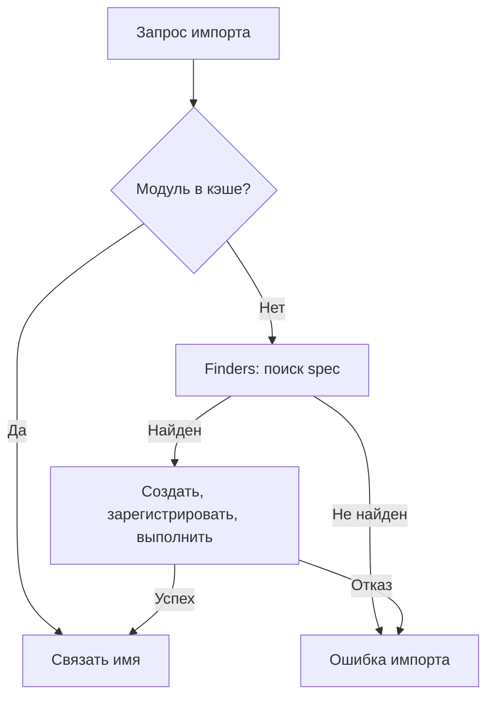

# 4. Модули и пакеты

Модули разделяют пространства имён и ответственность кода. Пакеты организуют иерархию импортов, а распространяемые дистрибутивы доставляют код, ресурсы, метаданные и команды пользователю. Эти три уровня связаны, но не совпадают: имя на PyPI не обязано быть именем в `import`, а успешный запуск исходников не доказывает корректность wheel.

Глава продолжает [«Функции»](03.%20functions.md) и сохраняет все 10 тем и 63 пункта README. Примеры ориентированы на Python 3.12–3.14; основная версия проверки — CPython 3.14.8. Упаковка описывается через актуальные спецификации PyPA и `pyproject.toml`. Изменения отдельных версий отмечены явно.

Небольшие Python-блоки являются самостоятельными экспериментами. Когда нужны файлы, они создаются во временном каталоге; дочерний Python запускается через `sys.executable`, чтобы не подменить интерпретатор случайной командой из PATH. Файлы сквозного проекта помечены своим путём и используются вместе. Команды публикации объясняют процесс, но для выполнения упражнений публикация не требуется.

**Содержание**

1. [Основы модулей](#module-basics)
2. [Специальный атрибут `__name__`](#module-name)
3. [Пакеты (Packages)](#packages)
4. [Стандартная библиотека (обзор ключевых модулей)](#standard-library)
5. [Внешние пакеты и PyPI](#pypi)
6. [Виртуальные окружения](#environments)
7. [Создание собственных пакетов](#creating-packages)
8. [Устройство распространяемого Python-пакета](#distribution-layout)
9. [Продвинутые темы](#advanced)
10. [Лучшие практики и частые ошибки](#best-practices)

<a id="module-basics"></a>

## Основы модулей

### Что такое модуль?

Модуль — объект с пространством имён и атрибутами, доступный через механизм импорта. Часто ему соответствует файл `.py`, но модуль может быть встроенным, замороженным, нативным расширением или загруженным нестандартным loader. Пакет тоже является модулем, у которого есть возможность искать подмодули через `__path__`.

```python
import math
import types

assert isinstance(math, types.ModuleType)
assert math.sqrt(9) == 3.0
assert math.__name__ == "math"
assert not hasattr(math, "__path__")

custom = types.ModuleType("custom_demo")
custom.answer = 42
assert custom.__dict__["answer"] == 42
```

Создание `ModuleType` само по себе не делает объект доступным любому последующему `import`: для этого нужны правила поиска или соответствующая регистрация. Обычно вручную создавать модули не нужно; пример показывает, что модуль — объект, а не исключительно файл.

Пространство имён модуля отделяет `billing.total` от `reporting.total`. Оно не является изоляцией безопасности: импортируемый код выполняется в процессе и может использовать его права. Глобальное состояние модуля разделяется потребителями того же объекта модуля в данном интерпретаторе.

### Создание модуля

Создай файл с допустимым именем, помести в него определения и импортируй его по имени без `.py`. Основная логика должна находиться в функциях и классах; действия верхнего уровня выполняются при загрузке модуля.

| Файл | Роль |
| --- | --- |
| `greeting_demo.py` | Функция формирования приветствия |
| `app.py` | Вход в приложение, использующий модуль |

Следующий эксперимент сам создаёт модуль и проверяет импорт:

```python
import subprocess
import sys
from pathlib import Path
from tempfile import TemporaryDirectory

with TemporaryDirectory() as directory:
    path = Path(directory) / "greeting_demo.py"
    path.write_text('def greet(name):\n    return f"Hello, {name}"\n', encoding="utf-8")
    result = subprocess.run(
        [
            sys.executable,
            "-c",
            "import greeting_demo; print(greeting_demo.greet('Alice'))",
        ],
        cwd=directory,
        capture_output=True,
        text=True,
        check=True,
    )
    assert result.stdout.strip() == "Hello, Alice"
    assert result.stderr == ""
```

Импорт не должен без необходимости запускать основную программу, открывать соединение, читать пользовательский файл и настраивать глобальное логирование. Константы и определения — ожидаемая работа верхнего уровня; сетевой запрос при простом `import` создаёт скрытую зависимость и затрудняет тесты, CLI и сборку документации.

Имя файла должно быть допустимым для обычной формы `import`: предпочитай `snake_case.py`, а не дефисы, пробелы и совпадения с популярными библиотеками. Имя дистрибутива с дефисом — другой уровень, разобранный ниже.

### Импорт модулей

`import module` связывает имя модуля, `from module import name` — выбранный объект из пространства имён. `as` задаёт локальный псевдоним и не переименовывает исходный модуль.

```python
import math
import math as mathematics
from math import sqrt as square_root

assert mathematics is math
assert square_root is math.sqrt
assert mathematics.__name__ == "math"
assert square_root(16) == 4.0

import xml.etree.ElementTree

assert xml.etree.ElementTree.fromstring("<root/>").tag == "root"
```

`import a.b.c` обычно связывает в локальной области верхнее имя `a` и загружает нужную цепочку. `import a.b.c as alias` даёт локальную ссылку на конечный модуль. Для динамического имени удобнее `importlib.import_module('a.b.c')`: он возвращает конечный модуль, в отличие от стандартного поведения прямого `__import__()` без `fromlist`.

`from module import value` не является живой связью с будущей перепривязкой `module.value`. Если импортирован изменяемый объект, его мутация видна через обе ссылки, но замена атрибута новым объектом не обновит ранее связанное локальное имя.

```python
import types

module = types.ModuleType("binding_demo")
module.items = []
bound = module.items
module.items.append(1)
assert bound == [1]
module.items = [2]
assert bound == [1]
assert module.items == [2]
```

В примере показана та же модель ссылок без изменения реального установленного модуля. При mutable-конфигурации `import settings` с доступом `settings.value` часто понятнее, чем копирование отдельных привязок через `from settings import value`.

Различай `ModuleNotFoundError` и произвольную ошибку внутри импортируемого кода. Если `import optional_library` не удался из-за отсутствующей транзитивной зависимости, это не означает, что отсутствует именно `optional_library`. Для ожидаемой необязательной зависимости проверяй `error.name` и не подавляй все ошибки импорта одной веткой fallback.

### Пути поиска модулей

Для импорта по полному имени сначала учитывается `sys.modules`, затем работают finders из `sys.meta_path`. Обычный path-based finder ищет верхнеуровневые имена по `sys.path`, а подмодули — по `package.__path__`. Поэтому утверждение «Python всегда просто читает папки из `sys.path`» неполно.

`sys.path` формируется при запуске с учётом способа запуска, настроек интерпретатора, стандартной библиотеки, окружения и обработки `site`. При обычном запуске файла в начале часто находится каталог файла, а при `-m` и `-c` — текущий каталог. Режимы `-P` и `-I` меняют это поведение.

```python
import subprocess
import sys
from pathlib import Path
from tempfile import TemporaryDirectory

with TemporaryDirectory() as directory:
    Path(directory, "local_probe.py").write_text("VALUE = 7\n", encoding="utf-8")
    normal = subprocess.run(
        [sys.executable, "-c", "import local_probe; print(local_probe.VALUE)"],
        cwd=directory,
        capture_output=True,
        text=True,
    )
    isolated = subprocess.run(
        [sys.executable, "-I", "-c", "import local_probe"],
        cwd=directory,
        capture_output=True,
        text=True,
    )
    assert normal.returncode == 0 and normal.stdout.strip() == "7"
    assert isolated.returncode != 0
    assert "ModuleNotFoundError" in isolated.stderr
```

`PYTHONPATH` добавляет пути, но глобальная настройка легко скрывает неправильную установку и влияет на другие проекты. В обычном приложении не исправляй структуру постоянным `sys.path.insert(0, '..')`: установи пакет в нужное окружение и запускай его через публичный вход.

`.pth`-файлы и site customization способны влиять на запуск; некоторые строки `.pth` выполняют код. `-I` игнорирует ряд переменных окружения и пользовательский site, но не означает запуск без стандартного системного `site` и всех установленных механизмов окружения. `-S` отключает автоматический импорт `site`, однако это другой режим, который может сломать установленные зависимости и editable-механизмы.

Для диагностики сначала посмотри `sys.executable`, `sys.path`, `module.__file__` при наличии и `module.__spec__.origin`. Импорт может прийти из другого checkout, текущего каталога, zip или старого окружения. Само имя модуля ещё не определяет источник.

### Кэширование модулей

`sys.modules` связывает полное имя с уже загруженным объектом. Повторный импорт того же имени обычно возвращает этот объект и не исполняет тело заново. Это кэш состояния модулей в интерпретаторе, а не каталог `.pyc` на диске.

```python
import importlib
import sys

first = importlib.import_module("fractions")
second = importlib.import_module("fractions")
assert first is second
assert sys.modules["fractions"] is first
```

`__pycache__` хранит байт-код, чтобы избежать части повторной компиляции при новых загрузках. Он не сохраняет значения глобальных списков между процессами и не заменяет `sys.modules`. `importlib.invalidate_caches()` уведомляет finders об изменении доступных модулей, но не перезагружает уже импортированный объект.

`reload()` повторно выполняет код существующего модуля. Старые ссылки на функции, классы и объекты не преобразуются автоматически в новые версии. Словарь модуля переиспользуется, поэтому имена, исчезнувшие из нового исходника, тоже могут остаться, если их явно не удалить.

```python
import importlib
import sys
from pathlib import Path
from tempfile import TemporaryDirectory

with TemporaryDirectory() as directory:
    source = Path(directory, "reload_probe.py")
    source.write_text("VALUE = 1\n", encoding="utf-8")
    sys.path.insert(0, directory)
    try:
        module = importlib.import_module("reload_probe")
        bound_value = module.VALUE
        source.write_text("VALUE = 200\n", encoding="utf-8")
        importlib.invalidate_caches()
        reloaded = importlib.reload(module)
        assert reloaded is module
        assert module.VALUE == 200
        assert bound_value == 1
    finally:
        sys.path.remove(directory)
        sys.modules.pop("reload_probe", None)
```

В эксперименте новый текст имеет другую длину, чтобы не зависеть от грубости временной метки `.pyc`. Удаление записи из `sys.modules` не уничтожает все внешние ссылки; последующий импорт может создать второй объект того же модуля. Это особенно опасно для классов, `isinstance`, singleton и реестров.

При первичной загрузке объект обычно появляется в `sys.modules` до выполнения тела, что позволяет обнаруживать циклы и даёт частично инициализированное состояние. Если выполнение упало, запись неуспешно загружаемого модуля удаляется, но успешно импортированные им зависимости могут остаться. Импорт не является транзакцией отката всех побочных эффектов.

**Документация:** [система импорта](https://docs.python.org/3.14/reference/import.html), [модули в tutorial](https://docs.python.org/3.14/tutorial/modules.html), [importlib](https://docs.python.org/3.14/library/importlib.html), [инициализация sys.path](https://docs.python.org/3.14/library/sys_path_init.html).

<a id="module-name"></a>

## Специальный атрибут `__name__`

### Что такое `__name__`?

`__name__` содержит имя, под которым выполняется модуль. При обычном импорте это полное имя, например `email.utils`; для верхнеуровневого входа программы — `'__main__'`. Это строковая метка роли модуля, а не имя текущего файла и не название установленного дистрибутива.

```python
import email.utils
import sys

assert email.utils.__name__ == "email.utils"
assert __name__ == "__main__"
assert sys.modules["__main__"].__dict__ is globals()
```

Последние две проверки относятся к самостоятельному запуску блока как программы. В notebook и других средах контекст исполнения может отличаться. `__file__` не обязателен для каждого модуля, а `__spec__` при запуске обычного файла обычно равен `None`. Для системы импорта особенно важен `ModuleSpec`, а не предположение, что все атрибуты выводятся из `__name__`.

### Конструкция if `__name__` == "`__main__`"

Условие позволяет отделить запуск сценария от определения API. При импорте выполняются определения и другой верхнеуровневый код, но тело этой ветки пропускается.

```python
import subprocess
import sys
from pathlib import Path
from tempfile import TemporaryDirectory

source = """def main():
    print("started")
    return 0

if __name__ == "__main__":
    raise SystemExit(main())
"""
with TemporaryDirectory() as directory:
    path = Path(directory, "entry_demo.py")
    path.write_text(source, encoding="utf-8")
    imported = subprocess.run(
        [sys.executable, "-c", "import entry_demo"],
        cwd=directory,
        capture_output=True,
        text=True,
        check=True,
    )
    executed = subprocess.run(
        [sys.executable, str(path)],
        capture_output=True,
        text=True,
        check=True,
    )
    assert imported.stdout == "" and imported.stderr == ""
    assert executed.stdout.strip() == "started"
```

`raise SystemExit(main())` связывает целый результат с кодом завершения процесса. `main()` удобно принимать `argv: list[str] | None`, чтобы тест не менял глобальный `sys.argv`. Не возвращай строку из `main`, если ожидается успех: для `SystemExit` строка является сообщением об ошибке, а не обычным stdout.

Проверка имени не спасает от других побочных эффектов выше неё. Она также не выполняет роль sandbox и не делает импорт дешёвым сама по себе.

### Практические примеры использования `__name__`

Используй `__name__` как имя logger (`logging.getLogger(__name__)`), как диагностическое имя модуля и для явного входа программы. Для публичной версии дистрибутива используй метаданные, а не это значение.

```python
import logging

logger = logging.getLogger(__name__)
assert logger.name == __name__
```

Библиотека обычно не вызывает `logging.basicConfig()` при импорте. Настройка handler и уровня принадлежит приложению; это позволяет одному пакету работать в CLI, notebook и сервисе без захвата общей конфигурации.

Для воспроизводимого эксперимента лучше отдельная функция `demo()` или тест, чем большой неструктурированный блок под `if`. Публичный CLI, тестируемое `main()` и внутренняя библиотека должны использовать один основной алгоритм, чтобы два способа запуска не расходились по логике.

### Особенности `__name__` в пакетах (`__name__` при запуске через -m)

`python -m package.module` ищет модуль через систему импорта и исполняет его как верхнеуровневый вход. Его `__name__` становится `'__main__'`, но `__spec__.name` сохраняет полное импортируемое имя, а пакетный контекст позволяет относительные импорты.

```python
import json
import subprocess
import sys
from pathlib import Path
from tempfile import TemporaryDirectory

with TemporaryDirectory() as directory:
    package = Path(directory, "launch_demo")
    package.mkdir()
    package.joinpath("__init__.py").write_text("", encoding="utf-8")
    package.joinpath("helper.py").write_text("VALUE = 7\n", encoding="utf-8")
    package.joinpath("__main__.py").write_text(
        "import json\nfrom .helper import VALUE\n"
        "print(json.dumps([__name__, __package__, __spec__.name, VALUE]))\n",
        encoding="utf-8",
    )
    result = subprocess.run(
        [sys.executable, "-m", "launch_demo"],
        cwd=directory,
        capture_output=True,
        text=True,
        check=True,
    )
    assert json.loads(result.stdout) == [
        "__main__",
        "launch_demo",
        "launch_demo.__main__",
        7,
    ]
```

`python path/to/package/module.py` запускает файл с другим контекстом и обычно ломает `from .helper import ...`, потому что родительский пакет неизвестен. Правильный вход для установленного приложения — `python -m package` или установленная CLI-команда, а не правка `sys.path` внутри каждого файла.

Модуль, исполняемый как `__main__`, и последующий импорт того же файла под обычным именем могут дать разные объекты состояния. Если CLI-модуль определяет доменные классы и затем сам себя импортирует, возникают особенно неприятные несовпадения типов. Держи вход тонким, а повторно используемые модели — в обычных импортируемых модулях. Родительский `__init__.py` тоже не должен заранее импортировать исполняемый подмодуль без необходимости.

**Документация:** [__main__](https://docs.python.org/3.14/library/__main__.html), [запуск через -m](https://docs.python.org/3.14/using/cmdline.html#cmdoption-m), [runpy](https://docs.python.org/3.14/library/runpy.html).

<a id="packages"></a>

## Пакеты (Packages)

### Что такое пакет?

Пакет — модуль, который задаёт пространство для подмодулей. Обычный пакет часто представлен каталогом с `__init__.py`. Namespace package позволяет объединять части пространства имён без такого файла на соответствующем уровне; он разобран отдельно в продвинутой теме.

Имя `acme.analytics.reader` описывает иерархию импортов, а не обязательно один фиксированный путь на диске. Пакет может приходить из zip или нескольких установленных дистрибутивов. Папка с данными сама по себе не обязана быть Python-пакетом.

```python
import email
import email.utils
import sys

assert hasattr(email, "__path__")
assert email.utils.__package__ == "email"
assert email.utils is sys.modules["email.utils"]
```

Слишком глубокая иерархия не делает архитектуру лучше автоматически. Группируй код по ответственности и направлению зависимостей, чтобы `core` не зависел от CLI, а модели не импортировали конкретные обработчики инфраструктуры.

### Структура пакета

Небольшой пакет может иметь такую структуру:

| Путь | Назначение |
| --- | --- |
| `sample_app/__init__.py` | Узкий публичный API пакета |
| `sample_app/core.py` | Основные вычисления |
| `sample_app/io.py` | Адаптеры внешнего ввода-вывода |
| `sample_app/cli.py` | Аргументы командной строки и коды завершения |
| `sample_app/__main__.py` | Делегирование запуска CLI |
| `tests/test_core.py` | Проверки поведения |

Это пример ответственности, не обязательный шаблон для каждого проекта. Модуль `io.py` внутри `sample_app` не является верхнеуровневой заменой стандартного `io`, если используется по полному имени; при небрежном запуске отдельных файлов структура поиска всё равно может создать конфликты.

Для распространяемого проекта этот каталог часто помещают в `src/`, а `pyproject.toml`, документацию и тесты оставляют в корне репозитория. Не смешивай каталог проекта, import package и директорию установленного `.dist-info`.

### Файл `__init__`.py

Для обычного файлового пакета `__init__.py` выполняется при загрузке соответствующего пакета. Он может быть пустым. Его задача — инициализировать пространство пакета и при необходимости определить аккуратный публичный фасад.

```python
import subprocess
import sys
from pathlib import Path
from tempfile import TemporaryDirectory

with TemporaryDirectory() as directory:
    package = Path(directory, "facade_demo")
    package.mkdir()
    package.joinpath("core.py").write_text(
        "def double(value):\n    return value * 2\n", encoding="utf-8"
    )
    package.joinpath("__init__.py").write_text(
        'from .core import double\n__all__ = ["double"]\n', encoding="utf-8"
    )
    result = subprocess.run(
        [sys.executable, "-c", "from facade_demo import double; print(double(3))"],
        cwd=directory,
        capture_output=True,
        text=True,
        check=True,
    )
    assert result.stdout.strip() == "6"
```

Реэкспорт сокращает путь пользователя до `from facade_demo import double`, но связывает загрузку пакета с `core`. Если реэкспортировать всё, простой импорт начнёт загружать тяжёлые необязательные зависимости и увеличит риск циклов. Публичный фасад должен быть намеренным.

Модульный `__getattr__` может использоваться для отложенного экспорта, однако меняет момент возникновения ошибок и требует аккуратной типизации и диагностики. Он не является обязательной оптимизацией. Сначала измерь стоимость импорта и проверь направление зависимостей.

### Импорт из пакетов

Абсолютный импорт начинается с верхнеуровневого имени: `from sample_app.core import calculate`. Относительный использует текущий пакетный контекст: `from .core import calculate`, `from ..models import Record`.

Одна точка означает текущий пакет, две — родительский. Это иерархия пакетов, не файловая команда `../`. Нельзя перейти выше верхнего уровня. В Python 3 `import core` внутри пакета не означает автоматически импорт соседнего `core.py`.

```python
from importlib.util import resolve_name

assert resolve_name(".core", "sample_app") == "sample_app.core"
assert resolve_name("..models", "sample_app.adapters") == "sample_app.models"
try:
    resolve_name("..core", "sample_app")
except ImportError:
    pass
else:
    raise AssertionError("Нельзя выйти выше верхнего пакета")
```

Выбирай последовательное правило проекта: абсолютные импорты яснее показывают границу пакета, относительные удобны для внутренних соседних модулей. Неправильный вход через запуск файла не следует компенсировать fallback-импортами вроде `try: from .x ... except: from x ...`: они могут незаметно загрузить другой объект.

`from package import name` может получать уже существующий атрибут пакета или инициировать загрузку подмодуля. Не создавай намеренных конфликтов, когда одно имя одновременно является важной функцией фасада и подмодулем с другим смыслом.

### Выполнение пакета как скрипта (`__main__`.py)

`python -m sample_app` выполняет `sample_app.__main__`. Этот файл лучше оставить тонким: импортировать `main` из обычного CLI-модуля и завершить процесс его кодом.

Обычное содержимое `sample_app/__main__.py` — импорт `from .cli import main` и вызов `raise SystemExit(main())`. Полный рабочий файл вместе с CLI приведён в сквозном проекте ниже. Проверку `if __name__ == '__main__'` можно оставить для защиты от побочного запуска при явном импорте этого модуля.

Консольный entry point из `[project.scripts]` может обращаться к той же функции `sample_app.cli:main`. Тогда `python -m sample_app` и `sample-app` используют один код разбора аргументов и ошибок. Наличие `__main__.py` не устанавливает CLI-команду автоматически: её создаёт установщик по метаданным дистрибутива.

**Самопроверка:** объясни, какие объекты и файлы участвуют в `python -m sample_app`, какие импорты выполняются прежде CLI и почему нельзя считать запуск `src/sample_app/cli.py` эквивалентным.

**Документация:** [пакеты и относительные импорты](https://docs.python.org/3.14/tutorial/modules.html#packages), [package semantics](https://docs.python.org/3.14/reference/import.html#packages), [__main__ в пакетах](https://docs.python.org/3.14/library/__main__.html#main-py-in-python-packages).

<a id="standard-library"></a>

## Стандартная библиотека (обзор ключевых модулей)

### Работа с операционной системой

| Модуль | Основная роль | Важная граница |
| --- | --- | --- |
| `pathlib` | Пути и файловые операции | Путь не доказывает существование или разрешение доступа |
| `os` | Окружение, дескрипторы, системные операции | Поведение части API зависит от ОС |
| `sys` | Интерпретатор, аргументы, потоки, пути импорта | Это состояние текущего процесса |
| `shutil` | Копирование, перенос, удаление, архивы | Операции могут частично выполниться до ошибки |
| `tempfile` | Временные файлы и каталоги | Управляй временем жизни через контекст |
| `subprocess` | Запуск программ | Аргументы и shell-команда имеют разные правила |
| `platform` | Описание платформы | Не подменяет проверку наличия конкретной возможности |

```python
import subprocess
import sys
from pathlib import Path
from tempfile import TemporaryDirectory

with TemporaryDirectory() as directory:
    path = Path(directory) / "данные.txt"
    path.write_text("alpha\nbeta\n", encoding="utf-8")
    assert path.read_text(encoding="utf-8").splitlines() == ["alpha", "beta"]
    result = subprocess.run(
        [sys.executable, "-X", "utf8", "-c", "print('готово')"],
        capture_output=True,
        text=True,
        encoding="utf-8",
        timeout=5,
        check=True,
    )
    assert result.stdout.strip() == "готово"
```

Передавай аргументы отдельным списком без `shell=True`, если shell-функции не нужны. Для внешнего процесса задай рабочий каталог, кодировку, лимит ожидания и политику stdout/stderr. `capture_output=True` на огромном выводе требует память; для потока направляй данные в файл или обрабатывай с контролем буферов.

Проверка `exists()` перед `open()` не гарантирует успешный доступ: состояние может измениться. Обычно открывай и обрабатывай конкретный `OSError`. Для окружения используй явные настройки и не печатай весь `os.environ` в диагностике. Изменение текущего каталога через `os.chdir()` влияет на весь процесс, поэтому библиотека не должна делать это незаметно.

**Документация:** [pathlib](https://docs.python.org/3.14/library/pathlib.html), [os](https://docs.python.org/3.14/library/os.html), [subprocess](https://docs.python.org/3.14/library/subprocess.html), [tempfile](https://docs.python.org/3.14/library/tempfile.html).

### Работа с данными

| Формат/задача | Модуль | Что учитывать |
| --- | --- | --- |
| JSON | `json` | Типы ограничены форматом; по умолчанию есть нестрогие расширения для чисел |
| CSV | `csv` | Диалект, разделитель, кавычки и `newline=''` при работе с файлом |
| TOML | `tomllib` | Чтение с Python 3.11; стандартного writer в этом модуле нет |
| INI | `configparser` | Интерполяция и строковая природа настроек |
| Встроенная БД | `sqlite3` | Параметры SQL, транзакции, блокировки |
| Объекты Python | `pickle` | Загрузка недоверенных данных может выполнить код |
| Двоичная структура | `struct` | Порядок байтов, размер и выравнивание |
| Base64 | `base64` | Кодирование, не шифрование |
| Десятичные числа | `decimal` | Контекст и правила округления |

```python
import csv
import io
import json
import sqlite3
import tomllib

assert json.loads('{"active": true, "count": 2}') == {"active": True, "count": 2}
try:
    json.dumps({"value": float("nan")}, allow_nan=False)
except ValueError:
    pass

rows = list(csv.DictReader(io.StringIO('id,name\n1,"Alice, A."\n')))
assert rows == [{"id": "1", "name": "Alice, A."}]
assert tomllib.loads("[app]\nretries = 3\n")["app"]["retries"] == 3

connection = sqlite3.connect(":memory:")
try:
    connection.execute("CREATE TABLE users (id INTEGER, name TEXT)")
    connection.execute("INSERT INTO users VALUES (?, ?)", (1, "Alice"))
    assert connection.execute(
        "SELECT name FROM users WHERE id = ?", (1,)
    ).fetchone() == ("Alice",)
finally:
    connection.close()
```

`csv` возвращает строки и не выводит числовую схему автоматически. JSON parser не проверяет бизнес-поля и может молча оставить последнее значение повторённого ключа, если не задана другая политика. Контекст `with connection:` у `sqlite3` управляет транзакцией, но не заменяет явное закрытие соединения.

Для внешних данных выбери предел размера, схему, обработку ошибок и кодировку. Не используй `pickle.loads()` как удобный аналог JSON для недоверенного входа. Конфиг тоже является внешними данными: корректный TOML ещё не означает допустимое значение тайм-аута.

**Документация:** [json](https://docs.python.org/3.14/library/json.html), [csv](https://docs.python.org/3.14/library/csv.html), [tomllib](https://docs.python.org/3.14/library/tomllib.html), [sqlite3](https://docs.python.org/3.14/library/sqlite3.html), [pickle](https://docs.python.org/3.14/library/pickle.html).

### Математика и случайности

`math` предоставляет вещественные математические операции, `cmath` — комплексные, `statistics` — базовые статистики, `fractions` и `decimal` — другие числовые модели. `random` подходит для моделирования, а `secrets` — для случайных токенов и подобных задач безопасности.

```python
import math
import random
import secrets
import statistics
from decimal import Decimal
from fractions import Fraction

assert math.isclose(0.1 + 0.2, 0.3)
assert statistics.mean([1, 2, 3]) == 2
assert Decimal("0.1") + Decimal("0.2") == Decimal("0.3")
assert Fraction(1, 3) * 3 == 1

first = random.Random(42)
second = random.Random(42)
assert [first.random() for _ in range(3)] == [second.random() for _ in range(3)]
token = secrets.token_hex(16)
assert len(token) == 32
assert all(char in "0123456789abcdef" for char in token)
```

Отдельный `Random(seed)` не меняет глобальный генератор другого кода. Seed полезен для воспроизводимого эксперимента, но полную воспроизводимость между произвольными версиями, алгоритмами библиотек и порядком параллельных задач нужно проверять отдельно. Не фиксируй seed для защитного токена и не используй `random` как криптографический генератор.

Численная корректность, `NaN`, бесконечности и округление подробно разобраны во второй главе. Импорт `math` не устраняет ограничения `float`, а `statistics` не определяет автоматически политику пропусков в твоём датасете.

**Документация:** [math](https://docs.python.org/3.14/library/math.html), [statistics](https://docs.python.org/3.14/library/statistics.html), [random](https://docs.python.org/3.14/library/random.html), [secrets](https://docs.python.org/3.14/library/secrets.html).

### Дата и время

Разделяй календарное время и длительность. Для сохранённых моментов обычно нужен timezone-aware `datetime` с явным UTC или зоной. Для измерения времени выполнения — монотонный счётчик. `time.time()` может отражать коррекцию календарных часов и не является идеальным секундомером.

```python
from datetime import UTC, datetime, timedelta
from time import monotonic, perf_counter

instant = datetime(2026, 10, 17, 12, 0, tzinfo=UTC)
assert instant.isoformat() == "2026-10-17T12:00:00+00:00"
assert instant + timedelta(hours=2) == datetime(2026, 10, 17, 14, 0, tzinfo=UTC)
assert datetime.fromisoformat(instant.isoformat()) == instant

started = perf_counter()
assert perf_counter() - started >= 0
mark = monotonic()
assert monotonic() >= mark
```

`zoneinfo.ZoneInfo` работает с базой часовых зон IANA. Доступность базы зависит от системы; на некоторых платформах нужна отдельно установленная `tzdata`, поэтому она может быть runtime-зависимостью приложения, хотя сам `zoneinfo` находится в стандартной библиотеке.

Naive `datetime` не содержит полного контекста часовой зоны. Переходы DST создают неоднозначные и отсутствующие локальные времена; одного `replace(tzinfo=...)` недостаточно, чтобы обосновать семантику внешнего расписания. Для форматов укажи допустимость `Z`, смещения, долей секунды и точность хранения. Не привязывай тест к текущей дате, если он проверяет правило преобразования.

**Документация:** [datetime](https://docs.python.org/3.14/library/datetime.html), [zoneinfo](https://docs.python.org/3.14/library/zoneinfo.html), [time](https://docs.python.org/3.14/library/time.html).

### Коллекции и итераторы

`collections` добавляет `Counter`, `defaultdict`, `deque`, `ChainMap` и другие структуры. `itertools` строит ленивые цепочки, `functools` — адаптеры и кэши функций, `heapq` — приоритетные очереди и top-k, `bisect` — поиск места в отсортированной последовательности.

```python
from bisect import bisect_left
from collections import Counter, defaultdict, deque
from heapq import nlargest
from itertools import chain, pairwise

assert Counter("aaba")["a"] == 3
groups = defaultdict(list)
groups["python"].append("Alice")
assert groups["python"] == ["Alice"]

queue = deque([1, 2])
queue.append(3)
assert queue.popleft() == 1
assert list(chain.from_iterable([[1, 2], [3]])) == [1, 2, 3]
assert list(pairwise([1, 4, 9])) == [(1, 4), (4, 9)]
assert nlargest(2, [3, 1, 8, 4]) == [8, 4]
assert bisect_left([1, 3, 3, 5], 3) == 1
```

Ленивость не отменяет буферизацию `tee`, сохранение входа `cycle` и комбинаторный размер `product`. `bisect` быстро находит позицию, но вставка в середину обычного списка всё ещё требует сдвигов. `deque` полезен для концов очереди, но не является универсальной заменой индексов списка.

Проверяй цену всего алгоритма, включая создание вспомогательной структуры. Для поиска одного элемента иногда не стоит строить множество, а для тысяч повторных проверок это может изменить сложность всего процесса.

**Документация:** [collections](https://docs.python.org/3.14/library/collections.html), [itertools](https://docs.python.org/3.14/library/itertools.html), [heapq](https://docs.python.org/3.14/library/heapq.html), [bisect](https://docs.python.org/3.14/library/bisect.html).

### Работа в интернете

| Уровень | Модули | Что они не решают автоматически |
| --- | --- | --- |
| URL и кодирование параметров | `urllib.parse` | Не выполняют запрос и не подтверждают доверенность адреса |
| Базовый HTTP-клиент | `urllib.request`, `http.client` | Не задают все прикладные retries и deadlines |
| TCP/UDP | `socket` | Не определяют протокол приложения |
| TLS | `ssl` | Требует корректной проверки сертификата и hostname |
| IP-адреса | `ipaddress` | Не заменяет политику доступа и DNS-проверки |
| Асинхронное I/O | `asyncio` | Не превращает синхронный клиент в неблокирующий |
| Простой HTTP-сервер | `http.server` | Не является готовым production application server |

```python
from ipaddress import ip_address, ip_network
from urllib.parse import parse_qs, urlencode, urlsplit

query = urlencode({"q": "python модули", "page": 2})
assert parse_qs(query) == {"q": ["python модули"], "page": ["2"]}
parts = urlsplit("https://example.test:8443/docs?q=python")
assert parts.hostname == "example.test"
assert parts.port == 8443
assert ip_address("192.0.2.10") in ip_network("192.0.2.0/24")
```

Пример не делает сетевой запрос и не зависит от внешнего сервиса. Для настоящего запроса задай timeout, проверку статуса, лимит тела, жизненный цикл ответа и обработку декодирования. Параметр socket timeout не обязательно равен общему deadline операции с несколькими этапами.

Сборка URL строковой конкатенацией может неправильно обработать специальные символы. Не отключай проверку TLS ради «починки» импорта или запроса. Для сложного HTTP-клиента сторонняя библиотека может быть удобнее, но выбор требует отдельного контракта соединений и повторных попыток.

**Документация:** [urllib](https://docs.python.org/3.14/library/urllib.html), [socket](https://docs.python.org/3.14/library/socket.html), [ssl](https://docs.python.org/3.14/library/ssl.html), [ipaddress](https://docs.python.org/3.14/library/ipaddress.html).

### Архивация и сжатие

Архив объединяет файлы, сжатие уменьшает представление данных; это разные задачи. `zipfile` и `tarfile` работают с архивами, `gzip`, `bz2`, `lzma`, `zlib` — с соответствующими способами сжатия. Не каждый wheel или zip можно корректно запустить как zipapp.

```python
import gzip
import io
import tarfile
import zipfile
from pathlib import Path
from tempfile import TemporaryDirectory

payload = "Привет, Python".encode("utf-8")
assert gzip.decompress(gzip.compress(payload, mtime=0)) == payload

with TemporaryDirectory() as directory:
    archive = Path(directory, "data.zip")
    with zipfile.ZipFile(archive, "w", compression=zipfile.ZIP_DEFLATED) as output:
        output.writestr("message.txt", payload)
    with zipfile.ZipFile(archive) as source:
        assert source.read("message.txt") == payload

    tar_path = Path(directory, "data.tar")
    with tarfile.open(tar_path, "w") as output:
        info = tarfile.TarInfo("message.txt")
        info.size = len(payload)
        output.addfile(info, io.BytesIO(payload))
    target = Path(directory, "unpacked")
    target.mkdir()
    with tarfile.open(tar_path) as source:
        source.extractall(target, filter="data")
    assert target.joinpath("message.txt").read_bytes() == payload
```

`filter='data'` доступен в базовой для главы версии 3.12; в 3.14 изменён default извлечения tar. Для переносимости политика указана явно. Фильтр не заменяет лимиты числа файлов, суммарного распакованного размера и дискового пространства. Для входного архива от внешнего пользователя также проверь симлинки, пути и разрешённый состав.

Python 3.14 добавляет стандартный модуль `compression.zstd` и связанные возможности Zstandard; доступность конкретного нативного компонента зависит от сборки. Формат и поддержку нужно сверять на целевой версии, особенно если архивы передаются между разными средами.

Сжатый размер не определяет размер распакованных данных. Для потоков большого объёма используй ограниченное чтение и контролируй выход. Сжатие и Base64 не обеспечивают конфиденциальность и подлинность.

**Документация:** [zipfile](https://docs.python.org/3.14/library/zipfile.html), [tarfile и extraction filters](https://docs.python.org/3.14/library/tarfile.html#extraction-filters), [gzip](https://docs.python.org/3.14/library/gzip.html), [compression.zstd](https://docs.python.org/3.14/library/compression.zstd.html).

### Прочее полезное

| Модуль | Практическое применение |
| --- | --- |
| `argparse` | CLI, help, преобразование и обязательность аргументов |
| `logging` | Сообщения по уровням и handler приложения |
| `re` | Поиск и проверка ограниченных текстовых форматов |
| `dataclasses`, `enum` | Модели значений и именованные варианты |
| `typing`, `collections.abc` | Статические типы и интерфейсы |
| `contextlib` | Управление ресурсами и композиция контекстов |
| `hashlib`, `hmac` | Дайджесты и проверка аутентичности по ключу |
| `uuid` | Стандартизованные идентификаторы |
| `unittest`, `unittest.mock` | Тесты и подмена зависимостей |
| `doctest` | Проверка примеров в документации |
| `inspect`, `dis`, `ast` | Интроспекция и анализ кода |
| `timeit`, `cProfile`, `tracemalloc` | Измерение времени, профилирование и память |
| `importlib.resources`, `importlib.metadata` | Ресурсы и установленные метаданные |

```python
import argparse
import hashlib
import hmac
import re
from contextlib import ExitStack
from io import StringIO

assert re.fullmatch(r"[A-Z]{2}-[0-9]{3}", "AB-123")
assert not re.fullmatch(r"[A-Z]{2}-[0-9]{3}", "AB-123 extra")
digest = hashlib.sha256(b"hello").hexdigest()
assert len(digest) == 64
assert hmac.compare_digest(digest, hashlib.sha256(b"hello").hexdigest())

parser = argparse.ArgumentParser()
parser.add_argument("--count", type=int, default=1)
assert parser.parse_args(["--count", "3"]).count == 3

with ExitStack() as stack:
    first = stack.enter_context(StringIO("a"))
    second = stack.enter_context(StringIO("b"))
    assert first.read() + second.read() == "ab"
assert first.closed and second.closed
```

Хеш без секрета не аутентифицирует отправителя; для MAC нужен ключ и подходящий алгоритм. UUID не является автоматически токеном доступа. Регулярное выражение не заменяет parser вложенного формата и может иметь дорогие худшие случаи на неудачном входе.

Не нужно заучивать все модули. Нужно уметь найти стандартное решение и проверить его ограничения до добавления зависимости. Стандартная библиотека тоже меняется: например, `distutils` удалён из неё начиная с Python 3.12; старые инструкции сборки требуют пересмотра.

**Документация:** [индекс стандартной библиотеки](https://docs.python.org/3.14/library/index.html), [argparse](https://docs.python.org/3.14/library/argparse.html), [contextlib](https://docs.python.org/3.14/library/contextlib.html), [hashlib](https://docs.python.org/3.14/library/hashlib.html), [logging](https://docs.python.org/3.14/library/logging.html).

<a id="pypi"></a>

## Внешние пакеты и PyPI

### Что такое PyPI (Python Package Index)?

PyPI — индекс проектов и опубликованных файлов дистрибутивов. Установщик получает из него подходящие артефакты с учётом версии Python, платформы, ограничений зависимостей и доступных форматов. PyPI не является встроенной частью механизма `import`: обычный импорт сам не скачивает отсутствующую библиотеку.

Различай проект в индексе, релиз с версией, файлы этого релиза и установку в конкретное окружение. Один релиз может содержать sdist и несколько wheel для разных платформ. Совпадение имени проекта с известным словом не доказывает происхождение и пригодность пакета.

Имя дистрибутива нормализуется: регистр и последовательности `-`, `_`, `.` учитываются по правилам сравнения имён. Это не означает, что `import my-project` становится допустимым синтаксисом. Дистрибутив `beautifulsoup4`, например, предоставляет import package `bs4`; установленное имя и импортируемое имя связаны метаданными, а не универсальной заменой дефисов.

TestPyPI — отдельный индекс для проверки публикации. Его учётные записи, проекты и набор зависимостей отделены от основного PyPI. Имя учебного проекта из главы не объявляется свободным для регистрации; для своего опубликованного проекта выбирается собственное доступное имя.

**Документация:** [PyPI](https://pypi.org/), [процесс упаковки](https://packaging.python.org/en/latest/flow/), [имена и нормализация](https://packaging.python.org/en/latest/specifications/name-normalization/), [TestPyPI](https://packaging.python.org/en/latest/guides/using-testpypi/).

### Менеджер пакетов pip

`pip` устанавливает и удаляет дистрибутивы в выбранном Python-окружении. Он не является самим интерпретатором и не обязан использовать тот Python, который запускается соседней командой. Форма `python -m pip` явно связывает установщик с интерпретатором.

Основные команды внутри активного виртуального окружения:

```bash
python -m pip --version
python -m pip install httpx
python -m pip show httpx
python -m pip list
python -m pip check
python -m pip uninstall httpx
```

| Команда | Что проверяет/делает | Что не гарантирует |
| --- | --- | --- |
| `pip show` | Установленные метаданные и расположение | Работоспособность всех импортов |
| `pip list` | Набор видимых дистрибутивов | Полный контракт приложения |
| `pip check` | Совместимость объявленных установленных зависимостей | ABI, внешние библиотеки и неописанные зависимости |
| `pip freeze` | Представление установленных зависимостей | Полноценный переносимый lock с хешами |
| `pip install --upgrade` | Обновление в рамках действующих ограничений | Сохранение поведения без проверки |

Для диагностики сравни `sys.executable` с `python -m pip --version`. Ошибка «пакет установлен, но не импортируется» часто связана с другим интерпретатором, venv, kernel notebook, import name или локальным файлом, который перекрывает библиотеку.

Resolver анализирует объявленные зависимости и может делать backtracking, выбирая совместимые версии. Он не знает скрытых требований к системной библиотеке и корректности твоего кода. Локальная установка исходника может запускать build backend, поэтому установка — не просто распаковка без исполнения кода. Wheel уменьшает потребность в локальной сборке, но установленный код всё равно остаётся исполняемым.

Не устанавливай пакет автоматически из обработчика `ImportError` внутри библиотеки: это скрытая сетевая операция и изменение окружения во время работы. Объяви зависимость в метаданных либо предоставь понятное сообщение о нужном extra.

**Документация:** [pip user guide](https://pip.pypa.io/en/stable/user_guide/), [pip install](https://pip.pypa.io/en/stable/cli/pip_install/), [dependency resolution](https://pip.pypa.io/en/stable/topics/dependency-resolution/).

### Файл requirements.txt

Requirements-файл задаёт входные требования для установщика. Он может содержать версии, extras, markers, ссылки на другие файлы и параметры pip. Это не обязательное стандартное имя для всех проектов: `requirements-dev.txt` и другие имена выбираются процессом команды.

Пример `requirements.in` для приложения:

```text
httpx>=0.27,<1
colorama>=0.4; sys_platform == "win32"
```

Эта запись оставляет resolver выбор конкретных версий и всех транзитивных зависимостей. Расширение `.in` часто используется инструментами компиляции требований, но само по себе не придаёт файлу специальной семантики для Python.

```bash
python -m pip install -r requirements.in
python -m pip freeze > requirements.snapshot.txt
```

Снимок полезен для диагностики уже созданного окружения, но не фиксирует автоматически платформенные wheel, хеши всех файлов, алгоритм разрешения и build-зависимости. Он может содержать случайно установленные инструменты разработки и локальные пути. Не объявляй его достаточным доказательством воспроизводимости.

Для библиотеки runtime-требования объявляй в `[project.dependencies]`, а не только в requirements-файле репозитория: иначе пользователь wheel не получит нужные зависимости. Для приложения можно иметь и метаданные проекта, и отдельный разрешённый набор для развёртывания, но источник истины и процесс обновления должны быть понятны.

Constraints-файл, переданный через `-c`, ограничивает допустимые версии, но сам не требует установки каждого перечисленного пакета. `-r` перечисляет требования к установке. Не используй constraints как скрытую замену объявления runtime-зависимости библиотеки.

**Документация:** [requirements file format](https://pip.pypa.io/en/stable/reference/requirements-file-format/), [constraints](https://pip.pypa.io/en/stable/user_guide/#constraints-files), [install_requires vs requirements](https://packaging.python.org/en/latest/discussions/install-requires-vs-requirements/).

### Разрешение зависимостей и воспроизводимость окружения

Для воспроизводимости нужно знать не только прямые зависимости, но и выбранные транзитивные версии, Python, ОС/архитектуру, источники артефактов и правила сборки. Даже одинаковые версии могут давать разные файлы wheel на разных платформах.

| Уровень | Что фиксирует |
| --- | --- |
| `[project.dependencies]` | Допустимые требования публичного пакета |
| Constraints | Дополнительные ограничения выбора в конкретной установке |
| Разрешённый lock | Конкретное решение графа для указанных условий |
| Хеши артефактов | Какие именно файлы разрешено установить |
| Wheelhouse/внутренний индекс | Доступность выбранных файлов независимо от внешней сети |
| Зафиксированная build-среда | Инструменты и зависимости создания собственных артефактов |
| CI-матрица и smoke tests | Проверенное поведение на поддерживаемых средах |

PEP 508 markers задают условия вроде `python_version < '3.13'`, `sys_platform == 'win32'` и `platform_machine`. `python_version` описывает major/minor, а для patch-уровня есть `python_full_version`. Markers относятся к фактической целевой среде, которую учитывает инструмент; они не заменяют явную проверку всех поддерживаемых конфигураций.

Extras описывают дополнительные возможности: `package[feature]` добавляет зависимости, но не создаёт отдельную независимую установку основного пакета. Dependency groups служат внутренним наборам проекта, например lint/test, и не являются автоматически публичными extras установленного wheel.

Современная спецификация `pylock.toml` стандартизует формат lock-файлов. Это не означает, что каждый менеджер уже одинаково читает, пишет и применяет все его возможности. `uv.lock`, lock Poetry и скомпилированный pip-tools requirements имеют собственные процессы и ограничения. Выбирай инструмент вместе с проверенным сценарием обновления и установки, а не по одному расширению файла.

Для строгого развёртывания в стиле pip можно подготовить полностью pinned requirements с хешами и локальные артефакты:

```bash
python -m pip download --require-hashes --only-binary=:all: -r requirements.lock.txt -d wheelhouse
python -m pip install --no-index --find-links=wheelhouse --require-hashes -r requirements.lock.txt
python -m pip check
```

Команды предполагают заранее сгенерированный корректный `requirements.lock.txt`, где перечислены все требуемые зависимости с точными версиями и допустимыми хешами. Нельзя просто переименовать предыдущий диапазонный файл. `--only-binary=:all:` намеренно запрещает sdist; при отсутствии совместимого wheel загрузка должна завершиться отказом, а не незаметной сборкой из исходников.

Хеши подтверждают соответствие выбранному файлу, но не отсутствие уязвимости и не корректность выбранной зависимости. Build-зависимости изолированной сборки — отдельный граф: обычный runtime-lock не всегда управляет им. Фиксируй backend и применяй поддерживаемые build constraints либо готовые проверенные wheel в соответствии с процессом проекта.

Не считай `--extra-index-url` строгим приоритетом доверенного репозитория: кандидаты могут выбираться из нескольких источников, что связано с dependency confusion. Для приватных имён нужен явный процесс доверенных индексов, зеркал и версий. Не помещай токены индекса в коммитируемые файлы и вывод диагностики.

Воспроизводимость установки, воспроизводимость сборки и побитовая идентичность результата — разные цели. Для последней дополнительно важны временные метки, компилятор, platform toolchain, порядок файлов и другие источники недетерминированности.

**Документация:** [повторяемые установки](https://pip.pypa.io/en/stable/topics/repeatable-installs/), [защищённые установки с хешами](https://pip.pypa.io/en/stable/topics/secure-installs/), [dependency specifiers](https://packaging.python.org/en/latest/specifications/dependency-specifiers/), [dependency groups](https://packaging.python.org/en/latest/specifications/dependency-groups/), [pylock.toml](https://packaging.python.org/en/latest/specifications/pylock-toml/).

<a id="environments"></a>

## Виртуальные окружения

### Зачем нужны виртуальные окружения

Виртуальное окружение задаёт отдельное место установки Python-дистрибутивов и свои точки запуска. Оно позволяет двум проектам использовать разные версии одной зависимости и не смешивать их с системным Python.

Это не контейнер и не граница безопасности: окружение использует возможности ОС и значительную часть базового Python, имеет доступ к файлам пользователя и может зависеть от внешних системных библиотек. `venv` также не выбирает автоматически правильную версию самого интерпретатора: она определяется Python, которым окружение создано.

```python
import sys

in_venv = sys.prefix != sys.base_prefix
assert isinstance(in_venv, bool)
assert sys.executable
```

Тест показывает типичную диагностику обычного `venv`, а не гарантирует поддержку всех возможных менеджеров окружений. Для реальной проверки выведи пути точечно и убедись, что IDE, терминал, notebook и CI используют ожидаемый интерпретатор.

Не переноси окружение между ОС и произвольными каталогами как готовый переносимый пакет. Скрипты могут содержать абсолютные пути, нативные модули — зависеть от ABI. Восстанавливай среду из описания и артефактов на целевой машине.

### venv — встроенное решение

Создание стандартного окружения:

```bash
python -m venv .venv
```

Затем используй подходящую команду для своей оболочки:

| Среда | Активация | Явный интерпретатор без активации |
| --- | --- | --- |
| POSIX shell | `source .venv/bin/activate` | `.venv/bin/python` |
| PowerShell на Windows | `.\.venv\Scripts\Activate.ps1` | `.\.venv\Scripts\python.exe` |
| `cmd.exe` на Windows | `.venv\Scripts\activate.bat` | `.venv\Scripts\python.exe` |

Активация в основном меняет PATH и связанные настройки оболочки; она не меняет уже работающий процесс Python и не требуется для явного вызова интерпретатора. Для CI и служебных скриптов прямой путь часто предсказуемее.

Пример для POSIX:

```bash
.venv/bin/python -m pip --version
.venv/bin/python -m pip install -e .
.venv/bin/python -m pip check
```

По умолчанию `venv` не включает системный `site-packages`, если явно не выбран соответствующий режим. В Python 3.12 setuptools больше не является обязательной автоматически устанавливаемой частью нового venv; наличие pip не означает наличие build backend. Некоторые системные поставки Python требуют отдельного пакета поддержки `venv`/`ensurepip`.

В Python 3.14 определение префикса виртуального окружения перенесено в более раннюю инициализацию пути; старые диагностические предположения о `-S` могут отличаться. Для обычного проекта пользуйся публичными путями и поддерживаемым способом создания, а не разбирай внутренний layout вручную.

### virtualenv — альтернатива venv

`virtualenv` — отдельный инструмент создания окружений с дополнительными механизмами выбора интерпретатора, seeding и ускорения. Он не является другой формой импорта и не меняет правила Python-пакетов.

Если инструмент не установлен, его можно держать в отдельном инструментальном окружении. Пример для POSIX:

```bash
python -m venv .tools
.tools/bin/python -m pip install virtualenv
.tools/bin/python -m virtualenv .venv
```

Конкретные поддерживаемые версии Python зависят от версии `virtualenv` и целевого интерпретатора. Для обычного нового проекта `venv` часто достаточно; выбирай альтернативу по нужной совместимости, скорости и интеграции, а не потому, что установленный пакет называется «виртуальный».

Удаление каталога окружения удаляет его установленные зависимости, но не исходный репозиторий. Изменение версии базового Python или toolchain обычно требует пересоздания окружения и повторной проверки.

### pyenv + virtualenv

`pyenv` выбирает и управляет установленными версиями Python; `pyenv-virtualenv` — отдельный plugin для работы с окружениями поверх них. Выбор интерпретатора и набор установленных зависимостей — две разные задачи.

Пример для подходящей Unix-подобной среды с уже настроенными инструментами:

```bash
pyenv install 3.14.8
pyenv virtualenv 3.14.8 zerohero-modules
pyenv local zerohero-modules
python --version
python -m pip --version
```

Запись локального выбора версии не заменяет lock зависимостей. Инструмент может собирать Python из исходников, поэтому нужны системные заголовки и библиотеки; отсутствие, например, SSL-компонента в собранном интерпретаторе проявится при установке и сетевых запросах. На Windows существуют отдельные решения, и инструкции POSIX pyenv не следует переносить дословно.

В команде важно договориться, какая версия Python является минимально поддерживаемой, какая используется для разработки и какие входят в CI. Один локально выбранный Python не доказывает совместимость с остальными.

### Современные менеджеры зависимостей

| Инструмент | Основная роль | На что смотреть при выборе |
| --- | --- | --- |
| `pip` + `venv` | Базовая установка и изоляция | Отдельный процесс lock/обновления |
| `uv` | Управление проектом, Python, окружением и lock | Целевые среды и режимы синхронизации |
| Poetry | Зависимости, lock, проектный workflow | Согласование `[project]` и tool-настроек |
| PDM | Проект и зависимости | Поддерживаемая модель окружения и групп |
| Hatch | Окружения, сценарии, интеграция сборки | Не путать Hatch с backend Hatchling |
| pip-tools | Компиляция и синхронизация requirements | Матрица платформ/версий при разрешении |
| pipx | Изолированная установка CLI-приложений | Это не обычная среда зависимостей проекта |
| Conda/Mamba | Python и другие бинарные зависимости | Согласование каналов, платформ и pip-пакетов |

Ни один из этих инструментов не отменяет различие import package, distribution и build backend. Полезно уметь понять wheel и `pyproject.toml`, даже если менеджер скрывает большую часть команд.

Пример проектного сценария uv:

```bash
uv sync
uv run python -m pytest
uv sync --locked
```

Команды предполагают уже настроенный проект и соответствующий lock. `--locked` требует, чтобы lock не нуждался в обновлении; не заменяй это незаметной генерацией нового решения в production. Режимы установки dev-групп и extras выбирай явно под задачу.

Не поддерживай несколько несогласованных lock-файлов как равноправный источник истины без причины. Для библиотеки обычно нужны корректные диапазоны в метаданных и воспроизводимое окружение разработки; для приложения дополнительно нужен конкретный проверенный набор развёртывания. Эти требования совместимы, но не идентичны.

**Документация:** [venv](https://docs.python.org/3.14/library/venv.html), [virtualenv](https://virtualenv.pypa.io/en/latest/), [pyenv](https://github.com/pyenv/pyenv), [pyenv-virtualenv](https://github.com/pyenv/pyenv-virtualenv), [uv](https://docs.astral.sh/uv/), [Poetry](https://python-poetry.org/docs/), [PDM](https://pdm-project.org/en/latest/), [Hatch](https://hatch.pypa.io/latest/), [pip-tools](https://pip-tools.readthedocs.io/en/stable/), [pipx](https://pipx.pypa.io/stable/).

<a id="creating-packages"></a>

## Создание собственных пакетов

### Структура пакета для распространения

Соберём учебный дистрибутив `zerohero-metrics-demo`, который предоставляет пакет `zerohero_metrics`, CLI `zerohero-metrics`, JSON-ресурс и форматтеры, обнаруживаемые через entry points. Он суммирует целые значения из UTF-8-файла: по одному на строку, пустые строки и строки с `#` пропускаются. Любая невалидная запись завершает операцию без итогового отчёта.

| Путь от корня проекта | Назначение |
| --- | --- |
| `pyproject.toml` | Backend, метаданные, CLI и entry points |
| `README.md` | Описание дистрибутива |
| `LICENSE` | Текст лицензии учебного примера |
| `MANIFEST.in` | Явный состав дополнительных файлов sdist |
| `src/zerohero_metrics/__init__.py` | Публичные модели и функция |
| `src/zerohero_metrics/core.py` | Проверка значений и агрегация |
| `src/zerohero_metrics/config.py` | Чтение пакетного ресурса |
| `src/zerohero_metrics/formatters.py` | JSON- и текстовый вывод |
| `src/zerohero_metrics/plugins.py` | Обнаружение и загрузка форматтера |
| `src/zerohero_metrics/cli.py` | Командная строка |
| `src/zerohero_metrics/__main__.py` | `python -m zerohero_metrics` |
| `src/zerohero_metrics/data/defaults.json` | Ограничения по умолчанию |
| `src/zerohero_metrics/py.typed` | Маркер распространяемой inline-типизации |
| `tests/test_package.py` | Контракт и установленная упаковка |

Каждый следующий блок с комментарием `# Файл:` сохраняется по указанному относительному пути. Каталоги нужно создать заранее. Это связанные файлы одного проекта, а не независимые фрагменты.

```python
# Файл: src/zerohero_metrics/__init__.py
from .core import Limits, Summary, summarize_text

__all__ = ["Limits", "Summary", "summarize_text"]
```

```python
# Файл: src/zerohero_metrics/core.py
from __future__ import annotations

import re
from collections.abc import Iterable
from dataclasses import dataclass

_INTEGER = re.compile(r"[+-]?[0-9]+")


@dataclass(frozen=True)
class Limits:
    max_values: int = 10_000
    max_abs_value: int = 1_000_000_000_000

    def __post_init__(self) -> None:
        if type(self.max_values) is not int or self.max_values < 1:
            raise ValueError("max_values должен быть положительным int")
        if type(self.max_abs_value) is not int or self.max_abs_value < 0:
            raise ValueError("max_abs_value должен быть неотрицательным int")


DEFAULT_LIMITS = Limits()


@dataclass(frozen=True)
class Summary:
    count: int
    total: int
    minimum: int | None
    maximum: int | None


def _parse_integer(text: str, *, max_abs_value: int) -> int:
    if len(text) > 32 or _INTEGER.fullmatch(text) is None:
        raise ValueError("нужна ASCII-запись целого числа до 32 символов")
    value = int(text)
    if abs(value) > max_abs_value:
        raise ValueError("значение превышает допустимый модуль")
    return value


def summarize_text(lines: Iterable[str], *, limits: Limits = DEFAULT_LIMITS) -> Summary:
    """Суммировать числа; неверная строка или превышение лимита даёт ValueError."""
    count = total = 0
    minimum = maximum = None
    for line_number, line in enumerate(lines, start=1):
        text = line.strip()
        if not text or text.startswith("#"):
            continue
        try:
            value = _parse_integer(text, max_abs_value=limits.max_abs_value)
        except ValueError as error:
            raise ValueError(f"Строка {line_number}: {error}") from error
        if count >= limits.max_values:
            raise ValueError("Превышено максимальное число значений")
        count += 1
        total += value
        minimum = value if minimum is None else min(minimum, value)
        maximum = value if maximum is None else max(maximum, value)
    return Summary(count, total, minimum, maximum)
```

Неизменяемый `DEFAULT_LIMITS` в default здесь намеренно безопасен: его поля — целые, обычная перепривязка запрещена. Это отличается от разделяемого изменяемого списка. Объект создаётся один раз на уровне модуля, а не скрытым вызовом в сигнатуре. Алгоритм хранит только агрегаты; строка и сам источник всё ещё требуют своего ограничения размера и корректного жизненного цикла.

```python
# Файл: src/zerohero_metrics/config.py
from __future__ import annotations

import json
from importlib.resources import files

from .core import Limits


def load_limits() -> Limits:
    text = (
        files("zerohero_metrics")
        .joinpath("data", "defaults.json")
        .read_text(encoding="utf-8")
    )
    payload: object = json.loads(text)
    if not isinstance(payload, dict):
        raise ValueError("Некорректная конфигурация пакета")
    max_values: object = payload.get("max_values")
    max_abs_value: object = payload.get("max_abs_value")
    if type(max_values) is not int or type(max_abs_value) is not int:
        raise ValueError("Лимиты в ресурсе должны быть int без bool")
    return Limits(max_values, max_abs_value)
```

```python
# Файл: src/zerohero_metrics/formatters.py
from __future__ import annotations

import json
from dataclasses import asdict

from .core import Summary


def format_json(summary: Summary) -> str:
    return json.dumps(asdict(summary), ensure_ascii=False, sort_keys=True)


def format_text(summary: Summary) -> str:
    return (
        f"count={summary.count}; total={summary.total}; "
        f"min={summary.minimum}; max={summary.maximum}"
    )
```

```python
# Файл: src/zerohero_metrics/plugins.py
from __future__ import annotations

from collections.abc import Callable
from importlib.metadata import entry_points
from typing import cast

from .core import Summary

FORMATTER_GROUP = "zerohero_metrics.formatters"


class FormatterError(RuntimeError):
    pass


def formatter_names() -> tuple[str, ...]:
    return tuple(sorted({point.name for point in entry_points(group=FORMATTER_GROUP)}))


def render(summary: Summary, /, *, format_name: str) -> str:
    matches = list(entry_points(group=FORMATTER_GROUP).select(name=format_name))
    if not matches:
        raise FormatterError(f"Форматтер {format_name!r} не установлен")
    if len(matches) != 1:
        raise FormatterError(f"Неоднозначное имя форматтера {format_name!r}")

    try:
        loaded: object = matches[0].load()
    except Exception as error:
        raise FormatterError("Не удалось загрузить форматтер") from error
    if not callable(loaded):
        raise FormatterError("Entry point форматтера должен быть вызываемым")

    formatter = cast(Callable[[Summary], str], loaded)
    try:
        text = formatter(summary)
    except Exception as error:
        raise FormatterError("Форматтер завершился ошибкой") from error
    if not isinstance(text, str):
        raise FormatterError("Форматтер должен возвращать строку")
    return text
```

`cast()` описывает ожидаемую сигнатуру статическому анализатору; он не проверяет её во время выполнения. Поэтому результат дополнительно проверяется, а отказ загрузки и вызова переводится в отдельную прикладную ошибку с сохранённой причиной. Перехват `Exception` здесь относится к явной границе plugin API, а не маскирует произвольную ошибку всего приложения. Плагин остаётся обычным исполняемым Python-кодом в том же процессе.

```python
# Файл: src/zerohero_metrics/cli.py
from __future__ import annotations

import argparse
import sys
from importlib.metadata import version
from pathlib import Path

from .config import load_limits
from .core import summarize_text
from .plugins import FormatterError, render

DIST_NAME = "zerohero-metrics-demo"


def main(argv: list[str] | None = None) -> int:
    parser = argparse.ArgumentParser(description="Сводка по файлу целых чисел")
    parser.add_argument("--version", action="version", version=version(DIST_NAME))
    parser.add_argument("--input", required=True, type=Path)
    parser.add_argument("--format", default="json")
    arguments = parser.parse_args(argv)

    try:
        limits = load_limits()
        with arguments.input.open(encoding="utf-8") as source:
            summary = summarize_text(source, limits=limits)
        output = render(summary, format_name=arguments.format)
    except (OSError, UnicodeError, ValueError, FormatterError) as error:
        print(f"Ошибка: {error}", file=sys.stderr)
        return 2

    print(output)
    return 0
```

```python
# Файл: src/zerohero_metrics/__main__.py
from .cli import main

if __name__ == "__main__":
    raise SystemExit(main())
```

Файл `src/zerohero_metrics/data/defaults.json`:

```json
{
  "max_values": 10000,
  "max_abs_value": 1000000000000
}
```

Создай пустой файл `src/zerohero_metrics/py.typed`. Он сообщает потребителю, что пакет распространяет inline-аннотации; само наличие маркера не запускает проверку типов и не доказывает её прохождение.

`README.md` учебного дистрибутива:

```markdown
# Zerohero Metrics Demo

Учебный пакет для проверки сборки, ресурсов и entry points.

После установки:

    zerohero-metrics --input numbers.txt --format json

Вход: целые числа по одному на строку; пустые строки и комментарии пропускаются.
```

`MANIFEST.in`:

```text
include README.md LICENSE
include src/zerohero_metrics/py.typed
recursive-include src/zerohero_metrics/data *.json
recursive-include tests *.py
```

Состав sdist и wheel контролируется разными механизмами. Этот manifest явно добавляет исходные материалы и тесты в sdist; правила включения данных в wheel задаются отдельно в backend-конфигурации следующего пункта.

Для согласованного примера ниже выбран MIT. Это лицензия именно учебного дистрибутива; она не определяет автоматически лицензию другого репозитория. Файл `LICENSE`:

```text
MIT License

Copyright (c) 2026 Example Author

Permission is hereby granted, free of charge, to any person obtaining a copy
of this software and associated documentation files (the "Software"), to deal
in the Software without restriction, including without limitation the rights
to use, copy, modify, merge, publish, distribute, sublicense, and/or sell
copies of the Software, and to permit persons to whom the Software is
furnished to do so, subject to the following conditions:

The above copyright notice and this permission notice shall be included in all
copies or substantial portions of the Software.

THE SOFTWARE IS PROVIDED "AS IS", WITHOUT WARRANTY OF ANY KIND, EXPRESS OR
IMPLIED, INCLUDING BUT NOT LIMITED TO THE WARRANTIES OF MERCHANTABILITY,
FITNESS FOR A PARTICULAR PURPOSE AND NONINFRINGEMENT. IN NO EVENT SHALL THE
AUTHORS OR COPYRIGHT HOLDERS BE LIABLE FOR ANY CLAIM, DAMAGES OR OTHER
LIABILITY, WHETHER IN AN ACTION OF CONTRACT, TORT OR OTHERWISE, ARISING FROM,
OUT OF OR IN CONNECTION WITH THE SOFTWARE OR THE USE OR OTHER DEALINGS IN THE
SOFTWARE.
```

### Настройка метаданных в pyproject.toml

Создай следующий `pyproject.toml` в корне учебного проекта. Используется setuptools, поскольку на нём удобно явно показать поиск пакетов и package data. Это выбор backend для примера, а не требование языка Python.

```toml
# Файл: pyproject.toml
[build-system]
requires = ["setuptools>=77.0.3"]
build-backend = "setuptools.build_meta"

[project]
name = "zerohero-metrics-demo"
version = "0.1.0"
description = "Учебный пакет: ресурсы, CLI и форматтеры через entry points"
readme = "README.md"
requires-python = ">=3.12"
license = "MIT"
license-files = ["LICENSE"]
dependencies = []

[project.optional-dependencies]
test = ["pytest>=8"]

[project.scripts]
zerohero-metrics = "zerohero_metrics.cli:main"

[project.entry-points."zerohero_metrics.formatters"]
json = "zerohero_metrics.formatters:format_json"
text = "zerohero_metrics.formatters:format_text"

[tool.setuptools]
package-dir = {"" = "src"}
include-package-data = false

[tool.setuptools.packages.find]
where = ["src"]
include = ["zerohero_metrics*"]
namespaces = false

[tool.setuptools.package-data]
zerohero_metrics = ["data/*.json", "py.typed"]

[tool.pytest.ini_options]
testpaths = ["tests"]
addopts = "--import-mode=importlib"

[tool.ruff]
target-version = "py312"
```

Минимум setuptools выбран с поддержкой современных полей лицензирования. Диапазон backend не является lock build-среды. Для воспроизводимого выпуска конкретные инструменты фиксируются отдельным процессом, а поддержка `>=3.12` подтверждается CI-матрицей, не только строкой в метаданных.

`include-package-data = false` отключает неявное включение данных из manifest/VCS для wheel; явно заданный `[tool.setuptools.package-data]` продолжает включать нужные файлы. Каталог `data/` здесь содержит ресурс и не требует собственного `__init__.py`.

Установленный extra `[test]` добавляет pytest, но не меняет import package. Runtime-зависимостей у примера нет: стандартная библиотека не перечисляется в `dependencies`. Build backend тоже не становится runtime-зависимостью пакета после обычной установки wheel.

**Тесты проекта**

Сохрани `tests/test_package.py`:

```python
# Файл: tests/test_package.py
import json
from importlib.metadata import distribution, entry_points, version
from importlib.resources import files
from pathlib import Path

import pytest

import zerohero_metrics
from zerohero_metrics import Limits, Summary, summarize_text
from zerohero_metrics.cli import main
from zerohero_metrics.config import load_limits
from zerohero_metrics.plugins import (
    FORMATTER_GROUP,
    FormatterError,
    formatter_names,
    render,
)


def test_public_api() -> None:
    assert zerohero_metrics.__all__ == ["Limits", "Summary", "summarize_text"]
    assert summarize_text(["1", "2", "-3"]) == Summary(3, 0, -3, 2)


def test_empty_and_comments() -> None:
    assert summarize_text(["", "  ", "# comment"]) == Summary(0, 0, None, None)


@pytest.mark.parametrize("text", ["1.5", "NaN", "１２", "1_000", "+", "1" * 33])
def test_invalid_numbers(text: str) -> None:
    with pytest.raises(ValueError, match="Строка 2"):
        summarize_text(["1", text])


def test_limits() -> None:
    with pytest.raises(ValueError):
        summarize_text(["11"], limits=Limits(max_abs_value=10))
    with pytest.raises(ValueError):
        summarize_text(["1", "2"], limits=Limits(max_values=1))
    assert summarize_text(["0"], limits=Limits(max_abs_value=0)).total == 0


@pytest.mark.parametrize("count", [True, 0, -1])
def test_invalid_limit(count: int) -> None:
    with pytest.raises(ValueError):
        Limits(max_values=count)


def test_resource_is_in_installed_package() -> None:
    resource = files("zerohero_metrics").joinpath("data", "defaults.json")
    data = json.loads(resource.read_text(encoding="utf-8"))
    assert data["max_values"] == 10_000
    assert load_limits() == Limits()
    assert files("zerohero_metrics").joinpath("py.typed").is_file()


def test_distribution_metadata() -> None:
    dist = distribution("zerohero-metrics-demo")
    assert version("zerohero-metrics-demo") == "0.1.0"
    assert dist.metadata["License-Expression"] == "MIT"
    assert dist.metadata["Requires-Python"] == ">=3.12"
    assert "LICENSE" in dist.metadata.get_all("License-File", [])


def test_entry_points() -> None:
    names = formatter_names()
    assert {"json", "text"} <= set(names)
    points = entry_points(group=FORMATTER_GROUP)
    assert len(points.select(name="json")) == 1
    summary = Summary(2, 3, 1, 2)
    assert json.loads(render(summary, format_name="json")) == {
        "count": 2,
        "total": 3,
        "minimum": 1,
        "maximum": 2,
    }
    assert render(summary, format_name="text") == "count=2; total=3; min=1; max=2"


def test_unknown_formatter() -> None:
    with pytest.raises(FormatterError):
        render(Summary(0, 0, None, None), format_name="not-installed")


def test_cli_success(tmp_path: Path, capsys: pytest.CaptureFixture[str]) -> None:
    path = tmp_path / "numbers.txt"
    path.write_text("# header\n10\n-2\n5\n", encoding="utf-8")
    assert main(["--input", str(path)]) == 0
    captured = capsys.readouterr()
    assert captured.err == ""
    assert json.loads(captured.out) == {
        "count": 3,
        "total": 13,
        "minimum": -2,
        "maximum": 10,
    }


def test_cli_bad_record(tmp_path: Path, capsys: pytest.CaptureFixture[str]) -> None:
    path = tmp_path / "numbers.txt"
    path.write_text("1\ninvalid\n", encoding="utf-8")
    assert main(["--input", str(path)]) == 2
    captured = capsys.readouterr()
    assert captured.out == ""
    assert "Строка 2" in captured.err


def test_cli_missing_file(tmp_path: Path, capsys: pytest.CaptureFixture[str]) -> None:
    assert main(["--input", str(tmp_path / "missing")]) == 2
    captured = capsys.readouterr()
    assert captured.out == ""
    assert captured.err.startswith("Ошибка:")
```

Тесты метаданных и entry points предполагают установленный дистрибутив. Это намеренно: простое добавление `src/` в `PYTHONPATH` не создаёт `.dist-info` и консольную команду. Для разработки установи проект в окружение:

```bash
python -m pip install -e ".[test]"
python -m pytest
```

После сборки те же тесты нужно запустить против wheel вне исходного checkout. Только тогда проверяются фактически поставляемые файлы и метаданные, а не случайная видимость исходников.

### Сборка пакета

Build frontend вызывает backend по стандартизованному протоколу. В отдельном инструментальном окружении установи `build` и выполни команду из корня проекта:

```bash
python -m pip install build
python -m build
```

Стандартный сценарий `build` без выбора отдельных форматов создаёт sdist, затем собирает wheel из подготовленного sdist. Это помогает заметить, что файл есть в checkout, но отсутствует в исходном архиве. Отдельный `python -m build --wheel` полезен для wheel напрямую из дерева, однако не является такой же проверкой состава sdist.

Ожидаемые файлы версии `0.1.0`:

| Артефакт | Смысл |
| --- | --- |
| `dist/zerohero_metrics_demo-0.1.0.tar.gz` | Исходный дистрибутив |
| `dist/zerohero_metrics_demo-0.1.0-py3-none-any.whl` | Pure-Python wheel учебного пакета |

Фактические имена и теги определяет backend. Нормализация дефиса имени дистрибутива в имени архива не меняет import package `zerohero_metrics`.

Проверь метаданные до публикации:

```bash
python -m pip install twine
python -m twine check dist/*
```

`twine check` проверяет ряд свойств метаданных и описания, но не заменяет запуск кода, проверку ресурсов и чистую установку. Не редактируй `.whl` после проверки и затем не выдавай его за тот же проверенный артефакт без повторной проверки и обновления отпечатка.

Сборка может создать `build/`, `.egg-info` и другие служебные файлы. Не включай их случайно в публичный API или версионируемые данные. Для чистого релиза используй свежий checkout/рабочий каталог и осознанные правила состава.

### Публикация пакета на PyPI

Публикация — отдельное действие после готовой сборки. До него нужны выбранное уникальное имя проекта, корректная лицензия, версия, проверенные wheel/sdist, права владельца и способ аутентификации. Учебный проект можно полностью проверить локально без загрузки в какой-либо индекс.

Для собственного проекта типичный ручной сценарий после настройки учётной записи выглядит так:

```bash
python -m twine check dist/*
python -m twine upload --repository testpypi dist/*
```

Для публикации в основной индекс используется другой явный запуск:

```bash
python -m twine upload dist/*
```

Не выполняй второй запуск автоматически как продолжение теста. TestPyPI и PyPI — независимые цели; публикация должна отправлять те же проверенные артефакты, а не пересобирать их с другим набором инструментов в последнюю секунду.

В автоматизации PyPI Trusted Publishing позволяет использовать поддерживаемую федерацию идентичностей и короткоживущие полномочия вместо постоянного токена в репозитории. Настройка связывает конкретный workflow и проект; сама строка в GitHub Actions не создаёт доверие на стороне индекса. Для ручных токенов нужны ограничение области и безопасное хранение. Не записывай секрет в `pyproject.toml` и историю shell.

Опубликованную версию рассматривай как неизменяемый выпуск: для исправления обычно нужен новый номер. Удаление, yanking и политика повторного использования имён файлов имеют отдельные правила индекса. Yanking помогает resolver избегать проблемного релиза, но не отзывает уже скачанный код и не является удалением установки у пользователя.

Для проверки TestPyPI не смешивай индексы без продуманной политики зависимостей. У примера нет runtime-зависимостей, поэтому установка конкретного учебного релиза может быть выполнена с `--no-deps` из явно выбранного индекса. Для настоящего проекта зависимости решаются отдельно по доверенному процессу.

**Документация:** [Packaging Projects](https://packaging.python.org/en/latest/tutorials/packaging-projects/), [build](https://build.pypa.io/en/stable/), [twine](https://twine.readthedocs.io/en/stable/), [Trusted Publishing](https://docs.pypi.org/trusted-publishers/), [file yanking](https://packaging.python.org/en/latest/specifications/file-yanking/).

<a id="distribution-layout"></a>

## Устройство распространяемого Python-пакета

### Import package vs distribution package

Import package — пространство, доступное через `import`, например `zerohero_metrics`. Distribution package — устанавливаемый проект с именем, версией, зависимостями и файлами, например `zerohero-metrics-demo`.

Связь не обязана быть один к одному: дистрибутив может устанавливать несколько пакетов и одиночных модулей, а namespace package — собираться из нескольких дистрибутивов. Поэтому нельзя получать PyPI-имя универсальной заменой `_` на `-` в `module.__name__`.

| Вопрос | Правильный источник |
| --- | --- |
| Как импортировать код? | Документация import API |
| Какую версию установили? | `importlib.metadata.version(distribution_name)` |
| Откуда загружен модуль? | Его spec/origin и, при наличии, `__file__` |
| Какие файлы поставляет установка? | Метаданные дистрибутива и `RECORD` |
| Какие дистрибутивы связаны с import name? | `packages_distributions()` с учётом ограничений |

```python
from importlib.metadata import packages_distributions

mapping = packages_distributions()
assert isinstance(mapping, dict)
assert all(isinstance(names, list) for names in mapping.values())
```

Этот mapping зависит от установленных метаданных и не является всезнающим реестром любого модуля, особенно при нестандартных или editable-установках. Стандартный модуль тоже не обязан иметь отдельный PyPI-дистрибутив. Для выбранного проекта всегда используй явно известное distribution name.

### src layout vs flat layout

При flat layout import package лежит в корне проекта. При src layout он находится в отдельном `src/`, который не должен становиться доступным только потому, что процесс запущен из корня репозитория.

| Свойство | Flat | Src |
| --- | --- | --- |
| Импорт из корня checkout | Часто работает без установки | Обычно требует установки или явного пути |
| Риск тестировать исходники вместо wheel | Выше при запуске из корня | Ниже при корректной установке |
| Простота маленького одноразового проекта | Меньше каталогов | Больше явной структуры |
| Отделение служебных файлов от импортируемых | Требует аккуратности | Выражено layout |
| Гарантия хорошей архитектуры | Не обеспечивается | Тоже не обеспечивается |

Src layout особенно полезен для распространяемой библиотеки, где важно проверять установленный результат. Он не запрещает плохой настройкой добавить `src` в `PYTHONPATH` и снова обойти упаковку. Для разработки используй поддерживаемый editable install, для проверки релиза — обычный wheel в новом окружении.

Не объявляй flat layout ошибкой сам по себе. Маленькое приложение может работать с ним корректно при явном поиске пакетов и тестах вне checkout. Выбор должен уменьшать реальные риски проекта, а не соответствовать картинке дерева каталогов.

### Wheel vs source distribution

Wheel — ZIP-архив в стандартизованном формате установки. Он содержит готовые к размещению модули, данные и `.dist-info`; для нативного кода — уже собранные бинарные файлы. Sdist — исходный архив, из которого backend должен суметь построить wheel в подходящей build-среде.

| Свойство | Wheel | Sdist |
| --- | --- | --- |
| Основная задача | Установка готового результата | Распространение материалов для сборки |
| Нужен backend при обычной установке | Обычно нет | Да, для получения wheel |
| Нужен локальный компилятор | Обычно нет, если wheel совместим | Возможно, при нативных компонентах |
| Зависимость от платформы | Кодируется тегами, если требуется | Проявляется при сборке |
| Должен содержать весь репозиторий | Нет | Тоже нет |
| Возможны отсутствующие ресурсы | Да, при неверной конфигурации | Да, при неверном составе |

Название «binary distribution» не означает, что каждый wheel содержит машинный код. `py3-none-any` может содержать только Python и данные. Wheel также не обязан быть приложением, запускаемым непосредственно через `python file.whl`: установка обрабатывает метаданные, entry points и при необходимости `.data`-раздел.

Не считай исходный архив полным только потому, что сборка из checkout работает. Нужны `pyproject.toml`, используемые исходники, разрешённые файлы лицензии, данные и необходимые генераторы/материалы. Если версия определяется из Git, в sdist должен быть способ получить её без исходной `.git`-истории.

### Build frontend vs build backend

Frontend организует процесс: создаёт build-среду, ставит build requirements и вызывает стандартизованные hooks. Backend знает, как превратить именно этот проект в метаданные, wheel и sdist.

| Роль | Примеры |
| --- | --- |
| Frontend | `python -m build`, установочная сборка через pip, соответствующие команды менеджера проекта |
| Backend | setuptools, Hatchling, Flit Core, meson-python, scikit-build-core |
| Установщик wheel | pip и другие совместимые installers |
| Индекс | PyPI, TestPyPI, приватный репозиторий |

PEP 517 определяет интерфейс hooks, включая `build_wheel`, `build_sdist`, запрос дополнительных build requirements и подготовку метаданных. Frontend может использовать поддерживаемые hooks и fallback-пути; это протокол взаимодействия, а не название одного инструмента.

Менеджер проекта иногда совмещает несколько ролей, но роли от этого не исчезают. Hatch и Hatchling, Poetry и его build backend, uv как менеджер и отдельный backend — связанные, но различимые компоненты. Для решения ошибки сборки нужно понять, кто именно её породил и какое окружение он видит.

Файл `setup.py` в старом проекте может оставаться допустимой backend-конфигурацией. Устарел прежде всего workflow прямых команд вроде `python setup.py install`/`sdist` как основной пользовательский интерфейс; наличие файла само по себе не доказывает некорректность проекта.

### Изолированная сборка

Frontend обычно создаёт временную Python-среду для build requirements, чтобы сборка не зависела от случайно установленного backend в окружении разработчика. После установки требований он получает метаданные и артефакт, используя backend проекта.

Эта изоляция относится к Python-зависимостям сборки. Она не означает sandbox процесса, запрет сети или независимость от системного компилятора, заголовков, внешних библиотек и переменных окружения. Build backend исполняет код с возможностями среды запуска.

`--no-build-isolation` у соответствующего инструмента перекладывает подготовку build requirements на пользователя. Это полезно в контролируемой сборочной системе или при специальной отладке, но не должно скрывать неописанную зависимость: пакет, работающий только после ручной установки ещё одной библиотеки, имеет неполный build-контракт.

Для воспроизводимой сборки фиксируй frontend, backend, дополнительные requirements и toolchain; сохраняй разрешённые артефакты и журнал. Результат может зависеть от архитектуры и системных библиотек даже при одинаковом `pyproject.toml`.

### Build dependencies vs runtime dependencies

Build requirements нужны для создания артефакта. Runtime requirements нужны пользователю для работы установленного кода. Development requirements нужны команде для тестов, линтинга и документации. Одна библиотека может участвовать в нескольких ролях, но это должно быть выражено отдельно.

| Пример | Где обычно объявлять |
| --- | --- |
| setuptools для выбранного backend | `[build-system].requires` |
| Библиотека HTTP, импортируемая рабочим кодом | `[project].dependencies` |
| Дополнительный драйвер выбранной функции | `[project.optional-dependencies]` |
| Pytest для внутренней разработки | Dependency group или осознанный test extra |
| Cython для генерации C-кода на этапе сборки | Build requirements при такой модели поставки |
| Системная shared library | Отдельный системный/платформенный контракт; одного pip requirement может быть недостаточно |

Не считывай runtime-зависимости исполнением самого пакета во время build: импорт может потребовать библиотек, которые ещё не установлены, и выполнить побочные эффекты. Сохраняй метаданные отдельно или используй поддерживаемый backend-механизм.

У нашего wheel нет runtime requirements, кроме поддерживаемого Python. Это не означает отсутствие build requirements. Установка `zerohero-metrics-demo[test]` добавит pytest, но не нужна обычному пользователю CLI.

### Таблицы [build-system], [project] и [tool]

`[build-system]` задаёт требования и backend сборки. `[project]` описывает стандартизованные метаданные проекта. `[tool.NAME]` содержит настройки конкретного инструмента; их смысл не переносится автоматически на другой backend или linter.

Отдельные стандартизованные таблицы, например `[dependency-groups]`, не нужно насильно помещать в `[tool]`. TOML допускает структуру вложенных таблиц и массивов; правильный синтаксис файла ещё не гарантирует правильные ключи для выбранного инструмента.

```python
import tomllib

document = """[build-system]
requires = ["setuptools>=77.0.3"]
build-backend = "setuptools.build_meta"

[project]
name = "example-package"
version = "0.1.0"
requires-python = ">=3.12"

[tool.ruff]
target-version = "py312"
"""
config = tomllib.loads(document)
assert config["build-system"]["build-backend"] == "setuptools.build_meta"
assert config["project"]["name"] == "example-package"
assert config["tool"]["ruff"]["target-version"] == "py312"
```

Имя `example-package` здесь служит только разбору TOML, а не совету установить или опубликовать чужой проект. Ошибка в `[tool.setuptools]` не становится валидной из-за того, что `tomllib` успешно прочитал файл: семантическую проверку выполняет backend.

### Статические и динамические метаданные

Статические поля записаны прямо в `[project]`: их можно прочитать без исполнения проекта. Динамическое поле объявляется в `dynamic`, после чего backend обязан получить его по своей поддерживаемой конфигурации.

Нельзя одновременно задать поле статически и объявить его динамическим. Имя проекта не допускает такой динамической подстановки. Если заявленная динамическая версия не может быть вычислена, корректная сборка должна сообщить об ошибке, а не выпустить случайную версию.

| Подход к версии | Преимущество | Что проверить |
| --- | --- | --- |
| Строка в `pyproject.toml` | Простота и чтение без импорта | Обновление версии в процессе релиза |
| Чтение отдельного атрибута/файла | Можно избежать двух ручных значений | Не требуется ли исполнить тяжёлый модуль |
| SCM/Git plugin | Связь с тегом и историей | Поведение в sdist, shallow clone и без Git |

Для чтения установленной версии приложением удобен `importlib.metadata.version()`. Не дублируй независимо `__version__` в трёх файлах и строку в CLI. Если нужна fallback-версия для непоставленного checkout, явно реши её семантику; молчаливое `'0.0.0'` может скрыть отсутствие корректной установки в production.

Наш пример использует одну статическую версию и требует установленный дистрибутив для CLI. Это намеренно делает ошибку окружения заметной.

### Пакетные данные и состав дистрибутива

Python-код и данные поставляются по отдельным правилам backend. Шаблоны, JSON, SQL, сертификаты и `py.typed` не обязаны попасть в wheel только потому, что лежат рядом с `.py` в репозитории. И наоборот, слишком широкое включение может добавить лишние тестовые выгрузки и секреты.

`MANIFEST.in` относится к выбранному backend и составу sdist; это не универсальный стандарт для всех backend. Setuptools package-data задаёт данные внутри import package. После изменения правил проверяй оба артефакта и очистку старых build-метаданных, чтобы устаревший список файлов не скрыл ошибку.

Следующий блок выполняется в корне уже собранного учебного проекта:

```python
# Проект: проверка содержимого dist.
import tarfile
import zipfile
from pathlib import Path

wheel = next(Path("dist").glob("*.whl"))
with zipfile.ZipFile(wheel) as archive:
    names = set(archive.namelist())
    assert "zerohero_metrics/core.py" in names
    assert "zerohero_metrics/data/defaults.json" in names
    assert "zerohero_metrics/py.typed" in names
    assert any(name.endswith(".dist-info/METADATA") for name in names)
    assert any(name.endswith(".dist-info/entry_points.txt") for name in names)
    assert any(name.endswith(".dist-info/licenses/LICENSE") for name in names)
    assert not any(name.startswith("tests/") for name in names)

sdist = next(Path("dist").glob("*.tar.gz"))
with tarfile.open(sdist) as archive:
    names = archive.getnames()
    assert any(name.endswith("/pyproject.toml") for name in names)
    assert any(name.endswith("/tests/test_package.py") for name in names)
    assert any(
        name.endswith("/src/zerohero_metrics/data/defaults.json") for name in names
    )
```

`data_files`, устанавливаемые в сторонние системные каталоги, и package data внутри импортируемого пакета — разные механизмы. Для ресурса, который должен читаться вместе с библиотекой, обычно предсказуемее package data и `importlib.resources`. Для пользовательского изменяемого состояния выбери отдельный каталог данных приложения, а не запись в установленный пакет.

### Лицензия и файлы лицензии

Метаданные должны описывать фактические условия поставляемых материалов. Наличие строки `license = 'MIT'` не добавляет автоматически недостающий текст лицензии и не меняет условия стороннего кода, включённого в wheel.

`license-files` перечисляет файлы, которые backend должен учитывать по поддерживаемым правилам glob. Современные метаданные связывают выражение лицензии и включённые материалы; в wheel соответствующие файлы размещаются в выделенной области `.dist-info/licenses`.

Проверяй наличие лицензии в sdist и wheel, а не только на странице GitHub. Если в пакет включены сторонние шаблоны, данные или бинарные компоненты, их условия и необходимые уведомления тоже требуют учёта. Спецификация метаданных описывает формат, но не принимает юридическое решение о праве распространять каждый компонент.

Для учебного примера выбран один полный MIT-файл. Для собственного проекта подставляй реальные данные правообладателя и осознанно выбранные условия, а не копируй имя автора из демонстрации как фактическое.

### Проверка собранного пакета в чистом окружении

Новая среда не должна видеть исходный `src/` через текущий каталог, `PYTHONPATH`, другой checkout или editable install. Установи именно созданный wheel и запускай проверку из отдельного каталога. Иначе тест может использовать не тот код, который будет поставлен пользователю.

Пример последовательности для POSIX после сборки:

```bash
python -m venv /tmp/zerohero-wheel-check
/tmp/zerohero-wheel-check/bin/python -m pip install --no-deps ./dist/zerohero_metrics_demo-0.1.0-py3-none-any.whl
/tmp/zerohero-wheel-check/bin/python -m pip check
```

`--no-deps` здесь корректен, потому что у учебного wheel нет runtime-зависимостей. Для обычной библиотеки отдельно проверь стандартную установку с полным разрешённым набором требований; отключение зависимостей не должно скрыть неполные метаданные.

Затем из каталога, не содержащего checkout, проверь `import`, ресурс, версию и CLI. Для тестов pytest может быть установлен отдельно как тестовый инструмент. Полезно проверить `module.__file__`/origin: он должен указывать на проверяемую установку, а не на исходный проект.

`python -I` помогает исключить текущий каталог, пользовательский site и влияние части окружения, но не является полной заменой новой среды. Сборка wheel из sdist, новый venv и запуск вне исходников проверяют разные границы и дополняют друг друга.

### Проверка импортов, ресурсов и установленных CLI-команд

Нужно проверять минимум четыре поверхности: публичный Python API, метаданные дистрибутива, ресурсы и точки запуска. Их можно сломать независимо: импорт работает, а JSON отсутствует; ресурс есть, но entry point указывает на удалённую функцию; CLI работает из текущего checkout, но не после установки.

Следующий блок запускается Python из среды с установленным учебным wheel:

```python
# Установленный проект: API, ресурс, метаданные и entry points.
import json
from importlib.metadata import entry_points, version
from importlib.resources import files

from zerohero_metrics import Summary, summarize_text
from zerohero_metrics.config import load_limits

assert summarize_text(["10", "-2", "5"]) == Summary(3, 13, -2, 10)
assert version("zerohero-metrics-demo") == "0.1.0"
assert load_limits().max_values == 10_000
resource = files("zerohero_metrics").joinpath("data", "defaults.json")
assert json.loads(resource.read_text(encoding="utf-8"))["max_values"] == 10_000
assert len(entry_points(group="console_scripts").select(name="zerohero-metrics")) == 1
```

Для файла `numbers.txt` со строками `10`, `-2`, `5` ожидаемый JSON содержит `count=3`, `total=13`, `minimum=-2`, `maximum=10`. Проверь оба запуска и один ошибочный вход:

```bash
python -m zerohero_metrics --input numbers.txt --format json
zerohero-metrics --input numbers.txt --format text
zerohero-metrics --version
```

Help и версия должны завершаться без выполнения основной обработки. Ошибка чтения или числа — код `2` и сообщение в stderr; успешный отчёт — код `0` и stdout. Не считай наличие файла CLI достаточным: он может содержать ссылку на другой Python или ошибочный объект entry point.

### Теги wheel: версия Python, ABI, платформа и переносимость

Имя wheel содержит compatibility tags: Python implementation/version, ABI и platform. Установщик сопоставляет их с поддерживаемыми тегами своей среды; расширение `.whl` само по себе не означает совместимость.

| Пример тегов | Общий смысл |
| --- | --- |
| `py3-none-any` | Python 3, без заявленного нативного ABI, без платформенного ограничения wheel |
| `cp314-cp314-...` | Конкретный CPython 3.14 и соответствующий ABI |
| `cp310-abi3-...` | Заявленная совместимость со Stable ABI от указанной нижней версии при подходящей платформе |
| `...-manylinux_2_28_x86_64` | Linux/x86-64 с соответствующей manylinux-политикой |
| `...-musllinux_...` | Отдельная Linux/musl-политика |
| `...-macosx_...` | Требования к macOS и архитектуре |
| `...-win_amd64` | Windows x86-64 |

`py3-none-any` не означает поддержку всех версий Python 3: её дополнительно ограничивает `Requires-Python`, а фактическую семантическую совместимость подтверждают тесты. Наличие pure-Python кода не гарантирует независимость от ОС, внешней программы, локали и необязательной бинарной зависимости.

ABI и архитектура должны совпадать с требованиями расширений. Free-threaded CPython имеет собственные особенности тегов и совместимости нативного кода; обычный CPython wheel нельзя объявить подходящим простым переименованием файла. Stable ABI тоже не отменяет платформенные зависимости.

Не меняй вручную `cp314` на `py3` для обхода отказа установки. Для нативного пакета нужна корректная сборка и проверка на целевых средах, включая внешние shared libraries. Часть путей компилятора, CPU-инструкций и системных зависимостей может не быть полностью выражена красивым именем файла, если сборка сделана неправильно.

### Editable installs — PEP 660 и отличие от обычной установки

Editable install устанавливает дистрибутив так, чтобы редактирование исходников отражалось в импортируемом коде без обычной переустановки каждого изменения `.py`. PEP 660 задаёт для этого backend hooks, а конкретный механизм может использовать `.pth`, import hooks или другие ссылки.

```bash
python -m pip install -e .
```

Это всё ещё установка с метаданными и entry points, а не просто добавление папки в PATH. Backend может построить специальный временный editable wheel; его не следует публиковать как релизный артефакт.

| Изменение | Типичное ожидание |
| --- | --- |
| Тело существующей `.py`-функции | Видно при новом запуске/импорте согласно механизму |
| Уже загруженный модуль в живом процессе | Сам по себе не перезагружается |
| Runtime-зависимости | Обычно нужна переустановка/синхронизация |
| Entry point или версия | Обычно нужна переустановка метаданных |
| Новый файл/пакет | Зависит от backend, иногда нужна переустановка |
| Нативное расширение | Часто нужна повторная компиляция |

Editable-среда может показывать файлы, которые не попадут в обычный wheel. Поэтому успешные тесты с `-e` не заменяют release-проверку. При перемещении или удалении checkout установка может перестать работать. Для доставки приложения используй обычный проверенный артефакт, если процесс не предусматривает иного.

### Лицензирование и SPDX-выражения в метаданных

SPDX-выражение задаёт машиночитаемое обозначение условий: `MIT`, `Apache-2.0`, комбинации с `OR`/`AND` и допустимые конструкции спецификации. `OR` выражает альтернативу, `AND` — сочетание; это разные заявления, которые должны соответствовать реальной поставке.

Современный `[project].license` принимает строковое выражение в поддерживающем backend. Старые таблицы вида `license = {file = ...}` и license classifiers не стоит смешивать с новым форматом без проверки правил совместимости. PEP 639 обновляет представление лицензий и связанных файлов в core metadata.

Проверь полученные поля `License-Expression` и `License-File` в установленном дистрибутиве и archive layout. Неправильное выражение не исправляется тем, что рядом лежит произвольный `LICENSE`; и наоборот, корректное выражение не создаёт недостающих уведомлений автоматически.

Этот раздел описывает формат метаданных, а не выбирает лицензию за автора проекта. Учебный MIT-пример согласован с собственным текстом, а включение материалов на других условиях требует отдельной проверки фактической совместимости.

### Inline script metadata — PEP 723

Для отдельного Python-скрипта можно записать зависимости и требование к Python в специальном комментарии. Совместимый runner читает этот блок и готовит окружение. Обычный интерпретатор видит комментарий и сам ничего не устанавливает.

```python
# Скрипт: environment_demo.py
# /// script
# requires-python = ">=3.12"
# dependencies = []
# ///

import sys

assert sys.version_info >= (3, 12)
print("script metadata example")
```

Сохрани блок в `environment_demo.py`; совместимый сценарий uv:

```bash
uv run --script environment_demo.py
```

Если `dependencies` содержит сторонние requirements, runner разрешает их по своему процессу. Наличие metadata не фиксирует автоматически все транзитивные версии и хеши; для повторяемого запуска используй поддерживаемое инструментом locking-решение и проверяй его применение.

PEP 723 не превращает скрипт в распространяемую библиотеку, не создаёт полноценный пакетный API и не заменяет lifecycle приложения. Он удобен для отдельных задач с явными зависимостями. Сложный проект с несколькими модулями, ресурсами и CLI обычно лучше оформить обычным дистрибутивом.

### Externally managed environments — PEP 668

Системная поставка Python может пометить базовое окружение как управляемое внешним менеджером, например пакетной системой ОС. Поддерживающий installer обнаруживает marker и предотвращает обычную установку поверх управляемой среды без явного обхода.

```python
import sys
import sysconfig
from pathlib import Path

marker = Path(sysconfig.get_path("stdlib")) / "EXTERNALLY-MANAGED"
marked_base_environment = sys.prefix == sys.base_prefix and marker.is_file()
assert isinstance(marked_base_environment, bool)
```

Это диагностический пример и не удаляет marker. Для зависимостей проекта создай venv; для CLI часто подходит pipx или соответствующий tool workflow; для компонентов ОС используй системный менеджер. Наличие флага обхода вроде `--break-system-packages` не делает смешение двух владельцев файлов безопасной нормой процесса.

Системный пакет с похожим именем, Python-дистрибутив и import package могут называться по-разному. Не исправляй ошибку окружения случайной установкой от администратора, пока не выяснил, каким Python реально запускается приложение.

**Документация:** [PyPA specifications](https://packaging.python.org/en/latest/specifications/), [src vs flat](https://packaging.python.org/en/latest/discussions/src-layout-vs-flat-layout/), [PEP 517](https://peps.python.org/pep-0517/), [PEP 518](https://peps.python.org/pep-0518/), [PEP 621](https://peps.python.org/pep-0621/), [PEP 660](https://peps.python.org/pep-0660/), [PEP 639](https://peps.python.org/pep-0639/), [wheel tags](https://packaging.python.org/en/latest/specifications/platform-compatibility-tags/), [inline metadata](https://packaging.python.org/en/latest/specifications/inline-script-metadata/), [externally managed environments](https://packaging.python.org/en/latest/specifications/externally-managed-environments/).

<a id="advanced"></a>

## Продвинутые темы

### Namespace packages

Native namespace package позволяет нескольким независимым частям поставлять подмодули общего пространства имён. На объединяемом уровне нет обычного `__init__.py`; import machinery собирает подходящие portions по доступным путям. Отдельные дочерние пакеты при этом могут быть обычными пакетами.

```python
import subprocess
import sys
from pathlib import Path
from tempfile import TemporaryDirectory

with TemporaryDirectory() as directory:
    roots = [Path(directory, "one"), Path(directory, "two")]
    for root in roots:
        root.joinpath("namespace_demo").mkdir(parents=True)
    roots[0].joinpath("namespace_demo", "alpha.py").write_text(
        "VALUE = 1\n", encoding="utf-8"
    )
    roots[1].joinpath("namespace_demo", "beta.py").write_text(
        "VALUE = 2\n", encoding="utf-8"
    )
    program = """import sys
sys.path[:0] = sys.argv[1:]
import namespace_demo
from namespace_demo import alpha, beta
assert alpha.VALUE == 1 and beta.VALUE == 2
assert namespace_demo.__spec__.origin is None
assert len(list(namespace_demo.__path__)) == 2
print("namespace works")
"""
    result = subprocess.run(
        [sys.executable, "-c", program, *(str(root) for root in roots)],
        capture_output=True,
        text=True,
        check=True,
    )
    assert result.stdout.strip() == "namespace works"
```

Если одна часть начинает поставлять обычный `__init__.py` на объединяемом уровне, семантика поиска меняется: regular package может перекрыть namespace portions. Поэтому все дистрибутивы общего namespace должны согласовать стратегию. Старые подходы `pkgutil.extend_path` и `pkg_resources` имеют другие требования; не смешивай механизмы случайно.

Для namespace package нельзя предполагать один реальный каталог, обычный `__file__` и один `.dist-info` с единственной версией. Путь пакета может учитывать несколько мест и обновляться при изменении путей поиска. Каждый распространяемый компонент должен владеть своими файлами, а не перезаписывать общий `__init__.py` соседа.

Namespace нужен для действительно распределённого пространства имён, например семейства независимых компонентов организации. Для одного обычного приложения он часто не даёт преимуществ. Plugin discovery через entry points вообще не требует общего namespace: плагин может жить в собственном import package.

### Импорт под капотом

Упрощённая последовательность: найти объект в `sys.modules`; иначе запросить finders; получить `ModuleSpec`; создать и зарегистрировать модуль; выполнить его через loader; связать имя для вызывающего кода. При импорте `a.b` сначала должен быть доступен `a` и его путь поиска подмодулей.



Это схема обычного пути; кэшированное значение `None`, расширенные hooks и особенности пакетов требуют дополнительных правил. Главное различие: finder отвечает за нахождение спецификации, loader — за создание/исполнение модуля, а импортирующая инструкция — ещё и за локальную привязку имени.

Рабочий пример модуля без `.py`-файла:

```python
import importlib
import importlib.abc
import importlib.util
import sys


class MemoryLoader(importlib.abc.Loader):
    def create_module(self, spec):
        return None  # Стандартное создание module object.

    def exec_module(self, module):
        module.ANSWER = 42


class MemoryFinder(importlib.abc.MetaPathFinder):
    def find_spec(self, fullname, path=None, target=None):
        if fullname == "memory_import_demo":
            return importlib.util.spec_from_loader(
                fullname, MemoryLoader(), origin="memory-demo"
            )
        return None


finder = MemoryFinder()
sys.meta_path.insert(0, finder)
try:
    module = importlib.import_module("memory_import_demo")
    assert module.ANSWER == 42
    assert module.__spec__.origin == "memory-demo"
    assert importlib.import_module("memory_import_demo") is module
finally:
    sys.meta_path.remove(finder)
    sys.modules.pop("memory_import_demo", None)
```

Изменение import machinery здесь — изолированный учебный эксперимент, не способ обычного приложения «найти соседний файл». Для production-hook нужны обработка пакетов, ошибок, конкуренции, ресурсов, cache invalidation и диагностируемая политика доверия. Современный API использует `find_spec`/`exec_module`; устаревшие рецепты с `find_module` нельзя переносить на новые версии без проверки.

Для динамического импорта известного имени используй `importlib.import_module()`. Импорт из произвольного пути через `spec_from_file_location()` требует правильного имени, регистрации и пакетного контекста; он не эквивалентен обычному установленному пакету и не создаёт изоляцию выполнения.

Для поиска стоимости импорта полезен:

```bash
python -X importtime -c "import zerohero_metrics"
```

Измеряй новый процесс и учитывай зависимости, выполняемые при импорте. Простое уменьшение числа строк `import` не гарантирует ускорения: один фасад может загрузить большой граф. Отложенные импорты через локальный `import`, модульный `__getattr__` или `LazyLoader` переносят момент затрат и ошибок; это изменение поведения, которое нужно проверить.

### Циклические импорты

Цикл не всегда приводит к немедленному отказу, но создаёт зависимость от порядка и частично инициализированных модулей. Особенно часто ломается `from other import name`, когда `name` ещё не определён в теле первого модуля.

```python
import subprocess
import sys
from pathlib import Path
from tempfile import TemporaryDirectory

with TemporaryDirectory() as directory:
    package = Path(directory, "cycle_demo")
    package.mkdir()
    package.joinpath("__init__.py").write_text("", encoding="utf-8")
    package.joinpath("a.py").write_text(
        "from .b import read_value\nVALUE = 7\n", encoding="utf-8"
    )
    package.joinpath("b.py").write_text(
        "from .a import VALUE\ndef read_value():\n    return VALUE\n", encoding="utf-8"
    )
    failed = subprocess.run(
        [sys.executable, "-c", "import cycle_demo.a"],
        cwd=directory,
        capture_output=True,
        text=True,
    )
    assert failed.returncode != 0
    assert "ImportError" in failed.stderr

    package.joinpath("b.py").write_text(
        "def read_value():\n    from .a import VALUE\n    return VALUE\n",
        encoding="utf-8",
    )
    succeeded = subprocess.run(
        [
            sys.executable,
            "-c",
            "from cycle_demo.a import read_value; print(read_value())",
        ],
        cwd=directory,
        capture_output=True,
        text=True,
        check=True,
    )
    assert succeeded.stdout.strip() == "7"
```

Локальный импорт отложил чтение до момента, когда `a.VALUE` уже существует. Это технический способ изменить время связывания, а не обязательное архитектурное решение каждого цикла. Часто лучше вынести общую модель в независимый модуль, передать зависимость параметром, использовать интерфейс или изменить направление зависимостей.

Для аннотаций `TYPE_CHECKING` и строковые/отложенные ссылки помогают избежать части runtime-импортов. Но если фреймворк затем разрешает аннотации через `get_type_hints`, нужные имена должны быть доступны по его правилам. Нельзя просто убрать все импорты под `TYPE_CHECKING` и считать runtime-интроспекцию исправленной.

Не лечи цикл огромным `__init__.py`, импортирующим весь проект «в правильном порядке». И не перехватывай произвольный `ImportError`, чтобы вернуть заглушку: ошибка может означать дефект внутри зависимости, который нужно исправить.

### `__all__` — контроль экспорта

`__all__` задаёт имена, которые должен взять `from module import *`. Без него обычно исключаются имена, начинающиеся с `_`. Это не механизм приватности и не запрет явного доступа к другим атрибутам.

```python
import subprocess
import sys
from pathlib import Path
from tempfile import TemporaryDirectory

with TemporaryDirectory() as directory:
    Path(directory, "exports_demo.py").write_text(
        'PUBLIC = 1\n_PRIVATE = 2\n__all__ = ["PUBLIC"]\n', encoding="utf-8"
    )
    program = """namespace = {}
exec("from exports_demo import *", namespace)
assert namespace["PUBLIC"] == 1
assert "_PRIVATE" not in namespace
from exports_demo import _PRIVATE
assert _PRIVATE == 2
"""
    subprocess.run([sys.executable, "-c", program], cwd=directory, check=True)
```

В package `__all__` может управлять экспортом подмодулей, но он не является автоматическим сканированием всех файлов на диске. Имена должны соответствовать реально доступному API. Для публичного фасада полезны явные реэкспорты и тесты, а не `import *` из каждого внутреннего модуля.

Внутреннее имя с `_` выражает соглашение о нестабильности API. Python не блокирует его импорт. Пользователи всё равно могут обратиться к нему, поэтому совместимость публичных поверхностей нужно определить документированно.

### Режим разработки (editable/develop mode)

Разрабатывай в окружении, где проект установлен одним выбранным способом. Не держи одновременно wheel одной версии, editable другой и `PYTHONPATH` третьего checkout: результат импорта станет зависеть от скрытого порядка путей.

Современная editable-установка и старый `setup.py develop` — не одинаковые интерфейсы. Используй frontend и backend с поддерживаемым PEP 660 workflow. После изменения метаданных, dependency extras или CLI переустанови/синхронизируй проект и проверь, что старая команда не осталась в другом окружении.

Следующий блок предназначен для окружения, где учебный проект установлен именно через `-e`:

```python
# Editable-проект: проверка происхождения установки.
import json
from importlib.metadata import distribution

dist = distribution("zerohero-metrics-demo")
raw = dist.read_text("direct_url.json")
assert raw is not None
origin = json.loads(raw)
assert origin.get("dir_info", {}).get("editable") is True
```

`direct_url.json` по соответствующей спецификации описывает происхождение прямой установки, а не универсально существует у любого пакета из индекса. Не используй этот блок как обязательную проверку обычного wheel из PyPI. Для source-path дополнительно можно посмотреть spec модуля; сам механизм editable зависит от backend.

Проверку обычного wheel выполняй в отдельном окружении, не превращая основную dev-среду туда-сюда без необходимости. Это сохраняет ясную границу: быстрый цикл редактирования и проверка поставляемого артефакта.

### Entry points и плагинная архитектура

Entry point — запись метаданных «группа, имя, ссылка на объект». Она позволяет обнаружить расширение без перебора всех модулей и без жёсткого импорта каждого кандидата. Чтение метаданных не равно загрузке кода; `.load()` разрешает ссылку и импортирует соответствующий модуль.

Наш основной пакет регистрирует `json` и `text` в группе `zerohero_metrics.formatters`. Для реального расширения создадим второй независимый дистрибутив. В каталоге `plugin_example/` размести файлы ниже и скопируй туда учебный `LICENSE` из основного проекта.

```toml
# Файл: plugin_example/pyproject.toml
[build-system]
requires = ["setuptools>=77.0.3"]
build-backend = "setuptools.build_meta"

[project]
name = "zerohero-metrics-plugin-demo"
version = "0.1.0"
requires-python = ">=3.12"
description = "Учебный внешний форматтер для Zerohero Metrics"
readme = {text = "Учебное расширение: формат compact через entry points основного пакета.", content-type = "text/plain"}
license = "MIT"
license-files = ["LICENSE"]
dependencies = ["zerohero-metrics-demo>=0.1,<1"]

[project.entry-points."zerohero_metrics.formatters"]
compact = "zerohero_metrics_extra:render"

[tool.setuptools]
py-modules = ["zerohero_metrics_extra"]
```

```python
# Файл: plugin_example/zerohero_metrics_extra.py
from zerohero_metrics import Summary


def render(summary: Summary) -> str:
    return f"{summary.total}/{summary.count}"
```

Здесь у дополнительного проекта намеренно один модуль с явным `py-modules`: flat layout тоже может быть корректным. Он не встраивается в исходники основного пакета и не меняет его публичный код. После установки основного wheel установи plugin в то же окружение:

```bash
python -m pip install ./plugin_example
zerohero-metrics --input numbers.txt --format compact
```

Для `10`, `-2`, `5` ожидается `13/3`. Обычная установка plugin учитывает зависимость на основной дистрибутив; при полностью локальном тесте можно собрать оба wheel и установить их из доверенного локального набора.

Plugin API должен явно определить тип входа/выхода, ошибки, версию протокола, правила выбора и обработку конфликтов. При двух entry points с одинаковым именем нельзя молча выбирать «первый» из неопределённого порядка. Наш `render()` отклоняет неоднозначность, проверяет вызываемость и строковый результат и сохраняет причину отказа.

Не загружай все entry points только ради списка доступных имён. Необязательное расширение должно импортироваться при выборе, если контракт не требует eager-инициализации. При этом plugin не sandbox: доверие к установленному коду и управление его ресурсами остаются обязанностью приложения.

Дополнительные проверки границы форматтера можно сохранить в основном проекте:

```python
# Файл: tests/test_plugin_failures.py
from importlib.metadata import EntryPoint, EntryPoints

import pytest

from zerohero_metrics import Summary, plugins


def replace_points(monkeypatch: pytest.MonkeyPatch, values: list[str]) -> None:
    points = EntryPoints(
        [
            EntryPoint(name="custom", value=value, group=plugins.FORMATTER_GROUP)
            for value in values
        ]
    )

    def selected(**parameters: str) -> EntryPoints:
        return points

    monkeypatch.setattr(plugins, "entry_points", selected)


def test_duplicate_names(monkeypatch: pytest.MonkeyPatch) -> None:
    replace_points(
        monkeypatch,
        [
            "zerohero_metrics.formatters:format_json",
            "zerohero_metrics.formatters:format_text",
        ],
    )
    with pytest.raises(plugins.FormatterError, match="Неоднозначное"):
        plugins.render(Summary(0, 0, None, None), format_name="custom")


@pytest.mark.parametrize(
    ("value", "message"),
    [
        ("zerohero_metrics.plugins:FORMATTER_GROUP", "вызываемым"),
        ("dataclasses:asdict", "возвращать строку"),
        ("_zerohero_absent_plugin_91827:render", "загрузить"),
        ("builtins:len", "завершился ошибкой"),
    ],
)
def test_bad_plugin(monkeypatch: pytest.MonkeyPatch, value: str, message: str) -> None:
    replace_points(monkeypatch, [value])
    with pytest.raises(plugins.FormatterError, match=message):
        plugins.render(Summary(0, 0, None, None), format_name="custom")
```

Подмена здесь относится к внешней границе обнаружения, а не повторяет внутреннюю арифметику. Отдельный установленный plugin выше проверяет реальный путь через метаданные и загрузку другого дистрибутива.

### Ресурсы и метаданные установленных пакетов

`importlib.resources` читает ресурс, связанный с импортируемым пакетом/модулем. `importlib.metadata` читает метаданные установленных дистрибутивов: версию, зависимости, entry points и состав файлов. Это два разных источника с разными именами.

Для ресурса предпочитай `files(package).joinpath(...).read_text(encoding='utf-8')`, а не `open('data/defaults.json')`, который зависит от рабочего каталога. `Path(__file__).parent` тоже не универсален: модуль может прийти из zip или loader без обычного файлового пути.

Если внешней библиотеке нужен настоящий путь, используй `as_file()` и не сохраняй временный путь за пределами его контекста. Проверка ресурса из zip показывает разницу:

```python
import subprocess
import sys
import zipfile
from pathlib import Path
from tempfile import TemporaryDirectory

with TemporaryDirectory() as directory:
    archive = Path(directory, "resources.zip")
    with zipfile.ZipFile(archive, "w") as output:
        output.writestr("zip_resource_demo/__init__.py", "")
        output.writestr("zip_resource_demo/data/message.txt", "hello")
    program = """import sys
from importlib.resources import as_file, files
sys.path.insert(0, sys.argv[1])
resource = files("zip_resource_demo").joinpath("data", "message.txt")
assert resource.read_text(encoding="utf-8") == "hello"
with as_file(resource) as path:
    assert path.is_file()
    assert path.read_text(encoding="utf-8") == "hello"
print("resource works")
"""
    result = subprocess.run(
        [sys.executable, "-c", program, str(archive)],
        capture_output=True,
        text=True,
        check=True,
    )
    assert result.stdout.strip() == "resource works"
```

`Traversable` — интерфейс ресурса, не обещание `pathlib.Path`. Не передавай недоверенный произвольный путь в resource API без ограничений. Каталог установленного пакета должен считаться поставляемыми read-only материалами по контракту приложения; изменяемые пользовательские файлы хранятся отдельно.

Для метаданных используй `distribution('zerohero-metrics-demo')`, `version(...)`, `entry_points(...)`; отсутствие дистрибутива выражается `PackageNotFoundError`. `dist.files` может не иметь полного списка у некоторых видов установок; не превращай эту возможность в неявный обязательный инвариант любого окружения.

Современные `importlib.resources` и `importlib.metadata` заменяют соответствующие сценарии старого `pkg_resources`. Не добавляй зависимость на весь setuptools в runtime только ради чтения версии или JSON-файла. При поддержке Python старше базовой версии главы могут понадобиться backports, но их наличие должно быть явно объявлено.

**Документация:** [PEP 420](https://peps.python.org/pep-0420/), [import machinery](https://docs.python.org/3.14/reference/import.html), [packaging namespace packages](https://packaging.python.org/en/latest/guides/packaging-namespace-packages/), [entry point specification](https://packaging.python.org/en/latest/specifications/entry-points/), [direct URL metadata](https://packaging.python.org/en/latest/specifications/direct-url-data-structure/), [importlib.resources](https://docs.python.org/3.14/library/importlib.resources.html), [importlib.metadata](https://docs.python.org/3.14/library/importlib.metadata.html).

<a id="best-practices"></a>

## Лучшие практики и частые ошибки

### Организация кода в проекте

Организуй модули по ответственности и направлению зависимостей. Доменная модель и чистые вычисления не должны знать о CLI, конкретном web-framework и способе хранения конфигурации. Внешние адаптеры используют внутренние интерфейсы, а вход приложения связывает зависимости и управляет ресурсами.

| Область | Ожидаемая ответственность | Нежелательная скрытая связь |
| --- | --- | --- |
| `core`/домен | Модели и вычисления | Импорт CLI ради глобальных настроек |
| Адаптеры I/O | Файлы, сеть, БД | Неявное создание соединения при импорте |
| CLI/вход приложения | Аргументы, сборка зависимостей, коды завершения | Копия основного алгоритма вместо вызова API |
| Конфигурация | Чтение и валидация настроек | Работа с cwd как неописанным источником истины |
| Публичный фасад | Документированный узкий API | Автоматический импорт всех внутренних модулей |
| Tests | Проверка контрактов и поставляемого результата | Зависимость только от случайного `PYTHONPATH` |

Не создавай `utils.py` как склад несвязанных функций, который импортирует половину проекта. Название `parsing.py`, `money.py` или `filesystem.py` обычно лучше выражает причину зависимости. Но и десятки файлов по одной тривиальной строке могут ухудшить навигацию: модуль должен иметь связную ответственность.

Публичный API отделяй от внутреннего layout. Если пользователю обещан `from package import Summary`, внутренний перенос `core.py` можно скрыть фасадом. Если он вынужден импортировать `package._internal.deep.generated`, твоя структура становится неявным внешним контрактом.

Импортируй дешёвые обязательные зависимости на уровне модуля, если это упрощает код. Локальный импорт уместен для действительно необязательной тяжёлой возможности или разрыва времени инициализации, но не должен маскировать неверную архитектуру. Документируй extras и сообщение при отсутствии опциональной зависимости.

Версию и метаданные держи в согласованном источнике. Ресурсы поставляй через backend, пользовательское состояние — через отдельный интерфейс хранения. Долгоживущие connections, pools, tasks и логирование создавай в lifecycle приложения, а не как неожиданный побочный эффект импорта.

### Именование модулей и пакетов

Для import names выбирай короткие осмысленные `snake_case`-имена, не конфликтующие со стандартной библиотекой и зависимостями. `json.py`, `typing.py`, `email.py`, `requests.py` в начале пути поиска способны перекрыть ожидаемый модуль и вызвать труднообъяснимый частичный импорт.

Не все стандартные модули одинаково ищутся: встроенные и frozen finders имеют свой порядок. Поэтому нельзя диагностировать shadowing только правилом «локальный файл всегда первый». Проверяй фактический spec и origin нужного модуля.

```python
import importlib.util
import json

spec = importlib.util.find_spec("json")
assert spec is not None
assert spec.name == "json"
assert json.__spec__ is not None
assert json.__spec__.name == "json"
```

Для dotted name `find_spec('package.child')` может сначала импортировать родительский пакет. Это диагностическая операция не обязательно без побочных эффектов. На частично загруженном модуле или нестандартном hook результат тоже требует аккуратной интерпретации.

Дефис допустим и обычен в distribution name, но не в синтаксисе `import name`. Не создавай собственную схему, где пользователь должен угадывать import name по названию wheel. Укажи оба имени в README и примерах установки.

Избегай путаницы регистра, особенно если разработка идёт на нечувствительной к регистру файловой системе, а CI и production — на чувствительной. Unicode в идентификаторах поддерживается, но для импортируемого API совместной библиотеки ASCII-имена обычно проще для инструментов и пользователей.

### Частые ошибки

| Симптом | Возможная причина | Что проверить первым |
| --- | --- | --- |
| «Установил, но `ModuleNotFoundError`» | Другой Python, другое окружение или неверное import name | `sys.executable`, `python -m pip --version`, документацию API |
| Ошибка relative import | Файл запущен напрямую без пакетного контекста | Установку и `python -m package` |
| Работает только из корня репозитория | Cwd/PYTHONPATH скрывают отсутствие установки | Новый venv и запуск вне checkout |
| Ресурс не найден после установки | Файл отсутствует в wheel или читается относительно cwd | Состав архива и `importlib.resources` |
| CLI не находится | Нет entry point, другое PATH или не тот venv | Установленные метаданные и каталог scripts |
| CLI обращается к старому коду | Команда из другого окружения | Реальный executable команды и Python |
| `partially initialized module` | Цикл или shadowing | Граф импортов, имена файлов, ранние реэкспорты |
| Изменения исходника «не видны» | Модуль уже в `sys.modules` или установлен обычный wheel | Источник модуля и выбранный режим разработки |
| Старый класс не проходит `isinstance` | Два экземпляра модуля или reload класса | Полные имена, `__main__`, повторные загрузки |
| `pip check` успешен, импорт падает | Неполные метаданные, ABI или системная shared library | Traceback и бинарную совместимость |
| Wheel не подходит платформе | Несовместимые теги/ABI/архитектура | Поддерживаемые теги интерпретатора и версию Python |
| Сборка работает только у автора | Скрытые build requirements или файлы вне sdist | Изолированную сборку из исходного архива |
| Editable работает, wheel ломается | Checkout раскрывает непоставляемые файлы | Обычный wheel в чистой среде |
| Два formatter с одним именем | Конфликт entry points | Политику неоднозначности и установленные дистрибутивы |
| Нельзя установить в системный Python | Управляемая среда PEP 668 | Правильный venv или системный workflow |

Не начинай с удаления всех `__pycache__` и переустановки Python. Такой шаг может случайно убрать симптом и оставить неверный путь, цикл или метаданные. Сначала получи минимальное воспроизведение в новом процессе и выясни, какой модуль откуда реально загружен.

Не подавляй исключение импорта без проверки причины. `ModuleNotFoundError.name` может указывать на транзитивную зависимость, а произвольный `ImportError` — возникнуть внутри нативного модуля или пользовательского кода. Для необязательной возможности откажи понятно и локально, сохранив причину.

Не запускай `pip` из приложения, чтобы «исправить» imports на лету. Не заставляй каждый модуль менять `sys.path`. Не объявляй `requirements.txt` единственными метаданными распространяемой библиотеки. Не считай тест из source tree проверкой релиза.

### Чек-лист для нового проекта

**Архитектура и импорты**

- Выбраны понятные import name и distribution name; они указаны в README.
- Модули разделены по ответственности; нет обязательного цикла core → CLI → core.
- Импорт публичного пакета не запускает основную работу, сетевые соединения и глобальную настройку логирования.
- Публичные имена явно определены; `__all__` используется как экспорт, а не защита доступа.
- `python -m package` и установленная CLI-команда вызывают один `main()`.
- Нет случайных `sys.path`-правок и скрытой зависимости от рабочего каталога.

**Метаданные и зависимости**

- В `pyproject.toml` выбран backend и описаны build requirements.
- `name`, `version`, `requires-python`, README и лицензия согласованы с содержимым выпуска.
- Runtime requirements перечислены в метаданных, dev-группы и extras имеют ясные роли.
- Выбран процесс lock/обновления и явно определены целевые Python, ОС и архитектуры.
- Секреты индекса не находятся в исходниках, requirements и диагностических логах.
- Для релиза учитываются build requirements и toolchain, а не только runtime-lock.

**Состав и установка**

- Создан sdist и wheel из sdist в изолированной build-среде.
- В артефактах есть необходимые `.py`, ресурсы, `py.typed` и файлы лицензии.
- В wheel нет случайных ключей, выгрузок, локальных конфигов и build-мусора.
- Проверка метаданных и README проходит через подходящий инструмент.
- Обычный wheel установлен в новом окружении без доступа к source tree.
- Импорт, ресурсы, версия, entry points и CLI проверены из другого каталога.
- Поддержка платформ подтверждается тестами; теги wheel не переименовывались вручную.

**Поведение приложения и сопровождение**

- Успех и ошибки имеют заданные stdout/stderr и коды завершения.
- Пустой вход, неверные данные и недоступный файл проверяются тестами.
- У plugin API заданы версии, типы, правила ошибок и конфликтов имён.
- Установленная версия определяется из выбранного источника, а не нескольких расходящихся строк.
- Документирован быстрый запуск разработчика и отдельная проверка релизного wheel.
- Публикация использует проверенные артефакты и управляемую аутентификацию.

**Практика по сквозному проекту**

1. Собери основной пакет, запусти его тесты против установленного wheel вне checkout и убедись, что default JSON читается как ресурс.
2. Установи внешний plugin в то же окружение и получи формат `compact` без изменения основного кода.
3. Удали `data/*.json` из правил wheel в отдельной учебной копии и объясни, почему editable-тест может пройти, а обычная установка сломается.
4. Добавь зависимость только в локальный requirements, импортируй её из рабочего кода и покажи, как чистая установка обнаружит неполные метаданные.
5. Измени entry point и проверь, какие действия нужны в editable-среде, чтобы обновились метаданные.
6. Сравни `python -m zerohero_metrics` и запуск `src/zerohero_metrics/cli.py` напрямую. Объясни разницу package context, не исправляя её `sys.path`-хаками.
7. Проверь чтение ресурса из zip и назови причины, по которым `Path(__file__).parent` не является универсальным API ресурсов.
8. Добавь матрицу CI с минимальной и основной поддерживаемой версией Python; для нативного расширения отдельно спроектируй платформенную матрицу.

**Контрольные вопросы**

- Что связывает `import a.b`, и что возвращает `importlib.import_module('a.b')`?
- Чем `sys.modules`, finder cache и `.pyc` отличаются по назначению?
- Почему `reload` не обновляет все ранее импортированные классы и функции?
- Что содержат `__name__`, `__package__` и `__spec__.name` при запуске через `-m`?
- Когда нужен обычный `__init__.py`, а когда его отсутствие является частью namespace-стратегии?
- Почему имя на PyPI и имя в `import` могут различаться?
- Какие зависимости нужны backend, какие пользователю wheel, а какие только разработчику?
- Почему изолированная сборка не является sandbox и не гарантирует побитовую воспроизводимость?
- Почему успешная editable-установка не доказывает полноту wheel?
- Чем чтение entry point metadata отличается от `.load()`?
- Почему `py3-none-any` всё равно требует `Requires-Python` и тестов поведения?
- Как проверить ресурс, CLI и plugin, не используя исходный checkout?

**Документация для продолжения:** [Python import reference](https://docs.python.org/3.14/reference/import.html), [Python Packaging User Guide](https://packaging.python.org/en/latest/), [build](https://build.pypa.io/en/stable/), [pip](https://pip.pypa.io/en/stable/), [setuptools](https://setuptools.pypa.io/en/latest/), [PyPI documentation](https://docs.pypi.org/).

---

**Проверка материала.** План сверен с README: 10 тем и 63 пункта в исходном порядке. Все 33 самостоятельных Python-примера выполнены в CPython 3.12.14 и 3.14.8. Ещё 10 Python-блоков составляют файлы основного проекта, внешнего плагина и тестов, а три блока требуют контекста собранной, установленной или editable-версии проекта; эти проверки также выполнены в соответствующих окружениях.

Оба дистрибутива собраны frontend `build 1.6.1` с backend `setuptools 84.0.0`: сначала sdist, затем wheel из sdist. Все четыре артефакта проходят `twine check --strict`. Установка обычных wheel проверена в отдельных окружениях без доступа к исходному checkout; 24 теста проходят на обеих версиях Python при запуске из внешнего каталога. Дополнительно проверены 48 сценариев CLI, импорта и PEP 723, включая подключение внешнего форматтера, help, версию и ошибки входа. Проверка типов Mypy в строгом режиме с целевой версией 3.12, Ruff и форматирование проходят для 10 исходных и тестовых файлов. Форматирование Python-блоков сверено на сохранение AST; структура Markdown, оглавление и таблицы проверены отдельно. Среда исполнения проверок — Linux x86-64; примеры команд для других ОС описывают соответствующий workflow, а не заявляют отдельное выполненное платформенное тестирование.
