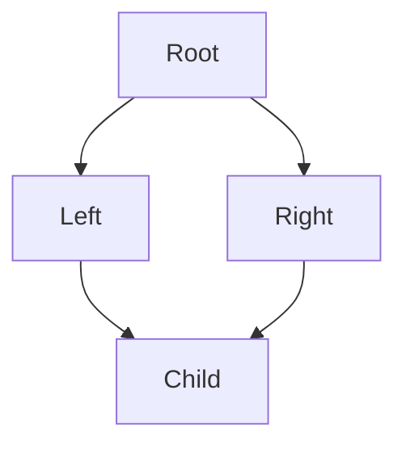
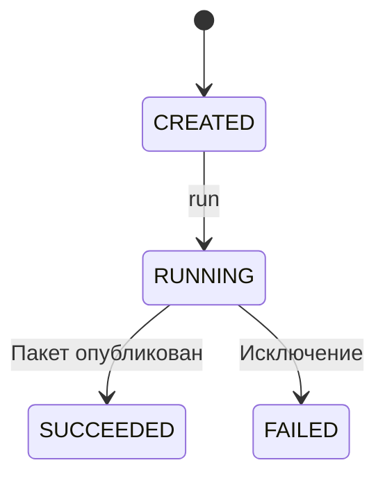

# 5. Объектно-ориентированное программирование

Объектно-ориентированное программирование помогает объединить состояние, допустимые операции и правила изменения в понятный контракт. В Python оно опирается на обычные объекты, протоколы и динамическую модель атрибутов: классы тоже являются объектами, методы строятся на дескрипторах, а наследование работает через MRO.

Глава сохраняет все 21 тему и 135 пунктов README. Основные примеры рассчитаны на Python 3.12–3.14; возможности 3.13 и 3.14 отмечены отдельно. Основная версия проверки — CPython 3.14.8. Детали реализации памяти отделены от гарантий языка. Базовые выражения и функции продолжаются из [второй](02.%20syntax_and_basic_constructs.md) и [третьей](03.%20functions.md) глав.

Короткие Python-блоки независимы и проверяют ожидаемое поведение через `assert`. Намеренные ошибки перехвачены. В практической части находится связанный модуль пакетной загрузки и его тесты: неизменяемые записи, протоколы зависимостей, абстрактный parser, композиция и явная машина состояний задания. Файлы проекта отмечены комментариями.

**Содержание**

1. [Основы ООП](#oop-basics)
2. [Классы и объекты](#classes-and-objects)
3. [Атрибуты класса и методы класса](#class-attributes-and-methods)
4. [Инкапсуляция и сокрытие данных](#encapsulation)
5. [Наследование](#inheritance)
6. [Полиморфизм](#polymorphism)
7. [Протоколы (Protocols)](#protocols)
8. [Магические методы (специальные методы)](#special-methods)
9. [Дескрипторы](#descriptors)
10. [Композиция и агрегация](#composition-and-aggregation)
11. [Миксины (Mixin)](#mixins)
12. [Дата-классы (Data Classes)](#dataclasses)
13. [Перечисления (Enum)](#enums)
14. [Слоты (`__slots__`)](#slots)
15. [Копирование объектов](#copying)
16. [Слабые ссылки (weakref)](#weak-references)
17. [ООП и управление памятью](#oop-and-memory)
18. [Продвинутая перегрузка операторов](#advanced-operators)
19. [Метаклассы](#metaclasses)
20. [Паттерны проектирования в Python](#design-patterns)
21. [Лучшие практики ООП в Python](#best-practices)

<a id="oop-basics"></a>

## Основы ООП

### Парадигмы программирования

Парадигма задаёт способ организации решения. Императивный код описывает шаги и изменения; процедурный объединяет действия в функции; функциональный делает акцент на преобразованиях и явных зависимостях; объектный помещает данные и поведение за интерфейсом объекта.

Python позволяет сочетать эти подходы. Чистая функция может вычислять значение для объекта, объект — реализовывать стратегию через `__call__`, а метод — возвращать ленивый генератор. Выбор парадигмы должен уменьшать сложность конкретного контракта, а не добавлять обязательный класс вокруг каждой формулы.

```python
def squared(value: int) -> int:
    return value**2


class Multiplier:
    def __init__(self, factor: int):
        self.factor = factor

    def __call__(self, value: int) -> int:
        return value * self.factor


assert squared(3) == 9
assert Multiplier(3)(4) == 12
```

Если операции не требуют собственного состояния и жизненного цикла, обычные функции часто достаточны. Если важно сохранять инварианты между несколькими изменениями, закрывать ресурс или подменять реализацию одного интерфейса, объект может выразить задачу лучше.

### Основные концепции ООП

| Концепция | Смысл | Частая ошибка понимания |
| --- | --- | --- |
| Объект | Значение/состояние с идентичностью и поведением | Считать любой объект просто словарём |
| Класс | Объект, задающий тип и поведение экземпляров | Путать его состояние с состоянием каждого экземпляра |
| Инкапсуляция | Контроль допустимых операций и инвариантов | Сводить её к двойному подчёркиванию |
| Абстракция | Контракт, скрывающий ненужные детали | Создавать иерархию без полезного интерфейса |
| Наследование | Отношение типов и переиспользование по MRO | Использовать только ради копирования кода |
| Полиморфизм | Один интерфейс для разных реализаций | Требовать общий базовый класс везде |
| Композиция | Объект делегирует работу зависимостям | Незаметно создавать все зависимости внутри себя |

Инвариант — условие, которое должно выполняться в допустимом состоянии объекта. Например, количество товара неотрицательно, закрытый ресурс нельзя использовать для чтения, а успешно завершённое задание нельзя запустить второй раз без отдельного контракта повторения.

Типы и аннотации помогают описать интерфейс, но не доказывают такие условия автоматически. Их обеспечивают конструкторы, методы, проверенные значения и границы взаимодействия с внешним миром.

### Зачем нужно ООП в Python

ООП полезно, когда состояние и правила его изменения связаны: репозиторий данных, parser с конфигурацией, клиент с соединением, кэш с политикой, задание с жизненным циклом. Оно позволяет заменить зависимость через общий контракт и проверить поведение без реального внешнего сервиса.

```python
class Inventory:
    def __init__(self, quantity: int):
        if type(quantity) is not int or quantity < 0:
            raise ValueError("Нужно неотрицательное целое количество")
        self._quantity = quantity

    @property
    def quantity(self) -> int:
        return self._quantity

    def take(self, amount: int) -> None:
        if type(amount) is not int or not 0 < amount <= self._quantity:
            raise ValueError("Недопустимое списание")
        self._quantity -= amount


inventory = Inventory(5)
inventory.take(2)
assert inventory.quantity == 3
```

Метод выражает допустимую операцию, а не выдаёт вызывающему коду необходимость каждый раз самостоятельно проверять остаток. Однако Python не превращает `_quantity` в защищённую область памяти и не синхронизирует конкурентные списания. Эти ограничения входят в договорённости дизайна.

**Документация:** [классы в tutorial](https://docs.python.org/3.14/tutorial/classes.html), [модель данных](https://docs.python.org/3.14/reference/datamodel.html).

<a id="classes-and-objects"></a>

## Классы и объекты

### Создание класса

Инструкция `class` исполняет тело в подготовленном пространстве имён и создаёт объект класса. Методы, константы и дескрипторы из тела становятся его атрибутами. Сам класс обычно является экземпляром `type` или производного метакласса.

```python
events = []


class User:
    events.append("class body")
    category = "person"

    def label(self):
        return self.category


assert events == ["class body"]
assert isinstance(User, type)
assert User.category == "person"
assert User().label() == "person"
```

Тело класса не ждёт создания экземпляра. Поэтому тяжёлая работа или сетевой запрос прямо в теле станут побочным эффектом определения, часто импорта модуля. Аннотация `name: str` сама по себе не создаёт значение `name` у каждого экземпляра и не проверяет присваивания.

Пространство имён класса не становится обычной замкнутой областью для методов: имя `limit` внутри метода не означает автоматически `self.limit` или `Class.limit`. Для доступа к состоянию используйте явного владельца. Это особенно важно при переносе формулы из тела класса в метод.

### Создание объекта (экземпляра)

Обычная запись `ClassName(...)` вызывает класс. В стандартной модели `type.__call__` организует создание через `__new__` и подходящую инициализацию через `__init__`. Метакласс может изменить эту процедуру, поэтому это описание нормального пути, а не запрет на иное поведение callable-класса.

```python
class User:
    def __init__(self, name):
        self.name = name


first = User("Alice")
second = User("Alice")
assert first is not second
assert type(first) is User
assert first.name == second.name
assert first != second  # Пользовательское равенство не определено.
```

Одинаковые поля не означают автоматического равенства объектов. Для сущности идентичность может быть естественным контрактом, а для значения нужно отдельно определить равенство или использовать подходящий dataclass. Создание объекта не подразумевает его регистрацию, сохранение в БД и глубокое копирование аргументов.

### Метод `__new__` — создание экземпляра

`__new__(cls, ...)` отвечает за получение нового объекта и обязан вернуть результат. Он получает класс, а не уже готовый `self`. Для обычного класса обычно достаточно унаследованного `object.__new__`; переопределение нужно для конкретного контракта создания.

```python
events = []


class Item:
    def __new__(cls, value):
        events.append("new")
        return super().__new__(cls)

    def __init__(self, value):
        events.append("init")
        self.value = value


item = Item(7)
assert item.value == 7
assert events == ["new", "init"]
```

Если `__new__` вернул объект, не являющийся экземпляром запрошенного класса, обычная инициализация этого класса не запускается:

```python
class FactoryLike:
    def __new__(cls):
        return {"answer": 42}

    def __init__(self):
        raise AssertionError("Этот __init__ не должен вызваться")


result = FactoryLike()
assert result == {"answer": 42}
assert not isinstance(result, FactoryLike)
```

Такой интерфейс возможен, но способен удивить пользователя и анализатор типов; обычная фабричная функция часто понятнее. Если возвращается уже существующий экземпляр, `__init__` может выполняться снова: кэширование объекта в `__new__` не даёт автоматической гарантии однократной инициализации.

### Метод `__init__` — инициализация экземпляра

`__init__` настраивает уже созданный объект: проверяет значения, устанавливает состояние и зависимости. Он должен возвращать `None`. Его неверно считать единственной стадией выделения объекта.

```python
class Batch:
    def __init__(self, size: int):
        if type(size) is not int or size <= 0:
            raise ValueError("size должен быть положительным int")
        self.size = size


assert Batch(10).size == 10


class Broken:
    def __init__(self):
        return 42


try:
    Broken()
except TypeError:
    pass
else:
    raise AssertionError("Неправильный результат __init__ принят")
```

При отказе инициализации уже могли произойти внешние действия. Не открывай несколько ресурсов без плана очистки частично созданного состояния. Для явного ресурса полезны фабрика/контекстный менеджер и метод `close`, а не надежда на `__del__`.

### `__new__` vs `__init__`

| Свойство | `__new__` | `__init__` |
| --- | --- | --- |
| Основной первый аргумент | Класс `cls` | Экземпляр `self` |
| Роль | Получить объект | Инициализировать объект |
| Результат | Созданный/выбранный объект | Только `None` |
| Частота переопределения | Обычно редко | Часто |
| Неизменяемые базовые типы | Здесь задаётся их значение | Значение базового immutable уже создано |
| Возврат чужого типа | Может изменить дальнейшую процедуру | Не является допустимым способом заменить экземпляр |

Прямой вызов `Class.__new__(Class)` не выполняет автоматически обычный последующий `__init__`. Такой путь может дать объект с нарушенными инвариантами. В стандартном прикладном коде вызывай класс или документированную фабрику, а низкоуровневые стадии используй только там, где они нужны протоколу.

### Создание экземпляров неизменяемых пользовательских типов

Для наследника `int`, `str` или `tuple` значение неизменяемой основы задаётся в `__new__`. Попытка изменить его обычным присваиванием внутри `__init__` не перепишет уже созданное число или строку.

```python
class PositiveInt(int):
    __slots__ = ()

    def __new__(cls, value):
        if type(value) is not int or value <= 0:
            raise ValueError("Нужен положительный int без bool")
        return super().__new__(cls, value)


value = PositiveInt(3)
assert isinstance(value, int)
assert value + 1 == 4
assert type(value + 1) is int
```

Операции унаследованного типа не обязаны сохранять пользовательский подкласс. Это важно: `PositiveInt` при сложении может вернуть обычный `int`, а не новое проверенное значение. Если доменный тип должен строго сохранять единицы и инварианты во всех операциях, композиция в отдельном value object часто надёжнее наследования от числа.

Неизменяемость базового значения также не означает глубокую неизменяемость дополнительных атрибутов подкласса. Возможность slots и дополнительного состояния у встроенных типов различается; непустые slots, например, не поддерживаются у ряда наследников variable-size встроенных типов.

### Атрибуты экземпляра

Обычный экземпляр пользовательского класса часто хранит динамические атрибуты в `__dict__`. Присваивание `self.name = value` создаёт/меняет атрибут через установленный протокол; это не всегда буквальная запись в словарь, потому что могут работать slots, property и другие дескрипторы.

```python
class User:
    def __init__(self, name):
        self.name = name


user = User("Alice")
assert vars(user) == {"name": "Alice"}
user.active = True
assert user.__dict__["active"] is True
del user.active
assert not hasattr(user, "active")
```

Атрибут со строковым именем можно читать через `getattr` и задавать через `setattr`, но это тоже может выполнить пользовательский код. `hasattr` не является полностью пассивной проверкой: он делает доступ и подавляет `AttributeError`. Для строгого анализа атрибутов без обычного динамического поиска есть специализированная introspection.

Атрибуты одного экземпляра обычно независимы от другого, пока они не ссылаются на один вложенный объект. Переданный в конструктор список по умолчанию не копируется автоматически.

### Методы экземпляра

Функция в классе при обычном доступе через экземпляр превращается в связанный метод. Экземпляр передаётся первым аргументом; имя `self` является соглашением, а не ключевым словом.

```python
class Counter:
    def __init__(self):
        self.value = 0

    def increment(self, amount=1):
        self.value += amount
        return self.value


counter = Counter()
assert counter.increment(2) == 2
assert Counter.increment(counter, 3) == 5
bound = counter.increment
assert bound.__self__ is counter
assert bound.__func__ is Counter.increment

counter.callback = lambda value: value + 1
assert counter.callback(3) == 4  # Функция в экземпляре не связалась как метод класса.
```

Связанный метод удерживает экземпляр сильной ссылкой. Если его сохранить в глобальном реестре callback, объект может жить дольше ожидаемого; слабые методы разобраны далее. Не сравнивай методы по случайным `id`: при каждом доступе могут создаваться новые объекты обёртки, представляющие ту же функцию и экземпляр.

### Практические примеры

Класс полезен, если он выражает связанное состояние и допустимые операции. Простая очередь с ограничением должна проверять лимит до изменения, а не оставлять некорректное содержимое после отказа.

```python
from collections import deque


class BoundedQueue:
    def __init__(self, capacity: int):
        if type(capacity) is not int or capacity < 1:
            raise ValueError("Некорректная вместимость")
        self._capacity = capacity
        self._items = deque()

    def put(self, item) -> None:
        if len(self._items) >= self._capacity:
            raise OverflowError("Очередь заполнена")
        self._items.append(item)

    def get(self):
        if not self._items:
            raise LookupError("Очередь пуста")
        return self._items.popleft()

    def __len__(self):
        return len(self._items)


queue = BoundedQueue(1)
queue.put("a")
try:
    queue.put("b")
except OverflowError:
    pass
assert len(queue) == 1
assert queue.get() == "a"
```

Это синхронный учебный объект, не замена потокобезопасной `queue.Queue` и не async-очередь. Составное «проверить длину → добавить» не получает синхронизацию автоматически. Выбирай интерфейс, соответствующий модели выполнения.

**Документация:** [создание объектов](https://docs.python.org/3.14/reference/datamodel.html#basic-customization), [методы и области имён](https://docs.python.org/3.14/tutorial/classes.html).

<a id="class-attributes-and-methods"></a>

## Атрибуты класса и методы класса

### Атрибуты класса (переменные класса)

Атрибут класса принадлежит объекту класса и участвует в поиске атрибутов экземпляра. Если экземпляр не имеет собственного значения и нет меняющего правила дескриптора, читается значение класса. Это удобно для константы, но опасно для случайно общего изменяемого списка.

```python
class BadRegistry:
    items = []


first = BadRegistry()
second = BadRegistry()
first.items.append("shared")
assert second.items == ["shared"]


class Configuration:
    retries = 3


config = Configuration()
config.retries = 10
assert config.retries == 10
assert Configuration.retries == 3
```

Присваивание обычному атрибуту экземпляра затенило атрибут класса; мутация списка изменила общий объект. В наследовании `Subclass.counter += 1` может создать собственный атрибут подкласса, а не обновить одну общую переменную иерархии. Если нужен общий реестр, явно определи владельца, сброс и конкурентный доступ.

В dataclass `ClassVar[T]` помогает отделить атрибут класса от поля экземпляра для генерации методов и анализатора. Сам по себе `ClassVar` не запрещает runtime-переприсваивание через объект.

### Методы класса (@classmethod)

Class method получает класс через `cls`. При вызове на подклассе передаётся этот подкласс, поэтому альтернативный конструктор может корректно сохранять тип результата.

```python
class Point:
    def __init__(self, x, y):
        self.x, self.y = x, y

    @classmethod
    def origin(cls):
        return cls(0, 0)


class ColoredPoint(Point):
    pass


point = ColoredPoint.origin()
assert type(point) is ColoredPoint
assert (point.x, point.y) == (0, 0)
```

Это работает, пока конструктор подкласса совместим с вызовом `cls(0, 0)`. Наследник, потребовавший дополнительные обязательные параметры, может нарушить контракт фабрики. Для типизации альтернативного конструктора часто подходит `Self`; подробные правила generic-типов развиваются в главе о типизации.

Для аннотации результата, сохраняющего фактический тип класса, подходит `typing.Self` (Python 3.11+):

```python
from typing import Self


class Account:
    def __init__(self, name: str) -> None:
        self.name = name

    @classmethod
    def anonymous(cls) -> Self:
        return cls("anonymous")


class Admin(Account):
    pass


account = Admin.anonymous()
assert type(account) is Admin
assert account.name == "anonymous"
```

`Self` описывает обещание для статического анализатора, но не меняет runtime. Возврат жёстко заданного `Account(...)` из этого метода нарушил бы обещание для `Admin`. Подкласс с несовместимой сигнатурой конструктора также может сломать фабрику: сохранение типа требует согласованного контракта конструирования.

### Статические методы (@staticmethod)

Static method не получает автоматически ни экземпляр, ни класс. Он группирует операцию в пространстве имён класса, если такая принадлежность полезна пользователю API.

```python
class Identifier:
    @staticmethod
    def is_valid(value: str) -> bool:
        return bool(value) and value.isascii() and value.isidentifier()


assert Identifier.is_valid("batch_1")
assert not Identifier.is_valid("batch-1")
assert Identifier().is_valid("batch_1")
```

Метод не проверяет ключевые слова Python: это контракт учебного идентификатора, а не parser допустимых имён переменных. Если операция полезна независимо от класса и не имеет смысловой связи с его API, обычная функция модуля может быть яснее.

### Сравнение: методы экземпляра vs методы класса vs статические методы

| Вид | Автоматический аргумент | Типичная ответственность |
| --- | --- | --- |
| Метод экземпляра | `self` | Изменить/прочитать состояние конкретного объекта |
| `classmethod` | `cls` | Альтернативное создание или поведение на уровне типа |
| `staticmethod` | Нет | Вспомогательное вычисление, относящееся к API класса |
| Функция модуля | Нет | Независимая операция без необходимого владельца-класса |

Выбор определяется зависимостями поведения, а не удобством избежать `self`. Если static method начал читать глобальную конфигурацию экземпляра через обходные пути, его ответственность описана неверно. Class method с реестром тоже хранит состояние и требует политики наследования.

**Документация:** [classmethod](https://docs.python.org/3.14/library/functions.html#classmethod), [staticmethod](https://docs.python.org/3.14/library/functions.html#staticmethod), [методы экземпляра](https://docs.python.org/3.14/reference/datamodel.html#instance-methods).

<a id="encapsulation"></a>

## Инкапсуляция и сокрытие данных

### Концепция инкапсуляции

Инкапсуляция объединяет представление и операции, поддерживающие инварианты, и отделяет публичный контракт от внутренних деталей. Пользователю объекта не нужно знать, каким списком хранится очередь и какое поле обозначает остаток, если доступны корректные методы.

Getter и setter вокруг каждого поля сами по себе не создают инкапсуляцию. Если setter позволяет в любой момент присвоить невозможное состояние, объект остаётся незащищённым от логических ошибок. Часто лучше метод уровня намерения: `reserve()`, `complete()`, `close()`, а не `set_status('done')`.

Не стоит выдавать наружу живой внутренний список, если вызывающий код не должен его менять. Выбери неизменяемое представление, копию нужной глубины или отдельный интерфейс чтения и документируй срок его актуальности.

### Уровни доступа в Python

| Имя | Соглашение |
| --- | --- |
| `name` | Публичная часть API, если так документировано |
| `_name` | Внутренняя деталь, не обещающая стабильной совместимости |
| `__name` внутри класса | Name mangling для уменьшения конфликтов наследования |
| `__name__` | Специальное имя протокола; не придумывай произвольно |

Python не имеет обычной модели модификаторов доступа `private/protected/public` как в некоторых языках. Следование интерфейсу — договорённость между автором и пользователем. Для запуска недоверенного кода нужны настоящие границы среды, а не подчёркивания.

`__all__` управляет экспортом при `import *` и не запрещает прямой доступ к другим именам. Аннотации, `Final`, property и frozen dataclass тоже имеют собственные ограничения и не являются общим механизмом секретности.

### Name mangling (механизм искажения имен)

Имя вида `__value` в контексте класса преобразуется примерно в `_ClassName__value`, если не оканчивается двумя подчёркиваниями. Это позволяет базовому классу и наследнику хранить одноимённые внутренние поля без случайного столкновения.

```python
class Base:
    def __init__(self):
        self.__value = "base"

    def base_value(self):
        return self.__value


class Child(Base):
    def __init__(self):
        super().__init__()
        self.__value = "child"

    def child_value(self):
        return self.__value


child = Child()
assert child.base_value() == "base"
assert child.child_value() == "child"
assert child._Base__value == "base"
assert child._Child__value == "child"
```

Mangled-имя доступно явно, поэтому это не защита данных. Преобразование относится к именам в исходном контексте класса, а строка `'__value'`, переданная в `getattr`, не переписывается автоматически. Не строй публичный API на восстановлении mangled-имён: переименование класса меняет их форму.

### Свойства (@property)

Property предоставляет управляемый доступ через синтаксис атрибута. Getter вычисляет значение, setter проверяет изменение, deleter при необходимости определяет удаление. Read-only property не позволяет обычное присваивание через этот атрибут, но не делает весь объект неизменяемым.

```python
class Temperature:
    def __init__(self, celsius: float):
        self.celsius = celsius

    @property
    def celsius(self) -> float:
        return self._celsius

    @celsius.setter
    def celsius(self, value: float) -> None:
        import math

        if not math.isfinite(value) or value < -273.15:
            raise ValueError("Недопустимая температура")
        self._celsius = value


temperature = Temperature(20.0)
try:
    temperature.celsius = -300.0
except ValueError:
    pass
assert temperature.celsius == 20.0
```

В примере вход ожидается числовым по контракту; проверку произвольного внешнего объекта нужно сделать отдельно. Дорогой сетевой запрос или неожиданная запись в property может удивить пользователя: доступ к атрибуту обычно выглядит дешёвым. Для долгой операции часто лучше явный метод.

Property реализует descriptor-протокол. Даже property без setter считается управляемым дескриптором записи: попытка присвоить обычным способом не превратит его в независимый атрибут экземпляра. Подробный алгоритм поиска разобран далее.

### Инкапсуляция на практике

Возвращай безопасный снимок внутренней изменяемой коллекции, если её содержимым владеет объект. Метод изменения должен проверять правило до публикации состояния.

```python
class Tags:
    def __init__(self):
        self._values = []

    def add(self, value: str) -> None:
        normalized = value.strip()
        if not normalized:
            raise ValueError("Пустой тег")
        if normalized not in self._values:
            self._values.append(normalized)

    @property
    def values(self) -> tuple[str, ...]:
        return tuple(self._values)


tags = Tags()
tags.add(" python ")
snapshot = tags.values
tags.add("data")
assert snapshot == ("python",)
assert tags.values == ("python", "data")
```

Снимок содержит неизменяемые строки, поэтому его обычное изменение не затронет внутренний список. Кортеж с вложенными изменяемыми объектами не дал бы такой глубокой независимости. Для больших данных копирование может быть дорого: иногда нужен документированный read-only view с другим контрактом актуальности.

**Документация:** [private variables](https://docs.python.org/3.14/tutorial/classes.html#private-variables), [property](https://docs.python.org/3.14/library/functions.html#property), [дескрипторы](https://docs.python.org/3.14/howto/descriptor.html).

<a id="inheritance"></a>

## Наследование

### Основы наследования

Наследование создаёт новый тип на основе существующего. Подкласс получает доступ к поведению базового класса, может добавлять операции и переопределять унаследованные методы.

```python
class Document:
    def __init__(self, title: str) -> None:
        self.title = title

    def render(self) -> str:
        return self.title


class MarkdownDocument(Document):
    def render(self) -> str:
        return f"# {self.title}"


document = MarkdownDocument("Python")
assert document.title == "Python"
assert document.render() == "# Python"
assert isinstance(document, Document)
```

Подкласс здесь наследует `__init__`, поэтому конструктор принимает `title`. Если определить собственный `__init__`, инициализация базовой части сама по себе не произойдёт: нужно явно встроить её в цепочку вызовов.

**Критерий выбора — подстановка.** Если функция принимает `Document`, она должна сохранять корректность с `MarkdownDocument`. Наследование ради доступа к двум вспомогательным методам часто создаёт лишние обязательства: подкласс становится связан с контрактом и будущими изменениями базы.

Например, очередь не стоит наследовать от списка, если произвольные вставки и присваивания нарушают её правила. Лучше хранить список внутри очереди и открыть подходящий интерфейс. Наследование также не превращает внешний ресурс в свойство типа: «сервис использует соединение» обычно означает композицию.

### Наследование атрибутов и методов

Атрибуты класса не копируются в словарь каждого подкласса. При поиске Python рассматривает классы по MRO. Атрибуты экземпляра обычно создаются присваиваниями во время инициализации или дальнейшей работы.

```python
class Base:
    category = "base"

    def __init__(self) -> None:
        self.ready = True

    def describe(self) -> str:
        return self.category


class Child(Base):
    category = "child"


item = Child()
assert item.ready is True
assert item.describe() == "child"
assert "describe" not in Child.__dict__
assert "ready" in vars(item)
```

Вызов `self.describe()` динамически выбирает реализацию по фактическому типу объекта. Это полезно для расширения поведения, но опасно в конструкторе базы: переопределённый метод может ожидать поля, которые подкласс ещё не создал.

```python
class Base:
    def __init__(self) -> None:
        self.configure()

    def configure(self) -> None:
        pass


class Child(Base):
    def __init__(self) -> None:
        super().__init__()
        self.limit = 10

    def configure(self) -> None:
        self.limit += 1


try:
    Child()
except AttributeError:
    pass
else:
    raise AssertionError("Переопределённый метод вызван до создания limit")
```

Либо база не вызывает переопределяемые операции при создании, либо протокол инициализации явно документирует доступное состояние. Простое перемещение присваивания иногда устраняет симптом, но не саму хрупкость контракта.

**Явное намерение переопределения.** `@typing.override` (Python 3.12+) помогает анализатору обнаружить метод, который должен переопределять базовый, но не делает этого из-за опечатки или изменения API. `@typing.final` обозначает класс, который не следует наследовать, либо метод, который не следует переопределять. Это инструменты статической проверки, а не runtime-запреты.

```python
from typing import final, override


class Renderer:
    def render(self) -> str:
        return "base"


@final
class JsonRenderer(Renderer):
    @override
    def render(self) -> str:
        return "{}"


assert JsonRenderer().render() == "{}"
```

`override` не обеспечивает LSP автоматически: неверное поведение может иметь формально корректную сигнатуру. `final` полезен как граница поддерживаемого API, а не как защита от враждебного кода.

### Функция super()

`super()` создаёт объект-посредник для поиска атрибутов **после определённого класса в MRO**. Это не фиксированная ссылка на непосредственного родителя и не новый экземпляр базового класса.

```python
class Message:
    def render(self) -> str:
        return "data"


class QuotedMessage(Message):
    def render(self) -> str:
        return f'"{super().render()}"'


assert QuotedMessage().render() == '"data"'
```

В обычном методе `super()` без аргументов использует класс, в котором метод определён, и первый аргумент метода. Упрощённый явный аналог внутри `QuotedMessage.render` — `super(QuotedMessage, self)`. Наименование `self` само по себе не обладает специальными свойствами.

В `classmethod` первым аргументом будет класс. В `staticmethod` нулевой `super()` обычно неприменим: нет автоматически переданного экземпляра или класса. Во вложенной функции и comprehension также нельзя бездумно рассчитывать на тот же первый аргумент.

Для совместной работы нескольких баз каждый участник вызывает `super()` один раз, принимает совместимую сигнатуру и передаёт дальше неиспользованные аргументы. Прямой вызов `Base.method(self)` иногда нужен намеренно, но разрывает такой протокол.

### Множественное наследование

Класс может иметь несколько баз. Это удобно для небольших независимых возможностей и инфраструктурных контрактов. Оно требует согласованного порядка поиска, сигнатур и инициализации.



В такой схеме прямые вызовы `Root.__init__` из обеих промежуточных баз могут дважды инициализировать одну и ту же часть объекта. Кооперативный вызов проходит через участников последовательно:

```python
class Root:
    def __init__(self, **kwargs: object) -> None:
        super().__init__(**kwargs)
        self.steps = ["root"]


class Left(Root):
    def __init__(self, *, left: int, **kwargs: object) -> None:
        super().__init__(**kwargs)
        self.left = left
        self.steps.append("left")


class Right(Root):
    def __init__(self, *, right: int, **kwargs: object) -> None:
        super().__init__(**kwargs)
        self.right = right
        self.steps.append("right")


class Child(Left, Right):
    pass


child = Child(left=1, right=2)
assert child.steps == ["root", "right", "left"]
assert (child.left, child.right) == (1, 2)
assert [cls.__name__ for cls in Child.__mro__] == [
    "Child",
    "Left",
    "Right",
    "Root",
    "object",
]
```

`Left` передаёт `right` дальше, а `Right` его забирает. `Root` передаёт остаток `object`; неизвестные аргументы приведут к `TypeError`, а не потеряются молча. Порядок в `steps` обратен входу в методы, потому что добавление выполняется после возврата из `super()`.

Такой код иллюстрирует механизм. В прикладной модели множество баз с состоянием часто сложнее композиции из нескольких объектов.

### Порядок разрешения методов — MRO

MRO — Method Resolution Order: порядок классов, используемый при наследуемом поиске атрибутов. Python применяет линеаризацию C3: она учитывает заданный порядок баз, сохраняет согласованность уже построенных иерархий и не включает один класс в результат повторно.

Посмотреть результат можно через `Class.__mro__` или `Class.mro()`. Поиск не означает «сначала рекурсивно весь левый родитель»: при ромбе общий предок может оказаться после соседней ветви, как в предыдущем примере.

Противоречивую иерархию Python отклонит при создании класса:

```python
class X:
    pass


class Y:
    pass


class XY(X, Y):
    pass


class YX(Y, X):
    pass


try:
    type("Impossible", (XY, YX), {})
except TypeError:
    pass
else:
    raise AssertionError("Одновременно потребовать X < Y и Y < X нельзя")
```

**Практический способ отладки:** выписать MRO, найти класс определения метода, затем пройти вправо от него. Именно там `super()` продолжит поиск для конкретного объекта. Изменение порядка баз способно изменить поведение без изменения текста методов.

### Проверка принадлежности классу

| Проверка | Смысл |
|---|---|
| `isinstance(obj, Base)` | Объект соответствует типу `Base`, включая подклассы и поддерживаемые виртуальные отношения |
| `issubclass(Child, Base)` | Класс рассматривается как подкласс `Base` |
| `type(obj) is Base` | Точный runtime-тип объекта — именно `Base` |
| `obj.__class__` | Доступ к атрибуту класса объекта; в пользовательских объектах его можно усложнить |

```python
assert isinstance(True, int)
assert type(True) is bool
assert type(True) is not int
assert issubclass(bool, int)


def require_plain_int(value: object) -> int:
    if type(value) is not int:
        raise TypeError("Нужен int без bool и пользовательских подклассов")
    return value


assert require_plain_int(5) == 5
```

Точное сравнение типов намеренно исключает расширение через подклассы. Используйте его, когда этого требует формат входных данных или инвариант. Для обычного полиморфного API предпочтительнее контракт поведения. Проверки типов также не заменяют проверок допустимых значений.

### Абстрактные базовые классы (ABC)

`ABC` и `@abstractmethod` задают номинальный контракт: подкласс должен реализовать абстрактные операции, прежде чем его можно будет инстанцировать.

```python
from abc import ABC, abstractmethod


class Renderer(ABC):
    @abstractmethod
    def render(self, text: str) -> str:
        """Преобразовать текст в представление."""
        raise NotImplementedError


class HtmlRenderer(Renderer):
    def render(self, text: str) -> str:
        from html import escape

        return f"<p>{escape(text)}</p>"


assert HtmlRenderer().render("<x>") == "<p>&lt;x&gt;</p>"

try:
    Renderer()
except TypeError:
    pass
else:
    raise AssertionError("Абстрактный класс нельзя инстанцировать")
```

Абстрактный метод может содержать работающую общую реализацию, вызываемую через `super()`. При сочетании декораторов `@abstractmethod` располагают ближе к функции: например, под `@classmethod` или `@property`.

**ABC не проверяет полноценный контракт.** Подкласс может переопределить метод с неправильной сигнатурой или значением, не являющимся подходящим методом. Статический анализ и поведенческие тесты остаются необходимыми.

`SomeABC.register(ExternalClass)` регистрирует виртуальный подкласс: `isinstance` и `issubclass` начинают учитывать это отношение. Регистрация не добавляет методы, не меняет MRO и не проверяет корректность реализации. Аналогично некоторые ABC распознают типы через `__subclasshook__`. Не воспринимайте положительную проверку как доказательство всех бизнес-гарантий.

**Документация:** [super](https://docs.python.org/3.14/library/functions.html#super), [MRO HOWTO](https://docs.python.org/3.14/howto/mro.html), [abc](https://docs.python.org/3.14/library/abc.html).

<a id="polymorphism"></a>

## Полиморфизм

### Что такое полиморфизм

Полиморфизм позволяет одной операции работать с объектами разных типов через общий контракт. Вызывающий код зависит от возможностей объекта, а конкретный тип определяет реализацию.

```python
class CsvReport:
    def render(self) -> str:
        return "id,total\n1,100"


class TextReport:
    def render(self) -> str:
        return "Заказ 1: 100"


reports = [CsvReport(), TextReport()]
assert [report.render() for report in reports] == ["id,total\n1,100", "Заказ 1: 100"]
```

Общий родитель для этого не обязателен. Важно согласовать не только имя: возвращаемый тип, исключения, побочные эффекты, единицы измерения и допустимые состояния тоже входят в контракт.

Полиморфизм убирает необходимость постоянно расширять ветвление `if type(x) is ...`. Но он не должен скрывать существенные различия: синхронная операция и операция, требующая `await`, не становятся взаимозаменяемыми только из-за одинакового названия.

**Диспетчеризация по типу аргумента.** Python не выбирает из нескольких одноимённых `def` по сигнатурам: следующее определение заменяет предыдущее. `@typing.overload` описывает варианты для анализатора, но требует одной runtime-реализации. Для намеренного выбора реализации по первому аргументу после `self`/`cls` существует `functools.singledispatchmethod`:

```python
from functools import singledispatchmethod


class Decoder:
    @singledispatchmethod
    def decode(self, value: object) -> str:
        raise TypeError("Неподдерживаемый тип")

    @decode.register
    def _(self, value: str) -> str:
        return value

    @decode.register
    def _(self, value: bytes) -> str:
        return value.decode("utf-8")


decoder = Decoder()
assert decoder.decode("python") == "python"
assert decoder.decode(b"python") == "python"
```

Это одиночная диспетчеризация по runtime-типу, а не автоматический выбор по всем аргументам или содержимому `list[int]`. Выбор между ней, полиморфными объектами и явным преобразованием на границе зависит от того, какие типы и операции расширяются в проекте.

### Утиная типизация (Duck Typing)

Утиная типизация опирается на поддерживаемое поведение: «объект умеет читать», «объект итерируется», «объект сравнивается». Python позволяет вызывать нужный метод без предварительной проверки наследования.

```python
from io import StringIO
from typing import Protocol


class TextReader(Protocol):
    def read(self) -> str: ...


def count_words(source: TextReader) -> int:
    return len(source.read().split())


class ConstantText:
    def read(self) -> str:
        return "Python supports protocols"


assert count_words(StringIO("one two")) == 2
assert count_words(ConstantText()) == 3
```

`Protocol` делает ожидание видимым для инструментов, сохраняя отсутствие обязательного общего предка.

**EAFP:** часто проще выполнить операцию и обработать конкретный ожидаемый сбой, чем заранее проверять всё через `hasattr`. Однако широкий `except AttributeError` вокруг сложного метода способен скрыть ошибку внутри самой реализации. Ограничивайте область перехвата и не подменяйте программную ошибку сообщением «неподдерживаемый объект».

### Полиморфизм через наследование

Наследование полезно, если типам нужен общий номинальный контракт или согласованная базовая реализация.

```python
from abc import ABC, abstractmethod


class Discount(ABC):
    @abstractmethod
    def apply(self, amount: int) -> int:
        """Вернуть целое число копеек от 0 до amount."""
        raise NotImplementedError


class NoDiscount(Discount):
    def apply(self, amount: int) -> int:
        return amount


class TenPercent(Discount):
    def apply(self, amount: int) -> int:
        return amount * 90 // 100


def total(amount: int, discount: Discount) -> int:
    if type(amount) is not int or amount < 0:
        raise ValueError("Сумма должна быть целым неотрицательным числом")
    return discount.apply(amount)


assert total(1_000, TenPercent()) == 900
assert total(1_000, NoDiscount()) == 1_000
```

Контракт требует, чтобы реализации не возвращали отрицательную сумму и не меняли денежные единицы. Система типов не доказывает эти свойства: их проверяют общими тестами контрактов. Для одного небольшого алгоритма вместо иерархии может быть достаточно функции `Callable[[int], int]`.

<a id="protocols"></a>

## Протоколы (Protocols)

### Что такое протокол в Python

Слово «протокол» используется в двух близких смыслах:

- **Протокол языка:** согласованный набор операций, например `__iter__`/`__next__` для итераторов или `__enter__`/`__exit__` для контекстных менеджеров.
- **`typing.Protocol`:** объявление структурного интерфейса для статической проверки типов.

Структурная совместимость означает, что тип соответствует интерфейсу по своим членам, даже если не наследуется от его объявления. Протокол не создаёт проверяющую обёртку и не добавляет отсутствующее поведение.

```python
from typing import Protocol


class HasName(Protocol):
    @property
    def name(self) -> str: ...


class User:
    def __init__(self, name: str) -> None:
        self.name = name


def greet(user: HasName) -> str:
    return f"Hello, {user.name}"


assert greet(User("Ada")) == "Hello, Ada"
```

Read-only свойство в протоколе говорит, что потребителю нужно чтение. Объявление изменяемого атрибута могло бы потребовать также безопасного присваивания; это влияет на совместимость типов и вариантность. Интерфейс стоит формулировать через минимально необходимые операции.

### Встроенные протоколы

| Протокол | Основные операции | Важный контракт |
|---|---|---|
| Iterable | `__iter__` | Возвращает итератор |
| Iterator | `__iter__`, `__next__` | `iter(iterator) is iterator`; конец через `StopIteration` |
| Sized | `__len__` | Неотрицательная длина |
| Container | `__contains__` | Проверка принадлежности |
| Sequence | Индексирование, длина и согласованные операции | Стабильная семантика последовательности |
| Mapping | Доступ по ключу, итерация ключей, длина | Отсутствующий ключ обычно даёт `KeyError` |
| Context manager | `__enter__`, `__exit__` | Согласованное получение и освобождение ресурса |
| Async iterable / iterator | `__aiter__`, `__anext__` | Асинхронный обход, конец через `StopAsyncIteration` |
| Awaitable | `__await__` | Совместимость с протоколом ожидания, а не произвольный синхронный результат |
| Hashable | `__hash__` | Хэш согласован с равенством и стабилен в ключе |
| Callable | `__call__` | Сигнатура и результат соответствуют ожиданию |

`collections.abc` предоставляет ABC для многих контейнерных контрактов, включая полезные mixin-реализации. `typing` описывает типы и структурные интерфейсы. Это взаимосвязанные инструменты, но не идентичные механизмы.

```python
from collections.abc import Iterable, Iterator


class Countdown:
    def __init__(self, start: int) -> None:
        self._start = start

    def __iter__(self) -> Iterator[int]:
        return iter(range(self._start, 0, -1))


values = Countdown(3)
assert isinstance(values, Iterable)
assert list(values) == [3, 2, 1]
assert list(values) == [3, 2, 1]
assert iter(values) is not iter(values)
```

Здесь объект — повторно итерируемый источник, а не одноразовый итератор. Также `iter(obj)` исторически умеет работать с последовательностью через `__getitem__`, даже если простая проверка `Iterable` не распознаёт такой объект. Проверка ABC не всегда полностью повторяет алгоритм операции языка.

### Создание своих протоколов

Проектируйте протокол со стороны потребителя: какая операция нужна этому сервису, а не какие двадцать методов есть у текущей реализации.

```python
from typing import Protocol


class ByteSink(Protocol):
    def write(self, data: bytes, /) -> int: ...


class MemorySink:
    def __init__(self) -> None:
        self.parts: list[bytes] = []

    def write(self, data: bytes, /) -> int:
        self.parts.append(data)
        return len(data)


def write_all(sink: ByteSink, data: bytes) -> None:
    offset = 0
    while offset < len(data):
        written = sink.write(data[offset:])
        if not 0 < written <= len(data) - offset:
            raise OSError("Некорректное число записанных байтов")
        offset += written


sink = MemorySink()
write_all(sink, b"python")
assert b"".join(sink.parts) == b"python"
```

Сигнатура разрешает позиционный вызов, а возвращаемое число учитывает частичную запись. Поведенческий контракт требует прогресса либо исключения; без него цикл мог бы зависнуть. Для неблокирующего I/O потребуются отдельные правила повторов и ожидания готовности.

Протоколы могут быть обобщёнными, наследоваться от других протоколов, описывать свойства и callback-объекты. Не добавляйте в интерфейс метод только ради удобства одной реализации: лишний член связывает всех поставщиков с ненужным требованием.

### Protocol vs ABC — когда что выбирать

| Ситуация | Подход |
|---|---|
| Принимаем сторонние объекты без изменения их наследования | `Protocol` |
| Нужна проверка структурной совместимости в mypy/pyright | `Protocol` |
| Нужна общая реализация и контролируемая иерархия | ABC или обычная база |
| Нужно запретить создание неполного подкласса | ABC с `abstractmethod` |
| Достаточно одного преобразования | Обычная функция / `Callable` |
| Требуются проверки входных данных | Явная валидация; сами ABC/Protocol её не обеспечивают |

Эти механизмы можно сочетать: публичный потребитель зависит от протокола, а внутренние реализации используют ABC для повторного кода. Но дублирование одного интерфейса в двух объявлениях оправдано только при реальной пользе.

Номинальное наследование показывает намерение автора, структурная проверка снижает связанность. Ни то ни другое не доказывает транзакционность, потокобезопасность или корректность вычислений.

### Runtime проверка протоколов

Для `isinstance` протокол нужно пометить `@runtime_checkable`. Такая проверка ограничена наличием требуемых членов; она не проверяет соответствие сигнатур и аннотаций.

```python
from typing import Protocol, runtime_checkable


@runtime_checkable
class Reader(Protocol):
    def read(self) -> str: ...


class BrokenReader:
    read = 42


candidate = BrokenReader()
assert isinstance(candidate, Reader)
assert not callable(candidate.read)
```

Положительный результат не делает `candidate.read()` корректным. Для протоколов с данными `issubclass` имеет дополнительные ограничения: наличие полей экземпляра невозможно надёжно установить по одному классу.

Начиная с Python 3.12 runtime-проверки используют `inspect.getattr_static`: динамически создаваемые через `__getattr__` члены могут не считаться присутствующими. Набор проверяемых членов фиксируется при создании протокола; последующее monkey patching не расширяет требования runtime-проверки. Это ещё одна причина не строить на ней валидатор внешних данных или горячий путь обработки.

**Документация:** [Protocols](https://docs.python.org/3.14/library/typing.html#typing.Protocol), [runtime_checkable](https://docs.python.org/3.14/library/typing.html#typing.runtime_checkable), [collections.abc](https://docs.python.org/3.14/library/collections.abc.html).

<a id="special-methods"></a>

## Магические методы (специальные методы)

### Введение в магические методы

Специальные методы связывают пользовательские типы с синтаксисом Python: `len(x)`, `x + y`, `x[key]`, `with x`, `str(x)`. Их имена определены моделью данных. Не придумывайте собственные «магические» имена вида `__business_action__`: такой стиль зарезервирован для механизмов языка.

Неявный вызов специальной операции обычно ищет метод **на типе**, обходя обычные атрибуты экземпляра. Поэтому присваивание `obj.__len__` не эквивалентно определению `__len__` в классе.

```python
class Bag:
    def __len__(self) -> int:
        return 3


bag = Bag()
bag.__len__ = lambda: 100
assert bag.__len__() == 100
assert len(bag) == 3
```

Метод стоит добавлять, если операция естественна для типа и выполняет ожидаемый контракт. Наличие `__getitem__` не означает, что тип автоматически обладает всеми свойствами словаря или последовательности. Совместимость формируют согласованные операции, ошибки и сложность выполнения.

### Инициализация и представление объектов

| Метод | Назначение |
|---|---|
| `__new__` | Создание экземпляра |
| `__init__` | Инициализация уже созданного экземпляра |
| `__repr__` | Диагностическое представление для разработчика |
| `__str__` | Представление для пользователя |
| `__format__` | Поддержка `format(obj, spec)` и форматирования в f-строке |
| `__bytes__` | Явное преобразование через `bytes(obj)` |

```python
class Distance:
    def __init__(self, meters: float) -> None:
        self.meters = meters

    def __repr__(self) -> str:
        return f"Distance(meters={self.meters!r})"

    def __str__(self) -> str:
        return f"{self.meters} m"

    def __format__(self, spec: str) -> str:
        return f"{format(self.meters, spec)} m"


distance = Distance(12.345)
assert repr(distance) == "Distance(meters=12.345)"
assert str(distance) == "12.345 m"
assert f"{distance:.1f}" == "12.3 m"
```

При отсутствии пользовательского `__str__` базовая реализация использует `__repr__`. Сам `__repr__` не обязан быть выражением для восстановления объекта: это полезное соглашение, когда оно практично и безопасно. Для объектов с ресурсами, секретами или большим состоянием информативное сокращённое представление лучше полного конструктора.

### Контракты представления объектов

`__repr__` и `__str__` обязаны возвращать `str`, а не произвольный объект. Представление часто вызывается в логировании, traceback, отладчике и коллекциях, поэтому оно должно быть предсказуемым и по возможности дешёвым.

```python
class ApiClient:
    def __init__(self, endpoint: str, token: str) -> None:
        self._endpoint = endpoint
        self._token = token

    def __repr__(self) -> str:
        return f"ApiClient(endpoint={self._endpoint!r}, token=<redacted>)"


client = ApiClient("https://example.invalid", "secret-123")
assert "secret-123" not in repr(client)
assert "<redacted>" in repr(client)
```

Не включайте в `repr` сетевой запрос, ленивую загрузку всей таблицы или вызов нестабильного пользовательского callback. Доступ к ещё не созданным полям может сломать диагностику ошибки конструктора; при необходимости используйте безопасные значения по умолчанию.

В рекурсивных структурах полезен `reprlib.recursive_repr`; в больших коллекциях — сокращение через `reprlib.repr`. Маскирование в одном методе не гарантирует отсутствия секрета в других логах, сериализации и сообщениях об ошибках: это отдельные поверхности вывода.

### Сравнение и хэширование

Богатые сравнения представлены методами `__eq__`, `__ne__`, `__lt__`, `__le__`, `__gt__`, `__ge__`. Результат сравнения может быть пользовательским объектом, но для обычных прикладных значений ожидается `bool`.

Для неизвестной пары типов возвращайте `NotImplemented`. Это позволяет Python попробовать соответствующую операцию другого операнда.

```python
class Version:
    def __init__(self, major: int, minor: int) -> None:
        self._key = (major, minor)

    def __eq__(self, other: object) -> bool:
        if type(other) is not Version:
            return NotImplemented
        return self._key == other._key

    def __lt__(self, other: object) -> bool:
        if type(other) is not Version:
            return NotImplemented
        return self._key < other._key


assert Version(3, 12) == Version(3, 12)
assert Version(3, 12) < Version(3, 14)
assert (Version(3, 12) == "3.12") is False
assert Version.__hash__ is None
```

Здесь тип намеренно закрывает сравнение с подклассами. Если разрешить `isinstance`, нужно продумать симметрию при расширении состояния подклассом. Не каждый набор полей задаёт естественный порядок: денежные суммы разных валют или интервалы могут быть несравнимы.

`NotImplemented` — значение протокола, а `NotImplementedError` — исключение. Они не взаимозаменяемы. Если обе стороны не поддержали равенство, Python использует поведение на основе идентичности; для неподдержанного упорядочивания обычно возникает `TypeError`.

### Контракт равенства и хэширования

Главное правило: **если `a == b`, то `hash(a) == hash(b)`** для хэшируемых объектов. Обратное неверно: коллизии допустимы. Хэш объекта, используемого ключом словаря или элементом множества, должен сохраняться всё время его использования.

```python
from dataclasses import dataclass


@dataclass(frozen=True, slots=True)
class Coordinate:
    x: int
    y: int


a = Coordinate(1, 2)
b = Coordinate(1, 2)
assert a == b
assert hash(a) == hash(b)
assert len({a, b}) == 1
assert {a: "point"}[b] == "point"
```

У изменяемого объекта, сравниваемого по содержимому, безопасный выбор часто `__hash__ = None`. Если класс определяет `__eq__` без собственного `__hash__`, Python обычно делает его нехэшируемым именно по этой причине.

**Значение и сущность — разные модели.** Координата равна другой координате с теми же компонентами. Два объекта с соединениями или два задания обработки могут иметь одинаковые параметры, но оставаться разными сущностями; для них стандартная идентичность может быть правильнее.

Хэш не является устойчивым идентификатором для БД, файлов и обмена между процессами. В частности, хэши строк и байтов могут различаться между запусками. Для постоянного ключа используйте явно определённый идентификатор или формат криптографического хэширования.

### Арифметические операции

Для бинарных операций обычно участвуют три группы методов:

| Выражение | Основной метод | Отражённый / расширенный |
|---|---|---|
| `a + b` | `a.__add__(b)` | `b.__radd__(a)` |
| `a - b` | `a.__sub__(b)` | `b.__rsub__(a)` |
| `a * b` | `a.__mul__(b)` | `b.__rmul__(a)` |
| `a / b` | `a.__truediv__(b)` | `b.__rtruediv__(a)` |
| `a // b` | `a.__floordiv__(b)` | `b.__rfloordiv__(a)` |
| `a @ b` | `a.__matmul__(b)` | `b.__rmatmul__(a)` |
| `a += b` | `a.__iadd__(b)` | При отсутствии поддержки — обычное сложение с присваиванием |

```python
from dataclasses import dataclass


@dataclass(frozen=True)
class Vector:
    x: int
    y: int

    def __add__(self, other: object):
        if type(other) is not Vector:
            return NotImplemented
        return Vector(self.x + other.x, self.y + other.y)

    def __mul__(self, scalar: object):
        if type(scalar) is not int:
            return NotImplemented
        return Vector(self.x * scalar, self.y * scalar)

    def __rmul__(self, scalar: object):
        return self.__mul__(scalar)


assert Vector(1, 2) + Vector(3, 4) == Vector(4, 6)
assert 3 * Vector(1, 2) == Vector(3, 6)
assert Vector(1, 2) * 3 == Vector(3, 6)
```

Умножение здесь принимает только точный `int`, включая отрицательные значения, но исключая `bool`. Это осознанный узкий контракт учебного типа, а не универсальное правило для всех числовых классов. Отражённую операцию можно делегировать прямой только при подходящей математической семантике; для вычитания это обычно неверно.

### Разрешение операторов и преобразований

Для операндов разных типов Python учитывает отражённые методы. Если правый тип — строгий подкласс левого и предоставляет подходящую отличающуюся реализацию отражённой операции, она получает приоритет. Это позволяет более специализированному типу обработать пару.

```python
class BaseNumber:
    def __add__(self, other: object):
        return "base add"


class SpecialNumber(BaseNumber):
    def __radd__(self, other: object):
        return "special reflected add"


assert BaseNumber() + SpecialNumber() == "special reflected add"
```

`__iadd__` вправе вернуть как тот же объект, так и новый. Если он отсутствует или возвращает `NotImplemented`, используется обычный протокол сложения, после чего результат присваивается цели. Поэтому `+=` не означает неизменную идентичность и не гарантирует отсутствие частичных эффектов.

```python
items = ([1],)
try:
    items[0] += [2]
except TypeError:
    pass
else:
    raise AssertionError("Кортеж не разрешает присваивание элемента")

assert items == ([1, 2],)
```

Список успел измениться, а последующее присваивание в кортеж завершилось ошибкой. Исключение не откатывает уже выполненные изменения.

`__int__` задаёт преобразование в целое, а `__index__` — точное целочисленное значение для индексов, срезов и `operator.index`. Не следует реализовывать второй метод для величины, которая требует округления.

```python
import operator


class RowCount:
    def __init__(self, value: int) -> None:
        self.value = value

    def __index__(self) -> int:
        return self.value


count = RowCount(2)
assert operator.index(count) == 2
assert [10, 20, 30][:count] == [10, 20]
```

```python
# Python 3.14+: NotImplemented нельзя преобразовывать в bool.
try:
    bool(NotImplemented)
except TypeError:
    pass
else:
    raise AssertionError("Начиная с 3.14 ожидается TypeError")
```

В старых версиях такое преобразование было устаревающим поведением. Код поддержки операторов должен проверять `result is NotImplemented`, а не истинность результата.

### Эмуляция контейнеров и последовательностей

Для контейнера определите смысл длины, итерации, принадлежности и доступа. Не используйте один и тот же `KeyError` и `IndexError` без учёта модели данных.

```python
from collections.abc import Iterator, Sequence


class ReadOnlyRows(Sequence[str]):
    def __init__(self, rows: list[str]) -> None:
        self._rows = tuple(rows)

    def __len__(self) -> int:
        return len(self._rows)

    def __getitem__(self, index):
        if isinstance(index, slice):
            return ReadOnlyRows(list(self._rows[index]))
        return self._rows[index]

    def __iter__(self) -> Iterator[str]:
        return iter(self._rows)


rows = ReadOnlyRows(["a", "b", "c"])
assert rows[-1] == "c"
assert list(rows[::2]) == ["a", "c"]
assert "b" in rows
assert len(rows) == 3
```

В аннотированном production-коде для `__getitem__` полезны `@overload`: индекс возвращает элемент, срез — последовательность. Срез приходит как объект `slice`; для собственной арифметики индексов используйте `slice.indices(length)`, учитывающий отрицательные границы и шаг.

Если есть `__bool__`, истинность определяется им; иначе Python обращается к `__len__`, а без обоих методов объект по умолчанию истинен. Длина обязана быть неотрицательной. Для CPython существуют также ограничения диапазона результата `len`.

Методы ABC могут иметь неожиданную сложность: mixin, многократно вызывающий дорогое индексирование, способен превратить обход в квадратичный. Корректность API включает и документированные ожидания по стоимости операций.

### Управление атрибутами

`__getattribute__` участвует в обычном чтении атрибутов экземпляра. `__getattr__` — резервный обработчик отсутствующего атрибута, если обычный доступ завершился `AttributeError`. Для изменения и удаления существуют `__setattr__` и `__delattr__`.

```python
class Settings:
    def __init__(self, values: dict[str, str]) -> None:
        self._values = dict(values)

    def __getattr__(self, name: str) -> str:
        try:
            return self._values[name]
        except KeyError:
            raise AttributeError(name) from None


settings = Settings({"region": "eu"})
assert settings.region == "eu"
assert getattr(settings, "missing", "default") == "default"
assert not hasattr(settings, "missing")
```

Неизвестное имя должно завершаться `AttributeError`, иначе ломаются `getattr` с default, `hasattr` и многие инструменты. При чтении `self._values` выше обычный поиск успешен; если само поле не создано, такая реализация может рекурсивно входить в `__getattr__`.

```python
class Audited:
    def __init__(self) -> None:
        object.__setattr__(self, "reads", [])
        self.value = 42

    def __getattribute__(self, name: str):
        if name != "reads":
            object.__getattribute__(self, "reads").append(name)
        return object.__getattribute__(self, name)


item = Audited()
assert item.value == 42
assert item.reads == ["value"]
```

Делегирование `object.__getattribute__` сохраняет стандартную работу дескрипторов. Прямое чтение только из `__dict__` её обходит. Для обычной валидации одного поля свойство или дескриптор почти всегда проще глобального перехвата атрибутов.

### Вызываемые объекты

`__call__` позволяет вызвать экземпляр как функцию. Такой объект удобен, если операция имеет собственную конфигурацию, состояние или несколько связанных методов.

```python
class Threshold:
    def __init__(self, limit: int) -> None:
        self._limit = limit
        self.calls = 0

    def __call__(self, value: int) -> bool:
        self.calls += 1
        return value >= self._limit


predicate = Threshold(10)
assert list(filter(predicate, [3, 10, 12])) == [10, 12]
assert predicate.calls == 3
assert callable(predicate)
```

Состояние здесь намеренно наблюдаемо. При совместном использовании из потоков счётчик потребует согласованной синхронизации; GIL не превращает произвольный составной протокол в корректный конкурентный алгоритм.

Для неизменяемой конфигурации достаточно замыкания или `functools.partial`. Класс оправдан, когда его интерфейс и жизненный цикл дают понятную пользу. `callable(obj)` показывает возможность вызова, но не подходящую сигнатуру и не успешность конкретного вызова.

### Менеджеры контекста

Контекстный менеджер отделяет время владения ресурсом от времени жизни Python-объекта. `__enter__` возвращает значение для `as`, а `__exit__` получает сведения об исключении и выполняет освобождение.

```python
class TemporaryFlag:
    def __init__(self, settings: dict[str, bool], key: str) -> None:
        self._settings = settings
        self._key = key

    def __enter__(self) -> "TemporaryFlag":
        self._had_key = self._key in self._settings
        self._old_value = self._settings.get(self._key, False)
        self._settings[self._key] = True
        return self

    def __exit__(self, exc_type, exc_value, traceback) -> bool:
        if self._had_key:
            self._settings[self._key] = self._old_value
        else:
            self._settings.pop(self._key, None)
        return False


settings = {"debug": False}
try:
    with TemporaryFlag(settings, "debug"):
        assert settings["debug"] is True
        raise ValueError("Ошибка внутри блока")
except ValueError:
    pass

assert settings == {"debug": False}
```

Ложный результат `__exit__` сохраняет распространение исключения, истинный подавляет его. Подавление должно быть частью явного контракта. Если `__enter__` завершился ошибкой, соответствующий `__exit__` не вызывается: частично полученные ресурсы должен освободить сам код входа, например через `ExitStack`.

Этот учебный менеджер не поддерживает повторный одновременный вход одним экземпляром и конкурентное изменение того же словаря. Повторное использование, реентерабельность и потокобезопасность — отдельные свойства. Для нескольких динамически получаемых ресурсов удобен `contextlib.ExitStack`, а для async-ресурсов — `__aenter__`/`__aexit__` и `AsyncExitStack`.

### Сериализация (pickle)

`pickle` сериализует граф Python-объектов, учитывая общие ссылки и циклы. При восстановлении обычного экземпляра `__init__` обычно не вызывается, поэтому инварианты нельзя защищать только в нём. Для собственного состояния используются `__getstate__` и `__setstate__`; более низкоуровневый протокол задают `__reduce__` и `__reduce_ex__`.

```python
import pickle


class Counter:
    def __init__(self, value: int) -> None:
        self._set_value(value)

    def _set_value(self, value: object) -> None:
        if type(value) is not int or value < 0:
            raise ValueError("Некорректное значение счётчика")
        self.value = value

    def __getstate__(self) -> dict[str, object]:
        return {"version": 1, "value": self.value}

    def __setstate__(self, state: dict[str, object]) -> None:
        if state.get("version") != 1:
            raise ValueError("Неизвестная версия состояния")
        self._set_value(state["value"])


original = Counter(5)
restored = pickle.loads(pickle.dumps(original))
assert restored is not original
assert restored.value == 5
```

**Десериализуйте pickle только из доверенного источника:** формат может приводить к выполнению произвольного кода. Валидация в `__setstate__` проверяет состояние данного типа, но не делает недоверенный pickle безопасным. Для внешнего обмена чаще нужен явный формат данных с валидацией схемы.

Классы и функции обычно сохраняются по импортируемому пути, а не вместе с исходным кодом. Локальные классы, перенос модуля и переименование типа могут ломать восстановление. У неизменяемых типов аргументы `__new__` можно передать через `__getnewargs_ex__`. Соединения, блокировки и открытые ресурсы нельзя бездумно включать в сохраняемое состояние; при восстановлении им нужен отдельный жизненный цикл.

### Практические примеры магических методов

Ниже небольшой объект-значение: публичная неизменяемость, равенство, хэш, сложение и читаемое представление работают согласованно.

```python
from dataclasses import dataclass


@dataclass(frozen=True, slots=True)
class Money:
    minor_units: int
    currency: str

    def __post_init__(self) -> None:
        if type(self.minor_units) is not int:
            raise TypeError("Сумма должна быть целым числом минимальных единиц")
        if self.currency not in {"RUB", "USD", "EUR"}:
            raise ValueError("Неподдерживаемая валюта")

    def __add__(self, other: object):
        if type(other) is not Money:
            return NotImplemented
        if self.currency != other.currency:
            raise ValueError("Для сложения нужен явный обмен валюты")
        return Money(self.minor_units + other.minor_units, self.currency)

    def __str__(self) -> str:
        sign = "-" if self.minor_units < 0 else ""
        whole, fraction = divmod(abs(self.minor_units), 100)
        return f"{sign}{whole}.{fraction:02d} {self.currency}"


price = Money(199, "RUB")
total = price + Money(101, "RUB")
assert total == Money(300, "RUB")
assert str(total) == "3.00 RUB"
assert str(Money(-1, "RUB")) == "-0.01 RUB"
assert {total: "paid"}[Money(300, "RUB")] == "paid"
```

В учебном контракте все перечисленные валюты используют две дробные цифры. Обобщённая денежная библиотека должна учитывать разные масштабы, правила округления, курсы, даты и ограничения операций. Не нужно добавлять деление, порядок и неявное преобразование в `float`, пока их смысл не определён.

**Документация:** [модель данных](https://docs.python.org/3.14/reference/datamodel.html#special-method-names), [pickle](https://docs.python.org/3.14/library/pickle.html), [contextlib](https://docs.python.org/3.14/library/contextlib.html).

<a id="descriptors"></a>

## Дескрипторы

### Что такое дескрипторы

Дескриптор — объект, чей тип реализует методы протокола доступа к атрибуту: `__get__`, `__set__` или `__delete__`. Для обычной работы с экземплярами такой объект помещают **в атрибут класса**. При доступе к этому атрибуту механизм поиска может передать управление дескриптору.

Дескриптор позволяет описать поведение поля один раз и использовать его в нескольких классах: валидацию числа, ленивое получение значения, связь с внешним хранилищем. `property`, функции в классе, `classmethod`, `staticmethod` и поля слотов используют этот механизм.

```python
class ClassName:
    def __get__(self, instance, owner=None) -> str:
        return owner.__name__


class User:
    kind = ClassName()


assert User.kind == "User"
assert User().kind == "User"
```

Один объект `ClassName` обслуживает доступ от многих экземпляров. Если сохранять в самом дескрипторе `self.value` как значение конкретного пользователя, это состояние случайно станет общим. Обычно данные принадлежат экземпляру, а дескриптор задаёт правила доступа.

### Протокол дескриптора

| Метод | Когда участвует | Аргументы |
|---|---|---|
| `__get__(self, instance, owner)` | Чтение | Экземпляр либо `None`; класс доступа |
| `__set__(self, instance, value)` | Присваивание экземпляру | Экземпляр и новое значение |
| `__delete__(self, instance)` | Удаление у экземпляра | Экземпляр |
| `__set_name__(self, owner, name)` | Создание класса | Класс-владелец и имя атрибута |

`__set_name__` — связанный hook создания класса; сам по себе он не делает объект дескриптором доступа. Для `Class.attr` параметр `instance` у `__get__` равен `None`. Удобное соглашение — возвращать при таком доступе сам дескриптор, чтобы сохранить возможность интроспекции.

```python
class Field:
    def __set_name__(self, owner, name: str) -> None:
        self.name = name

    def __get__(self, instance, owner=None):
        if instance is None:
            return self
        try:
            return vars(instance)[self.name]
        except KeyError:
            raise AttributeError(self.name) from None

    def __set__(self, instance, value) -> None:
        vars(instance)[self.name] = value


class Entry:
    payload = Field()


entry = Entry()
entry.payload = "data"
assert entry.payload == "data"
assert Entry.payload.name == "payload"
```

`__set_name__` вызывается автоматически для атрибутов в пространстве имён создаваемого класса. При `Entry.extra = Field()` после создания класса hook автоматически не вызывается: его нужно вызвать явно. Унаследованный дескриптор также не получает новый вызов только из-за появления подкласса. Повторное использование одного изменяемого дескриптора под разными именами требует отдельного проектирования.

### Типы дескрипторов

**Data descriptor** определяет `__set__` или `__delete__`; **non-data descriptor** предоставляет чтение через `__get__` без этих методов. Для обычного читаемого data descriptor приоритет выше словаря экземпляра, у non-data descriptor — ниже.

```python
class NonData:
    def __get__(self, instance, owner=None):
        return "descriptor"


class Example:
    label = NonData()

    @property
    def code(self) -> str:
        return "property"


example = Example()
vars(example)["label"] = "instance"
vars(example)["code"] = "attempted shadow"
assert example.label == "instance"
assert example.code == "property"
```

Read-only `property` остаётся data descriptor: у его типа есть `__set__`, который при отсутствии setter отклоняет присваивание. Поэтому отсутствие разрешённого изменения не превращает свойство в non-data descriptor.

Тип дескриптора определяют методы **его класса**, а не случайно добавленные одноимённые атрибуты конкретного объекта. `functools.cached_property` использует иной подход: после вычисления сохраняет результат в словарь экземпляра, где он получает приоритет над non-data descriptor. Для класса без `__dict__` такой механизм обычно не подходит.

### Алгоритм поиска и изменения атрибутов

Для стандартного чтения `obj.name` полезно разделять два шага: сначала найти **первое определение имени в MRO**, затем применить правила к найденному значению.

1. Найти `name` в классе объекта и его базах по MRO.
2. Если найден читаемый data descriptor, вызвать его `__get__`.
3. Иначе проверить словарь экземпляра, если он существует.
4. Если найден non-data descriptor, вызвать его `__get__`.
5. Иначе вернуть найденный обычный атрибут класса.
6. Если ничего не найдено, обычный поиск завершается `AttributeError`; механизм доступа может вызвать `__getattr__`.

Это объяснение относится к обычному `object.__getattribute__`. Дескриптор без `__get__` не выполняет чтение по второму шагу. Переопределённый `__getattribute__`, доступ через класс и `super()` имеют свои детали.

```python
class Base:
    @property
    def value(self) -> str:
        return "base property"


class Child(Base):
    value = "child attribute"


assert Child().value == "child attribute"
```

Свойство базы здесь не побеждает атрибут подкласса: MRO сначала выбрал определение в `Child`. Правило приоритета дескрипторов нельзя применять ко всем определениям имени во всей иерархии одновременно.

Для обычного `obj.name = value` Python сначала ищет подходящий дескриптор изменения в типе, иначе сохраняет значение в доступном хранилище экземпляра; при его отсутствии возникает ошибка. `Class.name = value` обычно заменяет атрибут в самом классе, а не вызывает setter дескриптора из его словаря. Перехват присваивания атрибутов класса — уже задача метакласса.

Прямое изменение `vars(obj)` обходит setter. Дескрипторы обеспечивают контракт публичного API, а не защиту от произвольного кода, имеющего доступ к объекту.

### Создание собственных дескрипторов

Проверяемое поле должно валидировать значение **до** изменения состояния, возвращать понятную ошибку и корректно обрабатывать ещё не инициализированный атрибут.

```python
class NonNegativeInt:
    def __set_name__(self, owner, name: str) -> None:
        self._public_name = name
        self._storage_name = f"_{owner.__name__}__validated_{name}"

    def __get__(self, instance, owner=None):
        if instance is None:
            return self
        try:
            return vars(instance)[self._storage_name]
        except KeyError:
            raise AttributeError(self._public_name) from None

    def __set__(self, instance, value: object) -> None:
        if type(value) is not int or value < 0:
            raise ValueError(f"{self._public_name}: нужен неотрицательный int")
        vars(instance)[self._storage_name] = value


class Stock:
    quantity = NonNegativeInt()
    reserved = NonNegativeInt()

    def __init__(self, quantity: int, reserved: int) -> None:
        self.quantity = quantity
        self.reserved = reserved


first = Stock(10, 2)
second = Stock(20, 0)
try:
    first.quantity = -1
except ValueError:
    pass
assert first.quantity == 10
assert second.quantity == 20
assert first.reserved == 2
```

Значения хранятся отдельно для каждого экземпляра; два поля используют два дескриптора. Реализация требует `__dict__` и не подходит без изменений объекту только со слотами. Вариант со слотами может делегировать в заранее выделенный приватный слот.

Два независимых валидатора ещё не защищают общий инвариант `reserved <= quantity`. Для изменения нескольких зависимых полей нужна операция уровня класса, проверяющая итоговое состояние. Также этот дескриптор не решает конкурентную синхронизацию.

### Встроенные дескрипторы

| Механизм | Роль |
|---|---|
| Функция в классе | Non-data descriptor, создающий bound method при доступе через экземпляр |
| `property` | Data descriptor для getter/setter/deleter |
| `classmethod` | Связывает функцию с фактическим классом доступа |
| `staticmethod` | Возвращает функцию без автоматического добавления `self`/`cls` |
| Поле `__slots__` | Descriptor для доступа к выделенному хранилищу |
| `cached_property` | Вычисляет значение и сохраняет его в словаре экземпляра |

```python
from functools import cached_property


class Data:
    def __init__(self, values: list[int]) -> None:
        self._values = tuple(values)
        self.computations = 0

    @cached_property
    def total(self) -> int:
        self.computations += 1
        return sum(self._values)


data = Data([1, 2, 3])
assert data.total == data.total == 6
assert data.computations == 1
del data.total
assert data.total == 6
assert data.computations == 2
```

`cached_property` увеличивает удерживаемое состояние экземпляра. Если исходные данные меняются, нужен контракт инвалидирования. Начиная с Python 3.12 встроенной блокировки для выполнения getter только один раз нет: при конкурентном первом доступе вычисление может повториться. Если это недопустимо, синхронизацию проектируют отдельно.

### Дескрипторы в реальных проектах

Типичные применения: поля ORM, объявление схем, валидируемые настройки, связи объектов, ленивые вычисления и инструменты привязки методов. Удобство декларативного API создаёт цену: чтение обычного с виду атрибута может выполнять SQL, загружать файл или менять кэш.

Для такого API документируйте:

- может ли доступ выполнять I/O и какие исключения возникают;
- кэшируется ли результат и как он сбрасывается;
- можно ли читать поле после закрытия сессии;
- где хранится значение и кто удерживает объект;
- что произойдёт при копировании, сериализации и доступе из разных потоков.

Для локального getter/setter обычно достаточно `property`. Собственный дескриптор оправдан, если правило повторяется на многих полях или является частью метамодели. Дескриптор с глобальным словарём `instance -> value` может сам стать утечкой: ключи сильно удерживают экземпляры; слабое хранилище тоже имеет требования к поддержке weakref и хэшированию.

**Документация:** [Descriptor HOWTO](https://docs.python.org/3.14/howto/descriptor.html), [cached_property](https://docs.python.org/3.14/library/functools.html#functools.cached_property).

<a id="composition-and-aggregation"></a>

## Композиция и агрегация

### Отношения между классами

| Отношение | Смысл | Пример |
|---|---|---|
| Наследование | Объект соответствует контракту более общего типа | HTML-рендерер является рендерером |
| Композиция | Объект включает часть и управляет её жизненным циклом | Архиватор создаёт и закрывает временный файл |
| Агрегация | Объект использует переданную часть с независимым владельцем | Сервис получает общий пул соединений |
| Обычная ассоциация | Между объектами есть связь без обязательного владения | Заказ ссылается на клиента |

Python не кодирует UML-отношение отдельным синтаксисом: во всех случаях это могут быть обычные ссылки. Отличия задаются контрактом владения, правилами создания, закрытия и совместного использования. Сборщик мусора освобождает недостижимые объекты, но не решает, кто по смыслу обязан закрывать соединение.

Заранее отвечайте на вопросы: можно ли передать одну часть нескольким владельцам, сохраняется ли она после закрытия объекта, кто обрабатывает ошибку её создания. Это часто важнее выбора между двумя названиями отношения.

### Композиция на практике

```python
from io import StringIO


class ReportBuilder:
    def __init__(self) -> None:
        self._buffer = StringIO()

    def add_line(self, text: str) -> None:
        self._buffer.write(text + "\n")

    def result(self) -> str:
        return self._buffer.getvalue()

    def close(self) -> None:
        self._buffer.close()

    def __enter__(self) -> "ReportBuilder":
        return self

    def __exit__(self, exc_type, exc_value, traceback) -> bool:
        self.close()
        return False


with ReportBuilder() as builder:
    builder.add_line("Python")
    builder.add_line("OOP")
    assert builder.result() == "Python\nOOP\n"
```

Строитель сам создаёт буфер и закрывает его. Он не открывает весь интерфейс `StringIO` наружу, поэтому может контролировать допустимые операции. В реальном файловом ресурсе контекстный менеджер особенно важен: своевременное закрытие не должно зависеть от реализации GC.

Наличие сильной ссылки не доказывает исключительное владение. Если вернуть `_buffer` наружу, сторонний код сможет закрыть его раньше владельца. Выдавайте результат или ограниченный интерфейс, если это позволяет сохранить контракт.

### Агрегация на практике

```python
from typing import Protocol


class Notifier(Protocol):
    def send(self, text: str) -> None: ...


class MemoryNotifier:
    def __init__(self) -> None:
        self.messages: list[str] = []

    def send(self, text: str) -> None:
        self.messages.append(text)


class ImportService:
    def __init__(self, notifier: Notifier) -> None:
        self._notifier = notifier

    def finish(self, count: int) -> None:
        self._notifier.send(f"Imported: {count}")


notifier = MemoryNotifier()
first = ImportService(notifier)
second = ImportService(notifier)
first.finish(2)
second.finish(3)
assert notifier.messages == ["Imported: 2", "Imported: 3"]
```

Оба сервиса используют один переданный объект. Они не закрывают его по окончании одной операции: жизненным циклом управляет внешний код. Это dependency injection через конструктор; для него не нужен специальный контейнер.

При передаче зависимости важно явно определить владение. Аргумент конструктора может означать как заимствование, так и передачу владения; одна форма синтаксиса этого не сообщает. Контекст приложения обычно создаёт инфраструктурные ресурсы, передаёт их сервисам и освобождает после остановки всех потребителей.

### Композиция vs Наследование

Наследование связывает реализацию с иерархией и MRO. Композиция связывает её с интерфейсом отдельного объекта и позволяет заменить поведение во время создания или работы.

Предпочитайте композицию, когда варианты поведения комбинируются независимо: формат отчёта, способ хранения, стратегия повторов, источник данных. Иначе количество классов может расти как произведение вариантов. Наследование полезно для действительно общей сущности, контролируемого framework-контракта или небольшого mixin.

Композиция тоже имеет цену: нужно организовать делегирование, владение и передачу ошибок. Не создавайте цепочку обёрток, каждая из которых только пересылает десятки методов. Выделяйте минимальный интерфейс, который нужен конкретному потребителю.

**Проверка решения:** можно ли заменить часть без изменения инвариантов владельца? Можно ли отдельно протестировать алгоритм? Понятно ли, кто освобождает ресурс? Если ответы положительные, композиция обычно даёт полезную границу.

<a id="mixins"></a>

## Миксины (Mixin)

### Что такое миксины

Mixin — небольшой класс для добавления отдельной возможности через наследование. Это соглашение проектирования, а не специальный тип Python. Обычно mixin не описывает самостоятельную предметную сущность и не предназначен для создания отдельных экземпляров.

Хороший mixin имеет узкую ответственность и явные требования к принимающему классу. Например, «умеет представить поля в словаре» или «добавляет префикс к сформированному сообщению». Название `Mixin` полезно как сигнал, но само по себе ничего не гарантирует.

Опасный вариант — большой класс, который молча ожидает десяток полей, создаёт ресурсы и переопределяет чужой жизненный цикл. Подключение такой возможности меняет слишком много свойств класса.

### Создание миксинов

```python
class ReprMixin:
    repr_fields: tuple[str, ...] = ()

    def __repr__(self) -> str:
        fields = ", ".join(
            f"{name}={getattr(self, name)!r}" for name in self.repr_fields
        )
        return f"{type(self).__name__}({fields})"


class User(ReprMixin):
    repr_fields = ("name",)

    def __init__(self, name: str, token: str) -> None:
        self.name = name
        self.token = token


assert repr(User("Ada", "secret")) == "User(name='Ada')"
```

Требование явно видно: принимающий класс объявляет имена полей для представления. Поле с секретом не включено. Однако getter указанного поля может быть дорогим или выполнять I/O; этот mixin подходит только при контролируемых безопасных атрибутах.

Если mixin имеет `__init__`, он должен участвовать в согласованной цепочке `super()`. Добавлять его к произвольной сторонней базе с неизвестной сигнатурой небезопасно. В statically typed проекте ожидания можно выразить через абстрактные методы, протоколы и аккуратные аннотации.

### Примеры миксинов

Типичные небольшие возможности: диагностическое представление, преобразование контролируемого набора полей, добавление аудита вокруг операции, общий метод сравнения на основе уже имеющегося ключа. Но часть этих задач уже решена `dataclass`, `functools.total_ordering` или обычной функцией.

```python
class BaseMessage:
    def render(self) -> str:
        return "payload"


class BracketsMixin:
    def render(self) -> str:
        return f"[{super().render()}]"


class UpperMixin:
    def render(self) -> str:
        return super().render().upper()


class Message(BracketsMixin, UpperMixin, BaseMessage):
    pass


assert Message().render() == "[PAYLOAD]"
```

Каждый mixin расширяет результат следующего участника цепочки. Такой код намеренно требует базы с `render() -> str`. Добавлять скрытую запись в БД или повтор сетевого запроса в похожую обёртку опаснее: нужно определить повторяемость и обработку частичного успеха.

### Порядок наследования с миксинами

Mixin обычно располагают перед базой, поведение которой он расширяет. Но правило определяется реальным MRO, а не суффиксом имени. Два mixin могут быть некоммутативны.

```python
class Base:
    def render(self) -> str:
        return "a"


class SuffixMixin:
    def render(self) -> str:
        return super().render() + "b"


class UpperMixin:
    def render(self) -> str:
        return super().render().upper()


class First(SuffixMixin, UpperMixin, Base):
    pass


class Second(UpperMixin, SuffixMixin, Base):
    pass


assert First().render() == "Ab"
assert Second().render() == "AB"
```

Если один участник вместо `super()` жёстко вызывает конкретную базу, соседние расширения могут исчезнуть из цепочки. Тестируйте требуемые сочетания, а не каждый mixin только в одиночку. Если число сочетаний становится трудно контролировать, отдельные объекты-декораторы могут быть яснее.

### Плюсы и минусы миксинов

Плюсы: небольшое переиспользуемое поведение, интеграция с framework-иерархиями, возможность расширить операцию без копирования. Минусы: неявные требования к состоянию, зависимость от порядка баз, коллизии имён и сложная инициализация.

Практические ограничения для поддерживаемого mixin:

- одна понятная возможность и небольшой публичный интерфейс;
- документированные методы и поля, требуемые от принимающего класса;
- отсутствие скрытого владения внешними ресурсами;
- совместимый `super()` там, где предусмотрена цепочка;
- тесты на порядок и взаимодействие с основной базой.

Mixin не должен становиться местом для случайных utility-методов. Если функция не зависит от состояния и контракта класса, вынесенная функция часто лучше выражает её независимость.

<a id="dataclasses"></a>

## Дата-классы (Data Classes)

### Проблема: классы-хранилища данных

Класс с несколькими полями быстро обрастает однообразным кодом: конструктор, `repr`, равенство, иногда порядок и хэш. Ручное добавление нового поля легко рассогласовывает эти методы: конструктор уже знает о нём, а сравнение ещё нет.

`dataclass` генерирует выбранные методы на основе объявленных полей. Он полезен для объектов-значений, результатов операций, конфигурации и небольших структур данных. При этом дата-класс остаётся обычным классом: может иметь методы, свойства, наследование и собственные инварианты.

Он не решает автоматически валидацию внешнего ввода, управление ресурсами, транзакции или глубокую неизменяемость. Если объект прежде всего управляет состоянием процесса, соединением или сложным жизненным циклом, явный обычный класс может быть понятнее.

### dataclasses (Python 3.7+)

```python
from dataclasses import dataclass


@dataclass(frozen=True, slots=True)
class Product:
    sku: str
    price: int

    def __post_init__(self) -> None:
        if not self.sku.strip():
            raise ValueError("Пустой SKU")
        if type(self.price) is not int or self.price < 0:
            raise ValueError("Цена должна быть целым неотрицательным числом")

    def discounted(self, percent: int) -> "Product":
        if type(percent) is not int or not 0 <= percent <= 100:
            raise ValueError("Процент вне диапазона 0..100")
        return Product(self.sku, self.price * (100 - percent) // 100)


product = Product("BOOK", 1_000)
assert product == Product(sku="BOOK", price=1_000)
assert product.discounted(10) == Product("BOOK", 900)
assert repr(product) == "Product(sku='BOOK', price=1000)"
```

Аннотации определяют поля для генерации, но не выполняют runtime-проверку соответствия типу. Здесь проверка цены написана явно, а для `sku` контракт примера предполагает строку. Если принять произвольный внешний объект, нужно отдельно проверить его тип перед `.strip()`.

Сгенерированный `__eq__` сравнивает поля как кортеж и требует одинакового фактического класса двух объектов. Два разных дата-класса с совпадающими полями не становятся равными только из-за одинакового содержимого.

### Параметры dataclass

| Параметр | По умолчанию | Назначение |
|---|---|---|
| `init` | `True` | Генерировать конструктор |
| `repr` | `True` | Генерировать диагностическое представление |
| `eq` | `True` | Генерировать равенство по полям |
| `order` | `False` | Генерировать операции упорядочивания |
| `unsafe_hash` | `False` | Принудительно генерировать хэш с ответственностью автора за контракт |
| `frozen` | `False` | Отклонять обычное изменение и удаление полей |
| `match_args` | `True` | Генерировать `__match_args__` для позиционного pattern matching |
| `kw_only` | `False` | Сделать поля, объявляемые в этом классе, keyword-only |
| `slots` | `False` | Создать класс со слотами; возвращается новый класс |
| `weakref_slot` | `False` | Добавить слот слабой ссылки; требует `slots=True` |

`kw_only`, `slots` и `match_args` доступны с Python 3.10, `weakref_slot` — с 3.11. Настройки взаимодействуют с явно определёнными методами: это не безусловная замена любого существующего метода.

```python
from dataclasses import dataclass


@dataclass(kw_only=True, order=True)
class Priority:
    rank: int
    name: str


assert Priority(rank=1, name="a") < Priority(rank=2, name="b")
assert Priority.__match_args__ == ()
```

`order=True` требует `eq=True`. Порядок лексикографический по полям с `compare=True` и зависит от порядка их объявления. Это не всегда бизнес-порядок: строковое имя не должно случайно становиться вторым критерием приоритета, если предметная область его не предусматривает.

Позиционный pattern matching использует `__match_args__`, а не порядок обхода `__dict__`. При публичном API такой порядок становится частью совместимости. Сопоставление по именам полей обычно устойчивее к добавлению полей:

```python
from dataclasses import dataclass


@dataclass(frozen=True)
class Point:
    x: int
    y: int


def location(point: Point) -> str:
    match point:
        case Point(x=0, y=0):
            return "origin"
        case Point(x=x, y=0):
            return f"x-axis:{x}"
        case _:
            return "other"


assert Point.__match_args__ == ("x", "y")
assert location(Point(0, 0)) == "origin"
assert location(Point(3, 0)) == "x-axis:3"
```

Keyword-only поля не входят в сгенерированный `__match_args__`. Обычный класс тоже может объявить его явно. Class pattern читает атрибуты и способен задействовать свойства: это не чисто структурный просмотр памяти без выполнения кода.

### Тонкости конфигурации dataclass

**Равенство и хэш по умолчанию.**

| `eq` | `frozen` | Обычный результат при `unsafe_hash=False` |
|---|---|---|
| `True` | `True` | Генерируется хэш по участвующим полям |
| `True` | `False` | `__hash__ = None`: экземпляры нехэшируемы |
| `False` | Любое | Существующий механизм хэширования не меняется, возможен унаследованный |

Это правила генерации; уже явно определённые методы и особенности базы также имеют значение. `unsafe_hash=True` не делает изменяемое значение безопасным ключом. Даже frozen-класс может содержать список, хэш которого вычислить нельзя.

```python
from dataclasses import FrozenInstanceError, dataclass, field


@dataclass(frozen=True)
class FrozenBox:
    items: list[int] = field(default_factory=list)


box = FrozenBox()
box.items.append(1)
assert box.items == [1]

try:
    box.items = []
except FrozenInstanceError:
    pass
else:
    raise AssertionError("Замена поля запрещена")

try:
    hash(box)
except TypeError:
    pass
else:
    raise AssertionError("Вложенный список остаётся нехэшируемым")
```

`frozen=True` обеспечивает запрет обычного присваивания на поверхности объекта, а не рекурсивное замораживание. В `__post_init__` иногда намеренно используют `object.__setattr__` для нормализации; это способ реализации инварианта, а не обещание защиты от произвольного стороннего вмешательства.

**Слоты и замена класса.** `slots=True` возвращает новый класс. Это влияет на registry-декораторы, `__init_subclass__` и методы, захватившие исходный `__class__`. В CPython 3.12.14 нулевой `super()` в таком методе может дать `TypeError`; совместимый приём — `super(CurrentClass, self)`. В проверенном CPython 3.14.8 соответствующий простой случай уже работает с нулевым `super()`. Не переносите предупреждение одной версии на все версии без проверки.

```python
from dataclasses import dataclass


class Base:
    def label(self) -> str:
        return "base"


@dataclass(slots=True)
class Child(Base):
    value: int

    def label(self) -> str:
        return f"{super(Child, self).label()}:{self.value}"


assert Child(3).label() == "base:3"
```

### Поля данных

`field()` управляет отдельным полем: default, factory, участием в конструкторе, представлении, сравнении и хэше. Для изменяемого значения по умолчанию нужна фабрика, создающая отдельный объект на экземпляр.

```python
from dataclasses import dataclass, field, fields


@dataclass
class Request:
    path: str
    headers: dict[str, str] = field(default_factory=dict)
    token: str = field(default="", repr=False, compare=False)
    retries: int = field(default=0, metadata={"unit": "attempts"})


first = Request("/data", token="secret")
second = Request("/data")
first.headers["Accept"] = "application/json"
assert second.headers == {}
assert "secret" not in repr(first)
assert Request("/x", token="a") == Request("/x", token="b")
assert fields(Request)[3].metadata["unit"] == "attempts"
```

Исключение поля из `repr` не исключает его из `asdict` и других сериализаторов. `compare=False` меняет семантику равенства, поэтому его нельзя ставить только ради прохождения теста.

По умолчанию `hash=None` у поля следует за `compare`. Включать в хэш поле, которое не участвует в равенстве, опасно: равные объекты могут получить разные хэши. Исключить из хэша дорогое поле, оставив его в равенстве, допустимо, но увеличивает коллизии.

`metadata` — расширяемые метаданные, которые сам `dataclass` не использует для валидации. Их отображение доступно только для чтения; вложенные изменяемые значения от этого не замораживаются.

```python
# Python 3.14+: документация отдельного поля через field(doc=...).
from dataclasses import dataclass, field, fields


@dataclass
class Page:
    size: int = field(default=100, doc="Максимальное число строк страницы")


assert fields(Page)[0].doc == "Максимальное число строк страницы"
```

### Специальные поля и постинициализация

`ClassVar` обозначает атрибут класса, который не является обычным полем экземпляра. `InitVar` добавляет параметр конструктора и `__post_init__`, но не сохраняет его автоматически как поле. `KW_ONLY` отмечает границу, после которой поля должны передаваться по имени.

```python
from dataclasses import InitVar, KW_ONLY, dataclass, field, fields
from typing import ClassVar


@dataclass(frozen=True)
class Endpoint:
    scheme: ClassVar[str] = "https"
    host: str
    _: KW_ONLY
    port: int = 443
    prefix: InitVar[str] = "api"
    url: str = field(init=False)

    def __post_init__(self, prefix: str) -> None:
        if not 1 <= self.port <= 65535:
            raise ValueError("Порт вне диапазона")
        object.__setattr__(
            self, "url", f"{self.scheme}://{self.host}:{self.port}/{prefix}"
        )


endpoint = Endpoint("example.invalid", port=8443, prefix="v1")
assert endpoint.url == "https://example.invalid:8443/v1"
assert [item.name for item in fields(endpoint)] == ["host", "port", "url"]
assert "prefix" not in vars(endpoint)
```

Это пример сборки строки для заранее доверенных компонентов, а не полноценный URL-конструктор. Для внешнего host/path нужны отдельная валидация и корректное кодирование.

Если пользователь определил собственный `__init__` или установил `init=False`, автоматического вызова `__post_init__` из сгенерированного конструктора не будет. Поля `init=False` нужно правильно создавать самостоятельно; они также требуют внимания при копировании и `replace`.

### Наследование в dataclasses

Дата-классы объединяют унаследованные поля с собственными. При переопределении имени меняются его настройки, но порядок полей нужно рассматривать по правилам сбора данных из иерархии, а не только по тексту последнего класса.

```python
from dataclasses import dataclass


@dataclass(kw_only=True)
class BaseConfig:
    timeout: int = 30


@dataclass
class DownloadConfig(BaseConfig):
    url: str


config = DownloadConfig("https://example.invalid", timeout=10)
assert config.timeout == 10
```

Без keyword-only полей обязательный параметр после унаследованного параметра со значением по умолчанию может вызвать `TypeError`. Это ошибка порядка параметров конструктора, а не ошибка аннотаций.

Сгенерированный `__init__` **не вызывает автоматически** `__init__` обычной, не являющейся дата-классом базы. Если тот устанавливает важное состояние, вызывайте его намеренно, например из `__post_init__`. Если подкласс переопределяет `__post_init__`, базовая реализация также требует явного включения в цепочку.

Нельзя свободно смешивать frozen и non-frozen дата-классы в одной иерархии: декоратор проверяет совместимость. При сложном наследовании значения нередко проще выделить в самостоятельные вложенные объекты.

### Преобразование dataclasses

```python
from dataclasses import asdict, astuple, dataclass, fields, replace


@dataclass(frozen=True)
class Address:
    city: str


@dataclass(frozen=True)
class User:
    name: str
    address: Address


user = User("Ada", Address("London"))
assert asdict(user) == {"name": "Ada", "address": {"city": "London"}}
assert astuple(user) == ("Ada", ("London",))
renamed = replace(user, name="Grace")
assert renamed.address is user.address
assert user.name == "Ada"
shallow = {item.name: getattr(user, item.name) for item in fields(user)}
assert shallow["address"] is user.address
```

`asdict` и `astuple` рекурсивно преобразуют вложенные дата-классы и коллекции, а прочие значения копируют через `deepcopy`. Они могут быть дорогими, не подходят как универсальный сериализатор циклического графа и не обязаны сохранять разделение ссылок так, как нужно приложению. Это не операция «посмотреть словарь без копирования».

`replace` создаёт объект через конструктор и запускает `__post_init__`. Поля `init=False` не переносятся как обычные параметры: они должны быть вычислены заново. Обязательный `InitVar` без default нужно передать повторно. Для внешнего JSON лучше явно выбрать публичные поля и правила кодирования Enum, дат, Decimal и секретов.

### Альтернативы dataclasses

| Инструмент | Подходит для | Ограничения |
|---|---|---|
| Обычный класс | Сложный жизненный цикл, инварианты, управляемое состояние | Больше явного кода |
| `typing.NamedTuple` | Неизменяемая запись с tuple-интерфейсом | Позиционные операции и сравнение могут раскрывать детали представления |
| `TypedDict` | Статическое описание формы обычного словаря | В runtime остаётся словарём, валидации нет |
| `dataclass` | Поля и выбранные стандартные методы | Проверки данных нужно проектировать |
| `attrs` | Расширенные возможности объявления классов | Внешняя зависимость и собственный контракт |
| Pydantic | Модели с runtime-валидацией и преобразованиями | Стоимость, зависимость и особенности режимов преобразования |

Выбор зависит от границы. Для уже проверенного внутреннего значения дата-класс часто достаточен. На входе HTTP/конфигурации может понадобиться специализированная схема. Переход между слоями полезно сделать явным, чтобы преобразование строки в число не выполнялось неожиданно при каждой внутренней операции.

**Документация:** [dataclasses](https://docs.python.org/3.14/library/dataclasses.html), [NamedTuple](https://docs.python.org/3.14/library/typing.html#typing.NamedTuple), [TypedDict](https://docs.python.org/3.14/library/typing.html#typing.TypedDict).

<a id="enums"></a>

## Перечисления (Enum)

### Что такое перечисления

Перечисление задаёт закрытый набор именованных значений: состояние задания, тип события, режим работы. Оно уменьшает число строковых опечаток и делает набор допустимых вариантов видимым.

В отличие от произвольной строки, обычный `Enum` сохраняет принадлежность конкретному типу. Но он не задаёт автоматически разрешённые переходы между состояниями: `CREATED -> RUNNING` и запрет `SUCCEEDED -> RUNNING` нужно реализовать отдельно.

```python
from enum import Enum


class State(Enum):
    CREATED = "created"
    RUNNING = "running"
    DONE = "done"


assert State.CREATED is State("created")
assert State.CREATED.name == "CREATED"
assert State.CREATED.value == "created"
assert State.CREATED != "created"
```

### Создание Enum

Обычное объявление использует наследование от `Enum`. Доступ по имени и по значению — разные операции:

```python
from enum import Enum


class Format(Enum):
    CSV = "csv"
    JSON = "json"

    def extension(self) -> str:
        return "." + self.value


assert Format["CSV"] is Format.CSV
assert Format("json") is Format.JSON
assert Format.JSON.extension() == ".json"
```

Неизвестное имя обычно вызывает `KeyError`, неизвестное значение — `ValueError`. Можно определить `_missing_` для контролируемой нормализации значений, но скрытая догадка о неизвестном статусе способна замаскировать несовместимость версий протокола.

Для динамического набора существует функциональная форма `Enum("Format", {"CSV": "csv", ...})`. Для сериализации импортируемость и стабильный модуль важнее способа создания. Перечисление с уже объявленными членами нельзя обычным наследованием расширить новыми членами; общие методы можно вынести в базовый Enum без членов.

### Автоматическое присвоение значений auto()

```python
from enum import Enum, Flag, StrEnum, auto


class Numbered(Enum):
    FIRST = auto()
    SECOND = auto()


class Mode(StrEnum):
    FAST = auto()


class Access(Flag):
    READ = auto()
    WRITE = auto()


assert [item.value for item in Numbered] == [1, 2]
assert Mode.FAST.value == "fast"
assert Access.READ.value == 1
assert Access.WRITE.value == 2
```

У `Enum`/`IntEnum` простое последовательное использование начинает значения с 1, у флагов выбираются степени двойки, у `StrEnum` — имя в нижнем регистре. Детали смешивания `auto()` с явно заданными разнородными значениями менялись между версиями; такой стиль лучше не использовать без причины.

Если значение сохраняется в БД или передаётся во внешнем API, задавайте его явно либо фиксируйте правила совместимости. Вставка нового члена в середину числового перечисления с `auto()` может изменить последующие значения.

### Псевдонимы членов перечисления

Одинаковое значение может создать несколько имён одного члена. Первое объявление становится каноническим.

```python
from enum import Enum


class Status(Enum):
    SUCCESS = 200
    OK = 200
    ERROR = 500


assert Status.OK is Status.SUCCESS
assert Status.OK.name == "SUCCESS"
assert list(Status) == [Status.SUCCESS, Status.ERROR]
assert list(Status.__members__) == ["SUCCESS", "OK", "ERROR"]
```

Псевдоним полезен для совместимости переименованных терминов. Но он не представляет отдельное состояние: после преобразования по значению различить первоначальное имя нельзя.

```python
# Python 3.13+: добавление псевдонимов существующему члену.
from enum import Enum


class Status(Enum):
    SUCCESS = 200


Status.SUCCESS._add_alias_("OK")
Status.SUCCESS._add_value_alias_(201)
assert Status.OK is Status.SUCCESS
assert Status(201) is Status.SUCCESS
assert Status.SUCCESS.value == 200
```

Такое изменение влияет на глобальное определение типа. Для предсказуемого API предпочтительнее объявить совместимость при настройке, а не менять перечисление в середине обработки запросов.

### Проверка уникальности через unique

```python
from enum import Enum, unique


@unique
class Priority(Enum):
    LOW = 1
    NORMAL = 2
    HIGH = 3


assert len(Priority) == 3

try:
    unique(Enum("Bad", {"FIRST": 1, "SECOND": 1}))
except ValueError:
    pass
else:
    raise AssertionError("Дублирующиеся значения должны быть обнаружены")
```

`@unique` проверяет объявленное перечисление и отклоняет псевдонимы. Это хорошая защита от copy-paste ошибки в статусах. Она не является постоянным монитором последующего намеренного изменения через API добавления alias: проверка выполняется при вызове декоратора.

### Проверка ограничений через verify

`verify` позволяет проверять несколько стандартных ограничений: `UNIQUE` — отсутствие alias, `CONTINUOUS` — отсутствие пропусков в числовом диапазоне, `NAMED_FLAGS` — корректное описание составных масок через именованные флаги.

```python
from enum import CONTINUOUS, NAMED_FLAGS, UNIQUE, Enum, Flag, verify


@verify(UNIQUE, CONTINUOUS)
class Level(Enum):
    LOW = 1
    MEDIUM = 2
    HIGH = 3


@verify(NAMED_FLAGS)
class Permission(Flag):
    READ = 1
    WRITE = 2
    READ_WRITE = 3


assert Permission.READ_WRITE == Permission.READ | Permission.WRITE
```

Непрерывность нужна не всем кодам: HTTP-статусы и внешние идентификаторы закономерно содержат пропуски. Выбирайте ограничение по контракту формата, а не ради максимального числа декораторов. Эти проверки доступны с Python 3.11.

### Сравнение Enum

Обычный `Enum` сравнивается по идентичности членов своего типа и не предоставляет числовое упорядочивание автоматически.

```python
from enum import Enum, IntEnum


class Plain(Enum):
    ONE = 1


class Count(IntEnum):
    ONE = 1


class OtherCount(IntEnum):
    ONE = 1


assert Plain.ONE != 1
assert Count.ONE == 1
assert Count.ONE == OtherCount.ONE
assert len({1, Count.ONE, OtherCount.ONE}) == 1
```

Последний эффект часто неожиданен: совместимость с целым числом ослабляет разделение предметных типов. Если идентификатор пользователя и номер статуса не должны быть взаимозаменяемыми, `IntEnum` может разрешать лишние сравнения и смешение ключей.

Для членов одного перечисления проверка `is` выражает идентичность. На границах приложения сначала нормализуйте внешний ввод через конструктор перечисления, затем работайте с типом, а не смешивайте строки и члены в одном условии.

### Итерация по Enum

```python
from enum import Enum


class Direction(Enum):
    NORTH = "N"
    EAST = "E"
    UP = "N"


assert [item.name for item in Direction] == ["NORTH", "EAST"]
assert list(reversed(Direction)) == [Direction.EAST, Direction.NORTH]
assert list(Direction.__members__) == ["NORTH", "EAST", "UP"]
assert Direction.NORTH in Direction
assert "N" in Direction  # Python 3.12+: допускается и значение члена.
```

Обычная итерация сохраняет порядок объявления канонических членов и пропускает alias. Для всех объявленных имён используйте `__members__`. Проверка `value in EnumClass` имела другое поведение до Python 3.12, поэтому такой код требует учёта минимальной версии.

Порядок объявления удобно использовать для интерфейса, но он не становится автоматически порядком сравнения членов и не должен незаметно определять бизнес-приоритет.

### IntEnum, IntFlag, Flag

`IntEnum` подходит для совместимости с существующим API целочисленных констант. `Flag` и `IntFlag` описывают **набор независимых признаков**, а не одно взаимоисключающее состояние.

```python
from enum import Flag, IntFlag, auto


class Permission(Flag):
    READ = auto()
    WRITE = auto()
    EXECUTE = auto()


rights = Permission.READ | Permission.WRITE
assert Permission.READ in rights
assert Permission.EXECUTE not in rights
assert rights & Permission.WRITE == Permission.WRITE
assert list(rights) == [Permission.READ, Permission.WRITE]


class WireFlag(IntFlag):
    READ = 1
    WRITE = 2


assert int(WireFlag.READ | WireFlag.WRITE) == 3
assert WireFlag.READ == 1
```

Не используйте флаги для состояний `CREATED`, `RUNNING`, `DONE`, если комбинация «создано и завершено» не имеет смысла. Для отсутствия флагов можно объявить `NONE = 0`.

Входные неизвестные биты требуют политики. `FlagBoundary` поддерживает варианты отклонения, отбрасывания, выхода в число или сохранения битов; стандартные defaults различаются у `Flag` и `IntFlag`. В протоколе с версиями сохранение неизвестных битов может быть полезно, но проверять полномочия всё равно нужно по известной маске. Арифметические операции над `IntEnum`/`IntFlag` могут вернуть обычное число и потерять тип перечисления.

### StrEnum

`StrEnum`, появившийся в Python 3.11, сочетает именованные члены со строковой совместимостью. Он удобен для конфигураций, JSON-полей и CLI при заранее определённом наборе значений.

```python
import json
from enum import StrEnum


class Mode(StrEnum):
    SAFE = "safe"
    FAST = "fast"


assert Mode.SAFE == "safe"
assert isinstance(Mode.SAFE, str)
assert type(Mode.SAFE) is not str
assert str(Mode.SAFE) == "safe"
assert json.loads(json.dumps({"mode": Mode.SAFE})) == {"mode": "safe"}
assert Mode("fast") is Mode.FAST
```

Некоторые API проверяют точный `type(value) is str`, поэтому на их границе нужно `str(member)`. Операции над строкой, например `.upper()` или конкатенация, обычно возвращают строку, а не новый член перечисления.

Совместимость с `str` также означает равенство со строковыми ключами. Если требуется строгое разделение типов, используйте обычный `Enum` и явно берите `.value` при сериализации.

### Выбор между Enum, IntEnum, StrEnum и флагами

| Требование | Выбор |
|---|---|
| Варианты должны сохранять самостоятельную типовую идентичность | `Enum` |
| Нужна совместимость с целочисленными константами | `IntEnum` |
| Нужна совместимость со строковыми значениями | `StrEnum` |
| Нужен набор независимых типизированных признаков | `Flag` |
| Нужна битовая маска с целочисленным API | `IntFlag` |
| Достаточно ограничения строк на уровне статической проверки | Иногда `Literal[...]` |

`Literal` не выполняет runtime-валидацию. `Enum` выполняет поиск допустимого значения при вызове конструктора, но не проверяет окружающую структуру запроса. На публичной границе нужно решить, что делать с неизвестным значением: отклонять, сохранять для совместимости или направлять в явно предусмотренный вариант `UNKNOWN`.

### Когда использовать Enum

Enum полезен для конечного набора устойчивых вариантов: режимов, типов событий, состояний конечного автомата, кодов формата. Для динамического справочника из БД, свободных тегов и пользовательских категорий он обычно не подходит: набор данных не должен требовать нового Python-класса при каждом изменении.

Разделяйте внутреннее имя, внешнее значение и отображаемую подпись. Переименование `RUNNING` в исходном коде может не требовать изменения wire-значения `"running"`; перевод пользовательской подписи не должен менять формат сохранённых данных.

Для модели состояний дополните перечисление таблицей переходов и методами, которые проверяют допустимость перехода. Для флагов дополните тип правилами совместимости комбинаций: независимость битов на уровне представления ещё не означает, что любая комбинация разрешена предметной областью.

**Документация:** [enum](https://docs.python.org/3.14/library/enum.html), [Enum HOWTO](https://docs.python.org/3.14/howto/enum.html).

<a id="slots"></a>

## Слоты (`__slots__`)

### Проблема: словари экземпляров занимают много памяти

Обычные пользовательские экземпляры обычно поддерживают словарь атрибутов, позволяющий добавлять новые имена. При миллионах маленьких объектов стоимость такого хранения может быть значимой по сравнению с несколькими полезными значениями.

Однако модель «у каждого объекта полностью независимый большой dict» слишком груба для современного CPython: возможны совместное использование структуры ключей и другие оптимизации. Конкретные размеры зависят от версии, сборки, архитектуры и истории создания объектов. Оптимизацию нужно измерять на собственном распределении данных.

Если основная память занята строками, большими списками или сторонними буферами, слоты могут дать небольшой общий эффект. Сначала определите, что именно удерживается, затем выбирайте представление.

### Что такое `__slots__`

`__slots__` объявляет фиксированные имена хранилища для экземпляров. Python создаёт соответствующие дескрипторы. Если в иерархии нет словаря и он не запрошен явно, произвольные новые атрибуты добавить нельзя.

```python
class Point:
    __slots__ = ("x", "y")

    def __init__(self, x: int, y: int) -> None:
        self.x = x
        self.y = y


point = Point(1, 2)
point.x = 10
assert point.x == 10
assert not hasattr(point, "__dict__")

try:
    point.z = 3
except AttributeError:
    pass
else:
    raise AssertionError("Необъявленный атрибут запрещён")
```

Слоты не делают объект неизменяемым: `x` успешно изменён. Они также не устанавливают значения по умолчанию и не проверяют типы. Если слот ещё не заполнен, чтение приводит к `AttributeError`.

### Использование `__slots__`

Объявление обычно делают кортежем имён. Одно строковое имя тоже допустимо, но форма `("value",)` яснее. Если нужны свойства с проверками, выделяйте слоты под приватное хранилище, а не под имя свойства.

```python
class Score:
    __slots__ = ("_value",)

    def __init__(self, value: int) -> None:
        self.value = value

    @property
    def value(self) -> int:
        return self._value

    @value.setter
    def value(self, new_value: int) -> None:
        if type(new_value) is not int or not 0 <= new_value <= 100:
            raise ValueError("Оценка должна быть в диапазоне 0..100")
        self._value = new_value


score = Score(80)
assert score.value == 80
```

Нельзя использовать обычный атрибут класса с тем же именем для default слота: это конфликтует с создаваемым дескриптором. Устанавливайте default в конструкторе или используйте `dataclass(slots=True)`.

`__slots__ = ()` означает, что класс не добавляет собственных слотов. Это полезно для подкласса, которому не нужны новые поля, но не удаляет уже унаследованный `__dict__`.

### Преимущества `__slots__`

Основные преимущества — более компактное представление многих небольших экземпляров и обнаружение опечаток в присваивании. Доступ к слоту может также отличаться по скорости, но современная специализация интерпретатора делает универсальные обещания ускорения ненадёжными.

```python
import sys


class Regular:
    def __init__(self, x: int, y: int) -> None:
        self.x = x
        self.y = y


class Slotted:
    __slots__ = ("x", "y")

    def __init__(self, x: int, y: int) -> None:
        self.x = x
        self.y = y


regular = Regular(1, 2)
slotted = Slotted(1, 2)
print(
    {
        "regular_object": sys.getsizeof(regular),
        "regular_dict": sys.getsizeof(vars(regular)),
        "slotted_object": sys.getsizeof(slotted),
    }
)
```

Эти числа показывают только непосредственные размеры, а не полный граф данных. Даже сумма объекта и словаря не является универсальной точной ценой экземпляра: возможны разделяемые структуры, уже учтённая память и эффекты аллокатора. Для решения о массовом представлении измеряйте целый набор объектов.

### Недостатки `__slots__`

Ограничение произвольных атрибутов может мешать библиотекам, сериализаторам, отладочным инструментам и `cached_property`, ожидающим `__dict__`. Поддержку слабых ссылок нужно предусмотреть отдельно. Наследование и особенно несколько баз с собственным layout требуют осторожности.

Слоты связывают представление с заранее выбранными именами. Это нормально для стабильного внутреннего значения, но менее удобно для расширяемой модели плагинов. Добавление `__dict__` возвращает гибкость вместе с частью её стоимости.

Не рассматривайте слоты как механизм приватности. К объявленным атрибутам можно обращаться; валидируемое свойство по-прежнему требует корректного проектирования, а `object.__setattr__` может участвовать в низкоуровневой реализации.

### Когда использовать `__slots__`

Слоты особенно полезны, если приложение создаёт много объектов с небольшим стабильным набором полей, профиль показывает заметную стоимость экземпляров, а библиотеки вокруг совместимы с таким layout. Частый вариант — `@dataclass(frozen=True, slots=True)` для внутренних записей.

Для нескольких экземпляров сервисов, владельцев соединений и объектов конфигурации экономия редко определяет архитектуру. Здесь читаемость, жизненный цикл и возможность интеграции обычно важнее десятков байтов.

До перехода проверьте: нужен ли weakref, ожидается ли `vars`, используется ли кэширование свойств, есть ли наследники вне вашего контроля, как работают копирование и pickle. После перехода повторите измерение на том же объёме данных.

### Наследование slots, `__dict__`, `__weakref__` и ограничения множественного наследования

```python
class Base:
    __slots__ = ("x",)


class FlexibleChild(Base):
    pass


class CompactChild(Base):
    __slots__ = ("y",)


flexible = FlexibleChild()
flexible.extra = 1
assert vars(flexible) == {"extra": 1}

compact = CompactChild()
compact.x = 1
compact.y = 2
assert not hasattr(compact, "__dict__")
```

Подкласс без собственного `__slots__` обычно снова получает словарь и возможность weakref. Если база уже имеет `__dict__`, объявление слотов в потомке не убирает его. Для явного сочетания можно объявить `("value", "__dict__", "__weakref__")`, если эти служебные возможности ещё не предоставлены базой.

Несколько независимых баз с непустыми слотами обычно создают конфликт layout:

```python
class Left:
    __slots__ = ("left",)


class Right:
    __slots__ = ("right",)


try:
    type("Combined", (Left, Right), {"__slots__": ()})
except TypeError:
    pass
else:
    raise AssertionError("Несовместимые layout баз должны быть отклонены")
```

Mixin без собственных данных может объявлять пустые слоты, но всё равно нужно проверить всю иерархию. Не объявляйте повторно имя слота базы: такое затенение делает хранилище неоднозначным для обычного доступа. Для дата-классов получайте поля через `dataclasses.fields`, а не из `__slots__`: унаследованные имена могут отсутствовать в tuple слотов потомка.

### Совместимость со слабой ссылкой, pickle и инструментами интроспекции

```python
import pickle
import weakref
from dataclasses import dataclass, fields


@dataclass(slots=True, weakref_slot=True)
class Record:
    key: str


record = Record("a")
reference = weakref.ref(record)
assert reference() is record
assert pickle.loads(pickle.dumps(record)) == record
assert [item.name for item in fields(record)] == ["key"]

try:
    vars(record)
except TypeError:
    pass
else:
    raise AssertionError("У объекта нет __dict__")
```

Современный pickle поддерживает многие обычные классы со слотами; универсальное утверждение «слоты несовместимы с pickle» неверно. Но собственный `__getstate__`, особый `__new__`, ресурсы и изменение схемы могут потребовать явного протокола восстановления.

Интроспекция через `dir` показывает имена, но не гарантирует безопасного чтения каждого атрибута. Для анализа дескрипторов без выполнения getter полезен `inspect.getattr_static`. Для построения внешней схемы лучше явное описание полей, а не попытка сериализовать всё, что удалось найти на объекте.

**Документация:** [slots](https://docs.python.org/3.14/reference/datamodel.html#slots), [dataclasses](https://docs.python.org/3.14/library/dataclasses.html).

<a id="copying"></a>

## Копирование объектов

### Поверхностное копирование (shallow copy)

Присваивание не копирует объект: новое имя связывается с тем же объектом. Поверхностная копия создаёт новый внешний контейнер, но сохраняет ссылки на вложенные элементы.

```python
import copy


original = {"tags": ["python"], "count": 1}
alias = original
shallow = copy.copy(original)
assert alias is original
assert shallow is not original
assert shallow["tags"] is original["tags"]

shallow["count"] = 2
shallow["tags"].append("oop")
assert original["count"] == 1
assert original["tags"] == ["python", "oop"]
```

Такой выбор подходит, если вложенные значения неизменяемы либо должны разделяться. Название «копия» без указания глубины недостаточно для публичного контракта. Также `list(subclass_instance)` и slicing могут вернуть базовый тип, тогда как `copy.copy` обычно сохраняет тип объекта по его протоколу.

### Глубокое копирование (deep copy)

`deepcopy` обходит поддерживаемый граф и копирует вложенные компоненты. В рамках одного обхода он использует `memo`, чтобы сохранять уже встреченные связи и не зациклиться.

```python
import copy


shared = [1]
original = [shared, shared]
cloned = copy.deepcopy(original)
assert cloned is not original
assert cloned[0] is cloned[1]
assert cloned[0] is not shared

cycle = []
cycle.append(cycle)
cycle_copy = copy.deepcopy(cycle)
assert cycle_copy is not cycle
assert cycle_copy[0] is cycle_copy
```

Глубокая копия не означает «все встреченные объекты обязательно новые». Функции, классы и многие неизменяемые объекты могут сохраняться; пользовательские hooks задают собственную политику. Ресурс вроде соединения нельзя превратить в независимое соединение простым рекурсивным копированием памяти.

Стоимость зависит от достижимого графа, а не только от размера верхнего объекта. Для большого состояния функциональное обновление небольшого неизменяемого значения может быть предсказуемее полного `deepcopy`.

### Модуль copy: copy() и deepcopy()

| Операция | Внешний объект | Вложенные изменяемые объекты |
|---|---|---|
| `b = a` | Тот же | Те же |
| `copy.copy(a)` | Обычно новый составной объект | Обычно разделяются |
| `copy.deepcopy(a)` | По протоколу типа | Рекурсивное копирование с memo |
| `dataclasses.replace(a, ...)` | Новый объект через конструктор | Неуказанные значения обычно разделяются |
| `copy.replace(a, ...)`, 3.13+ | Новый объект поддерживаемого типа | По контракту `__replace__`, не универсальный deep copy |

Модуль учитывает пользовательские методы копирования и часть протоколов pickle/`copyreg`. Поэтому копирование пользовательского объекта может выполнять код, валидировать данные и завершаться исключением. Нельзя обещать, что оно всегда быстрое и без побочных эффектов.

Если копирование не имеет осмысленного контракта, допустимо явно его запретить. Внешнему коду лучше получить понятную ошибку, чем два Python-объекта, ошибочно считающих себя единственными владельцами одного файлового дескриптора.

### Магические методы `__copy__` и `__deepcopy__`

Для циклических объектов сначала создают заготовку и помещают её в `memo`, только затем рекурсивно копируют связи. Один и тот же `memo` передают всем дочерним вызовам.

```python
import copy


class Node:
    def __init__(self, name: str) -> None:
        self.name = name
        self.children: list[Node] = []

    def __copy__(self) -> "Node":
        result = type(self)(self.name)
        result.children = self.children
        return result

    def __deepcopy__(self, memo: dict[int, object]) -> "Node":
        result = type(self).__new__(type(self))
        memo[id(self)] = result
        result.name = copy.deepcopy(self.name, memo)
        result.children = copy.deepcopy(self.children, memo)
        return result


root = Node("root")
root.children.append(root)
shallow = copy.copy(root)
deep = copy.deepcopy(root)
assert shallow.children is root.children
assert deep.children is not root.children
assert deep.children[0] is deep
```

Использование `__new__` здесь обходит конструктор намеренно и подходит известному простому типу. Если подкласс добавит свои обязательные поля, текущая реализация может оказаться неполной. Поддержка произвольных наследников — отдельное обещание, которое требует тестов или ограничения расширения.

При наличии блокировки, кэша и соединения нужно отдельно решить: какие данные копировать, какой кэш сбрасывать, создавать ли новую блокировку и кому принадлежит соединение. Универсальная рекурсия не знает этих правил.

### Создание изменённой копии объекта

Для объектов-значений удобно получить новое значение, сохранив оригинал.

```python
from dataclasses import dataclass, replace


@dataclass(frozen=True)
class Config:
    host: str
    retries: int = 3

    def __post_init__(self) -> None:
        if type(self.retries) is not int or self.retries < 0:
            raise ValueError("Некорректное число повторов")


original = Config("localhost")
updated = replace(original, retries=5)
assert updated == Config("localhost", 5)
assert original.retries == 3
```

```python
# Python 3.13+: общий интерфейс изменённой копии поддерживаемых типов.
import copy
from dataclasses import dataclass


@dataclass(frozen=True)
class Config:
    host: str
    retries: int = 3


assert copy.replace(Config("localhost"), retries=5) == Config("localhost", 5)
```

`copy.replace` поддерживает дата-классы, named tuples и типы с `__replace__`. Это не обновление произвольного `__dict__`. Собственная реализация `__replace__` должна проверять неизвестные поля, сохранять тип и инварианты. Не называйте такую операцию глубоким клонированием: вложенные объекты могут оставаться общими.

### Особенности копирования сложных объектов

**Разделяемость является частью модели.** Два узла дерева могут указывать на один объект-конфигурацию намеренно. Если каждый копируется отдельным вызовом `deepcopy`, единого `memo` между вызовами нет и нужная общность может исчезнуть. Копируйте общий корень графа, когда хотите сохранить его внутренние связи.

Слабая ссылка при копировании не обязана перенаправляться на копию адресата; это нужно проектировать. Замыкание, callback или bound method также способны сохранить связь со старым владельцем. Замена внешнего контейнера не исправляет такие скрытые отношения.

Для бизнес-сущности копирование может потребовать нового ID, а для объекта-значения — сохранить равенство. Для ресурса оно может быть запрещено. Явные методы `snapshot()`, `clone_for_retry()` или `with_options(...)` нередко точнее сообщают смысл, чем общий `deepcopy`.

**Документация:** [copy](https://docs.python.org/3.14/library/copy.html), [dataclasses.replace](https://docs.python.org/3.14/library/dataclasses.html#dataclasses.replace).

<a id="weak-references"></a>

## Слабые ссылки (weakref)

### Проблема циклических ссылок

Сильная ссылка удерживает объект. Если родитель хранит детей, а каждый ребёнок — родителя, получается цикл. В CPython сборщик циклов способен освободить такой граф после потери внешних достижимых ссылок; сам факт цикла не равен утечке.

Слабая ссылка выражает другое отношение: «хочу найти объект, пока у него есть настоящий владелец, но не хочу продлевать его жизнь». Это полезно для обратных связей, наблюдателей и вторичных индексов.

```python
import gc
import weakref


class Parent:
    def __init__(self) -> None:
        self.children: list[Child] = []


class Child:
    def __init__(self, parent: Parent) -> None:
        self._parent = weakref.ref(parent)

    @property
    def parent(self) -> Parent | None:
        return self._parent()


parent = Parent()
child = Child(parent)
parent.children.append(child)
assert child.parent is parent
del parent
gc.collect()
assert child.parent is None
```

Ребёнок остаётся жив из-за переменной `child`, но не владеет родителем. Если по смыслу ребёнок обязан гарантировать жизнь родителя, слабая ссылка здесь будет ошибкой проектирования. Не заменяйте все циклы механически: сначала определите владение.

### Модуль weakref

`weakref.ref(obj)` создаёт ссылку, которую вызывают для получения живого объекта либо `None`. Не все типы поддерживают weakref. Для слотов часто нужен `__weakref__`; некоторые встроенные типы не поддерживают слабые ссылки непосредственно.

```python
import weakref


class Task:
    pass


task = Task()
reference = weakref.ref(task)

target = reference()
if target is not None:
    target.completed = True
assert task.completed is True
```

**Получайте адресат один раз.** Конструкция `if reference() is not None: reference().run()` выполняет два независимых разыменования; между ними последний сильный владелец может исчезнуть. Локальная переменная `target` удерживает объект на время работы.

У weakref есть callback удаления, но сам объект слабой ссылки должен дожить до события, иначе ожидать вызова callback нельзя. В callback передаётся слабая ссылка, а не уже уничтоженный адресат. Для большинства задач завершения жизненного цикла `weakref.finalize` удобнее ручного callback.

### Практическое применение

Слабые коллекции подходят для необязательного кэша и реестра наблюдения. Они не гарантируют попадание в кэш: если больше никто не удерживает значение, запись может исчезнуть.

```python
import gc
import weakref


class Image:
    def __init__(self, name: str) -> None:
        self.name = name


cache: weakref.WeakValueDictionary[str, Image] = weakref.WeakValueDictionary()
image = Image("logo")
cache["logo"] = image
assert cache["logo"] is image
del image
gc.collect()
assert "logo" not in cache
```

Если присвоить в такой кэш только что созданный объект без другого владельца, он может исчезнуть сразу. Если данные должны оставаться доступными до вытеснения по LRU/TTL, нужен сильный ограниченный кэш, а не слабый.

При обходе слабой коллекции полезен сильный снимок `list(cache.values())`, если все выбранные объекты должны пережить операцию. Это временно меняет удержание и стоимость памяти. Конкурентное изменение и логические гонки всё равно требуют отдельного решения.

### weakref.ref, proxy, WeakKeyDictionary, WeakValueDictionary и WeakSet

| Инструмент | Слабая сторона | Поведение |
|---|---|---|
| `ref` | Адресат | Явное разыменование, после удаления `None` |
| `proxy` | Адресат | Перенаправляет операции, после удаления возможен `ReferenceError` |
| `WeakKeyDictionary` | Ключи | Значения удерживаются сильно |
| `WeakValueDictionary` | Значения | Ключи удерживаются сильно |
| `WeakSet` | Элементы | Не продлевает жизнь членов |

Слабые ключи и элементы множества должны быть подходящими для хэширования. Обычный изменяемый `dataclass(eq=True)` по умолчанию нехэшируем и потому не подходит как ключ `WeakKeyDictionary`, даже если поддерживает weakref.

```python
import gc
import weakref


class Item:
    pass


item = Item()
proxy = weakref.proxy(item)
item.name = "live"
assert proxy.name == "live"
members = weakref.WeakSet([item])
assert item in members
del item
gc.collect()
assert len(members) == 0
try:
    proxy.name
except ReferenceError:
    pass
else:
    raise AssertionError("Адресат proxy уже удалён")
```

**Скрытая сильная связь.** В `WeakKeyDictionary` значение, которое само ссылается на ключ, способно удерживать ключ и не дать записи исчезнуть. Название коллекции не делает весь граф слабым.

**Равные ключи не означают одинаковую жизнь.** При присваивании нового равного ключа `WeakKeyDictionary` может сохранить исходный объект ключа, заменив только значение:

```python
import gc
import weakref
from dataclasses import dataclass


@dataclass(frozen=True)
class Key:
    value: str


first = Key("same")
second = Key("same")
mapping = weakref.WeakKeyDictionary()
mapping[first] = 1
mapping[second] = 2
assert len(mapping) == 1
del first
gc.collect()
assert len(mapping) == 0
assert second.value == "same"
```

Для bound methods существует `weakref.WeakMethod`: обычная слабая ссылка на временный объект `obj.method` может быстро исчезнуть, хотя сам `obj` ещё жив. `WeakMethod` позволяет восстановить метод, пока живы его компоненты, не превращая подписку в сильное удержание владельца.

```python
import gc
import weakref


class Listener:
    def __init__(self) -> None:
        self.events: list[str] = []

    def notify(self, event: str) -> None:
        self.events.append(event)


listener = Listener()
subscription = weakref.WeakMethod(listener.notify)
callback = subscription()
assert callback is not None
callback("updated")
assert listener.events == ["updated"]
del callback  # Восстановленный bound method временно удерживал listener.
del listener
gc.collect()
assert subscription() is None
```

### weakref.finalize; callback, время жизни и случайное сильное удержание

`finalize(obj, callback, *args, **kwargs)` регистрирует одноразовую финализацию без необходимости хранить сам finalizer снаружи. Его можно также вызвать явно: повторный вызов уже не выполнит действие.

```python
import weakref


events: list[str] = []


class Resource:
    def __init__(self) -> None:
        self._finalizer = weakref.finalize(self, events.append, "closed")

    def close(self) -> None:
        self._finalizer()


resource = Resource()
resource.close()
resource.close()
assert events == ["closed"]
assert not resource._finalizer.alive
```

Здесь callback связан со списком событий, а не с финализируемым `resource`. Ошибочный вариант `weakref.finalize(self, self.close)` сохраняет bound method, а тот сильно удерживает `self`. Передача `self` через аргументы или захват в замыкании создаёт аналогичную проблему.

Финализация — страховочная уборка, а не надёжный бизнес-процесс. На неё нельзя возлагать обязательный commit, отправку сообщения или своевременное освобождение дефицитного ресурса. Используйте `close`/контекстный менеджер; fallback не заменяет явное владение. В завершении процесса доступность окружения и порядок действий также ограничены.

**Документация:** [weakref](https://docs.python.org/3.14/library/weakref.html).

<a id="oop-and-memory"></a>

## ООП и управление памятью

### Как объекты хранятся в памяти

На уровне языка объект имеет идентичность, тип и значение. Имена, атрибуты и элементы контейнеров связываются с объектами; они не содержат автоматически независимые копии. Поэтому многие ошибки памяти начинаются с неверной модели ссылок.

```python
class Batch:
    def __init__(self, rows: list[int]) -> None:
        self.rows = rows


rows = [1, 2]
first = Batch(rows)
second = Batch(rows)
first.rows.append(3)
assert second.rows == [1, 2, 3]
assert first.rows is second.rows
```

На уровне CPython у объектов есть служебные структуры, связь с типом и хранилище конкретного представления. Атрибуты могут храниться через словарь, слоты или layout расширения. Детали заголовков, аллокатора, бессмертных объектов и free-threaded сборок не являются универсальным контрактом Python.

`id(obj)` уникален и стабилен, пока объект жив; после его удаления идентификатор может быть использован повторно. В CPython он связан с адресом, но писать переносимый код, предполагающий адрес памяти, нельзя. Также `id` не подходит как постоянный ID записи или ключ, который переживает сам объект.

### Счетчик ссылок и сборщик мусора

CPython использует подсчёт ссылок и механизм обнаружения недостижимых циклов. `del name` удаляет привязку имени, а не командует «немедленно уничтожить объект независимо от других владельцев».

```python
import gc
import weakref


class Payload:
    pass


payload = Payload()
alias = payload
reference = weakref.ref(payload)
del payload
assert reference() is alias
del alias
gc.collect()
assert reference() is None
```

Быстрое освобождение ациклического объекта в привычной сборке CPython не заменяет гарантированный протокол закрытия ресурса. Другая реализация Python, циклы, финализаторы и особенности сборки могут изменить момент уборки.

`sys.getrefcount` — диагностическая деталь CPython. Передача аргумента сама может создавать временную ссылку; бессмертные объекты, оптимизации и free-threaded управление ссылками усложняют интерпретацию. Не стройте инварианты программы на конкретном значении счётчика.

Настройки поколений и алгоритм GC могут меняться даже между исправлениями версии: например, в CPython 3.14.5 был пересмотрен GC, поставлявшийся в ранних 3.14. Поэтому здесь примеры не зависят от точного числа поколений. Смотрите документацию конкретной версии перед настройкой `gc.set_threshold`.

### Циклические ссылки и их решение

```python
import gc
import weakref


class Node:
    def __init__(self) -> None:
        self.peer = None


first = Node()
second = Node()
first.peer = second
second.peer = first
references = (weakref.ref(first), weakref.ref(second))
del first, second
gc.collect()
assert all(reference() is None for reference in references)
```

Цикл становится собираемым, когда к нему нет достижимого сильного пути извне. Если глобальный registry хранит хотя бы один узел, весь связанный граф может оставаться живым. Вызывать `gc.collect()` при такой проблеме бесполезно: объект всё ещё нужен с точки зрения достижимости.

Современный CPython умеет собирать многие циклы с `__del__`; старое правило «любой `__del__` делает цикл несобираемым» устарело. Но финализаторы могут выполнять произвольный код, в том числе воскресить объект, а расширения имеют свои ограничения. Это не повод использовать `__del__` как основной механизм управления ресурсами.

Решения выбирают по смыслу: ограничить registry, отписать callback, разорвать связь при `close`, хранить слабую обратную ссылку или перестроить владение. Убирать все циклы ради формы графа не обязательно.

### `__slots__` для экономии памяти

Слоты оптимизируют оболочку экземпляра. Для массовых числовых данных следующий шаг может состоять в изменении **единицы хранения**: массив значений вместо миллионов отдельных объектов. Такая замена влияет на удобство, типы и обработку отсутствующих значений.

```python
from array import array


class Measurement:
    __slots__ = ("value",)

    def __init__(self, value: float) -> None:
        self.value = value


objects = [Measurement(float(i)) for i in range(100)]
packed = array("d", (float(i) for i in range(100)))
assert sum(item.value for item in objects) == sum(packed)
```

Массив имеет иной контракт: один фиксированный числовой формат и отсутствие отдельных прикладных объектов. Не переносите сложную модель в массив только из-за компактности, если это разрушает необходимые инварианты. Но для аналитического объёма данных выбор представления может дать больший эффект, чем добавление слотов каждому объекту.

Сравнивайте одинаковые сценарии создания и удержания, учитывая пик памяти. Если сначала построить весь список объектов, а затем массив, временный пик может вырасти, даже когда итоговое представление компактнее.

### Слабые ссылки

Слабая ссылка уменьшает удержание, но не делает память «бесплатной»: существуют сами weakref-объекты, таблицы и callbacks. Она подходит для вторичного доступа к объектам, которыми владеет кто-то другой.

Для обратной ссылки `child -> parent` проверьте, имеет ли операция смысл после исчезновения родителя. Для кэша проверьте, допустим ли немедленный miss. Для подписки на событие проверьте, должен ли publisher удерживать listener до явной отписки.

Обратите внимание на сильные пути, обходящие weakref: значение слабого словаря ссылается на ключ; callback захватывает владельца; bound method хранится в обычном списке; финализатор получает сам объект аргументом. Диагностируйте граф ссылок целиком.

### Профилирование памяти объектов

Используйте несколько измерений, потому что они отвечают на разные вопросы:

| Инструмент | Что помогает увидеть | Чего не доказывает |
|---|---|---|
| `sys.getsizeof` | Непосредственный размер поддерживаемого объекта | Полную стоимость достижимого графа |
| `tracemalloc` | Отслеживаемые Python-аллокации и места их появления | Весь RSS и все native-буферы |
| `gc.get_referrers` | Часть объектов, удерживающих адресат | Полную безопасную модель всех ссылок |
| Метрики процесса | RSS и динамику общей памяти | Конкретную строку удержания |
| Профиль специализированной библиотеки | Собственные буферы и allocator | Универсальные правила Python-объектов |

```python
import gc
import tracemalloc
from dataclasses import dataclass


@dataclass(slots=True)
class Row:
    key: int
    value: str


tracemalloc.start()
try:
    gc.collect()
    before = tracemalloc.take_snapshot()
    rows = [Row(i, f"row-{i}") for i in range(1_000)]
    after = tracemalloc.take_snapshot()
    changes = after.compare_to(before, "lineno")
    for change in changes[:3]:
        print(change)
    assert len(rows) == 1_000
finally:
    tracemalloc.stop()
```

Снимайте baseline после прогрева, повторяйте одинаковую нагрузку и смотрите **устойчивый рост после освобождения ожидаемых владельцев**. Сам профилировщик и диагностические списки могут удерживать объекты. Результат `gc.get_referrers` используйте для расследования, а не как механизм бизнес-логики.

Освобождение Python-объектов не обязано сразу уменьшать RSS: аллокатор может оставить арену для будущего использования, а память — быть фрагментированной. Различайте утечку достижимых объектов, внутреннее резервирование и native-утечку.

### Типичные утечки памяти в ООП

| Причина | Сильный путь удержания | Исправление по контракту |
|---|---|---|
| Неограниченный registry | Модуль → dict → экземпляры | Ограничение, явное удаление, иногда weakref |
| Подписки | Publisher → bound method → listener | Отписка или подходящий `WeakMethod` |
| Кэш метода | Кэш → ключ с `self` → большой граф | Ограничить/очищать кэш, изменить владельца |
| Сохранённое исключение | Объект → exception → traceback → локальные данные | Сохранять необходимую диагностику без лишнего графа |
| Незавершённый генератор | Генератор → frame → локальные ресурсы | Закрытие и явный контекст владения |
| Фоновая задача | Task/callback → объект сервиса | Завершение, отмена и ожидание остановки |
| Случайный общий список | Атрибут класса → все добавленные данные | Поле экземпляра или явная политика общего состояния |

`@lru_cache` на методе может удерживать `self` через ключ кэша функции; бессрочный кэш особенно опасен для краткоживущих экземпляров. У `cached_property` удержание направлено иначе: сам экземпляр хранит вычисленный результат. Эти два механизма требуют разных стратегий очистки.

**Конкурентность.** Общий изменяемый объект требует синхронизации инвариантов и в обычном CPython, и в free-threaded Python. Внутренняя защита структур от повреждения не делает последовательность «проверить остаток → списать» атомарной. Состояние, кэш и закрытие ресурса должны использовать согласованный lock/ownership-протокол.

```python
from threading import Lock


class Quota:
    def __init__(self, remaining: int) -> None:
        if type(remaining) is not int or remaining < 0:
            raise ValueError("Некорректная квота")
        self._remaining = remaining
        self._lock = Lock()

    def take(self, count: int) -> None:
        if type(count) is not int or count <= 0:
            raise ValueError("Нужно положительное целое число")
        with self._lock:
            if count > self._remaining:
                raise ValueError("Недостаточно квоты")
            self._remaining -= count

    @property
    def remaining(self) -> int:
        with self._lock:
            return self._remaining


quota = Quota(3)
quota.take(2)
assert quota.remaining == 1
```

Здесь чтение и изменение используют одну блокировку. Но несколько последовательных вызовов API всё ещё не становятся общей транзакцией. Не удерживайте такой lock вокруг произвольного пользовательского callback без анализа взаимных блокировок и времени выполнения.

**Документация:** [gc](https://docs.python.org/3.14/library/gc.html), [tracemalloc](https://docs.python.org/3.14/library/tracemalloc.html), [изменение GC в 3.14.5](https://docs.python.org/3.14/whatsnew/3.14.html#notable-changes-in-3-14-5), [free-threading](https://docs.python.org/3.14/howto/free-threading-python.html).

<a id="advanced-operators"></a>

## Продвинутая перегрузка операторов

### Принципы перегрузки операторов

Перегрузка должна сохранять ожидаемый смысл выражения. Вектор естественно складывать с вектором, маску — объединять через `|`. Отправка HTTP-запроса через `client + payload` или удаление файла через `-file` прячет важный побочный эффект за непривычным синтаксисом.

Для каждого оператора определите:

- допустимые типы и единицы измерения;
- тип результата и возможность потери точности;
- поведение на несовместимом типе и недопустимом значении;
- изменяется ли исходный объект;
- математические свойства, на которые пользователь вправе рассчитывать.

Не обещайте ассоциативность для неточных вычислений или полный порядок для частично упорядоченных значений. Не делайте `__eq__` зависимым от внешнего изменяющегося сервиса. Предсказуемый именованный метод лучше оператора с неочевидным контрактом.

### Тонкости реализации

Возвращайте `NotImplemented` для неподдерживаемого **типа**, но выбрасывайте предметное исключение, если тип поддерживается, а значения несовместимы, например валюты. Это сохраняет шанс другого операнда обработать операцию и делает ошибки понятнее.

`sum(values)` начинает с `0`, поэтому пользовательский тип должен либо намеренно поддержать сложение с нулём, либо получать явно заданное начальное значение: `sum(values, ZeroValue(...))`. Не принимайте произвольные числа только ради обхода этой особенности.

Для полного порядка можно использовать `functools.total_ordering`, определив `__eq__` и одну операцию порядка. Он уменьшает шаблонный код, но не исправляет логически несогласованный порядок и добавляет вызовы методов. Для критичного числового типа может быть лучше реализовать сравнения непосредственно.

```python
from functools import total_ordering


@total_ordering
class Revision:
    def __init__(self, number: int) -> None:
        self.number = number

    def __eq__(self, other: object) -> bool:
        if type(other) is not Revision:
            return NotImplemented
        return self.number == other.number

    def __lt__(self, other: object) -> bool:
        if type(other) is not Revision:
            return NotImplemented
        return self.number < other.number


assert Revision(1) <= Revision(2)
assert Revision(2) >= Revision(2)
assert Revision(3) > Revision(2)
```

У степеней есть версионная деталь: начиная с Python 3.14 трёхаргументный `pow(base, exponent, modulus)` при необходимости также пробует `__rpow__`. Собственный отражённый метод должен учитывать третий аргумент.

```python
# Python 3.14+: отражённая степень в трёхаргументном pow.
class Exponent:
    def __rpow__(self, base: int, modulo: int | None = None) -> int:
        return pow(base, 2, modulo) if modulo is not None else base**2


assert pow(5, Exponent(), 7) == 4
```

### Практические примеры

Неизменяемая двухкомпонентная величина поддерживает сложение и масштабирование, а не арифметику со всеми типами подряд.

```python
from dataclasses import dataclass


@dataclass(frozen=True, slots=True)
class Counters:
    accepted: int = 0
    rejected: int = 0

    def __post_init__(self) -> None:
        if any(
            type(value) is not int or value < 0
            for value in (self.accepted, self.rejected)
        ):
            raise ValueError("Счётчики должны быть неотрицательными int")

    def __add__(self, other: object):
        if type(other) is not Counters:
            return NotImplemented
        return Counters(self.accepted + other.accepted, self.rejected + other.rejected)

    def __mul__(self, factor: object):
        if type(factor) is not int:
            return NotImplemented
        if factor < 0:
            raise ValueError("Отрицательный множитель запрещён")
        return Counters(self.accepted * factor, self.rejected * factor)

    def __rmul__(self, factor: object):
        return self.__mul__(factor)


parts = [Counters(2, 1), Counters(3, 0)]
assert sum(parts, Counters()) == Counters(5, 1)
assert 2 * parts[0] == Counters(4, 2)
assert parts[0] + Counters() == parts[0]
assert parts[0] + parts[1] == parts[1] + parts[0]

try:
    parts[0] + 1
except TypeError:
    pass
else:
    raise AssertionError("Сложение с обычным числом не поддерживается")
```

Проверяйте нейтральное значение, согласованность прямой и отражённой операций, неизменность оригиналов, ошибки типов и сохранение инвариантов. Для более широкого домена property-based тестирование может проверять алгебраические законы на большом наборе значений; сами законы сначала нужно корректно выбрать.

**Документация:** [числовые специальные методы](https://docs.python.org/3.14/reference/datamodel.html#emulating-numeric-types), [total_ordering](https://docs.python.org/3.14/library/functools.html#functools.total_ordering), [изменения pow](https://docs.python.org/3.14/whatsnew/3.14.html#built-ins).

<a id="metaclasses"></a>

## Метаклассы

### Что такое метаклассы

Обычный класс создаёт экземпляры, а метакласс участвует в создании самих классов. Чаще всего `type(MyClass) is type`: встроенный `type` служит стандартным метаклассом.

```python
class User:
    pass


user = User()
assert type(user) is User
assert type(User) is type
assert type(type) is type
assert isinstance(User, object)
```

Метакласс может менять пространство имён класса, проверять объявления и управлять вызовом класса. Это мощная инфраструктурная возможность, но для обычной бизнес-модели она редко нужна. Часть задач проще решается дескриптором, `__init_subclass__` или декоратором класса.

Важно различать создание класса `class User: ...` и создание экземпляра `User()`. У них разные hooks; изменение одного этапа не означает автоматического контроля другого.

### Создание классов через type

Трёхаргументная форма `type(name, bases, namespace)` динамически создаёт класс.

```python
def greet(self) -> str:
    return f"Hello, {self.name}"


User = type(
    "User",
    (),
    {"__module__": __name__, "name": "Ada", "greet": greet},
)
assert User().greet() == "Hello, Ada"
assert User.__name__ == "User"
```

Функция из namespace становится обычным методом благодаря дескриптору функции. `__module__` важен для представления и импортируемости, но одного присваивания недостаточно для сериализации: класс должен реально находиться по ожидаемому пути в модуле.

`type(...)` не является полной текстовой заменой любого `class`: расширенное разрешение баз через `__mro_entries__` и подготовка пространства имён требуют корректного протокола. Для программного создания с такими возможностями смотрите `types.new_class` и `types.resolve_bases`.

### Создание собственных метаклассов

Метакласс обычно наследуется от `type` и расширяет `__new__`. Передавайте namespace в базовую реализацию, не теряя служебные записи.

```python
class RequireRun(type):
    def __new__(mcls, name, bases, namespace, **kwargs):
        cls = super().__new__(mcls, name, bases, namespace, **kwargs)
        if not callable(getattr(cls, "run", None)):
            raise TypeError(f"{name}: требуется метод run")
        return cls


class Task(metaclass=RequireRun):
    def run(self) -> str:
        return "done"


assert Task().run() == "done"
```

Эта проверка намеренно поверхностна: она проверяет наличие вызываемого атрибута, но не сигнатуру и результат. Для запрета неполной реализации ABC обычно лучше выражает намерение. Метакласс полезен, когда нужно обработать декларации всех полей или согласовать инфраструктуру создания типа.

`Meta.__call__` участвует в выражении `Class(...)`: стандартная реализация организует `__new__` и `__init__` экземпляра. Переопределение может изменить семантику конструирования, кэширование и идентичность; это требует строгого контракта, особенно при многопоточности.

### Жизненный цикл создания класса

Упрощённый порядок для обычного объявления:

1. Разрешаются базы, при необходимости через `__mro_entries__`; выбирается совместимый метакласс.
2. `metaclass.__prepare__` создаёт пространство имён.
3. Выполняется тело класса.
4. Метакласс создаёт класс через `__new__`; стандартный `type.__new__` вызывает `__set_name__` и hook `__init_subclass__` баз.
5. Метакласс завершает инициализацию через `__init__`.
6. Применяются декораторы класса, затем результат связывается с именем.

```python
events: list[str] = []


class Field:
    def __set_name__(self, owner, name: str) -> None:
        events.append(f"set_name:{name}")


class Base:
    def __init_subclass__(cls, **kwargs) -> None:
        super().__init_subclass__(**kwargs)
        events.append("init_subclass")


class Meta(type):
    @classmethod
    def __prepare__(mcls, name, bases, **kwargs):
        events.append("prepare")
        return super().__prepare__(name, bases, **kwargs)

    def __new__(mcls, name, bases, namespace, **kwargs):
        events.append("new:start")
        cls = super().__new__(mcls, name, bases, namespace, **kwargs)
        events.append("new:end")
        return cls

    def __init__(cls, name, bases, namespace, **kwargs) -> None:
        events.append("meta:init")
        super().__init__(name, bases, namespace, **kwargs)


def decorate(cls):
    events.append("decorate")
    return cls


@decorate
class Example(Base, metaclass=Meta):
    events.append("body")
    field = Field()


assert events == [
    "prepare",
    "body",
    "new:start",
    "set_name:field",
    "init_subclass",
    "new:end",
    "meta:init",
    "decorate",
]
```

Если компилятор создал `__classcell__`, его нужно передать дальше в `type.__new__`: потеря записи может сломать использование `__class__` и нулевого `super()`. Копирование namespace с фильтрацией «всех непубличных имён» здесь неверно.

`__class_getitem__` участвует в подписке класса `Class[T]`, а `__getitem__` экземпляра — в `obj[key]`. Поддержка generic-синтаксиса сама по себе не создаёт runtime-валидацию параметра типа. Для большинства аннотированных моделей достаточно стандартных механизмов `typing`.

### Примеры использования метаклассов

Метаклассы встречаются в ORM, декларативных схемах и ABC-инфраструктуре. Но простой реестр часто реализуется более локальным hook:

```python
from typing import ClassVar


class Plugin:
    registry: ClassVar[dict[str, type["Plugin"]]] = {}

    def __init_subclass__(cls, *, key: str | None = None, **kwargs) -> None:
        super().__init_subclass__(**kwargs)
        if key is None:
            return
        if not key or key in Plugin.registry:
            raise ValueError("Пустой или повторяющийся ключ плагина")
        Plugin.registry[key] = cls


class CsvPlugin(Plugin, key="csv"):
    pass


assert Plugin.registry["csv"] is CsvPlugin
```

`__init_subclass__` должен потреблять собственные keyword-аргументы и передавать остальные дальше по `super()`. Если неизвестные аргументы дойдут до `object`, ошибка полезна: она обнаруживает неправильную конфигурацию.

У реестра есть собственная политика жизни: сильное удержание классов, конфликты, повторный импорт, выгрузка плагинов и порядок загрузки. Автоматическая регистрация при импорте может стать нежелательным побочным эффектом. Явная регистрация в точке сборки приложения нередко предсказуемее.

### Метаклассы vs Декораторы классов

| Механизм | Когда работает | Подходящие задачи |
|---|---|---|
| Дескриптор | Доступ к конкретному полю | Правила чтения и изменения |
| `__init_subclass__` | Создание подкласса | Локальная настройка и регистрация наследников |
| Декоратор класса | После создания класса | Генерация методов, регистрация, преобразование класса |
| Метакласс | Подготовка, создание и вызов класса | Инфраструктура типа и анализ деклараций |

Декоратор проще подключать выборочно и сочетать с обычным наследованием. Он может вернуть другой класс, что важно для идентичности и registry. Если декоратор меняет реализацию абстрактных методов уже созданного ABC, может понадобиться `abc.update_abstractmethods`.

Метакласс наследуется через иерархию и вступает в правила совместимости с метаклассами других баз. Выбирайте минимальный механизм, который выражает нужный этап работы; изменение одной функции не требует контроля над всем процессом создания типа.

### Предупреждения

**Конфликт метаклассов.** При нескольких базах выбранный метакласс должен быть совместим с метаклассами всех баз. Например, отдельный наследник `type` может конфликтовать с `ABCMeta`. Иногда корректно создать общий метакласс-наследник, но это не снимает необходимости согласовать hooks и вызовы `super()`.

**Побочные эффекты определения.** Ошибка создания класса возникает во время импорта модуля. Регистрация, открытие соединений и сетевые вызовы на этом этапе усложняют диагностику, тесты и повторную загрузку.

**Аннотации и версии.** В Python 3.14 изменилась runtime-модель аннотаций. Библиотека метапрограммирования не должна полагаться на частные детали `namespace["__annotations__"]`; для 3.14 предусмотрены документированные инструменты `annotationlib`. Чтение и вычисление аннотаций также может выполнять код. Обычной прикладной модели лучше оставить эту работу проверенной библиотеке.

**Сложность сопровождения.** Не меняйте сигнатуры и значения классов неожиданно для инструментов. Для библиотечного метакласса нужны отдельные тесты создания классов, наследования, конфликтов, интроспекции и сериализации, а не только проверка одного экземпляра.

**Документация:** [создание классов](https://docs.python.org/3.14/reference/datamodel.html#customizing-class-creation), [types](https://docs.python.org/3.14/library/types.html), [abc.update_abstractmethods](https://docs.python.org/3.14/library/abc.html#abc.update_abstractmethods), [аннотации 3.14](https://docs.python.org/3.14/whatsnew/3.14.html#changes-in-annotations-pep-649-and-pep-749).

<a id="design-patterns"></a>

## Паттерны проектирования в Python

### Что такое паттерны проектирования

Паттерн — название повторяющегося решения с определёнными условиями и компромиссами. Он помогает обсуждать архитектуру, но не является требованием создать набор классов по диаграмме из учебника.

В Python функции, замыкания, модули, декораторы и контекстные менеджеры часто заменяют часть инфраструктуры, необходимой в других языках. Стратегия может быть функцией, фабрика — обычным вызовом, а итератор — генератором.

Хорошая последовательность: назвать проблему, зафиксировать инварианты и ограничения, выбрать минимальное решение, затем при необходимости распознать в нём паттерн. Если абстракция не имеет хотя бы одного реального потребителя и понятной причины изменения, её раннее введение может только увеличить сложность.

### Порождающие паттерны

| Паттерн | Задача | Python-форма и ограничения |
|---|---|---|
| Factory Method | Делегировать выбор создаваемого продукта | Метод, `classmethod`, иногда обычная функция |
| Abstract Factory | Создавать согласованное семейство объектов | Небольшой объект или набор фабрик; нужна реальная совместимость семейства |
| Builder | Постепенно собрать сложный результат | Объект накопления с финальной валидацией; для простой записи достаточно конструктора |
| Prototype | Создать объект на основе образца | Явный `clone`/`replace`/copy с заданной глубиной |
| Singleton | Обеспечить единственный экземпляр в определённой области | Лучше сначала определить владельца и область: процесс, interpreter, приложение или запрос |

```python
import json
from typing import Protocol


class Encoder(Protocol):
    def encode(self, value: dict[str, int]) -> str: ...


class JsonEncoder:
    def encode(self, value: dict[str, int]) -> str:
        return json.dumps(value, sort_keys=True)


def make_encoder(name: str) -> Encoder:
    if name == "json":
        return JsonEncoder()
    raise ValueError(f"Неизвестный encoder: {name}")


assert make_encoder("json").encode({"b": 2, "a": 1}) == '{"a": 1, "b": 2}'
```

Это простая фабрика: потребителю не требуется знать конкретный класс. Не нужно добавлять абстрактный «создатель создателей», пока реальная задача не требует смены семейства реализаций.

**Singleton требует особенно ясной области.** Глобальный экземпляр в модуле не является единственным объектом на все процессы и изолированные интерпретаторы. Реализация через `__new__` может повторно запускать `__init__`, а конкурентное создание требует синхронизации. Для соединения, кэша и clock обычно проще создать экземпляр в точке сборки приложения и передать его явно. Это также облегчает изоляцию тестов.

### Структурные паттерны

| Паттерн | Задача | Важная граница |
|---|---|---|
| Adapter | Привести существующий интерфейс к ожидаемому | Явно преобразует аргументы, результат и ошибки |
| Bridge | Разделить две независимо меняющиеся оси | Абстракция делегирует реализации, не умножая классы |
| Composite | Единообразно обрабатывать лист и группу | Не все операции одинаково осмысленны для обоих |
| Decorator | Добавить поведение вокруг объекта | Сохраняет нужный интерфейс и порядок обёрток |
| Facade | Дать простой API к подсистеме | Не должен скрывать существенные ошибки и стоимость |
| Flyweight | Разделить неизменяемое внутреннее состояние | Требует корректного ключа, лимитов и владения кэшем |
| Proxy | Представлять другой объект и контролировать доступ | Нужно определить I/O, идентичность и жизненный цикл |

```python
from typing import Protocol


class TextSender(Protocol):
    def send(self, text: str) -> None: ...


class LegacyTransport:
    def __init__(self) -> None:
        self.sent: list[bytes] = []

    def transmit(self, payload: bytes) -> None:
        self.sent.append(payload)


class Utf8Adapter:
    def __init__(self, transport: LegacyTransport) -> None:
        self._transport = transport

    def send(self, text: str) -> None:
        self._transport.transmit(text.encode("utf-8"))


transport = LegacyTransport()
sender: TextSender = Utf8Adapter(transport)
sender.send("Питон")
assert transport.sent == ["Питон".encode("utf-8")]
```

Адаптер меняет интерфейс `send(str)` на `transmit(bytes)` и фиксирует кодировку. В production-адаптере также нужно решить, преобразуются ли исключения и кто управляет транспортом.

Паттерн Decorator и синтаксис `@decorator` связаны по идее обёртки, но это не одно и то же понятие: объект-декоратор может создаваться обычным конструктором. У proxy специальные методы часто нужно делегировать явно, потому что одного `__getattr__` недостаточно для всех операций языка. У flyweight недопустимо разделять изменяемое состояние, которое пользователь считает своим.

### Поведенческие паттерны

| Паттерн | Задача | Python-выражение и компромисс |
|---|---|---|
| Chain of Responsibility | Передать запрос по цепочке обработчиков | Список функций/объектов; нужны правила остановки и ошибок |
| Command | Представить действие как объект | Callable, функция или запись команды; важны повтор и идемпотентность |
| Interpreter | Интерпретировать грамматику | AST и вычислитель; не подменять безопасный DSL произвольным `eval` |
| Iterator | Отделить обход от структуры | `iter`, генератор, `__next__` |
| Mediator | Координировать взаимодействия | Объект оркестрации; риск превратиться в большой центр всей логики |
| Memento | Сохранить состояние для восстановления | Явный snapshot; определить глубину и версию |
| Observer | Уведомить подписчиков | Callbacks; нужны отписка, политика исключений и владение |
| State | Менять поведение по состоянию | Enum + переходы или отдельные объекты состояний |
| Strategy | Подменить алгоритм | Функция, `Callable`, объект с протоколом |
| Template Method | Задать каркас алгоритма с расширяемыми шагами | База и hooks; важно сохранить инварианты и порядок |
| Visitor | Добавить операции над вариантами структуры | Методы посещения, `singledispatch`, pattern matching; расширение вариантов имеет цену |

```python
from collections.abc import Callable, Iterable


def positive(value: int) -> bool:
    return value > 0


def even(value: int) -> bool:
    return value % 2 == 0


class Selector:
    def __init__(self, predicate: Callable[[int], bool]) -> None:
        self._predicate = predicate

    def select(self, values: Iterable[int]) -> list[int]:
        return [value for value in values if self._predicate(value)]


assert Selector(positive).select([-1, 0, 1, 2]) == [1, 2]
assert Selector(even).select([-1, 0, 1, 2]) == [0, 2]
```

Стратегия здесь — обычная функция. Для алгоритма с конфигурацией можно передать callable-объект или объект с именованным методом. Если стратегия асинхронна, это нужно выразить в интерфейсе; одинаковое название не отменяет различий модели выполнения.

У Observer отдельно определите, что случится при ошибке одного подписчика: остановятся ли остальные, будет ли повтор, можно ли подписываться во время рассылки. У Command отдельно определите, можно ли выполнить действие дважды. У Memento отдельно определите согласованность снимка с внешними ресурсами. Название паттерна не отвечает на эти вопросы.

<a id="best-practices"></a>

## Лучшие практики ООП в Python

### Принципы SOLID в Python

| Принцип | Практический смысл | Типичная ошибка |
|---|---|---|
| SRP | У класса есть согласованная ответственность и понятная причина изменения | Один объект валидирует HTTP, выполняет SQL и форматирует письмо |
| OCP | Новую реализацию можно добавить через предусмотренный интерфейс | Разветвление по типу размазано по десяткам модулей |
| LSP | Подтип сохраняет обещания базового контракта | Подкласс неожиданно запрещает обычный допустимый вызов |
| ISP | Потребителю достаточно узкого интерфейса | Для чтения одной строки требуется весь административный API |
| DIP | Политика зависит от интерфейсов нужного поведения | Алгоритм сам создаёт конкретный сетевой клиент и глобальный clock |

SRP не означает «один метод на класс». Объект с несколькими методами может иметь одну цель — поддерживать инвариант. Разбиение его на несогласованные фрагменты способно ухудшить дизайн.

LSP включает предусловия, постусловия, исключения и побочные эффекты. Реализация `save`, которая молча перестаёт сохранять, нарушает контракт, даже если сигнатура совпадает. Аналогично нельзя выдать read-only объект за изменяемый контейнер, сохранив методы только для генерации ошибок.

DIP в Python часто реализуется через параметр функции, `Protocol` и constructor injection. Для этого не нужен отдельный интерфейс для каждой функции или контейнер зависимостей. Общая абстракция полезна, когда у неё есть реальный стабильный контракт и точка замены.

### Закон Деметры (Principle of least knowledge)

Длинная цепочка `order.customer.profile.settings.delivery.region.code` заставляет вызывающий код знать устройство нескольких объектов. Изменение вложенной модели затрагивает много потребителей.

Предоставьте операцию, соответствующую задаче: например, `delivery_policy.region_for(order)` или `order.delivery_region()`, если это действительно ответственность заказа. Но механическое создание forwarding-метода для каждого поля не уменьшает смысловую связанность.

Отличайте утечку внутренней структуры от естественного чтения DTO или намеренного fluent API. Цель — ограничить знания о чужих инвариантах и владельцах, а не запретить любое выражение с несколькими точками.

### Tell, Don't Ask

Если объект отвечает за инвариант, вызывайте операцию, которая поддерживает его целиком. Вместо чтения остатка с последующим внешним присваиванием предоставьте `stock.reserve(quantity)`.

```python
class Stock:
    def __init__(self, available: int) -> None:
        if type(available) is not int or available < 0:
            raise ValueError("Некорректный остаток")
        self._available = available

    @property
    def available(self) -> int:
        return self._available

    def reserve(self, quantity: int) -> None:
        if type(quantity) is not int or quantity <= 0:
            raise ValueError("Некорректное количество")
        if quantity > self._available:
            raise ValueError("Недостаточно товара")
        self._available -= quantity


stock = Stock(5)
stock.reserve(3)
assert stock.available == 2
```

Этот объект однопоточный; конкурентное резервирование требует общей синхронизации или транзакционного хранилища. Инкапсуляция операции создаёт место для такой гарантии, но сама её не реализует.

Принцип не запрещает запросы состояния, отчёты и read models. Внешнему алгоритму вполне могут быть нужны данные. Проблема возникает, когда он вручную воспроизводит чужие правила изменения и обходит владельца инварианта.

### Проектирование классов

Начните с контракта, а не с диаграммы наследования:

1. Что представляет объект: значение, сущность, сервис, стратегию или владелец ресурса?
2. Какие состояния допустимы и какие операции их меняют?
3. Кто владеет зависимостями и кто обязан их закрыть?
4. Что происходит при ошибке на середине операции?
5. Как определяется равенство, нужен ли хэш и копирование?
6. Допускаются ли повторный вызов, совместное использование и конкурентный доступ?

**Значения** удобно делать небольшими и неизменяемыми. **Сущности** часто имеют идентичность и переходы. **Сервисы** координируют зависимости и не должны случайно накапливать данные каждого запроса. **Ресурсные объекты** нуждаются в `close`/контексте и ясных правилах использования после закрытия.

Проверяйте инварианты на границах изменения. Не используйте `assert` для runtime-валидации внешних значений: при запуске с `-O` он может быть удалён. В примерах главы `assert` проверяет ожидаемое поведение; сами классы должны выбрасывать явные исключения.

Ограничивайте расширяемость осмысленно. Документированное наследование — отдельный API, который нужно поддерживать. Monkey patching и динамические атрибуты полезны как инструменты, но усложняют статическую проверку, отладку и конкурентную модель.

### Именование классов и методов

Классы обычно именуются `CapWords`, методы и поля — `snake_case`. Имя должно сообщать предметный смысл: `BatchJob`, `RowParser`, `reserve`, `snapshot`. Не добавляйте суффиксы `Manager` и `Helper`, если они скрывают отсутствие определённой ответственности.

Предикаты удобно называть `is_ready`, `has_items`, если результат действительно логический. Различайте запрос и действие: `report()` возвращает данные, `run()` запускает работу, `close()` меняет доступность ресурса. Дорогой сетевой запрос не стоит маскировать под безобидное поле без явного соглашения API.

Если единицы измерения неочевидны, включите их в имя или тип: `timeout_seconds`, `minor_units`, `bytes_written`. Набор хорошо названных полей уменьшает риск больше, чем механическая аннотация всех величин как `int`.

### Документирование классов

Документация должна описывать обещания, которые нельзя восстановить по сигнатуре: владение, исключения, атомарность, повторное использование, допустимые состояния и потокобезопасность.

```python
class Buffer:
    """Накапливает байты в памяти до явного закрытия.

    Экземпляр предназначен для одного потока. close() идемпотентен.
    После close() запись запрещена; snapshot() остаётся доступным.
    Конструктор не принимает внешних ресурсов и не выполняет I/O.
    """

    def __init__(self) -> None:
        self._data = bytearray()
        self._closed = False

    def write(self, data: bytes) -> None:
        """Добавить данные; выбросить RuntimeError после закрытия."""
        if self._closed:
            raise RuntimeError("Буфер закрыт")
        self._data.extend(data)

    def snapshot(self) -> bytes:
        """Вернуть независимый неизменяемый снимок текущих данных."""
        return bytes(self._data)

    def close(self) -> None:
        self._closed = True


buffer = Buffer()
buffer.write(b"abc")
buffer.close()
buffer.close()
assert buffer.snapshot() == b"abc"
```

Не обещайте «thread-safe», «atomic» и «immutable» без уточнения области. Потокобезопасность одного метода не гарантирует транзакционность нескольких вызовов; frozen-оболочка не замораживает граф; атомарная публикация in-memory снимка не равна commit в распределённой системе.

### Тестирование ООП-кода

Тестируйте наблюдаемое поведение и инварианты: состояние до и после операции, независимость экземпляров, сохранность данных при ошибке, равенство/хэш и корректное освобождение ресурса. Проверка внутреннего имени `_items` часто связывает тест с представлением сильнее, чем требует контракт.

Для нескольких реализаций одного интерфейса полезен общий набор контрактных тестов. Подмена зависимости должна вести себя достаточно близко к реальной: тестовый sink с полной атомарностью не доказывает атомарность сторонней БД. Важные свойства инфраструктуры проверяются интеграционно.

**Практический проект: пакетная загрузка записей.**

Проект объединяет объекты-значения, ABC, Protocol, композицию, Enum, специальные методы и тестирование ошибок. Метакласс и собственный дескриптор ему не нужны: добавлять все механизмы в один прикладной класс было бы лишним.

Контракт модели:

- `Record` — проверенная неизменяемая запись; ID нормализуется через NFC и обрезку краевых пробелов, количество — точный `int` от 0 до 1 000 000.
- `ListSource` хранит поверхностные копии словарей и выдаёт read-only views; parser использует только строку и целое число.
- `RowParser` задаёт номинальный контракт преобразования, источник и sink описаны структурными протоколами.
- `InMemorySink` сначала полностью потребляет пакет во временный словарь и лишь затем публикует его. При ошибке чтения, валидации или дубликате прежнее состояние сохраняется.
- `BatchJob` запускается один раз. `seen` считает полученные от источника строки, включая строку с ошибкой; `committed` — число новых опубликованных записей.
- Задание хранит только имя типа ошибки, не сам exception с traceback. Исключение передаётся вызывающему коду без подмены.

Это синхронная однопоточная модель в памяти. Пакет удерживается целиком; `max_rows` ограничивает число прочитанных строк, но не размер произвольных объектов в байтах. Заимствованные зависимости не закрываются заданием. Для БД, файлов и распределённого запуска нужны отдельные транзакции, idempotency keys, ограничения объёма и управление ресурсами.



**Файл `oop_pipeline.py`.**

```python
# oop_pipeline.py
from abc import ABC, abstractmethod
from collections.abc import Iterable, Iterator, Mapping
from dataclasses import dataclass
from enum import StrEnum
from types import MappingProxyType
from typing import Protocol
from unicodedata import normalize


class ValidationError(ValueError):
    """Строка или пакет нарушают контракт загрузки."""


@dataclass(frozen=True, slots=True)
class Record:
    """Нормализованный ID и неотрицательное целое количество."""

    record_id: str
    quantity: int

    def __post_init__(self) -> None:
        if not isinstance(self.record_id, str):
            raise ValidationError("id должен быть строкой")
        record_id = normalize("NFC", self.record_id.strip())
        if not 1 <= len(record_id) <= 64:
            raise ValidationError("Длина нормализованного id должна быть 1..64")
        if type(self.quantity) is not int or not 0 <= self.quantity <= 1_000_000:
            raise ValidationError("quantity должен быть int в диапазоне 0..1000000")
        object.__setattr__(self, "record_id", record_id)


class JobState(StrEnum):
    CREATED = "created"
    RUNNING = "running"
    SUCCEEDED = "succeeded"
    FAILED = "failed"


@dataclass(frozen=True, slots=True)
class JobReport:
    state: JobState
    seen: int
    committed: int
    error_type: str | None


class RowSource(Protocol):
    def rows(self) -> Iterable[Mapping[str, object]]:
        """Выдать строки; исключения чтения передаются вызывающему коду."""
        ...


class RowParser(ABC):
    @abstractmethod
    def parse(self, row: Mapping[str, object]) -> Record:
        """Преобразовать строку либо выбросить исключение."""
        raise NotImplementedError


class DefaultRowParser(RowParser):
    def parse(self, row: Mapping[str, object]) -> Record:
        # Лишние ключи намеренно игнорируются; обязательные проверяются.
        record_id = row.get("id")
        quantity = row.get("quantity")
        if not isinstance(record_id, str):
            raise ValidationError("id должен быть строкой")
        if type(quantity) is not int:
            raise ValidationError("quantity должен быть int без bool")
        return Record(record_id, quantity)


class BatchSink(Protocol):
    def write_batch(self, records: Iterable[Record]) -> int:
        """Потребить весь пакет и опубликовать все записи либо ни одной.

        При ошибке итерации или проверки прежние данные сохраняются.
        Вернуть число новых записей. Это поведенческое обещание реализации,
        которое не проверяется автоматически одним объявлением Protocol.
        """
        ...


class ListSource:
    """Копирует внешние словари, но не весь граф их значений."""

    def __init__(self, rows: Iterable[Mapping[str, object]]) -> None:
        self._rows = tuple(dict(row) for row in rows)

    def rows(self) -> Iterator[Mapping[str, object]]:
        for row in self._rows:
            yield MappingProxyType(row)


class InMemorySink:
    """Однопоточное хранилище с полной публикацией одного пакета.

    Дубликат нормализованного ID запрещён как внутри нового пакета,
    так и относительно ранее сохранённых записей.
    """

    def __init__(self) -> None:
        self._records: dict[str, Record] = {}

    def write_batch(self, records: Iterable[Record]) -> int:
        candidate = self._records.copy()
        added = 0
        for record in records:
            if record.record_id in candidate:
                raise ValidationError("Дубликат id")
            candidate[record.record_id] = record
            added += 1
        self._records = candidate
        return added

    def snapshot(self) -> tuple[Record, ...]:
        """Независимая оболочка с неизменяемыми записями, сортировка по ID."""
        return tuple(self._records[key] for key in sorted(self._records))

    def __len__(self) -> int:
        return len(self._records)

    def __contains__(self, key: object) -> bool:
        return isinstance(key, str) and key in self._records


class BatchJob:
    """Однократная загрузка через заимствованные зависимости.

    Не поддерживает конкурентный доступ. Повтор после успеха или ошибки
    требует нового объекта. Исключения, включая прерывание, не подавляются.
    """

    __slots__ = (
        "_source",
        "_parser",
        "_sink",
        "_max_rows",
        "_state",
        "_seen",
        "_committed",
        "_error_type",
    )

    def __init__(
        self,
        source: RowSource,
        sink: BatchSink,
        *,
        parser: RowParser | None = None,
        max_rows: int = 10_000,
    ) -> None:
        if type(max_rows) is not int or max_rows <= 0:
            raise ValueError("max_rows должен быть положительным int")
        self._source = source
        self._sink = sink
        self._parser = parser if parser is not None else DefaultRowParser()
        self._max_rows = max_rows
        self._state = JobState.CREATED
        self._seen = 0
        self._committed = 0
        self._error_type: str | None = None

    @property
    def state(self) -> JobState:
        return self._state

    def snapshot(self) -> JobReport:
        return JobReport(self._state, self._seen, self._committed, self._error_type)

    def _validated_rows(self) -> Iterator[Record]:
        for row in self._source.rows():
            self._seen += 1
            if self._seen > self._max_rows:
                raise ValidationError("Превышен лимит строк")
            yield self._parser.parse(row)

    def run(self) -> JobReport:
        if self._state is not JobState.CREATED:
            raise RuntimeError("Задание уже запускалось")
        self._state = JobState.RUNNING
        try:
            committed = self._sink.write_batch(self._validated_rows())
        except BaseException as error:
            # Широкий перехват нужен только для фиксации состояния.
            # KeyboardInterrupt/SystemExit тоже немедленно передаются дальше.
            self._state = JobState.FAILED
            self._error_type = type(error).__name__
            raise
        self._committed = committed
        self._state = JobState.SUCCEEDED
        return self.snapshot()

    def __repr__(self) -> str:
        return (
            f"BatchJob(state={self._state.value!r}, "
            f"seen={self._seen}, committed={self._committed})"
        )


def main() -> None:
    import json

    source = ListSource(
        [
            {"id": " b ", "quantity": 3},
            {"id": "a", "quantity": 2},
        ]
    )
    sink = InMemorySink()
    report = BatchJob(source, sink).run()
    print(
        json.dumps(
            {
                "state": report.state.value,
                "seen": report.seen,
                "committed": report.committed,
                "records": [[row.record_id, row.quantity] for row in sink.snapshot()],
            },
            sort_keys=True,
        )
    )


if __name__ == "__main__":
    main()
```

Публикация выполняется в одном месте после полного обхода. Если parser или источник падает после первой строки, `candidate` отбрасывается, а `_records` не меняется. Это свойство **конкретного sink**. Подставленный объект с частичной записью нарушит контракт; `Protocol` не сможет автоматически откатить его действия.

Перехват `BaseException` здесь нужен, чтобы не оставить задание в `RUNNING` после `KeyboardInterrupt`. Исключение немедленно пробрасывается дальше. В обычной логике обработки ожидаемых ошибок такой широкий перехват не нужен. Модель не обещает защиту от аварийного завершения процесса или прерывания в произвольной машинной инструкции после публикации: для этого требуется иной уровень надёжности.

**Файл `test_oop_pipeline.py`.**

```python
# test_oop_pipeline.py
from collections.abc import Iterator, Mapping
from dataclasses import FrozenInstanceError

import pytest

from oop_pipeline import (
    BatchJob,
    DefaultRowParser,
    InMemorySink,
    JobReport,
    JobState,
    ListSource,
    Record,
    RowParser,
    ValidationError,
)


def test_record_normalization_equality_and_hash() -> None:
    first = Record("  cafe\u0301  ", 3)
    second = Record("café", 3)
    assert first == second
    assert hash(first) == hash(second)
    assert len({first, second}) == 1


@pytest.mark.parametrize("value", ["", "  ", "x" * 65, None, 10])
def test_invalid_record_id(value: object) -> None:
    with pytest.raises(ValidationError):
        DefaultRowParser().parse({"id": value, "quantity": 1})


@pytest.mark.parametrize("value", [True, False, -1, 1_000_001, 1.0, "1", None])
def test_invalid_quantity(value: object) -> None:
    with pytest.raises(ValidationError):
        DefaultRowParser().parse({"id": "a", "quantity": value})


@pytest.mark.parametrize("quantity", [0, 1, 1_000_000])
def test_quantity_boundaries(quantity: int) -> None:
    assert Record("a", quantity).quantity == quantity


def test_record_and_report_are_frozen() -> None:
    record = Record("a", 1)
    with pytest.raises(FrozenInstanceError):
        record.quantity = 2  # type: ignore[misc]  # Проверяем запрет в runtime.
    report = JobReport(JobState.CREATED, 0, 0, None)
    with pytest.raises(FrozenInstanceError):
        report.seen = 1  # type: ignore[misc]  # Проверяем запрет в runtime.


def test_source_copies_outer_mapping() -> None:
    row: dict[str, object] = {"id": "a", "quantity": 1}
    source = ListSource([row])
    row["quantity"] = 999
    assert list(source.rows())[0]["quantity"] == 1
    assert list(source.rows()) == list(source.rows())


def test_success_and_stable_snapshot() -> None:
    sink = InMemorySink()
    job = BatchJob(
        ListSource([{"id": " b ", "quantity": 2}, {"id": "a", "quantity": 1}]), sink
    )
    before = job.snapshot()
    assert before == JobReport(JobState.CREATED, 0, 0, None)
    assert job.run() == JobReport(JobState.SUCCEEDED, 2, 2, None)
    assert before.state is JobState.CREATED
    assert sink.snapshot() == (Record("a", 1), Record("b", 2))
    assert len(sink) == 2
    assert "a" in sink
    assert 1 not in sink
    assert "missing" not in sink


def test_empty_batch_is_successful() -> None:
    sink = InMemorySink()
    assert BatchJob(ListSource([]), sink).run() == JobReport(
        JobState.SUCCEEDED, 0, 0, None
    )
    assert not sink


def test_repeat_after_success_is_rejected() -> None:
    job = BatchJob(ListSource([]), InMemorySink())
    completed = job.run()
    with pytest.raises(RuntimeError, match="уже запускалось"):
        job.run()
    assert job.snapshot() == completed


def test_duplicate_inside_batch_rolls_back() -> None:
    sink = InMemorySink()
    job = BatchJob(
        ListSource([{"id": "a", "quantity": 1}, {"id": " a ", "quantity": 2}]), sink
    )
    with pytest.raises(ValidationError, match="Дубликат"):
        job.run()
    assert sink.snapshot() == ()
    assert job.snapshot() == JobReport(JobState.FAILED, 2, 0, "ValidationError")


def test_duplicate_existing_preserves_old_batch() -> None:
    sink = InMemorySink()
    sink.write_batch([Record("old", 10)])
    before = sink.snapshot()
    job = BatchJob(
        ListSource([{"id": "new", "quantity": 1}, {"id": "old", "quantity": 2}]), sink
    )
    with pytest.raises(ValidationError):
        job.run()
    assert sink.snapshot() == before


def test_parser_failure_after_first_row_publishes_nothing() -> None:
    sink = InMemorySink()
    job = BatchJob(
        ListSource([{"id": "a", "quantity": 1}, {"id": "b", "quantity": -1}]), sink
    )
    with pytest.raises(ValidationError):
        job.run()
    assert len(sink) == 0
    assert job.snapshot() == JobReport(JobState.FAILED, 2, 0, "ValidationError")


def test_source_failure_keeps_exception_identity_and_old_data() -> None:
    failure = OSError("source failed")

    class BrokenSource:
        def rows(self) -> Iterator[Mapping[str, object]]:
            yield {"id": "new", "quantity": 1}
            raise failure

    sink = InMemorySink()
    sink.write_batch([Record("old", 10)])
    job = BatchJob(BrokenSource(), sink)
    with pytest.raises(OSError) as caught:
        job.run()
    assert caught.value is failure
    assert sink.snapshot() == (Record("old", 10),)
    assert job.snapshot() == JobReport(JobState.FAILED, 1, 0, "OSError")


def test_max_rows_counts_rejected_limit_row() -> None:
    sink = InMemorySink()
    job = BatchJob(
        ListSource([{"id": "a", "quantity": 1}, {"id": "b", "quantity": 1}]),
        sink,
        max_rows=1,
    )
    with pytest.raises(ValidationError, match="лимит"):
        job.run()
    assert job.snapshot() == JobReport(JobState.FAILED, 2, 0, "ValidationError")
    assert len(sink) == 0


@pytest.mark.parametrize("value", [True, 0, -1])
def test_invalid_max_rows(value: int) -> None:
    with pytest.raises(ValueError):
        BatchJob(ListSource([]), InMemorySink(), max_rows=value)


def test_interrupt_is_propagated_and_marks_failed() -> None:
    class InterruptedSource:
        def rows(self) -> Iterator[Mapping[str, object]]:
            yield {"id": "a", "quantity": 1}
            raise KeyboardInterrupt

    sink = InMemorySink()
    job = BatchJob(InterruptedSource(), sink)
    with pytest.raises(KeyboardInterrupt):
        job.run()
    assert job.snapshot() == JobReport(JobState.FAILED, 1, 0, "KeyboardInterrupt")
    assert not sink


def test_unexpected_parser_error_is_not_hidden() -> None:
    failure = RuntimeError("parser bug")

    class BrokenParser(RowParser):
        def parse(self, row: Mapping[str, object]) -> Record:
            raise failure

    sink = InMemorySink()
    job = BatchJob(
        ListSource([{"id": "a", "quantity": 1}]), sink, parser=BrokenParser()
    )
    with pytest.raises(RuntimeError) as caught:
        job.run()
    assert caught.value is failure
    assert job.state is JobState.FAILED
    assert not sink


def test_repeat_after_failure_does_not_change_report() -> None:
    job = BatchJob(ListSource([{"id": "a", "quantity": -1}]), InMemorySink())
    with pytest.raises(ValidationError):
        job.run()
    failed = job.snapshot()
    with pytest.raises(RuntimeError, match="уже запускалось"):
        job.run()
    assert job.snapshot() == failed


def test_snapshot_does_not_change_after_next_batch() -> None:
    sink = InMemorySink()
    sink.write_batch([Record("a", 1)])
    before = sink.snapshot()
    sink.write_batch([Record("b", 2)])
    assert before == (Record("a", 1),)
    assert sink.snapshot() == (Record("a", 1), Record("b", 2))


def test_repr_does_not_include_raw_rows() -> None:
    job = BatchJob(ListSource([{"id": "secret-record", "quantity": 1}]), InMemorySink())
    assert "secret-record" not in repr(job)
    assert "created" in repr(job)
```

**Запуск.** Сохраните два блока в одноимённые файлы в одной папке. Реализация использует только стандартную библиотеку; тестам нужен `pytest`.

Пример для Linux/macOS, не требующий активации окружения:

```bash
python3 -m venv .venv
.venv/bin/python -m pip install pytest
.venv/bin/python oop_pipeline.py
.venv/bin/python -m pytest -q
```

В Windows создайте окружение подходящей командой вашего интерпретатора и вместо `.venv/bin/python` используйте `.venv\Scripts\python.exe`. Создание `.venv` само по себе не меняет активный интерпретатор, поэтому команды выше явно указывают его путь. Для воспроизводимого проекта зафиксируйте зависимости выбранным инструментом управления окружением, рассмотренным в главе о модулях и пакетах.

Ожидаемый результат демонстрации:

```json
{"committed": 2, "records": [["a", 2], ["b", 3]], "seen": 2, "state": "succeeded"}
```

Тесты проверяют публичные снимки и результаты, а не расположение `_records`. Дубликат после нормализации проверяется отдельно от неверного количества. Ошибка источника и неожиданная ошибка parser сохраняют тип и идентичность исключения. Прерывание не превращается в успешный отчёт.

Для реальной инфраструктуры дополните набор сценариями закрытия ресурсов, конкурентного изменения, timeout/cancellation, повторной доставки и нарушения соединения около commit. Эти свойства невозможно доказать тестами текущего in-memory sink.

### Рефакторинг ООП-кода

Сначала зафиксируйте наблюдаемое поведение, затем меняйте представление небольшими шагами. Извлечение класса полезно, когда несколько полей и операций образуют собственный инвариант; перенос случайного набора функций в новый `Manager` этого не обеспечивает.

| Признак | Возможный рефакторинг | Что проверить |
|---|---|---|
| Одинаковые ветвления по типу | Полиморфизм, Strategy или таблица функций | Общий контракт действительно одинаков |
| Чужие поля постоянно меняются снаружи | Операция у владельца состояния | Ошибки не оставляют частичного изменения |
| Много независимых вариантов наследования | Композиция | Владение и порядок делегирования |
| Длинный конструктор из примитивов | Согласованные объекты-значения | Не прячется ли несогласованный набор параметров |
| Везде создаётся конкретный клиент | Передача зависимости | Кто создаёт и закрывает ресурс |
| Большая изменяемая запись | Разделение значения и жизненного цикла | Равенство, хэш, копирование и совместимость API |

При замене наследования композицией учитывайте не только методы, но и `isinstance`, MRO, сериализованные пути классов и расширения пользователей. При добавлении `frozen`/`slots` меняется доступность операций; это может быть несовместимым изменением публичной библиотеки.

В практическом проекте реальная БД должна появиться как новый sink с доказанным контрактом, а не как SQL-вызов внутри `Record`. Потоковый режим с публикацией частями потребует другого интерфейса и отчётности: нельзя сохранить обещание «весь пакет или ничего», просто заменив временный словарь записью каждой строки.

### Чек-лист: проектирование класса

- Ясно ли, объект представляет значение, сущность, сервис или ресурс?
- Можно ли кратко описать его ответственность и инварианты?
- Валидируются ли значения до публикации нового состояния?
- Определены ли ошибки и состояние объекта после них?
- Понятно ли, кто владеет зависимостями и кто их закрывает?
- Нужны ли вообще наследование, ABC, Protocol, mixin или метакласс?
- Совместимы ли подклассы по поведению, а не только по именам методов?
- Согласованы ли `__eq__`, `__hash__`, изменяемость и смысл идентичности?
- Естественны ли операторы и представления, не раскрывают ли они секреты?
- Определены ли глубина копирования, смысл snapshot и правила сериализации?
- Не удерживают ли экземпляры кэши, callbacks, registry и traceback?
- Описаны ли повторное использование, конкурентность и граница атомарности?
- Проверяется ли публичный контракт на успехе, границах и частичных сбоях?
- Подтверждена ли необходимость оптимизации измерением на целевой версии Python?
- Достаточно ли прост интерфейс, чтобы новый разработчик мог предсказать результат вызова?

Глубокое владение ООП в Python проявляется в выборе нужного механизма и точных обещаниях объекта. Для небольшого значения достаточно дата-класса; для алгоритма — функции; для ресурса — явного жизненного цикла; для расширяемой инфраструктуры — протокола и проверяемого контракта. Модель данных помогает связать эти решения с самим языком, не превращая каждую задачу в сложную иерархию.

**Документация:** [классы Python](https://docs.python.org/3.14/tutorial/classes.html), [модель данных](https://docs.python.org/3.14/reference/datamodel.html), [typing](https://docs.python.org/3.14/library/typing.html).

**Проверка материала.**

- Структура автоматически сопоставлена с README: сохранены порядок и названия всех 21 темы и 135 пунктов, без дополнительных уровней заголовков.
- 121 самостоятельный Python-пример успешно выполнен в отдельных процессах CPython 3.14.8; 116 из них также выполнены на CPython 3.12.14. Пять примеров с явно отмеченными возможностями 3.13–3.14 пропущены на 3.12 и проверены на 3.14; отдельный запуск на 3.13 не выполнялся.
- Все 34 тестовых случая практического проекта прошли на каждой из двух версий. Модуль и тесты прошли строгую проверку mypy с целевой версией 3.12 и проверки Ruff на ошибки, импорты и выбранные правила качества.
- Дополнительно проверены демонстрация с обычным запуском и `-O`, отсутствие вывода при импорте и сохранение runtime-валидации с `-O`: восемь сценариев на двух версиях.

Проверки выполнены в Linux x86_64 на обычных сборках CPython с GIL. Они подтверждают поведение приведённых примеров и учебного in-memory проекта; измерения размеров и памяти зависят от окружения. Конкурентные гарантии для сторонних реализаций, native-расширений и free-threaded сборки требуют проверки в целевой среде.
