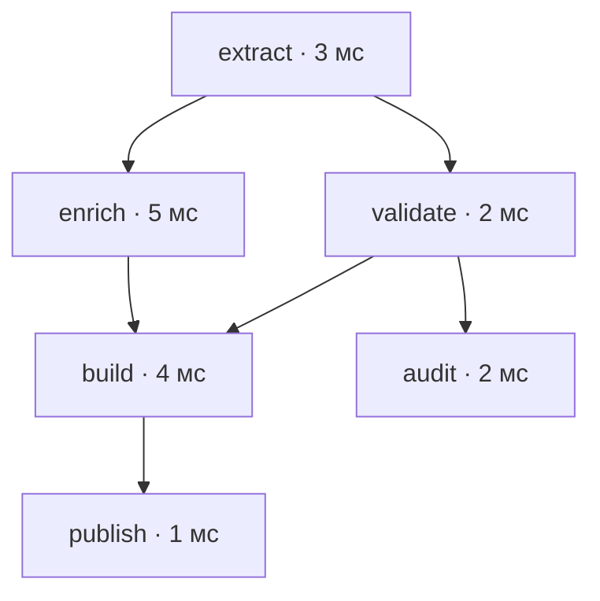

# 8. Алгоритмы и структуры данных

Алгоритм определяет, какие действия выполняет программа и почему они дают нужный результат. Структура данных определяет, как представлено состояние и какие действия над ним доступны по приемлемой цене. В Python часто достаточно встроенного контейнера, но правильный выбор требует понимать его контракт, стоимость и ограничения.

Эта глава сохраняет пять тем и 18 пунктов README. Примеры рассчитаны на Python 3.12–3.14. Там, где обсуждается устройство CPython, это указано отдельно: гарантия языка и конкретная реализация контейнера — разные уровни знания.

Короткие Python-блоки самостоятельны: они содержат необходимые данные и проверки результата. Ожидаемые исключения перехватываются. Один пример использует Hypothesis и помечен зависимостью. Файлы практического проекта в конце главы работают вместе; его выполнение требует только стандартной библиотеки, а тесты — pytest и Hypothesis.

`assert` в учебных примерах фиксирует ожидаемые свойства. Проверки внешнего входа в прикладном проекте выполняются явными исключениями: их нельзя отключать флагом оптимизации интерпретатора.

**Содержание**

1. [Сложность и выбор структуры данных](#complexity-and-structure-choice)
2. [Базовые структуры](#basic-structures)
3. [Поиск и сортировка](#search-and-sorting)
4. [Обходы и зависимости](#traversals-and-dependencies)
5. [Стратегии построения алгоритмов](#algorithm-design)

<a id="complexity-and-structure-choice"></a>

## Сложность и выбор структуры данных

### Big O, амортизированная сложность и расход памяти

Оценка сложности описывает, как растёт необходимая работа или память при увеличении входа. Сначала нужно определить размер входа. Для списка это может быть число элементов n, для графа — число вершин V и рёбер E, для строки — длина текста, для целого числа — число значащих битов.

**Асимптотическая граница не является секундомером.** Запись `T(n) = O(n)` означает верхнюю асимптотическую границу с точностью до постоянного множителя. Для достаточно больших n существуют положительные C и n₀, при которых `T(n) <= C · n`. Она не утверждает, что время на n элементах равно n микросекундам.

Если нужна точная по порядку двусторонняя оценка, используют Θ; нижнюю границу обозначают Ω. Линейный алгоритм формально также принадлежит O(n²), но такое описание обычно слишком слабое. В инженерном обсуждении старайтесь называть наиболее полезную установленную границу.

| Рост | Характерный пример | Что меняется при удвоении n |
|---|---|---|
| O(1) | Индексирование списка при ограниченной цене работы с индексом | Порядок работы не меняется |
| O(log n) | Бинарный поиск в индексируемой последовательности | Добавляется примерно один шаг |
| O(n) | Один проход | Работа примерно удваивается |
| O(n log n) | Общая сравнительная сортировка | Немного больше удвоения |
| O(n²) | Все пары элементов | Примерно четырёхкратный рост |
| O(2ⁿ) | Перебор всех подмножеств | Число вариантов возводится в квадрат |
| O(n!) | Перебор перестановок | Увеличение входа на единицу умножает число вариантов на n+1 |

Для экспоненциальной сложности увеличение n на единицу часто важнее, чем небольшое ускорение каждого шага. Однако и O(n²) может быть практичным при n=20, а O(n) — непригодным, если один шаг выполняет удалённый запрос.

**Худший, лучший и ожидаемый случаи относятся к разным утверждениям.** Линейный поиск находит первый элемент за O(1), а отсутствующий — за Θ(n). Ожидаемое время требует модели распределения входа или случайности алгоритма. Слово «обычно» без модели не является доказательством.

```python
from collections.abc import Sequence


def linear_find(values: Sequence[int], target: int) -> tuple[int | None, int]:
    comparisons = 0
    for index, value in enumerate(values):
        comparisons += 1
        if value == target:
            return index, comparisons
    return None, comparisons


assert linear_find([10, 20, 30], 10) == (0, 1)
assert linear_find([10, 20, 30], 99) == (None, 3)
assert linear_find([], 99) == (None, 0)
```

Здесь считается число сравнений. Если `__eq__` сравнивает большие структуры или выполняет пользовательский код, стоимость каждого сравнения нужно добавить к модели.

**Амортизированная стоимость относится к серии операций.** У динамического массива часть добавлений помещается в существующую ёмкость, а иногда нужен новый буфер и перенос ссылок. Один append может оказаться линейным по текущему размеру, но суммарная работа длинной серии append в обычной реализации CPython — линейная. Поэтому append имеет амортизированную стоимость O(1).

Упрощённая модель с удвоением ёмкости объясняет идею:

```python
def simulated_append_cost(count: int) -> int:
    if count < 0:
        raise ValueError("Число добавлений не может быть отрицательным")
    capacity = 0
    size = 0
    work = 0
    for _ in range(count):
        if size == capacity:
            work += size  # Перенос уже записанных элементов.
            capacity = max(1, 2 * capacity)
        size += 1
        work += 1
    return work


for count in range(1, 200):
    assert simulated_append_cost(count) < 3 * count
```

Сумма переносов `1 + 2 + 4 + ...` ограничена постоянным множителем от n. Это не усреднение по случайным входам: граница серии получается для любого входа такой модели. Настоящий коэффициент роста list в CPython не равен обязательному удвоению; код выше объясняет анализ, а не копирует формулу реализации.

Амортизированная граница не обеспечивает малую задержку **каждого** запроса. Если редкий resize нарушает latency budget, нужны измерения распределения задержек, предварительное выделение или другая организация состояния.

**Вложенность циклов не определяет сложность автоматически.**

```python
def consume_once(size: int) -> tuple[int, int]:
    right = 0
    steps = 0
    for left in range(size):
        while right < size and right <= left + 2:
            right += 1
            steps += 1
    return right, steps


assert consume_once(100) == (100, 100)
```

Несмотря на вложенный while, указатель right движется только вперёд и увеличивается не более n раз. Для серии итераций важна сумма выполненных действий, а не только отступы.

**Рабочая модель Python.** Оценки контейнеров обычно предполагают ограниченную стоимость сравнения, хэширования и машинного индекса. Но Python-int имеет произвольную точность: сложение двух чисел с b битами требует работы, зависящей от b. Сравнение строк может просмотреть длинный общий префикс. Ключ словаря из большого tuple требует хэширования его элементов.

Не называйте `pow(2, n)` константным только потому, что в коде один вызов. Не называйте все операции над числами O(1), если n описывает число разрядов. Для числовых задач различают число арифметических операций и битовую сложность.

**Память тоже имеет модель.**

- **Входная память** уже занята исходными данными.
- **Дополнительная память** нужна алгоритму сверх входа.
- **Память результата** зависит от того, что возвращает API.
- **Пиковая память** учитывает одновременно живущие представления и промежуточные копии.

Функция может использовать O(1) рабочего состояния, но возвращать O(n) элементов. Генератор может выдавать по одному результату, одновременно удерживая исходный список, кэш, открытые источники и стек обхода.

```python
from sys import getsizeof


shared = bytearray(100_000)
references = [shared] * 1000
assert references[0] is references[-1]
assert getsizeof(references) < getsizeof(shared)

# Тысяча ссылок не является тысячей независимых больших буферов.
independent = [bytearray(10) for _ in range(3)]
assert independent[0] is not independent[1]
```

`sys.getsizeof` показывает размер самого объекта, а не весь достижимый граф и не RSS процесса. При подсчёте вложенной памяти общие ссылки нельзя бездумно суммировать многократно. Для фактического пика полезны профилирование и `tracemalloc`; они также имеют собственную область наблюдения и накладные расходы.

### Стоимость операций list, dict, set и deque

Выбирайте контейнер по преобладающим операциям. List удобен для индексов и последовательного хранения ссылок. Dict и set — для поиска по хэшируемому ключу. Deque — для работы с концами очереди. Ни одна структура не делает все операции одинаково дешёвыми.

Таблица описывает обычную модель CPython при ограниченной стоимости хэшей и сравнений. Средняя/ожидаемая оценка хэш-таблицы не является гарантией худшего случая.

| Структура и операция | Типичная оценка | Существенная оговорка |
|---|---|---|
| `list[i]`, присваивание элементу | O(1) | Нормальный целочисленный индекс |
| `list.append` | Амортизированно O(1) | Отдельный resize может быть O(n) |
| `list.pop()` | Амортизированно O(1) | Удаление с конца |
| `list.insert(0, x)`, `list.pop(0)` | O(n) | Сдвиг оставшихся ссылок |
| `x in list` | O(n) в худшем случае | Последовательные сравнения |
| Срез списка длины k | O(k) времени и памяти | Создаётся новый список ссылок |
| Доступ/вставка по ключу dict | В среднем O(1) | Коллизии и resize могут ухудшать отдельный вызов |
| `x in set`, добавление в set | В среднем O(1) | Нужны корректные стабильные hash/eq |
| Обход list/dict/set | O(n) по живым элементам как базовая модель | История удаления и ёмкость хранилища могут влиять |
| `deque.append`, `appendleft`, `pop`, `popleft` | Примерно O(1) | Операции с концами |
| Индексирование deque в середине | O(n) | Не массив со случайным доступом |
| `list.sort` | O(n log n) в худшем случае | Адаптивность помогает на упорядоченном входе |

Для dict с большим числом удалений обход может зависеть от внутренней ёмкости и оставшихся пустых записей. Если вы анализируете именно такой сценарий, n нужно определить точнее, чем `len(mapping)`. Асимптотические таблицы предполагают разумное соотношение живого размера и внутреннего представления.

**Очередь на list часто создаёт квадратичную работу.**

```python
from collections import deque


bad_queue = list(range(5))
bad_result = []
while bad_queue:
    bad_result.append(bad_queue.pop(0))

good_queue = deque(range(5))
good_result = []
while good_queue:
    good_result.append(good_queue.popleft())

assert bad_result == good_result == [0, 1, 2, 3, 4]
```

Для удаления всех элементов с начала list суммируются сдвиги `(n−1) + (n−2) + ... + 1`, то есть Θ(n²). Для очереди из deque та же серия операций линейна по числу извлечений.

**Подготовка индекса окупается повторными запросами.**

```python
records = [{"id": 10, "value": "a"}, {"id": 20, "value": "b"}]
by_id = {record["id"]: record for record in records}

assert by_id[20]["value"] == "b"
assert by_id.get(99) is None

# Значения не скопированы: индекс и список разделяют объекты записей.
by_id[20]["value"] = "changed"
assert records[1]["value"] == "changed"
```

Построение dict требует времени и памяти O(n), зато q последующих запросов вместо O(qn) обходов обычно требуют O(n+q) суммарной работы. При одном запросе индекс может не окупиться.

У такого comprehension есть предметная семантика: повторяющиеся ID перезапишут предыдущую запись. Если дубликат запрещён, проверьте его явно; если нужен one-to-many индекс, группируйте значения.

**Обход dict означает обход ключей.** `target in mapping` проверяет ключи, а `target in mapping.values()` обычно требует линейного просмотра значений. Название контейнера не ускоряет произвольный поиск по любой части записи.

```python
data = {"first": 100, "second": 200}
assert "first" in data
assert 200 not in data
assert 200 in data.values()

allowed = {"read", "write"}
requested = {"read", "delete"}
assert requested - allowed == {"delete"}
assert {"read"} <= allowed
```

Для `set` пересечение часто можно строить, просматривая меньший набор и проверяя вхождение в больший. Объединение должно создать/обработать элементы обоих. Не заменяйте оценку всех операций над множествами одной фразой «O(1)».

Контейнеры также различаются порядком: dict сохраняет порядок вставки, set не предоставляет такого контракта. Стабильный вывод после обхода множества требует отдельного правила порядка. Порядок очереди задаётся операциями добавления и извлечения.

### Хэш-таблицы: коллизии, resize и качество хэша

Хэш-таблица сначала вычисляет хэш ключа, затем использует его для выбора области поиска. Полное равенство ключей проверяется при необходимости. Разные ключи могут иметь один хэш: это **коллизия**, а не логическая ошибка таблицы.

Основной контракт: если `a == b`, их хэши должны совпадать. Обратное неверно. Хэш и значимое для равенства состояние ключа не должны меняться, пока ключ используется в таблице.

```python
from dataclasses import dataclass


@dataclass(frozen=True)
class CollidingKey:
    value: int

    def __hash__(self) -> int:
        return 0  # Намеренно плохой хэш для демонстрации.


left = CollidingKey(1)
right = CollidingKey(2)
assert left != right
assert hash(left) == hash(right)

data = {left: "first", right: "second"}
assert len(data) == 2
assert data[CollidingKey(1)] == "first"
assert data[CollidingKey(2)] == "second"
```

Коллизия не должна приводить к выдаче чужого значения: таблица различает ключи. Но при большом числе коллизий поиск может потребовать много сравнений, вплоть до линейного числа по размеру таблицы.

В dict и set CPython используются варианты открытой адресации: коллизии разрешаются поиском по другим позициям таблицы, а не обязательным созданием связного списка в каждой ячейке. Конкретные схемы пробирования, layout, коэффициенты заполнения и правила resize относятся к версии реализации.

**Хороший хэш распределяет реальные ключи.** Константный хэш корректен относительно базового контракта, но разрушает ожидаемую производительность. Для составного неизменяемого ключа обычно используйте стандартный `hash(tuple_of_fields)`, а не собственные XOR-схемы без анализа.

```python
from dataclasses import dataclass


@dataclass(frozen=True, slots=True)
class CustomerKey:
    tenant: str
    customer_id: int


index = {CustomerKey("north", 42): "record"}
assert index[CustomerKey("north", 42)] == "record"
assert CustomerKey("south", 42) not in index

# Числа, сравнивающиеся равными, могут обозначать один и тот же ключ.
mixed = {1: "integer", True: "boolean", 1.0: "float"}
assert len(mixed) == 1
assert mixed[1] == "float"
```

Три ключа в последнем примере равны по правилам Python. Если предметная модель должна различать bool, int и float, задайте типизированный ключ, например tuple из тега типа и значения, и проверьте допустимые типы входа.

**Resize и удаление.** Таблице нужен свободный запас. При росте она периодически перестраивает внутреннее представление; отдельная вставка может быть заметно дороже предыдущей. Удаление не обязано сразу вернуть ёмкость операционной системе. Служебные отметки удалённых позиций и история изменений также влияют на дальнейший поиск.

Оценка среднего O(1) складывается из разумного распределения хэшей и политики заполнения. Амортизация resize и ожидаемое число проб — разные составляющие аргумента; их не стоит смешивать в одну неуточнённую «гарантию».

**Hash randomization имеет ограниченную задачу.** Некоторые встроенные типы, включая str и bytes, используют рандомизацию хэша между процессами. Это затрудняет определённые атаки с заранее подготовленными коллизиями, но не исправляет пользовательский `__hash__`, который всегда возвращает ноль.

Встроенный `hash` не является контрольной суммой для файла и не подходит как устойчивый ID между запусками. Для воспроизводимого отпечатка используйте определённую байтовую сериализацию и подходящий алгоритм из hashlib, как в предыдущей главе.

Пользовательские `__hash__` и `__eq__` могут выполнять произвольный код и бросать исключения. Формула «поиск dict — O(1)» предполагает, что эти методы сами не выполняют линейный обход, сетевой запрос или изменение сравниваемого состояния.

### Скрытые затраты копирования, сортировки и вложенных проходов

В Python сложность часто скрывается за коротким выражением. Срез, comprehension, `in`, материализация итератора и вызов `sorted` — реальные операции над данными.

**Срез копирует ссылки.** Он не копирует глубоко каждый элемент, но всё равно выделяет список и переносит выбранные ссылки. Рекурсивный бинарный поиск со срезами теряет главное преимущество отсутствия копирования: дополнительная работа на пути может стать линейной, хотя сравнений осталось логарифмически мало.

```python
source = [[1], [2], [3]]
tail = source[1:]
assert tail is not source
assert tail[0] is source[1]
tail[0].append(99)
assert source == [[1], [2, 99], [3]]
```

Если нужен диапазон, передавайте индексы `lo` и `hi`. Если нужно лениво пропустить элементы итератора, рассмотрите `itertools.islice`, учитывая, что пропущенные элементы всё равно нужно пройти.

**Повторная конкатенация списков переносит накопленный префикс.**

```python
parts = [[1, 2], [3], [4, 5]]

bad = []
for part in parts:
    bad = bad + part

good = []
for part in parts:
    good.extend(part)

assert bad == good == [1, 2, 3, 4, 5]
```

При большом числе маленьких частей повторная операция `bad + part` может дать квадратичную работу. Для списков используйте append/extend или comprehension. Для множества текстовых фрагментов обычно подходит `"".join(parts)`. Не опирайтесь на случайную оптимизацию конкретной формы `str +=` в конкретной сборке как на контракт алгоритма.

**Линейный поиск внутри цикла создаёт ещё один проход.**

```python
left = [1, 2, 2, 3, 4]
right = [2, 4, 6]

slow = [value for value in left if value in right]
right_index = set(right)
fast = [value for value in left if value in right_index]

assert slow == fast == [2, 2, 4]
```

Первая версия имеет до O(nm) сравнений, вторая — ожидаемую работу O(n+m) и дополнительную память O(m). Порядок и повторы left сохранены. Замена всего выражения на `set(left) & set(right)` поменяла бы семантику: исчезли бы повторные значения и порядок.

**Незаметное повторение подготовки.** Пишите `allowed = set(values)` вне цикла, если набор не меняется. Выражение `item in set(values)` внутри каждой итерации заново строит таблицу. Аналогично `sorted(records)[0]` сортирует весь набор ради одного минимума; `min(records)` делает один проход.

```python
values = [8, 2, 7, 1]
assert min(values) == sorted(values)[0] == 1

records = [{"id": "a", "score": 8}, {"id": "b", "score": 3}]
best = min(records, key=lambda record: record["score"])
assert best["id"] == "b"
```

**Ленивость не означает бесплатность.** Генератор экономит материализацию результата, но не обязательно саму работу. `sum(1 for x in values if x in a_list)` всё ещё содержит линейное вхождение для каждого x. `sorted(generator)` должен получить все значения до выдачи результата.

**Время жизни промежуточных данных.** При `sorted(transform(list(source)))` исходный список, результат transform и сортировочный буфер могут какое-то время существовать вместе. Профилируйте весь этап, а не только размер возвращённого объекта. Для большого pipeline полезнее убрать промежуточную материализацию, чем переименовать переменные в более короткие.

**Стоимость вывода тоже считается.** Выдать все пары n элементов невозможно за O(n), если сам результат содержит Θ(n²) пар. Генератор уменьшит одновременно хранимую память, но не число результатов и не суммарную стоимость их потребления.

**Источники для деталей Python:** [типы и операции контейнеров](https://docs.python.org/3.14/library/stdtypes.html), [collections](https://docs.python.org/3.14/library/collections.html), [модель данных и hash](https://docs.python.org/3.14/reference/datamodel.html#object.__hash__), [tracemalloc](https://docs.python.org/3.14/library/tracemalloc.html).

<a id="basic-structures"></a>

## Базовые структуры

### Массивы, связные списки, стеки и очереди

**Массив — способ адресовать элементы по индексу.** В классической модели элементы одинакового размера располагаются подряд. Адрес i-го вычисляется по смещению, что даёт O(1) доступ. Динамический массив дополнительно управляет ёмкостью и периодически увеличивает буфер.

CPython list хранит динамический массив **ссылок**. Сами объекты могут находиться в разных местах памяти. `array.array` хранит значения выбранного машинного формата плотнее. Эти представления различаются расходом памяти, локальностью и поддерживаемыми операциями.

Не переносите механически вывод «два массива одинаковой длины занимают одинаковую память» на list: размер объектов за ссылками может отличаться на порядки. Для многомерных числовых данных также имеют значение shape, strides и преобразования, а не только число элементов.

**Связный список хранит переходы между узлами.** В односвязном узле есть значение и ссылка на следующий узел; в двусвязном — ещё и на предыдущий.

| Операция | Динамический массив | Односвязный список |
|---|---|---|
| Получить i-й элемент | O(1) | O(i) переходов от головы |
| Вставить в начало | O(n) сдвигов | O(1) при известной голове |
| Вставить после известного узла | O(n) в общем случае | O(1) изменения ссылок |
| Удалить известный узел | Может потребоваться сдвиг | Нужен предыдущий узел или особый контракт |
| Найти узел по значению | O(n) | O(n) |
| Последовательный обход | Хорошая локальность ссылок | Переходы по отдельным объектам |

Фраза «удаление из связного списка за O(1)» неполна без условия, что нужные ссылки уже известны. Поиск места может оказаться дороже изменения указателей.

```python
from __future__ import annotations

from dataclasses import dataclass


@dataclass(slots=True)
class Node:
    value: int
    next: Node | None = None


def values(head: Node | None) -> list[int]:
    result = []
    while head is not None:
        result.append(head.value)
        head = head.next
    return result


def reverse(head: Node | None) -> Node | None:
    previous = None
    current = head
    while current is not None:
        following = current.next
        current.next = previous
        previous = current
        current = following
    return previous


head = Node(1, Node(2, Node(3)))
assert values(head) == [1, 2, 3]
head = reverse(head)
assert values(head) == [3, 2, 1]
assert reverse(None) is None
```

Инвариант reverse: previous — уже развёрнутый обработанный префикс, current — начало ещё не обработанного остатка. До изменения ссылки сохраняется following; иначе остаток можно потерять.

Предусловие примера — конечный ациклический список. Для потенциально повреждённого списка нужен отдельный поиск цикла или ограничение числа переходов. Разворот меняет существующие узлы: другой владелец ссылки на середину увидит изменённые связи.

В Python собственный связный список часто проигрывает list/deque по расходу памяти и скорости из-за множества объектов и переходов на уровне интерпретатора. Учебное понимание структуры полезно, но не обязывает использовать её в каждом приложении.

**Стек — контракт LIFO.** Последний добавленный элемент извлекается первым. Для обычного стека подходят `list.append` и `list.pop`. Типичные задачи — история обхода, разбор вложенности, откат выбора.

```python
def balanced_brackets(text: str) -> bool:
    expected_opening = {")": "(", "]": "[", "}": "{"}
    opening = set(expected_opening.values())
    stack: list[str] = []
    for character in text:
        if character in opening:
            stack.append(character)
        elif character in expected_opening:
            if not stack or stack.pop() != expected_opening[character]:
                return False
    return not stack


assert balanced_brackets("(a + [b * c])")
assert balanced_brackets("")
assert not balanced_brackets("([)]")
assert not balanced_brackets("(()")
assert not balanced_brackets(")")
```

Алгоритм линейный по длине текста, дополнительная память ограничена максимальной вложенностью. Он проверяет скобки как символы, а не синтаксис Python: скобка внутри строкового литерала здесь тоже учитывается. Для анализа кода нужен токенизатор или парсер.

**Очередь — контракт FIFO.** Первый добавленный элемент извлекается первым. Для обычного однопоточного алгоритма подходит deque. Для координации потоков/асинхронных задач нужны соответствующие очереди с ожиданием и правилами завершения.

Два стека позволяют реализовать очередь с амортизированным O(1) на операцию:

```python
class TwoStackQueue:
    def __init__(self) -> None:
        self._incoming: list[int] = []
        self._outgoing: list[int] = []

    def push(self, value: int) -> None:
        self._incoming.append(value)

    def pop(self) -> int:
        if not self._outgoing:
            while self._incoming:
                self._outgoing.append(self._incoming.pop())
        if not self._outgoing:
            raise IndexError("Пустая очередь")
        return self._outgoing.pop()


queue = TwoStackQueue()
queue.push(1)
queue.push(2)
assert queue.pop() == 1
queue.push(3)
assert queue.pop() == 2
assert queue.pop() == 3

try:
    queue.pop()
except IndexError:
    pass
else:
    raise AssertionError("Из пустой очереди нельзя извлечь элемент")
```

Каждый элемент один раз попадает во входной стек, не более одного раза переносится в выходной и один раз извлекается. Одна операция pop может перенести много элементов, но суммарное число переносов ограничено числом добавлений.

**Кольцевой буфер.** Индексы чтения и записи движутся по модулю ёмкости, позволяя повторно использовать фиксированное хранилище. Нужно явно определить, что делать при заполнении: блокировать, отказывать или вытеснять старое. `deque(maxlen=n)` реализует удобное ограниченное окно с вытеснением, но не протокол подтверждённой доставки.

### Кучи, деревья поиска и префиксные деревья

У этих деревьев разные инварианты. Куча организует получение минимума/максимума, BST — упорядоченный поиск по ключам, trie — общие префиксы последовательностей. Наличие «дерева» в названии не делает их взаимозаменяемыми.

**Двоичная куча.** В min-heap ключ родителя не больше ключей детей. В нумерации массива с нуля дети i находятся по индексам `2*i+1` и `2*i+2`. Между соседними поддеревьями общего порядка нет.

```python
import heapq


heap = [9, 4, 7, 1, 3, 6]
heapq.heapify(heap)
assert heap[0] == 1
assert all(heap[(index - 1) // 2] <= heap[index] for index in range(1, len(heap)))

heapq.heappush(heap, 2)
assert heapq.heappop(heap) == 1
assert heapq.heappop(heap) == 2
```

Путь подъёма/спуска ограничен высотой O(log n). `heapify` строит кучу за O(n), а не O(n log n): примерно половина узлов уже листья, четверть требует исправления не выше одного уровня и лишь немногие находятся высоко. Сумма работ по высотам ограничена рядом вида `n · Σ(h / 2^h)`.

Поддерживать минимум удобно, искать произвольный ключ — обычно линейно. Для удаления/обновления по ID понадобится дополнительный индекс, ленивое удаление или другая структура. Составной ключ должен исключать сравнение несравнимого payload; это подробно разобрано в предыдущей главе.

**Дерево бинарного поиска — BST.** Для каждого узла меньшие ключи находятся слева, большие — справа. Повторы нужно обработать явно: запретить, хранить счётчик или определить дополнительный ключ.

```python
from __future__ import annotations

from dataclasses import dataclass


@dataclass(slots=True)
class BSTNode:
    key: int
    left: BSTNode | None = None
    right: BSTNode | None = None


def insert(root: BSTNode | None, key: int) -> BSTNode:
    if root is None:
        return BSTNode(key)
    node = root
    while True:
        if key == node.key:
            return root
        if key < node.key:
            if node.left is None:
                node.left = BSTNode(key)
                return root
            node = node.left
        else:
            if node.right is None:
                node.right = BSTNode(key)
                return root
            node = node.right


def contains(root: BSTNode | None, key: int) -> bool:
    while root is not None:
        if key == root.key:
            return True
        root = root.left if key < root.key else root.right
    return False


def inorder(root: BSTNode | None) -> list[int]:
    stack: list[BSTNode] = []
    result: list[int] = []
    current = root
    while current is not None or stack:
        while current is not None:
            stack.append(current)
            current = current.left
        current = stack.pop()
        result.append(current.key)
        current = current.right
    return result


root = None
for key in [5, 2, 8, 1, 3, 8]:
    root = insert(root, key)
assert inorder(root) == [1, 2, 3, 5, 8]
assert contains(root, 3)
assert not contains(root, 7)
```

Стоимость поиска и вставки — O(h), где h — высота. У сбалансированного дерева h = O(log n), но обычный BST может превратиться в цепочку при вставке уже отсортированных ключей. Тогда отдельная операция линейна, а построение из n таких ключей квадратично.

Удаление BST имеет три базовых случая: лист, один ребёнок, два ребёнка. В последнем случае узел можно заменить ближайшим следующим ключом из правого поддерева с последующим удалением исходного узла-преемника. Просто удалить значение из середины структуры без перенастройки связей нельзя.

**Балансировка сохраняет высоту.** AVL контролирует разность высот поддеревьев, красно-чёрное дерево — ограничения окраски и чёрной высоты. Повороты меняют локальные связи, сохраняя inorder-порядок. Корректная реализация также обновляет высоты, размеры и другие агрегаты, если они хранятся в узлах.

B-деревья и B+ деревья объединяют много ключей в один узел/страницу. Они важны для индексов и внешней памяти: цена чтения страницы может быть важнее нескольких сравнений в RAM. Понятие «сбалансированное дерево» шире, чем двоичный объект с двумя ссылками.

В стандартной библиотеке нет универсального mutable sorted-map на сбалансированном дереве. Dict сохраняет **порядок вставки**, а не порядок ключей. Для редких обновлений отсортированный list и bisect могут быть проще; для частых ordered-операций нужен подходящий специализированный контейнер.

**Trie, или префиксное дерево.** Переход соответствует элементу ключа, например одному символу строки. Общий префикс хранится общим путём. Признак конца слова отделяет `"car"` от префикса слова `"cart"`.

```python
from __future__ import annotations

from dataclasses import dataclass, field


@dataclass(slots=True)
class TrieNode:
    terminal: bool = False
    children: dict[str, TrieNode] = field(default_factory=dict)


class Trie:
    def __init__(self) -> None:
        self._root = TrieNode()

    def add(self, word: str) -> None:
        node = self._root
        for character in word:
            child = node.children.get(character)
            if child is None:
                child = TrieNode()
                node.children[character] = child
            node = child
        node.terminal = True

    def contains(self, word: str) -> bool:
        node = self._find(word)
        return node is not None and node.terminal

    def _find(self, prefix: str) -> TrieNode | None:
        node = self._root
        for character in prefix:
            child = node.children.get(character)
            if child is None:
                return None
            node = child
        return node

    def words(self, prefix: str, limit: int = 10) -> list[str]:
        if limit < 0:
            raise ValueError("limit не может быть отрицательным")
        node = self._find(prefix)
        if node is None or limit == 0:
            return []
        stack = [(node, prefix)]
        result = []
        while stack and len(result) < limit:
            current, word = stack.pop()
            if current.terminal:
                result.append(word)
            for character in sorted(current.children, reverse=True):
                stack.append((current.children[character], word + character))
        return result


trie = Trie()
for word in ["car", "cart", "cat", "dog", ""]:
    trie.add(word)
assert trie.contains("car")
assert not trie.contains("ca")
assert trie.contains("")
assert trie.words("car") == ["car", "cart"]
assert trie.words("ca", limit=2) == ["car", "cart"]
assert trie.words("missing") == []
```

При ожидаемо постоянном поиске перехода по символу добавление/поиск ключа длины L требуют O(L) переходов. Это не O(1) по размеру строки. Перечисление совпадений зависит от посещённых узлов и общего объёма выданного текста.

В показанном учебном обходе сортируются дочерние ключи и создаются новые строки `word + character`. Их стоимость нужно учитывать отдельно: на глубокой цепочке копирование префиксов может быть квадратичным по её длине. Оптимизированный обход держит изменяемый путь и собирает строку только для результата; сжатое radix-дерево дополнительно объединяет цепочки переходов.

Ограничение числа результатов не ограничивает длину пути до первого слова. Для внешнего API нужны лимиты длины ключа, числа посещений и времени, соответствующие его входу.

Unicode-строка обходится по кодовым точкам, а не по пользовательским графемам. `"é"` и `"e\u0301"` без нормализации имеют разные пути. Правила регистра и нормализации определяются назначением поиска, а не автоматически самим trie.

### Графы: списки смежности vs матрицы

Граф состоит из вершин и рёбер. До выбора алгоритма определите, ориентированы ли связи, есть ли веса, петли и параллельные рёбра. Для зависимости `A → B` направление обычно означает «A должна завершиться до B»; интерфейс, принимающий predecessors, хранит ту же зависимость со стороны B.

| Представление | Память | Перебрать соседей | Проверить ребро u→v |
|---|---|---|---|
| Списки смежности | O(V+E) | O(outdegree(u)) | O(outdegree(u)) без дополнительного индекса |
| Множества смежности | O(V+E), выше константы | O(outdegree(u)) как базовая модель | В среднем O(1) |
| Матрица V×V | O(V²) ячеек | O(V) для строки | O(1) по индексам |
| Список рёбер | O(V+E) с отдельным набором вершин | Обычно O(E) без индекса | Обычно O(E) |

В неориентированном графе ребро обычно хранится дважды в смежности. Это не меняет асимптотику, но влияет на фактический размер и формулы подсчёта рёбер.

```python
vertices = ["A", "B", "C", "isolated"]
edges = [("A", "B"), ("A", "C"), ("B", "C")]

adjacency = {vertex: [] for vertex in vertices}
for source, target in edges:
    adjacency[source].append(target)
assert adjacency["isolated"] == []
assert adjacency["A"] == ["B", "C"]

positions = {vertex: index for index, vertex in enumerate(vertices)}
matrix = [[False] * len(vertices) for _ in vertices]
for source, target in edges:
    matrix[positions[source]][positions[target]] = True

assert matrix[positions["A"]][positions["C"]]
assert not matrix[positions["C"]][positions["A"]]
assert len({id(row) for row in matrix}) == len(vertices)
```

Матрицу нельзя создавать как `[[False] * n] * n`: строки будут одним общим списком, и изменение ячейки затронет несколько логических строк.

Для взвешенной матрицы `0` может обозначать настоящее ребро нулевого веса. Отсутствие ребра кодируйте отдельно — например, `None`. У Floyd–Warshall обычно используется другая конкретная схема с бесконечностью и нулевой диагональю; её начальные условия нужно определить явно.

**Граф — это не только вершины с исходящими рёбрами.** Вершина может встречаться только как сосед или быть изолированной. Нормализация должна включить все вершины:

```python
from collections.abc import Mapping, Sequence


def normalize(graph: Mapping[str, Sequence[str]]) -> dict[str, tuple[str, ...]]:
    nodes = set(graph)
    for neighbors in graph.values():
        nodes.update(neighbors)
    return {node: tuple(graph.get(node, ())) for node in sorted(nodes)}


graph = normalize({"A": ["B"], "isolated": []})
assert graph == {"A": ("B",), "B": (), "isolated": ()}
```

Сортировка здесь нужна для воспроизводимого представления и добавляет свою стоимость. Если порядок не требуется, можно строить нормализацию без сортировки. Если соседство приходит одноразовым генератором, нельзя сначала израсходовать его при сборе вершин, а потом ожидать повторного обхода: материализуйте один раз.

**Мультиграф.** List сохраняет повторные рёбра, set — удаляет их. Матрица bool также не хранит кратность. Это важно для графов маршрутов, зависимостей и подсчёта путей. Выберите, является повтор ребра ошибкой, отдельной связью или безразличным дубликатом.

**Представление влияет на цену алгоритма.** BFS на списках смежности — O(V+E), а на обычной матрице — O(V²), потому что для каждой посещённой вершины просматривается вся строка. Один и тот же псевдокод «для каждого соседа» может скрывать разную работу.

Для больших разреженных графов полезны плотные числовые ID и сжатые представления вроде CSR: массив смещений и общий массив соседей. Они уменьшают число Python-объектов и улучшают локальность, но усложняют динамическую вставку. Сначала определите, граф статический или постоянно меняется.

**Когда нужны только компоненты, дерево смежности может быть лишним.** Структура непересекающихся множеств, DSU/Union-Find, поддерживает слияние компонент и проверку принадлежности одной компоненте.

```python
class DisjointSet:
    def __init__(self, size: int) -> None:
        if size < 0:
            raise ValueError("Размер не может быть отрицательным")
        self.parent = list(range(size))
        self.size = [1] * size

    def find(self, node: int) -> int:
        if not 0 <= node < len(self.parent):
            raise IndexError(node)
        while self.parent[node] != node:
            self.parent[node] = self.parent[self.parent[node]]
            node = self.parent[node]
        return node

    def union(self, left: int, right: int) -> bool:
        left = self.find(left)
        right = self.find(right)
        if left == right:
            return False
        if self.size[left] < self.size[right]:
            left, right = right, left
        self.parent[right] = left
        self.size[left] += self.size[right]
        return True


groups = DisjointSet(5)
assert groups.union(0, 1)
assert groups.union(1, 2)
assert not groups.union(0, 2)
assert groups.find(0) == groups.find(2)
assert groups.find(0) != groups.find(4)
```

Сжатие путей и объединение по размеру дают амортизированную стоимость порядка α(V) на операцию — практически очень медленно растущую обратную функцию Аккермана. Это теоретическая оценка, а не утверждение, что find всегда делает ровно один шаг.

DSU полезна для компонент неориентированного графа и алгоритма Краскала. Она не хранит маршрут, не моделирует достижимость в ориентированном графе и не поддерживает произвольное удаление рёбер обычным union. Для удаления потребуются другие методы или обработка запросов offline.

**Материалы:** [heapq](https://docs.python.org/3.14/library/heapq.html), [учебные материалы MIT 6.006](https://ocw.mit.edu/courses/6-006-introduction-to-algorithms-spring-2020/pages/lecture-notes/).

<a id="search-and-sorting"></a>

## Поиск и сортировка

### Линейный и бинарный поиск; корректность границ

**Линейный поиск** работает без предварительной сортировки: проверяет элементы до совпадения или конца. Это подходящий выбор для небольшого набора, одного запроса или потока, который нельзя произвольно индексировать.

```python
from collections.abc import Iterable


def find_first(values: Iterable[int], target: int) -> int | None:
    for position, value in enumerate(values):
        if value == target:
            return position
    return None


assert find_first([7, 2, 7], 7) == 0
assert find_first(iter([7, 2, 7]), 2) == 1
assert find_first([], 10) is None

stream = iter([1, 2, 3])
assert 2 in stream
assert list(stream) == [3]  # Проверка in уже потребила префикс.
```

**Бинарный поиск** использует монотонность. Для отсортированной последовательности можно разделять диапазон пополам, отбрасывая ту часть, где нужная граница находиться не может. Если доступ по индексу дорогой, O(log n) сравнений не обязательно дают O(log n) времени.

Удобный базовый контракт — lower bound: вернуть первую позицию со значением `>= target`, либо len(values), если такой позиции нет.

```python
from bisect import bisect_left
from collections.abc import Sequence


def lower_bound(values: Sequence[int], target: int) -> int:
    lo = 0
    hi = len(values)
    while lo < hi:
        mid = lo + (hi - lo) // 2
        if values[mid] < target:
            lo = mid + 1
        else:
            hi = mid
    return lo


for values in [[], [1], [1, 1, 1], [1, 3, 3, 7]]:
    for target in range(-1, 10):
        position = lower_bound(values, target)
        assert position == bisect_left(values, target)
        assert all(value < target for value in values[:position])
        assert all(value >= target for value in values[position:])
```

**Доказательство границ.** Используется полуинтервал `[lo, hi)`. Элементы до lo уже меньше target, элементы начиная с hi уже не меньше target. Если mid меньше target, его тоже исключают и ставят `lo = mid + 1`. Иначе mid остаётся допустимым ответом и становится новой правой границей.

На каждой итерации `hi - lo` строго уменьшается. При `lo == hi` неопределённая область пуста, а lo разделяет две части. Пустой вход не требует отдельной ветки: обе границы сразу равны нулю.

Срезы в assert нужны только для проверки свойства примера. Сам поиск не создаёт срезов и использует O(1) дополнительной памяти.

Для точного поиска после lower bound проверьте, что индекс меньше длины и найденное значение равно target. Для дубликатов lower bound возвращает самое левое совпадение.

| Задача в отсортированном массиве | Выражение |
|---|---|
| Первая позиция `>= x` | `bisect_left(a, x)` |
| Первая позиция `> x` | `bisect_right(a, x)` |
| Число вхождений x | `bisect_right(a, x) - bisect_left(a, x)` |
| Последняя позиция `< x` | `bisect_left(a, x) - 1` с проверкой неотрицательности |
| Последняя позиция `<= x` | `bisect_right(a, x) - 1` с проверкой неотрицательности |

**Типичные ошибки:** смешать закрытый диапазон с полуинтервалом; записать `lo = mid` и зациклиться на двух элементах; обратиться по индексу len(a); принять позицию вставки за доказанное совпадение; незаметно искать в несортированных данных.

Проверка отсортированности требует O(n). Её не стоит автоматически повторять перед каждым запросом, если API уже принимает неизменяемый проверенный индекс. Поддерживайте инвариант на границе создания/обновления структуры.

**Бинарный поиск по ответу.** Массив не обязателен. Достаточно предиката, который на целочисленном диапазоне сначала False, затем True.

```python
from collections.abc import Callable, Sequence


def first_true(lo: int, hi: int, predicate: Callable[[int], bool]) -> int:
    """Первая True на [lo, hi); если её нет, исходное hi."""
    if lo > hi:
        raise ValueError("Некорректный диапазон")
    while lo < hi:
        mid = lo + (hi - lo) // 2
        if predicate(mid):
            hi = mid
        else:
            lo = mid + 1
    return lo


def minimum_capacity(weights: Sequence[int], days: int) -> int:
    if days <= 0 or any(weight < 0 for weight in weights):
        raise ValueError("Нужны положительное число дней и неотрицательные веса")
    if not weights:
        return 0

    def feasible(capacity: int) -> bool:
        used_days = 1
        current_load = 0
        for weight in weights:
            if current_load + weight > capacity:
                used_days += 1
                current_load = 0
            current_load += weight
        return used_days <= days

    return first_true(max(weights), sum(weights) + 1, feasible)


assert first_true(0, 10, lambda value: value >= 4) == 4
assert first_true(0, 10, lambda value: False) == 10
assert first_true(0, 0, lambda value: True) == 0
assert minimum_capacity([7, 2, 5, 10, 8], days=2) == 18
assert minimum_capacity([], days=1) == 0
```

Веса нужно перевозить в исходном порядке, каждый день берётся очередной непрерывный участок. Увеличение вместимости не ухудшает допустимость — это и даёт монотонность. Левая граница не меньше самого тяжёлого предмета, правая охватывает сумму всех весов.

Предикат делает O(n) работы. Число его вызовов логарифмично по ширине диапазона вместимости. Итого — O(n log R) арифметических действий, где R — размер диапазона поиска, с учётом принятых ограничений на размер чисел.

Для поиска по float обычно задают число итераций или точность, потому что модель «следующее целое» неприменима. NaN, ошибки округления и немонотонный предикат требуют отдельного анализа; переносить этот код простым заменением `//` на `/` нельзя.

**Когда подготовка оправданна.** Для одного запроса линейный поиск может быть дешевле сортировки. Для множества запросов по порядку — сортировка плюс bisect. Для точного поиска по ключу без ordered-операций — dict/set часто лучше. Стоимость построения индекса входит в сравнение вариантов.

### Стабильность, ключи и устройство Timsort

`sorted(iterable)` создаёт новый список, `list.sort()` меняет существующий и возвращает None. Обе операции стабильны: равные ключи сохраняют взаимный порядок входа.

```python
from operator import itemgetter


rows = [
    {"id": "first", "score": 10},
    {"id": "second", "score": 10},
    {"id": "third", "score": 5},
]
ascending = sorted(rows, key=itemgetter("score"))
descending = sorted(rows, key=itemgetter("score"), reverse=True)
assert [row["id"] for row in ascending] == ["third", "first", "second"]
assert [row["id"] for row in descending] == ["first", "second", "third"]

# Разворот готового списка разворачивает и порядок равных элементов.
assert [row["id"] for row in reversed(ascending)] == ["second", "first", "third"]
```

`reverse=True` не равен обычному развороту отсортированного результата с точки зрения стабильности равных ключей. Если исходный порядок сам получен из set или из недетерминированного источника, стабильность его не превращает в единый порядок между запусками.

**Функция key вычисляется один раз на элемент.** Это позволяет вынести дорогую подготовку из многочисленных сравнений.

```python
calls: list[str] = []


def normalized_key(value: str) -> str:
    calls.append(value)
    return value.casefold()


values = ["Bob", "alice", "ALICE"]
ordered = sorted(values, key=normalized_key)
assert ordered == ["alice", "ALICE", "Bob"]
assert calls == values
assert values == ["Bob", "alice", "ALICE"]
```

Если вычисление ключей стоит f(x), полная работа включает `Σ f(x)`, сравнения ключей и собственно перемещения ссылок. Формула O(n log n) не отменяет стоимость парсинга даты или обращения к внешнему сервису внутри key.

**Составной ключ и несколько стабильных проходов.**

```python
from operator import itemgetter


rows = [
    {"team": "b", "score": 2, "id": "x"},
    {"team": "a", "score": 1, "id": "y"},
    {"team": "a", "score": 3, "id": "z"},
]
one_pass = sorted(rows, key=lambda row: (row["team"], -row["score"]))

many_passes = sorted(rows, key=itemgetter("score"), reverse=True)
many_passes.sort(key=itemgetter("team"))

assert [row["id"] for row in one_pass] == ["z", "y", "x"]
assert one_pass == many_passes
```

При нескольких проходах сначала сортируют по менее значимому критерию, потом по более значимому. Отрицание удобно для подходящего числового поля, но не является универсальным способом обратить порядок строк или произвольного объекта.

`functools.cmp_to_key` адаптирует компаратор, когда key действительно неудобен, но компаратор вызывается многократно. Он должен задавать согласованный порядок. Непоследовательные результаты сравнения нельзя исправить выбором «более умной» сортировки.

**Как устроена адаптивная сортировка CPython.** Реализация относится к семейству стабильных естественных merge-sort, обычно обсуждаемому как Timsort:

- обнаруживает уже упорядоченные последовательности — runs;
- нормализует/доращивает короткие runs;
- сливает соседние runs, сохраняя стабильность;
- использует дополнительные приёмы, включая galloping, когда один run долго выигрывает сравнения;
- выбирает порядок слияний так, чтобы учитывать длины runs и не создавать неудачный перекос.

В CPython 3.11+ стратегия выбора порядка слияний основана на Powersort. Поэтому объяснение, сводящее современную реализацию только к старым числовым инвариантам стека Timsort, неполно. Точные minrun, galloping и внутренние структуры смотрите в исходниках выбранной версии; это не публичный контракт языка.

Худшая асимптотика сравнительной сортировки остаётся O(n log n), а на подходящем уже упорядоченном входе работа может быть линейной. Дополнительная память в худшем случае — O(n). Сортировка **in place по API** означает изменение исходного list, а не обещание O(1) вспомогательной памяти.

Обратные runs обрабатываются с сохранением стабильности равных ключей. Простая учебная схема «найти невозрастающий участок и полностью развернуть» без учёта равных элементов может нарушить это свойство.

**Пропуски и NaN требуют политики.**

```python
import math


values = [3.0, None, 1.0, float("nan"), 2.0]


def key(value: float | None) -> tuple[int, float]:
    if value is None:
        return 2, 0.0
    if math.isnan(value):
        return 1, 0.0
    return 0, value


ordered = sorted(values, key=key)
assert ordered[:3] == [1.0, 2.0, 3.0]
assert math.isnan(ordered[3])
assert ordered[4] is None
```

В примере сначала обычные числа, затем NaN, затем None. Это явно заданный порядок приложения. Не используйте `value or default` для поиска пропусков: ноль — допустимое falsy-число.

**Нижняя граница сортировки имеет условия.** Для произвольных ключей в модели сравнений нужно Ω(n log n) сравнений в худшем случае. Это не запрещает линейную сортировку ограниченных целых: counting/radix sort используют дополнительную структуру ключа.

```python
def counting_sort(values: list[int], max_key: int) -> list[int]:
    if max_key < 0:
        raise ValueError("max_key не может быть отрицательным")
    counts = [0] * (max_key + 1)
    for value in values:
        if type(value) is not int or not 0 <= value <= max_key:
            raise ValueError("Значение вне допустимого диапазона")
        counts[value] += 1
    return [value for value, count in enumerate(counts) for _ in range(count)]


assert counting_sort([3, 1, 3, 0], max_key=5) == [0, 1, 3, 3]
assert counting_sort([], max_key=2) == []
```

Стоимость — O(n+U), где U — размер диапазона ключей. Когда U огромен относительно n, массив счётчиков непригоден. Показанная версия сортирует сами числа; стабильная сортировка записей по такому ключу требует отдельной схемы размещения и сохранения порядка payload.

**Побочные эффекты.** Не меняйте сортируемую коллекцию из key или компаратора. Исключение сравнения не обещает транзакционный откат уже выполненных изменений списка. Если исходный порядок необходимо сохранить при любой ошибке, работайте с отдельной копией и публикуйте результат только после успеха.

**Документация:** [сортировка в Python](https://docs.python.org/3.14/howto/sorting.html), [устройство сортировки CPython 3.14](https://github.com/python/cpython/blob/3.14/Objects/listsort.txt), [bisect](https://docs.python.org/3.14/library/bisect.html).

### Два указателя, sliding window и prefix sums

Общий приём этих алгоритмов — повторно использовать сведения о близких участках, не вычисляя их заново. Применимость зависит от порядка и свойств данных.

**Два указателя на отсортированной последовательности.** Чтобы найти пару с заданной суммой, можно двигаться с двух концов. Если сумма мала, левый указатель увеличивается; если велика — правый уменьшается.

```python
from collections.abc import Sequence


def two_sum_sorted(values: Sequence[int], target: int) -> tuple[int, int] | None:
    left = 0
    right = len(values) - 1
    while left < right:
        total = values[left] + values[right]
        if total == target:
            return left, right
        if total < target:
            left += 1
        else:
            right -= 1
    return None


assert two_sum_sorted([1, 2, 4, 8, 10], 12) == (1, 4)
assert two_sum_sorted([2, 2], 4) == (0, 1)
assert two_sum_sorted([2], 4) is None
assert two_sum_sorted([], 4) is None
```

Предусловие — неубывающий порядок. При маленькой сумме текущее левое значение не подходит ни с каким правым, который ещё меньше текущего. Поэтому его можно исключить. Указатели суммарно делают O(n) шагов; дополнительная память O(1).

Если сначала сортировать неупорядоченный вход, стоимость сортировки и восстановление исходных индексов входят в задачу. Для поиска пары без сортировки можно хранить уже встреченные дополнения в dict/set с ожидаемой линейной работой и O(n) памятью.

**Два указателя для слияния.** Два отсортированных входа можно объединить за O(n+m), каждый элемент продвигается один раз. Для стабильности при равных ключах сначала берётся элемент левого входа. Тот же принцип используется в merge-sort, merge join и слиянии отсортированных файлов.

**Sliding window с суммой.** Для неотрицательных значений расширение окна не уменьшает сумму, а удаление слева не увеличивает. Это позволяет искать самое длинное окно с суммой не больше лимита.

```python
def longest_window(values: list[int], budget: int) -> tuple[int, int]:
    """Границы [left, right) первого самого длинного допустимого окна."""
    if budget < 0 or any(value < 0 for value in values):
        raise ValueError("Нужны неотрицательные значения и budget")
    left = 0
    total = 0
    best = (0, 0)
    for right, value in enumerate(values):
        total += value
        while total > budget:
            total -= values[left]
            left += 1
        if right + 1 - left > best[1] - best[0]:
            best = left, right + 1
    return best


assert longest_window([2, 1, 1, 3, 1], budget=4) == (0, 3)
assert longest_window([0, 0, 1], budget=0) == (0, 2)
assert longest_window([], budget=4) == (0, 0)
assert longest_window([5], budget=4) == (0, 0)

try:
    longest_window([4, -3], budget=2)
except ValueError:
    pass
else:
    raise AssertionError("Отрицательные значения нарушают условие алгоритма")
```

Каждый элемент один раз добавляется справа и не более одного раза удаляется слева, поэтому while не создаёт квадратичную работу. Проверка входа также линейна и не меняет итоговую O(n) оценку.

С отрицательными числами схема неверна: для `[4, -3]` всё окно имеет сумму 1, но преждевременное удаление 4 уже потеряло допустимый ответ. Нужен другой алгоритм, а не только другой оператор сравнения.

**Окно без повторяющихся символов.** Условие может относиться не к сумме, а к последней позиции значения.

```python
def longest_unique_length(text: str) -> int:
    last_position: dict[str, int] = {}
    left = 0
    best = 0
    for right, character in enumerate(text):
        previous = last_position.get(character, -1)
        left = max(left, previous + 1)
        last_position[character] = right
        best = max(best, right - left + 1)
    return best


assert longest_unique_length("abba") == 2
assert longest_unique_length("abcabcbb") == 3
assert longest_unique_length("") == 0
```

`max` не позволяет вернуть левую границу назад из-за повтора вне текущего окна. Сложность ожидаемо O(n) по кодовым точкам строки; память зависит от числа различных символов.

**Максимум фиксированного окна нельзя обновлять только одной переменной.** Когда прежний максимум выходит из окна, нужно знать следующего кандидата. Монотонная deque хранит индексы потенциальных максимумов.

```python
from collections import deque


def window_maxima(values: list[int], width: int) -> list[int]:
    if width <= 0:
        raise ValueError("Ширина должна быть положительной")
    candidates: deque[int] = deque()
    result = []
    for right, value in enumerate(values):
        while candidates and candidates[0] <= right - width:
            candidates.popleft()
        while candidates and values[candidates[-1]] <= value:
            candidates.pop()
        candidates.append(right)
        if right + 1 >= width:
            result.append(values[candidates[0]])
    return result


assert window_maxima([1, 3, -1, -3, 5, 3, 6, 7], 3) == [3, 3, 5, 5, 6, 7]
assert window_maxima([2, 2, 2], 2) == [2, 2]
assert window_maxima([1], 2) == []
assert window_maxima([], 1) == []
```

Индексы в deque возрастают, значения по ним убывают. Более старый элемент, не превосходящий новый, больше не нужен: новый не хуже по значению и выйдет из будущих окон позже. Каждый индекс добавляется один раз и удаляется не более одного раза — итог O(n) времени и O(min(n, width)) состояния, не считая результата.

**Prefix sums превращают сумму диапазона в разность.** Пусть prefix[i] — сумма первых i элементов. Тогда сумма `[left, right)` равна `prefix[right] - prefix[left]`.

```python
from itertools import accumulate


values = [3, -2, 5, 1]
prefix = list(accumulate(values, initial=0))
assert prefix == [0, 3, 1, 6, 7]


def range_sum(left: int, right: int) -> int:
    if not 0 <= left <= right <= len(values):
        raise ValueError("Некорректные границы")
    return prefix[right] - prefix[left]


assert range_sum(1, 3) == 3
assert range_sum(0, 4) == 7
assert range_sum(2, 2) == 0
```

Построение O(n), запрос O(1) арифметических операций, память O(n). Структура рассчитана на неизменяемые данные: изменение одного исходного элемента делает неверным весь последующий префикс.

Числовая модель важна. Для float разность двух близких больших сумм может терять точность. Для точных целых такая ошибка округления отсутствует, но стоимость операций растёт с числом битов.

**Подмассивы с заданной суммой и отрицательные значения.** Если `prefix[j] - prefix[i] == target`, то нужен предыдущий prefix, равный `prefix[j] - target`. Частоты прошлых префиксов решают задачу без предположения о неотрицательности.

```python
from collections import Counter


def count_subarrays(values: list[int], target: int) -> int:
    frequencies = Counter({0: 1})
    prefix = 0
    count = 0
    for value in values:
        prefix += value
        count += frequencies[prefix - target]
        frequencies[prefix] += 1
    return count


assert count_subarrays([1, -1, 0], target=0) == 3
assert count_subarrays([1, 1, 1], target=2) == 2
assert count_subarrays([], target=0) == 0
```

Начальный `0: 1` учитывает диапазоны от начала массива. Текущий префикс добавляется **после** подсчёта: иначе при target=0 можно ошибочно посчитать пустой диапазон. Время ожидаемо O(n), память O(n) по числу разных префиксов.

**Difference array** решает обратную задачу: много добавлений к диапазонам, затем одно получение всех итоговых значений. Для изменения `[left, right)` на delta записывают `diff[left] += delta` и `diff[right] -= delta`. Один последующий prefix pass восстанавливает результат.

```python
from itertools import accumulate


size = 5
diff = [0] * (size + 1)
for left, right, delta in [(1, 4, 3), (2, 5, -1)]:
    if not 0 <= left <= right <= size:
        raise ValueError("Некорректный диапазон обновления")
    diff[left] += delta
    diff[right] -= delta

result = list(accumulate(diff))[:size]
assert result == [0, 3, 2, 2, -1]
```

Если нужны перемежающиеся обновления и запросы, обычный префикс уже недостаточен. Дерево Фенвика поддерживает точечные изменения и префиксные суммы за O(log n), занимая O(n) памяти.

```python
class Fenwick:
    def __init__(self, size: int) -> None:
        if size < 0:
            raise ValueError("Размер не может быть отрицательным")
        self._tree = [0] * (size + 1)

    def add(self, index: int, delta: int) -> None:
        if not 0 <= index < len(self._tree) - 1:
            raise IndexError(index)
        position = index + 1
        while position < len(self._tree):
            self._tree[position] += delta
            position += position & -position

    def prefix(self, stop: int) -> int:
        if not 0 <= stop < len(self._tree):
            raise IndexError(stop)
        total = 0
        while stop:
            total += self._tree[stop]
            stop -= stop & -stop
        return total

    def range_sum(self, left: int, right: int) -> int:
        if not 0 <= left <= right < len(self._tree):
            raise ValueError("Некорректный диапазон")
        return self.prefix(right) - self.prefix(left)


tree = Fenwick(4)
for index, value in enumerate([3, -2, 5, 1]):
    tree.add(index, value)
assert tree.range_sum(1, 3) == 3
tree.add(1, 4)
assert tree.range_sum(1, 3) == 7
assert tree.prefix(0) == 0
```

Внешний API использует индексы с нуля, внутренний — с единицы. Проверка add исключает внутренний нулевой индекс, который иначе не продвигался бы. Размер блока определяется младшим установленным битом.

Построение в примере повторными add требует O(n log n); существуют линейные способы инициализации. Для более общих агрегатов и диапазонных обновлений используют segment tree, иногда с lazy propagation. Не переносите формулу `prefix[r] - prefix[l]` на минимум: у операции min нет обратного вычитания.

### Top-k, внешняя сортировка и данные больше памяти

Если нужен только минимум, полный порядок лишний. Если нужны k лучших элементов, выбор зависит от отношения k к n, порядка поступления, памяти и требований к порядку результата.

| Задача | Подход | Типичная стоимость |
|---|---|---|
| Один минимум/максимум | Один проход, `min/max` | O(n), O(1) состояния |
| Небольшой top-k | Ограниченная куча | O(n log k), O(k) состояния |
| Все данные по порядку | Полная сортировка | O(n log n), память зависит от реализации |
| k-я порядковая статистика | Selection/quickselect | В среднем O(n) у подходящей рандомизированной схемы |
| Отсортированные входные потоки | k-way merge | O(n log r) для r активных потоков |
| Вход больше RAM | Внешняя сортировка runs | Несколько проходов и дисковый обмен |

Табличная формула с log k подразумевает k>=2; для k=1 нужен линейный проход. Функции stdlib имеют собственные оптимизации и крайние случаи. Выходной список дополнительно занимает память по размеру результата.

```python
import heapq
from operator import itemgetter


rows = [
    {"id": "a", "score": 10},
    {"id": "b", "score": 30},
    {"id": "c", "score": 30},
    {"id": "d", "score": 20},
]
best = heapq.nlargest(2, rows, key=itemgetter("score"))
assert [row["id"] for row in best] == ["b", "c"]
assert best == sorted(rows, key=itemgetter("score"), reverse=True)[:2]
assert heapq.nlargest(0, rows, key=itemgetter("score")) == []
```

При равных ключах здесь сохраняется порядок входа, но это не означает, что любая самодельная куча с `(score, payload)` будет стабильна. Задайте правило разрешения равенства отдельно.

**Quickselect не сортирует весь вход.** Разбиение вокруг pivot позволяет продолжить только в части, содержащей нужный ранг. У обычных вариантов ожидаемое время линейно при подходящей случайности, а худший случай может быть O(n²). Детерминированный median-of-medians обеспечивает линейную худшую границу, но сложнее и имеет другие константы.

Python stdlib не предоставляет отдельную общую функцию quickselect. Не заменяйте production-сортировку первым коротким рекурсивным примером из интернета: повторы, плохой pivot, срезы и глубина рекурсии способны испортить и сложность, и память.

**Внешняя сортировка состоит из двух этапов.** Сначала вход разбивается на порции, каждая сортируется в памяти и сохраняется как run. Затем runs сливаются. Когда файлов больше допустимого числа открытых источников, слияние выполняется в несколько проходов.

Следующий самостоятельный пример сортирует поток целых signed 64-bit. Ограниченный числовой формат нужен, чтобы число элементов порции было связано с предсказуемым размером чисел и их текстовой записи. Временные файлы принадлежат функции.

```python
import heapq
from collections.abc import Iterable, Iterator
from contextlib import ExitStack, closing
from itertools import count, islice
from pathlib import Path
from tempfile import TemporaryDirectory


def external_sorted(
    values: Iterable[int], chunk_size: int = 1000, fan_in: int = 4
) -> Iterator[int]:
    if type(chunk_size) is not int or chunk_size <= 0:
        raise ValueError("chunk_size должен быть положительным целым")
    if type(fan_in) is not int or fan_in < 2:
        raise ValueError("fan_in должен быть целым не меньше двух")

    with TemporaryDirectory() as directory:
        root = Path(directory)
        identifiers = count()

        def new_path() -> Path:
            return root / f"run-{next(identifiers):08d}.txt"

        def write_run(path: Path, numbers: Iterable[int]) -> None:
            with path.open("w", encoding="utf-8", newline="\n") as stream:
                for number in numbers:
                    stream.write(f"{number}\n")

        source = iter(values)
        runs = []
        while chunk := list(islice(source, chunk_size)):
            if any(
                type(value) is not int or not -(1 << 63) <= value < (1 << 63)
                for value in chunk
            ):
                raise ValueError("Ожидались signed 64-bit integer")
            chunk.sort()
            path = new_path()
            write_run(path, chunk)
            runs.append(path)
        del source

        while len(runs) > 1:
            next_runs = []
            for start in range(0, len(runs), fan_in):
                group = runs[start : start + fan_in]
                merged_path = new_path()
                with ExitStack() as stack:
                    streams = [
                        stack.enter_context(path.open(encoding="utf-8"))
                        for path in group
                    ]
                    ordered = heapq.merge(*(map(int, stream) for stream in streams))
                    write_run(merged_path, ordered)
                for path in group:
                    path.unlink()
                next_runs.append(merged_path)
            runs = next_runs

        if runs:
            with runs[0].open(encoding="utf-8") as stream:
                for line in stream:
                    yield int(line)


data = [9, -1, 4, 4, 0, 8, 3, 2, 10, -5, 7]
assert list(external_sorted(iter(data), chunk_size=3, fan_in=2)) == sorted(data)
assert list(external_sorted([], chunk_size=3, fan_in=2)) == []

# При раннем прекращении чтения закрываем генератор явно.
with closing(external_sorted(data, chunk_size=2, fan_in=2)) as ordered:
    assert next(ordered) == -5
```

Во время merge открываются не больше fan_in входов и один выход. Равенство ключей не требует сравнения несравнимых объектов, потому что в примере передаются сами числа. Для записей нужно определить общий ключ и, если требуется глобальная стабильность, сохранить исходный порядковый номер.

Если R — число исходных runs, число merge-проходов имеет порядок log по основанию fan_in от R. Каждый проход читает и записывает данные. Поэтому объём дискового обмена, число дескрипторов, свободное место и ширина записи — часть оценки, а не второстепенная деталь.

Порции чисел ограничены chunk_size, но программа хранит список путей O(R), а файловые объекты имеют буферы. Это не обещание O(1) всей памяти при любом числе runs. Для экстремального масштаба нужен также дисковый manifest или другой ограниченный способ управления runs.

Функция не возвращает первые числа до завершения подготовки и слияния. Генератор ограничивает выдачу, но не делает сортировку алгоритмом с немедленным первым результатом. При раннем выходе потребитель явно закрывает генератор, чтобы временные файлы удалились без ожидания сборки мусора.

**Обработка данных больше памяти шире сортировки.** Проекция может отбросить ненужные поля до материализации; фильтрация — сократить вход; hash partitioning — разнести обработку по разделам; spill — перенести часть состояния на диск. Но один очень частый ключ может создать перекос, а большой точный set для дедупликации всё равно растёт вместе с кардинальностью.

Bloom filter может экономно сообщить «точно не было» или «возможно было», но допускает ложноположительные ответы. Если пропуск уникальной записи недопустим, вероятностный фильтр используют перед точным хранилищем, а не вместо него.

Чанкование помогает только тогда, когда итоговый этап также ограничивает состояние. Цикл по кускам, который затем складывает все записи в общий list или неограниченный dict, не решает проблему RAM.

**Документация:** [heapq и слияние](https://docs.python.org/3.14/library/heapq.html), [contextlib и ExitStack](https://docs.python.org/3.14/library/contextlib.html#contextlib.ExitStack).

<a id="traversals-and-dependencies"></a>

## Обходы и зависимости

### BFS, DFS, поиск циклов и топологическая сортировка

**BFS — обход в ширину.** Очередь сначала обрабатывает вершины на расстоянии 0 рёбер, затем 1, затем 2 и так далее. Для невзвешенного графа первое обнаружение вершины даёт минимальное число рёбер от источника.

```python
from collections import deque
from collections.abc import Mapping, Sequence


def shortest_unweighted_path(
    graph: Mapping[str, Sequence[str]], start: str, goal: str
) -> list[str] | None:
    if start not in graph or goal not in graph:
        raise KeyError("Неизвестная вершина")
    parent: dict[str, str | None] = {start: None}
    queue = deque([start])
    while queue:
        node = queue.popleft()
        if node == goal:
            path = []
            current: str | None = goal
            while current is not None:
                path.append(current)
                current = parent[current]
            return path[::-1]
        for neighbor in graph[node]:
            if neighbor not in parent:
                parent[neighbor] = node
                queue.append(neighbor)
    return None


graph = {"A": ["B", "C"], "B": ["D"], "C": ["D"], "D": [], "X": []}
assert shortest_unweighted_path(graph, "A", "D") == ["A", "B", "D"]
assert shortest_unweighted_path(graph, "A", "A") == ["A"]
assert shortest_unweighted_path(graph, "A", "X") is None
```

Предусловие — нормализованный граф: каждый сосед также присутствует ключом. Вершина отмечается при постановке в очередь, иначе несколько родителей могут много раз добавить её до первого извлечения.

Списки смежности дают O(V+E) времени и O(V) дополнительного состояния в худшем случае. Если обходится только компонента источника, фактическая работа относится к её достижимой части; проверка/нормализация всего входа отдельно может просмотреть весь граф.

Хранимые parent позволяют восстановить путь. Если нужна только достижимость, достаточно visited. Если несколько кратчайших путей равны по длине, выбранный путь зависит от порядка соседей. Для детерминированного API задайте этот порядок при создании графа.

**DFS — обход в глубину.** Обработка продолжает текущую ветку до завершения, затем возвращается к отложенным соседям. DFS удобен для порядка завершения, циклов, компонент сильной связности и деревьев разбора. Сам по себе он не гарантирует кратчайший путь.

Для ориентированного графа различают три состояния вершины:

- белая — ещё не посещена;
- серая — находится в текущем активном пути DFS;
- чёрная — обработка завершена.

Ребро в серую вершину замыкает цикл текущего пути. Ребро в чёрную вершину само по себе циклом не является: общая зависимость у двух ветвей нормальна.

```python
from collections.abc import Iterator, Mapping, Sequence


def directed_cycle(graph: Mapping[str, Sequence[str]]) -> tuple[str, ...] | None:
    color: dict[str, int] = {}
    for start in graph:
        if color.get(start, 0):
            continue
        color[start] = 1
        path = [start]
        position = {start: 0}
        stack: list[tuple[str, Iterator[str]]] = [(start, iter(graph[start]))]
        while stack:
            node, neighbors = stack[-1]
            neighbor = next(neighbors, None)
            if neighbor is None:
                stack.pop()
                path.pop()
                del position[node]
                color[node] = 2
                continue
            state = color.get(neighbor, 0)
            if state == 1:
                return tuple(path[position[neighbor] :] + [neighbor])
            if state == 0:
                color[neighbor] = 1
                position[neighbor] = len(path)
                path.append(neighbor)
                stack.append((neighbor, iter(graph[neighbor])))
    return None


assert directed_cycle({"A": ["B"], "B": ["C"], "C": ["A"]}) == ("A", "B", "C", "A")
assert directed_cycle({"A": ["B", "C"], "B": ["C"], "C": []}) is None
assert directed_cycle({"A": ["A"]}) == ("A", "A")
assert directed_cycle({}) is None
```

Строковые имена не могут быть None, поэтому здесь None используется как маркер конца итератора. Для графа с произвольными вершинами, где None допустим, нужен отдельный объект-маркер или перехват StopIteration.

Алгоритм возвращает конкретный замкнутый путь, а не просто набор «каких-то заблокированных вершин». Состояние position хранится только для активного пути. На каждое ребро приходится ограниченное число действий: O(V+E) времени и O(V) состояния.

В **неориентированном** простом графе обратное ребро к родителю нужно учитывать отдельно, иначе любое дерево выглядит циклическим. В мультиграфе два параллельных ребра требуют различения по ID: просто пропустить все рёбра к родителю уже недостаточно.

**Топологический порядок** существует только для DAG. Для каждого ребра u→v вершина u должна идти раньше v. Допустимых порядков может быть несколько; это частичный порядок зависимостей, а не единственная «правильная сортировка».

Алгоритм Кана хранит входящие степени и последовательно выбирает вершины, у которых не осталось необработанных предшественников.

```python
from collections import deque


def topological_order(graph: dict[str, list[str]]) -> list[str]:
    indegree = dict.fromkeys(graph, 0)
    for neighbors in graph.values():
        for neighbor in neighbors:
            indegree[neighbor] += 1
    ready = deque(node for node in graph if indegree[node] == 0)
    result = []
    while ready:
        node = ready.popleft()
        result.append(node)
        for neighbor in graph[node]:
            indegree[neighbor] -= 1
            if indegree[neighbor] == 0:
                ready.append(neighbor)
    if len(result) != len(graph):
        raise ValueError("Граф содержит ориентированный цикл")
    return result


graph = {
    "extract": ["check", "clean"],
    "check": ["load"],
    "clean": ["load"],
    "load": [],
}
order = topological_order(graph)
positions = {node: index for index, node in enumerate(order)}
assert set(order) == set(graph)
assert all(
    positions[source] < positions[target]
    for source, targets in graph.items()
    for target in targets
)
assert topological_order({}) == []
```

Инвариант: indegree вершины равна числу входящих рёбер от ещё не удалённых вершин. Если в непустом остатке нет нулевой входящей степени, в нём есть цикл. Но не каждая оставшаяся вершина обязана сама лежать в цикле: часть может быть только его downstream-зависимостью.

С deque сложность O(V+E). Если каждый раз нужна лексикографически минимальная доступная вершина, используйте heapq и добавьте O(V log V) к оценке. Полная сортировка ready на каждом шаге может оказаться существенно дороже.

**Стандартная библиотека: graphlib.TopologicalSorter.** На вход передаётся mapping `вершина → её предшественники`. Это обратное направление хранения по сравнению с исходящими списками смежности выше.

```python
from graphlib import CycleError, TopologicalSorter


dependencies = {
    "extract_orders": (),
    "extract_users": (),
    "join": ("extract_orders", "extract_users"),
    "publish": ("join",),
}
order = tuple(TopologicalSorter(dependencies).static_order())
positions = {node: index for index, node in enumerate(order)}
assert positions["extract_orders"] < positions["join"] < positions["publish"]
assert positions["extract_users"] < positions["join"]

sorter = TopologicalSorter(dependencies)
sorter.prepare()
ready = sorter.get_ready()
assert set(ready) == {"extract_orders", "extract_users"}
sorter.done(*ready)
assert sorter.get_ready() == ("join",)
sorter.done("join")
assert sorter.get_ready() == ("publish",)
sorter.done("publish")
assert not sorter.is_active()

try:
    tuple(TopologicalSorter({"a": ("b",), "b": ("a",)}).static_order())
except CycleError as error:
    cycle = error.args[1]
    assert cycle[0] == cycle[-1]
else:
    raise AssertionError("Цикл должен быть обнаружен")
```

`get_ready` выдаёт готовые задачи; `done` нужно вызывать после их реального завершения, а не сразу после передачи worker. Отказ задачи, retries, отмена и политика выполнения независимых ветвей остаются задачами приложения. Сам TopologicalSorter не запускает вычисления.

В Python 3.14 `prepare` можно вызвать повторно, пока обход ещё не начат. Пример вызывает его один раз и совместим с 3.12. Порядок независимых задач не стоит считать каноническим без явно выбранной политики.

**Компоненты сильной связности.** В ориентированном графе вершины одной SCC достижимы друг из друга. Сжатие SCC создаёт DAG компонент. Для полного анализа циклических зависимостей это полезнее, чем один свидетель цикла.

Косарайю выполняет DFS для порядка завершения, затем обход транспонированного графа в обратном порядке завершения. Тарьян использует номера открытия, low-link и стек активных компонент. Оба дают O(V+E) на списках смежности, но их состояния различаются: нельзя заменить low-link произвольным минимумом соседних номеров.

### Кратчайшие пути и ограничения весов

Прежде чем выбирать алгоритм, уточните, что означает длина: число рёбер, сумма весов, максимальное ребро на пути или другая функция. У маршрута с двумя рёбрами весом по 100 меньше переходов, чем у трёх рёбер по 1, но больше суммарный вес.

| Условия | Подход | Базовая оценка |
|---|---|---|
| Все рёбра одинакового положительного веса | BFS | O(V+E) |
| Веса только 0 и 1 | 0–1 BFS с deque | O(V+E) |
| Все веса неотрицательны | Dijkstra с приоритетной очередью | Зависит от реализации очереди |
| DAG, веса могут быть отрицательными | Релаксации в топологическом порядке | O(V+E) |
| Отрицательные веса в общем графе | Bellman–Ford | O(VE) как стандартная худшая оценка |
| Пути между всеми парами, умеренный V | Floyd–Warshall | O(V³) времени и O(V²) памяти |
| Есть полезная эвристика к цели | A* | Требует условий на эвристику и правила обработки вершин |

**Релаксация** пытается улучшить расстояние до v через ребро u→v: `candidate = distance[u] + weight(u, v)`. Если candidate меньше известного, обновляются расстояние и, при необходимости, parent.

**Dijkstra фиксирует ближайшую вершину.** При неотрицательных весах путь через ещё более далёкую вершину не может неожиданно сделать её дешевле. Именно это свойство позволяет доверять минимальному актуальному расстоянию в очереди.

```python
import heapq
from itertools import count


def dijkstra(
    graph: dict[str, dict[str, int]], start: str
) -> tuple[dict[str, int], dict[str, str]]:
    if start not in graph:
        raise KeyError(start)
    for neighbors in graph.values():
        for target, weight in neighbors.items():
            if target not in graph:
                raise ValueError("Граф не нормализован")
            if type(weight) is not int or weight < 0:
                raise ValueError("Dijkstra требует неотрицательные целые веса")

    distances = {start: 0}
    parent: dict[str, str] = {}
    sequence = count()
    heap = [(0, next(sequence), start)]
    while heap:
        distance, _, node = heapq.heappop(heap)
        if distance != distances[node]:
            continue  # Устаревшая запись после улучшения расстояния.
        for neighbor, weight in graph[node].items():
            candidate = distance + weight
            previous = distances.get(neighbor)
            if previous is None or candidate < previous:
                distances[neighbor] = candidate
                parent[neighbor] = node
                heapq.heappush(heap, (candidate, next(sequence), neighbor))
    return distances, parent


graph = {
    "s": {"a": 10, "b": 1},
    "a": {"t": 2},
    "b": {"a": 2, "t": 10},
    "t": {},
    "unreachable": {},
}
distances, parent = dijkstra(graph, "s")
assert distances == {"s": 0, "a": 3, "b": 1, "t": 5}
assert parent["t"] == "a"
assert parent["a"] == "b"
assert "unreachable" not in distances

zero_cycle = {"a": {"b": 0}, "b": {"a": 0}}
assert dijkstra(zero_cycle, "a")[0] == {"a": 0, "b": 0}
```

В heapq нет decrease-key для произвольной записи. Поэтому новое расстояние добавляется отдельно, а устаревшая запись пропускается при извлечении. Уникальный счётчик не даёт сравнениям дойти до имени вершины при равных расстояниях; этот приём особенно важен для несравнимых объектов.

Релаксация использует **строгое** улучшение. Обновление parent и повторная постановка при каждом равном расстоянии способны создать лишнюю работу и проблемы с нулевыми циклами. Для канонического выбора среди равных кратчайших путей нужна отдельная явно доказанная политика.

У lazy-реализации может накопиться O(E) записей в куче. Её общую оценку удобно записать как O(V+E+(E+1) log(E+2)) с O(V+E) дополнительной памятью в худшем случае. Для обычного простого графа это обычно выражают через O((V+E) log(V+1)). Не приписывайте ей O(V) кучи только по числу вершин.

Если нужна только одна цель, раннее завершение допустимо, когда извлечена её **актуальная минимальная запись**, а не при первом обнаружении через произвольное ребро.

**Отрицательное ребро нарушает аргумент Dijkstra.** Например, прямой путь s→a весом 2 выглядит лучше s→b весом 5, но ребро b→a весом −10 меняет итог до −5. Приведённая функция проверяет весь вход и отвергает отрицательные веса до обхода.

В коде используются целые. Для float проверьте конечность входных весов и промежуточных сумм; NaN разрушает сравнения, а переполнение может дать бесконечность. Десятичные суммы денег или длительности фиксированной дискретности иногда разумнее хранить целыми единицами.

**Bellman–Ford допускает отрицательные рёбра.** Без достижимого отрицательного цикла кратчайший путь можно выбрать простым, с не более V−1 рёбрами. Последовательные проходы по всем рёбрам распространяют улучшения.

```python
def bellman_ford(
    vertices: set[str], edges: list[tuple[str, str, int]], start: str
) -> dict[str, int]:
    if start not in vertices:
        raise KeyError(start)
    if any(
        source not in vertices or target not in vertices or type(weight) is not int
        for source, target, weight in edges
    ):
        raise ValueError("Некорректное ребро")

    distances = {start: 0}
    for _ in range(max(0, len(vertices) - 1)):
        changed = False
        for source, target, weight in edges:
            if source not in distances:
                continue
            candidate = distances[source] + weight
            if target not in distances or candidate < distances[target]:
                distances[target] = candidate
                changed = True
        if not changed:
            break

    for source, target, weight in edges:
        if source in distances and (
            target not in distances or distances[source] + weight < distances[target]
        ):
            raise ValueError("Достижим отрицательный цикл")
    return distances


vertices = {"s", "a", "b"}
edges = [("s", "a", 2), ("s", "b", 5), ("b", "a", -10)]
assert bellman_ford(vertices, edges, "s") == {"s": 0, "a": -5, "b": 5}

try:
    bellman_ford({"s", "a"}, [("s", "a", 1), ("a", "s", -2)], "s")
except ValueError as error:
    assert "цикл" in str(error)
else:
    raise AssertionError("Отрицательный цикл должен быть обнаружен")

assert bellman_ford({"s", "x", "y"}, [("x", "y", -2), ("y", "x", 1)], "s") == {"s": 0}
```

Здесь релаксации меняют один общий dict сразу, поэтому за один проход иногда распространяется улучшение по нескольким рёбрам. После i проходов учтены все необходимые улучшения для путей до i рёбер, но найденный путь может быть длиннее i. Для точной динамики «не больше i рёбер» нужно раздельное предыдущее и новое состояние.

Отрицательный цикл вне достижимой части источника не мешает расстояниям от этого источника. Если цикл достижим, для достижимых **из него** вершин можно уменьшать вес пути без границы; универсального конечного ответа для них нет. Пример сообщает об этом исключением, а не пытается вернуть обычный список расстояний.

**0–1 BFS** добавляет улучшенную вершину в начало deque при весе 0 и в конец при весе 1. Двух видов веса достаточно, чтобы поддерживать нужный порядок расстояний без общей кучи. При произвольном весе 7 такая схема уже не обоснована.

**DAG и длиннейший путь.** Топологический порядок позволяет один раз рассмотреть рёбра в правильной последовательности. Меняя минимум на максимум, получают длину критического пути. Для произвольного графа задача длиннейшего простого пути имеет совсем другую сложность; перенос результата DAG на граф с циклами неверен.

**A*.** Эвристика оценивает оставшуюся стоимость до цели. Для оптимальности важны допустимость/согласованность эвристики, правила переоткрытия вершин и остановки. Произвольная «похожесть на цель» не даёт гарантии кратчайшего пути. Когда хорошей эвристики нет, преимущество перед Dijkstra может исчезнуть.

Не путайте кратчайшие пути с минимальным остовным деревом: остов минимизирует суммарный вес набора рёбер, соединяющего все вершины, а не расстояния от одного источника. Краскал и Прим решают другую задачу.

### Рекурсивный vs итеративный обход; явный стек

Рекурсия естественно описывает дерево и разделение на подзадачи. Но Python хранит кадры вызовов и ограничивает глубину. Длинная цепочка из входных данных может привести к RecursionError даже у алгоритма с линейным числом посещений.

Увеличение `sys.setrecursionlimit` не является универсальным исправлением: оно не отменяет расход памяти и ограничения среды. Для потенциально глубокого входа обычно лучше явный стек.

Важно различать событие **входа** в вершину и **выхода** после детей. Для postorder, вычисления агрегатов и порядка завершения DFS простой стек вершин без состояния может не сохранить смысл рекурсивной программы.

```python
from collections.abc import Iterator


def recursive_finish_order(graph: dict[str, list[str]], start: str) -> list[str]:
    visited: set[str] = set()
    finished = []

    def visit(node: str) -> None:
        visited.add(node)
        for neighbor in graph[node]:
            if neighbor not in visited:
                visit(neighbor)
        finished.append(node)

    visit(start)
    return finished


def iterative_finish_order(graph: dict[str, list[str]], start: str) -> list[str]:
    visited = {start}
    finished = []
    stack: list[tuple[str, Iterator[str]]] = [(start, iter(graph[start]))]
    while stack:
        node, neighbors = stack[-1]
        neighbor = next(neighbors, None)
        if neighbor is None:
            finished.append(node)
            stack.pop()
        elif neighbor not in visited:
            visited.add(neighbor)
            stack.append((neighbor, iter(graph[neighbor])))
    return finished


graph = {"a": ["b", "c"], "b": ["d"], "c": ["d"], "d": ["a"]}
assert iterative_finish_order(graph, "a") == recursive_finish_order(graph, "a")
assert iterative_finish_order(graph, "a") == ["d", "b", "c", "a"]

length = 5000
deep = {
    str(index): [str(index + 1)] if index + 1 < length else []
    for index in range(length)
}
assert len(iterative_finish_order(deep, "0")) == length
```

Каждый кадр явного стека хранит итератор ещё не обработанных соседей. После возврата из ребёнка обход продолжает именно с места остановки. Это прямая модель рекурсивного кадра, а не случайный порядок извлечения из list.

Для нормализованного графа обе реализации выполняют O(V+E) работы в достижимой части. Активный стек ограничен глубиной пути, а visited занимает до O(V). У варианта «положить всех соседей в stack и отмечать только при pop» стек может содержать много повторных кандидатов и вырасти до O(E).

В показанном обходе строковые имена позволяют использовать None как маркер конца итератора. Мутация списков соседей во время обхода не поддерживается; для живого изменяемого графа нужна модель согласованности.

**Хвостовая рекурсия не устраняет проблему автоматически.** Python не обещает оптимизацию tail calls. Функция, которая в конце вызывает себя с n−1, по-прежнему расходует глубину вызовов.

**Дерево и DAG — разные входы.** В дереве у узла один родитель. В DAG общая подзадача может достигаться разными путями. Рекурсивный пересчёт без visited/мемоизации способен многократно обойти одну и ту же область. С другой стороны, если задача требует перечислить все пути, глобальный visited может ошибочно удалить допустимые результаты.

**Обратное отслеживание требует восстановления состояния.** Если рекурсивная функция временно добавляет выбор в общий list, перед возвращением она его удаляет. При переводе в явный стек эти точки отката тоже должны быть представлены. Копирование всего состояния в каждом кадре упрощает владение, но меняет стоимость памяти.

**Документация и материалы:** [graphlib](https://docs.python.org/3.14/library/graphlib.html), [лимит рекурсии](https://docs.python.org/3.14/library/sys.html#sys.setrecursionlimit), [MIT: Dijkstra](https://ocw.mit.edu/courses/6-006-introduction-to-algorithms-spring-2020/resources/lecture-13-dijkstra/), [MIT: Bellman–Ford](https://ocw.mit.edu/courses/6-006-introduction-to-algorithms-fall-2011/resources/lecture-17-bellman-ford/).

<a id="algorithm-design"></a>

## Стратегии построения алгоритмов

### Разделяй и властвуй, greedy и динамическое программирование

Стратегия задаёт способ получить решение из более простых действий. Важно не только узнать знакомый шаблон, но и проверить, почему он применим к конкретной задаче.

| Стратегия | Основная идея | Что нужно обосновать |
|---|---|---|
| Divide and conquer | Разбить задачу, решить части, объединить | Корректность разбиения и слияния; размер подзадач |
| Greedy | Сделать локальный выбор и больше его не пересматривать | Почему существует оптимум с этим выбором |
| Dynamic programming | Решать связанные подзадачи и сохранять результаты | Достаточность состояния и корректность переходов |
| Backtracking | Перебирать выборы с возвратом | Полноту перебора и безопасность отсечения |

**Разделяй и властвуй: merge-sort.** Каждая половина сортируется отдельно, затем два упорядоченных результата сливаются. В следующем примере используется синтаксис параметров типов Python 3.12.

```python
from collections.abc import Callable, Sequence


def merge_sort[T](values: Sequence[T], key: Callable[[T], int]) -> list[T]:
    if len(values) < 2:
        return list(values)
    middle = len(values) // 2
    left = merge_sort(values[:middle], key)
    right = merge_sort(values[middle:], key)
    merged = []
    i = j = 0
    while i < len(left) and j < len(right):
        if key(right[j]) < key(left[i]):
            merged.append(right[j])
            j += 1
        else:
            merged.append(left[i])
            i += 1
    merged.extend(left[i:])
    merged.extend(right[j:])
    return merged


records = [(2, "a"), (1, "b"), (2, "c"), (1, "d")]
assert merge_sort(records, key=lambda item: item[0]) == [
    (1, "b"),
    (1, "d"),
    (2, "a"),
    (2, "c"),
]
assert merge_sort([], key=lambda value: value) == []
```

При равных ключах берётся левый элемент — это сохраняет стабильность. Индукция по длине входа доказывает, что половины отсортированы; инвариант слияния — merged содержит правильный отсортированный префикс объединения, а i и j указывают на ещё не использованные элементы.

Рекуррентная оценка `T(n) = 2T(n/2) + Θ(n)` даёт Θ(n log n). На каждом уровне суммарно обрабатывается O(n) элементов, уровней O(log n). Срезы здесь тоже создают работу, но сохраняют тот же порядок O(n log n) общего копирования; пиковая дополнительная память — O(n) при обычной модели списка.

Учебная версия повторно вычисляет key во время слияния. Для дорогого ключа это существенно; встроенная сортировка кэширует ключ на элемент. Кроме того, пользовательская Sequence не обязана иметь дешёвый срез. Производственный выбор обычно начинается с `sorted`, а реализация выше нужна для понимания доказательства.

**Greedy: максимум непересекающихся интервалов.** Для невзвешенных интервалов выгодно выбирать следующий допустимый с самым ранним окончанием. Интервалы представлены полуинтервалами `[start, finish)` и имеют положительную длину.

```python
def select_intervals(
    intervals: list[tuple[int, int]],
) -> list[tuple[int, int]]:
    if any(start >= finish for start, finish in intervals):
        raise ValueError("Интервал должен иметь положительную длину")
    selected = []
    previous_finish: int | None = None
    for start, finish in sorted(intervals, key=lambda item: (item[1], item[0])):
        if previous_finish is None or start >= previous_finish:
            selected.append((start, finish))
            previous_finish = finish
    return selected


assert select_intervals([(0, 10), (0, 3), (3, 6), (6, 9)]) == [(0, 3), (3, 6), (6, 9)]
assert select_intervals([]) == []
assert select_intervals([(-5, -3), (-3, -1)]) == [(-5, -3), (-3, -1)]
```

**Обменный аргумент.** Возьмём оптимальное решение и его первый интервал. Замена на заканчивающийся не позже выбранный greedy-интервал не уменьшает пространство для остальных. Значит, есть оптимум с первым greedy-выбором. Затем тот же аргумент применяется к оставшейся задаче.

Сортировка требует O(n log n), последующий проход — O(n). Если вход уже отсортирован по окончанию и этот контракт гарантирован, остаётся один проход.

Для **взвешенных** интервалов, где каждый имеет разную прибыль, правило уже неверно: короткий дешёвый интервал может вытеснить один очень дорогой. Здесь подходит DP с поиском последнего совместимого предшественника: `best[i] = max(best[i-1], profit[i] + best[p(i)])`. Само сходство формата входа не переносит доказательство.

**Dynamic programming: минимальное число монет.** Greedy «брать самую крупную» для номиналов 1, 3, 4 и суммы 6 выдаёт 4+1+1, хотя 3+3 лучше.

Определим `best[s]` как минимальное число монет для суммы s. База `best[0] = 0`. Переход рассматривает последнюю монету c и решение для `s-c`. Положительность номиналов гарантирует движение к меньшему состоянию.

```python
from collections.abc import Sequence


def minimum_coins(coins: Sequence[int], amount: int) -> tuple[int, ...] | None:
    if type(amount) is not int or amount < 0:
        raise ValueError("amount должен быть неотрицательным целым")
    if any(type(coin) is not int or coin <= 0 for coin in coins):
        raise ValueError("Номиналы должны быть положительными целыми")
    denominations = sorted(set(coins))
    unreachable = amount + 1
    best = [unreachable] * (amount + 1)
    chosen: list[int | None] = [None] * (amount + 1)
    best[0] = 0
    for current in range(1, amount + 1):
        for coin in denominations:
            if coin > current:
                break
            candidate = best[current - coin] + 1
            if candidate < best[current]:
                best[current] = candidate
                chosen[current] = coin
    if best[amount] == unreachable:
        return None
    result = []
    remaining = amount
    while remaining:
        coin = chosen[remaining]
        if coin is None:
            raise RuntimeError("Нарушен внутренний инвариант восстановления")
        result.append(coin)
        remaining -= coin
    return tuple(result)


assert minimum_coins([1, 3, 4], 6) == (3, 3)
assert minimum_coins([2, 4], 3) is None
assert minimum_coins([], 0) == ()
assert minimum_coins([], 1) is None
```

Для m разных номиналов и суммы A таблица требует O(A·m) работы, O(A) памяти и до O(A) восстановления при наличии монеты 1. Сортировка номиналов добавляет свою подготовительную стоимость.

Это **псевдополиномиальная** оценка: A записывается примерно log A битами, а таблица растёт по самому числу A. Значение amount в миллиарды не становится небольшим входом для этой реализации только потому, что оно занимает несколько байт в конфигурации.

**Состояние должно содержать всю нужную информацию.** Если ограничено число монет каждого вида, состояния «оставшаяся сумма» уже может быть недостаточно. Если стоимость перехода зависит от предыдущего выбора, его тоже придётся учесть. Некорректное состояние склеивает разные подзадачи и даёт правдоподобный неверный ответ.

**Порядок обновления меняет задачу.** В 0/1 knapsack каждый предмет можно взять один раз. При одномерной таблице ёмкости обходят справа налево, чтобы не использовать текущее обновление повторно.

```python
def knapsack_01(items: list[tuple[int, int]], capacity: int) -> int:
    if capacity < 0 or any(weight <= 0 for weight, _ in items):
        raise ValueError("Нужны положительные веса и неотрицательная ёмкость")
    best = [0] * (capacity + 1)
    for weight, value in items:
        for available in range(capacity, weight - 1, -1):
            best[available] = max(best[available], best[available - weight] + value)
    return best[capacity]


assert knapsack_01([(3, 5)], capacity=6) == 5
assert knapsack_01([(2, 4), (3, 5), (4, 7)], capacity=5) == 9
assert knapsack_01([], capacity=0) == 0
```

Обход ёмкостей слева направо допустил бы многократное использование одного предмета и решал бы другую задачу — unbounded knapsack. Оптимизация памяти допустима только после анализа зависимостей состояний.

Для LCS обычно используется двумерная DP по префиксам строк; соседние строки таблицы позволяют уменьшить память, если нужна только длина. Восстановление самой подпоследовательности потребует дополнительной информации или другого алгоритма.

Для длины строго возрастающей подпоследовательности есть сочетание DP и бинарного поиска:

```python
from bisect import bisect_left


def lis_length(values: list[int]) -> int:
    tails: list[int] = []
    for value in values:
        position = bisect_left(tails, value)
        if position == len(tails):
            tails.append(value)
        else:
            tails[position] = value
    return len(tails)


assert lis_length([10, 9, 2, 5, 3, 7, 101, 18]) == 4
assert lis_length([2, 2, 2]) == 1
assert lis_length([]) == 0
```

`tails[length-1]` — минимальный возможный последний элемент подпоследовательности данной длины среди обработанного входа. Сам tails **не обязан быть реальной подпоследовательностью**: для её восстановления нужны индексы и parent. Для неубывающей, а не строго возрастающей подпоследовательности меняется правило границы.

**Как выбрать стратегию.** Ищите, какие подзадачи повторяются, какую информацию нужно сохранить, можно ли безопасно исключить часть вариантов и есть ли доказательство локального выбора. Если доказательства greedy нет, несколько успешных примеров его не заменяют.

### Мемоизация, backtracking и ограничение пространства поиска

**Мемоизация** сохраняет результат подзадачи по ключу. Она особенно полезна, когда рекурсивные ветви многократно приходят в одно состояние.

```python
from functools import cache


@cache
def fibonacci(number: int) -> int:
    if number < 0:
        raise ValueError("Индекс не может быть отрицательным")
    if number < 2:
        return number
    return fibonacci(number - 1) + fibonacci(number - 2)


assert fibonacci(30) == 832040
assert fibonacci.cache_info().misses == 31
assert fibonacci.cache_info().hits > 0
fibonacci.cache_clear()
assert fibonacci.cache_info().currsize == 0
```

Без кэша число повторных вызовов экспоненциально; с кэшем вычисляется O(n) разных состояний. Это оценка количества подзадач: точные значения Fibonacci увеличиваются по числу битов, поэтому суммарная стоимость больших целочисленных операций не обязана быть O(n).

Мемоизация не устраняет глубину первого рекурсивного спуска. Для большого n итеративная таблица или две текущие переменные избегают ограничения рекурсии. Top-down DP и bottom-up DP часто решают один граф зависимостей, но по-разному управляют его обходом.

**Ключ должен описывать подзадачу.** Если результат зависит от глобального курса валют, версии схемы или текущих прав пользователя, кэш только по числу record_id некорректен. Добавьте значимый контекст в ключ или ограничьте время жизни кэша соответствующим контекстом.

Аргументы cache/lru_cache должны быть хэшируемыми. Сам кэш удерживает аргументы и результаты до удаления записи или очистки. У cache нет ограничения размера; у ограниченного lru_cache вытеснение может вернуть повторные вычисления, что меняет анализ DP.

```python
from functools import cache


@cache
def cached_tags() -> list[str]:
    return ["initial"]


first = cached_tags()
first.append("changed")
assert cached_tags() == ["initial", "changed"]
assert cached_tags() is first
cached_tags.cache_clear()
```

Кэш возвращает тот же изменяемый результат. Если вызывающим нужны независимые значения, возвращайте неизменяемую модель или копируйте на границе. Кэшировать генератор также обычно неправильно: сохраняется истощаемый объект, а не новая последовательность при каждом вызове.

Потокобезопасность внутреннего словаря кэша не означает, что одна и та же подзадача обязательно вычислится ровно один раз при одновременных промахах. Если вычисление имеет побочные эффекты, нужна отдельная модель выполнения.

**Backtracking перебирает варианты и откатывает состояние.** В задаче n ферзей по одной фигуре ставится в каждую строку. Конфликт по столбцу и двум диагоналям можно проверить до перехода на следующий уровень.

```python
from collections.abc import Iterator


def queens(size: int) -> Iterator[tuple[int, ...]]:
    if size < 0:
        raise ValueError("Размер не может быть отрицательным")
    columns: set[int] = set()
    diagonal_down: set[int] = set()
    diagonal_up: set[int] = set()
    placement: list[int] = []

    def search(row: int) -> Iterator[tuple[int, ...]]:
        if row == size:
            yield tuple(placement)
            return
        for column in range(size):
            down = row - column
            up = row + column
            if column in columns or down in diagonal_down or up in diagonal_up:
                continue
            columns.add(column)
            diagonal_down.add(down)
            diagonal_up.add(up)
            placement.append(column)
            try:
                yield from search(row + 1)
            finally:
                placement.pop()
                diagonal_up.remove(up)
                diagonal_down.remove(down)
                columns.remove(column)

    yield from search(0)


assert list(queens(0)) == [()]
assert list(queens(1)) == [(0,)]
assert list(queens(2)) == []
assert list(queens(4)) == [(1, 3, 0, 2), (2, 0, 3, 1)]
```

Каждая выданная tuple — независимый снимок. Если выдать сам изменяемый placement, дальнейший откат изменит уже полученный результат. finally сохраняет корректный откат и при закрытии генератора или исключении потребителя.

Глубина поиска и рабочие множества имеют порядок O(n), но число посещённых вариантов растёт очень быстро. Грубая верхняя оценка работы этой схемы — O(n·n!) с учётом проверки кандидатов и копирования результатов; отсечения существенно уменьшают фактический поиск. Материализация всех решений требует ещё память по их суммарному объёму.

Генератор сокращает одновременно хранимый вывод, но не делает экспоненциальный перебор полиномиальным. Сначала оцените число допустимых вариантов и необходимый ответ: одно решение, оптимум, их количество или все решения.

**Branch and bound.** Для минимизации можно хранить стоимость лучшего уже найденного допустимого решения и нижнюю границу для незавершённой ветки. Если ветка уже не может улучшить результат, её отсекают.

Нижняя граница должна быть доказанно не больше настоящего оптимума ветки. Слишком оптимистичная оценка уменьшит эффективность, слишком пессимистичная может удалить правильное решение. Если требуются **все** оптимумы, правило отсечения при равенстве отличается от поиска одного оптимума.

**Ограничение пространства поиска.**

- Проверяйте противоречия сразу, а не после построения полного кандидата.
- Выбирайте переменную с меньшим числом оставшихся допустимых значений, если это помогает задаче.
- Используйте симметрию только после определения, какие результаты считаются различными.
- Ограничивайте глубину, число состояний и время на уровне API, когда вход внешний.
- Различайте «решения нет» и «лимит поиска исчерпан»: второе не доказывает первое.

**Классы сложности.** NP определяется для задач принятия решения через возможность проверить свидетельство за полиномиальное время. NP-hard означает трудность не меньше задач NP при соответствующих редукциях; NP-complete — сочетание NP-hard и принадлежности NP. Оптимизационная задача и её версия «существует ли решение не хуже порога» требуют аккуратного различения.

Наличие экспоненциального решения само по себе не доказывает NP-полноту: возможно, известен более хороший алгоритм. Также NP не означает «принципиально непроверяемо». Для инженерного решения важны конкретный размер входа, структура ограничений, допустимая аппроксимация и требования к точности.

**Документация:** [functools.cache и lru_cache](https://docs.python.org/3.14/library/functools.html).

### Инварианты, доказательство корректности и граничные случаи

Тест показывает, что программа дала ожидаемый результат на конкретных входах. Доказательство объясняет, почему алгоритм работает для всех входов, удовлетворяющих его условиям. На практике нужны оба подхода: доказательство может содержать ошибку, а реализация — отклониться от доказанного алгоритма.

**Начните с контракта.** Он должен определить допустимый вход, значение результата, наличие побочных эффектов и поведение при невозможном ответе. «Находит путь» недостаточно: какой путь, откуда, куда, в каком графе и что возвращается при недостижимости?

Для цикла полезна следующая структура рассуждения:

1. **Инициализация:** инвариант верен до первой итерации.
2. **Сохранение:** тело цикла переводит корректное состояние в корректное.
3. **Завершение:** существует убывающая неотрицательная величина или другая гарантия конца.
4. **Постусловие:** инвариант вместе с условием выхода даёт нужный результат.

Сохранение инварианта само по себе не исключает бесконечный цикл. В бинарном поиске отдельно доказывается уменьшение неопределённого диапазона; в обходе графа — ограниченность новых посещений.

**Пример: три группы значений.** Dutch national flag partition раскладывает значения 0, 1, 2 за один проход с постоянной дополнительной памятью.

```python
from collections import Counter


def sort_colors(values: list[int]) -> None:
    if any(type(value) is not int or value not in (0, 1, 2) for value in values):
        raise ValueError("Допустимы только целые 0, 1 и 2")
    low = middle = 0
    high = len(values)
    while middle < high:
        if values[middle] == 0:
            values[low], values[middle] = values[middle], values[low]
            low += 1
            middle += 1
        elif values[middle] == 1:
            middle += 1
        else:
            high -= 1
            values[middle], values[high] = values[high], values[middle]


values = [2, 0, 1, 2, 1, 0, 0]
before = Counter(values)
sort_colors(values)
assert values == [0, 0, 0, 1, 1, 2, 2]
assert Counter(values) == before

empty: list[int] = []
sort_colors(empty)
assert empty == []

invalid = [2, 0, 9]
try:
    sort_colors(invalid)
except ValueError:
    assert invalid == [2, 0, 9]
else:
    raise AssertionError("Некорректный вход должен быть отклонён")
```

Инвариант четырёх полуинтервалов:

| Диапазон | Что известно |
|---|---|
| `[0, low)` | Только нули |
| `[low, middle)` | Только единицы |
| `[middle, high)` | Ещё не классифицирован |
| `[high, n)` | Только двойки |

После обмена с концом middle **не увеличивается**: пришедшее оттуда значение ещё неизвестно. Это частая ошибка реализации. Каждый шаг уменьшает `high - middle`, поэтому число итераций линейно.

Обмены сохраняют мультимножество элементов. При выходе неизвестная область пуста, значит, все элементы расположены правильно. Предварительная валидация гарантирует, что некорректный вход не успеет частично изменить список.

Для записей с дополнительным payload такая схема обычно не стабильна. Правильность разбиения на группы не доказывает сохранение порядка внутри группы.

**Границы — часть алгоритма.**

| Случай | Вопрос к контракту |
|---|---|
| Пустой вход | Есть ли нейтральный ответ или нужен отказ? |
| Один элемент | Работают ли индексы и базовый случай? |
| Все значения одинаковы | Есть ли продвижение указателей и правило равенства? |
| Дубликаты | Сохраняются, объединяются или запрещаются? |
| Ноль и отрицательные значения | Не нарушают ли монотонность или диапазон? |
| Недостижимая вершина | None, отсутствие ключа или отдельный статус? |
| Цикл и самопетля | Отказ, частичный результат или другой алгоритм? |
| Максимальный размер | Хватает ли памяти, дескрипторов и глубины? |
| Несравнимые ключи, NaN | Определён ли подходящий порядок? |
| Повторный запуск | Не остались ли изменённый вход или глобальный кэш? |

**Отсутствие не равно falsy.** Индекс 0 — полноценный найденный ответ, расстояние 0 — полноценный путь, пустая tuple может быть правильным решением задачи нулевого размера. Если отсутствие обозначено None, проверяйте `result is None`, а не `if not result`.

`-1` как индекс отсутствия особенно опасен в Python: он корректно обращается к последнему элементу. Сначала проверяйте sentinel, потом индексируйте. Разрешение отрицательных индексов у контейнера не означает, что API поиска обязан использовать их.

**Сохранение результата при ошибке — отдельное свойство.** Учебный алгоритм может менять вход на месте. Если компаратор или парсер бросит исключение посередине, состояние не обязано восстановиться автоматически. Когда нужен принцип «либо весь результат, либо прежнее состояние», сначала вычисляйте во временном представлении.

**Численная корректность.** Python-int избегает переполнения фиксированного машинного int, но не бесконечной памяти и времени. При переносе в array/NumPy/C модель меняется. Для float округление может нарушать ожидаемое равенство, а NaN — предпосылки порядка. Укажите единицы и допустимые значения до выбора формулы.

**Локальный алгоритм не доказывает системную гарантию.** Корректный топологический порядок не обеспечивает успешное выполнение всех задач. Стабильная сортировка не обеспечивает exactly-once загрузку. Криптографический hash не заменяет авторизацию. На каждом уровне формулируйте именно ту гарантию, которую обеспечивает код.

### Свойства алгоритма, эталонная модель и измерение сложности

**Проверяйте несколько независимых свойств.** Для сортировки нужны упорядоченность и сохранение мультимножества; одной идемпотентности недостаточно — функция, всегда возвращающая пустой список, тоже идемпотентна.

Для топологического порядка проверяются все вершины ровно один раз и порядок концов каждого ребра. Для пути — правильные начало/конец, существование каждого ребра и стоимость. Чтобы доказать его оптимальность тестом на небольшом входе, можно сравнить с независимой эталонной моделью.

**Медленный эталон полезен на маленьких данных.** Проверим подсчёт подмассивов через частоты префиксов полным перебором непрерывных диапазонов.

```python
from collections import Counter
from itertools import product


def fast_count(values: tuple[int, ...], target: int) -> int:
    frequencies = Counter({0: 1})
    prefix = 0
    result = 0
    for value in values:
        prefix += value
        result += frequencies[prefix - target]
        frequencies[prefix] += 1
    return result


def reference_count(values: tuple[int, ...], target: int) -> int:
    result = 0
    for left in range(len(values)):
        total = 0
        for right in range(left, len(values)):
            total += values[right]
            if total == target:
                result += 1
    return result


for size in range(6):
    for values in product((-1, 0, 1), repeat=size):
        for target in range(-2, 3):
            assert fast_count(values, target) == reference_count(values, target)
```

Эталон не должен просто копировать те же переходы и ту же ошибку в другом файле. Здесь одна модель перечисляет диапазоны, а другая сопоставляет префиксы. Полный перебор малого домена хорошо ловит ошибки с нулём, повторами и знаком, но не является доказательством для всех размеров.

**Property-based testing генерирует входы из описания.** Hypothesis подбирает примеры и сокращает найденный контрпример до более простого. Для следующего самостоятельного блока установите пакет `hypothesis`.

```python
# dependency: hypothesis
from bisect import bisect_left

from hypothesis import given, settings, strategies as st


def counted_lower_bound(values: list[int], target: int) -> tuple[int, int]:
    lo = 0
    hi = len(values)
    comparisons = 0
    while lo < hi:
        comparisons += 1
        mid = (lo + hi) // 2
        if values[mid] < target:
            lo = mid + 1
        else:
            hi = mid
    return lo, comparisons


@given(
    values=st.lists(st.integers(-1000, 1000), max_size=200),
    target=st.integers(-2000, 2000),
)
@settings(max_examples=150, deadline=None, database=None, derandomize=True)
def test_lower_bound(values: list[int], target: int) -> None:
    values = sorted(values)
    position, comparisons = counted_lower_bound(values, target)
    assert position == bisect_left(values, target)
    assert all(value < target for value in values[:position])
    assert all(value >= target for value in values[position:])
    assert comparisons <= len(values).bit_length()


test_lower_bound()
```

Здесь проверяется не только ответ, но и число сравнений: для этого бинарного поиска оно не превосходит `n.bit_length()`. Последнее свойство относится к абстрактным сравнениям и O(1) доступу по индексу, а не ко всему времени пользовательского `__lt__`.

Фиксированная настройка генерации полезна для повторяемости демонстрации. В рабочем наборе тестов сохраняйте найденные регрессии, генерируйте содержательные структуры и не считайте один seed сертификатом корректности.

**Метаморфные свойства** помогают, когда точный ответ дорого вычислять:

- повторная сортировка не меняет уже отсортированный результат;
- добавление изолированной вершины не меняет кратчайшие расстояния в прежней компоненте;
- переименование вершин с сохранением рёбер сохраняет структуру достижимости;
- увеличение всех весов маршрутов в одинаковое положительное число раз масштабирует конечные расстояния;
- дублирование входных записей удваивает частоты, если задача считает события, а не уникальные значения.

Каждое свойство также имеет условия. Добавление одной константы к **каждому ребру** не обязано сохранять кратчайший путь: пути с разным числом рёбер меняются на разную величину.

**Измерение времени проверяет инженерную гипотезу.** Сложность описывает рост, benchmark — конкретную среду, представление и распределение входов.

```python
from timeit import Timer


def seconds_per_lookup(size: int) -> float:
    values = list(range(size))
    target = size - 1
    samples = Timer(lambda: target in values).repeat(repeat=3, number=100)
    return min(samples) / 100


timings = {size: seconds_per_lookup(size) for size in (2000, 4000, 8000)}
assert all(seconds >= 0 for seconds in timings.values())
```

Минимум повторов помогает уменьшить влияние сторонних задержек при измерении небольшой операции; он не описывает p95 времени production-запроса. Не записывайте в unit-тест требование «должно быть быстрее 0.01 секунды», если оно зависит от общей машины и планировщика.

Для сравнения вариантов:

1. Зафиксируйте задачу, распределение входа и правило корректности.
2. Отделите стоимость подготовки от повторного запроса, а затем измерьте и весь сценарий.
3. Используйте несколько размеров, повторы и достаточно работы в одном измерении.
4. Учитывайте прогрев, GC, аллокации, кэширование и версию интерпретатора.
5. Сравните результат, число значимых операций и пиковую память.

Не сортируйте один и тот же list во всех повторах, если нужен benchmark случайного входа: после первого прохода вход уже изменён. Не измеряйте ленивый алгоритм только созданием генератора — потребите требуемый результат.

`timeit` по умолчанию временно отключает циклический GC во время замеров. Это снижает шум для части микротестов, но способно скрыть затраты реального сценария с циклами объектов. Для end-to-end этапов выбирайте методику, соответствующую приложению.

**Измерение памяти.** `tracemalloc` показывает отслеживаемые Python-аллокации и их пиковый объём, но не всю память нативных расширений и не обязательно RSS. Пик измеряют при живом результате и нужных промежуточных данных; удаление объекта до чтения метрики может скрыть текущий размер, хотя peak ещё сохранится.

**Операционные счётчики дополняют benchmark.** Подсчитайте вызовы key, сравнения, релаксации, постановки в очередь или посещённые состояния. Это помогает отличить изменение алгоритма от изменения констант и не требует одинаковой скорости машин.

**Когда нужна оптимизация.** Сначала подтвердите bottleneck и размер входа. Затем выберите изменение, сохраните контракт и проверьте его теми же эталонами. Для небольших данных понятный list может быть лучше сложного индекса; для растущего входа исправление O(n²) на O(n) обычно важнее небольшого сокращения Python-инструкций.

**Документация:** [Hypothesis: начало работы](https://hypothesis.readthedocs.io/en/latest/quickstart.html), [timeit](https://docs.python.org/3.14/library/timeit.html), [tracemalloc](https://docs.python.org/3.14/library/tracemalloc.html).


**Практика: анализатор DAG и критического пути**

Соберём инструмент для анализа зависимостей пайплайна. Для каждой задачи известны имя, длительность в миллисекундах и предшественники. Программа проверяет граф, выдаёт канонический топологический порядок, рассчитывает ранние/поздние сроки и один критический путь. Отдельный запрос показывает downstream-задачи, на которые может повлиять изменение выбранного узла.

Это расчёт для следующей модели: все корневые задачи доступны в момент 0, зависимости обязательны, длительности заранее заданы и неотрицательны, ресурсы не ограничивают параллельность, передача результатов не занимает отдельного времени. Задача может стартовать после завершения всех предшественников.



**Формулы состояния.** Для вершины v длительность обозначим d(v), предшественников — pred(v), потомков на один шаг — succ(v).

| Величина | Формула |
|---|---|
| Ранний старт ES(v) | Максимум EF(p) по pred(v), либо 0 |
| Раннее завершение EF(v) | ES(v) + d(v) |
| Общее время T | Максимум EF(v), либо 0 для пустого графа |
| Позднее завершение LF(v) | Минимум LS(c) по succ(v), либо T |
| Поздний старт LS(v) | LF(v) − d(v) |
| Резерв slack(v) | LS(v) − ES(v) |

Ранние сроки вычисляются в топологическом порядке, поздние — в обратном. Для всех конечных вершин используется один общий дедлайн T; поэтому короткая независимая ветка получает положительный резерв.

Критический путь — путь от корня к конечной вершине с суммарной длительностью T. Таких путей может быть несколько. Программа выбирает конечную вершину с максимальным EF, при равенстве — с наименьшим именем. Затем на каждом шаге выбирает предшественника с максимальным EF и лексикографически меньшим именем при равенстве.

Это правило определяет воспроизводимую цепочку. В отчёте также видны все задачи с нулевым резервом, в том числе принадлежащие другим критическим ветвям.

**Контракт входа.**

- JSON — массив задач; обязательны `name` и `duration_ms`, `depends_on` по умолчанию пуст.
- Имя состоит из 1–64 ASCII-букв, цифр, `_` и `-`.
- Длительность — целое от 0 до 1 000 000 000 мс; bool не принимается.
- Имена задач уникальны, повторная зависимость запрещена, каждая ссылка должна существовать.
- Самопетля, как и любой ориентированный цикл, вызывает ошибку с конкретной замкнутой цепочкой.
- Пустой граф допустим: время и работа равны нулю.
- Размер файла ограничен 2 MiB до декодирования и парсинга; отдельно ограничены число задач и рёбер.
- При ошибке отчёт не выводится; CLI возвращает код 2.

Файл может перечислять задачи в любом порядке. Длительность и направление зависимостей не определяются порядком строк.

**Файл `dag_plan.py`.**

<!-- project: dag_plan.py -->
```python
# project: dag_plan.py
from __future__ import annotations

import argparse
import heapq
import json
import sys
from collections import deque
from collections.abc import Iterable, Iterator, Mapping, Sequence
from dataclasses import dataclass
from pathlib import Path
from types import MappingProxyType

MAX_TASKS = 5000
MAX_EDGES = 50_000
MAX_INPUT_BYTES = 2 * 1024 * 1024
MAX_DURATION_MS = 1_000_000_000


class PlanError(ValueError):
    """Некорректный вход или невозможный план."""


class DependencyCycleError(PlanError):
    def __init__(self, cycle: tuple[str, ...]) -> None:
        self.cycle = cycle
        super().__init__("Цикл зависимостей: " + " → ".join(cycle))


def valid_name(value: object) -> bool:
    return (
        isinstance(value, str)
        and 1 <= len(value) <= 64
        and value.isascii()
        and all(character.isalnum() or character in "_-" for character in value)
    )


@dataclass(frozen=True, slots=True)
class Task:
    name: str
    duration_ms: int
    depends_on: tuple[str, ...] = ()

    def __post_init__(self) -> None:
        if not valid_name(self.name):
            raise PlanError("Некорректное имя задачи")
        if (
            type(self.duration_ms) is not int
            or not 0 <= self.duration_ms <= MAX_DURATION_MS
        ):
            raise PlanError("duration_ms должен быть целым в допустимом диапазоне")
        if not isinstance(self.depends_on, tuple) or len(self.depends_on) > MAX_TASKS:
            raise PlanError("depends_on должен быть ограниченным tuple")
        if any(not valid_name(name) for name in self.depends_on):
            raise PlanError("Некорректное имя зависимости")
        if len(set(self.depends_on)) != len(self.depends_on):
            raise PlanError("Повтор зависимости")


@dataclass(frozen=True, slots=True)
class Timing:
    earliest_start_ms: int
    earliest_finish_ms: int
    latest_start_ms: int
    latest_finish_ms: int

    @property
    def slack_ms(self) -> int:
        return self.latest_start_ms - self.earliest_start_ms

    def as_dict(self) -> dict[str, int]:
        return {
            "earliest_start_ms": self.earliest_start_ms,
            "earliest_finish_ms": self.earliest_finish_ms,
            "latest_start_ms": self.latest_start_ms,
            "latest_finish_ms": self.latest_finish_ms,
            "slack_ms": self.slack_ms,
        }


@dataclass(frozen=True, slots=True)
class Plan:
    order: tuple[str, ...]
    tasks: Mapping[str, Task]
    successors: Mapping[str, tuple[str, ...]]
    timings: Mapping[str, Timing]
    critical_path: tuple[str, ...]
    makespan_ms: int
    total_work_ms: int

    def descendants(self, start: str) -> tuple[str, ...]:
        if start not in self.tasks:
            raise PlanError("Неизвестная задача для поиска потомков")
        visited = {start}
        queue = deque([start])
        while queue:
            node = queue.popleft()
            for child in self.successors[node]:
                if child not in visited:
                    visited.add(child)
                    queue.append(child)
        return tuple(sorted(visited - {start}))

    def as_dict(self) -> dict[str, object]:
        return {
            "order": list(self.order),
            "makespan_ms": self.makespan_ms,
            "total_work_ms": self.total_work_ms,
            "critical_path": list(self.critical_path),
            "tasks": [
                {
                    "name": name,
                    "duration_ms": self.tasks[name].duration_ms,
                    "depends_on": list(self.tasks[name].depends_on),
                    **self.timings[name].as_dict(),
                }
                for name in self.order
            ],
        }


def find_cycle(
    successors: Mapping[str, tuple[str, ...]], remaining: set[str]
) -> tuple[str, ...]:
    color: dict[str, int] = {}
    for start in sorted(remaining):
        if color.get(start, 0):
            continue
        path = [start]
        position = {start: 0}
        color[start] = 1
        stack: list[tuple[str, Iterator[str]]] = [(start, iter(successors[start]))]
        while stack:
            node, children = stack[-1]
            child = next(children, None)
            if child is None:
                stack.pop()
                path.pop()
                del position[node]
                color[node] = 2
                continue
            if child not in remaining:
                continue
            if color.get(child, 0) == 1:
                return tuple(path[position[child] :] + [child])
            if color.get(child, 0) == 0:
                color[child] = 1
                position[child] = len(path)
                path.append(child)
                stack.append((child, iter(successors[child])))
    raise RuntimeError("В циклическом остатке не найден свидетель цикла")


def analyze(tasks: Iterable[Task]) -> Plan:
    task_map: dict[str, Task] = {}
    edges = 0
    for task in tasks:
        if not isinstance(task, Task):
            raise PlanError("Ожидался объект Task")
        if task.name in task_map:
            raise PlanError("Повтор имени задачи")
        if len(task_map) >= MAX_TASKS:
            raise PlanError("Превышен лимит задач")
        edges += len(task.depends_on)
        if edges > MAX_EDGES:
            raise PlanError("Превышен лимит рёбер")
        task_map[task.name] = Task(
            task.name, task.duration_ms, tuple(sorted(task.depends_on))
        )

    names = sorted(task_map)
    mutable_successors: dict[str, list[str]] = {name: [] for name in names}
    for name in names:
        for dependency in task_map[name].depends_on:
            if dependency not in task_map:
                raise PlanError("Зависимость ссылается на неизвестную задачу")
            mutable_successors[dependency].append(name)
    successors = {
        name: tuple(children) for name, children in mutable_successors.items()
    }
    indegree = {name: len(task.depends_on) for name, task in task_map.items()}
    ready = [name for name in names if indegree[name] == 0]
    heapq.heapify(ready)
    order: list[str] = []
    while ready:
        name = heapq.heappop(ready)
        order.append(name)
        for child in successors[name]:
            indegree[child] -= 1
            if indegree[child] == 0:
                heapq.heappush(ready, child)
    if len(order) != len(task_map):
        remaining = {name for name in names if indegree[name] > 0}
        raise DependencyCycleError(find_cycle(successors, remaining))

    earliest_start: dict[str, int] = {}
    earliest_finish: dict[str, int] = {}
    parent: dict[str, str | None] = {}
    for name in order:
        dependencies = task_map[name].depends_on
        if dependencies:
            predecessor = min(
                dependencies, key=lambda item: (-earliest_finish[item], item)
            )
            parent[name] = predecessor
            earliest_start[name] = earliest_finish[predecessor]
        else:
            parent[name] = None
            earliest_start[name] = 0
        earliest_finish[name] = earliest_start[name] + task_map[name].duration_ms
    makespan = max(earliest_finish.values(), default=0)

    latest_start: dict[str, int] = {}
    latest_finish: dict[str, int] = {}
    for name in reversed(order):
        latest_finish[name] = min(
            (latest_start[child] for child in successors[name]),
            default=makespan,
        )
        latest_start[name] = latest_finish[name] - task_map[name].duration_ms

    critical_path = []
    if order:
        sinks = [name for name in names if not successors[name]]
        endpoint = min(sinks, key=lambda name: (-earliest_finish[name], name))
        current: str | None = endpoint
        while current is not None:
            critical_path.append(current)
            current = parent[current]
        critical_path.reverse()
    timings = {
        name: Timing(
            earliest_start[name],
            earliest_finish[name],
            latest_start[name],
            latest_finish[name],
        )
        for name in names
    }
    return Plan(
        order=tuple(order),
        tasks=MappingProxyType(task_map),
        successors=MappingProxyType(successors),
        timings=MappingProxyType(timings),
        critical_path=tuple(critical_path),
        makespan_ms=makespan,
        total_work_ms=sum(task.duration_ms for task in task_map.values()),
    )


def unique_object(pairs: list[tuple[str, object]]) -> dict[str, object]:
    result: dict[str, object] = {}
    for key, value in pairs:
        if key in result:
            raise PlanError("Повтор ключа JSON")
        result[key] = value
    return result


def parse_task(raw: object) -> Task:
    if not isinstance(raw, dict):
        raise PlanError("Задача должна быть JSON-объектом")
    if set(raw) - {"name", "duration_ms", "depends_on"}:
        raise PlanError("Неизвестное поле задачи")
    name = raw.get("name")
    duration = raw.get("duration_ms")
    dependencies = raw.get("depends_on", [])
    if not isinstance(name, str) or type(duration) is not int:
        raise PlanError("Требуются name и целое duration_ms")
    if not isinstance(dependencies, list) or len(dependencies) > MAX_TASKS:
        raise PlanError("depends_on должен быть ограниченным JSON-массивом")
    checked: list[str] = []
    for value in dependencies:
        if not isinstance(value, str):
            raise PlanError("Имя зависимости должно быть строкой")
        checked.append(value)
    return Task(name, duration, tuple(checked))


def load_tasks(path: Path) -> tuple[Task, ...]:
    with path.open("rb") as stream:
        content = stream.read(MAX_INPUT_BYTES + 1)
    if len(content) > MAX_INPUT_BYTES:
        raise PlanError("Превышен лимит размера JSON")
    try:
        raw: object = json.loads(
            content.decode("utf-8"), object_pairs_hook=unique_object
        )
    except (UnicodeError, ValueError, RecursionError) as error:
        raise PlanError("Некорректный JSON/UTF-8") from error
    if not isinstance(raw, list) or len(raw) > MAX_TASKS:
        raise PlanError("Ожидался ограниченный JSON-массив задач")
    return tuple(parse_task(item) for item in raw)


def main(argv: Sequence[str] | None = None) -> int:
    parser = argparse.ArgumentParser(description="Анализ зависимостей DAG")
    parser.add_argument("--input", type=Path, required=True)
    parser.add_argument("--descendants")
    args = parser.parse_args(list(argv) if argv is not None else None)
    input_path: Path = args.input
    start: str | None = args.descendants
    try:
        plan = analyze(load_tasks(input_path))
        payload = plan.as_dict()
        if start is not None:
            payload["descendants"] = {
                "of": start,
                "tasks": list(plan.descendants(start)),
            }
        print(json.dumps(payload, ensure_ascii=False, sort_keys=True, allow_nan=False))
    except (PlanError, OSError) as error:
        print(f"Ошибка: {error}", file=sys.stderr)
        return 2
    return 0


if __name__ == "__main__":
    raise SystemExit(main())
```


**Что доказывается в отдельных этапах.**

На этапе Кана ready содержит ровно доступные вершины с нулевой оставшейся входящей степенью. Min-heap выбирает минимальное имя среди них. Любой допустимый порядок должен выбрать одну из доступных вершин, поэтому последовательный минимальный выбор даёт лексикографически минимальный топологический порядок.

Если остались вершины, вызывается отдельный DFS со стеком итераторов. Он возвращает настоящий цикл из рёбер исходного направления. Заблокированный downstream-узел не выдаётся за участника цикла только потому, что не попал в результат Кана.

При расчёте ES все предшественники уже обработаны. Нельзя начать раньше их максимального EF, а в принятой модели начать в этот момент можно. Индукция по топологическому порядку даёт самые ранние сроки.

При обратном проходе все дети уже имеют LS. Завершиться после минимального LS ребёнка нельзя, а более раннее завершение не требуется для соблюдения этого ограничения. Так получается поздний допустимый срок относительно общего T.

Parent сохраняет предшественника, определившего максимальный EF. Обратное восстановление из конечной вершины с максимальным EF даёт существующую цепочку с суммой T. Выбор именно конечной вершины сохраняет полный путь от корня до конца и при нулевых длительностях.

**Владение данными.** Task и Timing содержат неизменяемые поля. Словари графа создаются внутри analyze и передаются Plan через MappingProxyType; внешней ссылки для изменения исходного словаря нет. as_dict создаёт отдельные списки и словари для сериализации.

Замороженная dataclass сама по себе не замораживает произвольный вложенный объект. Здесь неизменяемость обеспечивается составом конкретных значений и владением словарями. Возвращённый JSON-словарь можно изменять независимо от Plan.

**Стоимость.** Ключи ограничены по длине, длительности — по диапазону. Сам алгоритм Кана с heap требует O(E + V log V). Прямой/обратный DP и поиск цикла в остатке линейны по рассматриваемому графу. Сортировка имён и зависимостей на подготовке даёт общую верхнюю оценку O((V+E) log(V+1)); состояние и результат занимают O(V+E).

Поиск descendants обходит достижимую часть через BFS и затем сортирует имена результата. Это добавляет O(R log R) к обходу для R найденных потомков. Без требования упорядоченного ответа сортировка была бы не нужна.

JSON-парсер материализует весь ограниченный документ. Во время загрузки одновременно могут жить байты, декодированный текст, обычные JSON-объекты и Task. Ограничение размера и модель пикового потребления нужно учитывать вместе.

**Файл `tasks.json`.**

<!-- project: tasks.json -->
```json
[
  {"name": "extract", "duration_ms": 3},
  {"name": "validate", "duration_ms": 2, "depends_on": ["extract"]},
  {"name": "enrich", "duration_ms": 5, "depends_on": ["extract"]},
  {"name": "build", "duration_ms": 4, "depends_on": ["validate", "enrich"]},
  {"name": "publish", "duration_ms": 1, "depends_on": ["build"]},
  {"name": "audit", "duration_ms": 2, "depends_on": ["validate"]}
]
```


Для этого входа результат содержит:

| Задача | ES | EF | LS | LF | Slack |
|---|---:|---:|---:|---:|---:|
| extract | 0 | 3 | 0 | 3 | 0 |
| validate | 3 | 5 | 6 | 8 | 3 |
| enrich | 3 | 8 | 3 | 8 | 0 |
| build | 8 | 12 | 8 | 12 | 0 |
| publish | 12 | 13 | 12 | 13 | 0 |
| audit | 5 | 7 | 11 | 13 | 6 |

Все значения таблицы — миллисекунды. Критический путь: `extract → enrich → build → publish`, его длина 13 мс. Общая работа — 17 мс. Канонический порядок: `extract, enrich, validate, audit, build, publish`. После validate доступны audit и build, поэтому по выбранному правилу сначала идёт audit.

Запрос потомков validate возвращает `audit, build, publish`. Это транзитивное влияние по зависимостям, а не только непосредственные дети.

**Файл `pyproject.toml`.**

<!-- project: pyproject.toml -->
```toml
# project: pyproject.toml
[project]
name = "zerohero-dag-plan"
version = "0.1.0"
requires-python = ">=3.12"
dependencies = []

[project.optional-dependencies]
dev = ["pytest>=8", "hypothesis>=6", "mypy>=1.12", "ruff>=0.9"]

[tool.pytest.ini_options]
testpaths = ["."]
python_files = ["test_*.py"]
addopts = "-q"

[tool.mypy]
python_version = "3.12"
strict = true
files = ["dag_plan.py"]

[tool.ruff]
target-version = "py312"
line-length = 88

[tool.ruff.lint]
select = ["E4", "E7", "E9", "F", "I", "B", "UP"]
```


Здесь pyproject описывает метаданные и настройки инструментов, а запуск выполняется непосредственно из каталога файлов.

**Файл `test_dag_plan.py`.**

Помимо фиксированных примеров, тесты генерируют небольшие DAG. Эталон ранних/поздних сроков перечисляет пути, а эталон канонического порядка — все перестановки вершин. Эти способы намеренно дороже рабочего алгоритма, но имеют независимую структуру.

Проверяется и свидетель цикла: каждый переход должен быть настоящим ребром, первая и последняя вершины совпадают. Длинная цепочка из 2500 задач проверяет работу без глубокой Python-рекурсии.

<!-- project: test_dag_plan.py -->
```python
# project: test_dag_plan.py
import json
import subprocess
import sys
from dataclasses import FrozenInstanceError
from itertools import pairwise, permutations
from pathlib import Path

import pytest
from hypothesis import given, settings
from hypothesis import strategies as st

import dag_plan
from dag_plan import (
    DependencyCycleError,
    PlanError,
    Task,
    analyze,
    load_tasks,
    main,
)


def example_tasks():
    return (
        Task("extract", 3),
        Task("validate", 2, ("extract",)),
        Task("enrich", 5, ("extract",)),
        Task("build", 4, ("validate", "enrich")),
        Task("publish", 1, ("build",)),
        Task("audit", 2, ("validate",)),
    )


def test_example_timings_and_critical_path():
    plan = analyze(example_tasks())
    assert plan.order == ("extract", "enrich", "validate", "audit", "build", "publish")
    assert plan.makespan_ms == 13
    assert plan.total_work_ms == 17
    assert plan.critical_path == ("extract", "enrich", "build", "publish")
    expected = {
        "extract": (0, 3, 0, 3, 0),
        "validate": (3, 5, 6, 8, 3),
        "enrich": (3, 8, 3, 8, 0),
        "build": (8, 12, 8, 12, 0),
        "publish": (12, 13, 12, 13, 0),
        "audit": (5, 7, 11, 13, 6),
    }
    for name, values in expected.items():
        timing = plan.timings[name]
        assert (
            timing.earliest_start_ms,
            timing.earliest_finish_ms,
            timing.latest_start_ms,
            timing.latest_finish_ms,
            timing.slack_ms,
        ) == values


def test_empty_zero_duration_disconnected_and_ties():
    empty = analyze([])
    assert empty.order == empty.critical_path == ()
    assert empty.makespan_ms == empty.total_work_ms == 0

    zero = analyze([Task("a", 0), Task("b", 0, ("a",))])
    assert zero.critical_path == ("a", "b")
    assert zero.makespan_ms == 0

    parallel = analyze([Task("a", 10), Task("b", 3)])
    assert parallel.makespan_ms == 10
    assert parallel.timings["b"].slack_ms == 7

    tied = analyze([Task("b", 1), Task("a", 1), Task("t", 0, ("b", "a"))])
    assert tied.critical_path == ("a", "t")
    assert tied.timings["b"].slack_ms == 0


def test_input_order_independent_and_detached_readonly_result():
    original = example_tasks()
    changed = [
        Task(task.name, task.duration_ms, tuple(reversed(task.depends_on)))
        for task in reversed(original)
    ]
    first = analyze(iter(original))
    second = analyze(changed)
    assert first.as_dict() == second.as_dict()
    assert original[3].depends_on == ("validate", "enrich")

    payload = first.as_dict()
    payload["tasks"][0]["duration_ms"] = 999
    assert first.tasks["extract"].duration_ms == 3
    with pytest.raises(TypeError):
        first.tasks["other"] = Task("other", 1)
    with pytest.raises(FrozenInstanceError):
        first.tasks["extract"].duration_ms = 999


def test_descendants_and_available_minimum_order():
    plan = analyze(example_tasks())
    assert plan.descendants("validate") == ("audit", "build", "publish")
    assert plan.descendants("publish") == ()
    with pytest.raises(PlanError):
        plan.descendants("unknown")
    assert analyze([Task("z", 1), Task("a", 1, ("z",)), Task("b", 1)]).order == (
        "b",
        "z",
        "a",
    )


@pytest.mark.parametrize(
    "name", ["", "has space", "slash/name", "я", "x" * 65, 10, None]
)
def test_invalid_task_names(name):
    with pytest.raises(PlanError):
        Task(name, 1)


@pytest.mark.parametrize("duration", [-1, True, 1.0, "1", None, 1_000_000_001])
def test_invalid_durations(duration):
    with pytest.raises(PlanError):
        Task("a", duration)


@pytest.mark.parametrize(
    "dependencies", [["a"], "a", ("a", "a"), (None,), ("bad/name",)]
)
def test_invalid_dependencies(dependencies):
    with pytest.raises(PlanError):
        Task("b", 1, dependencies)


def test_unknown_and_duplicate_tasks():
    with pytest.raises(PlanError, match="неизвестную"):
        analyze([Task("a", 1, ("missing",))])
    with pytest.raises(PlanError, match="Повтор имени"):
        analyze([Task("a", 1), Task("a", 2)])
    with pytest.raises(PlanError, match="Task"):
        analyze([{"name": "a"}])


@pytest.mark.parametrize("size", [1, 2, 20])
def test_cycle_witness_uses_real_edges(size):
    tasks = [Task(f"n{index}", 0, (f"n{(index - 1) % size}",)) for index in range(size)]
    edges = {
        (dependency, task.name) for task in tasks for dependency in task.depends_on
    }
    with pytest.raises(DependencyCycleError) as caught:
        analyze(tasks)
    cycle = caught.value.cycle
    assert cycle[0] == cycle[-1]
    assert all((left, right) in edges for left, right in pairwise(cycle))


def test_blocked_tail_not_reported_as_cycle_member():
    tasks = [Task("a", 1, ("b",)), Task("b", 1, ("a",)), Task("tail", 1, ("b",))]
    with pytest.raises(DependencyCycleError) as caught:
        analyze(tasks)
    assert set(caught.value.cycle) == {"a", "b"}


def test_deep_chain_without_python_recursion():
    size = 2500
    tasks = [
        Task(f"n{index:04d}", 1, (f"n{index - 1:04d}",) if index else ())
        for index in range(size)
    ]
    plan = analyze(tasks)
    assert plan.makespan_ms == size
    assert len(plan.critical_path) == size
    assert len(plan.descendants("n0000")) == size - 1


def test_limits(monkeypatch):
    monkeypatch.setattr(dag_plan, "MAX_TASKS", 2)
    with pytest.raises(PlanError, match="лимит задач"):
        analyze([Task("a", 1), Task("b", 1), Task("c", 1)])
    with pytest.raises(PlanError, match="ограниченным tuple"):
        Task("x", 1, ("a", "b", "c"))
    monkeypatch.setattr(dag_plan, "MAX_TASKS", 5000)
    monkeypatch.setattr(dag_plan, "MAX_EDGES", 1)
    with pytest.raises(PlanError, match="лимит рёбер"):
        analyze([Task("a", 1), Task("b", 1), Task("c", 1, ("a", "b"))])


@pytest.mark.parametrize(
    "payload",
    [
        None,
        {},
        [None],
        [{}],
        [{"name": "a"}],
        [{"name": "a", "duration_ms": True}],
        [{"name": "a", "duration_ms": 1, "extra": 2}],
        [{"name": "a", "duration_ms": 1, "depends_on": "b"}],
        [{"name": "a", "duration_ms": 1, "depends_on": [2]}],
    ],
)
def test_invalid_json_schema(tmp_path, payload):
    path = tmp_path / "tasks.json"
    path.write_text(json.dumps(payload), encoding="utf-8")
    with pytest.raises(PlanError):
        load_tasks(path)


def test_json_encoding_duplicate_keys_and_size(tmp_path, monkeypatch):
    path = tmp_path / "tasks.json"
    for content in [
        b"\xff",
        b"[",
        b'[{"name":"a","name":"b","duration_ms":1}]',
    ]:
        path.write_bytes(content)
        with pytest.raises(PlanError):
            load_tasks(path)
    monkeypatch.setattr(dag_plan, "MAX_INPUT_BYTES", 16)
    path.write_bytes(b" " * 17)
    with pytest.raises(PlanError, match="размера"):
        load_tasks(path)


@st.composite
def dags(draw, max_nodes=6):
    size = draw(st.integers(0, max_nodes))
    durations = draw(st.lists(st.integers(0, 20), min_size=size, max_size=size))
    tasks = []
    for index in range(size):
        earlier = (
            draw(st.sets(st.integers(0, index - 1), max_size=index)) if index else set()
        )
        dependencies = tuple(f"t{parent}" for parent in sorted(earlier))
        tasks.append(Task(f"t{index}", durations[index], dependencies))
    return tuple(tasks)


def reference_by_all_paths(tasks):
    by_name = {task.name: task for task in tasks}
    successors = {name: [] for name in by_name}
    for task in tasks:
        for dependency in task.depends_on:
            successors[dependency].append(task.name)
    arrivals = {name: [] for name in by_name}
    suffix_costs = {name: [] for name in by_name}

    def visit_prefix(name, elapsed):
        arrivals[name].append(elapsed)
        for child in successors[name]:
            visit_prefix(child, elapsed + by_name[name].duration_ms)

    def visit_suffix(name, elapsed, start):
        elapsed += by_name[name].duration_ms
        if not successors[name]:
            suffix_costs[start].append(elapsed)
        for child in successors[name]:
            visit_suffix(child, elapsed, start)

    for task in tasks:
        if not task.depends_on:
            visit_prefix(task.name, 0)
        visit_suffix(task.name, 0, task.name)
    earliest = {name: max(values) for name, values in arrivals.items()}
    makespan = max(
        (earliest[name] + task.duration_ms for name, task in by_name.items()),
        default=0,
    )
    latest = {name: makespan - max(costs) for name, costs in suffix_costs.items()}
    return makespan, earliest, latest


@given(dags())
@settings(max_examples=120, deadline=None, database=None, derandomize=True)
def test_timings_against_exhaustive_paths(tasks):
    plan = analyze(tasks)
    makespan, earliest, latest = reference_by_all_paths(tasks)
    assert plan.makespan_ms == makespan
    positions = {name: index for index, name in enumerate(plan.order)}
    assert set(positions) == set(earliest)
    assert len(plan.order) == len(tasks)
    for task in tasks:
        timing = plan.timings[task.name]
        assert timing.earliest_start_ms == earliest[task.name]
        assert timing.latest_start_ms == latest[task.name]
        assert timing.slack_ms >= 0
        assert all(
            positions[parent] < positions[task.name] for parent in task.depends_on
        )
    if plan.critical_path:
        assert not plan.tasks[plan.critical_path[0]].depends_on
        assert not plan.successors[plan.critical_path[-1]]
    assert sum(plan.tasks[name].duration_ms for name in plan.critical_path) == makespan
    assert all(plan.timings[name].slack_ms == 0 for name in plan.critical_path)
    assert all(
        right in plan.successors[left] for left, right in pairwise(plan.critical_path)
    )


@given(dags(max_nodes=5))
@settings(max_examples=80, deadline=None, database=None, derandomize=True)
def test_canonical_order_against_all_permutations(tasks):
    candidates = []
    for order in permutations(task.name for task in tasks):
        positions = {name: index for index, name in enumerate(order)}
        if all(
            positions[dependency] < positions[task.name]
            for task in tasks
            for dependency in task.depends_on
        ):
            candidates.append(order)
    assert analyze(reversed(tasks)).order == min(candidates)


def test_cli_and_real_entry_point(tmp_path, capsys):
    path = tmp_path / "tasks.json"
    path.write_text('[{"name":"a","duration_ms":1}]', encoding="utf-8")
    assert main(["--input", str(path), "--descendants", "a"]) == 0
    captured = capsys.readouterr()
    payload = json.loads(captured.out)
    assert payload["makespan_ms"] == 1
    assert payload["descendants"] == {"of": "a", "tasks": []}
    assert captured.err == ""

    assert main(["--input", str(path), "--descendants", "unknown"]) == 2
    assert capsys.readouterr().out == ""
    path.write_text('[{"name":"a","duration_ms":-1}]', encoding="utf-8")
    assert main(["--input", str(path)]) == 2
    assert capsys.readouterr().out == ""

    path.write_text("[]", encoding="utf-8")
    completed = subprocess.run(
        [
            sys.executable,
            str(Path(__file__).with_name("dag_plan.py")),
            "--input",
            str(path),
        ],
        text=True,
        capture_output=True,
        check=False,
        timeout=10,
    )
    assert completed.returncode == 0
    assert json.loads(completed.stdout)["order"] == []
    assert completed.stderr == ""
```


**Запуск.** Все четыре файла расположите в одном каталоге. Среда разработки устанавливает дополнительные инструменты; сам dag_plan.py использует только stdlib.

```bash
python -m venv .venv
# Linux/macOS:
. .venv/bin/activate

python -m pip install pytest hypothesis mypy ruff
python dag_plan.py --input tasks.json
python dag_plan.py --input tasks.json --descendants validate
python -m pytest
python -m mypy
ruff check .
ruff format --check .
```

В PowerShell активация обычно выполняется через `.venv\Scripts\Activate.ps1`. Для повторяемой среды закрепите версии инструментов в принятом lock-файле.

**Развитие модели.** При p одинаковых worker нижняя граница времени выполнения — максимум из критического пути и округлённого вверх `total_work_ms / p`. Она не всегда достижима: задачи имеют зависимости и могут конкурировать за ресурсы. Получение реального расписания требует отдельного алгоритма.

Если добавляете разные типы worker, ограничения памяти, retries, время передачи, дедлайны или условные ветви, сначала измените контракт. Прежние формулы могут перестать описывать систему. Оценочные длительности дают расчёт по оценкам; фактическое выполнение требует измерения и обновления модели.

Для кеширования плана ключ должен включать все существенные поля графа и версию правил расчёта. Для выполнения задач понадобятся собственные состояния, отмена, обработка ошибок и устойчивое хранение прогресса.

**Самостоятельная проверка понимания.** Добавьте вторую равную критическую ветвь и проверьте выбор цепочки; сделайте отдельный короткий компонент; добавьте нулевую задачу между двумя вершинами; создайте цикл с длинным downstream-хвостом; измените порядок входного JSON без изменения графа. Объясните ожидаемый результат до запуска программы.

**Проверка главы.** Все 59 учебных Python-примеров, включая блок с Hypothesis, выполнены на CPython 3.12.14 и 3.14.8. Ещё два Python-блока содержат файлы практического проекта.

Проект прошёл 42 теста на каждой версии, включая property-based проверки по эталонному перебору путей и перестановок. Для основного модуля пройдена строгая проверка mypy; файлы проекта проверены Ruff. Отдельно проверены CLI с приведённым JSON, запрос потомков и отказ при цикле. Прогоны выполнены на Linux x86_64 в обычных сборках CPython с GIL.
