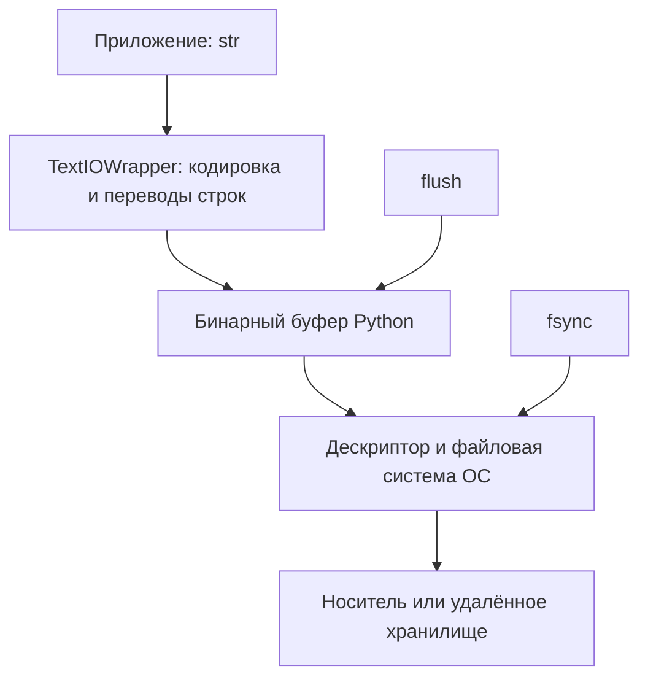

# 9. Работа с файлами и ввод-вывод (I/O)

Файловый ввод-вывод соединяет модель объектов Python с внешним состоянием: файловой системой, устройством, каналом между процессами или буфером памяти. Корректность здесь зависит от типов данных, владения ресурсами, поведения ОС, формата и момента, когда результат становится видимым другим участникам.

Глава сохраняет 15 тем и 107 пунктов README. Основной код ориентирован на Python 3.12–3.14. Новые возможности и платформенные ограничения отмечаются отдельно. Текст разделяет переносимый контракт Python, особенности ОС и гарантии конкретной файловой системы.

Короткие Python-примеры самостоятельны. Файловые эксперименты создают данные внутри TemporaryDirectory; примеры не удаляют пользовательские каталоги и не требуют сети. Ожидаемые ошибки перехватываются. Блок с PyYAML помечен сторонней зависимостью. Файлы практического проекта в конце работают вместе.

`assert` проверяет результат учебного примера. Проверки внешних данных в проекте выполняются явными исключениями и сохраняются при запуске Python с оптимизацией.

**Содержание**

1. [Основы файлового ввода-вывода](#file-io-basics)
2. [Чтение из файлов](#reading-files)
3. [Запись в файлы](#writing-files)
4. [Работа с файловой системой](#filesystem)
5. [Стандартные потоки ввода-вывода](#standard-streams)
6. [Форматы файлов и сериализация](#formats-and-serialization)
7. [Архивы и сжатие](#archives-and-compression)
8. [Работа с кодировками](#text-encodings)
9. [Буферизация и производительность](#buffering-and-performance)
10. [Буферный протокол и обработка бинарных данных](#buffer-protocol)
11. [Продвинутые техники и инструменты](#advanced-tools)
12. [Обработка ошибок и исключения в I/O](#io-errors)
13. [Лучшие практики и советы](#best-practices)
14. [Частые ошибки](#common-mistakes)
15. [Частые вопросы и ключевые выводы](#questions-and-takeaways)

<a id="file-io-basics"></a>

## Основы файлового ввода-вывода

### Что такое файловый объект?

Файловый объект — объект с определённым интерфейсом потока. Он может читать, писать, перемещать позицию, сообщать о возможностях и освобождать ресурс. За ним не обязательно находится обычный файл на диске: BytesIO работает в памяти, stdin может быть терминалом или pipe, gzip-поток — преобразованием над другим потоком.

| Возможность | Основные методы/свойства | Что не следует предполагать |
|---|---|---|
| Чтение | `read`, `readable` | Любой поток умеет читать |
| Запись | `write`, `writable` | Любая запись немедленно попадает на носитель |
| Произвольный доступ | `seek`, `tell`, `seekable` | Pipe или сокет можно перемотать |
| Закрытие | `close`, `closed` | Ресурс освободится в нужный момент сам |
| Дескриптор ОС | `fileno` | У потока в памяти существует дескриптор |
| Контекст | `__enter__`, `__exit__` | Контекст откатывает сделанные изменения |

```python
import io


with io.BytesIO(b"abc") as stream:
    assert stream.readable()
    assert stream.writable()
    assert stream.seekable()
    assert stream.read(1) == b"a"
    assert not stream.closed
    try:
        stream.fileno()
    except io.UnsupportedOperation:
        pass
    else:
        raise AssertionError("У BytesIO нет файлового дескриптора")
assert stream.closed
```

Описывайте зависимость минимальным нужным интерфейсом. Если функция только читает текст, ей не обязательно принимать путь и самостоятельно открывать файл. Поток можно передать извне — это упрощает тестирование и владение.

В CPython обычный open в текстовом режиме обычно возвращает TextIOWrapper над бинарным буфером и низкоуровневым FileIO. Проверять точный класс ради чтения обычно не нужно: важны интерфейс и вид данных.

Файловый дескриптор — целое число ОС, файловый объект — Python-обёртка. Номер 0 допустим и обычно относится к stdin. Наличие метода fileno ещё не гарантирует, что его вызов поддерживается.

### Текстовые и бинарные файлы

Бинарный поток передаёт bytes-подобные данные. Текстовый декодирует байты в str при чтении и кодирует str при записи. Кроме кодировки, текстовый слой может преобразовывать окончания строк.

```python
from pathlib import Path
from tempfile import TemporaryDirectory


with TemporaryDirectory() as directory:
    path = Path(directory) / "message.txt"
    raw = "Привет\r\n".encode("utf-8")
    path.write_bytes(raw)

    with path.open("rb") as stream:
        assert stream.read() == raw
    with path.open("r", encoding="utf-8", newline=None) as stream:
        assert stream.read() == "Привет\n"
    with path.open("r", encoding="utf-8", newline="") as stream:
        assert stream.read() == "Привет\r\n"
```

`newline=None` при чтении распознаёт `\n`, `\r\n` и `\r` и возвращает `\n`. `newline=""` тоже распознаёт универсальные окончания при чтении, но сохраняет их в возвращаемом тексте. При записи правила задаются отдельно: в частности, `newline=""` и `newline="\n"` не заменяют `\n` платформенным окончанием.

Расширение `.txt` или `.bin` не выбирает тип потока. Режим открытия выбирает интерфейс; содержимое определяет формат. JPEG, pickle и произвольный архив нельзя корректно прочитать как UTF-8 только потому, что файл получил текстовое имя.

Размер текстового чтения измеряется символами Python, размер бинарного — байтами. Один символ может кодироваться несколькими байтами. Кодовая точка также не всегда совпадает с видимым пользователю знаком.

### Открытие и закрытие файлов: `open()` и `close()`

open получает путь либо существующий дескриптор и создаёт поток выбранного режима. При работе с путями поддерживается протокол os.PathLike, поэтому объект Path не нужно заранее превращать в str.

```python
from pathlib import Path
from tempfile import TemporaryDirectory


with TemporaryDirectory() as directory:
    path = Path(directory) / "data.txt"
    stream = open(path, "w", encoding="utf-8")
    try:
        stream.write("example")
    finally:
        stream.close()
    assert stream.closed
    stream.close()  # Повторное закрытие обычного файла допустимо.
    assert path.read_text(encoding="utf-8") == "example"
    try:
        stream.write("more")
    except ValueError:
        pass
    else:
        raise AssertionError("Закрытый поток использовать нельзя")
```

Явный try/finally показывает механику, но стандартный способ — with. Не рассчитывайте на завершение функции, удаление имени или своевременную сборку мусора как на протокол закрытия. Исключение, цикл ссылок и другой интерпретатор меняют момент освобождения.

close может выполнять финальную запись буфера и сам завершиться ошибкой. Успешное возвращение write ещё не означает, что последующее закрытие будет успешным. Проверять ошибки нужно на всём участке записи и завершения.

**Владение дескриптором.** Если open оборачивает существующий fd, по умолчанию его закрытие относится и к дескриптору. `closefd=False` оставляет дескриптор владельцу. Для имени файла этот параметр нельзя использовать как способ «не закрывать настоящий файл».

```python
import os
from pathlib import Path
from tempfile import TemporaryDirectory


with TemporaryDirectory() as directory:
    path = Path(directory) / "data.bin"
    path.write_bytes(b"abc")
    descriptor = os.open(path, os.O_RDONLY)
    try:
        with open(descriptor, "rb", closefd=False) as wrapper:
            assert wrapper.read() == b"abc"
        os.lseek(descriptor, 0, os.SEEK_SET)
        assert os.read(descriptor, 1) == b"a"
    finally:
        os.close(descriptor)
```

Не смешивайте чтение через буферизованную обёртку с прямыми os.read/os.lseek на том же открытом файловом описании без согласованного протокола: Python может уже прочитать данные вперёд. Пример закрывает обёртку до прямого доступа.

### Менеджеры контекста: `with` — правильный способ работы

with привязывает освобождение ресурса к блоку, включая выход по исключению, return или break. Для стандартного файлового объекта выход из контекста закрывает поток.

```python
from pathlib import Path
from tempfile import TemporaryDirectory


with TemporaryDirectory() as directory:
    path = Path(directory) / "partial.txt"
    stream = None
    try:
        with path.open("w", encoding="utf-8") as stream:
            stream.write("already written")
            raise RuntimeError("Ошибка обработки")
    except RuntimeError:
        pass
    assert stream is not None and stream.closed
    assert path.read_text(encoding="utf-8") == "already written"
```

Контекст управляет ресурсом, но не откатывает уже записанные байты и не восстанавливает файл, усечённый режимом w. Для публикации целого результата нужен другой протокол, разобранный ниже.

При нескольких ресурсах их удобно открывать одним with. Если второй open не удался, первый уже открытый контекст будет завершён.

```python
from contextlib import ExitStack
from pathlib import Path
from tempfile import TemporaryDirectory


with TemporaryDirectory() as directory:
    paths = [Path(directory) / f"{number}.txt" for number in range(3)]
    for number, path in enumerate(paths):
        path.write_text(str(number), encoding="utf-8")
    with ExitStack() as stack:
        streams = [stack.enter_context(path.open(encoding="utf-8")) for path in paths]
        assert [stream.read() for stream in streams] == ["0", "1", "2"]
    assert all(stream.closed for stream in streams)
```

ExitStack нужен, когда число ресурсов определяется во время выполнения. Он не отменяет лимит открытых файлов: для тысяч источников иногда требуется обработка партиями.

Не закрывайте переданный чужой поток без такого соглашения в API. Удобный контракт: функция, принявшая путь, сама открывает и закрывает; функция, принявшая уже открытый поток, обычно оставляет владение вызывающему.

### Режимы открытия файлов (`r, w, a, x, b, t, +`)

| Режим | Назначение | Существование и прежнее содержимое |
|---|---|---|
| r | Читать | Файл должен существовать |
| w | Писать с начала | Создаёт либо сразу усекает существующий |
| a | Дописывать | Создаёт при отсутствии, пишет в конец |
| x | Создать новый | При существующем имени вызывает FileExistsError |
| b | Бинарные данные | Используется вместе с r/w/a/x |
| t | Текст | Режим по умолчанию |
| + | Чтение и запись | Не отменяет смысл базового режима |

`r+` не усекает файл; `w+` усекает; `a+` допускает чтение, но запись остаётся append. Открытие с плюсом не является транзакцией и не позволяет вставлять байты в середину без переноса хвоста.

```python
from pathlib import Path
from tempfile import TemporaryDirectory


with TemporaryDirectory() as directory:
    path = Path(directory) / "data.txt"
    path.write_text("alpha", encoding="utf-8")

    with path.open("r+", encoding="utf-8") as stream:
        assert stream.read() == "alpha"
        stream.seek(0)
        stream.write("X")
    assert path.read_text(encoding="utf-8") == "Xlpha"

    with path.open("a+", encoding="utf-8") as stream:
        stream.seek(0)
        assert stream.read() == "Xlpha"
        stream.write("!")
    assert path.read_text(encoding="utf-8") == "Xlpha!"

    try:
        path.open("x", encoding="utf-8")
    except FileExistsError:
        pass
    else:
        raise AssertionError("x не должен перезаписать существующий файл")

    with path.open("w+", encoding="utf-8") as stream:
        assert stream.read() == ""
        stream.write("new")
    assert path.read_text(encoding="utf-8") == "new"
```

Append полезен для журналов, но несколько write одного сообщения не становятся одной атомарной записью. Несколько процессов, буферизация и особенности файловой системы требуют отдельного протокола координации.

Для r+ при чередовании чтения/записи явно задавайте позицию и границы операций. Перезапись более короткого значения не удаляет старый хвост: для этого нужен truncate либо создание нового полного файла.

**Документация:** [open](https://docs.python.org/3.14/library/functions.html#open), [io](https://docs.python.org/3.14/library/io.html), [contextlib](https://docs.python.org/3.14/library/contextlib.html).

<a id="reading-files"></a>

## Чтение из файлов

### Чтение целиком: `read()`

`read()` без размера читает остаток потока до EOF, а не обязательно весь файл от начала. Текстовый поток возвращает str, бинарный — bytes. После EOF возвращается пустое значение соответствующего типа.

```python
from io import BytesIO, StringIO


with StringIO("abcdef") as text:
    assert text.read(2) == "ab"
    assert text.read() == "cdef"
    assert text.read() == ""
with BytesIO(b"abcdef") as binary:
    assert binary.read(2) == b"ab"
    assert binary.read(0) == b""
    assert binary.read() == b"cdef"
    assert binary.read() == b""
```

Пустой результат read(0) не означает EOF. Для read(n) с n>0 у обычного блокирующего файла пустые bytes означают конец. Низкоуровневые и неблокирующие потоки могут иметь другие сигналы готовности, включая None и BlockingIOError.

Полное чтение подходит для заведомо небольшого конфигурационного файла. Если размер ограничен контрактом, проверяйте его **во время чтения**, а не после неограниченного read.

```python
from io import BytesIO


def read_small(stream: BytesIO, max_bytes: int) -> bytes:
    if max_bytes < 0:
        raise ValueError("Лимит не может быть отрицательным")
    data = stream.read(max_bytes + 1)
    if len(data) > max_bytes:
        raise ValueError("Данные превышают лимит")
    return data


assert read_small(BytesIO(b"abc"), 3) == b"abc"
try:
    read_small(BytesIO(b"abcd"), 3)
except ValueError:
    pass
else:
    raise AssertionError("Превышение должно обнаруживаться")
```

Этот компактный вариант рассчитан на поток с поведением BytesIO/обычного блокирующего файла. Для общего raw-потока короткое чтение может произойти до EOF: тогда лимитированный read-all строится циклом. Сам запрос read(n) не является общим доказательством, что поток исчерпан.

Полный parse после чтения добавляет память: байтовый буфер, декодированная строка и дерево JSON могут одновременно занимать значительно больше размера исходного файла.

### Чтение по строкам: `readline()` и `readlines()`

readline читает одну строку, включая разделитель, если он присутствует. Последняя строка может не иметь окончания. EOF отличается от пустой строки: пустая текстовая строка файла обычно представлена `"\n"`, а EOF — `""`.

```python
from io import StringIO


with StringIO("first\n\nlast") as stream:
    assert stream.readline() == "first\n"
    assert stream.readline() == "\n"
    assert stream.readline() == "last"
    assert stream.readline() == ""

with StringIO("a\nb\n") as stream:
    assert stream.readlines() == ["a\n", "b\n"]
```

readlines возвращает список и удерживает все прочитанные строки. Аргумент hint — приблизительный ориентир по суммарному объёму, а не строгий лимит памяти. Одна строка способна оказаться гораздо длиннее hint.

Для ограничения строки используйте readline(limit+1) и проверяйте длину. Для текстового потока лимит в символах; для бинарного — в байтах.

```python
from io import BytesIO


def bounded_lines(stream: BytesIO, limit: int):
    if limit <= 0:
        raise ValueError("Нужен положительный лимит")
    while line := stream.readline(limit + 1):
        if len(line) > limit:
            raise ValueError("Слишком длинная строка")
        yield line


assert list(bounded_lines(BytesIO(b"a\nb"), 2)) == [b"a\n", b"b"]
try:
    list(bounded_lines(BytesIO(b"abc\n"), 3))
except ValueError:
    pass
else:
    raise AssertionError("Разделитель также входит в длину")
```

Не используйте strip без анализа формата: он удаляет пробелы и табуляции с обоих концов, а не только перевод строки. `rstrip("\r\n")` тоже удаляет любое число указанных символов в хвосте. Если нужен ровно один suffix, подходит removesuffix с явно заданным разделителем.

### Итерация по файлу (построчное чтение)

Обычный файловый объект уже итерируется по строкам. Дополнительный readlines для цикла обычно не нужен.

```python
from pathlib import Path
from tempfile import TemporaryDirectory


with TemporaryDirectory() as directory:
    path = Path(directory) / "numbers.txt"
    path.write_text("10\n20\n30", encoding="utf-8")
    total = 0
    with path.open(encoding="utf-8") as stream:
        for number, line in enumerate(stream, 1):
            value = int(line)
            total += value
        assert number == 3
    assert total == 60
```

Рабочая память такого цикла зависит от максимальной строки, буферов и состояния обработки. Если добавлять каждую строку в общий list, экономия исчезнет. Если одна строка занимает гигабайт, само «построчно» не создаёт жёсткого ограничения.

Итерация продвигает позицию. Второй for по тому же объекту после EOF ничего не выдаст без перемотки или повторного открытия. Передача генератора из with наружу также требует осторожности: потребитель может получить уже закрытый поток.

```python
from collections.abc import Iterator
from pathlib import Path
from tempfile import TemporaryDirectory
from contextlib import closing


def read_nonempty(path: Path) -> Iterator[str]:
    with path.open(encoding="utf-8") as stream:
        for line in stream:
            value = line.removesuffix("\n")
            if value:
                yield value


with TemporaryDirectory() as directory:
    path = Path(directory) / "lines.txt"
    path.write_text("a\n\nb\n", encoding="utf-8")
    assert list(read_nonempty(path)) == ["a", "b"]
    with closing(read_nonempty(path)) as values:
        assert next(values) == "a"
```

Здесь контекст живёт внутри генератора до исчерпания/закрытия. При раннем прекращении чтения closing явно завершает генератор, не оставляя момент закрытия сборщику мусора.

### Чтение бинарных данных: `readinto()`

readinto записывает данные в уже выделенный изменяемый буфер и возвращает число записанных байтов. Это позволяет повторно использовать память вместо создания нового bytes на каждой итерации.

```python
from io import BytesIO


buffer = bytearray(4)
with BytesIO(b"abcdefg") as stream:
    assert stream.readinto(buffer) == 4
    assert buffer == b"abcd"
    count = stream.readinto(buffer)
    assert count == 3
    assert buffer == b"efgd"
    with memoryview(buffer) as view:
        assert bytes(view[:count]) == b"efg"
    assert stream.readinto(buffer) == 0
```

Хвост буфера после короткого чтения содержит старые данные. Обрабатывать нужно только `buffer[:count]`, причём обычный срез bytearray создаст копию. Срез memoryview создаёт представление; последующее bytes(view) снова копирует.

Для обычного блокирующего потока цикл завершается при count=0. У неблокирующего raw-потока возможен None, который означает отсутствие готовых данных, а не конец.

Переданный буфер должен быть записываемым и подходящим по непрерывности. bytes неизменяемы. readinto уменьшает аллокации Python, но не обещает отсутствие копирования между устройством, ядром и пользовательской памятью.

### Продвинутое: работа с большими файлами (ленивое чтение, буферизация)

Выберите единицу обработки: строка, фиксированный блок, запись формата или ограниченный batch. У каждого варианта свой инвариант. Строка CSV может занимать несколько физических строк; UTF-8 символ может пересечь границу бинарных блоков; JSON-документ может содержать один огромный массив.

```python
import hashlib
from pathlib import Path
from tempfile import TemporaryDirectory


def file_digest(path: Path, block_size: int = 64 * 1024) -> str:
    if block_size <= 0:
        raise ValueError("Размер блока должен быть положительным")
    digest = hashlib.sha256()
    with path.open("rb") as stream:
        while block := stream.read(block_size):
            digest.update(block)
    return digest.hexdigest()


with TemporaryDirectory() as directory:
    path = Path(directory) / "large-example.bin"
    content = b"\x00example\xff" * 1000
    path.write_bytes(content)
    assert file_digest(path, 17) == hashlib.sha256(content).hexdigest()
```

Вычисление хэша хранит только текущий блок и состояние алгоритма. Если после этого сделать list всех результатов, общий pipeline уже имеет другую оценку памяти.

Для блокирующего бинарного файла удобно и `iter(lambda: stream.read(size), b"")`. Не применяйте sentinel b"" к текстовому read, возвращающему str: сравнение с sentinel никогда не совпадёт, и после EOF можно получить бесконечный поток пустых строк.

Учитывайте не только размер порции, но и длину записи, число групп в dict, очередь между этапами, буферы распаковщика и объём результата. Ограниченное чтение без ограниченного состояния не даёт ограниченной памяти.

Для схемы «чтение → преобразование → запись» полезен backpressure: следующий этап должен успевать потреблять данные, иначе очередь превращается в скрытую полную загрузку.

### Позиция в файле: `tell()` и произвольный доступ: `seek()`

В бинарном обычном файле позиция измеряется байтами. seek принимает смещение и начало отсчёта: SEEK_SET, SEEK_CUR, SEEK_END. Поток может не поддерживать случайный доступ.

```python
from io import BytesIO
import os


with BytesIO(b"0123456789") as stream:
    assert stream.tell() == 0
    stream.seek(4)
    assert stream.read(2) == b"45"
    stream.seek(-2, os.SEEK_END)
    assert stream.read() == b"89"
    stream.seek(0)
    assert stream.read(1) == b"0"
```

В текстовом потоке tell возвращает непрозрачную позицию-cookie, учитывающую состояние декодера и буферов. Сохранённое значение можно передать обратно в seek, но нельзя в общем случае прибавить к нему «три символа» или интерпретировать как длину UTF-8 префикса.

```python
import io
import os
from pathlib import Path
from tempfile import TemporaryDirectory


with TemporaryDirectory() as directory:
    path = Path(directory) / "text.txt"
    path.write_text("АБВ\nГД", encoding="utf-8")
    with path.open(encoding="utf-8") as stream:
        assert stream.read(2) == "АБ"
        position = stream.tell()
        tail = stream.read()
        stream.seek(position)
        assert stream.read() == tail
        try:
            stream.seek(-1, os.SEEK_END)
        except io.UnsupportedOperation:
            pass
        else:
            raise AssertionError("Произвольное смещение от конца текста недопустимо")
```

Для текстового seek поддерживаются ограниченные комбинации: сохранённый cookie от начала, перемотка к нулю, нулевое смещение от текущей позиции/конца в предусмотренных API случаях. Не переносите все операции бинарного файла на текстовый.

seek сам не вставляет данные и обычно не меняет длину обычного файла. Запись за концом может увеличить файл и создать разреженную область на поддерживающей файловой системе. truncate меняет длину; эти операции требуют отдельного анализа, если файл одновременно используется другими процессами.

**Документация:** [методы io](https://docs.python.org/3.14/library/io.html), [seek и tell](https://docs.python.org/3.14/library/io.html#io.TextIOBase.seek).

<a id="writing-files"></a>

## Запись в файлы

### Методы записи: `write()` и `writelines()`

write принимает одну строку либо байтовые данные согласно типу потока. В текстовом режиме возвращается число символов, а не физических байтов. writelines принимает итерируемый объект и не добавляет разделители.

```python
from pathlib import Path
from tempfile import TemporaryDirectory


with TemporaryDirectory() as directory:
    path = Path(directory) / "result.txt"
    with path.open("w", encoding="utf-8", newline="\n") as stream:
        assert stream.write("Я") == 1
        assert stream.writelines(["a", "b"]) is None
        stream.writelines(["\nfirst\n", "second\n"])
    assert path.read_bytes() == "Яab\nfirst\nsecond\n".encode("utf-8")
```

Если исходные строки не содержат `\n`, они склеятся. Если содержат, добавление ещё одного перевода создаст пустые строки. Определите, принимает API строки с разделителями или логические записи без них.

writelines может потреблять генератор и не требует списка целиком. Это не обещание одного системного write и не граница атомарности сообщения.

### Форматированный вывод в файл

print удобен для человекочитаемого текста. Для формата обмена лучше соответствующий сериализатор: csv.writer, json.dump либо явно описанный бинарный протокол.

```python
from pathlib import Path
from tempfile import TemporaryDirectory


with TemporaryDirectory() as directory:
    path = Path(directory) / "report.txt"
    with path.open("w", encoding="utf-8", newline="\n") as stream:
        print("count", 3, sep="=", file=stream)
        print(f"mean_ms={12.3456:.2f}", file=stream)
        print("done", end="", file=stream)
    assert path.read_text(encoding="utf-8") == "count=3\nmean_ms=12.35\ndone"
```

Округление в отчёте не меняет исходную точность данных. Машинный формат должен определить десятичный разделитель, наличие единиц, способ представления пропусков и точность.

Не собирайте CSV простым join запятых: поле может содержать запятую, кавычки или перевод строки. Не считайте repr объекта стабильной сериализацией.

### Запись бинарных данных

Бинарный поток принимает bytes и совместимые буферы. Он не кодирует str автоматически. Для строк выберите encoding и получите байты явно либо используйте текстовый слой.

```python
from pathlib import Path
from tempfile import TemporaryDirectory


with TemporaryDirectory() as directory:
    path = Path(directory) / "data.bin"
    with path.open("wb") as stream:
        assert stream.write(b"\x00\x01") == 2
        stream.write(bytearray([2, 3]))
        with memoryview(b"\x04\x05") as view:
            stream.write(view)
    assert path.read_bytes() == bytes(range(6))
```

У низкоуровневого потока write может записать только часть данных. Для универсального интерфейса нужен цикл, учитывающий фактически записанный объём.

```python
from typing import Protocol


class Writable(Protocol):
    def write(self, data: memoryview) -> int | None: ...


def write_all(stream: Writable, data: bytes) -> None:
    with memoryview(data) as view:
        position = 0
        while position < len(view):
            count = stream.write(view[position:])
            if count is None:
                raise BlockingIOError("Поток сейчас не готов к записи")
            if not 0 < count <= len(view) - position:
                raise OSError("Некорректная или нулевая короткая запись")
            position += count


class ShortWriter:
    def __init__(self) -> None:
        self.data = bytearray()

    def write(self, data: memoryview) -> int:
        count = min(2, len(data))
        self.data.extend(data[:count])
        return count


writer = ShortWriter()
write_all(writer, b"abcdefg")
assert writer.data == b"abcdefg"
```

Для неблокирующего вывода нельзя просто повторять None в активном while: нужно дождаться готовности и сохранить позицию. Некоторые buffered API при BlockingIOError также сообщают объём уже принятых данных. Контракт возобновления зависит от конкретного слоя.

### Передача данных из буфера и синхронизация: `flush()` vs `os.fsync()`

Python-буфер, кэш ОС и носитель — разные уровни. flush передаёт накопленные данные из соответствующего пользовательского буфера следующему слою. Он не является общим обещанием сохранения после потери питания.

| Действие | Основной смысл | Чего само по себе не доказывает |
|---|---|---|
| write | Данные приняты интерфейсом потока | Все байты уже на устройстве |
| flush | Пользовательский буфер передан дальше | Физическую сохранность после сбоя |
| close | Завершение потока, включая нужный flush | Автоматический fsync обычного файла |
| os.fsync(fd) | Запрос синхронизации файла через ОС | Сохранность отдельного rename без учёта каталога |
| fsync каталога на поддерживающем POSIX | Синхронизация записи имени/метаданных каталога | Универсальную гарантию для любой ФС и оборудования |

```python
import os
from pathlib import Path
from tempfile import TemporaryDirectory


with TemporaryDirectory() as directory:
    path = Path(directory) / "data.txt"
    with path.open("w", encoding="utf-8", newline="\n") as stream:
        stream.write("important\n")
        stream.flush()
        os.fsync(stream.fileno())
    assert path.read_bytes() == b"important\n"
```

Сначала flush, потом fsync: иначе часть данных может ещё находиться выше дескриптора в Python. Для BytesIO fsync неприменим, для pipe или некоторых специальных файлов может завершиться ошибкой.

Даже успешный fsync работает в рамках гарантий ОС, файловой системы, устройства и его конфигурации. Практический протокол должен определить, что обещает приложению успешный ответ и как оно обрабатывает ошибку синхронизации.

Сжатый поток имеет дополнительное состояние: завершение gzip-обёртки записывает footer. Для durable gzip-файла сначала корректно завершите сжатие, затем синхронизируйте нижележащий файловый объект. Один flush посередине потока не заменяет завершение формата.

### Надёжное изменение файлов

Перезапись через w уничтожает старое содержимое до успешного построения нового. Если нужен целый новый результат, распространённый протокол — временный файл в том же каталоге, полная запись, flush/fsync, закрытие, затем os.replace.

```python
import os
from pathlib import Path
from tempfile import NamedTemporaryFile, TemporaryDirectory


def replace_text(path: Path, text: str) -> None:
    temporary: Path | None = None
    try:
        with NamedTemporaryFile(
            mode="w",
            encoding="utf-8",
            newline="\n",
            dir=path.parent,
            prefix=".replace-",
            delete=False,
        ) as stream:
            temporary = Path(stream.name)
            stream.write(text)
            stream.flush()
            os.fsync(stream.fileno())
        os.replace(temporary, path)
        temporary = None
    except BaseException as error:
        if temporary is not None:
            try:
                temporary.unlink(missing_ok=True)
            except OSError as cleanup_error:
                error.add_note(f"Ошибка удаления временного файла: {cleanup_error}")
        raise


with TemporaryDirectory() as directory:
    path = Path(directory) / "settings.txt"
    path.write_text("old", encoding="utf-8")
    replace_text(path, "new\n")
    assert path.read_text(encoding="utf-8") == "new\n"
    assert sorted(item.name for item in Path(directory).iterdir()) == ["settings.txt"]
```

Операция replace в поддерживаемом сценарии одной файловой системы даёт атомарную **видимость имени**: читатель, открывающий его, получает прежний или новый файл. Перенос через разные файловые системы может завершиться ошибкой; fallback copy+delete уже имеет другие свойства.

Для сохранности rename после сбоя на POSIX обычно требуется также синхронизация родительского каталога. Если она не удалась **после** replace, новый файл уже может быть опубликован. Ошибка такой стадии не означает «ничего не изменилось». Практический проект ниже явно сообщает фазу публикации.

Права, владелец, ACL и прочие метаданные старого файла не переносятся автоматически на новый inode. Временный файл имеет собственный режим. Определите политику метаданных отдельно.

Атомарная замена одного имени не объединяет несколько файлов в транзакцию. Несколько writers могут последовательно заменять одно имя, и последний победит. Для проверки ожидаемой версии, блокировки или согласованной публикации набора нужен дополнительный протокол.

Пример рассчитан на контролируемый каталог. Работа с путями в каталоге, который может менять противник, требует отдельного анализа symlink/TOCTOU и платформенных операций с дескрипторами.

**Документация:** [os.fsync](https://docs.python.org/3.14/library/os.html#os.fsync), [os.replace](https://docs.python.org/3.14/library/os.html#os.replace), [tempfile](https://docs.python.org/3.14/library/tempfile.html).

<a id="filesystem"></a>

## Работа с файловой системой

### Модуль `os.path` (работы с путями)

os.path выполняет операции с представлением пути в соглашениях текущей платформы. Большинство функций вроде join и split не обращаются к диску; exists и getsize уже выполняют запрос к файловой системе.

```python
import os


path = os.path.join("data", "2026", "events.jsonl")
assert os.path.basename(path) == "events.jsonl"
assert os.path.dirname(path) == os.path.join("data", "2026")
assert os.path.splitext("archive.tar.gz") == ("archive.tar", ".gz")
assert os.fspath(path) == path
```

Не собирайте путь конкатенацией `base + "/" + name`, если нужна работа с соглашениями платформы. При этом использование join не валидирует имя и не запрещает абсолютный компонент, `..` или переход через symlink.

На Windows os.path использует Windows-семантику, на POSIX — POSIX. Для лексического разбора чужого формата используйте ntpath/posixpath или соответствующий PurePath, а не предположение о среде выполнения.

### Создание, разбор и нормализация путей: `join()`, `split()`, `dirname()`, `basename()`, `abspath()`

join объединяет компоненты, split отделяет последний, dirname и basename выбирают части, abspath делает путь абсолютным относительно текущего CWD. Нормализация записи и разрешение реального расположения — разные операции.

```python
import posixpath
from pathlib import PurePosixPath


assert posixpath.join("/srv/app", "data", "x.csv") == "/srv/app/data/x.csv"
assert posixpath.join("/srv/app", "/tmp/x.csv") == "/tmp/x.csv"
assert posixpath.split("/srv/app/x.csv") == ("/srv/app", "x.csv")
assert posixpath.basename("/srv/app/") == ""
assert PurePosixPath("/srv/app/").name == "app"
assert posixpath.normpath("/srv/app/../outside") == "/srv/outside"

assert posixpath.commonprefix(["/safe/base", "/safe/base-other"]) == "/safe/base"
assert posixpath.commonpath(["/safe/base", "/safe/base-other"]) == "/safe"
```

commonprefix сравнивает символы и непригоден как проверка границ каталога. commonpath учитывает компоненты, но сам не устраняет symlink и гонки.

abspath/normpath не равны realpath/resolve. Удаление `..` из записи может изменить смысл, если предыдущая часть — символическая ссылка. expanduser обрабатывает `~`, expandvars — переменные окружения; сами join и open этого не делают.

Если относительный путь относится к конфигурационному файлу, соединяйте его с каталогом этого файла, а не со случайным CWD процесса. Документируйте, кто задаёт базу.

### Проверка существования и типа: `exists()`, `isfile()`, `isdir()`

Эти проверки дают состояние на момент запроса. Они не резервируют имя и не обещают, что следующий open увидит тот же объект.

```python
import os
from pathlib import Path
from tempfile import TemporaryDirectory


with TemporaryDirectory() as directory:
    root = Path(directory)
    file = root / "data.txt"
    file.write_text("data", encoding="utf-8")
    assert os.path.exists(file)
    assert os.path.isfile(file)
    assert not os.path.isdir(file)
    assert os.path.isdir(root)
    assert not os.path.exists(root / "missing")
```

Обычно проверяется цель symlink. Для существования самого имени ссылки, включая broken symlink, у os.path есть lexists; у pathlib — is_symlink и соответствующие параметры stat/exists.

False не всегда означает только отсутствие: доступ и ошибки представления пути также имеют значение. В Python 3.14 предикаты Path вроде exists/is_file/is_dir возвращают False при любом OSError от ОС; в прежних версиях часть ошибок могла пробрасываться. Для диагностики используйте stat или саму нужную операцию с обработкой исключений.

Не пишите `if not exists: open(..., "w")` для эксклюзивного создания. Между проверкой и записью имя может появиться. Режим x выражает нужное действие одним вызовом.

### Свойства файлов: `getsize()`, `getmtime()`, `getatime()`

Размер и времена относятся к снимку метаданных. Если файл растёт или заменяется параллельно, результаты нескольких вызовов могут описывать разные моменты или разные объекты.

```python
import os
from datetime import UTC, datetime
from pathlib import Path
from tempfile import TemporaryDirectory


with TemporaryDirectory() as directory:
    path = Path(directory) / "data.bin"
    path.write_bytes(b"\x00\x01\x02")
    metadata = path.stat()
    assert os.path.getsize(path) == metadata.st_size == 3
    assert isinstance(metadata.st_mtime_ns, int)
    modified_at = datetime.fromtimestamp(metadata.st_mtime, tz=UTC)
    assert modified_at.tzinfo is UTC
    assert isinstance(os.path.getatime(path), float)
```

getsize возвращает логическую длину в байтах, а не суммарное потребление на диске. Sparse-файл, компрессия ФС и shared blocks меняют физическое хранение.

mtime — изменение содержимого, atime — время доступа по правилам ФС. atime может обновляться редко или быть отключён; не используйте его как надёжный аудит чтений. ctime на POSIX означает изменение метаданных inode, а не дату создания. Creation/birth time доступно не везде и требует платформенного API.

Поля с суффиксом _ns не гарантируют наносекундную точность самого носителя. Для статуса уже открытого объекта используйте os.fstat(fd): повторный stat по имени после replace может обратиться к другому файлу.

### Модуль `pathlib` (современный ООП-подход)

Path объединяет операции с компонентами пути и файловой системой в одном интерфейсе. Объекты путей неизменяемы: операции построения возвращают новый Path, а файловые методы могут менять внешнее состояние.

```python
from pathlib import Path
from tempfile import TemporaryDirectory


with TemporaryDirectory() as directory:
    root = Path(directory)
    destination = root / "reports" / "result.txt"
    destination.parent.mkdir()
    destination.write_text("ready", encoding="utf-8")
    assert destination.name == "result.txt"
    assert destination.parent == root / "reports"
    assert destination.read_text(encoding="utf-8") == "ready"
```

Path не фиксирует содержимое каталога и не открывает файл самим фактом создания объекта. `Path("report.txt")` может долго существовать до I/O, а его относительный смысл зависит от CWD в момент операции.

Существующие stdlib API обычно принимают Path напрямую. Не преобразуйте всё в str только ради привычки; используйте os.fspath, когда нужен именно путь по протоколу.

### Объекты `Path` и `PurePath`

PurePath занимается лексическими компонентами и не обращается к файловой системе. Path добавляет реальные операции текущей платформы.

| Тип | Назначение |
|---|---|
| Path | Файловая система текущей ОС |
| PurePath | Лексический путь текущего flavour |
| PurePosixPath | POSIX-компоненты независимо от ОС запуска |
| PureWindowsPath | Windows-компоненты, drive и UNC независимо от ОС запуска |

```python
from pathlib import PurePosixPath, PureWindowsPath


windows = PureWindowsPath(r"C:\data\reports\result.csv")
assert windows.drive == "C:"
assert windows.name == "result.csv"
assert windows.as_posix() == "C:/data/reports/result.csv"

posix = PurePosixPath("/data/reports/result.csv")
assert posix.is_absolute()
assert posix.parts == ("/", "data", "reports", "result.csv")

candidate = PurePosixPath("/safe/../outside")
assert candidate.is_relative_to("/safe")
```

Последняя проверка лексическая: наличие `..` не разрешено через ФС и не делает путь безопасным. is_relative_to проверяет компоненты, а не доступ к sandbox.

as_posix меняет текстовое представление разделителей. Он не монтирует Windows-диск в Linux и не переводит пути между машинами. Для удалённого пути нужен контракт удалённой системы, а не локальный Path.exists.

### Операции с путями через `Path`

Важные операции: parent/parents, name, stem, suffix/suffixes, with_name, with_suffix, relative_to, resolve, expanduser.

```python
from pathlib import PurePosixPath


path = PurePosixPath("/data/archive.tar.gz")
assert path.name == "archive.tar.gz"
assert path.stem == "archive.tar"
assert path.suffix == ".gz"
assert path.suffixes == [".tar", ".gz"]
assert path.with_suffix(".bz2") == PurePosixPath("/data/archive.tar.bz2")
assert path.with_name("new.csv") == PurePosixPath("/data/new.csv")
assert path.relative_to("/data") == PurePosixPath("archive.tar.gz")
assert path == PurePosixPath("/data/archive.tar.gz")
```

with_suffix заменяет последний suffix, а не обязательно весь составной формат. Для `.tar.gz` смена только `.gz` сохраняет `.tar`.

resolve обращается к реальному пути и symlink, насколько позволяет strict. strict=True требует существования разрешаемых компонентов; strict=False допускает отсутствующий остаток. После разрешения внешний мир всё равно может измениться.

Не соединяйте пользовательский абсолютный компонент с доверенной базой, рассчитывая, что база останется. Проверки пути выполняются относительно конкретного сценария и модели конкурирующих изменений.

### Чтение/запись через `Path.read_text()`, `Path.write_text()`

Convenience-методы самостоятельно открывают и закрывают файл. Они удобны для небольших данных, но читают/пишут целое значение, а write_text перезаписывает содержимое.

```python
from pathlib import Path
from tempfile import TemporaryDirectory


with TemporaryDirectory() as directory:
    path = Path(directory) / "data.txt"
    assert path.write_text("Привет", encoding="utf-8") == 6
    assert path.read_text(encoding="utf-8") == "Привет"
    raw = path.read_bytes()
    assert len(raw) == 12
    assert path.write_bytes(b"new") == 3
    assert path.read_bytes() == b"new"
```

Эти методы не дают атомарную публикацию и не задают лимит объёма чтения. Для большого файла, CSV, управления newline, буферами и fsync используйте Path.open.

У write_text параметр newline доступен в рассматриваемом диапазоне версий; у read_text он появился в Python 3.13.

```python
# Python 3.13+: newline у Path.read_text.
from pathlib import Path
from tempfile import TemporaryDirectory


with TemporaryDirectory() as directory:
    path = Path(directory) / "lines.txt"
    path.write_bytes(b"a\r\nb\r\n")
    assert path.read_text(encoding="utf-8", newline="") == "a\r\nb\r\n"
```

### Выбор между `pathlib` и `os.path`

Для прикладного кода с путями Path обычно улучшает читаемость. os.path полезен для существующего string-based API, точного выбора flavour и лексических функций. Низкоуровневые дескрипторы, dir_fd и специальные flags относятся к os.

| Задача | Удобный уровень |
|---|---|
| Построить путь, создать каталог, открыть файл | Path |
| Разобрать POSIX/Windows-строку без I/O | PurePath, posixpath, ntpath |
| Поддержать существующий интерфейс строк | os.path |
| Управлять fd и флагами ОС | os |
| Работать с ресурсом внутри пакета/архива | Контракт ресурса; это не всегда настоящий Path |

```python
import os
from pathlib import Path
from tempfile import TemporaryDirectory


class Location:
    def __init__(self, path: Path) -> None:
        self.path = path

    def __fspath__(self) -> str:
        return os.fspath(self.path)


with TemporaryDirectory() as directory:
    location = Location(Path(directory) / "data.txt")
    with open(location, "w", encoding="utf-8") as stream:
        stream.write("value")
    assert Path(os.fspath(location)).read_text(encoding="utf-8") == "value"
```

PathLike не означает «произвольный объект, у которого красиво работает str». Для поддержки пути нужен __fspath__, возвращающий str или bytes. Разрешённый тип пути и кодировка содержимого — разные вопросы.

### Навигация и управление файлами

Путь — имя в пространстве файловой системы, а открытый дескриптор — ссылка на уже открытый объект. Rename может поменять имя, пока открытый читатель на POSIX продолжает работать с прежним объектом. На Windows открытые handles и режимы sharing могут помешать переименованию/удалению.

Перед сложной операцией определите контракт:

- создаётся новый объект, заменяется существующий или дописывается прежний;
- допускается ли существующий destination;
- требуется ли сохранение метаданных и ссылок;
- как обрабатываются частичные результаты;
- один writer или несколько;
- операция выполняется в одной ФС или затрагивает разные.

Это не общий предварительный exists для каждого вызова. Действие и обработка его ошибки точнее описывают ситуацию, чем цепочка несогласованных снимков.

### Смена директории: `os.chdir()`, `Path.cwd()`

Текущий каталог — глобальное состояние процесса. Изменение влияет на все относительные пути, включая код библиотек и соседних потоков.

```python
import os
from pathlib import Path
from tempfile import TemporaryDirectory


previous = Path.cwd()
with TemporaryDirectory() as directory:
    try:
        os.chdir(directory)
        assert Path.cwd() == Path(directory).resolve()
        relative = Path("created.txt")
        relative.write_text("here", encoding="utf-8")
        assert (Path(directory) / "created.txt").exists()
    finally:
        os.chdir(previous)
assert Path.cwd() == previous
```

Пример выполняется в отдельной однопоточной программе. В сервере передавайте явную базовую директорию вместо chdir на каждый запрос. contextlib.chdir восстанавливает значение при выходе, но не делает глобальное переключение изолированным от потоков или await.

`Path.cwd() / relative` фиксирует абсолютную базу на момент построения. Сам относительный Path без базы будет интерпретирован по текущему CWD при каждой операции.

### Создание папок: `os.mkdir()`, `os.makedirs()`, `Path.mkdir()`

mkdir создаёт один уровень. makedirs либо Path.mkdir(parents=True) могут создать отсутствующих родителей. exist_ok управляет ожидаемым существованием каталога, а не подавляет любую ошибку.

```python
import os
from pathlib import Path
from tempfile import TemporaryDirectory


with TemporaryDirectory() as directory:
    root = Path(directory)
    os.mkdir(root / "one")
    os.makedirs(root / "a" / "b", exist_ok=True)
    nested = root / "c" / "d"
    nested.mkdir(parents=True, exist_ok=True)
    nested.mkdir(parents=True, exist_ok=True)
    assert nested.is_dir()

    file = root / "not-directory"
    file.write_text("x", encoding="utf-8")
    try:
        file.mkdir(exist_ok=True)
    except FileExistsError:
        pass
    else:
        raise AssertionError("Файл не должен считаться существующим каталогом")
```

На POSIX mode взаимодействует с umask; промежуточные каталоги и конечный могут получать разные правила применения mode. На Windows поддержка режимов отличается. Не считайте mode универсальной системой управления ACL.

Создание цепочки каталогов не является одной транзакцией: после ошибки уже созданные родители могут остаться. План очистки должен учитывать владение, чтобы не удалить каталог, которым начал пользоваться другой участник.

### Удаление файлов и папок: `os.remove()`, `os.rmdir()`, `shutil.rmtree()`, `Path.unlink()`

remove/unlink удаляют имя файла или ссылки; rmdir — пустой каталог; rmtree — дерево. Эти операции имеют разный масштаб и ошибки.

```python
import os
import shutil
from pathlib import Path
from tempfile import TemporaryDirectory


with TemporaryDirectory() as directory:
    root = Path(directory)
    file = root / "remove-me.txt"
    file.write_text("x", encoding="utf-8")
    os.remove(file)
    file.unlink(missing_ok=True)

    empty = root / "empty"
    empty.mkdir()
    os.rmdir(empty)

    tree = root / "tree"
    (tree / "nested").mkdir(parents=True)
    (tree / "nested" / "data.txt").write_text("x", encoding="utf-8")
    shutil.rmtree(tree)
    assert list(root.iterdir()) == []
```

missing_ok=True подавляет FileNotFoundError, а не PermissionError и не все OSError. Не заменяйте точечную идемпотентность общим except OSError: pass.

Удаление symlink должно относиться к самой ссылке, а не к разрешённой цели. Не вызывайте resolve перед unlink, если задача — удалить именно ссылку.

У rmtree защита от symlink-гонок зависит от доступных платформенных операций; есть индикатор rmtree.avoids_symlink_attacks. Это не основание удалять произвольный путь из внешнего запроса. Корень очистки должен принадлежать операции.

На POSIX удаление открытого файла не обязательно сразу освобождает занятые блоки: открытый fd продолжает удерживать объект. На Windows возможен отказ из-за открытого handle. Эти различия важны для ротации и очистки.

### Переименование и перемещение: `os.rename()`, `Path.rename()`, `shutil.move()`

Rename меняет имя в пределах поддерживаемой операции ФС. Поведение при существующем destination различается между платформами; для явной замены файла используйте os.replace/Path.replace.

```python
import shutil
from pathlib import Path
from tempfile import TemporaryDirectory


with TemporaryDirectory() as directory:
    root = Path(directory)
    original = root / "first.txt"
    original.write_text("data", encoding="utf-8")
    renamed = original.rename(root / "second.txt")
    assert original.name == "first.txt"
    assert not original.exists()
    assert renamed.read_text(encoding="utf-8") == "data"

    destination = root / "destination"
    destination.mkdir()
    shutil.move(renamed, destination)
    assert (destination / "second.txt").read_text(encoding="utf-8") == "data"
```

Относительный target метода rename интерпретируется относительно CWD, а не parent исходного Path. Path как значение не переписывается в новое имя; возвращённый объект указывает на новое расположение.

shutil.move при переносе между ФС может выполнить копирование и удаление. Это не атомарная публикация и не all-or-nothing: возможен частичный destination. При destination-каталоге результат помещается внутрь него.

В Python 3.14 появились Path.move и move_into. Внутри одной ФС move использует replace; между ФС — copy+delete. Более удобное имя метода не устраняет эту разницу.

### Копирование файлов: `shutil.copy2()`, `shutil.copytree()`

copyfile копирует данные, copy дополнительно режим, copy2 пытается сохранить поддерживаемые метаданные. Ни одна из них не обещает перенести все владельцы, ACL, Windows alternate streams и специфические атрибуты любой платформы.

```python
import shutil
from pathlib import Path
from tempfile import TemporaryDirectory


with TemporaryDirectory() as directory:
    root = Path(directory)
    source = root / "source"
    source.mkdir()
    (source / "data.txt").write_text("original", encoding="utf-8")
    copied = root / "copied.txt"
    shutil.copy2(source / "data.txt", copied)
    assert copied.read_text(encoding="utf-8") == "original"
    copied.write_text("changed", encoding="utf-8")
    assert (source / "data.txt").read_text(encoding="utf-8") == "original"

    tree = root / "copied-tree"
    shutil.copytree(source, tree)
    assert (tree / "data.txt").read_text(encoding="utf-8") == "original"
```

copytree с dirs_exist_ok=True объединяет содержимое с существующим деревом. Старые файлы destination, которых нет в source, не обязаны удаляться. Это не полная синхронизация и не атомарная замена каталога.

Политика symlink задаётся отдельно: сохранить саму ссылку или копировать её цель. Для работающего изменяемого источника копирование не создаёт автоматически согласованный snapshot.

```python
# Python 3.14+: копирование и перемещение через Path.
from pathlib import Path
from tempfile import TemporaryDirectory


with TemporaryDirectory() as directory:
    root = Path(directory)
    source = root / "source.txt"
    source.write_text("data", encoding="utf-8")
    copied = source.copy(root / "copy.txt", preserve_metadata=True)
    moved = copied.move(root / "moved.txt")
    assert moved.read_text(encoding="utf-8") == "data"
    assert source.exists()
    assert not copied.exists()
```

Path.copy может использовать copy-on-write, когда это поддерживает среда. Это оптимизация копирования, а не hard link: логические изменения копии не должны менять исходный файл. Значение preserve_metadata по умолчанию у этого API — False.

### Итерация по директориям

Выберите, нужны ли имена, Path-объекты, метаданные или рекурсия. Для большого каталога os.scandir даёт DirEntry и позволяет получать тип без отдельного полного stat там, где данные уже доступны от ОС.

```python
import os
from pathlib import Path
from tempfile import TemporaryDirectory


with TemporaryDirectory() as directory:
    root = Path(directory)
    (root / "a.txt").write_text("a", encoding="utf-8")
    (root / "nested").mkdir()
    with os.scandir(root) as entries:
        names = sorted(
            entry.name for entry in entries if entry.is_file(follow_symlinks=False)
        )
    assert names == ["a.txt"]
```

Порядок перечисления не следует считать сортировкой. Если нужен воспроизводимый вывод, сортируйте явно и учитывайте память результата.

DirEntry может кешировать сведения. Между перечислением и открытием объект может измениться или исчезнуть. Iterator API также не является универсальной гарантией отсутствия внутренней материализации всех имён; для точного расхода памяти учитывайте конкретный API и реализацию.

В Python 3.14 у Path появилась info с кешируемыми сведениями, в том числе полученными при iterdir. Для актуального запроса используйте методы Path/stat, а не предположение, что старый info обновится сам.

### Список содержимого: `os.listdir()`

listdir возвращает список имён непосредственных детей без базы пути. Он не обходит дерево и не возвращает только файлы.

```python
import os
from pathlib import Path
from tempfile import TemporaryDirectory


with TemporaryDirectory() as directory:
    root = Path(directory)
    (root / "a.txt").write_text("a", encoding="utf-8")
    (root / "folder").mkdir()
    names = os.listdir(root)
    assert sorted(names) == ["a.txt", "folder"]
    files = sorted(name for name in names if (root / name).is_file())
    assert files == ["a.txt"]
```

listdir материализует список. Проверка каждого элемента отдельным stat может создавать много системных вызовов; scandir иногда уменьшает эту стоимость.

На поддерживаемых платформах тип аргумента str/bytes влияет на тип возвращённых имён. Кодировка имени в файловой системе и encoding содержимого файла независимы.

### Рекурсивный обход: `os.walk()`

walk выдаёт тройки dirpath, dirnames, filenames. При topdown=True можно менять dirnames **на месте**, чтобы управлять будущим спуском.

```python
import os
from pathlib import Path
from tempfile import TemporaryDirectory


with TemporaryDirectory() as directory:
    root = Path(directory)
    (root / "src").mkdir()
    (root / ".cache").mkdir()
    (root / "src" / "a.py").write_text("x = 1", encoding="utf-8")
    (root / ".cache" / "ignored.py").write_text("x = 2", encoding="utf-8")
    found = []
    for current, directories, files in os.walk(root, topdown=True):
        directories[:] = sorted(name for name in directories if name != ".cache")
        for name in sorted(files):
            found.append((Path(current) / name).relative_to(root).as_posix())
    assert found == ["src/a.py"]
```

Присваивание `directories = [...]` меняет только локальное имя; `directories[:] = [...]` изменяет список, который использует walk. При topdown=False этап спуска уже прошёл, поэтому такое pruning не имеет того же смысла.

По умолчанию ошибки scandir могут игнорироваться. Для обязательного полного обхода задайте onerror, который пробрасывает или учитывает ошибку. followlinks=True способен привести к циклам ссылок: walk не обязан вести visited по inode.

Path.walk доступен с Python 3.12 и возвращает Path для текущего каталога. Название флага — follow_symlinks. Представление symlink-каталогов при отключённом следовании отличается от os.walk, поэтому перенос кода требует проверки контракта.

### Глоббинг (поиск по шаблону): `glob.glob()`, `Path.glob()` и `Path.rglob()`

Glob — язык шаблонов имён, а не регулярное выражение. `*` выбирает последовательность символов компонента, `?` — один, `[]` — класс; `**` используется для рекурсивного поиска в поддерживающем режиме.

```python
import glob
from pathlib import Path
from tempfile import TemporaryDirectory


with TemporaryDirectory() as directory:
    root = Path(directory)
    (root / "nested").mkdir()
    (root / "a.txt").write_text("a", encoding="utf-8")
    (root / "nested" / "b.txt").write_text("b", encoding="utf-8")
    (root / ".hidden.txt").write_text("h", encoding="utf-8")

    assert sorted(path.name for path in root.glob("*.txt")) == [".hidden.txt", "a.txt"]
    assert sorted(Path(path).name for path in glob.glob(str(root / "*.txt"))) == [
        "a.txt"
    ]
    assert sorted(path.name for path in root.rglob("*.txt")) == [
        ".hidden.txt",
        "a.txt",
        "b.txt",
    ]
```

Path.glob и glob.glob различаются обработкой dotfiles и формой результата. У glob есть iglob для итерации и дополнительные параметры вроде include_hidden; семантику нельзя переносить только по похожему имени.

Порядок не гарантирован. Регистрозависимость и symlink-поведение зависят от API, платформы и флагов. У Path.glob параметр case_sensitive появился в 3.12, recurse_symlinks — в 3.13. Не считайте любой `**` универсальным безопасным обходом без ссылок.

Рекурсивный шаблон может пройти огромное дерево. Если нужен только один известный путь, не заменяйте его глобальным rglob; если важны лимиты, контролируйте число результатов и корень поиска.

### Ссылки и переносимость файловых операций

Символическая ссылка хранит путь к цели, hard link добавляет ещё одно имя того же объекта ФС. Копия создаёт независимый логический объект. Разрешение относительного target symlink происходит относительно каталога самой ссылки.

```python
import os
from pathlib import Path
from tempfile import TemporaryDirectory


with TemporaryDirectory() as directory:
    root = Path(directory)
    source = root / "source.txt"
    source.write_text("data", encoding="utf-8")
    link = root / "link.txt"
    try:
        link.symlink_to("source.txt")
    except (OSError, NotImplementedError):
        pass  # Возможность зависит от ОС и разрешений.
    else:
        assert link.is_symlink()
        assert link.read_text(encoding="utf-8") == "data"
        assert link.resolve() == source.resolve()
        source.unlink()
        assert link.is_symlink()
        assert not link.exists()
        assert os.path.lexists(link)
        link.unlink()
```

Hard links обычно ограничены одной ФС; изменение содержимого через любое имя видно другим именам. samefile проверяет идентичность объекта по данным ОС, а не равенство строк. Проверка тоже относится к моменту вызова.

Файловая система определяет регистр, Unicode-поведение, точность времён, ограничения длины и поддержку атомарных операций. Windows имеет drive/UNC, junctions, reserved names и собственные правила sharing. Linux-приложение на сетевой ФС тоже не обязано иметь все свойства локального диска.

Разрешённые символы пути не равны разрешённым символам имени внутри архива или URL. Нормализуйте только по явно выбранным правилам; не меняйте регистр и Unicode всех имён автоматически.

**Документация:** [pathlib](https://docs.python.org/3.14/library/pathlib.html), [os.path](https://docs.python.org/3.14/library/os.path.html), [os](https://docs.python.org/3.14/library/os.html), [shutil](https://docs.python.org/3.14/library/shutil.html), [glob](https://docs.python.org/3.14/library/glob.html).

<a id="standard-streams"></a>

## Стандартные потоки ввода-вывода

### Что такое `stdin`, `stdout`, `stderr`

stdin обычно поставляет вход, stdout — основной результат, stderr — диагностику. Их реальное подключение определяет среда запуска: терминал, файл, pipe, notebook или заменяющий объект.

| Поток | Обычная роль | Практический контракт CLI |
|---|---|---|
| sys.stdin | Входные данные | Определить текст/байты, encoding и framing |
| sys.stdout | Результат | Не смешивать JSON/CSV с progress messages |
| sys.stderr | Ошибки и диагностика | Не превращать отсутствие текста в единственный признак успеха |

Стандартные объекты обычно текстовые; у обычных обёрток доступен .buffer для байтов. В тесте или notebook вместо них может быть StringIO без .buffer и fileno. Они также могут быть недоступны в некоторых средах.

Библиотека обычно принимает явно заданный поток или возвращает данные, а решение о stdout оставляет вызывающему. Чужие стандартные потоки не следует закрывать как собственный временный файл.

### Чтение из `sys.stdin`

Можно читать весь stdin, одну строку или итерироваться. read без размера ждёт EOF; он не обязан вернуть управление после первого Enter.

```python
import sys
from io import StringIO


owned_input = StringIO("10\n20\n30\n")
previous = sys.stdin
try:
    sys.stdin = owned_input
    total = sum(int(line) for line in sys.stdin)
    assert total == 60
finally:
    sys.stdin = previous
    owned_input.close()
assert sys.stdin is previous
```

Подмена нужна только для самостоятельного тестового примера. В прикладном коде удобнее передать stream аргументом: это не меняет глобальное состояние.

input читает одну текстовую строку, удаляет завершающий перевод и при EOF вызывает EOFError. Его prompt пишется в stdout, поэтому интерактивный вопрос способен испортить машинный JSON-протокол.

Для бинарного stdin в обычном CLI можно читать sys.stdin.buffer, но библиотека не должна предполагать наличие этого атрибута у любого переданного потока. Ограничения длины и полного объёма действуют так же, как для файлов.

### Перенаправление `stdout` и `stderr`

contextlib.redirect_stdout/redirect_stderr временно заменяют Python-переменные потоков. Это удобно для теста или адаптации небольшой синхронной функции.

```python
from contextlib import redirect_stderr, redirect_stdout
from io import StringIO
import sys


output = StringIO()
errors = StringIO()
with redirect_stdout(output), redirect_stderr(errors):
    print("result")
    print("diagnostic", file=sys.stderr)
assert output.getvalue() == "result\n"
assert errors.getvalue() == "diagnostic\n"
```

Такая подмена глобальна для процесса, не изолирована между потоками/coroutine и не обязана перехватить прямой os.write(1, ...) либо вывод нативной библиотеки. Она также не перенаправляет автоматически дочерние процессы.

Для subprocess используйте его собственные stdin/stdout/stderr параметры. Если требуется объединить stderr со stdout, учитывайте потерю разделения результата и диагностики.

```python
import subprocess
import sys


completed = subprocess.run(
    [
        sys.executable,
        "-c",
        "import sys; data=sys.stdin.read(); "
        "sys.stdout.write(data.upper()); sys.stderr.write('checked\\n')",
    ],
    input="hello\n",
    text=True,
    encoding="utf-8",
    capture_output=True,
    check=True,
)
assert completed.stdout == "HELLO\n"
assert completed.stderr == "checked\n"
```

capture_output материализует захваченный вывод. Для больших объёмов нужны файлы, потоковая обработка и управление pipe, а не бесконтрольное накопление. Задачи процессов подробнее рассматриваются в соответствующей главе.

### `print()` как интерфейс к `stdout` (параметры `file`, `flush`)

print преобразует аргументы в строки, разделяет sep и добавляет end. file выбирает текстовый поток, flush=True запрашивает его flush после вывода.

```python
from io import StringIO


stream = StringIO()
print("a", 10, sep=":", end=";", file=stream, flush=True)
print("b", file=stream)
assert stream.getvalue() == "a:10;b\n"
```

По умолчанию file соответствует текущему sys.stdout. flush=True полезен для интерактивного прогресса, но не вызывает автоматически fsync и не гарантирует одну атомарную запись всего сообщения.

Если stdout — pipe и потребитель завершился, возможен BrokenPipeError. Политика CLI может считать это нормальным ранним завершением или ошибкой протокола. Повторять весь вывод автоматически нельзя: часть данных уже принята потребителем.

**Документация:** [sys: стандартные потоки](https://docs.python.org/3.14/library/sys.html#sys.stdin), [redirect_stdout](https://docs.python.org/3.14/library/contextlib.html#contextlib.redirect_stdout).

<a id="formats-and-serialization"></a>

## Форматы файлов и сериализация

### Текстовые форматы

Encoding переводит байты в текст. Формат переводит текст в структуру. Схема определяет, какие структуры допустимы. Успешное UTF-8-декодирование и JSON-парсинг ещё не доказывают наличие нужного поля или допустимость его значения.

| Формат | Удобный сценарий | Что определить отдельно |
|---|---|---|
| Строковые записи | Логи, простой обмен | Разделитель и escaping переводов строк |
| CSV/TSV | Табличные записи | Диалект, заголовки, типы, null и дубликаты |
| JSON | Структурированный документ | Схема, числа, версии |
| JSONL | Последовательная обработка записей | Одна запись на физическую строку и лимиты |
| INI/TOML | Настройки | Приоритеты, типы и значения по умолчанию |
| XML | Иерархия с атрибутами и namespace | Схема и политика безопасного парсинга |
| YAML | Человекочитаемая конфигурация | Loader, типы, алиасы и ограничения |

Файл должен описывать хотя бы encoding, framing, типы и версию контракта. Пустая строка, null, отсутствие поля и ноль часто имеют разные значения. Отделяйте восстановимую ошибку строки от ошибки всего документа по явному правилу.

### CSV: модуль `csv` (читатели, писатели, словари)

CSV — семейство диалектов. Разделитель, quoting, escapechar, doublequote и окончание записи задаются явно или согласуются с источником. split(",") не обрабатывает кавычки и вложенные переводы строк.

Для файлов открывайте текстовый поток с `newline=""`: модуль csv должен сам управлять переводами строк. Encoding задаётся при open.

```python
import csv
from io import StringIO


output = StringIO(newline="")
writer = csv.DictWriter(
    output,
    fieldnames=["id", "name", "note"],
    lineterminator="\n",
    extrasaction="raise",
)
writer.writeheader()
writer.writerow({"id": 1, "name": "Иса, коллега", "note": "first\nsecond"})
writer.writerow({"id": 2, "name": 'Name "quoted"', "note": ""})

reader = csv.DictReader(StringIO(output.getvalue(), newline=""))
assert reader.fieldnames == ["id", "name", "note"]
rows = list(reader)
assert rows[0] == {"id": "1", "name": "Иса, коллега", "note": "first\nsecond"}
assert rows[1]["name"] == 'Name "quoted"'
assert len(rows) == 2
assert reader.line_num > len(rows) + 1
```

reader возвращает строки, а не автоматически проверенные числа. line_num считает физические прочитанные строки, а не логические записи: одно quoted-поле может содержать несколько строк.

DictReader при неодинаковом числе колонок использует restkey/restval. Повторяющиеся имена заголовков способны потерять значение при преобразовании в dict. Для строгого контракта проверьте fieldnames на наличие, уникальность и точный разрешённый набор, а затем ширину каждой строки.

DictWriter может заполнить отсутствующее поле restval; extrasaction="raise" обнаруживает лишние ключи. None обычно превращается в пустое поле, поэтому такое представление не сохраняет различие null и пустой строки без дополнительных правил.

```python
import csv
from io import StringIO


source = StringIO("id;count\n10;3\n20;4\n", newline="")
reader = csv.reader(source, delimiter=";", strict=True)
header = next(reader, None)
if header != ["id", "count"]:
    raise ValueError("Неожиданный заголовок")
records = []
for row in reader:
    if len(row) != 2:
        raise ValueError("Неверное число колонок")
    identifier, count_text = row
    count = int(count_text)
    if count < 0:
        raise ValueError("Отрицательное количество")
    records.append((identifier, count))
assert records == [("10", 3), ("20", 4)]
```

Sniffer — эвристика по образцу, а не доказательство диалекта. Если формат задан API, используйте его. csv.field_size_limit ограничивает размер поля, но меняет состояние модуля процесса; восстановите прежнее значение и учитывайте соседних readers.

CSV quoting решает синтаксис, но не правила spreadsheet-формул. Если файл открывается в таблицах, политика обработки значений, начинающихся с формульных символов, задаётся отдельно и не должна молча менять исходные данные без контракта.

### JSON: модуль `json` (`dump/load`, `dumps/loads`, кастомные кодеки)

dump/load работают с файловым объектом, dumps/loads — со значением в памяти. dump пишет str в текстовый поток. loads принимает текст и поддерживаемые бинарные представления, но правила encoding лучше задавать на границе формата явно.

```python
import json
from decimal import Decimal
from io import StringIO


document = {"name": "Иса", "enabled": True, "tags": ["python", "io"]}
text = json.dumps(document, ensure_ascii=False, sort_keys=True, allow_nan=False)
assert "Иса" in text
assert json.loads(text) == document

stream = StringIO()
json.dump(document, stream, ensure_ascii=False, allow_nan=False)
stream.seek(0)
assert json.load(stream) == document

numbers = json.loads('{"ratio": 0.1}', parse_float=Decimal)
assert numbers["ratio"] == Decimal("0.1")
```

JSON-объект имеет строковые ключи. Tuple после обычного round trip становится list, множество и Decimal по умолчанию не сериализуются. Не считайте JSON точным снимком произвольного графа Python-объектов.

**Строгие числовые и объектные правила.** По умолчанию Python допускает некоторые расширения, включая NaN/Infinity, и сохраняет последнее значение повторного ключа. allow_nan=False относится к выводу. На входе нужны parse_constant и, при необходимости, контроль parse_float.

```python
import json
import math


def reject_constant(token: str):
    raise ValueError(f"Недопустимая числовая константа: {token}")


def finite_float(token: str) -> float:
    value = float(token)
    if not math.isfinite(value):
        raise ValueError("Число вне конечного float-диапазона")
    return value


def unique_object(pairs):
    result = {}
    for key, value in pairs:
        if key in result:
            raise ValueError("Повтор JSON-ключа")
        result[key] = value
    return result


def strict_loads(text: str):
    return json.loads(
        text,
        parse_constant=reject_constant,
        parse_float=finite_float,
        object_pairs_hook=unique_object,
    )


assert strict_loads('{"value": 0.5}') == {"value": 0.5}
for bad in ['{"x": 1, "x": 2}', "NaN", "Infinity", "1e400"]:
    try:
        strict_loads(bad)
    except ValueError:
        pass
    else:
        raise AssertionError("Некорректное для контракта значение")
```

Один parse_constant не отлавливает переполнение обычной записи 1e400 в float. Альтернатива — Decimal с последующей проверкой диапазона по схеме.

**Кастомное представление** задаётся default/JSONEncoder на выводе и object_hook/другими hooks на входе.

```python
import json
from decimal import Decimal


def encode_special(value):
    if isinstance(value, Decimal):
        return {"__decimal__": str(value)}
    raise TypeError(f"Неподдерживаемый тип: {type(value).__name__}")


def decode_special(value):
    if set(value) == {"__decimal__"} and isinstance(value["__decimal__"], str):
        return Decimal(value["__decimal__"])
    return value


payload = {"amount": Decimal("10.20")}
text = json.dumps(payload, default=encode_special, allow_nan=False)
restored = json.loads(text, object_hook=decode_special)
assert restored == payload
assert str(restored["amount"]) == "10.20"
```

Тег __decimal__ — часть собственного контракта. Он может конфликтовать с обычными данными, поэтому для внешнего протокола требуется схема и версия. Не превращайте произвольный тег входа в импорт класса или вызов функции.

sort_keys и фиксированные separators помогают воспроизводимой сериализации конкретной модели, но не объявляют её универсальным каноническим JSON между языками. Для подписей сравниваются точно определённые байты.

### Потоковая обработка JSON

json.load обычно читает документ целиком. JSONEncoder.iterencode выдаёт фрагменты **сериализации** и не является инкрементальным reader произвольного большого JSON-массива.

Если формат можно выбрать, JSONL удобно обрабатывается по одной ограниченной строке. Внутренние переводы строк JSON-строки экранируются как `\n`; произвольный pretty-printed объект на нескольких физических строках не является одной JSONL-записью.

```python
import json
from io import BytesIO


def jsonl_records(stream: BytesIO, max_line_bytes: int = 1024):
    if max_line_bytes <= 0:
        raise ValueError("Нужен положительный лимит")
    number = 0
    while line := stream.readline(max_line_bytes + 1):
        number += 1
        if len(line) > max_line_bytes:
            raise ValueError(f"Строка {number} слишком длинная")
        if not line.strip():
            raise ValueError(f"Пустая строка {number} запрещена")
        value = json.loads(line.decode("utf-8"))
        if not isinstance(value, dict):
            raise ValueError("Ожидался объект")
        yield value


source = BytesIO(b'{"id":1}\n{"id":2}\n')
assert list(jsonl_records(source)) == [{"id": 1}, {"id": 2}]
```

Лимит строки не заменяет лимиты числа записей, суммарного входа, глубины вложенности и состояния агрегатора. Формат gzip поверх JSONL также требует лимита распакованных данных.

Для одного большого JSON-массива понадобится подходящий инкрементальный parser или изменение формата. raw_decode умеет разобрать значение из уже доступной строки и вернуть индекс окончания; организация ограниченного буфера, неполных токенов и ошибок остаётся за приложением.

Последовательные json.dump в один файл без framing обычно создают невалидный единый JSON-документ. Добавляйте согласованный разделитель записей либо формируйте корректный массив.

### INI/конфиги: модуль `configparser`

Подробная модель configparser разобрана в предыдущей главе. Здесь важен файловый контракт: read может пропускать отсутствующие необязательные файлы, а обязательный конфиг лучше открыть явно и передать в read_file.

```python
from configparser import ConfigParser
from pathlib import Path
from tempfile import TemporaryDirectory


with TemporaryDirectory() as directory:
    path = Path(directory) / "settings.ini"
    path.write_text("[service]\nport = 8080\nenabled = false\n", encoding="utf-8")
    config = ConfigParser(interpolation=None)
    with path.open(encoding="utf-8") as stream:
        config.read_file(stream)
    assert config.getint("service", "port") == 8080
    assert config.getboolean("service", "enabled") is False
```

Значения INI обычно строки. bool("false") не является парсингом логического значения. DEFAULT, регистр опций и интерполяция влияют на результат и требуют проверки модели после чтения.

ConfigParser.write не сохраняет исходное оформление и комментарии как редактор синтаксического дерева. Для изменения конфигурации применяются те же правила публикации: временный файл, проверка результата и выбранная атомарность.

### XML: обзор `xml.etree.ElementTree`

ElementTree представляет XML деревом элементов с tag, attrib, text, tail и дочерними узлами. Namespace входит в полное имя тега, а атрибуты и текст не имеют автоматически проверенных предметных типов.

```python
from io import BytesIO
import xml.etree.ElementTree as ET


source = b'<root xmlns="urn:example"><item id="10">value</item></root>'
root = ET.fromstring(source)
item = root.find("e:item", namespaces={"e": "urn:example"})
assert item is not None
assert item.attrib["id"] == "10"
assert item.text == "value"

output = BytesIO()
ET.ElementTree(root).write(output, encoding="utf-8", xml_declaration=True)
assert ET.fromstring(output.getvalue()).tag == "{urn:example}root"
```

Проверяйте `element is not None`. Truthiness элемента исторически связана с наличием детей и в рассматриваемых версиях меняется/устаревает; пустой найденный элемент не равен отсутствующему.

**iterparse уменьшает необходимость полного дерева**, но сам факт использования iterparse не гарантирует O(1) памяти. Родитель может удерживать уже очищенные дочерние элементы.

```python
from io import BytesIO
import xml.etree.ElementTree as ET


source = BytesIO(b'<rows><row id="1"/><row id="2"/><row id="3"/></rows>')
events = iter(ET.iterparse(source, events=("start", "end")))
first_event, root = next(events)
assert first_event == "start" and root.tag == "rows"
identifiers = []
for event, element in events:
    if event == "end" and element.tag == "row":
        identifiers.append(int(element.attrib["id"]))
        root.remove(element)
        element.clear()
assert identifiers == [1, 2, 3]
assert len(root) == 0
source.close()
```

Пример рассчитан на конкретную плоскую схему: row — непосредственные дети root. Для произвольной вложенности нужен стек родителей и аккуратное удаление после использования данных. Нельзя очистить элемент до чтения нужных text/attrib.

iterparse делает блокирующие чтения. Для неблокирующего поступления данных существуют XMLPullParser и отдельная организация транспорта.

Внешний XML требует лимитов размера, структуры и времени. Возможности entity/DTD и уязвимости зависят от parser и версии Expat; нельзя считать весь XML одинаково безопасным либо одинаково исполняющим внешние сущности. Для недоверенного входа следуйте [рекомендациям Python по XML](https://docs.python.org/3.14/library/xml.html#xml-vulnerabilities), включая подходящие защитные библиотеки.

### YAML: работа со сторонними библиотеками (`PyYAML`)

PyYAML устанавливается отдельно. Для обычных данных выбирайте safe_load/safe_dump. Общий Loader может поддерживать конструкции с Python-объектами и не подходит для недоверенного документа.

```python
# dependency: PyYAML
import yaml


document = """
service:
  name: example
  workers: 4
  enabled: false
labels: [python, io]
"""
data = yaml.safe_load(document)
assert data["service"]["workers"] == 4
assert data["service"]["enabled"] is False
text = yaml.safe_dump(data, allow_unicode=True, sort_keys=True)
assert yaml.safe_load(text) == data
```

Safe означает ограничение создаваемых типов, а не отсутствие любых рисков расхода ресурсов. Алиасы могут разделять объекты; не каждый parser/loader одинаково обрабатывает повторные ключи. Неявное определение bool, дат и других значений также зависит от диалекта и реализации.

Валидируйте результат: корневой документ может оказаться None, list или scalar вместо dict. Контролируйте неизвестные поля, диапазоны и объём. safe_dump не является редактором с сохранением исходных комментариев.

**Документация:** [csv](https://docs.python.org/3.14/library/csv.html), [json](https://docs.python.org/3.14/library/json.html), [ElementTree](https://docs.python.org/3.14/library/xml.etree.elementtree.html), [PyYAML](https://pyyaml.org/wiki/PyYAMLDocumentation).

### Бинарные форматы

Бинарный формат описывает значения через байты и правила их интерпретации. Это может быть изображение, индекс, сетевой пакет или контейнер со сложной схемой.

Открытие rb само по себе не объясняет формат. Для корректного чтения нужны спецификация и ограничения.

| Вопрос | Что зафиксировать в формате |
|---|---|
| Как отличить файл от случайных данных? | Сигнатура, или magic |
| Какая версия структуры используется? | Номер версии и правила совместимости |
| Где заканчивается запись? | Фиксированный размер, длина или экранируемый разделитель |
| Как закодированы числа? | Размер, знаковость, порядок байтов |
| Как закодирован текст? | Например, UTF-8 с длиной в байтах |
| Как обнаружить повреждение? | Контрольная сумма или иной механизм целостности |
| Какие ресурсы допустимы? | Максимум длины, количества записей, глубины, распакованного объёма |

Бинарность не обеспечивает секретность, а сжатие не означает шифрование. Даже компактный формат может содержать большой служебный заголовок или требовать много памяти при разборе.

При выборе стороннего формата оценивайте экосистему: поддержку другими языками, эволюцию схемы, доступ по колонкам или строкам, независимое чтение блоков, типы чисел и дат. MessagePack, Protocol Buffers, Avro, Arrow и Parquet решают разные задачи; ни один не является универсальной заменой всем остальным.

Для долговременного хранения важнее документированная схема и возможность миграции, чем несколько сэкономленных байтов.

### Pickle: сериализация Python-объектов (`pickle.dump/load`)

pickle сохраняет структуру Python-объектов. В отличие от JSON, он умеет представлять разделяемые ссылки и циклические контейнеры.

```python
import pickle
from pathlib import Path
from tempfile import TemporaryDirectory


shared = ["python"]
source = {"left": shared, "right": shared, "tags": {"io", "files"}}

with TemporaryDirectory() as directory:
    path = Path(directory) / "trusted-cache.pkl"
    with path.open("wb") as stream:
        pickle.dump(source, stream, protocol=5)
    with path.open("rb") as stream:
        restored = pickle.load(stream)

assert restored == source
assert restored["left"] is restored["right"]
assert restored["left"] is not shared

cycle = []
cycle.append(cycle)
restored_cycle = pickle.loads(pickle.dumps(cycle, protocol=5))
assert restored_cycle[0] is restored_cycle
```

Этот пример читает только данные, только что созданные самим процессом. **Нельзя загружать недоверенный pickle: десериализация может выполнять произвольный Python-код.**

dump/load работают с бинарными потоками, dumps/loads — с объектом bytes в памяти. Протокол определяет представление, но не является версией бизнес-схемы.

В Python 3.12–3.13 протокол по умолчанию — 4, в Python 3.14 — 5. Протокол 5 поддерживается начиная с Python 3.8. Если совместимость существенна, указывайте protocol явно и проверяйте читатель, а не полагайтесь на значение по умолчанию.

Функции и классы обычно восстанавливаются по имени модуля и имени объекта. pickle не упаковывает произвольный исходный код, окружение, установленный пакет и доступ к внешнему ресурсу в автономный исполняемый снимок. Переименование модуля или изменение класса может сломать старые данные. Открытый сокет, файловый дескриптор или блокировка также не превращаются автоматически в переносимый ресурс.

**Буферы вне основного потока.** Протокол 5 позволяет передавать некоторые буферы отдельно. Это полезно при обмене большими массивами, но требует передачи обеих частей и согласованного управления временем жизни.

```python
import pickle


payload = bytearray(b"large-data")
exported = []
wrapped = pickle.PickleBuffer(payload)
try:
    metadata = pickle.dumps(
        {"payload": wrapped},
        protocol=5,
        buffer_callback=exported.append,
    )
    restored = pickle.loads(metadata, buffers=exported)
    assert len(exported) == 1
    with memoryview(restored["payload"]) as view:
        assert view.tobytes() == b"large-data"
    del restored
finally:
    wrapped.release()
```

Отдельный буфер не обязательно является копией. Изменение исходной памяти может быть видно потребителю. Метаданные без соответствующих буферов не являются полным сохранённым объектом.

### Плюсы, минусы и предостережения (безопасность)

| Свойство | pickle | JSON со схемой приложения |
|---|---|---|
| Основная среда | Python | Много языков |
| Типы | Множество Python-типов и настроек восстановления | Ограниченный набор базовых значений |
| Циклы и общие ссылки | Поддерживаются | Требуют собственной модели идентификаторов |
| Просмотр человеком | Не является текстовым документом | Удобен для небольших документов |
| Доверие к источнику | Доверие к исполнению кода | Всё равно нужны лимиты и проверка схемы |
| Долговременная совместимость | Зависит также от классов и импортов | Зависит от явно заданной схемы |

Не используйте pickle для загружаемых пользователем файлов, публичного API или очереди, куда может записывать недоверенная сторона. Это относится и к библиотекам, которые используют pickle внутри: файлам моделей, кэшам и некоторым механизмам межпроцессного обмена.

Проверка SHA-256 помогает обнаружить изменение только при наличии независимо доверенного ожидаемого хеша. Контрольная сумма внутри того же подменяемого файла не удостоверяет отправителя.

Подпись или MAC подтверждают происхождение при корректном управлении ключами, но разрешать pickle имеет смысл только если подписанту доверяют **выполнять код в процессе получателя**. Подписанный документ от клиента не становится безопасным Python-объектом только из-за подписи.

Ограничение импортируемых классов через find_class может сузить возможности, но самодельный «безопасный Unpickler» не является общей заменой формату данных. Для недоверенного ввода выбирайте представление без конструирования произвольных объектов, проверяйте типы и лимиты.

Ошибки pickle не ограничиваются одним UnpicklingError: возможны EOFError, ImportError, AttributeError и исключения пользовательского кода восстановления. Не подавляйте их и не превращайте повреждённый важный файл в молчаливый пустой словарь.

### Структуры C: модуль `struct` (упаковка/распаковка бинарных данных)

struct переводит числа и другие простые значения в бинарное представление по строке формата.

```python
import struct


header = struct.Struct("!4sBH")
packed = header.pack(b"PYIO", 1, 513)
assert header.size == 7
assert packed == b"PYIO\x01\x02\x01"
assert header.unpack(packed) == (b"PYIO", 1, 513)

buffer = bytearray(header.size + 2)
header.pack_into(buffer, 2, b"PYIO", 1, 513)
assert header.unpack_from(buffer, 2) == (b"PYIO", 1, 513)

records = struct.pack("<HHH", 10, 20, 30)
assert [number for (number,) in struct.iter_unpack("<H", records)] == [10, 20, 30]
```

| Префикс | Порядок байтов | Размеры и выравнивание |
|---|---|---|
| `@` или отсутствие префикса | Родной | Родные размеры и выравнивание |
| `=` | Родной | Стандартные размеры, без автоматического выравнивания |
| `<` | Little-endian | Стандартные размеры, без автоматического выравнивания |
| `>` | Big-endian | Стандартные размеры, без автоматического выравнивания |
| `!` | Сетевой, big-endian | Как у `>` |

Для переносимого формата явно выбирайте порядок байтов и стандартные размеры. Родное представление может различаться между платформами.

Частые коды: B — беззнаковый байт, b — знаковый байт, H — uint16, I — uint32, Q — uint64, f/d — числа IEEE 754 соответствующих размеров при стандартном формате, Ns — ровно N байтов. Строка s принимает bytes, а не str.

pack проверяет диапазон целого и может выбросить struct.error. unpack требует ровно размер структуры; unpack_from читает структуру из большего буфера; iter_unpack требует, чтобы общий размер делился на размер записи.

`@` не означает «прочитать любой C struct»: имеют значение ABI, компилятор, упаковка, битовые поля, типы и завершающий padding. struct не добавляет автоматически любой возможный padding в конце C-структуры. Указатель процесса вообще нельзя хранить как переносимую ссылку на объект.

### Хранение сериализованных объектов: модуль `shelve`

shelve предоставляет интерфейс словаря с строковыми ключами поверх DBM и pickle. Это удобный инструмент для небольшого локального доверенного хранилища, но не полноценная транзакционная база данных.

```python
import shelve
from pathlib import Path
from tempfile import TemporaryDirectory


with TemporaryDirectory() as directory:
    filename = str(Path(directory) / "state")
    with shelve.open(filename, flag="c", writeback=False) as database:
        database["profile"] = {"name": "Иса", "skills": ["Python"]}
        profile = database["profile"]
        profile["skills"].append("I/O")
        database["profile"] = profile
        database.sync()

    with shelve.open(filename, flag="r") as database:
        assert database["profile"]["skills"] == ["Python", "I/O"]
```

При writeback=False изменение вложенного списка без повторного присваивания ключа не сохраняется автоматически.

writeback=True кэширует прочитанные значения и записывает их при sync/close. Это повышает расход памяти и может сделать закрытие долгим; кэшируются не только реально изменённые значения.

Физический формат и количество файлов зависят от DBM backend. Нельзя считать shelf одним переносимым файлом, копировать его во время записи и ожидать согласованный снимок. Одновременные записи без внешней организации доступа не поддерживаются; сценарий с читателями во время записи тоже требует ограничений.

sync не предоставляет общую транзакцию над несколькими ключами и не равен универсальной гарантии сохранности при отключении питания. Для запросов, конкурентного доступа и транзакций обычно подходит SQLite или отдельная СУБД.

Недоверенный shelf опасен по тем же причинам, что pickle.

### Работа с бинарными файлами произвольного формата

Ниже небольшой формат последовательных кадров: сигнатура PYIO, версия 1, длина payload в uint32 big-endian, затем payload. Длина ограничена до выделения памяти. Пустой payload допустим.

**Различайте чистый EOF между кадрами и обрыв посередине кадра.**

```python
import io
import struct
from typing import BinaryIO


HEADER = struct.Struct("!4sBI")
MAGIC = b"PYIO"
MAX_PAYLOAD = 1024 * 1024


def read_exact(stream: BinaryIO, size: int) -> bytes:
    if size < 0:
        raise ValueError("отрицательный размер")
    result = bytearray()
    while len(result) < size:
        chunk = stream.read(size - len(result))
        if chunk is None:
            raise BlockingIOError("пример рассчитан на блокирующий поток")
        if not chunk:
            raise EOFError("оборванный кадр")
        result.extend(chunk)
    return bytes(result)


def read_frame(stream: BinaryIO) -> bytes | None:
    first = stream.read(1)
    if first is None:
        raise BlockingIOError("пример рассчитан на блокирующий поток")
    if first == b"":
        return None
    header = first + read_exact(stream, HEADER.size - 1)
    magic, version, size = HEADER.unpack(header)
    if magic != MAGIC:
        raise ValueError("неизвестная сигнатура")
    if version != 1:
        raise ValueError("неподдерживаемая версия")
    if size > MAX_PAYLOAD:
        raise ValueError("payload превышает лимит")
    return read_exact(stream, size)


def encode_frame(payload: bytes) -> bytes:
    if len(payload) > MAX_PAYLOAD:
        raise ValueError("payload превышает лимит")
    return HEADER.pack(MAGIC, 1, len(payload)) + payload


text = "Привет".encode("utf-8")
with io.BytesIO(encode_frame(text) + encode_frame(b"")) as stream:
    assert read_frame(stream).decode("utf-8") == "Привет"
    assert read_frame(stream) == b""
    assert read_frame(stream) is None

try:
    read_frame(io.BytesIO(encode_frame(b"abc")[:-1]))
except EOFError:
    pass
else:
    raise AssertionError("обрыв должен обнаруживаться")
```

В реальном протоколе потребуются лимит общего объёма и числа кадров, проверка допустимости полей, политика неизвестных версий и, если нужно, аутентификация. Ограничение одного кадра не ограничивает бесконечную последовательность кадров.

read_exact выше выделяет результат пропорционально размеру одного кадра. Для огромного payload надо передавать блоки потребителю и обновлять контрольную сумму, не собирая весь payload. Формат должен позволять отличить повреждение от нормального окончания.

Не пытайтесь восстановить синхронизацию поиском magic вслепую: те же байты могут встречаться внутри payload. Восстановление требует специально разработанного framing и правил валидации.

### Версионирование сериализованных данных

Версия схемы описывает смысл полей. Версия Python, pickle protocol и версия ZIP-сжатия не заменяют версию документа приложения.

Полезно иметь внешний конверт: schema_version, тип записи и payload. Приложение должно явно решить, допустимы ли неизвестные поля, отсутствующие значения и будущие версии.

```python
def migrate_profile(document: dict[str, object]) -> dict[str, object]:
    version = document.get("schema_version")
    if type(version) is not int:
        raise ValueError("schema_version должен быть целым числом")
    if version == 1:
        if set(document) != {"schema_version", "full_name"}:
            raise ValueError("неожиданные поля версии 1")
        name = document["full_name"]
        if not isinstance(name, str) or not name:
            raise ValueError("некорректное full_name")
        return {"schema_version": 2, "name": name, "active": True}
    if version == 2:
        if set(document) != {"schema_version", "name", "active"}:
            raise ValueError("неожиданные поля версии 2")
        if not isinstance(document["name"], str) or not document["name"]:
            raise ValueError("некорректное name")
        if type(document["active"]) is not bool:
            raise ValueError("некорректное active")
        return document.copy()
    raise ValueError(f"неподдерживаемая версия: {version}")


old = {"schema_version": 1, "full_name": "Иса"}
current = migrate_profile(old)
assert current == {"schema_version": 2, "name": "Иса", "active": True}
assert migrate_profile(current) == current
assert old == {"schema_version": 1, "full_name": "Иса"}
```

Проверка type(version) is int намеренно исключает bool, который является подклассом int.

Миграции должны быть тестируемыми на сохранённых образцах старых версий. Не перезаписывайте единственную копию старого набора, пока не проверен новый. Для большой базы может потребоваться миграция по частям, журнал прогресса и возможность продолжения.

Документируйте единицы измерения, часовой пояс, nullable-поля, точность чисел, кодировку и пределы длины. Переход amount → amount_cents является изменением семантики, а не только переименованием.

**Документация:** [pickle](https://docs.python.org/3.14/library/pickle.html), [struct](https://docs.python.org/3.14/library/struct.html), [shelve](https://docs.python.org/3.14/library/shelve.html).

<a id="archives-and-compression"></a>

## Архивы и сжатие

Архивация объединяет несколько объектов и их метаданные. Сжатие уменьшает представление потока. TAR может быть несжатым архивом, GZIP — сжатым потоком без каталога файлов, а ZIP объединяет каталог с возможностью сжимать записи отдельно.

### zipfile

ZipFile читает и создаёт ZIP-архив. Для чтения одного файла используйте open, для небольшого содержимого — read, для списка метаданных — infolist.

```python
import io
import zipfile


with io.BytesIO() as buffer:
    with zipfile.ZipFile(buffer, "w", compression=zipfile.ZIP_DEFLATED) as archive:
        archive.writestr("docs/readme.txt", "Привет, ZIP!\n")
        archive.writestr("data/values.csv", "id,value\n1,10\n")

    buffer.seek(0)
    with zipfile.ZipFile(buffer, "r") as archive:
        assert archive.namelist() == ["docs/readme.txt", "data/values.csv"]
        with archive.open("docs/readme.txt") as member:
            assert member.read().decode("utf-8") == "Привет, ZIP!\n"
        info = archive.getinfo("data/values.csv")
        assert info.file_size > 0
```

Кодировка UTF-8 в writestr для str не означает, что произвольный существующий член архива тоже содержит UTF-8. Кодировка имён записей и кодировка содержимого — разные вопросы.

ZipFile нужно закрывать: при записи завершаются служебные структуры, включая центральный каталог. Незавершённый архив может оказаться нечитаемым.

Режим a добавляет записи в архив, но не редактирует прежнюю запись на месте. Имена внутри ZIP могут повторяться. Если приложение требует уникальности, проверяйте её явно, а не используйте первое или последнее совпадение случайным образом.

ZIP_STORED не сжимает; ZIP_DEFLATED использует Deflate. Поддержка BZIP2, LZMA и Zstandard зависит также от читателя. ZIP_ZSTANDARD появился в Python 3.14; старые инструменты могут не прочитать такой архив.

Обычное чтение ZIP требует seekable-источник для доступа к каталогу. Потоковое чтение отдельной записи не делает весь контейнер потоковым транспортным форматом без обратных переходов. Метаданные большого количества записей тоже занимают память.

### tarfile

TAR хранит последовательность записей: заголовки, содержимое, выравнивание и метаданные. В нём могут быть каталоги, ссылки и специальные файлы; это существенная часть модели безопасности распаковки.

```python
import io
import tarfile


payload = "Текст из TAR\n".encode("utf-8")
with io.BytesIO() as buffer:
    with tarfile.open(fileobj=buffer, mode="w:gz") as archive:
        info = tarfile.TarInfo("docs/note.txt")
        info.size = len(payload)
        info.mtime = 0
        archive.addfile(info, io.BytesIO(payload))

    buffer.seek(0)
    with tarfile.open(fileobj=buffer, mode="r:gz") as archive:
        info = archive.getmember("docs/note.txt")
        assert info.isfile()
        member = archive.extractfile(info)
        assert member is not None
        with member:
            assert member.read() == payload
```

Режимы r:* и r:gz предполагают обычный интерфейс чтения; r|* и r|gz — последовательную обработку без произвольного перемещения назад. Для записи аналогичны w| и w|gz.

getmembers возвращает список метаданных. Если в архиве миллионы записей, это тоже значительный объём. Для последовательного процесса обходите архив итератором; в Python 3.13+ параметр stream=True позволяет дополнительно не кэшировать информацию о прочитанных участниках. Сам режим с `|` не следует автоматически считать гарантией отсутствия любых накопленных метаданных во всех версиях.

Поддержка Zstandard для tarfile добавлена в Python 3.14. Выбор алгоритма не меняет необходимость проверять имена, типы и размеры записей.

### gzip

GZIP представляет сжатый поток. Обычный файл data.jsonl.gz содержит поток JSONL, а не ZIP-подобный каталог независимых файлов.

```python
import gzip
from pathlib import Path
from tempfile import TemporaryDirectory


with TemporaryDirectory() as directory:
    path = Path(directory) / "events.jsonl.gz"
    with gzip.open(path, "wt", encoding="utf-8", newline="\n") as stream:
        stream.write('{"id": 1}\n')
        stream.write('{"id": 2}\n')

    with gzip.open(path, "rt", encoding="utf-8") as stream:
        assert list(stream) == ['{"id": 1}\n', '{"id": 2}\n']
```

Чтение по строкам ограничивает объём приложения только при ограничении максимальной длины строки. Одна гигантская строка после распаковки всё равно может занять много памяти.

seek у сжатого файла может потребовать повторного разжатия значительной части потока. Наличие метода не означает стоимость O(1).

Для воспроизводимых байтов задавайте параметры заголовка явно:

```python
import gzip
import io


def compress_stably(payload: bytes) -> bytes:
    with io.BytesIO() as buffer:
        with gzip.GzipFile(
            filename="",
            mode="wb",
            fileobj=buffer,
            mtime=0,
            compresslevel=6,
        ) as stream:
            stream.write(payload)
        return buffer.getvalue()


first = compress_stably(b"repeat\n" * 20)
assert first == compress_stably(b"repeat\n" * 20)
assert gzip.decompress(first) == b"repeat\n" * 20
```

GzipFile с переданным fileobj не закрывает сам исходный объект; пример отдельно закрывает оба уровня. mtime=0 убирает зависимость от времени создания, filename="" — от имени исходного файла. Побайтовая воспроизводимость между разными реализациями и версиями компрессора требует отдельной проверки.

В Python 3.14 gzip.compress по умолчанию использует mtime=0. Не переносите это утверждение автоматически на конструктор GzipFile и все предыдущие версии.

### bz2

bz2 предоставляет файловый интерфейс, разовые compress/decompress и инкрементальные компрессоры.

```python
import bz2
from pathlib import Path
from tempfile import TemporaryDirectory


payload = "данные\n" * 100
with TemporaryDirectory() as directory:
    path = Path(directory) / "data.txt.bz2"
    with bz2.open(path, "wt", encoding="utf-8") as stream:
        stream.write(payload)
    with bz2.open(path, "rt", encoding="utf-8") as stream:
        assert stream.read() == payload
```

Выбор bzip2 требует измерений на реальных данных. Меньший архив может потребовать больше CPU и задержать весь конвейер. Поддержка модуля зависит от сборки Python.

BZ2Decompressor обрабатывает один сжатый поток. При наличии следующих потоков проверяйте unused_data и создавайте новый декомпрессор по правилам контейнера. BZ2File и bz2.decompress умеют обрабатывать последовательность нескольких потоков автоматически.

max_length у инкрементального decompress ограничивает размер возвращаемого блока, а не суммарный результат всей обработки. После достижения лимита needs_input может стать False: декомпрессор нужно продолжать опрашивать с b"", прежде чем подавать следующий блок.

### lzma

lzma работает, в частности, с контейнером XZ. Алгоритм, контейнер, уровень сжатия и контрольная сумма — отдельные параметры.

```python
import lzma


payload = b"row,value\n" * 100
compressed = lzma.compress(payload, format=lzma.FORMAT_XZ, preset=3)
assert lzma.decompress(compressed) == payload

decoder = lzma.LZMADecompressor(
    format=lzma.FORMAT_XZ,
    memlimit=64 * 1024 * 1024,
)
parts = []
part = decoder.decompress(compressed, max_length=128)
parts.append(part)
while not decoder.eof and not decoder.needs_input:
    parts.append(decoder.decompress(b"", max_length=128))
assert decoder.eof
assert b"".join(parts) == payload
```

Пример намеренно собирает небольшой результат в памяти. В настоящем конвейере отправляйте part потребителю и проверяйте общий бюджет до записи.

memlimit ограничивает требования декомпрессора к рабочей памяти; он не ограничивает суммарный объём распакованных данных. max_length ограничивает один возвращаемый блок; он не заменяет memlimit.

Высокий preset может значительно повысить расход памяти и CPU. «Максимальное сжатие» редко является хорошим значением по умолчанию для сервиса.

LZMADecompressor, как и BZ2Decompressor, требует отдельного решения для нескольких последовательных потоков. Проверяйте eof: исчерпание исходных байтов без признака конца сжатого потока означает обрыв.

### Чтение и создание архивов

Когда содержимое уже находится в файлах, добавляйте их по путям с явным arcname. Абсолютный путь локальной машины не должен случайно становиться именем в архиве.

```python
import zipfile
from pathlib import Path
from tempfile import TemporaryDirectory


with TemporaryDirectory() as directory:
    root = Path(directory)
    source = root / "source"
    source.mkdir()
    (source / "a.txt").write_text("A\n", encoding="utf-8")
    (source / "b.txt").write_text("B\n", encoding="utf-8")
    archive_path = root / "bundle.zip"

    with zipfile.ZipFile(archive_path, "x", zipfile.ZIP_DEFLATED) as archive:
        for path in sorted(source.iterdir()):
            if path.is_file():
                archive.write(path, arcname=path.relative_to(source).as_posix())

    with zipfile.ZipFile(archive_path) as archive:
        assert archive.namelist() == ["a.txt", "b.txt"]
        assert archive.read("a.txt") == b"A\n"
```

Проверка is_file и последующее открытие могут наблюдать разные состояния при конкурентных изменениях. Пример рассчитан на принадлежащий процессу временный каталог.

shutil.make_archive и unpack_archive удобны как высокоуровневый интерфейс. Для контроля алгоритма, лимитов, типов участников и обработки ошибок обычно удобнее zipfile/tarfile непосредственно.

Для воспроизводимого архива недостаточно отсортировать имена: нужны правила для mtime, прав, uid/gid, платформенных атрибутов, заголовков компрессора и версии алгоритма. Для большого архива сначала создайте временный результат, завершите все уровни, затем публикуйте заменой.

### Потоковое сжатие и распаковка

Основной принцип: прочитать блок, преобразовать, передать дальше, обновить счётчики. Компрессор может вернуть b"" на очередном блоке; это не означает конец входа.

```python
import gzip
import io
from typing import BinaryIO


def copy_with_limit(
    source: BinaryIO,
    destination: BinaryIO,
    *,
    limit: int,
    block_size: int = 64 * 1024,
) -> int:
    if limit < 0 or block_size <= 0:
        raise ValueError("некорректные ограничения")
    total = 0
    while True:
        chunk = source.read(min(block_size, limit - total + 1))
        if not chunk:
            return total
        if len(chunk) > limit - total:
            raise ValueError("превышен распакованный объём")
        written = destination.write(chunk)
        if written != len(chunk):
            raise OSError("короткая запись: нужен отдельный write_all")
        total += len(chunk)


compressed = gzip.compress(b"abc\n" * 100, mtime=0)
with io.BytesIO(compressed) as packed:
    with gzip.GzipFile(fileobj=packed, mode="rb") as source:
        with io.BytesIO() as destination:
            count = copy_with_limit(source, destination, limit=400)
            assert count == 400
            assert destination.getvalue() == b"abc\n" * 100
```

Пример работает с блокирующими потоками, у которых read возвращает bytes, и проверяет полный write. Он ограничивает байты, переданные приложению, но внутренние буферы декомпрессора и его CPU требуют собственного учёта. При превышении лимита destination уже может содержать префикс: для публикации результата используйте временный файл.

Ровно достигнутый limit ещё не доказывает конец: нужен дополнительный запрос хотя бы одного байта. Иначе файл с незамеченным хвостом был бы ошибочно принят.

shutil.copyfileobj с положительным length выполняет блочное копирование, но сам по себе не задаёт лимит всего результата. Отрицательный length допускает чтение входа целиком.

### Обработка архивов без полной загрузки в память

Для ZIP открывайте отдельного участника через archive.open и читайте его блоками. Не используйте archive.read на многогигабайтном участнике.

Для TAR последовательная обработка может выглядеть так:

```python
import io
import tarfile


with io.BytesIO() as packed:
    with tarfile.open(fileobj=packed, mode="w|") as writer:
        for name, data in [("a.txt", b"alpha"), ("b.txt", b"beta")]:
            info = tarfile.TarInfo(name)
            info.size = len(data)
            writer.addfile(info, io.BytesIO(data))
    packed.seek(0)

    lengths = {}
    with tarfile.open(fileobj=packed, mode="r|*") as reader:
        for info in reader:
            if not info.isfile():
                continue
            if info.size > 1024:
                raise ValueError("слишком большой участник")
            member = reader.extractfile(info)
            assert member is not None
            size = 0
            with member:
                for block in iter(lambda: member.read(128), b""):
                    size += len(block)
            lengths[info.name] = size
    assert lengths == {"a.txt": 5, "b.txt": 4}
```

В примере маленький архив находится в BytesIO для автономности. Для настоящего большого архива передавайте обычный файловый или другой подходящий бинарный поток вместо BytesIO.

Полезно отдельно ограничивать количество участников, размер одного участника, сумму размеров и фактически полученные байты. Нельзя считать ненадёжный заголовок окончательной гарантией.

Потребление памяти включает не только payload: каталог ZIP, кэш метаданных TAR, буферы сжатия, накопленные имена и результаты обработки. Если lengths растёт с числом файлов, весь алгоритм уже не O(1) по памяти.

Если нужна обработка с постоянным объёмом памяти, отправляйте метаданные дальше по мере получения, а не складывайте все имена в список. На версиях с поддержкой tarfile stream=True учитывайте и этот параметр; на остальных проверяйте реальное накопление метаданных или меняйте стратегию.

### Безопасная распаковка — ссылка на раздел безопасности

Недоверенный архив — это набор инструкций по созданию объектов файловой системы. Возможные проблемы: выход за целевой каталог, ссылки, устройства, перезапись существующих файлов, дубликаты, особенности имён Windows, огромный распакованный объём и исчерпание места.

Начиная с Python 3.12 у tarfile есть extraction filters. В Python 3.14 фильтр по умолчанию изменён на data; в коде для нескольких версий задавайте его явно:

```python
import io
import tarfile
from pathlib import Path
from tempfile import TemporaryDirectory


with TemporaryDirectory() as directory:
    root = Path(directory)
    archive_path = root / "own.tar"
    with tarfile.open(archive_path, "w") as archive:
        info = tarfile.TarInfo("note.txt")
        info.size = 4
        archive.addfile(info, io.BytesIO(b"safe"))
    destination = root / "unpacked"
    destination.mkdir()
    with tarfile.open(archive_path) as archive:
        archive.extractall(destination, filter="data")
    assert (destination / "note.txt").read_bytes() == b"safe"
```

Этот пример распаковывает собственный маленький архив. data отсекает ряд опасных путей, ссылок и специальных объектов, но не решает все вопросы: нужны бюджеты ресурсов, обработка частичной распаковки и изолированный каталог. Отдельные исправленные старые Python могут иметь backport фильтров; проверяйте поддержку конкретной сборки.

zipfile.extract/extractall очищают ряд опасных компонентов имён. Поэтому неверно утверждать, что любой вызов стандартного extractall неизбежно допускает простейший ../-выход. Вместе с тем zipfile.Path не выполняет такую же санитарную обработку за пользователя, а ручное destination / member_name требует собственной проверки.

Для ограниченного импорта удобно вообще не воссоздавать исходную структуру: выбрать несколько разрешённых имён, прочитать их с лимитами и записать под собственными фиксированными именами. Это уменьшает число правил, которые нужно обеспечить.

Универсальная распаковка требует политики, описанной в разделе справочника о безопасности: допустимые типы, имена, ссылки, права, бюджеты, конкурентные изменения каталога, обработка отказов. Простая проверка строкового префикса пути недостаточна.

**Документация:** [zipfile](https://docs.python.org/3.14/library/zipfile.html), [tarfile и фильтры](https://docs.python.org/3.14/library/tarfile.html#extraction-filters), [gzip](https://docs.python.org/3.14/library/gzip.html), [bz2](https://docs.python.org/3.14/library/bz2.html), [lzma](https://docs.python.org/3.14/library/lzma.html), [compression.zstd — Python 3.14+](https://docs.python.org/3.14/library/compression.zstd.html).

<a id="text-encodings"></a>

## Работа с кодировками

### Понятие кодировки текста (ASCII, UTF-8, UTF-16, cp1251)

str — последовательность кодовых точек Unicode. bytes — последовательность чисел 0–255. Кодировка задаёт преобразование между ними.

```python
text = "Я"
assert len(text) == 1
assert text.encode("utf-8") == b"\xd0\xaf"
assert text.encode("utf-16-le") == b"/\x04"
assert text.encode("cp1251") == b"\xdf"
assert b"\xdf".decode("cp1251") == text

try:
    text.encode("ascii")
except UnicodeEncodeError:
    pass
else:
    raise AssertionError("ASCII не содержит эту букву")
```

| Кодировка | Основные свойства | Типичная ошибка |
|---|---|---|
| ASCII | 7-битный набор, один байт на символ | Ожидание поддержки кириллицы |
| UTF-8 | 1–4 байта на кодовую точку, ASCII-совместима | Деление байтов в середине символа |
| UTF-16 | 2 или 4 байта на кодовую точку | Предположение «всегда два байта на символ» |
| cp1251 | Однобайтовая кодировка с кириллицей | Попытка сохранить произвольный Unicode |

Понятие пользовательского символа сложнее кодовой точки: буква с комбинируемым знаком или emoji-последовательность могут состоять из нескольких code points. len(str) не измеряет количество графем и ширину текста в терминале.

По содержимому нельзя всегда однозначно определить кодировку. Небольшая ASCII-строка одновременно корректна во многих кодировках; случайные байты могут декодироваться в cp1251 без исключения, но с неверным смыслом. Автоопределение — эвристика, а не доказательство.

При чтении байтов блоками используйте инкрементальный декодер:

```python
import codecs


payload = "Привет, мир".encode("utf-8")
decoder = codecs.getincrementaldecoder("utf-8")(errors="strict")
parts = []
for offset in range(0, len(payload), 3):
    parts.append(decoder.decode(payload[offset : offset + 3], final=False))
parts.append(decoder.decode(b"", final=True))
assert "".join(parts) == "Привет, мир"
```

final=True обязателен для проверки незавершённой последовательности в конце. Декодирование каждого блока отдельным bytes.decode может упасть на корректном файле, если граница блока разрезала UTF-8-последовательность.

### Параметр `encoding` в `open()`

Выбирайте кодировку по контракту формата или источника, а не по текущей ОС. Для собственных новых текстовых файлов обычно удобно явно задавать UTF-8.

```python
from pathlib import Path
from tempfile import TemporaryDirectory


with TemporaryDirectory() as directory:
    path = Path(directory) / "legacy.txt"
    with path.open("w", encoding="cp1251", newline="\n") as stream:
        stream.write("Москва\n")
    with path.open("r", encoding="cp1251") as stream:
        assert stream.read() == "Москва\n"
    try:
        path.read_text(encoding="utf-8")
    except UnicodeDecodeError:
        pass
    else:
        raise AssertionError("кодировка должна соответствовать данным")
```

Для Python 3.12–3.14 неявная кодировка текстового open зависит от locale и режима UTF-8. Настройка терминала и кодировка файла при этом не обязательно одинаковы. UTF-8 mode может включаться через -X utf8 и окружение.

PEP 686 задаёт включение UTF-8 mode по умолчанию начиная с Python 3.15. Это изменение версии не отменяет пользу явного encoding: оно документирует контракт и не зависит от режима запуска. Не считайте, что encoding=None означает UTF-8 во всех поддерживаемых версиях.

Для поиска неявных кодировок в совместимом окружении полезен запуск python -X warn_default_encoding ... с EncodingWarning. Библиотека, намеренно использующая пользовательскую locale-кодировку, может явно выбрать encoding="locale" и описать это решение.

encoding не применяется к бинарному режиму. Если необходимо анализировать неизвестные байты, сначала читайте rb, сохраняйте исходное представление, затем принимайте решение о декодировании.

### Обработка ошибок кодирования: параметр `errors` (`strict`, `ignore`, `replace`, `surrogateescape`)

| Режим | Поведение | Где уместен |
|---|---|---|
| strict | Исключение при ошибке | Импорт данных, где потеря недопустима |
| ignore | Удаление непредставимых участков | Только явно допустимое отбрасывание |
| replace | Подстановка заменителя | Диагностический просмотр с потерей точного содержимого |
| surrogateescape | Отображение некоторых недекодируемых байтов в специальные surrogate code points | Обратимый проход системных байтов через str при том же кодеке |

```python
raw = b"A\xffB"
assert raw.decode("utf-8", errors="ignore") == "AB"
assert raw.decode("utf-8", errors="replace") == "A\ufffdB"

escaped = raw.decode("utf-8", errors="surrogateescape")
assert escaped == "A\udcffB"
assert escaped.encode("utf-8", errors="surrogateescape") == raw

try:
    raw.decode("utf-8", errors="strict")
except UnicodeDecodeError as error:
    assert error.start == 1
else:
    raise AssertionError("повреждение нельзя молча игнорировать")
```

ignore может склеить соседние части идентификатора и незаметно изменить смысл. replace делает содержимое читаемым, но не обеспечивает восстановление исходных байтов.

surrogateescape предназначен, в частности, для границы POSIX-имён файлов и текста. Он не «исправляет Unicode» и не гарантирует совместимость результата с JSON, базой данных или веб-API. Обратимость требует подходящего кодека и того же обработчика при обратном кодировании. Это другой механизм, чем surrogatepass.

Для обязательного бизнес-поля обычно лучше отклонить запись с понятным номером строки, чем продолжить с изменёнными данными. Диагностика не должна печатать секретный payload целиком.

### Юникодные нормализации при чтении/записи

Одинаково выглядящий текст может иметь разные последовательности кодовых точек. Нормализация задаёт каноническое или совместимое представление, но сама по себе не переводит bytes в str.

```python
import unicodedata


composed = "\u00e9"
decomposed = "e\u0301"
assert composed != decomposed
assert len(composed) == 1
assert len(decomposed) == 2
assert unicodedata.normalize("NFC", decomposed) == composed
assert unicodedata.normalize("NFD", composed) == decomposed
assert unicodedata.normalize("NFKC", "①") == "1"
```

NFC/NFD работают с канонической эквивалентностью. NFKC/NFKD также выполняют совместимые преобразования, способные стереть существенные для приложения различия.

Нормализация, casefold и удаление пробелов — отдельные операции. Не применяйте их автоматически к паролям, подписанным документам, внешним идентификаторам или путям. Изменение представления меняет хеш и цифровую подпись.

Файловые системы по-разному обращаются с Unicode и регистром. Два имени, различимые в одной среде, могут конфликтовать в другой. При экспорте задавайте политику обнаружения коллизий.

Для потоковой нормализации нельзя безусловно нормализовать каждый произвольный блок отдельно: комбинируемый знак может оказаться в следующем блоке. Для небольшого ограниченного поля нормализуйте поле целиком; для больших потоков нужна специальная обработка границ.

### BOM (Byte Order Mark) и как с ним работать

BOM — специальная последовательность в начале некоторых Unicode-представлений. Для UTF-16/UTF-32 она помогает определить порядок байтов. Для UTF-8 порядок байтов не выбирается; BOM выступает сигнатурой.

```python
import codecs


raw = codecs.BOM_UTF8 + "name\nИса\n".encode("utf-8")
assert raw.decode("utf-8").startswith("\ufeff")
assert raw.decode("utf-8-sig") == "name\nИса\n"

utf16 = "Я".encode("utf-16")
assert utf16.startswith((codecs.BOM_UTF16_LE, codecs.BOM_UTF16_BE))
assert utf16.decode("utf-16") == "Я"
assert b"/\x04".decode("utf-16-le") == "Я"
```

utf-8-sig снимает BOM в начале при чтении и добавляет при записи. Не удаляйте все символы U+FEFF из документа произвольно: расположение и политика формата имеют значение.

Для CSV, поступившего от некоторых офисных инструментов, encoding="utf-8-sig" позволяет не получить заголовок "\ufeffid". Для API, требующего UTF-8 без BOM, выбирайте обычный utf-8.

При конкатенации файлов BOM может оказаться посередине. Это уже не начальная сигнатура; автоматическое исправление должно быть отдельно разрешено. Независимое encode("utf-16") для каждого блока также вставит несколько BOM — используйте один потоковый encoder.

**Документация:** [codecs](https://docs.python.org/3.14/library/codecs.html), [Unicode HOWTO](https://docs.python.org/3.14/howto/unicode.html), [PEP 686](https://peps.python.org/pep-0686/).

<a id="buffering-and-performance"></a>

## Буферизация и производительность

### Режимы буферизации: без буфера, построчная, полная

Буферизация объединяет мелкие обращения к нижнему уровню. Она влияет на число системных вызовов, задержку появления данных и расход памяти.

| Режим | Основная идея | Чего он не гарантирует |
|---|---|---|
| Без буфера | Обход бинарного буфера Python | Обход page cache ОС и синхронную запись на носитель |
| Построчная | Сброс текстового потока при соответствующей границе строки | Сохранность после отказа питания |
| Блочная | Накопление и выдача блоками | Одинаковый размер каждого системного вызова |

Обычная структура текстового файлового ввода-вывода:



Диаграмма показывает разные уровни. Конкретные гарантии нижнего уровня зависят от ОС, драйвера, файловой системы и оборудования.

Не смешивайте несогласованные обращения через stream, stream.buffer и os.write(stream.fileno(), ...): позиции и содержимое буферов могут рассинхронизироваться. Если переход между уровнями необходим, задайте протокол владения и синхронизации.

### Параметр `buffering` в `open()`

buffering=-1 выбирает стандартную политику. buffering=0 допустим только для бинарного потока. buffering=1 задаёт построчную буферизацию при текстовой записи. Значение больше 1 задаёт размер бинарного буфера; это не лимит числа символов в TextIOWrapper.

```python
from pathlib import Path
from tempfile import TemporaryDirectory


with TemporaryDirectory() as directory:
    path = Path(directory) / "buffered.bin"
    with path.open("wb", buffering=0) as raw:
        assert raw.write(b"abc") == 3
    with path.open("rb", buffering=4096) as buffered:
        assert buffered.read() == b"abc"

    try:
        path.open("w", encoding="utf-8", buffering=0)
    except ValueError:
        pass
    else:
        raise AssertionError("текстовый режим требует текстовый слой")
```

Стандартный размер буфера зависит от версии Python и характеристик устройства. Не закладывайте универсальное «по умолчанию всегда 8 KiB».

TextIOWrapper.reconfigure позволяет менять некоторые параметры; менять кодировку или newline после чтения нельзя без ограничений. write_through=True передаёт текстовые записи сразу в нижний бинарный поток, но не обязательно минует его буфер. line_buffering=True и write_through=True — разные настройки.

Ни write_through, ни buffering=0 не заменяют fsync.

### Влияние размера буфера на скорость I/O

Производительность определяется всем конвейером:

- количеством обращений к ОС;
- пропускной способностью и задержками носителя;
- page cache, readahead и состоянием кэша;
- декодированием, парсингом, сжатием и копированием;
- числом одновременно открытых потоков;
- размером записи и требованиями к задержке;
- поведением сетевой файловой системы.

Увеличение буфера может сократить накладные расходы, но увеличивает память на каждый активный поток и задержку выдачи. Если CPU занят JSON-парсером, увеличение блока чтения может почти не изменить результат.

Сравнивайте несколько разумных размеров на характерных файлах. Измеряйте длительность всего процесса, throughput, пиковую память и число системных вызовов. Прогретый кэш и холодный запуск дают разные результаты.

Мини-бенчмарк ниже проверяет одинаковый результат и показывает метод измерения, но не делает выводов о скорости настоящего диска:

```python
import hashlib
import io
from time import perf_counter


payload = b"0123456789abcdef" * 65536
expected = hashlib.sha256(payload).hexdigest()
for block_size in (4096, 65536, 262144):
    started = perf_counter()
    digest = hashlib.sha256()
    with io.BytesIO(payload) as source:
        for block in iter(lambda: source.read(block_size), b""):
            digest.update(block)
    elapsed = perf_counter() - started
    assert digest.hexdigest() == expected
    print(block_size, round(elapsed, 6))
```

Измерение BytesIO характеризует Python-цикл, хеширование и память. Оно не подтверждает, что тот же размер оптимален для SSD, HDD, NFS или сжатого потока.

### Блочное чтение бинарных файлов для максимальной производительности

Выбор между read и readinto зависит от потребителя. read создаёт объект с содержимым блока. readinto повторно использует выделенный изменяемый буфер.

```python
import hashlib
from pathlib import Path
from tempfile import TemporaryDirectory


def sha256_file(path: Path, block_size: int = 128 * 1024) -> str:
    if block_size <= 0:
        raise ValueError("block_size должен быть положительным")
    digest = hashlib.sha256()
    buffer = bytearray(block_size)
    with path.open("rb") as source, memoryview(buffer) as view:
        while True:
            count = source.readinto(buffer)
            if count == 0:
                break
            if count is None:
                raise BlockingIOError("требуется блокирующий источник")
            with view[:count] as filled:
                digest.update(filled)
    return digest.hexdigest()


with TemporaryDirectory() as directory:
    path = Path(directory) / "payload.bin"
    payload = b"abc" * 10001
    path.write_bytes(payload)
    assert sha256_file(path, block_size=4096) == hashlib.sha256(payload).hexdigest()
```

Потребитель digest.update использует данные до возврата. Если вместо него передать view в очередь другому потоку, следующий readinto изменит те же байты. Тогда нужны копия, пул независимых буферов или протокол возврата владения.

Чтение блоками не означает распараллеливание. Несколько читателей одного диска могут ухудшить доступ; несколько потоков к одному файловому объекту требуют согласованной позиции.

Для простого SHA-дайджеста есть hashlib.file_digest. Функция может работать напрямую с дескриптором; не предполагайте сохранённое положение и согласованное состояние буферов для дальнейшего смешанного чтения.

### Использование `io.BufferedReader`, `io.BufferedWriter`, `io.BytesIO`

BufferedReader/BufferedWriter оборачивают бинарный raw-поток. Обычно open уже создаёт нужные слои: второй буфер вокруг него без причины не нужен.

```python
import io
from pathlib import Path
from tempfile import TemporaryDirectory


with TemporaryDirectory() as directory:
    path = Path(directory) / "manual.bin"
    raw_writer = io.FileIO(path, "w")
    with io.BufferedWriter(raw_writer, buffer_size=16) as writer:
        writer.write(b"alpha")
        writer.write(b"beta")
    assert raw_writer.closed

    raw_reader = io.FileIO(path, "r")
    with io.BufferedReader(raw_reader, buffer_size=16) as reader:
        prefix = reader.peek(1)
        assert prefix.startswith(b"a")
        assert reader.read(5) == b"alpha"
        assert reader.read1(4) == b"beta"
    assert raw_reader.closed
```

peek не обязан возвращать ровно запрошенное число байтов. read1 и readinto1 ограничивают взаимодействие с raw-уровнем одним чтением; обычный read может выполнять несколько обращений.

Закрытие буферной обёртки закрывает нижний поток. detach передаёт нижний поток вызывающему коду и делает обёртку непригодной для дальнейшей работы. Должен существовать один понятный владелец закрытия.

BytesIO хранит данные в памяти. Он удобен для ограниченных payload, тестов и адаптации API. Не подменяйте им дисковый файл для неограниченного входа: весь результат окажется в RAM.

В Python 3.14 появились обобщённые протоколы io.Reader[T] и io.Writer[T], которые полезны для узких интерфейсов:

```python
# Python 3.14+
import io


def first_character(source: io.Reader[str]) -> str:
    return source.read(1)


with io.StringIO("Python") as source:
    assert isinstance(source, io.Reader)
    assert first_character(source) == "P"
```

Проверка runtime-протокола не проверяет тип возвращаемого значения и весь контракт метода. Аннотация и isinstance не заменяют корректную реализацию.

**Документация:** [io](https://docs.python.org/3.14/library/io.html), [open](https://docs.python.org/3.14/library/functions.html#open), [hashlib.file_digest](https://docs.python.org/3.14/library/hashlib.html#hashlib.file_digest).

<a id="buffer-protocol"></a>

## Буферный протокол и обработка бинарных данных

### Buffer protocol

Буферный протокол позволяет объекту предоставить потребителю доступ к памяти с описанием её структуры. Вместо обязательного копирования в bytes потребитель может использовать существующее представление.

Экспортёр владеет памятью, потребитель получает представление. Контракт включает доступность записи, формат элементов, размер, форму, strides и время жизни. Это более богатая модель, чем «объект можно перебрать по целым числам».

memoryview — основной Python-интерфейс к буферному протоколу. Он не делает потоковый read и не является файловым объектом.

```python
source = bytearray(b"abcdef")
with memoryview(source) as view:
    assert view.format == "B"
    assert view.itemsize == 1
    assert view.ndim == 1
    assert view.shape == (6,)
    assert view.strides == (1,)
    assert view.nbytes == 6
    assert not view.readonly
    view[0] = ord("A")
assert source == bytearray(b"Abcdef")
```

Слово zero-copy относится к определённой границе. Создание view может не копировать payload, но последующий encode, сжатие, передача ядру или запись на устройство могут копировать данные. Не объявляйте весь конвейер «без копирования», проверив только memoryview.

### Объекты, поддерживающие буферный протокол

Типичные экспортёры: bytes, bytearray, array.array, memoryview, mmap и многие массивы сторонних библиотек. str и обычный list[int] не экспортируют подходящий сырой буфер.

```python
from array import array
from collections.abc import Buffer


for value in (b"abc", bytearray(b"abc"), array("I", [1, 2])):
    assert isinstance(value, Buffer)
    with memoryview(value) as view:
        assert view.nbytes > 0

assert not isinstance("abc", Buffer)
assert not isinstance([1, 2, 3], Buffer)

numbers = array("I", [1, 2, 3])
with memoryview(numbers) as view:
    assert len(view) == 3
    assert view.nbytes == 3 * numbers.itemsize
```

collections.abc.Buffer доступен с Python 3.12. Он обозначает поддержку протокола, но не обещает writable-буфер, непрерывность или конкретный dtype.

len(view) обычно относится к первому измерению, nbytes — к логическому объёму элементов. Для многомерного представления len(view) нельзя использовать как общий размер байтов. Для нульмерных представлений поведение len также имеет отдельные ограничения.

Если функция пишет в буфер, это должно быть частью её контракта: «принимает Buffer» недостаточно для гарантии writable. Проверяйте свойства полученного view и обрабатывайте отказ запроса.

### Продвинутая работа с memoryview

Срез memoryview обычно создаёт новое представление исходной памяти. Изменение writable-среза видно в исходном объекте.

```python
storage = bytearray(b"01234567")
with memoryview(storage) as whole:
    with whole[2:6] as middle:
        middle[:] = b"ABCD"
        assert middle.tobytes() == b"ABCD"
    with whole.toreadonly() as readonly:
        assert readonly.readonly
        storage[0] = ord("X")
        assert readonly[0] == ord("X")
assert storage == bytearray(b"X1ABCD67")
```

toreadonly запрещает запись через конкретное представление. Он не замораживает сам объект и не предотвращает изменения через другой alias.

Присваивание срезу должно соответствовать структуре и длине назначения; оно не является list-подобной вставкой с изменением размера. Многомерная индексация и поддержка форматов у memoryview ограничены по сравнению с NumPy.

Храните границы и смысл view рядом с кодом, который его получает. Передача view на весь рабочий буфер вместо заполненного префикса может раскрыть остаточные данные предыдущего чтения.

### Представления vs копирование данных

```python
source = bytearray(b"abc")
with memoryview(source) as view:
    snapshot = bytes(view)
    source[0] = ord("X")
    assert view.tobytes() == b"Xbc"
    assert snapshot == b"abc"
```

| Операция | Связь с исходной памятью |
|---|---|
| memoryview(bytearray) | Представление, изменения видны |
| view[a:b] | Новое представление участка |
| view.toreadonly() | Представление с ограничением записи |
| bytes(view), view.tobytes() | Отдельное значение bytes; для изменяемого источника фиксирует содержимое |
| bytearray[a:b] | Новый bytearray |
| bytes[a:b] | Значение bytes; детали повторного использования неизменяемого объекта не являются контрактом копирования |

Копия полезна на границе владения: при отправке в очередь, передаче долгоживущему callback или сохранении снимка. Представление полезно, если потребитель заканчивает работу до следующего изменения буфера.

Маленький view может удерживать большой исходный объект. Срез в несколько байтов из многогигабайтного массива способен продлить жизнь всей памяти. Иногда небольшая явная копия снижает общую память.

### Время жизни исходного буфера

Экспортированное представление удерживает необходимые ресурсы. Для bytearray активный view запрещает изменение размера; замена существующего байта обычно допустима.

```python
buffer = bytearray(b"abc")
view = memoryview(buffer)
try:
    buffer[0] = ord("A")
    try:
        buffer.extend(b"d")
    except BufferError:
        pass
    else:
        raise AssertionError("нельзя менять размер экспортированного буфера")
finally:
    view.release()

buffer.extend(b"d")
assert buffer == bytearray(b"Abcd")
try:
    view.tobytes()
except ValueError:
    pass
else:
    raise AssertionError("освобождённое представление недоступно")
```

Освобождение родительского view не обязательно освобождает все независимые дочерние представления: у них могут оставаться собственные ссылки на экспорт. Нужно завершить каждое владение.

У BytesIO.getbuffer активное представление также препятствует изменению размера и закрытию BytesIO. У mmap представление нужно освободить до закрытия отображения.

Порядок контекстов должен соответствовать зависимостям: сначала закрывается потребитель/view, затем экспортёр/отображение, затем связанный файл. GC и окончание функции не заменяют понятный протокол закрытия.

### memoryview.cast()

cast переинтерпретирует те же байты как элементы другого поддерживаемого родного формата. Он не преобразует числа математически и не выполняет перевод endian.

```python
from array import array


numbers = array("I", [1, 2, 3, 4])
with memoryview(numbers) as typed:
    with typed.cast("B") as raw:
        assert raw.nbytes == len(numbers) * numbers.itemsize
        with raw.cast("I", shape=[2, 2]) as matrix:
            assert matrix.shape == (2, 2)
            assert matrix[1, 0] == 3
            matrix[0, 1] = 20
assert numbers.tolist() == [1, 20, 3, 4]
```

Для такого cast требуется C-contiguous исходная память; размер должен быть совместим с размером элемента и новой shape. При изменении формата один из форматов должен быть байтовым, действуют дополнительные ограничения перехода между размерностями.

Результат зависит от родного представления. Нельзя прочитать big-endian сетевые uint32 через cast("I") и ожидать переносимый результат. Для явного endian используйте struct или API массивов, который описывает порядок байтов.

Не путайте cast со str.encode и bytes.decode: они выполняют содержательное преобразование и формируют новое представление текста.

### Непрерывность памяти

Срез с шагом может быть view без копии, но с промежутками между логическими элементами.

```python
source = bytearray(b"abcdef")
with memoryview(source) as whole:
    with whole[::2] as odds:
        assert odds.tobytes() == b"ace"
        assert odds.strides == (2,)
        assert not odds.c_contiguous
        assert odds.nbytes == 3
        odds[1] = ord("X")
        assert source == bytearray(b"abXdef")
        try:
            odds.cast("B")
        except TypeError:
            pass
        else:
            raise AssertionError("cast требует подходящую непрерывность")
```

nbytes здесь равен числу логических байтов, а не расстоянию от первого до последнего адреса. tobytes собирает логическое содержимое в непрерывный bytes.

Потребители различаются: одни принимают strided-буферы, другим нужен непрерывный блок. Не передавайте memoryview любому API только потому, что оно принимает bytes. Отказ с BufferError/TypeError может быть частью корректного контракта.

Для многомерных данных различайте C-contiguous и Fortran-contiguous. Непрерывность и выравнивание — разные свойства; наличие одного не доказывает другое.

### mmap

mmap отображает файл или выделенную область в адресное пространство процесса. Доступ к страницам обслуживается ОС; это удобный способ произвольного доступа, но не обещание «файл целиком бесплатно находится в памяти».

```python
import mmap
from tempfile import TemporaryFile


with TemporaryFile(mode="w+b") as file:
    file.write(b"header:0000\npayload\n")
    file.flush()
    with mmap.mmap(file.fileno(), length=0, access=mmap.ACCESS_WRITE) as mapping:
        assert mapping[:6] == b"header"
        mapping[7:11] = b"0042"
        with memoryview(mapping) as view:
            with view[7:11] as field:
                assert field.tobytes() == b"0042"
        mapping.flush()
    file.seek(0)
    assert file.readline() == b"header:0042\n"
```

Здесь length=0 означает отображение текущего файла целиком; файл предварительно непустой. Пустые файлы, допустимые offset и гранулярность отображения имеют платформенные ограничения.

| Доступ | Поведение |
|---|---|
| ACCESS_READ | Чтение, без записи через mapping |
| ACCESS_WRITE | Изменения могут отражаться в исходном файле |
| ACCESS_COPY | Приватные изменения copy-on-write; не сохраняются в исходный файл как обычная запись |

Срез mapping[a:b] возвращает bytes и копирует содержимое. memoryview(mapping) позволяет получить представление. Активные exports должны быть освобождены до mapping.close.

Отображённый большой файл потребляет виртуальное адресное пространство и по мере доступа физические страницы. Пиковый RSS, page faults, случайный доступ и page cache всё ещё важны. На 32-битной платформе доступное адресное пространство существенно ограничено.

Нельзя без согласования обрезать файл, пока другой участник обращается к его отображению: возможны ошибки ОС вплоть до аварийного завершения процесса. Эти проблемы не всегда превращаются в удобное Python-исключение.

mmap.flush не заменяет продуманную политику сохранности файла и метаданных при сбоях. Для записи нескольких полей также нужна схема согласованности: читатель может увидеть промежуточное состояние.

### Порядок байтов и выравнивание

Порядок байтов определяет представление многобайтного числа. Выравнивание определяет допустимое или эффективное расположение значения по адресу.

```python
import struct
import sys


raw = b"\x01\x02\x03\x04"
assert int.from_bytes(raw, "big") == 0x01020304
assert int.from_bytes(raw, "little") == 0x04030201
assert struct.unpack("!I", raw)[0] == 0x01020304
assert (0x01020304).to_bytes(4, "big") == raw
assert sys.byteorder in {"little", "big"}
```

Для бинарного протокола зафиксируйте порядок, размер и знаковость каждого поля. Для signed-чисел задавайте signed=True у int.from_bytes/to_bytes или соответствующий struct-код.

Python struct с явным стандартным форматом умеет читать из байтового буфера без требования, чтобы начало каждого поля совпадало с родным C-выравниванием. C-расширение, SIMD-операция или конкретная библиотека могут предъявлять другие требования.

Не создавайте указатель на произвольный offset через ctypes, предполагая корректный тип и выравнивание. Это уже граница FFI с другими рисками; для обычного parsing безопаснее struct.

### Переносимость бинарного формата

Переносимый формат явно описывает:

- magic, версию, размер заголовка и стратегию расширения;
- endian, знаковость, размеры целых;
- представление float и допустимость NaN/Infinity;
- длины в байтах, кодировку и правила нормализации текста;
- временную шкалу, epoch, часовой пояс и единицы времени;
- ограничения, контроль целостности и обработку неизвестных полей;
- поведение при обрыве и лишних байтах в конце.

array("l").tobytes, memoryview.cast и нативный struct могут зависеть от платформы. Файл с таким содержимым не становится переносимым только потому, что создан Python.

Для денежных значений удобнее явно определённая целая величина минимальной единицы или decimal-схема. Float без описанной точности и округления создаёт ошибки независимо от endian.

Сохраняйте эталонные бинарные образцы с известными полями. Тестируйте чтение старых версий, неверные длины, границы диапазонов, неизвестные теги и усечённые входы. Проверка только encode → decode собственным кодом может скрыть одну и ту же ошибку с обеих сторон.

### Создание пользовательского buffer protocol: `__buffer__` и `__release_buffer__`

С Python 3.12 PEP 688 позволяет реализовывать буферный протокол на Python. Метод __buffer__(flags) возвращает memoryview, а необязательный __release_buffer__ участвует в завершении экспорта.

Ниже экспортёр допускает только запрос FULL_RO, используемый в этом примере memoryview. Название FULL_RO разрешает read-only-буфер, но не требует делать writable-источник неизменяемым.

```python
import inspect


class SingleExportBuffer:
    def __init__(self, data: bytes) -> None:
        self._storage = bytearray(data)
        self._export: memoryview | None = None
        self.releases = 0

    def __buffer__(self, flags: int, /) -> memoryview:
        if flags != inspect.BufferFlags.FULL_RO:
            raise BufferError("поддерживается только FULL_RO")
        if self._export is not None:
            raise BufferError("одновременный второй экспорт запрещён")
        self._export = memoryview(self._storage)
        return self._export

    def __release_buffer__(self, view: memoryview, /) -> None:
        if view is not self._export:
            raise RuntimeError("неизвестное представление")
        view.release()
        self._export = None
        self.releases += 1


source = SingleExportBuffer(b"abc")
with memoryview(source) as view:
    assert view.tobytes() == b"abc"
    view[0] = ord("A")
assert source.releases == 1
with memoryview(source) as view:
    assert view.tobytes() == b"Abc"
assert source.releases == 2
```

Это учебный экспортёр с намеренно узкими возможностями. Реальный объект обязан уважать запрошенные flags, writable/read-only, форму и правила освобождения. Нельзя обещать произвольную поддержку, просто игнорируя flags.

Обычно потребитель вызывает memoryview(obj), а интерпретатор управляет запросом и освобождением. Прямой вызов __buffer__ перекладывает парное освобождение на вызывающий код; не делайте его без необходимости.

Методы не позволяют безопасно экспортировать произвольный адрес из int. Память должна иметь корректного владельца и время жизни. Чисто типовой backport Buffer на старой версии Python не добавляет ей отсутствующую runtime-поддержку PEP 688.

**Документация:** [memoryview](https://docs.python.org/3.14/library/stdtypes.html#memoryview), [mmap](https://docs.python.org/3.14/library/mmap.html), [PEP 688](https://peps.python.org/pep-0688/).

<a id="advanced-tools"></a>

## Продвинутые техники и инструменты

### Файлы в памяти: `io.StringIO` и `io.BytesIO`

StringIO предоставляет текстовый поток, BytesIO — бинарный. Они полезны для тестов, форматирования небольшого отчёта и API, принимающих file-like объект.

```python
import io


with io.StringIO() as output:
    print("name,value", file=output)
    print("alpha,10", file=output)
    assert output.getvalue() == "name,value\nalpha,10\n"
    output.seek(0)
    assert output.readline() == "name,value\n"

with io.BytesIO(b"abc") as buffer:
    buffer.write(b"X")
    assert buffer.getvalue() == b"Xbc"
    buffer.seek(0, io.SEEK_END)
    buffer.write(b"d")
    with buffer.getbuffer() as view:
        view[1] = ord("Y")
    assert buffer.getvalue() == b"XYcd"
```

Позиция после создания с начальным значением находится в начале, а не в конце. write заменяет участок с текущей позиции; для добавления нужен seek(0, SEEK_END).

getvalue возвращает значение содержимого. Не предполагайте универсальную стоимость без копирования для всех реализаций и состояний. getbuffer у BytesIO даёт view на изменяемые данные с ограничениями времени жизни.

Для большого входа или результата, который иногда помещается в RAM, полезен SpooledTemporaryFile: до порога данные находятся в памяти, затем переходят во временный файл.

### Временные файлы и директории: `tempfile.TemporaryFile`, `tempfile.TemporaryDirectory`

TemporaryFile предоставляет временный файловый объект, TemporaryDirectory — каталог с автоматическим удалением содержимого. Состояние нужно использовать внутри соответствующего контекста.

```python
from pathlib import Path
from tempfile import NamedTemporaryFile, SpooledTemporaryFile, TemporaryDirectory


with TemporaryDirectory() as directory:
    root = Path(directory)
    with NamedTemporaryFile(
        mode="w", encoding="utf-8", dir=root, delete=False
    ) as stream:
        stream.write("temporary\n")
        saved_path = Path(stream.name)
    try:
        assert saved_path.read_text(encoding="utf-8") == "temporary\n"
    finally:
        saved_path.unlink(missing_ok=True)

with SpooledTemporaryFile(max_size=16, mode="w+b") as stream:
    stream.write(b"abc")
    stream.rollover()
    stream.seek(0)
    assert stream.read() == b"abc"
```

TemporaryFile на некоторых Unix может не иметь доступного имени; не строите дальнейший процесс на предположении о его пути. NamedTemporaryFile имеет имя, но правила повторного открытия и удаления различаются между ОС.

В Python 3.12 у NamedTemporaryFile добавлен delete_on_close. На Windows повторное открытие именованного временного файла и удаление при незакрытом дескрипторе требуют подходящих флагов и разрешений. Переносимый шаблон для публикации через replace: delete=False, закрыть файл, заменить, удалить остаток при ошибке.

SpooledTemporaryFile переходит на диск при превышении max_size, явном rollover или запросе fileno. max_size=0 не является обычным положительным лимитом автоматического перехода по размеру.

mkstemp возвращает открытый fd и путь: вызывающий должен закрыть дескриптор и удалить файл. Не используйте mktemp для «получить свободное имя, потом открыть»: между шагами другой процесс может занять имя.

Автоочистка не гарантирует уборку после kill -9, отключения питания или аварии ОС. Для долгоживущего сервиса нужны политика срока жизни и безопасная уборка собственных временных объектов.

### Файловые блокировки: `fcntl` (Unix), `msvcrt` (Windows) или `portalocker`

Файловая блокировка координирует участников, которые используют один согласованный протокол. Она отличается от threading.Lock: последний по умолчанию защищает только потоки конкретного процесса.

```python
import os
from pathlib import Path
from tempfile import TemporaryDirectory


if os.name == "posix":
    import fcntl

    with TemporaryDirectory() as directory:
        lock_path = Path(directory) / "report.lock"
        with lock_path.open("a+b") as lock_file:
            fcntl.flock(lock_file.fileno(), fcntl.LOCK_EX)
            try:
                # Здесь выполняется защищённая операция.
                lock_file.write(b"held\n")
                lock_file.flush()
            finally:
                fcntl.flock(lock_file.fileno(), fcntl.LOCK_UN)
```

На Unix flock обычно используется как advisory lock: другой процесс, который не запрашивает блокировку, может продолжить доступ. Подробности различаются между ОС, типами блокировок и файловыми системами.

msvcrt.locking блокирует диапазон байтов относительно текущей позиции; это не точная копия семантики flock. Для переносимого приложения можно использовать portalocker, учитывая его timeout и платформенный backend.

Если целевой файл заменяется через os.replace, удобно блокировать отдельный стабильный .lock-файл. Блокировка старого inode целевого файла не обязана защищать новый объект, появившийся по тому же имени. Все писатели должны использовать одну и ту же точку координации.

Не удаляйте lock-файл произвольно после каждого освобождения, если это позволяет конкурирующим процессам открыть разные объекты с одним именем. Файл блокировки может существовать постоянно; признак удержания — блокировка ОС, а не его наличие.

На NFS/SMB и внутри распределённых систем проверьте гарантии отдельно. Timeout, порядок захвата нескольких блокировок, поведение при аварии и восстановление владельца входят в дизайн. GIL и существование файла эти задачи не решают.

### Наблюдение за файловой системой: watchdog (обзор сторонних библиотек)

watchdog предоставляет Observer и обработчики событий создания, изменения, перемещения и удаления. Библиотека использует доступные механизмы платформы либо подходящий fallback.

Обычная схема: создать handler, назначить наблюдаемый каталог, запустить observer, при остановке вызвать stop и join. В callback лучше быстро поставить компактную задачу в ограниченную очередь; разбор большого файла выполнит отдельный worker.

Событие изменения означает, что состояние могло измениться. Оно не гарантирует, что запись завершена, что вы получили каждое промежуточное изменение или что на один файл придёт ровно один callback.

Практический обработчик должен:

- объединять повторные события и обеспечивать идемпотентность;
- учитывать move/replace, а не только modified;
- перечитывать актуальное состояние с обработкой исчезнувшего файла;
- ограничивать очередь и замечать потерю событий;
- периодически сверять каталог с фактическим состоянием;
- согласовать с писателем момент готовности файла, например через атомарную публикацию.

Фиксированная пауза «подождать секунду после modified» является эвристикой. Она не доказывает завершение большой медленной записи. Удобнее договориться о временном имени и финальном rename/replace.

### Асинхронная работа с файлами: `aiofiles` (обзор для асинхронного кода)

Обычный open/read в coroutine остаётся блокирующей файловой операцией. Ключевое слово async само по себе не превращает её в неблокирующий системный вызов.

aiofiles предоставляет async-интерфейс и делегирует обычные файловые операции пулу потоков. Для единичной завершённой операции часто достаточно asyncio.to_thread из стандартной библиотеки:

```python
import asyncio
import hashlib
from pathlib import Path
from tempfile import TemporaryDirectory


def hash_file(path: Path) -> str:
    digest = hashlib.sha256()
    with path.open("rb") as stream:
        for block in iter(lambda: stream.read(64 * 1024), b""):
            digest.update(block)
    return digest.hexdigest()


async def main() -> None:
    with TemporaryDirectory() as directory:
        path = Path(directory) / "data.bin"
        payload = b"abc" * 1000
        path.write_bytes(payload)
        result = await asyncio.to_thread(hash_file, path)
        assert result == hashlib.sha256(payload).hexdigest()


asyncio.run(main())
```

Здесь файл открывается и закрывается внутри одной worker-функции. Это проще для владения, чем открывать в event loop, передавать отдельные read в пул и закрывать из другого места.

Отмена coroutine, ожидающей to_thread или уже начатую работу executor, не останавливает автоматически выполняющийся поток. Для операций с публикацией файла нужно определить, кто ждёт worker и кто отвечает за cleanup. Нельзя удалять временный каталог, пока отменённая задача всё ещё пишет туда в фоне.

Пул не делает диск бесконечно параллельным. Ограничивайте число активных операций, объём очереди и размер блоков. await file.read() без ограничения может целиком загрузить огромный файл так же, как синхронный read.

Для потоков сокетов, pipe и regular files доступны разные механизмы ОС. API, пригодный для async-сокета, не обязательно подходит для обычного дискового файла.

**Документация:** [tempfile](https://docs.python.org/3.14/library/tempfile.html), [fcntl](https://docs.python.org/3.14/library/fcntl.html), [msvcrt](https://docs.python.org/3.14/library/msvcrt.html), [portalocker](https://portalocker.readthedocs.io/en/latest/), [watchdog](https://python-watchdog.readthedocs.io/en/stable/quickstart.html), [aiofiles](https://github.com/Tinche/aiofiles).

<a id="io-errors"></a>

## Обработка ошибок и исключения в I/O

### Иерархия исключений: OSError, его псевдоним IOError, FileNotFoundError, PermissionError

OSError объединяет множество ошибок взаимодействия с ОС. IOError в Python 3 — псевдоним OSError.

```python
import errno


assert IOError is OSError
assert issubclass(FileNotFoundError, OSError)
assert issubclass(PermissionError, OSError)
assert issubclass(IsADirectoryError, OSError)
assert issubclass(BrokenPipeError, OSError)
assert not issubclass(UnicodeDecodeError, OSError)

error = OSError(errno.ENOENT, "не найден", "example.txt")
assert isinstance(error, FileNotFoundError)
assert error.errno == errno.ENOENT
assert error.filename == "example.txt"
```

| Исключение | Типичный смысл |
|---|---|
| FileNotFoundError | Не существует файл или компонент пути |
| FileExistsError | Операция требует отсутствующего имени, но объект уже существует |
| PermissionError | Отказ в доступе |
| IsADirectoryError / NotADirectoryError | Неподходящий тип компонента |
| BlockingIOError | Операция не может завершиться сейчас в неблокирующем режиме |
| BrokenPipeError | Получатель pipe/socket больше не принимает запись |
| OSError | Другие ошибки: место, устройство, файловая система и т. д. |

UnicodeDecodeError и UnicodeEncodeError относятся к преобразованию текста. ValueError может означать обращение к закрытому потоку, TypeError — передачу str вместо bytes. Исключения parser формата тоже не обязаны наследоваться от OSError.

Ошибка возможна на open, read, write, flush, fsync, close и replace. Успешное открытие не доказывает, что последующая запись завершится.

В диагностике полезны тип операции, errno, путь или безопасный идентификатор, стадия публикации. Текст ошибки ОС может быть локализован: не разбирайте его строковыми поисками вместо errno/типа.

### Правильная обработка ошибок при работе с файлами

Перехватывайте ошибку там, где есть конкретное решение: создать отсутствующий необязательный конфиг, сообщить пользователю, повторить идемпотентную операцию или отменить публикацию.

```python
import json
from pathlib import Path
from tempfile import TemporaryDirectory


def load_optional_config(path: Path) -> dict[str, object]:
    try:
        stream = path.open("r", encoding="utf-8")
    except FileNotFoundError:
        return {}
    with stream:
        data = json.load(stream)
    if not isinstance(data, dict):
        raise ValueError("конфиг должен быть JSON-объектом")
    return data


with TemporaryDirectory() as directory:
    path = Path(directory) / "settings.json"
    assert load_optional_config(path) == {}
    path.write_text('{"enabled": true}', encoding="utf-8")
    assert load_optional_config(path) == {"enabled": True}
    path.write_text("{broken", encoding="utf-8")
    try:
        load_optional_config(path)
    except json.JSONDecodeError:
        pass
    else:
        raise AssertionError("повреждение не равно отсутствию конфига")
```

Область try ограничена операцией открытия. Если чтение, parser или пользовательский callback внутри большого try выбросит FileNotFoundError по другой причине, нельзя ошибочно объявить основной файл отсутствующим.

Не используйте except Exception: pass и не выдавайте пустой результат после частичного импорта. Для преобразования исключения сохраняйте причину через raise NewError(...) from error.

Повтор разрешён только после анализа стадии и последствий. Временная ошибка чтения и ошибка после успешного replace отличаются: слепой retry записи может повторить бизнес-эффект. ENOSPC обычно не исправляется немедленным циклом повторов.

Cleanup не должен маскировать первичную ошибку. Если удаление временного файла тоже не удалось, добавьте диагностическую заметку к исходному исключению или сообщите обе причины с понятной основной.

### Гонки состояний (race conditions) при проверке существования файла (принцип EAFP)

Между exists и open состояние может измениться. Тот же риск есть между is_file и read, между проверкой прав и записью, между нормализацией пути и обращением к нему.

```python
from pathlib import Path
from tempfile import TemporaryDirectory


with TemporaryDirectory() as directory:
    path = Path(directory) / "new.txt"
    with path.open("x", encoding="utf-8") as stream:
        stream.write("first\n")
    try:
        with path.open("x", encoding="utf-8") as stream:
            stream.write("second\n")
    except FileExistsError:
        pass
    else:
        raise AssertionError("эксклюзивное создание должно обнаружить конфликт")
    assert path.read_text(encoding="utf-8") == "first\n"
```

Режим x выражает условие отсутствия в самой операции создания. Предварительное if not path.exists(): path.open("w") такого условия не обеспечивает.

EAFP устраняет ненужную отдельную проверку, но не создаёт полную защиту от атак со ссылками и подменой каталогов. Для враждебной файловой среды могут требоваться descriptor-relative операции с dir_fd, O_NOFOLLOW и особенности конкретной ОС. Недоступную гарантию нельзя имитировать одним resolve.

Для приложения с доверенным каталогом и одним писателем достаточно более простого контракта. Указывайте этот контракт прямо.

<a id="best-practices"></a>

## Лучшие практики и советы

### Всегда использовать менеджеры контекста (`with`)

Используйте with для ресурса, которым владеет текущая функция. Для заимствованного потока правило другое: не закрывайте объект вызывающего кода без договорённости.

```python
import io
from typing import TextIO


def write_report(destination: TextIO) -> None:
    destination.write("status,ok\n")


with io.StringIO() as output:
    write_report(output)
    assert not output.closed
    assert output.getvalue() == "status,ok\n"
assert output.closed
```

Функция принимает destination и не владеет его закрытием. Функция, которая сама вызвала open, должна обычно и завершить соответствующий контекст.

Не возвращайте файловый объект из уже завершённого with. Для генератора, открывающего файл внутри, предусмотрите досрочное закрытие при прекращении потребления.

### Явно указывать кодировку

Кодировка — часть публичного формата файла. Выбирайте её рядом с открытием: path.open("r", encoding="utf-8") или read_text(encoding="utf-8").

Отдельно задавайте newline там, где формат этого требует: CSV обычно открывают с newline="", а для собственного текстового протокола может быть нужен стабильный LF.

Запишите политику BOM и ошибок. encoding="utf-8", errors="ignore" не является строгим UTF-8-импортом.

Для бинарного протокола задавайте кодировку только при декодировании текстового поля, а не переводите весь документ в str через произвольный кодек.

### EAFP (Easier to Ask for Forgiveness than Permission) против LBYL (Look Before You Leap)

EAFP: выполнить целевую операцию и обработать ожидаемый отказ. LBYL: проверить предусловие до операции.

Для внешнего изменяемого состояния EAFP обычно даёт более точный результат, потому что проверка актуальна в момент самой операции. LBYL полезен для внутренних детерминированных условий: положительный block_size, схема параметров, поддерживаемая версия.

Эти подходы можно сочетать: сначала проверить конфигурацию, затем открыть файл с обработкой FileNotFoundError. Не нужно выбрасывать исключение ради каждого неверного пользовательского числа, если обычная валидация яснее.

В Python 3.14 некоторые pathlib-предикаты возвращают False при любом OSError. Если важно отличить «не найдено» от «не удалось проверить», используйте stat или целевое открытие с нужной обработкой.

### Использовать `pathlib` для новых проектов

Path удобно выражает операции с путём и поддерживает os.PathLike. Большинство файловых API стандартной библиотеки принимают Path напрямую.

Не вызывайте str(path) повсюду без необходимости. Строковое преобразование нужно там, где конкретный API требует str, или для отображения.

Разделяйте путь и URL, физический путь и имя участника архива, PureWindowsPath и путь текущей ОС. Path("s3://bucket/key") не становится клиентом объектного хранилища.

os остаётся нужен для дескрипторов, fsync, dir_fd и низкоуровневых операций; shutil — для копирования деревьев; pathlib не заменяет все эти возможности.

### Производительность: выбор между построчным и блочным чтением

| Вход и задача | Начальный выбор | Дополнительный контроль |
|---|---|---|
| Небольшой ограниченный конфиг | Чтение целиком | Проверка максимального размера |
| JSONL или лог | Строки | Максимальная длина записи и общий объём |
| Хеширование или копирование | Бинарные блоки | Полная запись, правильный последний блок |
| CSV | csv.reader над текстовым потоком | Многострочные поля, лимиты, проверка схемы |
| Большой XML | Событийный parser | Освобождение элементов и ограничения структуры |
| Случайный доступ по фиксированным записям | seek или mmap | Формат, выравнивание, согласованность |
| Сжатый поток | Блочная/построчная декомпрессия | Распакованный бюджет и конец контейнера |

Построчный код не обязательно медленнее блочного: он может быть проще, а декодирование уже буферизовано. Выбирайте сначала корректную модель, затем измеряйте узкое место.

Память всей программы включает очереди, накопленные результаты, дедупликационные set и parser. Генератор на входе не компенсирует последующий list(generator).

<a id="common-mistakes"></a>

## Частые ошибки

### Забыл закрыть файл

Открытый объект может удерживать дескриптор, буфер, блокировку и препятствовать удалению на некоторых ОС. Ошибка часто проявляется только при большом количестве файлов или в другой среде.

Не рассчитывайте на немедленный reference counting CPython как на переносимый контракт. Циклы ссылок, альтернативная реализация и другой поток меняют момент финализации.

Используйте with, ExitStack для динамического числа ресурсов и явное владение для переданных потоков. Не подавляйте ResourceWarning в тестах без объяснения.

### Игнорирование кодировок

Симптомы: файл читается на машине автора, но падает в CI; заголовок содержит BOM; кириллица превращается в другую последовательность; ignore скрывает повреждение.

Сначала выясните исходную кодировку и сохраните байты для диагностики. Повторная попытка latin-1/cp1251 после любой ошибки UTF-8 может «успешно» получить бессмысленный текст и скрыть дефект источника.

Не исправляйте уже испорченный текст цепочками encode/decode без понимания предыдущих преобразований. Добавьте образец реальных байтов в регрессионный тест.

### Модификация списка во время итерации по `os.walk`

Здесь есть важное уточнение: **изменять directories[:] при topdown=True — документированный способ отсечения обхода**. Ошибка заключается в другом: удалять элементы списка во время обычного for по тому же списку либо присваивать новой локальной переменной вместо изменения переданного списка.

```python
from pathlib import Path
from tempfile import TemporaryDirectory
import os


with TemporaryDirectory() as directory:
    root = Path(directory)
    for name in ("keep", "skip-a", "skip-b"):
        (root / name).mkdir()
    visited = []
    for current, directories, _files in os.walk(root, topdown=True):
        directories[:] = [name for name in directories if not name.startswith("skip-")]
        visited.append(Path(current).relative_to(root).as_posix())
    assert sorted(visited) == [".", "keep"]
```

directories = [...] только переназначает локальное имя, а directories[:] = [...] меняет список, который использует walk. При topdown=False решение о рекурсивном обходе уже принято.

Список files обычно является снимком имён. Удаление файла через unlink не обновляет магически этот список; дальнейшее открытие по нему может получить FileNotFoundError.

### Режимы `w` и `a` (случайная перезапись)

w обрезает существующий файл при открытии. Не нужно даже успеть вызвать write, чтобы старые данные исчезли.

a сохраняет прежнее содержимое и добавляет в конец, но не предоставляет транзакцию записи сложной логической строки для любых потоков, ОС и файловых систем. Буферизация и несколько write могут разделить событие.

x подходит для «создать только если нет». r+ не обрезает и оставляет старый хвост после короткой перезаписи. w+ обрезает, a+ добавляет, но для чтения существующего содержимого обычно нужен seek.

Для полной замены важного документа выбирайте временный файл и публикацию через replace. Для журнала — отдельный протокол append, ограничение прав, ротацию и согласование нескольких писателей.

### Смешивание текстового и бинарного режимов

```python
import io


with io.BytesIO() as binary:
    try:
        binary.write("text")
    except TypeError:
        pass
    else:
        raise AssertionError("бинарный поток не принимает str")
    binary.write("text".encode("utf-8"))

with io.StringIO() as text:
    try:
        text.write(b"bytes")
    except TypeError:
        pass
    else:
        raise AssertionError("текстовый поток не принимает bytes")
    text.write(b"bytes".decode("ascii"))
```

str(b"...") создаёт текстовое представление Python-объекта вроде "b'...'", а не декодирует содержимое. Для декодирования нужен bytes.decode с известной кодировкой.

У текстового write возвращается число символов, у бинарного — число байтов. Не используйте первое как счётчик объёма UTF-8-файла.

<a id="questions-and-takeaways"></a>

## Частые вопросы и ключевые выводы

### Чем отличается `read()` от `readline()`?

read(size) читает ограниченное число единиц потока; без size обычно читает остаток целиком. readline(size) читает до окончания строки, EOF или указанного ограничения.

В текстовом потоке размер выражается в символах, в бинарном — в байтах. Пустая строка/bytes обычно означает EOF для блокирующего чтения; строка "\n" является пустой логической строкой, а не EOF.

readlines возвращает список строк; hint не является строгим лимитом памяти. Для последовательной обработки обычно удобнее итерация по файлу.

Граница строки не всегда равна записи формата: CSV допускает переводы строк внутри quoted-поля. Используйте parser, а не split(",") или произвольное readline для каждой логической CSV-записи.

### Что такое `pathlib` и зачем он нужен?

Это стандартный интерфейс объектов путей. Он помогает составлять путь через /, разбирать части, обходить каталог и выполнять распространённые файловые операции.

PurePath работает с формой пути без обращения к файловой системе. Path представляет путь для текущей платформы и поддерживает операции ОС.

Path не является открытым файлом, не гарантирует существование и не сохраняет неизменный объект по имени. Между двумя методами путь может начать обозначать другой файл.

### Как прочитать огромный файл, не съев всю память?

Определите единицу обработки и ограничьте её: блок, строка, XML-элемент, запись контейнера. Не накапливайте все результаты, если задача позволяет отдавать их дальше.

Ограничивайте длину строки, размер кадра, число записей, распакованные байты и очередь. Для JSON-массива один json.load всё ещё строит весь документ; нужны JSONL или подходящий событийный parser.

Оценка «память O(B)» верна только когда все вспомогательные структуры ограничены константой относительно входа. Уникальные идентификаторы в set занимают O(N), даже если чтение идёт генератором.

mmap полезен для доступа по смещениям, но не устраняет физическую память и ограничения адресного пространства. Выбор определяется задачей и измерениями.

### Как безопасно работать с временными файлами?

Используйте tempfile, выбирайте каталог по модели доверия и назначайте понятного владельца cleanup. Для публикации создавайте временный файл в родительском каталоге назначения, чтобы replace не пересекал файловые системы.

Закройте временный файл до переименования, если важна переносимость на Windows. Сохраняйте исключение первичной операции, если cleanup тоже завершился ошибкой.

Не считайте temporary абсолютной гарантией удаления после аварии. Не храните чувствительные данные во вседоступном каталоге с предсказуемым именем; tempfile создаёт файл без опасной отдельной проверки свободного имени.

### Итоговый чек-лист для работы с файлами

- Известно, кто открывает, закрывает и удаляет ресурс.
- Текст и байты разделены; encoding, errors, newline и BOM заданы по контракту.
- Режим открытия соответствует перезаписи, добавлению или эксклюзивному созданию.
- Поток не обязан поддерживать seek, fileno и полный write.
- Размер единицы обработки, общий объём и накопление результатов ограничены.
- Формат разбирается подходящим parser с валидацией схемы.
- Недоверенный pickle не загружается; архивы распаковываются по явной политике.
- Поведение ссылок, путей, прав и конкурирующих писателей определено.
- flush, синхронизация и публикация рассматриваются как отдельные стадии.
- Ошибка после публикации отличается от ошибки до неё.
- Cleanup сохраняет первичную причину; повтор не создаёт дубликаты.
- Проверены обрывы, неверные кодировки, границы лимитов и отказы записи.
- Платформенные и версионные гарантии не выдаются за универсальные.

**Практический проект: потоковый экспорт JSONL → CSV.**

Ниже законченный пример, который связывает темы главы. Он читает обычный или gzip-сжатый JSONL, проверяет записи, пишет CSV во временный файл и публикует результат через os.replace.

Структура проекта: file_export.py, test_file_export.py, events.jsonl и pyproject.toml в одном каталоге. Runtime-зависимостей нет; для тестов нужны pytest и Hypothesis.

Вход — события с полями id, name, amount_cents. Идентификаторы могут повторяться: это поток событий, а не таблица уникальных сущностей. Дедупликационный set не накапливается.

| Поле | Контракт |
|---|---|
| id | 1–64 ASCII-символа: буквы, цифры, _, -, . |
| name | Непустая строка до 200 кодовых точек, без NUL и непарных surrogate |
| amount_cents | Целое число от -10¹² до 10¹²; bool не допускается |

Переводы строк, запятые и кавычки в name допустимы: csv.writer сам экранирует поле. Первая строка может начинаться с UTF-8 BOM. Пустой вход допустим и создаёт только заголовок; пустая строка между записями считается ошибкой. Поддерживаются LF и CRLF, последняя запись может быть без завершающего LF.

Лимиты применяются к распакованным байтам входа, длине одной физической JSONL-строки, числу записей и байтам UTF-8-выхода. Длина строки включает разделитель и начальный BOM, если они есть. Параметры также имеют верхние пределы, чтобы «настройка лимита» не отключала ограничения.

**Контракт публикации.** До успешного replace старое назначение сохраняется. После replace новый файл уже виден. Если запросить синхронизацию родительского каталога и она завершится ошибкой, исключение содержит published=True: новый файл опубликован, но подтверждение запрошенной синхронизации не получено.

Проект рассчитан на контролируемые пути, существующий родительский каталог и одного писателя. Он не реализует защиту от враждебной подмены каталогов и блокировку нескольких писателей. CSV является форматом обмена: значения не переписываются ради нейтрализации формул электронных таблиц; для такого потребителя нужен отдельный контракт экспорта.

Файловый fsync выполняется перед публикацией. --sync-directory запрашивает дополнительный fsync каталога на POSIX; конкретная файловая система может его не поддержать. Успех syscall оценивается в рамках гарантий платформы и хранилища, а не как универсальное обещание пережить любой аппаратный отказ.

<!-- practical-project-files -->

**Файл file_export.py.**

```python
# project: file_export.py
from __future__ import annotations

import argparse
import csv
import gzip
import json
import os
import re
import sys
from collections.abc import Iterator, Sequence
from contextlib import ExitStack
from dataclasses import asdict, dataclass
from pathlib import Path
from tempfile import NamedTemporaryFile
from typing import NoReturn, Protocol


class LineReader(Protocol):
    def readline(self, size: int = -1, /) -> bytes: ...


class TextDestination(Protocol):
    def write(self, text: str, /) -> int: ...


class DataError(ValueError):
    """Неверный документ или превышение ресурса."""


class ExportError(Exception):
    """Ошибка экспорта с указанием стадии публикации."""

    def __init__(self, message: str, *, published: bool) -> None:
        super().__init__(message)
        self.published = published


@dataclass(frozen=True)
class Limits:
    max_line_bytes: int = 16 * 1024
    max_input_bytes: int = 64 * 1024 * 1024
    max_records: int = 10_000
    max_output_bytes: int = 16 * 1024 * 1024

    def __post_init__(self) -> None:
        bounds = {
            "max_line_bytes": (self.max_line_bytes, 1024 * 1024),
            "max_input_bytes": (self.max_input_bytes, 1024 * 1024 * 1024),
            "max_records": (self.max_records, 1_000_000),
            "max_output_bytes": (self.max_output_bytes, 1024 * 1024 * 1024),
        }
        for name, (value, maximum) in bounds.items():
            if type(value) is not int or not 1 <= value <= maximum:
                raise ValueError(f"{name}: требуется целое число от 1 до {maximum}")


@dataclass(frozen=True)
class Record:
    id: str
    name: str
    amount_cents: int


@dataclass(frozen=True)
class Receipt:
    rows: int
    output_bytes: int
    directory_synced: bool


IDENTIFIER = re.compile(r"[A-Za-z0-9_.-]{1,64}")
FIELDS = ("id", "name", "amount_cents")


def _unique_object(pairs: list[tuple[str, object]]) -> dict[str, object]:
    result: dict[str, object] = {}
    for key, value in pairs:
        if key in result:
            raise DataError(f"повторный JSON-ключ: {key!r}")
        result[key] = value
    return result


def _reject_number(value: str) -> NoReturn:
    raise DataError("допустимы только конечные целые JSON-числа")


def parse_record(text: str) -> Record:
    data: object = json.loads(
        text,
        object_pairs_hook=_unique_object,
        parse_float=_reject_number,
        parse_constant=_reject_number,
    )
    if not isinstance(data, dict) or set(data) != set(FIELDS):
        raise DataError("ожидается объект с полями id, name, amount_cents")
    identifier = data["id"]
    name = data["name"]
    amount = data["amount_cents"]
    if not isinstance(identifier, str) or IDENTIFIER.fullmatch(identifier) is None:
        raise DataError("id: требуется 1–64 допустимых ASCII-символа")
    if not isinstance(name, str) or not 1 <= len(name) <= 200 or "\0" in name:
        raise DataError("name: требуется непустая строка до 200 символов без NUL")
    try:
        name.encode("utf-8", errors="strict")
    except UnicodeEncodeError as error:
        raise DataError("name: непарный surrogate недопустим") from error
    if type(amount) is not int or not -(10**12) <= amount <= 10**12:
        raise DataError("amount_cents: требуется целое число в допустимом диапазоне")
    return Record(identifier, name, amount)


def iter_records(source: LineReader, limits: Limits) -> Iterator[Record]:
    total_bytes = 0
    line_number = 0
    while True:
        remaining = limits.max_input_bytes - total_bytes
        raw = source.readline(min(limits.max_line_bytes, remaining) + 1)
        if not raw:
            return
        total_bytes += len(raw)
        line_number += 1
        if total_bytes > limits.max_input_bytes:
            raise DataError("превышен лимит распакованного входа")
        if len(raw) > limits.max_line_bytes:
            raise DataError(f"строка {line_number}: превышен лимит длины")
        if line_number > limits.max_records:
            raise DataError("превышен лимит записей")
        encoding = "utf-8-sig" if line_number == 1 else "utf-8"
        try:
            text = raw.decode(encoding, errors="strict")
            if not text.strip():
                raise DataError("пустая JSONL-строка")
            record = parse_record(text)
        except (ValueError, RecursionError) as error:
            raise DataError(f"строка {line_number}: {error}") from error
        yield record


class LimitedTextWriter:
    """Считает UTF-8-байты до передачи в текстовый файловый поток."""

    def __init__(self, destination: TextDestination, limit: int) -> None:
        if type(limit) is not int or limit < 1:
            raise ValueError("limit должен быть положительным целым")
        self._destination = destination
        self._limit = limit
        self.total_bytes = 0

    def write(self, text: str) -> int:
        byte_count = len(text.encode("utf-8", errors="strict"))
        if byte_count > self._limit - self.total_bytes:
            raise DataError("превышен лимит выходного CSV")
        written = self._destination.write(text)
        if written != len(text):
            raise OSError("неполная запись текстового потока")
        self.total_bytes += byte_count
        return written


def _sync_directory(directory: Path) -> None:
    descriptor = os.open(directory, os.O_RDONLY | getattr(os, "O_DIRECTORY", 0))
    try:
        os.fsync(descriptor)
    finally:
        os.close(descriptor)


def _ensure_distinct(source: Path, destination: Path) -> None:
    if source.resolve() == destination.resolve():
        raise ValueError("источник и назначение должны различаться")
    try:
        same = source.samefile(destination)
    except FileNotFoundError:
        same = False
    if same:
        raise ValueError("источник и назначение являются одним файлом")


def export_jsonl(
    source: Path,
    destination: Path,
    *,
    limits: Limits | None = None,
    gzip_input: bool = False,
    sync_directory: bool = False,
) -> Receipt:
    effective_limits = limits if limits is not None else Limits()
    temporary: Path | None = None
    published = False
    rows = 0
    output_bytes = 0
    try:
        if sync_directory and os.name != "posix":
            raise ValueError(
                "синхронизация каталога в проекте поддержана только на POSIX"
            )
        _ensure_distinct(source, destination)
        with ExitStack() as stack:
            input_file = stack.enter_context(source.open("rb"))
            reader = (
                stack.enter_context(gzip.GzipFile(fileobj=input_file, mode="rb"))
                if gzip_input
                else input_file
            )
            with NamedTemporaryFile(
                mode="w",
                encoding="utf-8",
                errors="strict",
                newline="",
                dir=destination.parent,
                prefix=f".{destination.name}.",
                suffix=".tmp",
                delete=False,
            ) as output:
                temporary = Path(output.name)
                counter = LimitedTextWriter(output, effective_limits.max_output_bytes)
                writer = csv.writer(counter, lineterminator="\n", quoting=csv.QUOTE_ALL)
                writer.writerow(FIELDS)
                for record in iter_records(reader, effective_limits):
                    writer.writerow((record.id, record.name, record.amount_cents))
                    rows += 1
                output.flush()
                os.fsync(output.fileno())
                output_bytes = counter.total_bytes
        # Все входные и выходные обёртки закрыты до публикации.
        if temporary is None:
            raise RuntimeError("не создан временный файл")
        os.replace(temporary, destination)
        published = True
        temporary = None
        if sync_directory:
            _sync_directory(destination.parent)
        return Receipt(rows, output_bytes, sync_directory)
    except BaseException as error:
        cleanup_note: str | None = None
        if temporary is not None:
            try:
                temporary.unlink(missing_ok=True)
            except OSError as cleanup_error:
                cleanup_note = f"не удалось удалить временный файл: {cleanup_error}"
                error.add_note(cleanup_note)
        if not isinstance(error, Exception):
            raise
        failure = ExportError(str(error), published=published)
        if cleanup_note is not None:
            failure.add_note(cleanup_note)
        raise failure from error


def main(argv: Sequence[str] | None = None) -> int:
    parser = argparse.ArgumentParser(description="Потоковый экспорт JSONL в CSV")
    parser.add_argument("source", type=Path)
    parser.add_argument("destination", type=Path)
    parser.add_argument("--gzip", action="store_true", dest="gzip_input")
    parser.add_argument("--sync-directory", action="store_true")
    defaults = Limits()
    for option in (
        "max_line_bytes",
        "max_input_bytes",
        "max_records",
        "max_output_bytes",
    ):
        parser.add_argument(
            "--" + option.replace("_", "-"),
            type=int,
            default=getattr(defaults, option),
        )
    args = parser.parse_args(argv)
    try:
        limits = Limits(
            max_line_bytes=args.max_line_bytes,
            max_input_bytes=args.max_input_bytes,
            max_records=args.max_records,
            max_output_bytes=args.max_output_bytes,
        )
        receipt = export_jsonl(
            args.source,
            args.destination,
            limits=limits,
            gzip_input=args.gzip_input,
            sync_directory=args.sync_directory,
        )
    except (ExportError, ValueError) as error:
        published = isinstance(error, ExportError) and error.published
        print(
            json.dumps(
                {"error": str(error), "published": published}, ensure_ascii=False
            ),
            file=sys.stderr,
        )
        for note in getattr(error, "__notes__", ()):
            print(note, file=sys.stderr)
        return 3 if published else 2
    print(json.dumps(asdict(receipt), ensure_ascii=False, sort_keys=True))
    return 0


if __name__ == "__main__":
    raise SystemExit(main())
```

**Файл test_file_export.py.**

```python
# project: test_file_export.py
from __future__ import annotations

import codecs
import csv
import gzip
import io
import json
import os
import subprocess
import sys
from dataclasses import replace
from pathlib import Path
from tempfile import TemporaryDirectory

import pytest
from hypothesis import given, settings
from hypothesis import strategies as st

import file_export as fe


def document(
    identifier: str = "e-1",
    name: str = "Иса",
    amount: int = 125,
) -> bytes:
    return (
        json.dumps(
            {"id": identifier, "name": name, "amount_cents": amount},
            ensure_ascii=False,
        ).encode("utf-8")
        + b"\n"
    )


def paths(tmp_path: Path, payload: bytes) -> tuple[Path, Path]:
    source = tmp_path / "input.jsonl"
    destination = tmp_path / "report.csv"
    source.write_bytes(payload)
    return source, destination


def read_csv(path: Path) -> list[list[str]]:
    with path.open(encoding="utf-8", newline="") as stream:
        return list(csv.reader(stream))


def no_temporary_files(destination: Path) -> None:
    assert list(destination.parent.glob(f".{destination.name}.*.tmp")) == []


def test_round_trip_and_receipt(tmp_path: Path) -> None:
    source, destination = paths(
        tmp_path, document() + document("e-2", 'A,\n"B"\rC', -4)
    )
    receipt = fe.export_jsonl(source, destination)
    assert read_csv(destination) == [
        list(fe.FIELDS),
        ["e-1", "Иса", "125"],
        ["e-2", 'A,\n"B"\rC', "-4"],
    ]
    assert receipt.rows == 2
    assert receipt.output_bytes == len(destination.read_bytes())
    assert receipt.directory_synced is False
    no_temporary_files(destination)


@pytest.mark.parametrize(
    "payload",
    [
        document().rstrip(b"\n"),
        document().replace(b"\n", b"\r\n"),
        codecs.BOM_UTF8 + document(),
    ],
)
def test_input_text_variants(tmp_path: Path, payload: bytes) -> None:
    source, destination = paths(tmp_path, payload)
    assert fe.export_jsonl(source, destination).rows == 1
    assert read_csv(destination)[1] == ["e-1", "Иса", "125"]


def test_empty_input_has_only_header(tmp_path: Path) -> None:
    source, destination = paths(tmp_path, b"")
    receipt = fe.export_jsonl(source, destination)
    assert receipt.rows == 0
    assert read_csv(destination) == [list(fe.FIELDS)]


def test_repeated_ids_are_events(tmp_path: Path) -> None:
    source, destination = paths(tmp_path, document() * 3)
    assert fe.export_jsonl(source, destination).rows == 3


@pytest.mark.parametrize(
    "text",
    [
        "null",
        "[]",
        '"text"',
        "{}",
        '{"id":"e","name":"x"}',
        '{"id":"e","name":"x","amount_cents":1,"extra":2}',
        '{"id":"e","id":"f","name":"x","amount_cents":1}',
        '{"id":1,"name":"x","amount_cents":1}',
        '{"id":"bad id","name":"x","amount_cents":1}',
        '{"id":"я","name":"x","amount_cents":1}',
        '{"id":"e","name":"","amount_cents":1}',
        '{"id":"e","name":null,"amount_cents":1}',
        '{"id":"e","name":"a\\u0000b","amount_cents":1}',
        '{"id":"e","name":"\\ud800","amount_cents":1}',
        '{"id":"e","name":"x","amount_cents":true}',
        '{"id":"e","name":"x","amount_cents":1.0}',
        '{"id":"e","name":"x","amount_cents":1e400}',
        '{"id":"e","name":"x","amount_cents":NaN}',
        '{"id":"e","name":"x","amount_cents":Infinity}',
        '{"id":"e","name":"x","amount_cents":-Infinity}',
        '{"id":"e","name":"x","amount_cents":1000000000001}',
        '{"id":"e","name":"x","amount_cents":-1000000000001}',
    ],
)
def test_schema_rejects_invalid_documents(text: str) -> None:
    with pytest.raises(fe.DataError):
        fe.parse_record(text)


@pytest.mark.parametrize("amount", [-(10**12), 10**12, 0])
def test_integer_range_boundaries(amount: int) -> None:
    record = fe.parse_record(document(amount=amount).decode("utf-8"))
    assert record.amount_cents == amount


@pytest.mark.parametrize(
    ("identifier", "name"),
    [("e" * 65, "x"), ("e", "x" * 201)],
)
def test_field_length_boundaries(identifier: str, name: str) -> None:
    with pytest.raises(fe.DataError):
        fe.parse_record(document(identifier, name).decode("utf-8"))


@pytest.mark.parametrize(
    "tail",
    [
        b"\n",
        b"   \r\n",
        b"{broken}\n",
        b"\xff\n",
        codecs.BOM_UTF8 + document(),
        b"[" * 3000 + b"0" + b"]" * 3000 + b"\n",
    ],
)
def test_late_invalid_input_preserves_destination(tmp_path: Path, tail: bytes) -> None:
    source, destination = paths(tmp_path, document() + tail)
    destination.write_bytes(b"previous")
    with pytest.raises(fe.ExportError) as captured:
        fe.export_jsonl(source, destination)
    assert captured.value.published is False
    assert destination.read_bytes() == b"previous"
    no_temporary_files(destination)


@pytest.mark.parametrize("field", list(fe.Limits.__dataclass_fields__))
@pytest.mark.parametrize("value", [0, -1, True, 2**40])
def test_limit_configuration_rejects_invalid_values(field: str, value: int) -> None:
    with pytest.raises(ValueError):
        replace(fe.Limits(), **{field: value})


def test_line_limit_counts_bytes_and_separator(tmp_path: Path) -> None:
    raw = document(name="Я" * 20)
    source, destination = paths(tmp_path, raw)
    assert (
        fe.export_jsonl(
            source, destination, limits=fe.Limits(max_line_bytes=len(raw))
        ).rows
        == 1
    )
    previous = destination.read_bytes()
    with pytest.raises(fe.ExportError, match="лимит длины"):
        fe.export_jsonl(
            source, destination, limits=fe.Limits(max_line_bytes=len(raw) - 1)
        )
    assert destination.read_bytes() == previous


def test_input_limit_exact_and_one_byte_over(tmp_path: Path) -> None:
    raw = document() * 2
    source, destination = paths(tmp_path, raw)
    assert (
        fe.export_jsonl(
            source, destination, limits=fe.Limits(max_input_bytes=len(raw))
        ).rows
        == 2
    )
    previous = destination.read_bytes()
    with pytest.raises(fe.ExportError, match="распакованного входа"):
        fe.export_jsonl(
            source, destination, limits=fe.Limits(max_input_bytes=len(raw) - 1)
        )
    assert destination.read_bytes() == previous
    no_temporary_files(destination)


def test_record_count_limit(tmp_path: Path) -> None:
    source, destination = paths(tmp_path, document() * 3)
    with pytest.raises(fe.ExportError, match="лимит записей"):
        fe.export_jsonl(source, destination, limits=fe.Limits(max_records=2))
    assert not destination.exists()
    no_temporary_files(destination)


def test_output_byte_limit_exact_and_one_byte_over(tmp_path: Path) -> None:
    source, destination = paths(tmp_path, document(name="Я" * 200))
    receipt = fe.export_jsonl(source, destination)
    previous = destination.read_bytes()
    assert (
        fe.export_jsonl(
            source,
            destination,
            limits=fe.Limits(max_output_bytes=receipt.output_bytes),
        )
        == receipt
    )
    with pytest.raises(fe.ExportError, match="выходного CSV"):
        fe.export_jsonl(
            source,
            destination,
            limits=fe.Limits(max_output_bytes=receipt.output_bytes - 1),
        )
    assert destination.read_bytes() == previous
    no_temporary_files(destination)


def test_gzip_stream(tmp_path: Path) -> None:
    raw = document() * 5
    source, destination = paths(tmp_path, gzip.compress(raw, mtime=0))
    assert fe.export_jsonl(source, destination, gzip_input=True).rows == 5


def test_gzip_expanded_input_limit(tmp_path: Path) -> None:
    raw = document() * 100
    source, destination = paths(tmp_path, gzip.compress(raw, mtime=0))
    destination.write_bytes(b"previous")
    with pytest.raises(fe.ExportError, match="распакованного входа"):
        fe.export_jsonl(
            source,
            destination,
            gzip_input=True,
            limits=fe.Limits(max_input_bytes=len(raw) - 1),
        )
    assert destination.read_bytes() == b"previous"
    no_temporary_files(destination)


@pytest.mark.parametrize(
    "payload",
    [
        b"not-gzip",
        gzip.compress(document(), mtime=0)[:-6],
    ],
)
def test_bad_gzip_preserves_destination(tmp_path: Path, payload: bytes) -> None:
    source, destination = paths(tmp_path, payload)
    destination.write_bytes(b"previous")
    with pytest.raises(fe.ExportError) as captured:
        fe.export_jsonl(source, destination, gzip_input=True)
    assert not captured.value.published
    assert destination.read_bytes() == b"previous"
    no_temporary_files(destination)


def test_missing_input_preserves_destination(tmp_path: Path) -> None:
    destination = tmp_path / "report.csv"
    destination.write_bytes(b"previous")
    with pytest.raises(fe.ExportError) as captured:
        fe.export_jsonl(tmp_path / "missing.jsonl", destination)
    assert isinstance(captured.value.__cause__, FileNotFoundError)
    assert destination.read_bytes() == b"previous"
    no_temporary_files(destination)


def test_missing_parent_is_not_created(tmp_path: Path) -> None:
    source, _destination = paths(tmp_path, document())
    destination = tmp_path / "absent" / "report.csv"
    with pytest.raises(fe.ExportError):
        fe.export_jsonl(source, destination)
    assert not destination.parent.exists()


def test_same_file_rejected(tmp_path: Path) -> None:
    source, _destination = paths(tmp_path, document())
    previous = source.read_bytes()
    with pytest.raises(fe.ExportError, match="различаться"):
        fe.export_jsonl(source, source)
    assert source.read_bytes() == previous
    no_temporary_files(source)


def test_hard_link_same_file_rejected(tmp_path: Path) -> None:
    source, destination = paths(tmp_path, document())
    try:
        destination.hardlink_to(source)
    except (OSError, NotImplementedError) as error:
        pytest.skip(f"hardlink недоступен: {error}")
    with pytest.raises(fe.ExportError, match="одним файлом"):
        fe.export_jsonl(source, destination)
    assert source.read_bytes() == document()


@pytest.mark.parametrize("stage", ["file-sync", "replace"])
def test_io_failure_before_publish(
    tmp_path: Path, monkeypatch: pytest.MonkeyPatch, stage: str
) -> None:
    source, destination = paths(tmp_path, document())
    destination.write_bytes(b"previous")

    def fail(*args: object, **kwargs: object) -> None:
        raise OSError("injected I/O failure")

    name = "fsync" if stage == "file-sync" else "replace"
    monkeypatch.setattr(fe.os, name, fail)
    with pytest.raises(fe.ExportError) as captured:
        fe.export_jsonl(source, destination)
    assert not captured.value.published
    assert destination.read_bytes() == b"previous"
    no_temporary_files(destination)


def test_directory_sync_failure_is_already_published(
    tmp_path: Path, monkeypatch: pytest.MonkeyPatch
) -> None:
    if os.name != "posix":
        pytest.skip("синхронизация каталога требует POSIX")
    source, destination = paths(tmp_path, document())
    destination.write_bytes(b"previous")

    def fail(directory: Path) -> None:
        assert directory == destination.parent
        raise OSError("injected directory sync failure")

    monkeypatch.setattr(fe, "_sync_directory", fail)
    with pytest.raises(fe.ExportError) as captured:
        fe.export_jsonl(source, destination, sync_directory=True)
    assert captured.value.published is True
    assert read_csv(destination)[1] == ["e-1", "Иса", "125"]
    no_temporary_files(destination)


def test_directory_sync_runs_after_replace(
    tmp_path: Path, monkeypatch: pytest.MonkeyPatch
) -> None:
    if os.name != "posix":
        pytest.skip("синхронизация каталога требует POSIX")
    source, destination = paths(tmp_path, document())
    calls = []

    def observe(directory: Path) -> None:
        assert read_csv(destination)[1][0] == "e-1"
        calls.append(directory)

    monkeypatch.setattr(fe, "_sync_directory", observe)
    receipt = fe.export_jsonl(source, destination, sync_directory=True)
    assert receipt.directory_synced
    assert calls == [destination.parent]


def test_short_text_write_is_an_error() -> None:
    class ShortWriter(io.StringIO):
        def write(self, text: str) -> int:
            return super().write(text[:1])

    with ShortWriter() as destination:
        counter = fe.LimitedTextWriter(destination, 100)
        with pytest.raises(OSError, match="неполная"):
            counter.write("ЯЯ")
        assert counter.total_bytes == 0


def test_output_limit_checked_before_write() -> None:
    with io.StringIO() as destination:
        counter = fe.LimitedTextWriter(destination, 3)
        assert counter.write("Я") == 1
        with pytest.raises(fe.DataError):
            counter.write("Я")
        assert destination.getvalue() == "Я"
        assert counter.total_bytes == 2


def test_base_exception_still_cleans_temporary_file(
    tmp_path: Path, monkeypatch: pytest.MonkeyPatch
) -> None:
    source, destination = paths(tmp_path, document())
    destination.write_bytes(b"previous")

    def interrupt(text: str) -> fe.Record:
        raise KeyboardInterrupt

    monkeypatch.setattr(fe, "parse_record", interrupt)
    with pytest.raises(KeyboardInterrupt):
        fe.export_jsonl(source, destination)
    assert destination.read_bytes() == b"previous"
    no_temporary_files(destination)


def test_cleanup_failure_does_not_mask_primary_error(
    tmp_path: Path, monkeypatch: pytest.MonkeyPatch
) -> None:
    source, destination = paths(tmp_path, b"{broken}\n")
    destination.write_bytes(b"previous")
    original_unlink = Path.unlink

    def fail_cleanup(path: Path, missing_ok: bool = False) -> None:
        if path.suffix == ".tmp":
            raise PermissionError("injected cleanup failure")
        original_unlink(path, missing_ok=missing_ok)

    monkeypatch.setattr(Path, "unlink", fail_cleanup)
    with pytest.raises(fe.ExportError, match="строка 1") as captured:
        fe.export_jsonl(source, destination)
    assert isinstance(captured.value.__cause__, fe.DataError)
    assert "временный файл" in captured.value.__notes__[0]
    assert destination.read_bytes() == b"previous"
    remaining = list(tmp_path.glob(".report.csv.*.tmp"))
    assert len(remaining) == 1
    monkeypatch.undo()
    remaining[0].unlink()


def test_cli_subprocess_success(tmp_path: Path) -> None:
    source, destination = paths(tmp_path, document())
    result = subprocess.run(
        [sys.executable, str(Path(fe.__file__)), str(source), str(destination)],
        capture_output=True,
        text=True,
        encoding="utf-8",
        timeout=20,
        check=False,
    )
    assert result.returncode == 0
    assert result.stderr == ""
    receipt = json.loads(result.stdout)
    assert receipt["rows"] == 1
    assert receipt["output_bytes"] == len(destination.read_bytes())


def test_cli_error_is_stderr_and_exit_two(tmp_path: Path) -> None:
    source, destination = paths(tmp_path, b"{broken}\n")
    result = subprocess.run(
        [sys.executable, str(Path(fe.__file__)), str(source), str(destination)],
        capture_output=True,
        text=True,
        encoding="utf-8",
        timeout=20,
        check=False,
    )
    assert result.returncode == 2
    assert result.stdout == ""
    assert json.loads(result.stderr)["published"] is False
    assert not destination.exists()


def test_cli_published_error_exit_three(
    tmp_path: Path,
    monkeypatch: pytest.MonkeyPatch,
    capsys: pytest.CaptureFixture[str],
) -> None:
    if os.name != "posix":
        pytest.skip("синхронизация каталога требует POSIX")
    source, destination = paths(tmp_path, document())

    def fail(directory: Path) -> None:
        raise OSError("injected")

    monkeypatch.setattr(fe, "_sync_directory", fail)
    assert fe.main([str(source), str(destination), "--sync-directory"]) == 3
    captured = capsys.readouterr()
    assert captured.out == ""
    assert json.loads(captured.err)["published"] is True
    assert read_csv(destination)[1][0] == "e-1"


safe_name = st.text(
    alphabet=st.characters(blacklist_categories=("Cs",), blacklist_characters="\0"),
    min_size=1,
    max_size=40,
)
identifier = st.text(alphabet="abcXYZ012_.-", min_size=1, max_size=12)


@given(
    st.lists(
        st.tuples(identifier, safe_name, st.integers(-(10**12), 10**12)),
        max_size=12,
    )
)
@settings(max_examples=40, deadline=None)
def test_generated_jsonl_csv_round_trip(records: list[tuple[str, str, int]]) -> None:
    with TemporaryDirectory() as directory:
        root = Path(directory)
        payload = b"".join(document(*record) for record in records)
        source, destination = paths(root, payload)
        receipt = fe.export_jsonl(source, destination)
        assert read_csv(destination) == [
            list(fe.FIELDS),
            *[[item_id, name, str(amount)] for item_id, name, amount in records],
        ]
        assert receipt.rows == len(records)
        assert receipt.output_bytes == len(destination.read_bytes())
```

**Файл events.jsonl.**

<!-- project: events.jsonl -->

```jsonl
{"id": "event-1", "name": "Иса", "amount_cents": 12500}
{"id": "event-2", "name": "Кофе, чай", "amount_cents": -350}
{"id": "event-3", "name": "Две строки\nв одном поле", "amount_cents": 0}
```

**Файл pyproject.toml.**

```toml
# project: pyproject.toml
[project]
name = "jsonl-file-export"
version = "0.1.0"
requires-python = ">=3.12"

[project.optional-dependencies]
test = ["pytest>=8", "hypothesis>=6"]

[tool.pytest.ini_options]
testpaths = ["."]
pythonpath = ["."]
addopts = "-ra"

[tool.ruff]
target-version = "py312"
line-length = 88

[tool.ruff.lint]
select = ["E4", "E7", "E9", "F", "I", "B", "UP"]

[tool.mypy]
python_version = "3.12"
strict = true
```

**Установка и запуск.**

Создайте отдельный каталог, скопируйте четыре файла и выполните команды из него:

```bash
python -m venv .venv
source .venv/bin/activate
python -m pip install "pytest>=8" "hypothesis>=6"
python -m pytest -q
python file_export.py events.jsonl report.csv
```

В Windows активация окружения отличается: используйте .venv\Scripts\Activate.ps1
в PowerShell или запускайте .venv\Scripts\python.exe напрямую.

Для входа gzip добавьте --gzip; расширение пути не меняет режим автоматически.
На POSIX можно добавить --sync-directory. Параметры --max-line-bytes,
--max-input-bytes, --max-records и --max-output-bytes задают ограничения в пределах
проверяемых верхних границ.

При успехе stdout содержит JSON-квитанцию с rows, output_bytes,
directory_synced. Сам CSV записывается в указанный файл. Сообщения ошибок идут
в stderr. Код выхода 2 означает отказ до подтверждённой публикации;
3 — ошибку после публикации. Ошибки аргументов argparse также дают код 2.

**Почему реализация устроена именно так.**

- readline получает максимум остатка бюджета плюс один байт: лишний байт
  позволяет отличить ровно достигнутый лимит от превышения.
- Ограничения применяются после декомпрессии, а не только к размеру gzip-файла.
- JSON с повторными ключами, float, NaN и Infinity отвергается по схеме.
- Номер строки добавляется к ошибке без вывода всей исходной записи.
- CSV создаётся с newline="" и QUOTE_ALL. Все поля заключаются в кавычки:
  в том числе одиночный CR внутри имени не становится незаключённым разделителем.
- Счётчик измеряет UTF-8-байты, а не возвращаемое текстовым write число символов.
- Исходный и временный файлы закрываются до replace, что важно для переносимости.
- Именованный временный файл находится рядом с назначением; его имя создаёт
  tempfile без отдельной гонки «проверить свободное имя».
- fsync временного файла выполняется после flush. Синхронизация каталога,
  если запрошена, выполняется после replace.
- При ошибке cleanup не маскирует исходную причину. Если остаток удалить
  не удалось, диагностика содержит отдельную заметку.
- Отдельный флаг published помогает вызывающему коду выбрать восстановление,
  а не повторять операцию вслепую.

NamedTemporaryFile обычно создаёт файл с ограниченными правами.
После replace результат получает метаданные нового файла: старые mode, ACL,
владелец и расширенные атрибуты не копируются автоматически.
Приложение, которому нужны другие правила доступа, должно задать их отдельно
до публикации и проверить соответствующие гарантии платформы.

Ни resolve/samefile, ни проверка одного писателя на словах не обеспечивают
защиту от атакующего, который меняет каталоги во время работы. В проекте
эти методы обнаруживают обычную ошибку выбора одного файла для входа и выхода.
Для конкурентного изменения нужна отдельная блокировка и стабильный каталог.

**Сложность и границы.**

Память обработки пропорциональна максимальной входной строке, представлению
одной записи и буферам потоков; список всех записей не создаётся.
CSV-строка дополнительно ограничена длинами полей.
Временный файл занимает место пропорционально выходу.
Ограничения байтов не являются жёстким лимитом CPU, RSS процесса
или внутренней памяти декомпрессора.

Время включает декодирование, JSON, CSV, файловый ввод-вывод и синхронизацию.
fsync способен определять задержку даже на маленьком входе.
Приложение не делает транзакцию одновременно над исходным и выходным файлами,
не создаёт резервную копию старого результата и не сохраняет историю версий.

Аварийное завершение процесса может оставить временный файл.
После замены старая версия больше не доступна по прежнему имени.
Если не удалось вывести квитанцию в stdout, это само по себе не доказывает,
что файл не опубликован: публикация выполняется раньше вывода квитанции.
Для восстановления ориентируйтесь также на состояние результата
и прикладной идентификатор операции.

**Что проверяют тесты.**

Проверяются Unicode, BOM, CRLF, последняя строка без LF, многострочные CSV-поля,
повторные события, границы чисел и байтовых бюджетов, неверная схема,
непарные surrogate, дубликаты JSON-ключей, глубокий JSON, повреждённый gzip,
отсутствующие пути, совпадение входа и выхода, hardlink и CLI.

Инъекции ошибок проверяют отказ fsync/replace до публикации,
ошибку синхронизации каталога после неё, короткую запись,
KeyboardInterrupt и отказ удаления временного файла.
Property-based тест генерирует допустимые Unicode-записи и сравнивает
результат с csv.reader, включая точность целых денежных значений.

Эти проверки не имитируют реальное отключение питания.
Гарантии файловой системы, NFS/SMB, Windows-sharing и оборудования требуют
отдельных испытаний на целевой платформе.

**Самостоятельная практика.**

Добавьте отдельный стабильный lock-файл для нескольких писателей;
версию входной схемы с миграцией; проверяемый идентификатор экспорта;
отдельный режим CSV для электронных таблиц; метрики прочитанных и записанных
байтов; уборку только собственных устаревших временных файлов.
Для каждого расширения сначала определите поведение при сбое,
затем напишите проверку наблюдаемого результата.

**Проверка материалов.**

Глава содержит 15 тем и 107 пунктов исходного плана, 107 Python-блоков,
из которых 105 — самостоятельные учебные примеры, а два — файлы проекта.
Примеры проверены в CPython 3.12.14 и 3.14.8: соответственно 102 и 105
успешных запусков. Три блока с более новыми API пропущены на Python 3.12
согласно пометкам версий.

Все 79 тестов проекта прошли в обоих окружениях, включая property-based
проверку на генерируемых данных. Модуль проекта прошёл mypy в строгом режиме;
проект — проверки Ruff. JSONL, TOML, shell-команды, порядок заголовков,
ссылки содержания и ограждения блоков проверены отдельно.
CLI проверен с обычным запуском и -O; синхронизация каталога — на фактическом
временном каталоге POSIX.

Среда выполнения проверок — Linux x86_64, обычные сборки CPython с GIL.
Платформенные различия Windows и поведение при реальном отказе питания
объяснены в тексте, но не проверены такими запусками.
