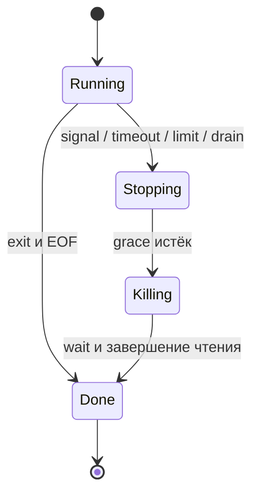

# 10. Операционная система, процессы и CLI

Python-приложение работает внутри процесса операционной системы. У процесса есть адресное пространство, потоки, идентификатор, окружение, текущий каталог, открытые дескрипторы, права и ограничения ресурсов. Командная строка задаёт способ взаимодействия с этим процессом, а subprocess позволяет запускать другие программы и управлять их жизненным циклом.

Главная инженерная задача — сделать поведение предсказуемым: что именно запускается, с какими аргументами, куда попадают данные, сколько времени и памяти допустимо потратить и что происходит при ошибке или остановке.

Глава сохраняет четыре темы и 23 пункта README в исходном порядке. Основной код рассчитан на Python 3.12–3.14. Версионные и платформенные особенности помечены отдельно.

Короткие Python-примеры самостоятельны. Они запускают только собственные небольшие дочерние Python-программы, создают файлы в TemporaryDirectory и не требуют сети. Примеры не печатают содержимое всего окружения, не меняют системные настройки и не завершают чужие процессы. Ожидаемые исключения перехватываются.

В конце находится законченный CLI-проект с тестами. Его backend управления процессом требует POSIX и waitid/WNOWAIT; это ограничение проверяется до запуска команды. В Windows остаются применимы переносимые примеры главы, но для аналогичных гарантий управления деревом нужен отдельный backend.

В учебных блоках assert проверяет результат. Валидация пользовательских параметров в проекте выполняется явными исключениями и работает при запуске с -O.

**Содержание**

1. [Окружение процесса — os и sys](#process-environment)
2. [Запуск внешних программ — subprocess](#external-programs)
3. [Сигналы и завершение приложения](#signals-and-shutdown)
4. [Проектирование командной строки — argparse](#command-line-design)

<a id="process-environment"></a>

## Окружение процесса — os и sys

### argv, executable, platform, exit codes и sys.exit()

**Процесс, программа и интерпретатор.** Программа — код, процесс — его выполняющийся экземпляр. Два запуска одного файла обычно создают два процесса с отдельной памятью. Потоки одного процесса разделяют значительную часть состояния, включая текущий каталог и окружение.

В CPython интерпретатор является программой ОС. Python-модуль выполняется внутри него. Отдельные Python-интерпретаторы в одном процессе и отдельные процессы — разные модели изоляции.

| Интерфейс | Что означает | На что обратить внимание |
|---|---|---|
| sys.argv | Аргументы, доступные Python-программе | argv[0] не гарантирует абсолютный путь |
| sys.orig_argv | Исходные аргументы запуска интерпретатора | Отличается от списка аргументов приложения |
| sys.executable | Путь к текущему исполняемому интерпретатору | Может быть пустым/недоступным в особом встраивании |
| sys.platform | Платформа Python, например linux, win32, darwin | Не равно названию дистрибутива или всем возможностям ОС |
| os.name | Крупная категория интерфейса, обычно posix или nt | Это не полный тест наличия конкретной функции |
| os.getpid() | PID текущего процесса | PID может повторно использоваться после завершения |
| os.getppid() | PID родителя | Родитель может измениться при переподчинении |
| sys.exit(status) | Возбуждает SystemExit | Не является безусловным немедленным убийством процесса |

```python
import os
import subprocess
import sys


if not sys.executable:
    raise RuntimeError("путь интерпретатора недоступен")

code = "import json, sys; print(json.dumps(sys.argv[1:], ensure_ascii=True))"
result = subprocess.run(
    [sys.executable, "-I", "-c", code, "two words", "Иса", "--flag=value"],
    capture_output=True,
    text=True,
    encoding="utf-8",
    check=True,
    timeout=5,
)
import json

assert json.loads(result.stdout) == ["two words", "Иса", "--flag=value"]
assert os.getpid() > 0
assert isinstance(sys.platform, str)
```

Аргумент "two words" уже является одним элементом списка. Дополнительные кавычки внутри значения не нужны. На POSIX shell обычно обрабатывает пользовательскую строку до запуска приложения: кавычки помогают оболочке сформировать argv, но сами обычно не входят в значение.

На Windows базовый механизм запуска принимает командную строку, и subprocess преобразует список в подходящее строковое представление. Конкретная программа может разбирать его по собственным правилам; это важно для нестандартных исполняемых файлов и batch.

Для запуска того же Python обычно используйте [sys.executable, "-m", "package"], а не строку "python". Иначе PATH может выбрать другой интерпретатор и другое виртуальное окружение. Не разрешайте symlink sys.executable без причины: путь внутри venv может быть значим для выбора окружения.

```python
import subprocess
import sys


result = subprocess.run(
    [sys.executable, "-I", "-m", "json.tool"],
    input='{"b": 2, "a": 1}',
    capture_output=True,
    text=True,
    encoding="utf-8",
    check=True,
    timeout=5,
)
assert '"a": 1' in result.stdout
assert result.returncode == 0
```

Флаг -I включает изолированный режим Python: он влияет на поиск модулей и обработку Python-переменных окружения. Это полезно для контролируемых примеров, но не является sandbox против недоверенного Python-кода.

**Коды завершения.** Ноль обычно означает успех. Ненулевые значения определяются контрактом конкретной программы. Для переносимого собственного CLI удобно использовать небольшой документированный диапазон. Не кодируйте произвольные большие числа: способы представления статуса различаются между ОС и оболочками.

На POSIX Popen.returncode == -N означает завершение сигналом N. Shell может отображать это как 128 + N, например 130 для SIGINT. Это представление shell, а не значение Popen.returncode. Процесс, явно выполнивший sys.exit(130), завершился обычным способом с кодом 130, что отличается от убийства SIGINT.

```python
import sys


events = []
try:
    try:
        events.append("work")
        sys.exit(7)
    finally:
        events.append("cleanup")
except SystemExit as error:
    assert error.code == 7
assert events == ["work", "cleanup"]
```

SystemExit наследуется от BaseException, а не Exception. Поэтому except Exception его обычно не ловит. finally и контекстные менеджеры выполняются при нормальной раскрутке стека.

sys.exit(None) эквивалентен успешному завершению. Строка в sys.exit("message") обычно выводится в stderr и задаёт ошибочный статус, а не превращается в числовой код.

```python
import subprocess
import sys


result = subprocess.run(
    [sys.executable, "-I", "-c", "import sys; sys.exit('invalid input')"],
    capture_output=True,
    text=True,
    encoding="utf-8",
    timeout=5,
)
assert result.returncode == 1
assert result.stdout == ""
assert result.stderr.strip() == "invalid input"
```

В worker-потоке sys.exit завершает этот поток, если SystemExit не перехвачен; весь процесс не обязан остановиться. Завершение главного потока также не заменяет согласованную остановку остальных non-daemon потоков.

Для обычного CLI используйте функцию main(argv=None) -> int и тонкую точку входа raise SystemExit(main()). Это позволяет тестировать разбор аргументов без изменения глобального sys.argv.

**fork, exec и ожидание.** На POSIX fork создаёт дочерний процесс с унаследованным состоянием, exec заменяет текущую программу новой, wait/waitpid забирают статус завершившегося потомка. Успешный exec не возвращается в старый Python-код и не выполняет его обычный cleanup.

Не вызывайте fork непосредственно ради простого запуска команды: subprocess выбирает подходящий механизм сам и может использовать posix_spawn. После fork многопоточного процесса ребёнок получает опасно неполное состояние потоков и блокировок. Начиная с Python 3.12 CPython может предупреждать о fork при обнаружении нескольких потоков.

Методы старта multiprocessing и их значения по умолчанию — отдельная тема. В Python 3.14 fork больше не является default ни на одной платформе; выбор spawn/forkserver зависит от платформы. Это нельзя переносить на внутреннюю реализацию каждого subprocess-вызова.

### Переменные окружения, кодировки и текущая директория

Окружение — набор строковых пар имя → значение, которые процесс обычно получает при запуске. Изменение окружения дочернего процесса не обновляет окружение уже работающего родителя.

```python
import os
import subprocess
import sys


key = "PYBOOK_EXAMPLE_LABEL"
old_value = os.environ.get(key)
child_environment = os.environ.copy()
child_environment[key] = "demo"
result = subprocess.run(
    [
        sys.executable,
        "-I",
        "-c",
        "import os; print(os.environ['PYBOOK_EXAMPLE_LABEL'])",
    ],
    env=child_environment,
    capture_output=True,
    text=True,
    encoding="utf-8",
    check=True,
    timeout=5,
)
assert result.stdout.strip() == "demo"
assert os.environ.get(key) == old_value
```

env= заменяет окружение потомка целиком. Это не «добавить указанные значения к inherited». Если нужно наследование с изменениями, сначала копируйте os.environ.

Минимальное окружение иногда полезно, но его нужно проектировать. PATH, locale, временный каталог, сертификаты, динамический загрузчик и системные переменные могут быть нужны запускаемой программе. На Windows для некоторых сценариев существенен SystemRoot. Не считайте env={} универсально рабочим или автоматически безопасным.

Окружение не является хранилищем секретов с гарантированной конфиденциальностью. Его могут видеть диагностические средства и участники с достаточными правами; оно попадает в потомков, если его не ограничить. Не печатайте os.environ в логи ради отладки.

os.environ — Python-представление окружения. Изменяйте его через mapping, а не os.putenv, если нужно согласованное поведение Python-API. В Python 3.14 появился os.reload_environ для перечитывания изменений вне mapping; он не thread-safe и не должен использоваться как безусловный способ синхронизации конкурентного кода.

**Кодировки относятся к разным границам.** Кодировка имён файлов/argv, стандартных потоков, конкретного файла и вывода внешней команды может различаться.

```python
import locale
import os
import sys


assert isinstance(sys.getfilesystemencoding(), str)
assert isinstance(locale.getpreferredencoding(False), str)
assert os.fsdecode(os.fsencode("example.txt")) == "example.txt"
assert sys.stdout.encoding is None or isinstance(sys.stdout.encoding, str)
```

В POSIX Python может сохранять недекодируемые байты argv/путей через surrogateescape. Такой str не обязательно является корректным Unicode для внешнего JSON/API. Для точной передачи непрозрачных байтов используйте подходящую бинарную границу.

encoding="utf-8" в subprocess задаёт декодирование со стороны родителя. Это не приказывает произвольной дочерней программе выдавать UTF-8. Для своего дочернего Python можно передать -X utf8; для других программ используйте их контракт и настройки.

**Текущий каталог.** Относительный путь интерпретируется относительно cwd процесса. Это не обязательно каталог .py-файла, корень проекта или домашний каталог пользователя.

```python
import subprocess
import sys
from pathlib import Path
from tempfile import TemporaryDirectory


original = Path.cwd()
with TemporaryDirectory() as directory:
    root = Path(directory)
    result = subprocess.run(
        [sys.executable, "-I", "-c", "from pathlib import Path; print(Path.cwd())"],
        cwd=root,
        capture_output=True,
        text=True,
        encoding="utf-8",
        check=True,
        timeout=5,
    )
    assert Path(result.stdout.strip()).resolve() == root.resolve()
assert Path.cwd() == original
```

cwd= меняет каталог только для запускаемого процесса. Для ресурсов пакета используйте importlib.resources; для заданного пользователем пути заранее определите, относительно какого каталога он разрешается.

При env и cwd поиск не абсолютного executable имеет платформенные различия. Самый ясный контракт для критичного запуска — заранее выбранный абсолютный путь к программе и отдельно переданные аргументы.

### Глобальное состояние процесса и конкурирующие изменения

Текущий каталог, os.environ, umask, locale, обработчики сигналов и стандартные потоки — примеры состояния, изменения которого могут повлиять на другие части процесса.

| Действие | Возможный неожиданный эффект | Предпочтительный способ |
|---|---|---|
| os.chdir перед запуском | Другой поток открывает относительный путь в новом месте | subprocess(..., cwd=...) |
| Изменение os.environ перед запуском | Параллельный запуск наследует чужие параметры | Копия env на конкретный вызов |
| redirect_stdout в библиотеке | Печать другого потока уходит в чужой буфер | Передать destination/logger |
| Изменение locale | Другой код иначе форматирует/разбирает значения | Явный формат и локальная библиотечная настройка |
| Временная смена umask | Конкурентное создание получает другие права | Права/umask дочернего запуска или изолированный процесс |
| Глобальная смена signal handler | Фреймворк теряет собственную остановку | Владение обработчиками на уровне приложения |

Восстановление в finally полезно, но не устраняет окно, в котором другой поток наблюдает временное значение.

GIL не обеспечивает смысловую атомарность последовательности «изменить env → запустить → восстановить». Некоторые операции освобождают GIL, а free-threaded сборка меняет модель выполнения; основная проблема общего состояния существует в обоих случаях.

```python
import os
import subprocess
import sys


def run_with_label(label: str) -> str:
    environment = dict(os.environ)
    environment["PYBOOK_LABEL"] = label
    result = subprocess.run(
        [sys.executable, "-I", "-c", "import os; print(os.environ['PYBOOK_LABEL'])"],
        env=environment,
        capture_output=True,
        text=True,
        encoding="utf-8",
        check=True,
        timeout=5,
    )
    return result.stdout.strip()


assert run_with_label("first") == "first"
assert run_with_label("second") == "second"
```

Этот дизайн не изменяет окружение родителя. Если другая часть программы конкурентно меняет os.environ во время самого копирования, всё равно нужен общий договор о доступе. Удобнее конфигурировать окружение до старта потоков и затем считать его неизменяемым.

Lock поможет только если все участники используют тот же lock. C-библиотека или сторонний код, который меняет глобальное состояние без него, этим договором не охватывается.

В библиотеке не меняйте глобальный cwd/locale/сигналы неожиданно для вызывающего кода. При невозможности локальной настройки вынесите операцию в выделенный процесс.

### Файловые дескрипторы, наследование и закрытие ресурсов

Файловый объект — Python-обёртка. Файловый дескриптор POSIX — целое число, обозначающее открытый ресурс в таблице процесса. В Windows также существуют OS handles и отдельные CRT file descriptors; эти понятия не полностью взаимозаменяемы.

Обычно 0, 1, 2 соответствуют stdin, stdout, stderr. Ноль — допустимый fd. Не проверяйте дескриптор условием if descriptor:.

```python
import os
from tempfile import TemporaryFile


with TemporaryFile(mode="w+b") as stream:
    descriptor = stream.fileno()
    assert descriptor >= 0
    stream.write(b"abc")
    stream.flush()
    duplicate = os.dup(descriptor)
    try:
        os.lseek(duplicate, 0, os.SEEK_SET)
        assert os.read(duplicate, 3) == b"abc"
    finally:
        os.close(duplicate)
```

Дубликаты дескриптора могут разделять одну open file description, включая файловую позицию. Это не два независимых чтения одного имени. Не смешивайте низкоуровневые операции с буферной обёрткой без протокола синхронизации.

В современных Python вновь созданные fd обычно non-inheritable. close_fds=True ограничивает перенос лишних открытых дескрипторов в запускаемую программу. Стандартные потоки перенаправляются отдельно; pass_fds позволяет явно передать выбранные fd на POSIX.

```python
import os
import subprocess
import sys


if os.name == "posix":
    read_fd, write_fd = os.pipe()
    try:
        assert not os.get_inheritable(write_fd)
        result = subprocess.run(
            [
                sys.executable,
                "-I",
                "-c",
                "import os, sys; os.write(int(sys.argv[1]), b'ok')",
                str(write_fd),
            ],
            pass_fds=(write_fd,),
            close_fds=True,
            check=True,
            timeout=5,
        )
        os.close(write_fd)
        write_fd = -1
        assert os.read(read_fd, 2) == b"ok"
    finally:
        os.close(read_fd)
        if write_fd >= 0:
            os.close(write_fd)
```

Передавать fd через аргумент недостаточно: номер должен действительно обозначать унаследованный ресурс в ребёнке. pass_fds не является переносимым Windows-интерфейсом.

После fork ещё не закрытый fd может присутствовать в дочернем процессе даже при настройке close-on-exec: это свойство относится к переходу exec. Не путайте наследование через fork и через запуск новой программы.

EOF в pipe появляется, когда закрыты все дескрипторы записи соответствующего канала. Если копию держит внук, родитель может ждать EOF уже после завершения непосредственного ребёнка.

У каждого конца pipe должен быть владелец. Родитель закрывает ненужную копию, ребёнок — свои ненужные ресурсы. Popen не закрывает автоматически все открытые вами файлы.

Закрытие файла, flush, ожидание процесса и освобождение статуса завершения — разные операции. Вызов kill без wait на POSIX может оставить zombie-потомка.

### Права, пользователь, лимиты ресурсов и различия ОС

Процесс выполняется с набором полномочий. На POSIX значимы real/effective UID и GID, дополнительные группы, mode bits, ACL, capabilities и ограничения namespaces/cgroups. В Windows работают токены доступа, ACL, уровни целостности и механизмы Job Objects.

```python
import os


identity = {"pid": os.getpid(), "os_name": os.name}
if hasattr(os, "getuid"):
    identity["uid"] = os.getuid()
    identity["effective_uid"] = os.geteuid()
assert identity["pid"] > 0
```

Не определяйте полномочия исключительно по имени пользователя, наличию sudo или UID=0: контейнер, capabilities, ACL и политика ОС меняют доступные действия. Предварительный os.access не заменяет обработку ошибки целевой операции.

**Права новых файлов.** umask ограничивает mode при создании; он не является универсальной заменой ACL и не исправляет права существующего объекта. У POSIX Popen есть параметр umask: его можно применить к ребёнку без временной смены umask родителя.

```python
import os
import stat
import subprocess
import sys
from pathlib import Path
from tempfile import TemporaryDirectory


if os.name == "posix":
    with TemporaryDirectory() as directory:
        path = Path(directory) / "private.txt"
        subprocess.run(
            [
                sys.executable,
                "-I",
                "-c",
                "import os, sys; fd=os.open(sys.argv[1], os.O_CREAT|os.O_EXCL|os.O_WRONLY, 0o666); os.close(fd)",
                str(path),
            ],
            umask=0o077,
            check=True,
            timeout=5,
        )
        assert stat.S_IMODE(path.stat().st_mode) == 0o600
```

Параметры user, group, extra_groups и umask у subprocess платформозависимы. Изменение пользователя может требовать привилегий. Не используйте preexec_fn ради такой настройки: в многопоточном родителе он способен привести к deadlock до exec; предпочтительнее специальные параметры и supervisor ОС.

**Лимиты.** На Unix resource предоставляет getrlimit/setrlimit и getrusage.

```python
import os


if os.name == "posix":
    import resource

    soft, hard = resource.getrlimit(resource.RLIMIT_NOFILE)
    usage = resource.getrusage(resource.RUSAGE_SELF)
    assert soft == resource.RLIM_INFINITY or soft > 0
    assert hard == resource.RLIM_INFINITY or hard >= soft
    assert usage.ru_utime >= 0
```

Soft limit применяется к текущему использованию; hard ограничивает допустимое повышение soft. Возможность изменения зависит от полномочий. Значение RLIM_INFINITY и доступные ресурсы различаются между платформами.

RLIMIT_CPU ограничивает CPU-время, а не elapsed wall-clock: спящая программа может почти не расходовать CPU и долго ждать. RLIMIT_AS относится к адресному пространству, что не тождественно RSS. ru_maxrss имеет платформенные единицы, которые нельзя считать универсальными байтами.

Ограничения по одному процессу не обязательно суммируют всё дерево. Для лимитов команды вместе с потомками на Linux обычно нужен cgroup/supervisor; в Windows — соответствующая организация Job Object. Таймаут Python не является лимитом памяти.

os.cpu_count сообщает логическое число CPU системы, которое может не совпадать с реально доступным процессу набором. В Python 3.13 появился os.process_cpu_count; affinity, quota и настройки контейнера всё равно требуют отдельного анализа.

| Область | POSIX | Windows |
|---|---|---|
| Аргументы запуска | Обычно argv-массив на exec-границе | Командная строка и правила разбора программы |
| Остановка | Сигналы, группы, сессии | TerminateProcess, console control events, Job Objects |
| Pipes в selectors | Обычно поддерживаются | Стандартный selectors рассчитан прежде всего на sockets |
| Учёт ресурсов | resource и механизмы ОС | Другие API и инструменты |
| Пути и права | Slash, mode, ACL и прочие правила | Drive/UNC, ACL, sharing и прочие правила |
| Дерево/группа | Это разные отношения | CREATE_NEW_PROCESS_GROUP не равно Job Object |

Проверяйте наличие конкретной функции и документированные ограничения. Условие os.name == "posix" не обещает наличие всех Linux-возможностей на macOS или BSD.

**Документация:** [os](https://docs.python.org/3.14/library/os.html), [sys](https://docs.python.org/3.14/library/sys.html), [resource](https://docs.python.org/3.14/library/resource.html), [multiprocessing: методы старта](https://docs.python.org/3.14/library/multiprocessing.html#contexts-and-start-methods), [cgroup v2](https://docs.kernel.org/admin-guide/cgroup-v2.html), [Windows Job Objects](https://learn.microsoft.com/en-us/windows/win32/procthread/job-objects).

<a id="external-programs"></a>

## Запуск внешних программ — subprocess

### run(), Popen и CompletedProcess

run подходит, когда нужно запустить команду, дождаться её окончания и получить результат. Popen предоставляет управляемый объект ещё работающего процесса.

| API | Что возвращает | Когда выбирать |
|---|---|---|
| subprocess.run | CompletedProcess | Одна завершённая операция с понятными входом и выходом |
| subprocess.Popen | Объект жизненного цикла | Потоковое чтение, несколько взаимодействий, своя остановка |
| subprocess.check_output | Захваченный stdout | Небольшой результат при обязательном нулевом статусе |
| subprocess.call/check_call | Статус/проверка завершения | Обычно новый код проще выразить через run |
| os.system | Статус запуска shell-команды | Для нового управляемого Python-кода обычно недостаточно |

```python
import subprocess
import sys


result = subprocess.run(
    [sys.executable, "-I", "-c", "print(6 * 7)"],
    capture_output=True,
    text=True,
    encoding="utf-8",
    check=True,
    timeout=5,
)
assert isinstance(result, subprocess.CompletedProcess)
assert result.args[0] == sys.executable
assert result.returncode == 0
assert result.stdout == "42\n"
assert result.stderr == ""
result.check_returncode()
```

CompletedProcess — результат наблюдения, а не управляющий объект живого процесса. У него нет terminate и kill.

```python
import subprocess
import sys


with subprocess.Popen(
    [sys.executable, "-I", "-c", "print('ready')"],
    stdout=subprocess.PIPE,
    stderr=subprocess.PIPE,
    text=True,
    encoding="utf-8",
) as process:
    output, errors = process.communicate(timeout=5)
    assert output == "ready\n"
    assert errors == ""
    assert process.returncode == 0
```

Контекст Popen закрывает свои стандартные потоки и ожидает ребёнка. **Выход из with сам по себе не означает terminate/kill.** Если ребёнок завис, context exit тоже может ждать. Ошибку во внутреннем коде надо сочетать с явной политикой остановки.

poll проверяет статус без блокирующего ожидания, wait ждёт завершения. Оба могут забрать статус ребёнка у ОС. Запуск Popen без сохранения объекта не является корректным способом «запустить и забыть».

На POSIX завершившийся ребёнок остаётся zombie, пока родитель не забрал статус. Zombie уже не выполняет код и не расходует обычную память живой программы, но занимает запись в таблице процессов. Orphan — другой случай: живой процесс потерял прежнего родителя. Эти понятия нельзя смешивать.

Не устанавливайте сторонний SIGCHLD-handler, который забирает все статусы через waitpid(-1), параллельно с subprocess без общего договора. Иначе владелец Popen может потерять возможность корректно узнать свой результат.

### Список аргументов, shell=True и правила экранирования

Для обычного запуска передавайте последовательность аргументов и оставляйте shell=False.

```python
import json
import subprocess
import sys


arguments = ["two words", "$(example)", "a;b", "*.csv", "", "--name=Иса"]
result = subprocess.run(
    [
        sys.executable,
        "-I",
        "-c",
        "import json,sys; print(json.dumps(sys.argv[1:], ensure_ascii=True))",
        *arguments,
    ],
    capture_output=True,
    text=True,
    encoding="utf-8",
    check=True,
    timeout=5,
)
assert json.loads(result.stdout) == arguments
```

Здесь $, ; и * — обычные символы аргумента. Ни command substitution, ни glob не выполняются. Тестовая строка $(example) ничего не запускает.

Не добавляйте кавычки вручную: ["tool", '"two words"'] передаёт кавычки как часть значения во многих обычных сценариях. Не вызывайте " ".join(args) перед shell=False: потеряются границы аргументов.

Список не устраняет **инъекцию опций самой программы**. Имя "-delete" может быть интерпретировано инструментом как ключ. Если целевая программа поддерживает разделитель --, ставьте его перед пользовательскими позиционными значениями. Некоторые программы имеют свои языки выражений, URL-обработчики и настройки исполнения.

shell=True добавляет интерпретацию shell: pipe, перенаправления, подстановки, glob и операторы. Недоверенная часть строки может стать кодом.

```python
import shlex


arguments = ["program", "two words", "literal;value"]
display = shlex.join(arguments)
assert shlex.split(display) == arguments
```

shlex.join/quote относятся к совместимым Unix-shell. Это не универсальное экранирование для cmd.exe, PowerShell или чужого parser. shlex.split не выполняет полноценную shell-команду: он не подставляет переменные и не строит pipeline.

Для самой команды строка "python script.py" при shell=False на POSIX обычно означает имя исполняемого файла с пробелом, а не пару аргументов. На Windows правила отличаются; переносимый контракт — список.

Намеренный запуск shell должен явно определять оболочку и доверие к коду. В учебном примере shell-скрипт содержит только фиксированный код:

```python
import os
import subprocess


if os.name == "posix":
    result = subprocess.run(
        ["/bin/sh", "-c", "printf '%s\\n' fixed-value"],
        capture_output=True,
        text=True,
        encoding="utf-8",
        check=True,
        timeout=5,
    )
    assert result.stdout == "fixed-value\n"
```

Явный /bin/sh здесь всё равно является shell-интерпретатором, хотя shell=False у subprocess. Безопасность определяется всей цепочкой, а не одним значением параметра.

В Windows .bat/.cmd могут исполняться через shell даже при shell=False. Поэтому нельзя механически переносить гарантию прямого argv-запуска native executable на batch-файл. Для недоверенных аргументов избегайте batch-прослойки либо следуйте текущим рекомендациям subprocess для конкретного сценария.

В Python 3.12 изменён Windows-поиск оболочки для shell=True: это уменьшает один класс подмены cmd.exe. Изменение не делает построенную конкатенацией shell-строку безопасной.

Абсолютный путь снижает неоднозначность выбора executable, но не удостоверяет его содержимое и все загружаемые библиотеки. Версия инструмента, права каталога, PATH плагинов и окружение тоже входят в контракт запуска.

### env, cwd, stdin/stdout/stderr и text vs bytes

Разделяйте четыре решения: где выполнить команду, какое окружение передать, откуда дать вход и куда направить выход.

| Значение потока | Поведение |
|---|---|
| None | Обычно унаследовать соответствующий стандартный поток |
| subprocess.PIPE | Создать канал к родителю |
| subprocess.DEVNULL | Читать EOF или отбрасывать вывод через специальное устройство |
| Открытый файл / fd | Подключить предоставленный ресурс |
| stderr=STDOUT | Объединить stderr с stdout |

```python
import subprocess
import sys


code = "import sys; data=sys.stdin.buffer.read(); sys.stdout.buffer.write(data[::-1])"
binary = subprocess.run(
    [sys.executable, "-I", "-c", code],
    input=b"\x00\xffABC",
    capture_output=True,
    check=True,
    timeout=5,
)
assert binary.stdout == b"CBA\xff\x00"
assert binary.stderr == b""
```

Без text/encoding потоки бинарные. В текстовом режиме ожидаются str, выполняются кодирование/декодирование и преобразование окончаний строк.

```python
import subprocess
import sys


code = "import sys; sys.stdout.buffer.write('Я\\r\\n'.encode('utf-8'))"
text = subprocess.run(
    [sys.executable, "-I", "-c", code],
    capture_output=True,
    text=True,
    encoding="utf-8",
    errors="strict",
    check=True,
    timeout=5,
)
assert text.stdout == "Я\n"
```

Если важны исходные CR/LF или непрозрачные байты, используйте бинарный режим. errors="replace" допустим для диагностического просмотра с потерей точных байтов; для строгого протокола повреждение обычно должно приводить к ошибке.

capture_output=True эквивалентно захвату обоих потоков через PIPE. Нельзя одновременно передавать его и отдельные stdout/stderr. input= создаёт stdin=PIPE; отдельный stdin вместе с input не нужен.

```python
import subprocess
import sys
from pathlib import Path
from tempfile import TemporaryDirectory


with TemporaryDirectory() as directory:
    output = Path(directory) / "result.txt"
    with output.open("wb") as destination:
        result = subprocess.run(
            [sys.executable, "-I", "-c", "print('file output')"],
            stdin=subprocess.DEVNULL,
            stdout=destination,
            stderr=subprocess.PIPE,
            check=True,
            timeout=5,
        )
    assert result.stdout is None
    assert result.stderr == b""
    assert output.read_bytes().rstrip(b"\r\n") == b"file output"
```

Такой вывод не накапливается в Python-строке, но способен заполнить диск. Перенаправление в файл не является лимитом общего объёма.

Объединение stderr=STDOUT удобно для человекочитаемого журнала, но разрушает разделение данных и диагностики. Если stdout — JSON, случайная диагностическая строка сделает результат невалидным. Порядок между двумя отдельными потоками не является единой точной временной шкалой событий.

### PIPE, communicate() и deadlock при заполнении буфера

Pipe имеет конечную ёмкость. Если ребёнок записал достаточно данных, следующая запись блокируется до чтения другим участником.

Классическая взаимная блокировка: родитель ждёт окончания ребёнка через wait, ребёнок ждёт свободное место в stdout/stderr, родитель эти потоки не читает.

Другая схема: родитель полностью читает stdout, а ребёнок сначала заполняет stderr. Родитель ждёт stdout/EOF, ребёнок ждёт чтения stderr.

Для ограниченного вывода communicate одновременно организует обмен через выбранные каналы и ожидание процесса.

```python
import subprocess
import sys


code = (
    "import sys; "
    "sys.stdout.buffer.write(b'A'*200000); sys.stdout.flush(); "
    "sys.stderr.buffer.write(b'B'*200000); sys.stderr.flush()"
)
process = subprocess.Popen(
    [sys.executable, "-I", "-c", code],
    stdin=subprocess.DEVNULL,
    stdout=subprocess.PIPE,
    stderr=subprocess.PIPE,
)
try:
    output, errors = process.communicate(timeout=5)
except BaseException:
    process.kill()
    process.communicate()
    raise
assert process.returncode == 0
assert output == b"A" * 200000
assert errors == b"B" * 200000
```

Этот пример безопасен по памяти только потому, что размер вывода собственной программы известен. communicate хранит захваченный результат в памяти. Он устраняет типичный deadlock, но не вводит лимит байтов.

Не считайте буфер pipe равным конкретному числу KiB на любой ОС. PIPE_BUF в POSIX относится к определённой атомарности записи, а не универсальной полной ёмкости канала. Одна логическая строка может быть длиннее любого из этих значений.

**Конвейер без shell.** Соединяйте потоки явно и закрывайте лишнюю копию конца pipe у родителя:

```python
import subprocess
import sys


first = subprocess.Popen(
    [sys.executable, "-I", "-c", "print('alpha'); print('beta')"],
    stdout=subprocess.PIPE,
)
second = None
try:
    if first.stdout is None:
        raise RuntimeError("stdout первого процесса недоступен")
    second = subprocess.Popen(
        [
            sys.executable,
            "-I",
            "-c",
            "import sys; sys.stdout.write(sys.stdin.read().upper())",
        ],
        stdin=first.stdout,
        stdout=subprocess.PIPE,
        stderr=subprocess.PIPE,
    )
    first.stdout.close()
    output, errors = second.communicate(timeout=5)
    assert first.wait(timeout=5) == 0
    assert second.returncode == 0
    assert output.splitlines() == [b"ALPHA", b"BETA"]
    assert errors == b""
finally:
    for process in (second, first):
        if process is not None:
            if process.poll() is None:
                process.kill()
            process.wait(timeout=5)
    if first.stdout is not None:
        first.stdout.close()
```

Успех последнего звена не доказывает успех предыдущих. Проверяйте статусы всех звеньев. Если ранний потребитель закрыл вход, писатель может получить BrokenPipe/SIGPIPE — нормальная или ошибочная ситуация определяется протоколом pipeline.

### Таймаут, returncode, check=True и обработка ошибок

Таймаут ограничивает конкретное ожидание. Он не гарантирует абсолютное время всей цепочки, не откатывает выполненные действия и не обязательно убивает потомков запускаемой программы.

| Ситуация | Что обычно получит родитель |
|---|---|
| Программа не найдена при прямом запуске | FileNotFoundError/OSError |
| Программа запустилась и вернула ошибочный код | CompletedProcess с ненулевым returncode |
| То же при check=True | CalledProcessError |
| Истёк timeout | TimeoutExpired |
| Неверная кодировка stdout в text-режиме | UnicodeDecodeError |
| Программа убита сигналом на POSIX | Отрицательный returncode |

```python
import subprocess
import sys


try:
    subprocess.run(
        [
            sys.executable,
            "-I",
            "-c",
            "import sys; print('details', file=sys.stderr); sys.exit(4)",
        ],
        capture_output=True,
        text=True,
        encoding="utf-8",
        check=True,
        timeout=5,
    )
except subprocess.CalledProcessError as error:
    assert error.returncode == 4
    assert error.stdout == ""
    assert error.stderr.strip() == "details"
else:
    raise AssertionError("ненулевой код должен обрабатываться")
```

check=True проверяет статус, но не смысл stdout. Команда может вернуть 0 и выдать повреждённый JSON; валидация результата остаётся задачей вызывающего кода.

```python
import subprocess
import sys


try:
    subprocess.run(
        [sys.executable, "-I", "-c", "import time; time.sleep(10)"],
        capture_output=True,
        timeout=0.2,
        check=True,
    )
except subprocess.TimeoutExpired as error:
    assert error.timeout == 0.2
else:
    raise AssertionError("ожидался таймаут")
```

При timeout в run библиотека убивает непосредственного ребёнка, ожидает его и возбуждает TimeoutExpired. Создание процесса на некоторых платформах не прерывается этим timeout. Дополнительные потомки и удерживаемые ими pipe могут усложнить время завершения; timeout не является полноценным деревом supervision.

Для Popen.communicate(timeout=...) автоматического kill нет:

```python
import subprocess
import sys


process = subprocess.Popen(
    [
        sys.executable,
        "-I",
        "-c",
        "import time; print('started', flush=True); time.sleep(10)",
    ],
    stdout=subprocess.PIPE,
    stderr=subprocess.PIPE,
)
try:
    output, errors = process.communicate(timeout=0.2)
except subprocess.TimeoutExpired:
    process.kill()
    output, errors = process.communicate(timeout=5)
assert process.returncode != 0
assert isinstance(output, bytes)
assert isinstance(errors, bytes)
```

После kill всё равно требуется wait/communicate. Повтор communicate после TimeoutExpired допускается; не надо безусловно склеивать error.output с возвращённым полным результатом, иначе можно получить дубликаты.

TimeoutExpired.output/stderr, если захвачены, являются bytes даже при text=True; отсутствие данных может обозначаться None. Это отличается от успешного CompletedProcess.stdout в текстовом режиме.

Используйте monotonic для deadline. time.time может перескочить при коррекции системных часов. Если операция состоит из нескольких ожиданий, передавайте оставшийся бюджет, иначе каждый шаг получит новый полный timeout.

Повтор команды после таймаута может повторить внешние изменения. Дочерняя программа могла успеть записать файл или выполнить удалённую операцию до остановки. Для retry нужны идемпотентность и протокол подтверждения результата.

### Сигналы, terminate/kill, группы и дерево процессов

На POSIX terminate посылает SIGTERM, kill — SIGKILL. SIGTERM можно обработать или игнорировать; SIGKILL перехватить нельзя. В Windows terminate и kill используют жёсткое завершение процесса; terminate не становится автоматически «мягким SIGTERM».

```python
import subprocess
import sys


process = subprocess.Popen(
    [sys.executable, "-I", "-c", "import time; time.sleep(10)"],
    stdin=subprocess.DEVNULL,
    stdout=subprocess.DEVNULL,
    stderr=subprocess.DEVNULL,
)
try:
    process.terminate()
    try:
        process.wait(timeout=2)
    except subprocess.TimeoutExpired:
        process.kill()
        process.wait(timeout=5)
finally:
    if process.poll() is None:
        process.kill()
        process.wait(timeout=5)
assert process.returncode is not None
```

Успешный send_signal говорит о запросе ОС, а не о завершении обработки и освобождении всех ресурсов. Даже SIGKILL не превращает любую заблокированную kernel-операцию в мгновенное событие.

PID — идентификатор отдельного процесса; PPID описывает родительство; process group объединяет получателей сигналов; session связывает группы и терминальный контекст. Группа и дерево потомков — разные структуры.

На POSIX start_new_session=True позволяет не посылать групповой сигнал в группу самого вызывающего приложения:

```python
import os
import signal
import subprocess
import sys


if os.name == "posix":
    process = subprocess.Popen(
        [sys.executable, "-I", "-c", "import time; time.sleep(10)"],
        start_new_session=True,
        stdin=subprocess.DEVNULL,
        stdout=subprocess.DEVNULL,
        stderr=subprocess.DEVNULL,
    )
    try:
        try:
            os.killpg(process.pid, signal.SIGTERM)
        except ProcessLookupError:
            pass
        try:
            process.wait(timeout=2)
        except subprocess.TimeoutExpired:
            try:
                os.killpg(process.pid, signal.SIGKILL)
            except ProcessLookupError:
                pass
            process.wait(timeout=5)
    finally:
        if process.poll() is None:
            process.kill()
            process.wait(timeout=5)
```

Не вызывайте killpg(os.getpgrp(), ...) для остановки произвольной команды: можно завершить собственную оболочку и другие связанные процессы.

Часть потомков может сменить сессию/группу и уйти от сигнала. Обход дерева по PPID также подвержен гонкам: появляются новые процессы, меняются родители, переиспользуются PID. Для строгого владения набором задач нужны supervisor, cgroup или Job Object, а не только рекурсивный kill.

Не храните PID как вечную ссылку. На Linux pidfd позволяет устойчивее адресовать конкретный процесс, но сам по себе не является дескриптором всего дерева.

CREATE_NEW_PROCESS_GROUP на Windows помогает с некоторыми console control events. CTRL_C_EVENT/CTRL_BREAK_EVENT требуют подходящих условий консоли и приложения. Это не эквивалент POSIX process group плюс SIGKILL и не замена Job Object.

Для корректной остановки задайте последовательность: прекратить приём работы, запросить завершение, продолжить чтение pipe, дождаться grace period, усилить сигнал, забрать статус и закрыть потоки. Если закрыть чтение слишком рано, ребёнок может завершиться на BrokenPipe вместо своей штатной остановки.

### Потоковое чтение вывода и ограничение его объёма

capture_output/communicate удобны для ограниченного результата. Для потенциально неограниченного вывода нужна другая архитектура.

| Вариант | Преимущество | Ограничение |
|---|---|---|
| Перенаправить в файл | Не копить весь вывод в RAM | Нужны дисковая квота/ротация и политика публикации |
| Один объединённый pipe | Один канал чтения | Теряется разделение stdout/stderr |
| Два reader-потока | Переносимый подход для многих blocking pipes | Нужны ограниченные очереди и продуманная остановка |
| selectors на POSIX | Мультиплексирование нескольких pipe | Не переносится автоматически на Windows pipes |
| asyncio subprocess | Интеграция с event loop | Нужны лимиты, остановка и правильный backend |

Читать for line in stdout удобно, но строка может быть огромной, не завершаться LF или приходить медленно. Поток байтов с bounded read даёт более прямой контроль памяти.

Учебный пример ниже объединяет потоки и хранит только ограниченный результат. Он рассчитан на собственную конечную команду; полноценный timeout показан в практическом проекте.

```python
import subprocess
import sys


limit = 1024
process = subprocess.Popen(
    [sys.executable, "-I", "-c", "import sys; sys.stdout.buffer.write(b'X'*5000)"],
    stdin=subprocess.DEVNULL,
    stdout=subprocess.PIPE,
    stderr=subprocess.STDOUT,
)
collected = bytearray()
exceeded = False
try:
    if process.stdout is None:
        raise RuntimeError("нет канала вывода")
    while True:
        block = process.stdout.read(256)
        if not block:
            break
        remaining = limit - len(collected)
        collected.extend(block[:remaining])
        if len(block) > remaining:
            exceeded = True
            process.kill()
            break
finally:
    if process.stdout is not None:
        process.stdout.close()
    if process.poll() is None:
        process.kill()
    process.wait(timeout=5)
assert exceeded
assert len(collected) == limit
```

Ограничение хранимого префикса и ограничение фактически прочитанных байтов — разные вещи. Продолжать бесконечно читать и отбрасывать вывод означает ограничить память, но не CPU и время.

Нельзя остановиться только на len(prefix) == limit и продолжить ждать ребёнка: он может заблокироваться на полном pipe. При превышении бюджета нужна явная остановка/переключение политики и ограниченное завершение чтения.

bufsize=1 у Popen не заставляет ребёнка сбрасывать собственный stdout. У Python-потомка можно использовать -u или print(..., flush=True); у сторонней программы — её настройки. Терминал, pipe и pseudo-terminal могут вызывать разную буферизацию.

Если декодируете поток UTF-8 блоками, используйте инкрементальный декодер: кодовая точка может пересекать границу блока. Префикс ограниченного вывода может закончиться посередине символа; для точного машинного результата удобно хранить bytes и кодировать их base64.

Для asyncio.create_subprocess_exec cancellation ожидания тоже не означает автоматическое уничтожение всех процессов. limit у StreamReader не является общим лимитом всех байтов команды. Нужно одновременно читать оба потока и выполнять собственную stop/reap-политику.

**Документация:** [subprocess](https://docs.python.org/3.14/library/subprocess.html), [shlex](https://docs.python.org/3.14/library/shlex.html), [selectors](https://docs.python.org/3.14/library/selectors.html), [asyncio subprocess](https://docs.python.org/3.14/library/asyncio-subprocess.html), [wait и WNOWAIT в Linux](https://man7.org/linux/man-pages/man2/waitpid.2.html).

<a id="signals-and-shutdown"></a>

## Сигналы и завершение приложения

### signal: ограничения главного потока и платформы

Сигнал уведомляет процесс о событии ОС. У каждого сигнала есть действие по умолчанию; для некоторых можно установить Python-handler.

В CPython низкоуровневая доставка и выполнение Python-функции — разные этапы. Python-handler выполняется позднее в главном Python-потоке главного интерпретатора. Устанавливать новый handler также разрешено только там.

```python
import signal


received = []
previous = signal.getsignal(signal.SIGINT)


def remember(signum: int, frame: object) -> None:
    received.append(signum)


try:
    signal.signal(signal.SIGINT, remember)
    signal.raise_signal(signal.SIGINT)
    assert received == [signal.SIGINT]
finally:
    signal.signal(signal.SIGINT, previous)
```

Этот пример посылает сигнал только самому учебному процессу и восстанавливает старый handler. В рабочем обработчике лучше ограничиться простейшей записью состояния, а не изменением сложных коллекций.

Долгая операция в C может задержать выполнение Python-handler. Ожидать точного миллисекундного отклика нельзя. Сигналы также не являются надёжной очередью событий: некоторые доставки объединяются, и число вызовов не обязано соответствовать числу внешних событий.

Не выполняйте в handler сетевой запрос, сложный logging, блокирующее ожидание, захват threading.Lock или cleanup всей системы. Handler может прервать код, который уже держит ту же блокировку.

В рабочем event loop сигнал можно превратить в событие через поддерживаемые loop-механизмы или signal.set_wakeup_fd. Последний требует неблокирующего fd и аккуратного управления переполнением; это инфраструктура уровня приложения, а не случайный побочный эффект библиотеки.

```python
import signal
from concurrent.futures import ThreadPoolExecutor


def attempt() -> str:
    try:
        signal.signal(signal.SIGINT, signal.default_int_handler)
    except ValueError:
        return "main-thread-required"
    raise AssertionError("установка handler в worker не должна проходить")


with ThreadPoolExecutor(max_workers=1) as pool:
    assert pool.submit(attempt).result(timeout=5) == "main-thread-required"
```

Набор доступных сигналов и смысл send_signal зависят от ОС. SIGKILL и SIGSTOP на POSIX не перехватываются. Сигнал с названием SIGTERM на Windows не превращает Windows-процесс в POSIX-программу с теми же гарантиями.

Стандартные обработчики Python также имеют значение: SIGINT обычно преобразуется в KeyboardInterrupt; SIGPIPE обычно игнорируется, поэтому запись в закрытый pipe даёт BrokenPipeError. Не восстанавливайте SIGPIPE=SIG_DFL глобально без анализа других записей процесса.

### SIGINT, SIGTERM, кооперативная остановка и deadline завершения

SIGINT часто приходит при Ctrl+C из терминала. SIGTERM обычно используется supervisor/container runtime для запроса завершения на POSIX. По умолчанию SIGTERM не обязан выполнять Python finally: без собственного handler действует системное завершение.

Кооперативная остановка означает, что обычный код замечает запрос и заканчивает работу в контролируемой точке.

```python
from dataclasses import dataclass


@dataclass
class StopState:
    requested: bool = False
    signum: int | None = None

    def request(self, signum: int) -> None:
        self.requested = True
        self.signum = signum


state = StopState()
completed = []
for item in range(10):
    if state.requested:
        break
    completed.append(item)
    if item == 2:
        state.request(15)
assert completed == [0, 1, 2]
assert state.signum == 15
```

Сам flag не прервёт вечный read, зависший lock или бесконечную задачу. Блокирующие действия должны иметь ограниченное ожидание либо механизм пробуждения. Без этого «поддержка graceful shutdown» существует только на уровне флага.

Удобная политика сервиса:

1. Перестать принимать новую работу и снять readiness.
2. Передать запрос остановки выполняющимся задачам.
3. Завершить или отменить операции по прикладному протоколу.
4. Сохранить подтверждённый прогресс, закрыть ресурсы.
5. Дождаться worker и потомков в пределах общего deadline.
6. Усилить остановку там, где это допустимо и предусмотрено.

Если supervisor даёт десять секунд, отдельные этапы не должны каждый расходовать собственные десять секунд.

```python
from time import monotonic


def remaining(deadline: float) -> float:
    return max(0.0, deadline - monotonic())


deadline = monotonic() + 2.0
first_budget = remaining(deadline)
second_budget = remaining(deadline)
assert 0 <= second_budget <= first_budget <= 2.0
```

Обычно первый SIGINT запрашивает штатную остановку, повторный ускоряет принудительную. Это политика конкретного CLI, а не встроенная гарантия любого приложения. Точное поведение нужно описать пользователю.

Если handler возбуждает исключение, оно может появиться в середине произвольного Python-кода. Простой flag и проверка в нормальном control flow часто дают более ясные инварианты, чем raise SystemExit из обработчика.

KeyboardInterrupt наследуется от BaseException. Библиотека не должна молча превращать Ctrl+C в успешный пустой результат. Верхний CLI-уровень может преобразовать его в документированный код 130.

В контейнере PID 1 имеет особенности сигналов и ожидания orphan-потомков. Shell-entrypoint может мешать передаче сигналов, если не выполняет exec. Для сервиса нужен подходящий entrypoint/init/supervisor и согласованный termination grace period.

### atexit и случаи, когда обработчик не вызывается

atexit регистрирует функции нормального завершения интерпретатора. Обычно они выполняются в обратном порядке регистрации.

```python
import json
import subprocess
import sys


code = """
import atexit
import json
events = []
atexit.register(lambda: print(json.dumps(events)))
atexit.register(lambda: events.append("second"))
atexit.register(lambda: events.append("first"))
"""
result = subprocess.run(
    [sys.executable, "-I", "-c", code],
    capture_output=True,
    text=True,
    encoding="utf-8",
    check=True,
    timeout=5,
)
assert json.loads(result.stdout) == ["first", "second"]
```

Handler не является гарантированной транзакцией восстановления. Он не вызывается, например, при os._exit, фатальной внутренней ошибке и завершении сигналом, который Python не обработал обычным control flow. При SIGKILL и отключении питания выполнить cleanup невозможно.

```python
import subprocess
import sys


code = "import atexit,os; atexit.register(lambda: print('cleanup',flush=True)); os._exit(9)"
result = subprocess.run(
    [sys.executable, "-I", "-c", code],
    capture_output=True,
    timeout=5,
)
assert result.returncode == 9
assert result.stdout == b""
```

os._exit здесь вызывается только в собственной дочерней программе. Он обходит обычный Python-cleanup и сброс буферов, поэтому не подходит как стандартная реализация CLI-exit.

Начиная с Python 3.12 запуск нового потока или fork внутри atexit-handler приводит к RuntimeError. Завершение интерпретатора — неподходящий момент для старта новой инфраструктуры.

atexit полезен как дополнительная уборка ограниченных локальных ресурсов. Основное управление должно происходить через with, try/finally, явные close/join/wait и процедуру shutdown до финализации интерпретатора.

Не возлагайте на atexit отправку обязательного платежа, commit единственной копии результата или освобождение распределённой блокировки без срока жизни. Для критичных эффектов нужны подтверждения, журнал и восстановление при повторном запуске.

### Освобождение частично инициализированных ресурсов

Если второй шаг инициализации упал, первый уже мог открыть файл или запустить процесс. Cleanup нужен не только после успешного старта всей системы.

ExitStack регистрирует завершение по мере успешного получения ресурсов и вызывает его в обратном порядке.

```python
from contextlib import ExitStack
from pathlib import Path
from tempfile import TemporaryDirectory


events = []
with TemporaryDirectory() as directory:
    root = Path(directory)
    try:
        with ExitStack() as stack:
            first = stack.enter_context(
                (root / "first.txt").open("w", encoding="utf-8")
            )
            stack.callback(events.append, "release-first")
            first.write("prepared\n")
            stack.enter_context(
                (root / "missing" / "second.txt").open("w", encoding="utf-8")
            )
    except FileNotFoundError:
        pass
    else:
        raise AssertionError("второй шаг должен завершиться ошибкой")
    assert first.closed
    assert events == ["release-first"]
```

Cleanup запускаемого процесса должен быть зарегистрирован сразу после успешного Popen. Если следующий шаг — подключение selector — завершится ошибкой, ребёнок всё равно должен получить остановку и wait.

Разделяйте состояния NEW, STARTED, STOPPING, REAPED, CLOSED. Не вызывайте kill после того, как потеряли владение PID, и не закрывайте поток, который ещё использует reader-worker.

```python
from contextlib import ExitStack


events = []
try:
    with ExitStack() as stack:
        stack.callback(events.append, "close-storage")
        stack.callback(events.append, "stop-workers")
        raise RuntimeError("startup failed")
except RuntimeError:
    pass
assert events == ["stop-workers", "close-storage"]
```

Этот порядок важен: worker должен закончить обращения к storage до его закрытия. Сам факт использования ExitStack не выбирает правильную зависимость ресурсов автоматически.

Если cleanup тоже упал, сохраняйте первичную причину и добавляйте контекст через exception chaining или add_note. Для нескольких независимых отказов иногда подходит ExceptionGroup, но результат должен оставаться понятным оператору.

Идемпотентность cleanup означает, что повторное завершение не создаёт новый эффект или не обращается к уже переданному ресурсу. Это особенно важно, когда остановку могут инициировать timeout, пользователь и ошибка worker одновременно.

**Документация:** [signal](https://docs.python.org/3.14/library/signal.html), [atexit](https://docs.python.org/3.14/library/atexit.html), [ExitStack](https://docs.python.org/3.14/library/contextlib.html#contextlib.ExitStack).

<a id="command-line-design"></a>

## Проектирование командной строки — argparse

### Позиционные аргументы, опции и значения по умолчанию

CLI — публичный интерфейс программы. Им пользуются люди, shell-скрипты, scheduler, CI и оркестраторы. Изменение имени опции или exit code способно сломать интеграцию так же, как изменение Python-API.

argparse разбирает список строк в Namespace, создаёт help и сообщает о неверных аргументах.

```python
import argparse
from pathlib import Path


def build_parser() -> argparse.ArgumentParser:
    parser = argparse.ArgumentParser(
        prog="report",
        description="Сформировать отчёт из входного файла",
        allow_abbrev=False,
    )
    parser.add_argument("source", type=Path, help="путь к источнику")
    parser.add_argument("--output", type=Path, default=Path("report.json"))
    parser.add_argument("--limit", type=int, default=100)
    parser.add_argument("--verbose", action="store_true")
    parser.add_argument("--cache", action=argparse.BooleanOptionalAction, default=True)
    return parser


args = build_parser().parse_args(["events.jsonl", "--limit", "20", "--no-cache"])
assert args.source == Path("events.jsonl")
assert args.output == Path("report.json")
assert args.limit == 20
assert args.verbose is False
assert args.cache is False
```

По умолчанию parse_args() читает sys.argv[1:]. Переданный список удобен для тестов и встраивания.

Позиционные значения выражают основные объекты операции; опции задают режимы и настройки. required=True у опции имеет смысл только при отсутствии разумного default. Не заставляйте пользователя заполнять много обязательных ключей, если структура subcommand яснее.

allow_abbrev=False запрещает случайные сокращения длинных опций. Иначе сегодняшнее --out может означать --output, а добавление --outline сделает старый скрипт неоднозначным.

```python
import argparse


parser = argparse.ArgumentParser(allow_abbrev=False)
parser.add_argument("-v", "--verbose", action="count", default=0)
parser.add_argument("--tag", action="append", default=None)
parser.add_argument("files", nargs="+")
args = parser.parse_args(
    ["-vv", "--tag", "daily", "--tag", "finance", "a.csv", "b.csv"]
)
assert args.verbose == 2
assert args.tag == ["daily", "finance"]
assert args.files == ["a.csv", "b.csv"]
```

Не используйте type=bool для строковой опции: bool("false") == True. Для флага подходят store_true/store_false или BooleanOptionalAction, для конкретных значений — choices/свой parser.

default может оказаться не тем типом, который вы ожидаете: строковый default argparse способен обработать через type, а готовое объектное значение уже является значением. Проверяйте итоговый Namespace и контракт, а не только отдельный аргумент.

Открытие ресурса лучше выполнять после полной валидации аргументов. type=Path создаёт объект пути и не открывает файл. argparse.FileType открывает во время parsing и может оставить нежелательные побочные эффекты при последующей ошибке; в Python 3.14 FileType помечен deprecated.

### Subcommands, группы, типы, choices и валидация

Subcommands подходят для разных действий: validate, export, inspect. Каждое действие получает собственные аргументы и help.

```python
import argparse


def positive_integer(text: str) -> int:
    try:
        value = int(text)
    except ValueError as error:
        raise argparse.ArgumentTypeError("нужно целое число") from error
    if value <= 0:
        raise argparse.ArgumentTypeError("число должно быть положительным")
    return value


def build_parser() -> argparse.ArgumentParser:
    parser = argparse.ArgumentParser(prog="dataset", allow_abbrev=False)
    commands = parser.add_subparsers(dest="command", required=True)
    export = commands.add_parser("export", allow_abbrev=False, help="выгрузить данные")
    export.add_argument("--format", choices=("jsonl", "csv"), default="jsonl")
    export.add_argument("--workers", type=positive_integer, default=2)
    destination = export.add_mutually_exclusive_group(required=True)
    destination.add_argument("--stdout", action="store_true")
    destination.add_argument("--output")
    commands.add_parser("info", allow_abbrev=False, help="показать версию схемы")
    return parser


args = build_parser().parse_args(["export", "--format", "csv", "--stdout"])
assert args.command == "export"
assert args.format == "csv"
assert args.workers == 2
assert args.stdout is True
```

Argument group только группирует help; mutually exclusive group дополнительно проверяет несовместимость опций. Не путайте визуальную организацию и валидацию.

type проверяет одно значение. Межполевые условия — start <= end, timeout <= общий бюджет, несовместимость --resume и --overwrite — проверяйте после parsing и до открытия ресурсов.

```python
import argparse


parser = argparse.ArgumentParser(prog="window")
parser.add_argument("--start", type=int, required=True)
parser.add_argument("--end", type=int, required=True)
args = parser.parse_args(["--start", "10", "--end", "20"])
if args.start > args.end:
    parser.error("--start не может быть больше --end")
assert (args.start, args.end) == (10, 20)
```

Для float недостаточно value > 0: NaN и Infinity требуют явной проверки math.isfinite. Ограничение верхней границы тоже важно: timeout=10**100 не является полезной защитой сервиса.

Разбор parse_known_args удобен для передачи остатка другому parser, но может скрыть опечатку. Для wrapper-команды установите явную границу -- и не пытайтесь угадать, какой инструмент должен получить неизвестную опцию.

```python
import argparse


parser = argparse.ArgumentParser(prog="wrapper", allow_abbrev=False)
parser.add_argument("--timeout", type=float, default=5.0)
parser.add_argument("command", nargs=argparse.REMAINDER)
args = parser.parse_args(["--timeout", "2", "--", "/usr/bin/example", "--child-option"])
command = args.command
if command and command[0] == "--":
    command = command[1:]
assert command == ["/usr/bin/example", "--child-option"]
```

Файлы аргументов через fromfile_prefix_chars вводят ещё один язык конфигурации, кодировку и доверие к пути. Не включайте их автоматически, если они не нужны. CLI, env и конфиг должны иметь определённый порядок приоритетов, например CLI → env → конфиг → default.

Не используйте eval для интерпретации аргумента «со списком» или «с выражением». Выбирайте явный parser соответствующего ограниченного формата.

### help, сообщения об ошибках и контракт exit codes

Хороший help отвечает, что делает команда, какие аргументы нужны, что считается успехом и куда попадёт результат. Для опасной/долгой операции полезны описание эффектов, пример и ограничения.

```python
import argparse
from contextlib import redirect_stderr, redirect_stdout
from io import StringIO


parser = argparse.ArgumentParser(prog="sample", description="Показать число")
parser.add_argument("--count", type=int, required=True)
with StringIO() as output, redirect_stdout(output):
    try:
        parser.parse_args(["--help"])
    except SystemExit as error:
        assert error.code == 0
    else:
        raise AssertionError("--help должен завершить parser")
    assert "--count" in output.getvalue()

with StringIO() as errors, redirect_stderr(errors):
    try:
        parser.parse_args(["--count", "bad"])
    except SystemExit as error:
        assert error.code == 2
    else:
        raise AssertionError("неверный аргумент должен быть отклонён")
    assert "error:" in errors.getvalue()
```

Здесь перенаправление используется в изолированном учебном тесте. В многопоточной библиотеке глобальный redirect всё ещё имеет ограничения.

По стандартному поведению argparse help идёт в stdout с кодом 0, ошибка использования — в stderr с кодом 2. parser.error позволяет оформить собственную ошибку в том же стиле.

exit_on_error=False полезен для некоторых ошибок parsing, но на поддерживаемых версиях не следует без проверки считать его обещанием «argparse никогда не вызовет SystemExit». Разные пути ошибок и --help имеют собственное поведение. Для встраивания определите и протестируйте весь нужный контракт.

Текст help — человекочитаемый интерфейс. Не заставляйте автоматизацию разбирать предложение "Processed 10 items successfully". Для машин нужен отдельный JSON/JSONL или явно стабильный формат.

| Категория | Пример контракта собственного CLI |
|---|---|
| Успех | 0 |
| Ошибка операции | 1 |
| Неверный вызов | 2 |
| Таймаут | Отдельный документированный код, например 3 |
| Ограничение вывода | Отдельный документированный код, например 4 |
| Ctrl+C | Обычно 130 по принятой программе политике |

Это пример, а не обязательный универсальный стандарт. Wrapper должен решить, возвращать ли исходный код ребёнка или собственную классификацию. При классификации сохраните исходный returncode в структурированном результате.

В Python 3.14 argparse добавил suggest_on_error и color:

```python
# Python 3.14+
import argparse


parser = argparse.ArgumentParser(
    prog="tool",
    suggest_on_error=True,
    color=False,
)
parser.add_argument("--format", choices=("json", "csv"))
assert parser.parse_args(["--format", "json"]).format == "json"
assert "\x1b[" not in parser.format_help()
```

Цветной вывод не должен попадать в machine-readable stdout. Для стабильных тестов help/ошибок отключайте цвет, когда API это поддерживает; не полагайтесь только на isatty.

### stdout для результата; stderr для диагностики

stdout должен иметь один определённый формат. Если команда обещала JSON, прогресс и logging отправляйте в stderr.

```python
import json
from io import StringIO
from typing import TextIO


def emit_summary(count: int, output: TextIO, errors: TextIO) -> None:
    print(f"processed={count}", file=errors)
    print(json.dumps({"schema_version": 1, "count": count}), file=output)


with StringIO() as output, StringIO() as errors:
    emit_summary(3, output, errors)
    assert json.loads(output.getvalue()) == {"schema_version": 1, "count": 3}
    assert errors.getvalue() == "processed=3\n"
```

Библиотечная функция принимает потоки или возвращает данные; внешний CLI решает, куда их вывести. Это позволяет тестировать поведение без замены глобальных sys.stdout/sys.stderr.

logging по умолчанию обычно направляет сообщения в stderr через StreamHandler, но настройки приложения могут это изменить. Проверьте конечную конфигурацию, особенно если зависимости тоже печатают.

Progress bar, ANSI-цвета и интерактивные prompts применяйте только в подходящем режиме. isatty полезен для выбора представления, но не заменяет отдельные --json/--no-progress и не доказывает поддержку любого терминального кода.

Не логируйте команду бездумно: argv может содержать токен, URL с паролем или персональные данные. Перенос секретов из argv в env тоже не обеспечивает полной защиты. Лучше использовать соответствующий безопасный канал, например ограниченный stdin/файл/провайдер секретов, по контракту конкретного инструмента.

Если stdout перенаправлен в файл, ошибка могла произойти после записи части документа. Нельзя считать наличие файла признаком успеха. Для готового документа используйте атомарную публикацию, а для потокового формата — маркирование завершённости/подтверждение.

### JSON-вывод, pipelines, Ctrl+C и BrokenPipeError

Стабильный машинный результат должен иметь схему, типы и версию. Решите, выдаёт ли программа один JSON-документ или JSONL-события.

```python
import json


result = {
    "schema_version": 1,
    "status": "ok",
    "items": 3,
    "duration_seconds": 0.125,
}
encoded = json.dumps(result, ensure_ascii=False, allow_nan=False)
assert json.loads(encoded)["items"] == 3
try:
    json.dumps({"duration": float("nan")}, allow_nan=False)
except ValueError:
    pass
else:
    raise AssertionError("NaN не должен попадать в строгий JSON")
```

Сериализуйте числа и bool как числа и bool, а не локализованные строки. Для произвольного бинарного stdout ребёнка задайте представление, например base64 с соответствующим именем поля.

JSON Lines удобен для длительных операций: каждый LF завершает отдельный документ. Но отдельная строка может не означать завершение всей задачи; при необходимости предусмотрите финальное событие и проверку статуса процесса.

**Ctrl+C.** CLI должен остановить принадлежащие ему операции и вернуть понятный статус. В POSIX терминал обычно посылает SIGINT foreground process group. Если ребёнок в той же группе, он может получить сигнал напрямую; wrapper не должен бездумно дублировать несовместимую остановку. Если ребёнок в новой сессии, wrapper отвечает за передачу запроса.

**Broken pipe.** Если получатель конвейера прочитал достаточно и закрыл вход, следующая запись может дать BrokenPipeError. Это не обязательно ошибка вычисления.

```python
from io import StringIO
from typing import TextIO


def write_json_line(output: TextIO, text: str) -> bool:
    try:
        output.write(text + "\n")
        output.flush()
    except BrokenPipeError:
        return False
    return True


class ClosedConsumer(StringIO):
    def write(self, text: str) -> int:
        raise BrokenPipeError("consumer closed input")


with ClosedConsumer() as output:
    assert write_json_line(output, '{"status":"ok"}') is False
```

В настоящем stdout ошибка может появиться только при финальном flush. Если её перехватили, но оставили тот же сломанный системный stdout на завершение интерпретатора, повторная ошибка может возникнуть снова.

Для standalone CLI на обычном системном stdout в верхнем обработчике можно перенаправить его fd в os.devnull после BrokenPipe, как показывает документация signal. Не применяйте такой глобальный приём в библиотеке и к произвольному переданному StringIO.

Не переводите любой OSError в «получатель закрыл pipe»: ENOSPC при выводе в файл — другая ошибка. Политика кода выхода при BrokenPipe определяется CLI; часто используются 0, 1 или принятая POSIX-конвенция 141. Документируйте выбранное поведение.

Потеря финальной квитанции в pipeline не откатывает уже выполненные операции. Потребитель должен учитывать и формат ответа, и статус команды, и прикладную идемпотентность.

### Console entry points и обратная совместимость CLI

Console entry point создаёт команду при установке пакета и связывает её с импортируемой Python-функцией.

Пример декларации в pyproject.toml:

```toml
[project]
name = "example-cli"
version = "0.1.0"
requires-python = ">=3.12"

[project.scripts]
example-cli = "example_cli.cli:main"
```

Эта декларация сама не создаёт модуль example_cli.cli и не выбирает build backend. Она является частью метаданных проекта; пакет, backend и install layout тоже должны быть настроены. Полный минимальный вариант есть в проекте ниже.

Entry-point wrapper вызывает функцию без CLI-аргументов Python-функции; main должна сама использовать sys.argv либо поддерживать argv=None. Возвращённое целое используется как exit status в обычной обёртке установщика.

Поддержите также python -m package через __main__.py, если это полезно пользователям. Не выполняйте parse_args и запуск subprocess при импорте модуля: импорт нужен тестам, автодополнению, инструментам и библиотечным клиентам.

Обратная совместимость CLI включает:

- имена subcommands и опций, short aliases и порядок разбора;
- значения default, диапазоны и смысл единиц;
- имена и типы JSON-полей, version и завершённость потока;
- exit codes и разделение stdout/stderr;
- кодировки, newline и работу без TTY;
- поведение при сигналах, timeout, отсутствии входа;
- правила env/конфига и приоритеты источников.

Новая необязательная опция обычно безопаснее изменения default старой. Смена JSON-массива на объект с полем items может быть breaking change, даже если информация сохранилась.

Не фиксируйте в тесте весь help побайтно без необходимости: версия argparse может менять оформление. Проверяйте существенные опции и смысл; для публичного machine-readable формата используйте более строгие контрактные тесты.

Для депрекации сохраните старое имя на переходный период, выдайте предупреждение в stderr и предложите замену. Предупреждение не должно ломать JSON в stdout.

### Click и Typer: выбор альтернативы под задачу

argparse входит в стандартную библиотеку, хорошо подходит для утилит без runtime-зависимостей и позволяет явно контролировать parser. Click и Typer добавляют другие способы описания и организации CLI.

| Инструмент | Сильная сторона | Что оценить |
|---|---|---|
| argparse | Стандартная библиотека, явное управление | Объём ручной связки Namespace с приложением |
| Click | Декораторы, command groups, composability, тестовый runner | Семантика параметров, окружения и зависимость |
| Typer | Построение интерфейса из аннотаций, удобство типизированного кода | Связь Python-signature с публичным CLI и версиями зависимостей |

Типизированная функция Typer не делает внешний ввод автоматически корректным по бизнес-правилам. Проверки диапазонов, взаимных ограничений и доступа к ресурсам всё ещё нужны.

При использовании Click/Typer отделяйте бизнес-функции от decorator-слоя. Функция, которую удобно вызвать из Python и тестов, не должна зависеть от глобального контекста CLI без причины.

Сторонняя библиотека не решает за приложение shell injection, lifecycle процессов, quotas, machine-readable stdout и graceful shutdown. Эти инварианты одинаково нужны при любом parser.

Выбирайте по размеру командного дерева, требованиям к зависимостям, автодополнению, тестированию и привычкам команды. Зафиксируйте проверенный диапазон версий и протестируйте именно установленный console entry point.

**Документация:** [argparse](https://docs.python.org/3.14/library/argparse.html), [entry points](https://packaging.python.org/en/latest/specifications/entry-points/), [Click](https://click.palletsprojects.com/en/stable/), [Typer](https://typer.tiangolo.com/).

**Практический проект: jobctl — запуск команды с ограничениями и JSON-квитанцией.**

Проект связывает темы главы в одну утилиту. Команда info показывает безопасную диагностику runtime без дампа окружения. Команда run запускает native executable по абсолютному пути, отдельно читает stdout/stderr, применяет timeout и лимит вывода и завершает свою POSIX process group при отмене.

Аргументы ребёнка идут после обязательного --. Shell не запускается автоматически, строка команды не разбирается через shlex. Если пользователь сам выбрал /bin/sh или другой интерпретатор, он отвечает за доверие к переданному коду.

Выход run — один JSON-документ версии 1. В нём есть причина завершения, исходный returncode, число прочитанных байтов каждого канала и ограниченные base64-префиксы. Аргументы и переменные окружения в квитанцию не включаются.

| Код jobctl | Смысл |
|---|---|
| 0 | Команда завершилась с returncode=0 |
| 1 | Команда завершилась с ненулевым returncode |
| 2 | Ошибка вызова, конфигурации, запуска или управления процессом |
| 3 | Истёк общий timeout выполнения |
| 4 | Превышен суммарный лимит прочитанного вывода |
| 5 | Ребёнок завершился, но pipe не закрылись за drain timeout |
| 130 / 143 | Запрос SIGINT / SIGTERM к jobctl |
| 141 | Получатель stdout закрыл pipe при выдаче квитанции |

Это классификация wrapper, а не непосредственная передача статуса ребёнка.
Код 2 при ошибке управления или cleanup не доказывает отсутствие уже
выполненных ребёнком побочных действий; повтор требует прикладного решения.

Проект требует POSIX, os.waitid и WNOWAIT. В частности, стандартный Python 3.12 на macOS не предоставляет тот же набор, что Linux; поддержку проверяет сама программа. Команда info переносима. Для Windows нужно отдельно спроектировать backend pipes/Job Objects; подмена названия сигнала не обеспечивает те же гарантии.

**Модель жизненного цикла.**



Во время работы waitid(..., WNOWAIT) замечает выход лидера, но пока не забирает его статус. Это сохраняет владение PID на время необходимых групповых сигналов. Popen.wait выполняется после решения о завершении. Другой код не должен параллельно забирать статусы этих детей.

Grace и drain timeout имеют разные задачи. Grace даёт процессам время после SIGTERM; drain ограничивает ожидание каналов, которые удержали другие участники. После SIGKILL задаётся ещё ограниченное ожидание EOF и wait.

Группа процессов не является sandbox. Потомок может выйти из неё; фоновый потомок с уже закрытыми pipe может пережить нормальное завершение команды. Для строгого владения всеми потомками используйте cgroup/Job Object/supervisor. Проект не запускает команды, которым разрешено намеренно уходить в daemon.

<!-- practical-project-files -->

**Файл jobctl.py.**

```python
# project: jobctl.py
from __future__ import annotations

import argparse
import base64
import io
import json
import math
import os
import re
import selectors
import signal
import subprocess
import sys
from collections.abc import Iterator, Mapping, Sequence
from contextlib import ExitStack, contextmanager
from dataclasses import asdict, dataclass, field
from pathlib import Path
from time import monotonic
from types import FrameType
from typing import IO


@dataclass(frozen=True)
class Options:
    timeout: float = 10.0
    grace: float = 0.5
    drain_timeout: float = 0.5
    max_output_bytes: int = 1024 * 1024
    preview_bytes: int = 4096

    def __post_init__(self) -> None:
        for name, value, minimum, maximum in (
            ("timeout", self.timeout, 0.05, 3600.0),
            ("grace", self.grace, 0.0, 10.0),
            ("drain_timeout", self.drain_timeout, 0.05, 10.0),
        ):
            if (
                isinstance(value, bool)
                or not isinstance(value, (int, float))
                or not math.isfinite(value)
                or not minimum <= value <= maximum
            ):
                raise ValueError(
                    f"{name}: expected finite number in [{minimum}, {maximum}]"
                )
        for name, value, maximum in (
            ("max_output_bytes", self.max_output_bytes, 64 * 1024 * 1024),
            ("preview_bytes", self.preview_bytes, 64 * 1024),
        ):
            if type(value) is not int or not 1 <= value <= maximum:
                raise ValueError(f"{name}: expected integer in [1, {maximum}]")


@dataclass
class StopState:
    signum: int | None = None
    requests: int = 0

    def request(self, signum: int) -> None:
        if self.signum is None:
            self.signum = signum
        self.requests += 1


@dataclass
class Capture:
    bytes_read: int = 0
    prefix: bytearray = field(default_factory=bytearray)

    def consume(self, data: bytes, limit: int) -> None:
        self.bytes_read += len(data)
        self.prefix.extend(data[: max(0, limit - len(self.prefix))])


@dataclass(frozen=True)
class Result:
    pid: int
    reason: str
    returncode: int
    duration_seconds: float
    requested_signal: int | None
    stdout_bytes_read: int
    stderr_bytes_read: int
    stdout_preview_base64: str
    stderr_preview_base64: str
    stdout_truncated: bool
    stderr_truncated: bool
    pipes_complete: bool
    group_kill_requested: bool
    schema_version: int = 1


def backend_supported() -> bool:
    return os.name == "posix" and all(
        hasattr(os, name)
        for name in ("waitid", "WNOWAIT", "WEXITED", "WNOHANG", "P_PID")
    )


@contextmanager
def signal_scope(state: StopState) -> Iterator[None]:
    def handler(signum: int, frame: FrameType | None) -> None:
        state.request(signum)

    with ExitStack() as stack:
        for signum in (signal.SIGINT, signal.SIGTERM):
            previous = signal.signal(signum, handler)
            stack.callback(signal.signal, signum, previous)
        yield


def _signal_group(pid: int, signum: int) -> None:
    try:
        os.killpg(pid, signum)
    except ProcessLookupError:
        pass


def _exited_without_reaping(pid: int) -> bool:
    info = os.waitid(os.P_PID, pid, os.WEXITED | os.WNOHANG | os.WNOWAIT)
    return info is not None


def _close_pipes(pipes: Sequence[IO[bytes]], primary: BaseException | None) -> None:
    errors: list[OSError] = []
    for stream in pipes:
        try:
            stream.close()
        except OSError as error:
            errors.append(error)
    if primary is not None:
        for cleanup_error in errors:
            primary.add_note(f"pipe cleanup failed: {cleanup_error}")
    elif errors:
        first = errors[0]
        for cleanup_error in errors[1:]:
            first.add_note(f"another pipe cleanup failure: {cleanup_error}")
        raise first


def run_command(
    argv: Sequence[str],
    *,
    options: Options | None = None,
    cwd: Path | None = None,
    env: Mapping[str, str] | None = None,
    stop: StopState | None = None,
) -> Result:
    if not backend_supported():
        raise ValueError("run requires POSIX with waitid/WNOWAIT")
    if (
        isinstance(argv, (str, bytes))
        or not argv
        or any(not isinstance(arg, str) or "\0" in arg for arg in argv)
    ):
        raise ValueError("command must be a nonempty sequence of strings without NUL")
    if not Path(argv[0]).is_absolute():
        raise ValueError("executable path must be absolute")
    effective = options if options is not None else Options()
    state = stop if stop is not None else StopState()
    if state.signum is not None:
        raise ValueError("stop was already requested before launch")

    started = monotonic()
    execute_deadline = started + effective.timeout
    preview_limit = min(effective.preview_bytes, effective.max_output_bytes)
    stdout = Capture()
    stderr = Capture()
    captures = {"stdout": stdout, "stderr": stderr}
    pipes: list[IO[bytes]] = []
    process: subprocess.Popen[bytes] | None = None
    primary: BaseException | None = None
    reason: str | None = None
    child_exit_at: float | None = None
    stop_at: float | None = None
    final_deadline: float | None = None
    kill_requested = False
    pipes_complete = False
    try:
        with selectors.DefaultSelector() as selector:
            process = subprocess.Popen(
                list(argv),
                cwd=cwd,
                env=env,
                stdin=subprocess.DEVNULL,
                stdout=subprocess.PIPE,
                stderr=subprocess.PIPE,
                bufsize=0,
                close_fds=True,
                start_new_session=True,
            )
            pipes.extend(
                stream
                for stream in (process.stdout, process.stderr)
                if stream is not None
            )
            for label, stream in (
                ("stdout", process.stdout),
                ("stderr", process.stderr),
            ):
                if stream is None:
                    raise RuntimeError(f"missing {label} pipe")
                os.set_blocking(stream.fileno(), False)
                selector.register(stream, selectors.EVENT_READ, label)

            while True:
                now = monotonic()
                if child_exit_at is None and _exited_without_reaping(process.pid):
                    child_exit_at = now
                channels_open = bool(selector.get_map())
                if reason is None:
                    if state.signum is not None:
                        reason = "signal"
                    elif child_exit_at is not None and not channels_open:
                        pipes_complete = True
                        break
                    elif now >= execute_deadline:
                        reason = "timeout"
                    elif (
                        child_exit_at is not None
                        and now >= child_exit_at + effective.drain_timeout
                        and channels_open
                    ):
                        reason = "drain-timeout"

                if reason is not None and stop_at is None:
                    _signal_group(process.pid, signal.SIGTERM)
                    stop_at = now
                if (
                    stop_at is not None
                    and not kill_requested
                    and (now >= stop_at + effective.grace or state.requests > 1)
                ):
                    _signal_group(process.pid, signal.SIGKILL)
                    kill_requested = True
                    final_deadline = now + effective.drain_timeout
                if kill_requested:
                    if child_exit_at is not None and not channels_open:
                        pipes_complete = True
                        break
                    if final_deadline is not None and now >= final_deadline:
                        pipes_complete = not channels_open
                        break

                for key, _events in selector.select(timeout=0.02):
                    selected_file = key.fileobj
                    descriptor = key.fd
                    try:
                        chunk = os.read(descriptor, 64 * 1024)
                    except BlockingIOError:
                        continue
                    if not chunk:
                        selector.unregister(selected_file)
                        continue
                    capture = captures[str(key.data)]
                    capture.consume(chunk, preview_limit)
                    if (
                        reason is None
                        and stdout.bytes_read + stderr.bytes_read
                        > effective.max_output_bytes
                    ):
                        reason = "output-limit"

            # Лидер не был reaped до окончания необходимых групповых сигналов.
            returncode = process.wait(timeout=effective.drain_timeout)
        return Result(
            pid=process.pid,
            reason=reason if reason is not None else "exit",
            returncode=returncode,
            duration_seconds=monotonic() - started,
            requested_signal=state.signum if reason == "signal" else None,
            stdout_bytes_read=stdout.bytes_read,
            stderr_bytes_read=stderr.bytes_read,
            stdout_preview_base64=base64.b64encode(stdout.prefix).decode("ascii"),
            stderr_preview_base64=base64.b64encode(stderr.prefix).decode("ascii"),
            stdout_truncated=stdout.bytes_read > len(stdout.prefix),
            stderr_truncated=stderr.bytes_read > len(stderr.prefix),
            pipes_complete=pipes_complete,
            group_kill_requested=kill_requested,
        )
    except BaseException as error:
        primary = error
        if process is not None and process.returncode is None:
            try:
                _signal_group(process.pid, signal.SIGKILL)
                process.wait(timeout=effective.drain_timeout)
            except Exception as cleanup_error:
                error.add_note(
                    f"child cleanup failed; pid={process.pid}: {cleanup_error}"
                )
        raise
    finally:
        _close_pipes(pipes, primary)


def exit_code(result: Result) -> int:
    if result.reason == "exit":
        return 0 if result.returncode == 0 else 1
    if result.reason == "signal":
        if result.requested_signal is None:
            raise ValueError("signal result has no signal")
        return 128 + result.requested_signal
    return {"timeout": 3, "output-limit": 4, "drain-timeout": 5}[result.reason]


ENVIRONMENT_KEY = re.compile(r"[A-Za-z_][A-Za-z0-9_]*")


def child_environment(overrides: Sequence[str]) -> dict[str, str]:
    result = os.environ.copy()
    seen: set[str] = set()
    for item in overrides:
        key, separator, value = item.partition("=")
        if not separator or ENVIRONMENT_KEY.fullmatch(key) is None or "\0" in value:
            raise ValueError("--env expects NAME=VALUE without NUL")
        if key in seen:
            raise ValueError(f"duplicate --env key: {key}")
        seen.add(key)
        result[key] = value
    return result


def build_parser() -> argparse.ArgumentParser:
    parser = argparse.ArgumentParser(prog="jobctl", allow_abbrev=False)
    if sys.version_info >= (3, 14):
        parser.color = False
    parser.add_argument("--version", action="version", version="jobctl 0.1.0")
    commands = parser.add_subparsers(dest="action", required=True)
    info = commands.add_parser("info", help="show runtime facts", allow_abbrev=False)
    if sys.version_info >= (3, 14):
        info.color = False
    run = commands.add_parser("run", help="run a bounded POSIX job", allow_abbrev=False)
    if sys.version_info >= (3, 14):
        run.color = False
    run.add_argument("--timeout", type=float, default=10.0)
    run.add_argument("--grace", type=float, default=0.5)
    run.add_argument("--drain-timeout", type=float, default=0.5)
    run.add_argument("--max-output-bytes", type=int, default=1024 * 1024)
    run.add_argument("--preview-bytes", type=int, default=4096)
    run.add_argument("--cwd", type=Path)
    run.add_argument("--env", action="append", default=[])
    run.add_argument("command", nargs=argparse.REMAINDER)
    return parser


def _silence_broken_stdout() -> None:
    try:
        stdout_fd = sys.stdout.fileno()
    except (AttributeError, OSError, ValueError):
        sys.stdout = io.StringIO()
        return
    descriptor = os.open(os.devnull, os.O_WRONLY)
    try:
        os.dup2(descriptor, stdout_fd)
    finally:
        os.close(descriptor)


def main(argv: Sequence[str] | None = None) -> int:
    parser = build_parser()
    args = parser.parse_args(argv)
    if args.action == "info":
        payload: dict[str, object] = {
            "schema_version": 1,
            "python": sys.executable,
            "python_version": sys.version.split()[0],
            "platform": sys.platform,
            "pid": os.getpid(),
            "run_backend_supported": backend_supported(),
        }
        status = 0
    else:
        if not args.command or args.command[0] != "--":
            parser.error("run requires -- followed by an absolute executable path")
        try:
            options = Options(
                timeout=args.timeout,
                grace=args.grace,
                drain_timeout=args.drain_timeout,
                max_output_bytes=args.max_output_bytes,
                preview_bytes=args.preview_bytes,
            )
            environment = child_environment(args.env)
            state = StopState()
            with signal_scope(state):
                result = run_command(
                    args.command[1:],
                    options=options,
                    cwd=args.cwd,
                    env=environment,
                    stop=state,
                )
            payload = asdict(result)
            status = exit_code(result)
        except (OSError, ValueError, subprocess.SubprocessError, RuntimeError) as error:
            print(json.dumps({"error": str(error)}, ensure_ascii=True), file=sys.stderr)
            for note in getattr(error, "__notes__", ()):
                print(note, file=sys.stderr)
            return 2
        except KeyboardInterrupt:
            return 130
    try:
        print(json.dumps(payload, ensure_ascii=True, allow_nan=False, sort_keys=True))
        sys.stdout.flush()
    except BrokenPipeError:
        _silence_broken_stdout()
        return 141
    return status


if __name__ == "__main__":
    raise SystemExit(main())
```

**Файл test_jobctl.py.**

```python
# project: test_jobctl.py
from __future__ import annotations

import base64
import io
import json
import os
import signal
import subprocess
import sys
from concurrent.futures import ThreadPoolExecutor
from dataclasses import replace
from pathlib import Path
from time import monotonic, sleep

import pytest
from hypothesis import given, settings
from hypothesis import strategies as st

import jobctl as jc

requires_backend = pytest.mark.skipif(
    not jc.backend_supported(), reason="requires POSIX waitid/WNOWAIT"
)


def command(code: str, *arguments: str) -> list[str]:
    return [sys.executable, "-I", "-X", "utf8", "-c", code, *arguments]


def decode(value: str) -> bytes:
    return base64.b64decode(value, validate=True)


def fast_options(**overrides: object) -> jc.Options:
    return replace(jc.Options(timeout=3, grace=0.0, drain_timeout=0.2), **overrides)


@requires_backend
def test_separate_streams_and_nonzero_status() -> None:
    result = jc.run_command(
        command(
            "import sys; print('data'); print('warning', file=sys.stderr); sys.exit(7)"
        )
    )
    assert result.reason == "exit"
    assert result.returncode == 7
    assert jc.exit_code(result) == 1
    assert decode(result.stdout_preview_base64) == b"data\n"
    assert decode(result.stderr_preview_base64) == b"warning\n"
    assert result.pipes_complete
    assert not result.group_kill_requested
    assert result.schema_version == 1


@requires_backend
def test_large_both_streams_do_not_deadlock() -> None:
    code = (
        "import sys; "
        "sys.stderr.buffer.write(b'B'*200000); sys.stderr.flush(); "
        "sys.stdout.buffer.write(b'A'*200000); sys.stdout.flush()"
    )
    result = jc.run_command(command(code), options=fast_options(preview_bytes=64))
    assert result.returncode == 0
    assert result.stdout_bytes_read == result.stderr_bytes_read == 200000
    assert decode(result.stdout_preview_base64) == b"A" * 64
    assert decode(result.stderr_preview_base64) == b"B" * 64
    assert result.stdout_truncated and result.stderr_truncated


@requires_backend
def test_binary_output_has_no_decoder_loss() -> None:
    result = jc.run_command(
        command("import sys; sys.stdout.buffer.write(b'\\x00\\xff\\xd0')"),
        options=fast_options(),
    )
    assert decode(result.stdout_preview_base64) == b"\x00\xff\xd0"
    assert result.stdout_bytes_read == 3


@requires_backend
def test_stdin_is_eof() -> None:
    result = jc.run_command(
        command("import sys; print(len(sys.stdin.buffer.read()))"),
        options=fast_options(),
    )
    assert decode(result.stdout_preview_base64) == b"0\n"


@requires_backend
def test_cwd_and_environment_are_local_to_child(tmp_path: Path) -> None:
    before_cwd = Path.cwd()
    key = "PYBOOK_JOBCTL_LABEL"
    before_value = os.environ.get(key)
    env = jc.child_environment([f"{key}=child"])
    code = (
        "import json,os; "
        "print(json.dumps({'cwd':os.getcwd(),'label':os.environ['PYBOOK_JOBCTL_LABEL']}))"
    )
    result = jc.run_command(command(code), cwd=tmp_path, env=env)
    payload = json.loads(decode(result.stdout_preview_base64))
    assert Path(payload["cwd"]).resolve() == tmp_path.resolve()
    assert payload["label"] == "child"
    assert Path.cwd() == before_cwd
    assert os.environ.get(key) == before_value


@requires_backend
def test_new_session_does_not_change_parent_group() -> None:
    parent_group = os.getpgrp()
    result = jc.run_command(
        command("import os; print(os.getpid(), os.getpgrp(), os.getsid(0))")
    )
    assert [int(part) for part in decode(result.stdout_preview_base64).split()] == [
        result.pid,
        result.pid,
        result.pid,
    ]
    assert os.getpgrp() == parent_group


@requires_backend
def test_output_limit_is_classified_even_if_child_already_exited() -> None:
    result = jc.run_command(
        command("import sys; sys.stdout.buffer.write(b'X'*100000)"),
        options=fast_options(max_output_bytes=1000, preview_bytes=50),
    )
    assert result.reason == "output-limit"
    assert jc.exit_code(result) == 4
    assert result.stdout_bytes_read > 1000
    assert len(decode(result.stdout_preview_base64)) == 50
    assert result.group_kill_requested


@requires_backend
def test_timeout_kills_and_reaps_child() -> None:
    result = jc.run_command(
        command("import time; time.sleep(30)"),
        options=fast_options(timeout=0.2),
    )
    assert result.reason == "timeout"
    assert jc.exit_code(result) == 3
    assert result.group_kill_requested
    with pytest.raises(ChildProcessError):
        os.waitpid(result.pid, os.WNOHANG)


def wait_for_file(path: Path, seconds: float = 3.0) -> None:
    deadline = monotonic() + seconds
    while monotonic() < deadline:
        if path.exists():
            return
        sleep(0.01)
    raise TimeoutError(f"readiness file not created: {path}")


@requires_backend
def test_cancellation_escalates_after_child_ignores_term(tmp_path: Path) -> None:
    ready = tmp_path / "ready"
    state = jc.StopState()
    code = (
        "import signal,sys,time; from pathlib import Path; "
        "signal.signal(signal.SIGTERM, signal.SIG_IGN); "
        "Path(sys.argv[1]).write_text('ready'); time.sleep(30)"
    )

    def cancel() -> None:
        wait_for_file(ready)
        state.request(signal.SIGINT)

    with ThreadPoolExecutor(max_workers=1) as pool:
        request = pool.submit(cancel)
        result = jc.run_command(
            command(code, str(ready)),
            options=fast_options(grace=0.05),
            stop=state,
        )
        request.result(timeout=4)
    assert result.reason == "signal"
    assert result.requested_signal == signal.SIGINT
    assert result.returncode == -signal.SIGKILL
    assert jc.exit_code(result) == 130


@requires_backend
def test_retained_pipe_has_bounded_drain(monkeypatch: pytest.MonkeyPatch) -> None:
    read_fd, write_fd = os.pipe()
    original_popen = subprocess.Popen

    def with_retained_writer(
        *args: object, **kwargs: object
    ) -> subprocess.Popen[bytes]:
        # Реальный pipe: родитель удерживает дополнительный конец записи.
        kwargs["stdout"] = write_fd
        process = original_popen(*args, **kwargs)
        process.stdout = os.fdopen(os.dup(read_fd), "rb", buffering=0)
        return process

    monkeypatch.setattr(jc.subprocess, "Popen", with_retained_writer)
    try:
        result = jc.run_command(
            command("print('done', flush=True)"),
            options=fast_options(drain_timeout=0.05),
        )
    finally:
        os.close(read_fd)
        os.close(write_fd)
    assert result.reason == "drain-timeout"
    assert result.returncode == 0
    assert jc.exit_code(result) == 5
    assert not result.pipes_complete


@requires_backend
def test_partial_startup_failure_stops_owned_child(
    monkeypatch: pytest.MonkeyPatch,
) -> None:
    created = []
    original_popen = subprocess.Popen

    def remember(*args: object, **kwargs: object) -> subprocess.Popen[bytes]:
        process = original_popen(*args, **kwargs)
        created.append(process)
        return process

    def fail(descriptor: int, blocking: bool) -> None:
        raise OSError("injected set_blocking failure")

    monkeypatch.setattr(jc.subprocess, "Popen", remember)
    monkeypatch.setattr(jc.os, "set_blocking", fail)
    with pytest.raises(OSError, match="injected"):
        jc.run_command(command("import time; time.sleep(30)"), options=fast_options())
    assert len(created) == 1
    assert created[0].returncode is not None
    assert created[0].stdout is not None and created[0].stdout.closed
    assert created[0].stderr is not None and created[0].stderr.closed
    with pytest.raises(ChildProcessError):
        os.waitpid(created[0].pid, os.WNOHANG)


@requires_backend
def test_repeated_runs_do_not_leak_descriptors() -> None:
    directory = Path("/proc/self/fd")
    if not directory.is_dir():
        pytest.skip("Linux fd inventory required")
    before = len(list(directory.iterdir()))
    for _index in range(5):
        assert jc.run_command(command("pass")).returncode == 0
    assert len(list(directory.iterdir())) == before


@pytest.mark.parametrize("field", ["timeout", "grace", "drain_timeout"])
@pytest.mark.parametrize("value", [float("nan"), float("inf"), -1.0, True])
def test_invalid_time_configuration(field: str, value: float) -> None:
    with pytest.raises(ValueError):
        replace(jc.Options(), **{field: value})


@pytest.mark.parametrize("field", ["max_output_bytes", "preview_bytes"])
@pytest.mark.parametrize("value", [0, -1, True, 2**40])
def test_invalid_byte_configuration(field: str, value: int) -> None:
    with pytest.raises(ValueError):
        replace(jc.Options(), **{field: value})


@pytest.mark.parametrize(
    "argv", [[], ["python"], ["relative/tool"], ["/x", "bad\0arg"]]
)
@requires_backend
def test_invalid_command_rejected_before_launch(argv: list[str]) -> None:
    with pytest.raises(ValueError):
        jc.run_command(argv)


@requires_backend
def test_cancelled_before_launch_is_not_started() -> None:
    state = jc.StopState()
    state.request(signal.SIGINT)
    with pytest.raises(ValueError, match="before launch"):
        jc.run_command(command("pass"), stop=state)


@pytest.mark.parametrize(
    "overrides", [["missing"], ["=x"], ["BAD KEY=x"], ["X=a\0b"], ["X=a", "X=b"]]
)
def test_environment_validation(overrides: list[str]) -> None:
    with pytest.raises(ValueError):
        jc.child_environment(overrides)


def test_signal_scope_restores_handlers_after_error() -> None:
    before = {sig: signal.getsignal(sig) for sig in (signal.SIGINT, signal.SIGTERM)}
    with pytest.raises(RuntimeError):
        with jc.signal_scope(jc.StopState()):
            raise RuntimeError("injected")
    assert {sig: signal.getsignal(sig) for sig in before} == before


def test_unsupported_backend_does_not_try_to_launch(
    monkeypatch: pytest.MonkeyPatch,
) -> None:
    monkeypatch.setattr(jc, "backend_supported", lambda: False)
    with pytest.raises(ValueError, match="requires POSIX"):
        jc.run_command(command("pass"))


def test_cli_info_and_schema(capsys: pytest.CaptureFixture[str]) -> None:
    assert jc.main(["info"]) == 0
    streams = capsys.readouterr()
    data = json.loads(streams.out)
    assert data["schema_version"] == 1
    assert data["python"] == sys.executable
    assert "environment" not in data
    assert streams.err == ""


@pytest.mark.parametrize(
    "arguments", [[], ["run"], ["run", sys.executable], ["run", "--time", "1"]]
)
def test_cli_usage_errors(
    arguments: list[str], capsys: pytest.CaptureFixture[str]
) -> None:
    with pytest.raises(SystemExit) as captured:
        jc.main(arguments)
    assert captured.value.code == 2
    streams = capsys.readouterr()
    assert streams.out == ""
    assert "error:" in streams.err


@pytest.mark.parametrize("arguments", [["--help"], ["run", "--help"], ["--version"]])
def test_cli_help(arguments: list[str], capsys: pytest.CaptureFixture[str]) -> None:
    with pytest.raises(SystemExit) as captured:
        jc.main(arguments)
    assert captured.value.code == 0
    streams = capsys.readouterr()
    assert streams.out
    assert streams.err == ""
    assert "\x1b[" not in streams.out


@requires_backend
def test_cli_preserves_child_options(capsys: pytest.CaptureFixture[str]) -> None:
    child = command(
        "import sys,json; print(json.dumps(sys.argv[1:]))", "--timeout", "child"
    )
    assert jc.main(["run", "--", *child]) == 0
    streams = capsys.readouterr()
    result = json.loads(streams.out)
    assert json.loads(decode(result["stdout_preview_base64"])) == ["--timeout", "child"]
    assert streams.err == ""


@requires_backend
def test_launch_error_goes_only_to_stderr(
    tmp_path: Path, capsys: pytest.CaptureFixture[str]
) -> None:
    assert jc.main(["run", "--", str(tmp_path / "missing")]) == 2
    streams = capsys.readouterr()
    assert streams.out == ""
    assert "error" in json.loads(streams.err)


def test_broken_consumer_has_documented_status(
    monkeypatch: pytest.MonkeyPatch,
) -> None:
    class BrokenOutput(io.StringIO):
        def write(self, text: str) -> int:
            raise BrokenPipeError("closed consumer")

    monkeypatch.setattr(sys, "stdout", BrokenOutput())
    assert jc.main(["info"]) == 141


@requires_backend
def test_real_closed_stdout_pipe() -> None:
    read_fd, write_fd = os.pipe()
    os.close(read_fd)
    try:
        result = subprocess.run(
            [sys.executable, str(Path(jc.__file__)), "info"],
            stdin=subprocess.DEVNULL,
            stdout=write_fd,
            stderr=subprocess.PIPE,
            timeout=5,
            check=False,
        )
    finally:
        os.close(write_fd)
    assert result.returncode == 141
    assert result.stderr == b""


@requires_backend
def test_real_cli_sigterm(tmp_path: Path) -> None:
    ready = tmp_path / "ready"
    child = command(
        "import sys,time; from pathlib import Path; "
        "Path(sys.argv[1]).write_text('ready'); time.sleep(30)",
        str(ready),
    )
    process = subprocess.Popen(
        [
            sys.executable,
            str(Path(jc.__file__)),
            "run",
            "--grace",
            "0.02",
            "--",
            *child,
        ],
        stdout=subprocess.PIPE,
        stderr=subprocess.PIPE,
    )
    try:
        wait_for_file(ready)
        process.send_signal(signal.SIGTERM)
        output, errors = process.communicate(timeout=6)
    finally:
        if process.poll() is None:
            process.kill()
        process.wait(timeout=5)
        if process.stdout is not None:
            process.stdout.close()
        if process.stderr is not None:
            process.stderr.close()
    assert process.returncode == 143
    assert errors == b""
    assert json.loads(output)["reason"] == "signal"


@requires_backend
@given(
    st.lists(
        st.text(
            alphabet=st.characters(
                blacklist_categories=("Cs",), blacklist_characters="\0"
            ),
            max_size=30,
        ),
        max_size=6,
    )
)
@settings(max_examples=25, deadline=None)
def test_generated_argv_boundaries(arguments: list[str]) -> None:
    result = jc.run_command(
        command(
            "import json,sys; print(json.dumps(sys.argv[1:],ensure_ascii=True))",
            *arguments,
        ),
        options=fast_options(preview_bytes=8192),
    )
    assert result.returncode == 0
    assert not result.stdout_truncated
    assert json.loads(decode(result.stdout_preview_base64)) == arguments
```

**Файл demo.py.**

```python
# project: demo.py
import subprocess
import sys

result = subprocess.run(
    [
        sys.executable,
        "-m",
        "jobctl",
        "run",
        "--timeout",
        "2",
        "--",
        sys.executable,
        "-I",
        "-X",
        "utf8",
        "-c",
        "print('Привет от дочернего процесса')",
    ],
    check=False,
    timeout=10,
)
raise SystemExit(result.returncode)
```

**Файл pyproject.toml.**

```toml
# project: pyproject.toml
[build-system]
requires = ["hatchling>=1.25"]
build-backend = "hatchling.build"

[project]
name = "python-jobctl-handbook"
version = "0.1.0"
requires-python = ">=3.12"
description = "Bounded POSIX command runner from Python Zero to Hero"

[project.scripts]
jobctl = "jobctl:main"

[project.optional-dependencies]
test = ["pytest>=8", "hypothesis>=6"]

[tool.hatch.build.targets.wheel]
only-include = ["jobctl.py"]

[tool.pytest.ini_options]
testpaths = ["."]
pythonpath = ["."]
addopts = "-ra"

[tool.ruff]
target-version = "py312"
line-length = 88

[tool.ruff.lint]
select = ["E4", "E7", "E9", "F", "I", "B", "UP"]

[tool.mypy]
python_version = "3.12"
strict = true
```

**Установка и запуск.**

Скопируйте четыре файла в один новый каталог. Команды ниже выполняются
из этого каталога:

```bash
python -m venv .venv
source .venv/bin/activate
python -m pip install -e ".[test]"
python -m pytest -q
jobctl info
python demo.py
```

В PowerShell окружение активируется через .venv\Scripts\Activate.ps1;
можно также напрямую запускать .venv\Scripts\python.exe.
Команда info работает и в Windows, а run возвращает понятную ошибку
отсутствующего backend до запуска программы.

demo.py выбирает абсолютный путь своего Python через sys.executable.
Для обычного вызова jobctl run укажите абсолютный executable после --.
Его можно узнать из jobctl info. Аргументы --timeout, --cwd и --env,
расположенные после --, относятся к ребёнку, а не к wrapper.

Пример задания дочернего окружения: перед -- укажите
--env PYBOOK_LABEL=demo. Несколько --env разрешены, повтор одного имени
отвергается. Проект допускает имена по шаблону
[A-Za-z_][A-Za-z0-9_]* — это намеренно более узкий интерфейс, чем все
возможные имена окружения ОС. Окружение родителя не изменяется.

Вывод ребёнка не показывается напрямую в терминале. Прочитать сохранённый
stdout можно через base64.b64decode(result["stdout_preview_base64"]).
Не считайте префикс полным результатом, если stdout_truncated=True.
Даже полный прочитанный префикс не гарантирует, что процесс успел
сгенерировать весь предполагавшийся вывод: он мог быть остановлен.

**Лимиты и их точный смысл.**

timeout задаёт deadline относительно момента перед Popen.
Само создание процесса может задержаться дольше; Python не может
обещать немедленное прерывание системного API создания.
После timeout отдельно допускаются grace и ограниченная стадия
завершения чтения/ожидания. Это не один жёсткий wall-clock limit
на все возможные состояния ядра.

max_output_bytes — порог, после превышения которого начинается остановка.
Это не квота, запрещающая ребёнку физически записать следующий байт.
За один read уже может прийти блок сверх порога; во время grace
wrapper продолжает освобождать pipe. Поэтому bytes_read способны
превысить порог, иногда значительно. Если политика требует немедленной
жёсткой остановки, задайте grace=0 либо добавьте отдельную проверенную
политику для причины output-limit.

В памяти сохраняется максимум preview_bytes на каждый канал
с дополнительным ограничением max_output_bytes, плюс текущие блоки,
буферы ОС и небольшой JSON-результат. Полный вывод не накапливается.
Объём прочитанного — не то же самое, что объём, который программа
пыталась записать или оставила в своих пользовательских буферах.

pipes_complete=True означает наблюдённый EOF обоих каналов.
False означает, что wrapper прекратил чтение по конечному deadline.
Это полезный признак неполного результата, даже если returncode лидера — 0.

group_kill_requested отмечает запрос финального группового SIGKILL.
Он не утверждает, что каждый когда-либо существовавший потомок был найден
и завершён. Повторный запрос сигнала ускоряет эту стадию, но число
доставленных сигналов не является надёжным счётчиком внешних событий.

Если даже после SIGKILL непосредственный ребёнок не перешёл в состояние,
которое можно забрать через wait, проект возвращает ошибку, сохраняя PID
в диагностической заметке cleanup. Нельзя утверждать успешную уборку,
когда ОС её не подтвердила. Для неотменяемого I/O и строгих эксплуатационных
гарантий необходим supervisor и инструменты целевой ОС.

**Почему waitid используется отдельно от wait.**

Завершение лидера и завершение каналов — два независимых события.
Если лидер вышел, а другой процесс удерживает его stdout, нужно
обнаружить выход, ограничить drain и ещё иметь безопасный жизненный
цикл для групповых сигналов.

WNOWAIT оставляет непосредственного ребёнка в waitable-состоянии.
Проект не вызывает poll/wait до финального решения о сигналах.
Случайный сторонний waitpid(-1), SIGCHLD=SIG_IGN или другой reaper
нарушат этот контракт. Такой компонент должен владеть запуском
целиком либо иметь согласованный протокол с jobctl.

Это осознанно более сложная модель, чем обычный run.
Для маленького конечного stdout и отсутствия специальных требований
короткий subprocess.run остаётся предпочтительным интерфейсом.

**Что проверяют тесты.**

Интеграционные проверки запускают настоящие маленькие процессы.
Проверяются раздельные каналы, большой вывод, произвольные бинарные байты,
EOF на stdin, cwd/env, отдельная сессия, ненулевой статус и классификация
превышения лимита даже при уже завершившемся ребёнке.

Проверка отмены ждёт готовности ребёнка, который игнорирует SIGTERM,
и подтверждает эскалацию до SIGKILL. Проверка реального CLI отправляет
SIGTERM wrapper и получает документированный код 143.

В тесте удержанного pipe родитель намеренно оставляет дополнительный
конец записи собственного реального канала. Так воспроизводится
отсутствие EOF после завершения ребёнка без запуска orphan-процессов.
Проверяется ограниченный drain и pipes_complete=False.

Инъекция сбоя настройки дескриптора проверяет частичную инициализацию:
процесс остановлен, статус забран, оба канала закрыты.
На Linux отдельно сравнивается число fd после нескольких запусков.
Property-based тест генерирует Unicode-аргументы с пробелами,
кавычками и пустыми значениями и проверяет сохранение границ argv.

Тесты также проверяют конечность числовых параметров, env,
help, отсутствие цвета в help, разделитель --, stdout/stderr,
BrokenPipe и восстановление старых signal handlers.

Эти проверки не доказывают изоляцию враждебной программы,
ограничение памяти дерева и работу Windows Job Objects.
Код не выдаёт эти свойства за свои гарантии.

**Чек-лист для рабочего CLI.**

- Главный модуль импортируется без запуска parser и процессов.
- Аргументы имеют стабильные имена, типы, единицы и defaults.
- Для запуска выбран конкретный executable, argv не склеивается в shell-строку.
- Окружение и cwd передаются локально конкретному ребёнку.
- stdin, stdout и stderr имеют явный контракт.
- Время, сохраняемый вывод и очереди ограничены.
- Наблюдается завершение процесса и освобождаются его ресурсы.
- SIGINT/SIGTERM имеют политику кооперации и усиления остановки.
- Данные и диагностика разделены; JSON имеет версию схемы.
- Переполнение pipe и раннее закрытие потребителя обработаны.
- Частичная инициализация не оставляет принадлежащих приложению ресурсов.
- Изменения exit codes и JSON считаются изменениями публичного интерфейса.
- Платформенные ограничения проверяются до начала операции.

**Задания для самостоятельной практики.**

Добавьте конфиг с явными приоритетами CLI/env/файла; режим JSONL-событий;
вывод в ограниченный ротируемый журнал; versioned allowlist разрешённых
executable; отдельную политику немедленного kill при output-limit.
Для Linux разработайте backend на основе supervisor/cgroup,
для Windows — управление Job Object и подходящий reader pipes.
Сначала опишите сбои и гарантии, затем протестируйте реализацию
на соответствующей платформе.

**Проверка материалов.**

Глава содержит четыре темы и 23 пункта исходного плана, 50 Python-блоков:
47 самостоятельных учебных примеров и три Python-файла проекта.
В CPython 3.12.14 успешно выполнены 46 самостоятельных примеров,
в CPython 3.14.8 — все 47. Пример нового argparse API пропущен
на Python 3.12 по явной пометке версии.

Все 58 тестов проекта прошли в обоих окружениях, включая property-based
проверку границ argv. Проверки выполнялись также с ResourceWarning,
переведённым в ошибку. Модуль jobctl прошёл mypy в строгом режиме,
проект — проверки Ruff.

Wheel собран и установлен в отдельные чистые окружения Python 3.12 и 3.14.
Проверены настоящий console entry point, запуск python -m jobctl из другого
каталога, обычный режим и -O. Проверены структура Markdown, все заголовки
и ссылки содержания, TOML, синтаксис shell-команд и совпадение встроенных
файлов проекта с проверенными исходниками.

Среда проверки — Linux x86_64, обычные сборки CPython с GIL.
Windows, macOS и реальные отказы ядра/оборудования этими запусками
не проверялись; соответствующие ограничения и различия описаны в тексте.
