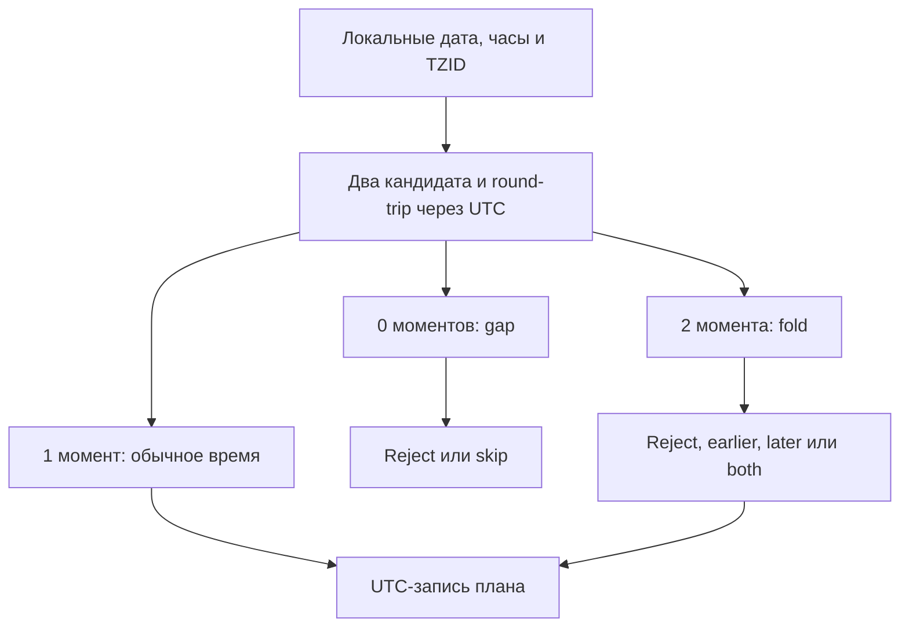

# 11. Работа с датой и временем

Работа со временем начинается с выбора смысла данных. Дата рождения, момент поступления события, время начала рабочего дня и таймаут сетевого запроса требуют разных моделей. Один datetime не делает эти различия очевидными: их должен зафиксировать контракт программы.

Глава сохраняет 19 тем и 83 пункта README в исходном порядке. Базовая версия примеров — Python 3.12–3.14; новые API помечены отдельно. Используются календарные даты и исторические переходы с явно указанными поясами. Примеры не меняют системные часы, текущий пояс ОС или глобальную locale.

Python-блоки самостоятельны, кроме файлов практического проекта в конце. Сторонние зависимости отмечены. Примерам ZoneInfo нужна доступная IANA tzdb: системная база либо установленный пакет tzdata. Для воспроизводимого проекта используется конкретная версия пакета tzdata напрямую, независимо от системной базы.

Учебные assert проверяют результат. Внешние данные проекта проверяются исключениями, которые не отключаются флагом -O.

**Содержание**

1. [Введение в работу со временем](#introduction)
2. [Модуль `time`: работа с системным временем](#time-module)
3. [Модуль `datetime`: основы и базовые классы](#datetime-basics)
4. [Часовые пояса и осведомленное время (Aware Datetime)](#timezones)
5. [Модуль `calendar`: работа с календарями](#calendar-module)
6. [Работа с временными зонами в реальных приложениях](#real-world-timezones)
7. [Сравнение и сортировка дат](#comparison)
8. [Арифметика локального и абсолютного времени](#wall-and-timeline-arithmetic)
9. [Производительность операций с датами](#performance)
10. [Работа с duration и интервалами](#durations)
11. [Сторонние библиотеки для сложных задач](#third-party-libraries)
12. [Парсинг дат и времени из строк](#parsing)
13. [Округление и манипуляции с датами](#rounding)
14. [Работа с микросекундами и наносекундами](#precision)
15. [Лучшие практики](#best-practices)
16. [Сериализация дат](#serialization)
17. [Тестирование кода со временем](#testing)
18. [Частые ошибки](#common-mistakes)
19. [Частые вопросы и ключевые выводы](#questions-and-takeaways)

<a id="introduction"></a>

## Введение в работу со временем

### Почему время — это сложно (високосные годы, часовые пояса, летнее время)

Часы на стене не являются простой линейкой абсолютного времени. Государства изменяют смещения и правила; календарные месяцы имеют разную длину; локальная дата может содержать пропуск или повтор часов.

| Источник сложности | Пример | Инженерное следствие |
|---|---|---|
| Високосные годы | 2024-02-29 существует, 2023-02-29 — нет | Нельзя считать каждый год равным 365 дням |
| Месяцы | После 31 января нет 31 февраля | Нужна политика календарного переноса |
| Смещение UTC | У разных мест разное время одного момента | Смещение должно быть частью модели момента |
| Сезонный/политический переход | Некоторые локальные часы не существуют или повторяются | Локальная запись не всегда задаёт один момент |
| Изменение tzdb | Будущие правила могут пересмотреть | Планы на будущее требуют версии данных и перепланирования |
| Системные часы | NTP/администратор меняют wall-clock | Таймауты нельзя строить только на time.time |
| Точность хранения | Наносекунды источника и микросекунды datetime | Преобразование может потерять информацию |

```python
from datetime import date


assert date(2024, 2, 29).isoformat() == "2024-02-29"
try:
    date(2023, 2, 29)
except ValueError:
    pass
else:
    raise AssertionError("невозможная дата должна отклоняться")
```

В Python datetime используется идеализированный григорианский календарь. Поддерживаемые годы — 1–9999. Библиотека не моделирует все исторические календарные реформы каждого региона.

**Не всякий переход — один час DST.** Бывают смещения на 30 минут, изменения стандартного времени и пропуск целой локальной даты. Термин «зимнее время» также не является универсальным техническим определением.

**Leap second и leap day — разные понятия.** Високосный день относится к календарю. Дополнительная секунда относится к шкалам времени. datetime не допускает second=60; обычный POSIX timestamp не является счётчиком всех физических секунд UTC с учётом leap seconds.

Для научной астрономии, TAI/GPS и строгой работы с leap seconds требуются специализированная шкала и инструменты. Для обычного приложения достаточно ясно зафиксировать используемую модель и её границы.

### Основные модули: `time`, `datetime`, `calendar`, `zoneinfo` (Python 3.9+), `pytz` (legacy)

| Инструмент | Назначение | Чего он не заменяет |
|---|---|---|
| time | Системные часы, timestamp, ожидание, измерение | Полноценную календарную модель приложения |
| datetime | date, time, datetime, timedelta, tzinfo | Базу исторических правил поясов сам по себе |
| calendar | Сетка календаря и календарные вычисления | Календарь праздников всех стран |
| zoneinfo | IANA-пояса с историческими переходами | Строгий parser пользовательского локального времени |
| tzdata | Дистрибутив базы IANA для Python | Сам код преобразования datetime |
| pytz | Прежний распространённый API поясов | Семантику ZoneInfo и fold |
| dateutil | relativedelta, parsing, recurrence | Автоматическое решение всех бизнес-политик |

timezone из datetime описывает фиксированное смещение, например UTC+03:00. ZoneInfo("Europe/Moscow") описывает набор правил региона, включая прошлые изменения. Это разные виды tzinfo.

```python
from datetime import UTC, datetime, timedelta, timezone
from zoneinfo import ZoneInfo


instant = datetime(2024, 1, 15, 12, tzinfo=UTC)
fixed = timezone(timedelta(hours=3))
regional = ZoneInfo("Europe/Moscow")
assert instant.astimezone(fixed).hour == 15
assert instant.astimezone(regional).hour == 15
assert fixed is not regional
```

Совпадение смещения на выбранную дату не означает эквивалентность поясов для всей истории и будущего.

В новом коде на поддерживаемом Python обычно удобно начать с datetime + zoneinfo. Для существующего проекта на pytz сначала учитывайте его контракт localize/normalize и только затем мигрируйте: механическая замена import может изменить поведение.

### Типы времени: момент (точка на временной оси) vs интервал (длительность)

**Момент** отвечает «когда произошло событие на общей шкале». **Длительность** отвечает «сколько прошло/сколько ждать». **Календарная запись** отвечает «какие числа показывает календарь и часы в указанном контексте».

```python
from datetime import UTC, date, datetime, time, timedelta


occurred_at = datetime(2024, 7, 1, 12, 30, tzinfo=UTC)
timeout = timedelta(seconds=5)
birthday = date(2000, 2, 29)
opening_time = time(9, 0)
assert occurred_at + timeout == datetime(2024, 7, 1, 12, 30, 5, tzinfo=UTC)
assert birthday.year == 2000
assert opening_time.hour == 9
```

Момент не равен его текстовому представлению. 12:00Z и 15:00+03:00 могут обозначать одну точку.

Длительность «3600 секунд» не равна календарному правилу «следующий час на локальных часах» во всех обстоятельствах. «Один месяц» вообще нельзя выразить единственной фиксированной длительностью.

Математический интервал [start, end) — ещё одно понятие: множество моментов между границами. В API слово interval иногда означает timedelta, иногда пару границ, иногда SQL-календарный интервал. Используйте точные имена: elapsed, timeout, start_at/end_at, billing_month.

Для диапазонов удобно полуоткрытое представление [start, end): start включён, end исключён. Соседние окна не пересекаются в общей границе.

### Выбор модели временных данных

| Задача | Модель | Пример хранимых данных |
|---|---|---|
| Событие в логе | Aware datetime/целый epoch с единицей | occurred_at_utc |
| День рождения | date | 2000-02-29 |
| Открытие офиса | Локальное time + TZID и календарь | 09:00, Europe/Berlin |
| Ежедневное расписание | Локальное правило + зона + политики переходов | 02:30, skip gap, later fold |
| Таймаут в процессе | Monotonic deadline | Не абсолютная календарная дата |
| Срок действия, заданный сервером | Абсолютный aware expiry | expires_at_utc |
| Биллинг «месяц» | Календарный период с правилами | Начало/конец расчётного месяца |
| День аналитики | Business date + зона/правило окна | 2024-03-31 в Europe/Berlin |

Не храните день рождения как «полночь UTC»: отображение в другом поясе способно показать предыдущую дату.

Не превращайте пользовательское «каждый день в 09:00» в бесконечную последовательность шагов timedelta(hours=24) по UTC: при изменении смещения локальное время сдвинется.

Если источник прислал naive timestamp, сначала выясните его смысл. Это может быть намеренно локальное расписание или ошибочно недостающий пояс момента. Автоматически назначить UTC — не универсальное исправление.

Для инженера данных полезно разделять event time, ingestion time, processing time и business date. Это разные столбцы с разной семантикой; замена одного другим меняет оконные агрегации, SLA и воспроизводимость.

**Документация:** [datetime](https://docs.python.org/3.14/library/datetime.html), [zoneinfo](https://docs.python.org/3.14/library/zoneinfo.html), [PEP 495](https://peps.python.org/pep-0495/), [PEP 615](https://peps.python.org/pep-0615/).

<a id="time-module"></a>

## Модуль `time`: работа с системным временем

### Timestamp: `time.time()` — что это и зачем

Unix/POSIX timestamp задаёт число секунд относительно epoch, обычно 1970-01-01T00:00:00Z. Это не локальные часы: один момент имеет один такой timestamp независимо от отображаемого пояса.

```python
from datetime import UTC, datetime
import time


epoch = datetime(1970, 1, 1, tzinfo=UTC)
assert epoch.timestamp() == 0.0
assert datetime.fromtimestamp(0, UTC) == epoch
sample = time.time()
sample_ns = time.time_ns()
assert isinstance(sample, float)
assert isinstance(sample_ns, int)
```

Два вызова здесь выполнены в разное время; не проверяйте их точное равенство после умножения на 10⁹.

time.time возвращает float, time.time_ns — целое число наносекунд. Суффикс _ns убирает потерю от float-представления, но не обещает наносекундную точность физических часов.

Timestamp должен иметь контракт единицы. Значения в секундах, миллисекундах, микросекундах и наносекундах внешне похожи, но различаются в 10³–10⁹ раз. Имена epoch_seconds/epoch_ms лучше неопределённого timestamp.

Системные часы могут корректироваться и идти назад. Поэтому разность time.time до/после не является лучшим инструментом для timeout и performance measurement.

Диапазон timestamp-преобразований зависит от платформенных функций и версии ОС. datetime с годом 1 допустим как объект, но fromtimestamp очень далёкого значения не обязан работать одинаково везде.

В распределённой системе wall-clock двух узлов может расходиться. Порядок timestamp не доказывает причинный порядок событий. Для этого могут понадобиться последовательности, логические часы, версии и протокол приложения.

### Представления времени: `struct_time` (named tuple)

struct_time — tuple-подобная структура с именованными полями календарного представления.

```python
import time


value = time.gmtime(0)
assert value.tm_year == 1970
assert value.tm_mon == 1
assert value.tm_mday == 1
assert value.tm_hour == 0
assert value.tm_wday == 3
assert value.tm_yday == 1
assert len(value) == 9
```

Основные поля: tm_year, tm_mon, tm_mday, tm_hour, tm_min, tm_sec, tm_wday, tm_yday, tm_isdst. Понедельник — 0, воскресенье — 6. День года начинается с 1.

tm_isdst показывает информацию о сезонном времени в этом представлении: положительное значение, ноль либо -1 для неизвестного в соответствующих API. Это не аналог fold и не универсальный идентификатор нужного offset.

На поддерживаемых платформах встречаются также tm_zone и tm_gmtoff. Не строите переносимый код на предположении, что дополнительный атрибут всегда доступен.

struct_time не хранит микросекунды и полный набор правил IANA-зоны. Для прикладной модели обычно удобнее aware datetime.

### Конвертация: `gmtime()`, `localtime()`, `mktime()`

gmtime переводит timestamp в UTC-календарь. localtime — в локальный календарь процесса/ОС. mktime интерпретирует struct_time как локальное время, а не UTC.

```python
import calendar
import time


timestamp = 1704067200
utc_fields = time.gmtime(timestamp)
assert utc_fields[:6] == (2024, 1, 1, 0, 0, 0)
assert calendar.timegm(utc_fields) == timestamp
local_fields = time.localtime(timestamp)
assert isinstance(time.mktime(local_fields), float)
```

calendar.timegm выполняет UTC-обратное преобразование для соответствующей структуры. Вызов mktime(gmtime(ts)) часто создаёт ошибку на величину локального смещения.

У mktime на DST-границах есть платформозависимые правила разрешения неопределённости и tm_isdst. Не используйте его как строгий parser пользовательского времени с IANA TZID.

time.tzset, где доступен, обновляет системные представления timezone из окружения. Изменение TZ и вызов tzset меняют глобальное состояние процесса. Для преобразования одной записи удобнее ZoneInfo и astimezone без изменения окружения.

Для UTC-aware результата используйте datetime.fromtimestamp(ts, UTC), а не utcfromtimestamp с последующей неявной договорённостью.

### Форматирование и парсинг: `strftime()` и `strptime()`

strftime форматирует представление по шаблону; strptime разбирает строку в struct_time.

```python
import time


fields = time.strptime("2024-02-29 13:45:06", "%Y-%m-%d %H:%M:%S")
assert fields.tm_year == 2024
assert fields.tm_mon == 2
assert time.strftime("%Y-%m-%d", fields) == "2024-02-29"
```

| Код | Значение | Частая путаница |
|---|---|---|
| %Y | Год с веком | %y содержит двухзначный год и правила интерпретации |
| %m | Месяц | Не минуты |
| %d | День месяца | Не день года |
| %H | Часы 00–23 | %I — 12-часовая шкала |
| %M | Минуты | Не месяц |
| %S | Секунды | Модель leap seconds отличается между API |
| %z | Смещение UTC, где поддерживается | Не IANA TZID |
| %Z | Текстовое имя пояса | CST/IST неоднозначны |

Директивы и крайние случаи зависят от API и платформы. Например, микросекунды %f поддерживает datetime.strptime/strftime, а time.strftime не следует считать универсальным микросекундным formatter.

Текстовые месяцы, дни недели и %c/%x зависят от locale. Такой формат удобен человеку, но не является стабильным протоколом обмена между серверами.

Не используйте %s как переносимый стандарт strftime: это расширение некоторых платформ. Для timestamp есть отдельный API.

### Измерение производительности: `time.perf_counter()` и `time.process_time()`

perf_counter измеряет прошедшее время подходящими высокоточными часами, включая ожидание. process_time измеряет CPU-время процесса и не включает обычное время sleep.

```python
import time


wall_start = time.perf_counter_ns()
cpu_start = time.process_time_ns()
result = sum(number * number for number in range(10000))
wall_elapsed = time.perf_counter_ns() - wall_start
cpu_elapsed = time.process_time_ns() - cpu_start
assert result > 0
assert wall_elapsed >= 0
assert cpu_elapsed >= 0
```

Одна проверка CPU <= wall не является универсальным инвариантом: процесс может использовать несколько ядер через native-код и потоки. Также на очень коротких измерениях существенны разрешение и накладные расходы.

process_time относится к процессу, thread_time — к текущему потоку, где поддерживается. Они не являются автоматически учётом всего дерева subprocess.

У perf_counter/monotonic неопределённая календарная точка отсчёта; важны разности, а не абсолютное значение. В CPython с Python 3.13 perf_counter использует те же часы, что monotonic; назначение API остаётся различным.

Для бенчмарка учитывайте warm-up, кэш, GC, шум планировщика и распределение результатов. Измерение одного короткого запуска не доказывает преимущество алгоритма. Для микробенчмарка подходит timeit, для устойчивого процесса измерений — отдельный инструмент/методика.

### Приостановка выполнения: `time.sleep()`

sleep приостанавливает текущий поток. Он не гарантирует точный момент пробуждения: поток ещё должен получить CPU у планировщика.

```python
import time


started = time.monotonic()
time.sleep(0.002)
elapsed = time.monotonic() - started
assert elapsed >= 0
```

Пример намеренно не проверяет точное значение 0.002. В реальном окружении задержка может быть больше.

При обработанном сигнале sleep обычно продолжает ожидание оставшегося времени, если handler не выбросил исключение. Сигнал не является универсальным способом прервать любое ожидание.

Для async-кода используйте await asyncio.sleep, чтобы не блокировать event loop. Для кооперативной остановки потока Event.wait(timeout) позволяет раньше проснуться при установленном событии.

```python
from threading import Event


stop = Event()
stop.set()
assert stop.wait(timeout=10) is True
```

Не используйте длинный sleep как единственный механизм graceful shutdown. При повторяющейся задаче схема work(); sleep(period) накапливает длительность самой work и дрейфует. Сначала выберите, нужна ли fixed delay после завершения, fixed rate по monotonic или календарное расписание.

### Монотонное время: `time.monotonic()` (защита от изменения системного времени)

monotonic не идёт назад из-за перевода календарных часов. Это подходящая основа для локальных дедлайнов.

```python
from collections.abc import Callable


def remaining(deadline: float, clock: Callable[[], float]) -> float:
    return max(0.0, deadline - clock())


readings = iter([100.0, 102.0, 108.0])
clock = lambda: next(readings)
deadline = clock() + 5.0
assert remaining(deadline, clock) == 3.0
assert remaining(deadline, clock) == 0.0
```

Здесь fake clock делает тест мгновенным и детерминированным.

Не сохраняйте monotonic deadline в базу как дату истечения и не передавайте его как общий timestamp другим машинам. Происхождение и жизненный цикл часов должны быть известны; после перезапуска/перезагрузки старое значение не является надёжным persistent-контрактом.

Если сервер прислал expires_at по wall-clock, можно вычислить локальный остаток относительно текущего UTC и затем ждать по monotonic. Но при длительной работе и изменении требований синхронизации политику пересчёта надо определить отдельно.

Поведению во время suspend и частотной коррекции нельзя приписывать одну универсальную семантику: оно зависит от выбранных системных часов. На некоторых платформах есть отдельные CLOCK_BOOTTIME/CLOCK_MONOTONIC_RAW. Используйте их только при необходимости и с платформенным контрактом.

```python
import time


info = time.get_clock_info("monotonic")
assert info.monotonic
assert info.resolution > 0
assert isinstance(info.implementation, str)
```

resolution — характеристика представления/часов, а не доказательство точности измерения относительно внешней физической шкалы.

**Документация:** [time](https://docs.python.org/3.14/library/time.html), [PEP 418](https://peps.python.org/pep-0418/).

<a id="datetime-basics"></a>

## Модуль `datetime`: основы и базовые классы

### Базовые типы: обзор и иерархия

datetime — имя модуля и имя класса внутри него. Выбирайте однозначный стиль импорта.

```python
import datetime as dt


assert issubclass(dt.datetime, dt.date)
assert not issubclass(dt.time, dt.date)
assert isinstance(dt.datetime(2024, 1, 1), dt.date)
assert not isinstance(dt.date(2024, 1, 1), dt.datetime)
assert dt.UTC is dt.timezone.utc
```

| Тип | Содержимое | Неизменяемость |
|---|---|---|
| date | Год, месяц, день | Значение неизменяемо |
| time | Час, минута, секунда, микросекунда, optional tzinfo/fold | Значение неизменяемо |
| datetime | Дата и время, optional tzinfo/fold | Значение неизменяемо |
| timedelta | Нормализованная длительность | Значение неизменяемо |
| tzinfo | Интерфейс правил смещения | Конкретная реализация задаёт контракт |
| timezone | Фиксированное смещение | Значение неизменяемо |

replace создаёт новый объект. Назначить value.hour = 10 нельзя.

Из-за наследования isinstance(x, date) принимает и datetime. Если API ожидает чистую календарную дату, проверяйте это явно либо нормализуйте по документированному правилу, а не молча отбрасывайте время.

Python-аннотация datetime сама по себе не различает naive и aware. Это нужно проверять на границе либо выражать дополнительной моделью/обёрткой и соответствующими инструментами типизации.

### Работа с датами: `datetime.date`

date подходит для календарной даты без момента суток и пояса: день рождения, business date, дата документа.

```python
from datetime import date, timedelta


value = date(2024, 2, 29)
assert value.year == 2024
assert value.weekday() == 3
assert value.isoweekday() == 4
assert value.isoformat() == "2024-02-29"
assert date.fromordinal(value.toordinal()) == value
assert value + timedelta(days=1) == date(2024, 3, 1)
assert date(2024, 3, 1) - date(2024, 2, 28) == timedelta(days=2)
```

weekday использует 0–6, isoweekday — 1–7. ISO-неделя может относиться к соседнему ISO-году:

```python
from datetime import date


value = date(2021, 1, 1)
assert value.isocalendar() == (2020, 53, 5)
assert date.fromisocalendar(2020, 53, 5) == value
```

Не смешивайте календарный %Y и номер ISO-недели %V без соответствующего ISO-года %G.

date.today зависит от локального календаря машины. Для «сегодня пользователя» сначала получите aware now в его поясе и только потом .date().

При сложении date с timedelta используются календарные дни, а секунды/микросекунды не превращают дату в datetime:

```python
from datetime import date, timedelta


value = date(2024, 1, 1)
assert value + timedelta(hours=23) == value
assert value + timedelta(hours=24) == date(2024, 1, 2)
```

Если нужны часы, сначала явно создайте datetime. date не поддерживает произвольные значения года за пределами 1–9999.

### Работа с временем (без даты): `datetime.time`

time задаёт время суток без даты. Оно подходит для локального правила «открывается в 09:30», но недостаточно для момента в региональном поясе.

```python
from datetime import date, datetime, time


opening = time(9, 30, 15, 123456)
assert opening.isoformat() == "09:30:15.123456"
meeting = datetime.combine(date(2024, 7, 1), opening)
assert meeting == datetime(2024, 7, 1, 9, 30, 15, 123456)
assert meeting.time() == opening
```

time не поддерживает простое time + timedelta. Перенос через полночь требует даты либо отдельного бизнес-правила.

```python
from datetime import timedelta, time


try:
    time(23, 30) + timedelta(hours=1)
except TypeError:
    pass
else:
    raise AssertionError("для календарного переноса нужна дата")
```

Региональный ZoneInfo часто не может определить offset без даты. Поэтому time с непустым tzinfo не обязательно является aware. Для режима работы храните naive time и TZID отдельно, а дату подставляйте при построении конкретного события.

datetime.time() убирает tzinfo, timetz() сохраняет. Эти методы не выполняют конвертацию пояса: это извлечение полей из уже выбранного представления.

### Работа с датой и временем вместе: `datetime.datetime`

datetime объединяет календарные поля. Для момента добавьте корректный tzinfo и разрешите возможную неоднозначность исходного локального времени.

```python
from datetime import UTC, datetime


value = datetime(2024, 7, 1, 12, 30, 40, 123456, tzinfo=UTC)
changed = value.replace(minute=45)
assert value.minute == 30
assert changed.minute == 45
assert changed.tzinfo is UTC
assert value.date().isoformat() == "2024-07-01"
assert value.timetz().tzinfo is UTC
assert value.time().tzinfo is None
```

now(UTC) возвращает текущее aware UTC. now() без аргумента возвращает naive локальное время. В Python 3.12 utcnow и utcfromtimestamp deprecated: возвращаемый naive UTC легко ошибочно интерпретировать как локальный.

Для timestamp используйте fromtimestamp(value, UTC). Для преобразования представления уже существующего момента — astimezone(zone).

replace(tzinfo=...) не перемещает момент между поясами: он меняет интерпретацию тех же чисел. Такое назначение допустимо только когда вы действительно привязываете известное локальное представление к выбранной модели.

Не проверяйте точное равенство двух вызовов now. Даже быстрые последовательные вызовы могут различаться; разрешение и реальная точность тоже не одинаковы.

### Работа с интервалами: `datetime.timedelta`

timedelta хранит нормализованные days, seconds, microseconds. Именованные аргументы weeks/hours/minutes переводятся в них.

```python
from datetime import timedelta


value = timedelta(days=1, hours=2, minutes=3, seconds=4, microseconds=5)
assert value.days == 1
assert value.seconds == 2 * 3600 + 3 * 60 + 4
assert value.microseconds == 5
assert value.total_seconds() == 93784.000005

negative = timedelta(seconds=-1)
assert negative.days == -1
assert negative.seconds == 86399
assert negative.total_seconds() == -1
```

seconds — нормализованный остаток внутри суток, а не вся длительность. Для общего значения используют total_seconds либо точное целочисленное выражение.

```python
from datetime import timedelta


def total_microseconds(value: timedelta) -> int:
    return (value.days * 86400 + value.seconds) * 1_000_000 + value.microseconds


assert total_microseconds(timedelta(microseconds=-1)) == -1
assert total_microseconds(timedelta(days=2, microseconds=3)) == 172800000003
assert timedelta(microseconds=0.5) == timedelta(0)
assert timedelta(microseconds=1.5) == timedelta(microseconds=2)
```

Округление дробных микросекунд при float-аргументах использует round-half-to-even. total_seconds возвращает float и для очень больших интервалов теряет микросекундную точность.

Месяцев и лет в timedelta нет: фиксированный месяц без даты начала не определён. Кроме того, timedelta(days=1) как значение — 86400 секунд, но операция с региональным aware datetime имеет собственную календарную семантику; она разобрана отдельно ниже.

Есть конечные границы timedelta.min/max; отрицание timedelta.max не представимо. Переполнение datetime при прибавлении допустимой timedelta тоже вызывает OverflowError.

### Форматирование и парсинг в `datetime`

Для машинного обмена используйте isoformat/fromisoformat в рамках явно заданного профиля. Для известного пользовательского шаблона подходит strptime.

```python
from datetime import UTC, datetime


value = datetime(2024, 2, 29, 13, 45, 6, 123456, tzinfo=UTC)
text = value.isoformat(timespec="microseconds")
assert text == "2024-02-29T13:45:06.123456+00:00"
assert datetime.fromisoformat(text) == value
parsed = datetime.strptime("29.02.2024 13:45 +0300", "%d.%m.%Y %H:%M %z")
assert parsed.utcoffset().total_seconds() == 10800
assert parsed.strftime("%Y-%m-%d %H:%M") == "2024-02-29 13:45"
```

%z создаёт offset-aware результат, но не сохраняет IANA-пояс. Название вроде Europe/Berlin надо передавать отдельным полем и применять его правила.

isoformat(timespec="seconds") отбрасывает микросекунды в представлении; это потеря точности, а не сохранение исходного значения в другом оформлении.

Не разбирайте день и месяц без года через default 1900: 1900 не високосный. Для «29 февраля без года» добавьте явно выбранный високосный опорный год и затем используйте собственную календарную модель. С Python 3.13 parsing дня месяца без года выдаёт предупреждение в соответствующих сценариях.

В Python 3.14 добавлены date.strptime и datetime.time.strptime:

```python
# Python 3.14+
from datetime import date, time


assert date.strptime("29.02.2024", "%d.%m.%Y") == date(2024, 2, 29)
assert time.strptime("13:45", "%H:%M") == time(13, 45)
```

Это разные API, чем функция time.strptime из модуля time, которая возвращает struct_time.

**Документация:** [datetime: типы и форматирование](https://docs.python.org/3.14/library/datetime.html).

<a id="timezones"></a>

## Часовые пояса и осведомленное время (Aware Datetime)

### Наивное (naive) и осведомленное (aware) время: в чем разница

Для datetime aware означает одновременно: tzinfo не None и utcoffset() возвращает не None. Проверка только наличия атрибута недостаточна для произвольного пользовательского tzinfo.

```python
from datetime import UTC, datetime


def is_aware(value: datetime) -> bool:
    return value.tzinfo is not None and value.utcoffset() is not None


assert not is_aware(datetime(2024, 1, 1, 12))
assert is_aware(datetime(2024, 1, 1, 12, tzinfo=UTC))
```

Naive не означает UTC. Он означает отсутствие достаточного контекста внутри значения. Если проект договорился о naive UTC, эту договорённость легко нарушить при передаче в API, который воспринимает naive как локальное.

Aware тоже не означает «пользовательский ввод уже проверен»: можно создать значение с ZoneInfo для несуществующих локальных часов. Конструктор не обязан отклонять gap.

```python
from datetime import UTC, datetime
from zoneinfo import ZoneInfo


zone = ZoneInfo("Europe/Berlin")
wall = datetime(2024, 1, 15, 12)
interpreted = wall.replace(tzinfo=zone)
converted = interpreted.astimezone(UTC)
assert interpreted.hour == 12
assert converted.hour == 11
assert converted.astimezone(zone).replace(tzinfo=None) == wall
```

Здесь назначение tzinfo оправдано известным контрактом: wall — календарное время Берлина на обычную дату. Для произвольного пользовательского wall нужна проверка переходов.

Не используйте astimezone без аргумента в серверной логике, ожидая пояс пользователя: он выберет локальный пояс машины. Передавайте явную зону.

### Абстрактный базовый класс `tzinfo`

tzinfo задаёт интерфейс utcoffset, dst, tzname и fromutc. Реализация должна обеспечивать согласованность правил, включая переходы.

Для фиксированного offset используйте datetime.timezone, для региональных правил — ZoneInfo. Самостоятельная реализация нужна редко.

```python
from datetime import datetime, timedelta, tzinfo


class FixedExampleZone(tzinfo):
    def utcoffset(self, value: datetime | None) -> timedelta:
        return timedelta(hours=3)

    def dst(self, value: datetime | None) -> timedelta:
        return timedelta(0)

    def tzname(self, value: datetime | None) -> str:
        return "DEMO+03"


zone = FixedExampleZone()
value = datetime(2024, 1, 1, 12, tzinfo=zone)
assert value.utcoffset() == timedelta(hours=3)
assert value.tzname() == "DEMO+03"
```

Пример намеренно фиксированный и не является шаблоном реализации DST. Для меняющихся правил корректность fromutc и fold существенно сложнее. Не кодируйте «DST начинается в последнее воскресенье марта» как вечное правило для любой страны.

tzname — отображаемая метка, а не обязательно уникальный идентификатор. "CST" может означать разные регионы; "+03:00" — смещение, а "Europe/Moscow" — ключ правил. В API различайте offset и timezone_id.

Некоторые tzinfo возвращают None для time без даты: без календарного контекста нельзя выбрать исторический offset.

### Модуль `zoneinfo` (Python 3.9+) — современный стандарт

ZoneInfo использует базу IANA. При обычном конструировании он ищет данные в настроенном TZPATH и затем может использовать пакет tzdata. Python не обязан поставляться со всеми правилами внутри интерпретатора.

```python
from datetime import UTC, datetime, timedelta
from zoneinfo import ZoneInfo


berlin = ZoneInfo("Europe/Berlin")
assert ZoneInfo("Europe/Berlin") is berlin
winter = datetime(2024, 1, 15, 12, tzinfo=UTC).astimezone(berlin)
summer = datetime(2024, 7, 15, 12, tzinfo=UTC).astimezone(berlin)
assert winter.utcoffset() == timedelta(hours=1)
assert summer.utcoffset() == timedelta(hours=2)
assert berlin.key == "Europe/Berlin"
```

Если данных нет, возможен ZoneInfoNotFoundError. Для кроссплатформенного приложения полезно явно объявить зависимость tzdata, особенно там, где системная IANA-база обычно отсутствует.

Наличие установленного tzdata не означает, что обычный ZoneInfo использовал именно его: системный путь проверяется согласно настройке. Для воспроизводимости фиксируйте реальный источник данных, а не только список Python-зависимостей.

В практическом проекте файл зоны читается непосредственно из ресурсов выбранного пакета tzdata и передаётся в ZoneInfo.from_file. Тогда версия пакета действительно относится к использованным правилам.

ZoneInfo кэширует основной конструктор. no_cache/clear_cache/reset_tzpath — инфраструктурные операции с последствиями для identity и сравнения datetime. Не используйте очистку кэша как безобидное обновление в середине бизнес-вычисления.

Обновление tzdb может изменить будущие результаты. Долгоживущие уже созданные объекты не следует считать автоматически обновляемыми. Для контролируемого обновления обычно нужен перезапуск/пересоздание по понятной политике.

### Библиотека `pytz` (для старых версий Python)

pytz встречается и в новых версиях Python как зависимость старого приложения. Название пункта означает прежний API, а не запрет запускать pytz на современном интерпретаторе.

Для pytz локальное naive-время привязывают через localize. При арифметике и переходах может понадобиться normalize. Прямой datetime(..., tzinfo=pytz.timezone(...)) для региональной зоны часто даёт историческое LMT-представление вместо ожидаемого offset.

```python
# dependency: pytz
from datetime import datetime, timedelta
import pytz


zone = pytz.timezone("Europe/Berlin")
wall = datetime(2024, 10, 27, 2, 30)
early = zone.localize(wall, is_dst=True)
late = zone.localize(wall, is_dst=False)
assert early.utcoffset() == timedelta(hours=2)
assert late.utcoffset() == timedelta(hours=1)
assert late - early == timedelta(hours=1)

try:
    zone.localize(wall, is_dst=None)
except pytz.AmbiguousTimeError:
    pass
else:
    raise AssertionError("неоднозначность должна быть явной")
```

is_dst не является универсальной заменой fold: не все изменения offset относятся к DST, бывают и другие исторические переходы.

```python
# dependency: pytz
from datetime import datetime, timedelta
import pytz


zone = pytz.timezone("Europe/Berlin")
start = zone.localize(datetime(2024, 3, 30, 12))
after = zone.normalize(start + timedelta(hours=24))
assert after.hour == 13
assert after - start == timedelta(hours=24)
```

Перед миграцией зафиксируйте expected values для gap/fold и арифметики. После перехода на ZoneInfo методы localize/normalize не переносятся механически: меняется модель. Для новых данных не смешивайте разные семейства tzinfo внутри одного слоя без необходимости.

### Конвертация между часовыми поясами

astimezone меняет представление одного момента. replace(tzinfo=...) переинтерпретирует календарные числа.

```python
from datetime import UTC, datetime, timedelta
from zoneinfo import ZoneInfo


utc = datetime(2024, 7, 1, 12, tzinfo=UTC)
tokyo = utc.astimezone(ZoneInfo("Asia/Tokyo"))
new_york = utc.astimezone(ZoneInfo("America/New_York"))
assert tokyo.hour == 21
assert new_york.hour == 8
assert tokyo - utc == timedelta(0)
assert new_york.astimezone(UTC) == utc

wrong = utc.replace(tzinfo=ZoneInfo("Asia/Tokyo"))
assert wrong.astimezone(UTC).hour == 3
```

После преобразования календарная дата может измениться. «День пользователя» получают после astimezone(user_zone), а не до:

```python
from datetime import UTC, date, datetime
from zoneinfo import ZoneInfo


instant = datetime(2024, 1, 1, 23, 30, tzinfo=UTC)
assert instant.date() == date(2024, 1, 1)
assert instant.astimezone(ZoneInfo("Asia/Tokyo")).date() == date(2024, 1, 2)
```

Не выполняйте конвертацию прибавлением текущего offset вручную. Смещение зависит от момента, а ручная арифметика часто забывает дату, fold и обратный переход.

### Летнее время (DST) — как с ним работать

При переводе вперёд появляется gap: некоторые локальные значения не соответствуют ни одному реальному моменту. При переводе назад появляется fold: некоторые значения соответствуют двум.

| Локальное время Europe/Berlin | Вариант | UTC |
|---|---|---|
| 2024-03-31 01:30 | Обычное | 00:30Z |
| 2024-03-31 02:30 | Gap | Не существует |
| 2024-03-31 03:30 | Обычное | 01:30Z |
| 2024-10-27 02:30, fold=0 | Более ранний момент | 00:30Z |
| 2024-10-27 02:30, fold=1 | Более поздний момент | 01:30Z |

```python
from datetime import UTC, datetime, timedelta
from zoneinfo import ZoneInfo


zone = ZoneInfo("Europe/Berlin")
early = datetime(2024, 10, 27, 2, 30, tzinfo=zone, fold=0)
late = early.replace(fold=1)
assert early.astimezone(UTC) == datetime(2024, 10, 27, 0, 30, tzinfo=UTC)
assert late.astimezone(UTC) == datetime(2024, 10, 27, 1, 30, tzinfo=UTC)
assert late.astimezone(UTC) - early.astimezone(UTC) == timedelta(hours=1)
```

fold — не валидатор. Можно назначить fold=1 вне повторяющегося интервала или создать datetime внутри gap; конструктор это сам по себе не запрещает.

Для строгой интерпретации локального ввода полезно построить оба кандидата, преобразовать каждый в UTC и обратно и оставить только round-trip-совместимые моменты.

```python
from datetime import UTC, datetime
from zoneinfo import ZoneInfo


def candidates(wall: datetime, zone: ZoneInfo) -> tuple[datetime, ...]:
    if wall.tzinfo is not None:
        raise ValueError("ожидается naive wall time")
    found = set()
    for fold in (0, 1):
        candidate = wall.replace(tzinfo=zone, fold=fold).astimezone(UTC)
        restored = candidate.astimezone(zone).replace(tzinfo=None)
        if restored == wall:
            found.add(candidate)
    return tuple(sorted(found))


zone = ZoneInfo("Europe/Berlin")
assert len(candidates(datetime(2024, 1, 15, 2, 30), zone)) == 1
assert candidates(datetime(2024, 3, 31, 2, 30), zone) == ()
assert len(candidates(datetime(2024, 10, 27, 2, 30), zone)) == 2
```

Здесь set содержит **UTC-кандидаты**. Использование локальных aware-кандидатов с одинаковым tzinfo привело бы к неожиданному схлопыванию fold из-за правил равенства Python.

После классификации приложение выбирает политику:

- gap: отклонить, пропустить событие, перенести на первую допустимую границу или сдвинуть на величину разрыва;
- fold: отклонить, выбрать ранний, поздний или выполнить оба.

«Сдвинуть 02:30 на 03:00» и «прибавить разницу offset и получить 03:30» — разные политики. Нельзя назвать обе просто «исправить DST» и ожидать одинакового результата.

Не предполагайте разрыв ровно в 3600 секунд. Практический проект проверяет, в том числе, Australia/Lord_Howe и пропущенную дату Pacific/Apia.

### Лучшие практики: всегда хранить в UTC, конвертировать при отображении

Правило относится прежде всего к **моментам уже произошедших или однозначно назначенных событий**. Для них UTC упрощает сравнение, индексы, обмен и сортировку.

Оно не означает, что вся календарная информация должна быть превращена в UTC:

| Данные | Что сохранить |
|---|---|
| Фактический event timestamp | UTC-момент и при необходимости исходное представление |
| Дата рождения | date |
| «Каждый день в 09:00 Берлина» | Local time, TZID, календарное правило, gap/fold policies |
| Будущая встреча с обещанием локальных часов | Намерение и зона, плюс рассчитанный момент и политика обновления |
| Аудит исходного ввода | Строка/offset/TZID и версия преобразования по требованиям |

Если сохранить от расписания только один UTC-момент, правила повторения потеряются. Если сохранить только текущий offset +02:00, сезонность и будущие изменения региона потеряются.

Нормализуйте моменты к UTC на границах системы. Для пользователя конвертируйте к его явному TZID. Исходные атрибуты храните отдельно, если они нужны для объяснимости, аудита и перепланирования.

**Документация:** [zoneinfo](https://docs.python.org/3.14/library/zoneinfo.html), [PEP 495: fold и сравнение](https://peps.python.org/pep-0495/), [pytz](https://pythonhosted.org/pytz/), [tzdata](https://tzdata.readthedocs.io/en/latest/).

<a id="calendar-module"></a>

## Модуль `calendar`: работа с календарями

### Получение календаря на месяц/год

calendar строит календарные сетки, текстовое/HTML-представление и предоставляет базовые вычисления.

```python
import calendar


renderer = calendar.TextCalendar(firstweekday=calendar.MONDAY)
text = renderer.formatmonth(2024, 2)
assert "2024" in text
weeks = renderer.monthdayscalendar(2024, 2)
assert len(weeks[0]) == 7
assert sum(day > 0 for week in weeks for day in week) == 29
assert weeks[0][:3] == [0, 0, 0]
```

Нули в monthdayscalendar обозначают ячейки за пределами месяца. itermonthdates возвращает реальные соседние даты вместо нулей.

Экземпляр TextCalendar(firstweekday=...) удобнее глобального calendar.setfirstweekday, если библиотека не должна менять поведение других частей процесса.

HTMLCalendar форматирует календарь, но не превращает произвольные пользовательские строки в безопасный HTML автоматически во всех ваших расширениях: при добавлении своего содержимого соблюдайте правила экранирования.

### Проверка: високосный ли год? `calendar.isleap()`

Для григорианского календаря год високосный, если делится на 4, кроме делящихся на 100, которые не делятся на 400.

```python
import calendar


assert calendar.isleap(2024)
assert not calendar.isleap(1900)
assert calendar.isleap(2000)
assert calendar.leapdays(2000, 2025) == 7
```

leapdays(y1, y2) считает високосные годы в полуоткрытом диапазоне [y1, y2). Проверка только year % 4 == 0 ошибочна для некоторых вековых годов.

Наличие 29 февраля не решает, когда наступает годовщина даты 29 февраля в невисокосный год. Это уже правило приложения/юрисдикции/домена.

### Работа с днями недели: `weekday()`, `monthrange()`

calendar.weekday использует Monday=0. monthrange возвращает день недели первого дня месяца и количество дней.

```python
import calendar
from datetime import date


first_weekday, number_of_days = calendar.monthrange(2024, 2)
assert first_weekday == calendar.THURSDAY
assert number_of_days == 29
assert calendar.weekday(2024, 2, 29) == date(2024, 2, 29).weekday()
last_day = date(2024, 2, number_of_days)
assert last_day.day == 29
```

«Рабочий день» не равен weekday < 5 во всех организациях и странах. Праздники, переносы, смены и частичные рабочие дни требуют отдельного бизнес-календаря и источника данных.

Не определяйте последний день месяца через next_month - 30 days. Получите границу следующего месяца или monthrange.

### Итераторы по датам: `Calendar.itermonthdates()`

```python
import calendar
from datetime import date


grid = calendar.Calendar(firstweekday=calendar.MONDAY)
dates = list(grid.itermonthdates(2024, 2))
assert dates[0] == date(2024, 1, 29)
assert dates[-1] == date(2024, 3, 3)
assert len(dates) % 7 == 0
february = [value for value in dates if value.month == 2]
assert len(february) == 29
```

Итератор включает соседние месяцы, чтобы заполнить полные недели. Для подсчёта дней целевого месяца фильтруйте и год/месяц, если диапазон может пересекать границу года.

Несмотря на название, этот API ограничен диапазоном datetime.date при возврате объектов date. Для некоторых вычислений calendar поддерживает более широкую идеализированную шкалу, но это не расширяет сам date.

Календарная сетка содержит даты, а не UTC-интервалы по 24 часа. Чтобы получить реальные окна дня в конкретной зоне, надо отдельно определить и разрешить границы.

**Документация:** [calendar](https://docs.python.org/3.14/library/calendar.html).

<a id="real-world-timezones"></a>

## Работа с временными зонами в реальных приложениях

### Хранение в базе данных (TIMESTAMP WITH TIME ZONE vs WITHOUT)

Название SQL-типа не гарантирует одинаковую семантику во всех СУБД. Ниже конкретно рассматривается PostgreSQL.

| PostgreSQL-тип | Семантика | Важное ограничение |
|---|---|---|
| date | Календарная дата | Не момент |
| timestamp without time zone | Календарные поля без зоны | Offset из неподходящего литерала может быть проигнорирован |
| timestamp with time zone / timestamptz | Момент; вывод зависит от session TimeZone | Исходный IANA TZID не сохраняется автоматически |
| interval | Календарные/временные компоненты | Не всегда эквивалент фиксированным секундам timedelta |

PostgreSQL timestamptz нормализует момент, а не сохраняет строку Europe/Berlin рядом с каждым значением. Если нужны намерение и зона расписания, храните их отдельными колонками.

**Примеры PostgreSQL; требуют подключённой базы для выполнения:**

```sql
CREATE TABLE events (
    event_id text PRIMARY KEY,
    occurred_at timestamptz NOT NULL,
    source_timezone text,
    business_date date
);

SELECT TIMESTAMPTZ '2024-07-01 12:00:00+03'
       AT TIME ZONE 'UTC';

SELECT TIMESTAMP '2024-07-01 12:00:00'
       AT TIME ZONE 'Europe/Moscow';
```

Первое преобразование возвращает календарные UTC-поля без зоны; второе интерпретирует naive-поля в заданной зоне и возвращает момент. AT TIME ZONE в этих направлениях меняет смысл результата.

Для выборки пользовательского дня заранее вычислите проверенные UTC-границы и используйте occurred_at >= start AND occurred_at < end. Это сохраняет ясную семантику и часто удобнее для индекса, чем преобразование каждой строки в WHERE.

Session timezone, driver и ORM влияют на представление Python-результата. Настройка соединения не исправляет неправильную семантику колонки. Проверяйте round-trip через реальный backend и используемый driver.

У PostgreSQL диапазон дат шире Python datetime; также бывают специальные значения вроде infinity. Соответствие Python-типа всем значениям СУБД не гарантируется. Внешний контракт должен ограничивать диапазон либо вводить отдельное представление.

### API и временные метки (Unix time, ISO 8601)

API должен задавать формат, точность, единицу и смысл.

```python
from datetime import UTC, datetime


value = datetime(2024, 7, 1, 12, 30, 45, 123456, tzinfo=UTC)
iso = value.isoformat(timespec="microseconds").replace("+00:00", "Z")
assert iso == "2024-07-01T12:30:45.123456Z"
assert datetime.fromisoformat(iso) == value
```

Пример профиля: YYYY-MM-DDTHH:MM:SS[.1–6 digits](Z|±HH:MM), обязательный offset, UTC на выходе, отсутствие leap second и неизвестного offset. Это прикладное подмножество, а не заявление о поддержке всей ISO 8601.

RFC 3339 имеет свои правила и крайние случаи. В частности, -00:00 может обозначать неизвестное локальное смещение; datetime.fromisoformat не сохраняет такую отдельную семантику. Если API требует известный момент/offset, запретите неоднозначный ввод по контракту.

Большие epoch-nanoseconds превышают диапазон точных целых JavaScript Number (2⁵³−1). Передавайте их строкой, используйте согласованный BigInt-протокол или выбирайте подходящую единицу и диапазон. Сам JSON не определяет точность всех реализаций number.

Не определяйте секунды/миллисекунды только по количеству цифр. Проверяйте метаданные/схему источника.

Если источник прислал offset и TZID, проверьте их согласованность на выбранную дату. Смещение +03:00 с Europe/Berlin летом 2024 не описывает обычное берлинское время; молчаливое предпочтение одного поля может скрыть ошибку.

### Фронтенд и отображение локального времени пользователя

Передавайте frontend однозначный момент и отдельно известный TZID, если отображение должно соответствовать профилю пользователя.

Пояс браузера может быть полезным default, но не всегда совпадает с бизнес-поясом: пользователь путешествует, работает с командой другого региона или просматривает исторический документ.

```python
from datetime import UTC, datetime
from zoneinfo import ZoneInfo


event = datetime(2024, 7, 1, 23, 30, tzinfo=UTC)
user_timezone_id = "Asia/Tokyo"
shown = event.astimezone(ZoneInfo(user_timezone_id))
assert shown.strftime("%Y-%m-%d %H:%M") == "2024-07-02 08:30"
```

Locale и timezone — разные настройки. ru_RU определяет язык/формат, а Europe/Moscow — календарные правила смещения. Пользователь может предпочитать русский язык и берлинское время.

В браузере Intl.DateTimeFormat позволяет явно задать timeZone; в backend аналогичную роль для локализованного отображения может выполнять Babel.

Не отправляйте дату рождения как timestamp для обязательного преобразования через timezone. Не полагайтесь на универсальный parsing произвольной строки "01/02/2024" во всех языках и браузерах.

Если сервер и клиент используют разные версии tzdb, редкие или будущие даты могут отобразиться по-разному. Для критичного подтверждения встречи показывайте также согласованную зону/offset и храните исходное намерение.

### Повторяющиеся события (cron, календари) — сложности с DST

У расписания есть календарное правило и политика исполнения. Cron-строка не описывает автоматически все детали.

| Правило | Что сохраняется | Что может меняться |
|---|---|---|
| Каждые 24 часа | Абсолютная длительность | Локальный час |
| Каждый день в 09:00 | Локальные часы и зона | UTC-момент и длительность между запусками |
| В последний день месяца | Календарное положение | Число дней/секунд до следующего запуска |
| Каждый рабочий день | Бизнес-календарь | Праздники, переносы, региональные правила |

Для «02:30 каждый день» в Berlin некоторые даты дают 0 или 2 момента. Для «каждую минуту» на повторённом часе важно решить, выполняется ли каждая повторная минута.

Поведение cron/scheduler при gap, fold и missed runs зависит от конкретной реализации и настроек. Не переносите семантику одного инструмента на другой только из-за одинаковой cron-строки.

У recurrence бывают независимые вопросы: календарный gap/fold, простой сервиса, повтор доставки, отставание worker, изменение правила и обновление tzdb.

Невозможно решить все их одним datetime.utcnow + timedelta. Сначала определите semantics, затем выбирайте scheduler.

### Хранение и выполнение повторяющихся расписаний

Храните намерение: schedule_id, timezone_id, local time, правило дат/частоты, gap/fold policy, период действия и версию схемы. Рассчитанный next_run_utc — производное поле.

Для воспроизводимости полезны версия правил приложения и источник/version tzdb. Для обновления зоны нужно решить, какие будущие события пересчитываются и как это связано с уже выданными обещаниями.

| Этап | Инвариант |
|---|---|
| Генерация | Каждому локальному кандидату применена явная политика |
| Планирование | Момент выполнения нормализован к UTC |
| Захват worker | Конкурентные исполнители согласуют владение |
| Выполнение | Бизнес-операция идемпотентна либо имеет собственный протокол |
| Подтверждение | Результат/прогресс записан устойчиво |
| Восстановление | Определены misfire, catch-up, skip и повтор |

Логический идентификатор события и рассчитанный момент — разные атрибуты. Один daily occurrence может сохранить свой business key, даже если новая tzdb изменила UTC-время.

При fold с политикой both нужны два различимых occurrence. Дедупликация только по локальной строке 02:30 ошибочно схлопнет их.

«Ровно один раз» нельзя обеспечить только генерацией уникального timestamp: между выполнением внешнего эффекта и фиксацией статуса возможна авария. Нужны транзакционные границы, idempotency key и протокол конкретного эффекта.

Для ожидания уже выбранного близкого момента используйте monotonic-бюджет, но пересматривайте календарный план по политике приложения при длительном ожидании и изменениях wall-clock.

Практический проект ниже строит план, а не запускает задания. Такое разделение позволяет независимо тестировать календарную корректность и эксплуатационные гарантии исполнения.

**Документация:** [PostgreSQL date/time types](https://www.postgresql.org/docs/current/datatype-datetime.html), [RFC 3339](https://www.rfc-editor.org/rfc/rfc3339), [dateutil recurrence](https://dateutil.readthedocs.io/en/stable/rrule.html).

<a id="comparison"></a>

## Сравнение и сортировка дат

### Сравнение naive и aware (исключения)

У обычных datetime равенство naive и aware возвращает False, а упорядочивающее сравнение и вычитание между ними вызывают TypeError.

```python
from datetime import UTC, datetime


naive = datetime(2024, 1, 1, 12)
aware = datetime(2024, 1, 1, 12, tzinfo=UTC)
assert naive != aware
for operation in (lambda: naive < aware, lambda: aware - naive):
    try:
        operation()
    except TypeError:
        pass
    else:
        raise AssertionError("смешанная семантика должна быть явной")
```

Отсутствие исключения у == не означает корректности всей модели. Ошибка может незаметно проявиться как «ключ не найден» или дубликат записи.

Особый случай — fold у одинакового объекта tzinfo:

```python
from datetime import UTC, datetime
from zoneinfo import ZoneInfo


zone = ZoneInfo("Europe/Berlin")
early = datetime(2024, 10, 27, 2, 30, tzinfo=zone, fold=0)
late = early.replace(fold=1)
assert early == late
assert len({early, late}) == 1
assert early.astimezone(UTC) != late.astimezone(UTC)
assert len({early.astimezone(UTC), late.astimezone(UTC)}) == 2
assert early != early.astimezone(UTC)
```

Последняя строка — предусмотренный PEP 495 крайний случай межзонного equality внутри повторяющегося интервала. Поэтому нельзя универсально свести Python == для любых aware объектов к «одинаковый timestamp».

Если предмет сравнения — момент, сначала приводите к каноническому UTC, затем сравнивайте/хешируйте. Если предмет — локальное назначение, явно сравнивайте его поля, TZID и выбранный вариант.

### Сортировка списков дат

Для date достаточно обычной сортировки. Для моментов в разных представлениях используйте проверенный UTC-key.

```python
from datetime import UTC, datetime
from zoneinfo import ZoneInfo


zone = ZoneInfo("Europe/Berlin")
early = datetime(2024, 10, 27, 2, 30, tzinfo=zone, fold=0)
late = early.replace(fold=1)
values = [late, early]
ordered = sorted(values, key=lambda value: value.astimezone(UTC))
assert ordered[0].fold == 0
assert ordered[1].fold == 1
```

Без UTC-key одинаковые локальные поля могут считаться равными для сортировки и сохранять исходный, а не хронологический порядок.

Строковая сортировка ISO-времени даёт хронологический порядок только при согласованном формате, точности, offset и диапазоне. Смесь Z, +03:00 и переменной записи не является универсальным сортируемым ключом.

Не используйте float timestamp как единственный ключ для микросекундных экстремальных дат: преобразование может потерять точность или зависеть от платформы.

Для business date сначала вычислите дату в нужном поясе. Сортировка UTC-моментов и группировка по локальной дате решают разные задачи.

### Минимальное и максимальное значение

```python
from datetime import UTC, date, datetime, timedelta


assert date.min == date(1, 1, 1)
assert date.max == date(9999, 12, 31)
assert datetime.min.tzinfo is None
assert datetime.max.microsecond == 999999
try:
    datetime.max + timedelta(microseconds=1)
except OverflowError:
    pass
else:
    raise AssertionError("переполнение должно обнаруживаться")
utc_min = datetime.min.replace(tzinfo=UTC)
assert utc_min.year == 1
```

UTC-aware min/max можно построить, но конвертация в другие пояса около границ способна выйти за допустимый год. Не используйте datetime.max как универсальное бесконечное значение для произвольного timezone.

Для отсутствующего срока обычно яснее None с явной семантикой, чем магическая дата 9999-12-31. В БД могут быть отдельные infinity, не совпадающие с Python max.

У mixed date/datetime различайте типы до min/max. Наследование datetime от date не означает, что порядок между всеми такими объектами определён.

<a id="wall-and-timeline-arithmetic"></a>

## Арифметика локального и абсолютного времени

### Изменение локального времени vs фактически прошедшая длительность

«Завтра в то же время» — календарная операция. «Через 24 часа» — операция на временной оси. В региональном поясе они могут дать разные значения.

```python
from datetime import UTC, datetime, timedelta
from zoneinfo import ZoneInfo


zone = ZoneInfo("Europe/Berlin")
start = datetime(2024, 3, 30, 12, tzinfo=zone)
same_local_hour = start + timedelta(days=1)
after_24_hours = (start.astimezone(UTC) + timedelta(hours=24)).astimezone(zone)
assert same_local_hour.hour == 12
assert after_24_hours.hour == 13
assert same_local_hour.astimezone(UTC) - start.astimezone(UTC) == timedelta(hours=23)
```

Само значение timedelta(days=1) равно 86400 секунд. Различие возникает из-за семантики операции datetime с тем же tzinfo, а не из-за скрытого изменения timedelta.

Для elapsed addition приводите к UTC, выполняйте действие и конвертируйте обратно. Для локального правила вычисляйте календарный кандидат и проверяйте его существование/неоднозначность.

### Операции между aware datetime с одинаковыми tzinfo

При сложении datetime с timedelta tzinfo сохраняется, а перенос календарных полей не делает автоматической проверки gap.

При вычитании двух aware datetime с **тем же объектом tzinfo** зона игнорируется: получается разность локальных полей.

```python
from datetime import UTC, datetime, timedelta
from zoneinfo import ZoneInfo


zone = ZoneInfo("Europe/Berlin")
start = datetime(2024, 3, 30, 12, tzinfo=zone)
end = datetime(2024, 3, 31, 12, tzinfo=zone)
assert start.tzinfo is end.tzinfo
assert end - start == timedelta(days=1)
assert end.astimezone(UTC) - start.astimezone(UTC) == timedelta(hours=23)
```

Одинаковый TZID и тот же объект tzinfo — не полностью взаимозаменяемые условия. Основной конструктор ZoneInfo кэшируется и часто обеспечивает identity, но no_cache/from_file могут создать другой объект.

В fold локальные 02:30 fold=0 и fold=1 с одним tzinfo дают нулевую разность. Для биллинга фактически прошедшего времени такой расчёт ошибочен; используйте UTC.

### Операции между aware datetime с разными tzinfo

При вычитании aware значений с разными tzinfo Python учитывает UTC-offset и получает разность моментов.

```python
from datetime import UTC, datetime, timedelta
from zoneinfo import ZoneInfo


first_zone = ZoneInfo("Europe/Berlin")
second_zone = ZoneInfo.no_cache("Europe/Berlin")
start = datetime(2024, 3, 30, 12, tzinfo=first_zone)
end = datetime(2024, 3, 31, 12, tzinfo=second_zone)
assert first_zone is not second_zone
assert end - start == timedelta(hours=23)
assert end.astimezone(UTC) - start.astimezone(UTC) == timedelta(hours=23)
```

Это демонстрация семантики, а не рекомендация обходить проблему через no_cache. Корректный и ясный код прямо приводит моменты к UTC.

Разность timedelta не помнит, из какой зоны и каким способом её получили. Прибавить её назад к локальному datetime не всегда восстанавливает исходный межзонный объект ожидаемым способом. Арифметические интуиции обычных чисел применимы не ко всем комбинациям.

### Арифметика на переходах DST

Можно получить несуществующее локальное время простым прибавлением:

```python
from datetime import UTC, datetime, timedelta
from zoneinfo import ZoneInfo


zone = ZoneInfo("Europe/Berlin")
start = datetime(2024, 3, 31, 1, 30, tzinfo=zone)
wall_result = start + timedelta(hours=1)
assert wall_result.hour == 2
roundtrip = wall_result.astimezone(UTC).astimezone(zone)
assert roundtrip.replace(tzinfo=None) != wall_result.replace(tzinfo=None)

elapsed_result = (start.astimezone(UTC) + timedelta(hours=1)).astimezone(zone)
assert elapsed_result.hour == 3
assert elapsed_result.minute == 30
```

Внутри fold арифметика также может сбросить/не сохранить выбранный вариант так, как ожидает бизнес-логика. Не используйте добавление нуля как способ гарантированно сохранить все атрибуты неоднозначного представления.

Отрицательный или положительный DST, историческая смена стандартного offset и переход на 30 минут требуют того же принципа: вычислить кандидат, проверить round-trip, применить политику.

### Выбор семантики для бизнес-задачи

| Требование | Подход |
|---|---|
| SLA «ответить за 30 секунд» в процессе | Monotonic deadline |
| Токен действует до абсолютного expires_at | Aware UTC и явная политика проверки |
| Повтор через 24 фактических часа | UTC + timedelta(hours=24) |
| Уведомление завтра в 09:00 пользователя | Local date/time + TZID + resolver |
| Месячная подписка от даты | Календарная операция с end-of-month policy |
| Сколько времени отработала смена | Разность однозначных UTC-моментов |
| Число календарных дней отпуска | Разность/перебор date и бизнес-календарь |
| Окно дневного отчёта | Проверенные границы локального дня → UTC [start, end) |

Уточните, что значит «один день», «месяц», «полночь», «сегодня» и «срок истёк». Например, expires_at <= now и expires_at < now различаются в точной границе.

Сохраните это решение в именах функций, типах/обёртках, документации и тестах. Правильный API должен позволять увидеть выбор semantics без мысленного анализа неявной зоны сервера.

<a id="performance"></a>

## Производительность операций с датами

### Создание большого количества объектов datetime

Оптимизация начинается после выбора правильной модели. Миллионы Python datetime создают Python-объекты и накладные расходы; columnar-инструменты могут работать иначе.

```python
from datetime import UTC, datetime, timedelta


start = datetime(2024, 1, 1, tzinfo=UTC)
values = (start + timedelta(seconds=index) for index in range(1000))
count = sum(1 for value in values if value.minute == 0)
assert count == 60
```

Генератор не хранит все значения, но всё равно создаёт их по мере обхода. Последующий list вернёт O(N) памяти. Не путайте снижение peak memory с устранением вычислительной работы.

Для массового ETL рассмотрите vectorized/columnar parsing с явной единицей и timezone. Проверьте NaT, out-of-range и правила преобразования, прежде чем сравнивать скорость.

Не кэшируйте бесконечно каждый уникальный parsed timestamp: cardinality может совпасть с размером всего входа. Кэш полезен при повторяемых значениях и ограниченном размере.

### Кэширование часовых поясов

Основной ZoneInfo уже кэшируется:

```python
from functools import lru_cache
from zoneinfo import ZoneInfo


@lru_cache(maxsize=32)
def user_zone(key: str) -> ZoneInfo:
    return ZoneInfo(key)


assert user_zone("Europe/Berlin") is user_zone("Europe/Berlin")
assert user_zone.cache_info().currsize == 1
```

Собственный кэш может быть нужен для дополнительной валидации или from_file, но не должен дублировать основной конструктор без пользы.

Ключ кэша должен учитывать вход, который влияет на результат. Если источник tzdb обновляется управляемо, важна его версия/жизненный цикл. Проще не менять файлы пакета в работающем процессе, а пересоздать экземпляры при запуске новой версии.

no_cache и clear_cache способны менять identity tzinfo и, соответственно, некоторые операции datetime. Нельзя применять их посередине вычисления, считая, что изменилась только скорость.

### Сравнение скорости парсинга: `strptime` vs `fromisoformat`

fromisoformat обычно удобен для поддерживаемого ISO-представления; strptime — для заданного шаблона. Сначала сравните допустимые входы и обработку ошибок, затем скорость.

```python
from datetime import datetime
from timeit import timeit


text = "2024-07-01T12:30:45.123456+00:00"
expected = datetime.fromisoformat(text)
template = "%Y-%m-%dT%H:%M:%S.%f%z"
assert datetime.strptime(text, template) == expected
iso_seconds = timeit(lambda: datetime.fromisoformat(text), number=1000)
pattern_seconds = timeit(lambda: datetime.strptime(text, template), number=1000)
assert iso_seconds >= 0
assert pattern_seconds >= 0
```

Пример не утверждает конкретное соотношение скоростей на любой версии и машине. Не смешивайте измерение parser с чтением диска, сетью и форматированием, если хотите понять именно parser.

Предварительная валидация строгого API-профиля тоже стоит CPU, но может быть обязательна. Самый быстрый permissive parser не является заменой правильному контракту.

<a id="durations"></a>

## Работа с duration и интервалами

### `timedelta` и его ограничения (месяцы, годы)

timedelta выражает фиксированные компоненты days/seconds/microseconds. Он не хранит «расчётный месяц», праздники и рабочие часы.

```python
from datetime import date, timedelta


start = date(2024, 1, 31)
assert start + timedelta(days=30) == date(2024, 3, 1)
assert start + timedelta(days=31) == date(2024, 3, 2)
```

Ни один из этих результатов не является универсальным ответом на «прибавить один месяц».

Для интервала моментов храните start/end с выбранной включённостью границ. Для отчётного месяца можно хранить отдельный YearMonth либо date первого дня и правило следующей границы.

ISO 8601 duration вроде P1M относится к календарному месяцу, а PT1M — к минуте. timedelta не имеет встроенного универсального parser всех ISO-duration и не может представить их все без потери смысла.

SQL interval, pandas Timedelta, pandas DateOffset и dateutil.relativedelta не являются взаимозаменяемыми только из-за слова «интервал».

### dateutil.relativedelta: работа с месяцами и годами

relativedelta применяет календарные изменения к выбранной дате. Singular-аргументы задают компоненты, plural-аргументы сдвигают.

```python
# dependency: python-dateutil
from datetime import date
from dateutil.relativedelta import relativedelta


start = date(2024, 1, 31)
assert start + relativedelta(months=1) == date(2024, 2, 29)
assert start + relativedelta(months=2) == date(2024, 3, 31)
assert start + relativedelta(months=1) + relativedelta(months=1) == date(2024, 3, 29)
assert date(2024, 5, 10) + relativedelta(month=2) == date(2024, 2, 10)
assert date(2024, 5, 10) + relativedelta(months=2) == date(2024, 7, 10)
```

День корректируется до доступного в целевом месяце. Последовательное применение может потерять исходное намерение «последний день» или «31-е число». Для recurrence сохраняйте anchor, а не только предыдущий результат.

```python
# dependency: python-dateutil
from datetime import date
from dateutil.relativedelta import MO, relativedelta


first_monday = date(2024, 7, 15) + relativedelta(day=1, weekday=MO(1))
assert first_monday == date(2024, 7, 1)
```

Порядок применения компонентов определён библиотекой и не является произвольной перестановкой математических слагаемых. Календарное прибавление к aware datetime не освобождает от проверки gap/fold.

### Подсчет возраста (разница в годах)

Разность timestamp / 365.25 days не является корректным календарным возрастом. Нужно сравнить дату годовщины в текущем календарном году.

Для родившихся 29 февраля отдельно задайте правило невисокосного года. Ниже это бизнес-настройка, а не универсальное юридическое определение.

```python
import calendar
from datetime import date


def age_on(born: date, today: date, *, feb29: str = "feb28") -> int:
    if feb29 not in {"feb28", "mar1"}:
        raise ValueError("неизвестная политика 29 февраля")
    if today < born:
        raise ValueError("дата рождения находится в будущем")
    if born.month == 2 and born.day == 29 and not calendar.isleap(today.year):
        anniversary = (
            date(today.year, 2, 28) if feb29 == "feb28" else date(today.year, 3, 1)
        )
    else:
        anniversary = born.replace(year=today.year)
    return today.year - born.year - (today < anniversary)


assert age_on(date(2000, 7, 2), date(2024, 7, 1)) == 23
assert age_on(date(2000, 7, 2), date(2024, 7, 2)) == 24
assert age_on(date(2000, 2, 29), date(2023, 2, 28), feb29="feb28") == 23
assert age_on(date(2000, 2, 29), date(2023, 2, 28), feb29="mar1") == 22
```

today передаётся явно. Если его получают из текущего момента, сначала выбирают нужный пояс и .date(). Иначе на границе суток разные серверы могут получить разный возраст.

<a id="third-party-libraries"></a>

## Сторонние библиотеки для сложных задач

### dateutil: парсинг, relativedelta, rrule (повторяющиеся правила)

python-dateutil устанавливается под этим именем, а импортируется как dateutil. Она объединяет несколько разных инструментов.

| Компонент | Задача | Что проверить |
|---|---|---|
| parser.parse | Гибкое распознавание строк | Неоднозначность, defaults, warnings, timezone |
| parser.isoparse | Поддерживаемые ISO-представления | Конкретный профиль и совместимость |
| relativedelta | Календарные преобразования | End-of-month и порядок компонентов |
| rrule/rruleset | Повторяющиеся правила | Пропуски дат, ограничения, timezone и bounded generation |
| tz helpers | Проверка/разрешение локальных времён | Выбранная политика resolver |

```python
# dependency: python-dateutil
from datetime import datetime
from dateutil.rrule import MONTHLY, rrule


rule = rrule(MONTHLY, dtstart=datetime(2024, 1, 31, 9), count=3)
values = list(rule)
assert [value.date().isoformat() for value in values] == [
    "2024-01-31",
    "2024-03-31",
    "2024-05-31",
]
```

В этом recurrence 31-е число не заменяется автоматически последним днём каждого месяца: отсутствующие даты пропускаются. Это другой контракт, чем последовательный relativedelta(months=1).

Не материализуйте бесконечное rrule через list. Используйте count/until, ограниченный диапазон и лимит общего результата.

При сочетании rrule с конкретными tzinfo проверяйте поведение на gap/fold в установленной версии. Даже календарный генератор, описывающий RFC-правила, не заменяет явный этап проверки полученных локальных кандидатов для вашего приложения.

dateutil.tz предоставляет datetime_exists/datetime_ambiguous и resolve_imaginary. Последний использует определённое правило сдвига, которое не обязано совпасть с «первая допустимая минута». Не применяйте его без выбранного бизнес-смысла.

### arrow (обзор: удобный синтаксис, человеческие интервалы)

Пакет arrow для дат не является Apache Arrow — платформой колонночных данных. Название легко спутать, особенно в data engineering.

```python
# dependency: arrow
import arrow


value = arrow.get("2024-07-01T12:30:00+00:00")
moscow = value.to("Europe/Moscow")
assert moscow.format("YYYY-MM-DD HH:mm") == "2024-07-01 15:30"
assert moscow.datetime.utcoffset().total_seconds() == 10800
```

Arrow предлагает компактный API, shift, форматирование и humanize. Его шаблоны вроде YYYY отличаются от strftime %Y.

Человеческий текст «два часа назад» зависит от locale и текущей точки отсчёта. Он удобен в UI, но не заменяет сериализованный момент и точную длительность.

Проверьте интероперабельность с библиотеками, ожидающими datetime, и правила двусмысленности/нормализации. Удобный синтаксис не отменяет календарную модель.

### pendulum (обзор: замена datetime с лучшей поддержкой поясов)

Pendulum предлагает собственные типы и API преобразований/календарных операций. Формулировка «замена datetime» в заголовке не означает, что каждая операция имеет полностью идентичный контракт.

```python
# dependency: pendulum
import pendulum


value = pendulum.datetime(2024, 7, 1, 12, 30, tz="UTC")
local = value.in_timezone("Europe/Moscow")
assert local.hour == 15
assert local.in_timezone("UTC") == value
```

Сравните поведение вашей версии на nonexistent/ambiguous input, календарной и elapsed-арифметике, сериализации и ORM. Зависимость может изменить правила, которые остальной код ожидал от стандартного datetime.

Не смешивайте форматирующие токены разных библиотек. Сохраняйте на границах системы простой документированный протокол, например UTC RFC 3339 плюс TZID там, где он нужен.

### delorean (обзор)

Delorean — ещё одна обёртка вокруг операций с датами и поясами: нормализация, сдвиги и удобное представление временных значений. Она может встречаться в существующем проекте.

При чтении такого кода сначала установите, какой объект является стандартным datetime, какой — wrapper и меняют ли операции исходный объект или возвращают новый. Не переносите предположение об immutable datetime на любой объект с похожим API.

Для нового проекта оцените актуальную совместимость с вашей версией Python, поддержку timezone-модели, транзитивные зависимости и стоимость перехода на стандартные типы. Наличие библиотеки в списке не является требованием добавить её в стек.

Если нескольких методов datetime/ZoneInfo достаточно, дополнительный wrapper может увеличить число несовместимых представлений без существенной пользы.

### Когда стоит использовать сторонние библиотеки, а когда — встроенные

| Требование | Начальный выбор |
|---|---|
| UTC-моменты, даты, timedelta | datetime |
| IANA-конвертация | zoneinfo + доступная tzdb |
| Monotonic timeout | time |
| Календарная сетка | calendar |
| Сдвиг на месяцы/годы, сложное recurrence | dateutil с проверяемой политикой |
| Локализованное отображение | Babel или слой UI |
| Удобный wrapper по принятому стандарту проекта | Arrow/Pendulum после проверки semantics |
| Массовые столбцы timestamp | pandas/NumPy/Arrow с явным dtype/unit |
| Другие шкалы и leap seconds | Специализированный инструмент соответствующего домена |

Оценивайте API, контракт, поддерживаемые версии, data dependencies и тестируемость. Не устанавливайте несколько перекрывающих библиотек только потому, что каждая умеет now().

**Документация:** [dateutil](https://dateutil.readthedocs.io/en/stable/), [Arrow](https://arrow.readthedocs.io/en/latest/), [Pendulum](https://pendulum.eustace.io/docs/), [Delorean](https://delorean.readthedocs.io/en/latest/).

<a id="parsing"></a>

## Парсинг дат и времени из строк

### ISO 8601: `fromisoformat()`

fromisoformat понимает поддерживаемое подмножество/набор ISO-представлений Python, который не совпадает с любым строгим API-профилем.

```python
from datetime import UTC, date, datetime


assert datetime.fromisoformat("2024-07-01T12:30:00Z") == datetime(
    2024, 7, 1, 12, 30, tzinfo=UTC
)
assert date.fromisoformat("20240701") == date(2024, 7, 1)
assert date.fromisoformat("2024-W27-1") == date(2024, 7, 1)
assert datetime.fromisoformat("2024-07-01 12:30:00").tzinfo is None
```

Z поддерживается актуальными рассматриваемыми версиями, но результат без offset остаётся naive. Не добавляйте Z к произвольной строке, пока не известно, что её часы действительно UTC.

Для публичного API сначала проверьте допустимую лексическую форму, затем календарную корректность:

```python
import re
from datetime import UTC, datetime


PROFILE = re.compile(
    r"[0-9]{4}-[0-9]{2}-[0-9]{2}T(?:[01][0-9]|2[0-3]):[0-5][0-9]:[0-5][0-9]"
    r"(?:\.[0-9]{1,6})?(?:Z|[+-][0-9]{2}:[0-9]{2})"
)


def parse_api_instant(text: str) -> datetime:
    if not isinstance(text, str) or PROFILE.fullmatch(text) is None:
        raise ValueError("ожидается timestamp согласованного профиля")
    if text.endswith("-00:00"):
        raise ValueError("неизвестный offset не допускается")
    offset = text[-6:] if not text.endswith("Z") else None
    if offset is not None and (int(offset[1:3]) > 23 or int(offset[4:6]) > 59):
        raise ValueError("некорректные компоненты offset")
    return datetime.fromisoformat(text).astimezone(UTC)


assert parse_api_instant("2024-07-01T15:30:00+03:00") == datetime(
    2024, 7, 1, 12, 30, tzinfo=UTC
)
for invalid in (
    "2024-02-30T00:00:00Z",
    "2024-07-01 12:30:00",
    "2024-07-01T12:30:00-00:00",
    "2024-07-01T24:00:00Z",
    "2024-07-01T12:60:00Z",
    "2024-07-01T12:30:60Z",
):
    try:
        parse_api_instant(invalid)
    except ValueError:
        pass
    else:
        raise AssertionError("профиль/дата должны проверяться")
```

Пример выбирает offset < 24 часов в соответствии с возможностями datetime и заданным профилем. Более узкое приложение может ограничить offset известным диапазоном/набором. Leap second second=60 здесь отклоняется datetime.

fromisoformat принимает некоторые представления, которые вы можете не хотеть в протоколе: разные разделители, более широкие формы даты и некоторые offsets. Успешный parsing не доказывает соответствие RFC 3339.

Разрешённые формы и нормализация также могут различаться между версиями.
Например, в проверенной сборке CPython 3.14.8 time.fromisoformat("24:00")
возвращает 00:00, а в CPython 3.12.14 такая запись отклоняется.
Если ваш контракт допускает только часы 00–23, проверяйте диапазон явно.
Практический проект разбирает HH:MM по компонентам и использует
конструктор time(hour, minute), который проверяет нужные пределы.

Дробь с более чем шестью цифрами может потерять остаток при преобразовании в datetime. Если источник наносекундный, сохраните точный integer/unit или выберите тип с нужной точностью.

### Универсальный парсер: `dateutil.parser.parse()`

Гибкий parser полезен для импорта человеческих данных, но его «успех» не означает единственный возможный смысл.

```python
# dependency: python-dateutil
from datetime import date
from dateutil import parser


assert parser.parse("01/04/2024", dayfirst=True).date() == date(2024, 4, 1)
assert parser.parse("01/04/2024", dayfirst=False).date() == date(2024, 1, 4)
assert parser.isoparse("2024-07-01T12:30:00+00:00").utcoffset().total_seconds() == 0
```

dayfirst/yearfirst помогают выбрать интерпретацию, но не являются строгим шаблоном допустимой строки. Если допустим только DD.MM.YYYY, используйте соответствующий явный parser и при необходимости лексическую проверку.

default заполняет отсутствующие поля. Двузначные годы могут зависеть от правила окна относительно текущего года. Не допускайте такую зависимость незаметно для долговременного ETL.

fuzzy=True позволяет игнорировать посторонний текст. Это полезно в контролируемом извлечении, но опасно как способ «принять любой неверный timestamp».

Неоднозначные аббревиатуры поясов требуют собственного отображения tzinfos или отклонения. Warning о неизвестном timezone нельзя молча превратить в «получили корректный момент».

Сохраняйте исходную строку, причину отказа и версию parser по требованиям трассировки. Для аналитического импорта лучше отдельно учитывать invalid records, чем заменять их текущей датой.

### Обработка локализованных форматов (Babel)

Babel использует данные locale для форматирования и некоторых видов parsing. Это позволяет не менять глобальный locale процесса.

```python
# dependency: Babel
from datetime import UTC, date, datetime
from zoneinfo import ZoneInfo
from babel.dates import format_date, format_datetime, parse_date


value = datetime(2024, 7, 1, 12, tzinfo=UTC)
shown = format_datetime(
    value,
    "yyyy-MM-dd HH:mm",
    tzinfo=ZoneInfo("Europe/Berlin"),
    locale="ru_RU",
)
assert shown == "2024-07-01 14:00"
assert parse_date("01.04.2024", format="dd.MM.yyyy", locale="ru_RU") == date(2024, 4, 1)
assert "2024" in format_date(date(2024, 4, 1), format="long", locale="ru_RU")
```

Шаблоны Babel основаны на LDML и отличаются от strftime. YYYY и yyyy могут иметь разную семантику календарного/недельного года; сверяйте документацию.

Babel не является универсальным parser всего естественного языка и всех локализованных datetime. Разделяйте отображение, ограниченный parsing и полноценную интерпретацию пользовательского запроса.

Версия CLDR/библиотеки может менять пунктуацию и формулировки. Не используйте локализованный вывод как стабильный machine-readable storage.

**Документация:** [datetime.fromisoformat](https://docs.python.org/3.14/library/datetime.html#datetime.datetime.fromisoformat), [dateutil parser](https://dateutil.readthedocs.io/en/stable/parser.html), [Babel dates](https://babel.pocoo.org/en/latest/dates.html).

<a id="rounding"></a>

## Округление и манипуляции с датами

### Начало/конец дня, недели, месяца

Для календарных диапазонов удобнее следующий start-exclusive, чем искусственный «последний микросекундный момент».

```python
from datetime import UTC, date, datetime, timedelta


day = date(2024, 2, 15)
week_start = day - timedelta(days=day.weekday())
month_start = day.replace(day=1)
next_month = (
    date(day.year + 1, 1, 1) if day.month == 12 else date(day.year, day.month + 1, 1)
)
assert week_start == date(2024, 2, 12)
assert month_start == date(2024, 2, 1)
assert next_month == date(2024, 3, 1)
day_start_utc = datetime(2024, 2, 15, tzinfo=UTC)
day_end_exclusive_utc = day_start_utc + timedelta(days=1)
assert day_end_exclusive_utc.hour == 0
```

Интервал [2024-02-01, 2024-03-01) включает весь февраль без допущения о точности последней записи. Условие <= 23:59:59 теряет дробные секунды.

Для локального дня обе границы интерпретируются в нужной зоне независимо. Они не обязаны разделяться 86400 секундами. Полночь тоже может быть gap/fold, а целая дата иногда отсутствует.

Если бизнес-определение «начало дня» означает первый существующий момент даты, это отдельный resolver. Простое replace(hour=0) не реализует его для всех зон.

### Округление до часа/дня

Сначала выберите шкалу округления: фиксированная сетка по UTC или календарные границы локальной зоны.

```python
from datetime import UTC, datetime


value = datetime(2024, 7, 1, 12, 34, 56, 789123, tzinfo=UTC)
hour = value.replace(minute=0, second=0, microsecond=0)
day = value.replace(hour=0, minute=0, second=0, microsecond=0)
assert hour == datetime(2024, 7, 1, 12, tzinfo=UTC)
assert day == datetime(2024, 7, 1, tzinfo=UTC)
```

Здесь UTC выбран намеренно, поэтому нет локального gap/fold. Для 15-минутной сетки по локальным часам возможны повторяющиеся/несуществующие buckets.

Для integer epoch можно округлять без float:

```python
def floor_to_bucket(epoch_microseconds: int, bucket_microseconds: int) -> int:
    if bucket_microseconds <= 0:
        raise ValueError("размер bucket должен быть положительным")
    return epoch_microseconds - epoch_microseconds % bucket_microseconds


assert floor_to_bucket(61_000_000, 60_000_000) == 60_000_000
assert floor_to_bucket(-1, 60_000_000) == -60_000_000
```

Оператор % здесь задаёт floor-семантику и для отрицательных значений. Приведение int(float_timestamp / bucket) дало бы другое направление округления до epoch.

Round-to-nearest требует отдельного правила равной середины. datetime.replace — truncation календарных компонентов, а не универсальный round.

### "Naive" нормализация (замена времени на полночь)

Название пункта описывает распространённый приём, который нужно применять осознанно. Замена полей не выбирает автоматически корректный локальный момент.

```python
from datetime import datetime


value = datetime(2024, 7, 1, 12, 34, 56)
midnight = value.replace(hour=0, minute=0, second=0, microsecond=0)
assert midnight == datetime(2024, 7, 1)
assert midnight.tzinfo is None
```

Если задача — получить календарную дату, используйте .date(), не создавая лишнюю полночь. Если задача — UTC-граница, сначала приведите момент к UTC. Если задача — локальная граница, задайте зону и политику переходов.

replace(tzinfo=None) только снимает метаданные. Он не переводит значение в UTC и не сохраняет однозначность момента. Например, два fold-момента после такого преобразования выглядят одинаково.

Слова normalize в разных библиотеках означают разное: pytz.normalize пересчитывает представление после арифметики, а pandas normalize часто устанавливает полночь. Нельзя переносить смысл по имени метода.

<a id="precision"></a>

## Работа с микросекундами и наносекундами

### Точность datetime: микросекунды

datetime хранит microsecond в диапазоне 0–999999. Наносекундный остаток 0–999 внутри микросекунды стандартный объект не хранит.

```python
from datetime import UTC, datetime, timedelta


epoch = datetime(1970, 1, 1, tzinfo=UTC)
nanoseconds = 1_700_000_000_123_456_789
microseconds, leftover_ns = divmod(nanoseconds, 1000)
value = epoch + timedelta(microseconds=microseconds)
assert value.microsecond == 123456
assert leftover_ns == 789
assert divmod(-1, 1000) == (-1, 999)
```

Пример явно выбирает floor к микросекунде и отдельно сохраняет остаток. Для отрицательных значений остаток важен: -1 ns не равен -1 µs.

При обратном преобразовании избегайте float, если нужна точность:

```python
from datetime import UTC, datetime


def epoch_microseconds(value: datetime) -> int:
    if value.tzinfo is None or value.utcoffset() is None:
        raise ValueError("нужен aware момент")
    delta = value.astimezone(UTC) - datetime(1970, 1, 1, tzinfo=UTC)
    return (delta.days * 86400 + delta.seconds) * 1_000_000 + delta.microseconds


assert epoch_microseconds(datetime(1970, 1, 1, 0, 0, 0, 1, tzinfo=UTC)) == 1
assert epoch_microseconds(datetime(1969, 12, 31, 23, 59, 59, 999999, tzinfo=UTC)) == -1
```

Точность хранения, разрешение часов, точность синхронизации и частота обновления источника — разные характеристики. Запись шестизначной дроби не доказывает, что событие измерено с микросекундной погрешностью.

### Работа с наносекундами через сторонние инструменты (pandas, numpy)

У pandas/NumPy важны dtype и unit. Не считайте все временные массивы безусловно наносекундными: современные версии поддерживают разные разрешения и могут выбирать их по данным.

```python
# dependency: numpy
import numpy as np


value = np.datetime64("2024-07-01T12:30:45.123456789", "ns")
assert np.datetime_as_string(value, unit="ns") == "2024-07-01T12:30:45.123456789"
micro = value.astype("datetime64[us]")
assert np.datetime_as_string(micro, unit="us") == "2024-07-01T12:30:45.123456"
assert np.isnat(np.datetime64("NaT", "ns"))
```

NumPy datetime64 не хранит полноценный IANA timezone. Строка без offset в примере относится к заранее выбранному временному контексту; для событий удобно нормализовать к UTC до помещения в такой массив и сохранять этот контракт в схеме.

```python
# dependency: pandas
import pandas as pd


value = pd.Timestamp("2024-07-01T12:30:45.123456789Z")
assert value.microsecond == 123456
assert value.nanosecond == 789
python_value = value.to_pydatetime(warn=False)
assert python_value.microsecond == 123456
assert python_value.utcoffset().total_seconds() == 0

naive = pd.DatetimeIndex(["2024-10-27 02:30:00"])
early = naive.tz_localize("Europe/Berlin", ambiguous=True).tz_convert("UTC")
late = naive.tz_localize("Europe/Berlin", ambiguous=False).tz_convert("UTC")
assert early[0].hour == 0
assert late[0].hour == 1
gap = pd.DatetimeIndex(["2024-03-31 02:30:00"]).tz_localize(
    "Europe/Berlin", nonexistent="NaT"
)
assert pd.isna(gap[0])
```

to_pydatetime теряет наносекундный остаток. warn=False только подавляет предупреждение, а не сохраняет точность.

tz_localize интерпретирует локальные поля, tz_convert меняет отображение уже aware-моментов. Это аналогичное разделение задач, что assign timezone и astimezone, но с собственным API и политиками pandas.

Наносекундный int64 даёт диапазон примерно ±292 года вокруг epoch. Часто упоминаемые границы 1677–2262 относятся к ns, а не ко всем возможным unit/типам pandas и NumPy. Уменьшение точности расширяет диапазон, но меняет контракт данных.

NaT — отдельное missing-представление. Его сравнения и распространение в вычислениях требуют явной обработки. При чтении Parquet/Arrow/БД проверяйте единицы, timezone metadata и правила преобразования, а не только вид строки.

**Документация:** [NumPy datetime64](https://numpy.org/doc/stable/reference/arrays.datetime.html), [pandas time series](https://pandas.pydata.org/docs/user_guide/timeseries.html).

<a id="best-practices"></a>

## Лучшие практики

### Aware datetime для моментов времени; date и локальное время для календарных моделей

Объект должен отражать смысл задачи. Для момента требуйте aware на внешней границе; для даты используйте date; для расписания храните локальные поля и TZID.

```python
from datetime import UTC, datetime


def require_utc_instant(value: datetime) -> datetime:
    if value.tzinfo is None or value.utcoffset() is None:
        raise ValueError("момент должен быть aware")
    return value.astimezone(UTC)


assert require_utc_instant(datetime(2024, 1, 1, tzinfo=UTC)).tzinfo is UTC
try:
    require_utc_instant(datetime(2024, 1, 1))
except ValueError:
    pass
else:
    raise AssertionError("нельзя молча назначать UTC неизвестному naive")
```

Название столбца/параметра тоже является частью модели. occurred_at_utc и office_opens_local лучше, чем три несвязанных значения date_time.

### Хранение моментов в UTC; сохранение локального времени и зоны для расписаний

Для события сохраните нормализованный момент; для будущего правила — намерение и правила его интерпретации. Производный next_run_utc можно хранить рядом для эффективного поиска.

Не используйте текущий offset как замену TZID. Не восстанавливайте пользователя по timezone из offset: многим зонам соответствует одно смещение на выбранную дату.

Для аудита преобразования при необходимости сохраняйте исходную строку, TZID/offset, версию parser и источник tzdb. Не каждый продукт требует всех этих полей, но решение должно быть осознанным.

### Явные правила сравнения и преобразования naive и aware datetime

Определите функции на границах системы: parse_instant, interpret_local_schedule, to_user_zone. Не позволяйте вызывающему коду случайно выбирать семантику через replace.

Если legacy-источник документированно содержит naive UTC, присвоение UTC может быть частью конкретного adapter. Назовите его соответствующим образом и тестируйте; не распространяйте соглашение на все naive-входы.

Для сравнения моментов используйте UTC. Для equality локальных назначений явно сравнивайте zone_id, date, time и выбранный occurrence. Это предотвращает ошибки fold/set/dict.

### Использовать ISO 8601 для API и сериализации

Определите прикладной профиль: допустимые формы, обязательность offset, точность дроби, трактовку Z/-00:00 и диапазон.

Не утверждайте поддержку всей ISO 8601, если parser принимает только timestamp с календарной датой и секундами. Стабильный узкий профиль часто удобнее обеим сторонам.

Дата без времени должна передаваться как YYYY-MM-DD, а не искусственный UTC-момент. Duration и recurrence должны иметь отдельную схему.

### Указывать часовой пояс пользователя для правильного отображения

Пояс пользователя должен быть явной настройкой/частью контекста, а не локальной зоной сервера. При смене профиля определите, меняется ли только отображение истории или ещё будущие локальные расписания.

Для критичного времени укажите дату, часы и понятную зону/offset. Одна строка "завтра в 9" не даёт стабильного смысла при пересылке между пользователями.

Проверяйте доступность TZID и определите поведение при неизвестном ключе. Молчаливый fallback на UTC может привести к выполнению в неверный час.

<a id="serialization"></a>

## Сериализация дат

### JSON и datetime: кастомные энкодеры

Стандартный json не сериализует datetime автоматически. Не применяйте default=str ко всем неизвестным объектам: это скрывает тип и позволяет случайно выпустить неоговорённое представление.

```python
import json
from datetime import UTC, date, datetime


class TemporalEncoder(json.JSONEncoder):
    def default(self, value: object) -> object:
        if isinstance(value, datetime):
            if value.tzinfo is None or value.utcoffset() is None:
                raise ValueError("naive момент запрещён")
            return {
                "type": "instant",
                "value": value.astimezone(UTC).isoformat(timespec="microseconds"),
            }
        if isinstance(value, date):
            return {"type": "date", "value": value.isoformat()}
        return super().default(value)


source = {
    "occurred_at": datetime(2024, 7, 1, 12, tzinfo=UTC),
    "business_date": date(2024, 7, 1),
}
encoded = json.dumps(source, cls=TemporalEncoder)
data = json.loads(encoded)
assert data["occurred_at"] == {
    "type": "instant",
    "value": "2024-07-01T12:00:00.000000+00:00",
}
assert data["business_date"] == {"type": "date", "value": "2024-07-01"}
```

datetime проверяется раньше date из-за наследования. Схема с type/value здесь явная: потребитель знает, где ожидается instant, date или обычный объект. Зарезервированные marker-поля и их коллизии нужно определять по контракту.

При чтении проверяйте схему и выбранный строгий профиль. Не выполняйте динамический import/конструирование произвольного класса по строке type из внешнего JSON.

Если храните timestamp числом, укажите unit и предел точности потребителей. Для расписания JSON должен включать local time и zone_id, а не только рассчитанный UTC.

### Pickle и datetime

Pickle сохраняет Python-объекты, но не является безопасным форматом недоверенного ввода. Загружайте только данные, источнику которых доверено выполнение Python-кода.

```python
import pickle
from datetime import UTC, datetime
from zoneinfo import ZoneInfo


zone = ZoneInfo("Europe/Berlin")
original = datetime(2024, 10, 27, 2, 30, tzinfo=zone, fold=1)
restored = pickle.loads(pickle.dumps(original, protocol=5))
assert restored.fold == 1
assert restored.tzinfo.key == "Europe/Berlin"
assert restored.astimezone(UTC) == original.astimezone(UTC)
```

Обычный ZoneInfo сериализуется по ключу, а не как полный неизменный снимок всех правил. На другой версии tzdb восстановленное представление может иметь другие свойства.

ZoneInfo.from_file не поддерживает обычный pickle такого объекта, даже если ему назначен key. В практическом проекте сериализуется план с явными UTC-строками и версией tzdata, а не сам объект зоны.

Протокол pickle не является версией вашей календарной схемы. Для долгосрочного межсистемного обмена удобнее явные данные и миграции.

### datetime в ORM (SQLAlchemy, Django ORM)

ORM задаёт слой преобразования, но не отменяет семантику конкретной СУБД и driver.

| Слой | Настройка/тип | Что проверить интеграционным тестом |
|---|---|---|
| SQLAlchemy | DateTime(timezone=True) и подходящий dialect type | Реальный DDL, bind/result conversion, naive rejection |
| PostgreSQL | timestamptz | Момент сохраняется; исходный TZID отдельно |
| SQLite | Нет полноценного PostgreSQL timestamptz | Формат хранения и восстановление aware контекста |
| Django | USE_TZ=True, DateTimeField | Aware input/output и реальный backend |
| Django time utilities | timezone.now, localtime, make_aware | Выбранная зона и gap/fold policy |

DateTime(timezone=True) не заставляет каждый backend хранить IANA TZID и не гарантирует одно и то же поведение SQLite/PostgreSQL.

В Django явно включайте USE_TZ там, где работаете с моментами, и задавайте TIME_ZONE как настройку приложения. Часовой пояс активного пользователя для отображения — отдельный контекст.

make_aware не следует считать общим строгим resolver всех локальных gap/fold. Проверяйте реализацию используемой версии и контролируйте ввод до присвоения контекста.

Проверки должны проходить через используемую СУБД, а не только через Python-объект model. Особо важны timezone соединения, server-side defaults, точность колонки, bulk insert, raw SQL и границы переходов.

Не передавайте уже вычисленное default=datetime.now() при определении модели:
время зафиксируется на этапе импорта. Нужен callable, совместимый с ORM и
aware-контрактом. Например, в SQLAlchemy это может быть
default=lambda: datetime.now(UTC), а в Django — default=timezone.now
без вызова функции.

**Документация:** [SQLAlchemy DateTime](https://docs.sqlalchemy.org/en/20/core/type_basics.html#sqlalchemy.types.DateTime), [Django time zones](https://docs.djangoproject.com/en/5.2/topics/i18n/timezones/).

<a id="testing"></a>

## Тестирование кода со временем

### Мокирование `datetime.now()` и `time.time()`

Самый простой тестируемый дизайн — передавать clock как зависимость. Clock для момента и clock для timeout должны быть разными по смыслу.

```python
from collections.abc import Callable
from datetime import UTC, datetime


def has_expired(expires_at: datetime, clock: Callable[[], datetime]) -> bool:
    if expires_at.tzinfo is None or expires_at.utcoffset() is None:
        raise ValueError("expires_at должен быть aware")
    now = clock()
    if now.tzinfo is None or now.utcoffset() is None:
        raise ValueError("clock должен возвращать aware")
    return now.astimezone(UTC) >= expires_at.astimezone(UTC)


deadline = datetime(2024, 7, 1, 12, tzinfo=UTC)
assert has_expired(deadline, lambda: deadline)
assert not has_expired(deadline, lambda: datetime(2024, 7, 1, 11, tzinfo=UTC))
```

Такой тест не ждёт реальное время и не зависит от даты запуска.

При patch меняйте имя там, где его ищет тестируемый код. Встроенный C-тип datetime обычно не позволяет просто присвоить datetime.now = fake.

```python
import time
from datetime import UTC, datetime
from unittest.mock import patch


def read_utc() -> datetime:
    return datetime.now(UTC)


fixed = datetime(2024, 7, 1, 12, tzinfo=UTC)
with patch(__name__ + ".datetime") as mocked:
    mocked.now.return_value = fixed
    assert read_utc() == fixed
    mocked.now.assert_called_once_with(UTC)
with patch("time.time", return_value=1234.5):
    assert time.time() == 1234.5
```

В реальном модуле target будет вроде "package.service.datetime", если именно там импортирован класс. Если в default-аргументе заранее сохранён bound method, поздняя замена имени может его не затронуть.

Не тестируйте timeout через настоящий sleep на много секунд. Передайте fake monotonic и управляемое ожидание; отдельно оставьте небольшие интеграционные проверки системного API, если они нужны.

### Библиотека `freezegun` / `pytest-freezegun` для тестов

Freezegun временно подменяет несколько распространённых способов получения текущего времени. Это удобно для существующего кода с глобальными вызовами.

```python
# dependency: freezegun
import time
from datetime import UTC, datetime
from freezegun import freeze_time


with freeze_time("2024-07-01T12:30:00Z"):
    assert datetime.now(UTC) == datetime(2024, 7, 1, 12, 30, tzinfo=UTC)
    assert time.time() == datetime(2024, 7, 1, 12, 30, tzinfo=UTC).timestamp()
```

pytest-freezegun добавляет pytest-интеграцию и fixture/markers; совместимость с выбранными версиями pytest/Python нужно проверять отдельно. Контекстный менеджер freezegun сам по себе не требует этого плагина.

Замораживание может затрагивать monotonic/perf_counter и влиять на event loop/таймауты. Используйте документированные режимы tick/auto_tick/real_asyncio там, где это соответствует тесту, или предпочитайте явный clock.

Подмена Python-времени не меняет часы БД, другой машины и произвольного subprocess. Она также не моделирует автоматически реальные переходы операционной системы.

Не оставляйте замороженное время в глобальном состоянии между тестами. Нужны корректные контексты/fixture и восстановление.

### Тестирование на границах DST

Проверяйте обычный момент, gap, оба fold, переход не на час и целиком пропущенную дату.

```python
from datetime import UTC, datetime
from zoneinfo import ZoneInfo


def valid_instants(wall: datetime, zone: ZoneInfo) -> set[datetime]:
    if wall.tzinfo is not None:
        raise ValueError("ожидается naive wall time")
    result = set()
    for fold in (0, 1):
        instant = wall.replace(tzinfo=zone, fold=fold).astimezone(UTC)
        if instant.astimezone(zone).replace(tzinfo=None) == wall:
            result.add(instant)
    return result


cases = [
    ("Europe/Berlin", datetime(2024, 3, 31, 2, 30), 0),
    ("Europe/Berlin", datetime(2024, 10, 27, 2, 30), 2),
    ("Australia/Lord_Howe", datetime(2024, 4, 7, 1, 45), 2),
    ("Pacific/Apia", datetime(2011, 12, 30, 9), 0),
]
for key, wall, expected_count in cases:
    assert len(valid_instants(wall, ZoneInfo(key))) == expected_count
```

Дополнительно проверяйте границы ровно до/после перехода, leap day, конец месяца, смену года, точность дроби, naive rejection и неизвестный TZID.

Для сравнения фактических моментов используйте UTC. Проверка только локальных строк пропустит ошибку выбора fold.

Тесты на текущей tzdb доказывают поведение этой версии. Для воспроизводимых fixtures фиксируйте источник базы; для проверки обновления сравнивайте старые/новые планы и применяйте принятую политику.

**Документация:** [freezegun](https://github.com/spulec/freezegun), [pytest-freezegun](https://pypi.org/project/pytest-freezegun/), [dateutil timezone helpers](https://dateutil.readthedocs.io/en/stable/tz.html).

<a id="common-mistakes"></a>

## Частые ошибки

### Использование naive datetime для пользовательского времени

Naive локальная запись корректна как часть календарной модели, но недостаточна как уже определённый момент.

Не отбрасывайте TZID после формы «дата + часы + город». Во время fold такая форма может требовать дополнительного выбора; во время gap — исправления по явной политике.

Если источник обещал UTC, это должно быть записано в схеме adapter, а не угадываться по отсутствию tzinfo.

### Сложение timedelta с месяцами через 30 дней

30 дней — фиксированная длительность в соответствующей операции. Месяц — календарная единица.

Для monthly recurrence сохраняйте anchor и end-of-month policy. «Последний день месяца», «каждое 31-е с пропуском» и «дата с ограничением последним доступным днём» — разные правила.

### Сравнение времени без учета пояса

12:00 и 12:00 в разных зонах не обязаны быть одним моментом. А два одинаковых 02:30 в одной зоне могут быть двумя моментами fold.

Не снимайте tzinfo с обеих сторон ради устранения TypeError. Сначала выберите: сравниваете календарные поля или события на общей шкале.

Для ключей/дедупликации событий нормализуйте к UTC. Для локальных назначений храните полный business key.

### Игнорирование DST при работе с повторяющимися событиями

Прибавление 24 часов к UTC может изменить локальный час. Прибавление дня к локальному datetime может создать gap.

Генерируйте календарный кандидат из сохранённого правила, затем применяйте resolver/policy. Не используйте округление до часа как «универсальное исправление DST».

### Путаница между UTC и локальным временем на сервере

datetime.now(), date.today(), fromtimestamp без tz и astimezone без аргумента зависят от локального контекста процесса.

Настройка сервера на UTC уменьшает число случайностей, но не заменяет явные aware-значения. Локальный developer laptop, CI и контейнер могут иметь другие defaults.

Не заставляйте библиотеку менять TZ/tzset глобально ради одной конвертации. Передайте ZoneInfo.

### Предположение, что день всегда 24 часа (DST переход)

У timedelta(days=1) фиксированное значение. У интервала между двумя локальными полуночами длительность может быть другой.

```python
from datetime import UTC, datetime, timedelta
from zoneinfo import ZoneInfo


zone = ZoneInfo("Europe/Berlin")
spring_start = datetime(2024, 3, 31, tzinfo=zone)
spring_end = datetime(2024, 4, 1, tzinfo=zone)
autumn_start = datetime(2024, 10, 27, tzinfo=zone)
autumn_end = datetime(2024, 10, 28, tzinfo=zone)
assert spring_end.astimezone(UTC) - spring_start.astimezone(UTC) == timedelta(hours=23)
assert autumn_end.astimezone(UTC) - autumn_start.astimezone(UTC) == timedelta(hours=25)
assert spring_end - spring_start == timedelta(days=1)
```

В этих примерах полуночи корректны. Не обобщайте этот способ построения границ на все исторические зоны без resolver.

Для дневного ETL-окна используйте реальные [start_utc, end_utc), а не start_utc + 86400 seconds.

<a id="questions-and-takeaways"></a>

## Частые вопросы и ключевые выводы

### Чем отличается `now()` от `utcnow()` и почему `utcnow()` может быть опасен?

now() без tz возвращает naive локальное время. utcnow() возвращает naive UTC, поэтому многие методы могут потом трактовать его как локальное. С Python 3.12 utcnow deprecated.

Используйте datetime.now(UTC) для текущего момента в UTC. Для timestamp — datetime.fromtimestamp(value, UTC).

Не исправляйте уже известный aware-момент через replace(tzinfo=UTC): это меняет его интерпретацию. Для конвертации нужен astimezone(UTC).

### Как правильно получить текущее время в Европе/Москва?

Ключ IANA — Europe/Moscow:

```python
from datetime import UTC, datetime
from zoneinfo import ZoneInfo


zone = ZoneInfo("Europe/Moscow")
now = datetime.now(UTC).astimezone(zone)
assert now.tzinfo is zone
assert now.utcoffset() is not None
```

Не рассчитывайте, что название timezone совпадает с локализованным названием города. Не заменяйте исторические правила региона постоянным +03:00, если работаете с прошлым/будущими изменениями.

Если нужна только дата пользователя, вызывайте now.date() после выбора зоны.

### Как перевести дату из строки в объект?

Для календарной ISO-даты — date.fromisoformat. Для известного шаблона — datetime.strptime(...).date(). Для момента нужен offset либо отдельно проверенная интерпретация local + TZID.

```python
from datetime import date, datetime


assert date.fromisoformat("2024-07-01") == date(2024, 7, 1)
assert datetime.strptime("01.07.2024", "%d.%m.%Y").date() == date(2024, 7, 1)
```

Строгий протокол сначала проверяет разрешённую форму, затем значение. Не заменяйте ошибку parsing текущей датой и не используйте permissive parser там, где нужна точная схема.

### Как посчитать разницу в днях между датами?

Для календарных date:

```python
from datetime import date


start = date(2024, 3, 1)
end = date(2024, 4, 1)
assert (end - start).days == 31
```

Включение обеих границ — отдельное правило, которое может добавить единицу для конкретного диапазона. Рабочие дни требуют бизнес-календаря.

Для фактически прошедшей длительности между aware datetime сначала приведите к UTC. total_seconds()/86400 даст дробное число условных 24-часовых единиц, а не количество календарных дат пользователя.

### Что такое Unix timestamp и зачем он нужен?

Это числовое представление момента относительно epoch в согласованной модели POSIX. Оно удобно для протоколов, индексов и обмена между языками.

Единица должна быть явной; число без unit неоднозначно. Timestamp не хранит IANA TZID, локальную дату пользователя и recurrence.

Integer наносекунды могут сохранять точность лучше float, но тип потребителя должен поддерживать диапазон. Для elapsed measurement используйте monotonic/perf_counter, а не wall-clock timestamp.

### Итоговая шпаргалка по datetime

| Задача | Подход |
|---|---|
| Текущий UTC-момент | datetime.now(UTC) |
| Известный epoch в секундах | datetime.fromtimestamp(value, UTC) |
| Отобразить момент в зоне | instant.astimezone(ZoneInfo(key)) |
| Календарная дата | date |
| Локальное расписание | date/time + TZID + gap/fold policy |
| Привязать локальные часы | Проверить кандидаты через UTC round-trip |
| Сравнить/хешировать моменты | Нормализовать к UTC |
| Фактически прибавить длительность | UTC + timedelta, затем обратно |
| Календарно прибавить месяц | relativedelta/правило с anchor |
| Измерить выполнение | perf_counter_ns |
| Локальный timeout | monotonic deadline |
| JSON timestamp | Явный строгий профиль с offset и точностью |
| Наносекундные события | Integer/unit или подходящий dtype; не терять остаток |
| Дневное окно | Проверенные границы в зоне → UTC [start, end) |
| Тест на «сейчас» | Clock injection или контролируемый patch |

**Практический проект: план ежедневного локального расписания.**

Проект читает JSON-конфигурацию и строит конечный список UTC-запусков для ежедневного локального правила. Он не исполняет задания и не подменяет scheduler: его задача — календарная интерпретация с проверяемыми результатами.

В конфигурации задаются schedule_id, timezone, local_time, start_date,
end_date_exclusive, gap_policy и fold_policy. Даты образуют полуоткрытый
диапазон; максимум 366 календарных дней. Допустимые годы начала — 2000–2100,
конечная исключающая граница может быть 2101-01-01.

gap_policy: reject или skip. fold_policy: reject, earlier, later или both.
Названия earlier/later относятся к порядку UTC-моментов, а не к догадке
о «летнем» и «зимнем» времени.

local_time имеет строгую форму HH:MM. Вход ограничен 64 KiB, повторные
JSON-ключи и неизвестные поля запрещены. Моменты плана сериализуются
в UTC с Z; локальное представление с offset и выбранный fold сохраняются
как объяснение решения.



База читается прямо из ресурсов закреплённого пакета tzdata==2026.5.
Это версия, использованная в проверках материалов, а не обещание
«всегда самая новая база». Обычный системный TZPATH при таком чтении
не выбирает другой источник. В результате указывается версия пакета.
Для планирования после изменения правил обновите зависимость,
перезапустите процесс и сравните будущие планы по принятой политике.

Каждая запись получает логический ключ schedule_id + business_date + fold.
UTC-момент хранится отдельно. Ключ не является полной гарантией exactly-once:
согласование worker, idempotency и устойчивое подтверждение исполнения
остаются задачами слоя выполнения.

<!-- practical-project-files -->

**Файл schedule_plan.py.**

```python
# project: schedule_plan.py
from __future__ import annotations

import argparse
import json
import os
import re
import sys
from collections.abc import Sequence
from dataclasses import dataclass
from datetime import UTC, date, datetime, time, timedelta
from enum import StrEnum
from functools import lru_cache
from importlib import metadata, resources
from pathlib import Path
from zoneinfo import ZoneInfo

MAX_CONFIG_BYTES = 64 * 1024
MIN_DATE = date(2000, 1, 1)
END_LIMIT = date(2101, 1, 1)
MAX_DAYS = 366
IDENTIFIER = re.compile(r"[A-Za-z0-9_.-]{1,64}")
ZONE_KEY = re.compile(r"[A-Za-z0-9_+-]+(?:/[A-Za-z0-9_+-]+)*")
DATE_TEXT = re.compile(r"[0-9]{4}-[0-9]{2}-[0-9]{2}")
TIME_TEXT = re.compile(r"[0-9]{2}:[0-9]{2}")


class ConfigError(ValueError):
    pass


class ResolutionError(ValueError):
    pass


class GapPolicy(StrEnum):
    REJECT = "reject"
    SKIP = "skip"


class FoldPolicy(StrEnum):
    REJECT = "reject"
    EARLIER = "earlier"
    LATER = "later"
    BOTH = "both"


def validate_zone_key(key: str) -> None:
    if (
        not isinstance(key, str)
        or len(key) > 128
        or ZONE_KEY.fullmatch(key) is None
        or key.count("/") > 7
    ):
        raise ConfigError("timezone: invalid restricted IANA key")


@lru_cache(maxsize=32)
def load_zone(key: str) -> ZoneInfo:
    validate_zone_key(key)
    root = resources.files("tzdata.zoneinfo")
    try:
        with root.joinpath(*key.split("/")).open("rb") as source:
            return ZoneInfo.from_file(source, key=key)
    except (OSError, ValueError) as error:
        raise ConfigError(f"timezone cannot be loaded from tzdata: {key}") from error


@dataclass(frozen=True)
class Schedule:
    schedule_id: str
    timezone: str
    local_time: time
    start_date: date
    end_date_exclusive: date
    gap_policy: GapPolicy
    fold_policy: FoldPolicy

    def __post_init__(self) -> None:
        if (
            not isinstance(self.schedule_id, str)
            or IDENTIFIER.fullmatch(self.schedule_id) is None
        ):
            raise ConfigError("schedule_id: expected 1-64 safe ASCII characters")
        validate_zone_key(self.timezone)
        if (
            type(self.local_time) is not time
            or self.local_time.tzinfo is not None
            or self.local_time.second != 0
            or self.local_time.microsecond != 0
            or self.local_time.fold != 0
        ):
            raise ConfigError("local_time: expected naive time with minute precision")
        if (
            type(self.start_date) is not date
            or type(self.end_date_exclusive) is not date
        ):
            raise ConfigError("range bounds must be dates, not datetimes")
        if not MIN_DATE <= self.start_date < self.end_date_exclusive <= END_LIMIT:
            raise ConfigError("date range must be inside 2000-01-01 .. 2101-01-01")
        if (self.end_date_exclusive - self.start_date).days > MAX_DAYS:
            raise ConfigError("range exceeds 366 calendar days")
        if not isinstance(self.gap_policy, GapPolicy):
            raise ConfigError("gap_policy must be GapPolicy")
        if not isinstance(self.fold_policy, FoldPolicy):
            raise ConfigError("fold_policy must be FoldPolicy")


def _unique_object(pairs: list[tuple[str, object]]) -> dict[str, object]:
    result: dict[str, object] = {}
    for key, value in pairs:
        if key in result:
            raise ConfigError(f"duplicate JSON key: {key}")
        result[key] = value
    return result


def _reject_constant(value: str) -> object:
    raise ConfigError("non-finite JSON numbers are not allowed")


STRING_FIELDS = (
    "schedule_id",
    "timezone",
    "local_time",
    "start_date",
    "end_date_exclusive",
    "gap_policy",
    "fold_policy",
)


def parse_config(raw: bytes) -> Schedule:
    if len(raw) > MAX_CONFIG_BYTES:
        raise ConfigError("configuration exceeds 64 KiB")
    try:
        document: object = json.loads(
            raw.decode("utf-8", errors="strict"),
            object_pairs_hook=_unique_object,
            parse_constant=_reject_constant,
        )
    except (ValueError, RecursionError) as error:
        raise ConfigError(f"invalid UTF-8 JSON configuration: {error}") from error
    if not isinstance(document, dict):
        raise ConfigError("configuration must be a JSON object")
    if set(document) != {"schema_version", *STRING_FIELDS}:
        raise ConfigError("configuration has missing or unknown fields")
    version = document["schema_version"]
    if type(version) is not int or version != 1:
        raise ConfigError("only integer schema_version=1 is supported")
    values: dict[str, str] = {}
    for key in STRING_FIELDS:
        value = document[key]
        if not isinstance(value, str):
            raise ConfigError(f"{key}: expected string")
        values[key] = value
    if TIME_TEXT.fullmatch(values["local_time"]) is None:
        raise ConfigError("local_time must have exact HH:MM form")
    for key in ("start_date", "end_date_exclusive"):
        if DATE_TEXT.fullmatch(values[key]) is None:
            raise ConfigError(f"{key} must have exact YYYY-MM-DD form")
    try:
        return Schedule(
            schedule_id=values["schedule_id"],
            timezone=values["timezone"],
            local_time=time(
                int(values["local_time"][:2]), int(values["local_time"][3:])
            ),
            start_date=date.fromisoformat(values["start_date"]),
            end_date_exclusive=date.fromisoformat(values["end_date_exclusive"]),
            gap_policy=GapPolicy(values["gap_policy"]),
            fold_policy=FoldPolicy(values["fold_policy"]),
        )
    except ValueError as error:
        raise ConfigError(str(error)) from error


def load_config(path: Path) -> Schedule:
    with path.open("rb") as stream:
        return parse_config(stream.read(MAX_CONFIG_BYTES + 1))


def local_candidates(wall: datetime, zone: ZoneInfo) -> tuple[datetime, ...]:
    if wall.tzinfo is not None:
        raise ValueError("wall must be naive")
    instants: set[datetime] = set()
    for fold in (0, 1):
        proposed = wall.replace(tzinfo=zone, fold=fold).astimezone(UTC)
        restored = proposed.astimezone(zone).replace(tzinfo=None)
        if restored == wall:
            instants.add(proposed)
    return tuple(sorted(instants))


def select_instants(
    wall: datetime,
    zone: ZoneInfo,
    *,
    gap_policy: GapPolicy,
    fold_policy: FoldPolicy,
) -> tuple[datetime, ...]:
    if not isinstance(gap_policy, GapPolicy) or not isinstance(fold_policy, FoldPolicy):
        raise ValueError("policies must be enum values")
    options = local_candidates(wall, zone)
    if not options:
        if gap_policy is GapPolicy.REJECT:
            raise ResolutionError(
                f"nonexistent local time: {wall.isoformat()} {zone.key}"
            )
        return ()
    if len(options) == 1:
        return options
    if fold_policy is FoldPolicy.REJECT:
        raise ResolutionError(f"ambiguous local time: {wall.isoformat()} {zone.key}")
    if fold_policy is FoldPolicy.EARLIER:
        return options[:1]
    if fold_policy is FoldPolicy.LATER:
        return options[-1:]
    return options


@dataclass(frozen=True)
class Occurrence:
    key: str
    business_date: date
    utc: datetime
    local: datetime

    def as_dict(self) -> dict[str, object]:
        return {
            "key": self.key,
            "business_date": self.business_date.isoformat(),
            "utc": self.utc.isoformat(timespec="seconds").replace("+00:00", "Z"),
            "local": self.local.isoformat(timespec="seconds"),
            "fold": self.local.fold,
        }


@dataclass(frozen=True)
class Plan:
    schedule: Schedule
    tzdata_version: str
    occurrences: tuple[Occurrence, ...]
    skipped_dates: tuple[date, ...]

    def as_dict(self) -> dict[str, object]:
        return {
            "schema_version": 1,
            "schedule_id": self.schedule.schedule_id,
            "timezone": self.schedule.timezone,
            "tzdata_version": self.tzdata_version,
            "local_time": self.schedule.local_time.isoformat(timespec="minutes"),
            "start_date": self.schedule.start_date.isoformat(),
            "end_date_exclusive": self.schedule.end_date_exclusive.isoformat(),
            "gap_policy": self.schedule.gap_policy.value,
            "fold_policy": self.schedule.fold_policy.value,
            "occurrences": [item.as_dict() for item in self.occurrences],
            "skipped_dates": [item.isoformat() for item in self.skipped_dates],
        }


def build_plan(schedule: Schedule) -> Plan:
    zone = load_zone(schedule.timezone)
    package_version = metadata.version("tzdata")
    occurrences = []
    skipped = []
    day = schedule.start_date
    while day < schedule.end_date_exclusive:
        wall = datetime.combine(day, schedule.local_time)
        instants = select_instants(
            wall,
            zone,
            gap_policy=schedule.gap_policy,
            fold_policy=schedule.fold_policy,
        )
        if not instants:
            skipped.append(day)
        for instant in instants:
            local = instant.astimezone(zone)
            key = f"{schedule.schedule_id}:{day.isoformat()}:{local.fold}"
            occurrences.append(Occurrence(key, day, instant, local))
        day += timedelta(days=1)
    occurrences.sort(key=lambda item: item.utc)
    return Plan(schedule, package_version, tuple(occurrences), tuple(skipped))


def _silence_broken_stdout() -> None:
    descriptor = os.open(os.devnull, os.O_WRONLY)
    try:
        os.dup2(descriptor, sys.stdout.fileno())
    finally:
        os.close(descriptor)


def main(argv: Sequence[str] | None = None) -> int:
    parser = argparse.ArgumentParser(
        prog="schedule-plan",
        description="Build a bounded daily schedule using packaged tzdata",
        allow_abbrev=False,
    )
    if sys.version_info >= (3, 14):
        parser.color = False
    parser.add_argument("config", type=Path)
    args = parser.parse_args(argv)
    try:
        plan = build_plan(load_config(args.config))
        output = json.dumps(
            plan.as_dict(), ensure_ascii=True, allow_nan=False, sort_keys=True
        )
    except (ValueError, OSError, ModuleNotFoundError) as error:
        print(json.dumps({"error": str(error)}, ensure_ascii=True), file=sys.stderr)
        return 2
    try:
        print(output, flush=True)
    except BrokenPipeError:
        _silence_broken_stdout()
        return 141
    return 0


if __name__ == "__main__":
    raise SystemExit(main())
```

**Файл test_schedule_plan.py.**

```python
# project: test_schedule_plan.py
from __future__ import annotations

import json
import os
import subprocess
import sys
from dataclasses import replace
from datetime import UTC, date, datetime, time, timedelta
from importlib import metadata
from pathlib import Path

import pytest
from hypothesis import given, settings
from hypothesis import strategies as st

import schedule_plan as sp


def schedule(**changes: object) -> sp.Schedule:
    baseline = sp.Schedule(
        schedule_id="daily-report",
        timezone="Europe/Berlin",
        local_time=time(9),
        start_date=date(2024, 1, 15),
        end_date_exclusive=date(2024, 1, 16),
        gap_policy=sp.GapPolicy.REJECT,
        fold_policy=sp.FoldPolicy.REJECT,
    )
    return replace(baseline, **changes)


def config(**changes: object) -> bytes:
    data = {
        "schema_version": 1,
        "schedule_id": "daily-report",
        "timezone": "Europe/Berlin",
        "local_time": "02:30",
        "start_date": "2024-10-26",
        "end_date_exclusive": "2024-10-29",
        "gap_policy": "reject",
        "fold_policy": "both",
    }
    data.update(changes)
    return json.dumps(data).encode("utf-8")


def test_ordinary_time_has_one_exact_instant() -> None:
    plan = sp.build_plan(schedule())
    assert len(plan.occurrences) == 1
    assert plan.occurrences[0].utc == datetime(2024, 1, 15, 8, tzinfo=UTC)
    assert plan.occurrences[0].local.hour == 9
    assert plan.occurrences[0].local.fold == 0
    assert plan.skipped_dates == ()
    assert plan.tzdata_version == metadata.version("tzdata")


def test_fixture_fold_has_golden_utc_plan() -> None:
    plan = sp.build_plan(sp.parse_config(config()))
    payload = plan.as_dict()
    assert [item.utc for item in plan.occurrences] == [
        datetime(2024, 10, 26, 0, 30, tzinfo=UTC),
        datetime(2024, 10, 27, 0, 30, tzinfo=UTC),
        datetime(2024, 10, 27, 1, 30, tzinfo=UTC),
        datetime(2024, 10, 28, 1, 30, tzinfo=UTC),
    ]
    assert [item.local.fold for item in plan.occurrences] == [0, 0, 1, 0]
    assert len({item.key for item in plan.occurrences}) == 4
    assert payload["schema_version"] == 1


@pytest.mark.parametrize(
    ("policy", "expected_hour", "fold"),
    [(sp.FoldPolicy.EARLIER, 0, 0), (sp.FoldPolicy.LATER, 1, 1)],
)
def test_fold_selection_is_chronological(
    policy: sp.FoldPolicy, expected_hour: int, fold: int
) -> None:
    plan = sp.build_plan(
        schedule(
            start_date=date(2024, 10, 27),
            end_date_exclusive=date(2024, 10, 28),
            local_time=time(2, 30),
            fold_policy=policy,
        )
    )
    assert len(plan.occurrences) == 1
    assert plan.occurrences[0].utc.hour == expected_hour
    assert plan.occurrences[0].local.fold == fold


def test_fold_rejection() -> None:
    with pytest.raises(sp.ResolutionError, match="ambiguous"):
        sp.build_plan(
            schedule(
                start_date=date(2024, 10, 27),
                end_date_exclusive=date(2024, 10, 28),
                local_time=time(2, 30),
            )
        )


def test_gap_skip_preserves_business_date_of_other_days() -> None:
    plan = sp.build_plan(
        schedule(
            start_date=date(2024, 3, 30),
            end_date_exclusive=date(2024, 4, 2),
            local_time=time(2, 30),
            gap_policy=sp.GapPolicy.SKIP,
        )
    )
    assert plan.skipped_dates == (date(2024, 3, 31),)
    assert [item.business_date for item in plan.occurrences] == [
        date(2024, 3, 30),
        date(2024, 4, 1),
    ]


def test_gap_rejection() -> None:
    with pytest.raises(sp.ResolutionError, match="nonexistent"):
        sp.build_plan(
            schedule(
                start_date=date(2024, 3, 31),
                end_date_exclusive=date(2024, 4, 1),
                local_time=time(2, 30),
            )
        )


def test_lord_howe_overlap_is_thirty_minutes() -> None:
    zone = sp.load_zone("Australia/Lord_Howe")
    values = sp.local_candidates(datetime(2024, 4, 7, 1, 45), zone)
    assert values == (
        datetime(2024, 4, 6, 14, 45, tzinfo=UTC),
        datetime(2024, 4, 6, 15, 15, tzinfo=UTC),
    )
    assert values[1] - values[0] == timedelta(minutes=30)
    assert sp.local_candidates(datetime(2024, 10, 6, 2, 15), zone) == ()


def test_skipped_entire_date_in_apia() -> None:
    plan = sp.build_plan(
        schedule(
            timezone="Pacific/Apia",
            start_date=date(2011, 12, 30),
            end_date_exclusive=date(2011, 12, 31),
            gap_policy=sp.GapPolicy.SKIP,
        )
    )
    assert plan.occurrences == ()
    assert plan.skipped_dates == (date(2011, 12, 30),)


def test_quarter_hour_offset() -> None:
    plan = sp.build_plan(schedule(timezone="Asia/Kathmandu"))
    assert plan.occurrences[0].utc == datetime(2024, 1, 15, 3, 15, tzinfo=UTC)


def test_leap_day_and_exclusive_end() -> None:
    plan = sp.build_plan(
        schedule(
            timezone="UTC",
            start_date=date(2024, 2, 28),
            end_date_exclusive=date(2024, 3, 2),
        )
    )
    assert [item.business_date for item in plan.occurrences] == [
        date(2024, 2, 28),
        date(2024, 2, 29),
        date(2024, 3, 1),
    ]


@pytest.mark.parametrize(
    ("start", "end"),
    [
        (date(2000, 1, 1), date(2001, 1, 1)),
        (date(2100, 12, 31), date(2101, 1, 1)),
    ],
)
def test_allowed_date_boundaries(start: date, end: date) -> None:
    plan = sp.build_plan(
        schedule(timezone="UTC", start_date=start, end_date_exclusive=end)
    )
    assert len(plan.occurrences) == (end - start).days


@pytest.mark.parametrize(
    ("start", "end"),
    [
        (date(1999, 12, 31), date(2000, 1, 2)),
        (date(2100, 12, 31), date(2101, 1, 2)),
        (date(2024, 1, 1), date(2024, 1, 1)),
        (date(2024, 1, 2), date(2024, 1, 1)),
        (date(2024, 1, 1), date(2025, 1, 2)),
    ],
)
def test_invalid_date_ranges(start: date, end: date) -> None:
    with pytest.raises(sp.ConfigError):
        schedule(start_date=start, end_date_exclusive=end)


@pytest.mark.parametrize(
    "value",
    [time(9, tzinfo=UTC), time(9, 0, 1), time(9, 0, 0, 1), time(9, fold=1)],
)
def test_invalid_local_time_model(value: time) -> None:
    with pytest.raises(sp.ConfigError):
        schedule(local_time=value)


def test_date_does_not_silently_accept_datetime() -> None:
    with pytest.raises(sp.ConfigError, match="not datetimes"):
        schedule(start_date=datetime(2024, 1, 15))


@pytest.mark.parametrize(
    "key",
    [
        "",
        "/etc/passwd",
        "../UTC",
        "Europe/../UTC",
        "Europe\\Berlin",
        "Europe//Berlin",
        "A" * 129,
    ],
)
def test_restricted_zone_keys(key: str) -> None:
    with pytest.raises(sp.ConfigError):
        sp.load_zone(key)


def test_unknown_zone_is_an_error() -> None:
    with pytest.raises(sp.ConfigError, match="cannot be loaded"):
        sp.load_zone("Missing/Nowhere")


@pytest.mark.parametrize(
    "changes",
    [
        {"schema_version": True},
        {"schema_version": 1.0},
        {"schema_version": 2},
        {"extra": "not allowed"},
        {"local_time": "9:00"},
        {"local_time": "09:00:00"},
        {"local_time": "24:00"},
        {"local_time": "25:00"},
        {"local_time": "23:60"},
        {"local_time": 900},
        {"start_date": "20241026"},
        {"start_date": "2024-1-01"},
        {"start_date": "2024-02-30"},
        {"gap_policy": "shift"},
        {"fold_policy": "first"},
        {"schedule_id": ""},
        {"schedule_id": "bad:key"},
    ],
)
def test_schema_rejects_invalid_values(changes: dict[str, object]) -> None:
    with pytest.raises(sp.ConfigError):
        sp.parse_config(config(**changes))


@pytest.mark.parametrize("value", ["00:00", "23:59"])
def test_valid_time_boundaries(value: str) -> None:
    parsed = sp.parse_config(config(local_time=value))
    assert parsed.local_time == time(int(value[:2]), int(value[3:]))


@pytest.mark.parametrize(
    "raw",
    [
        b"[]",
        b"null",
        b"{broken}",
        b"\xff",
        b"\xef\xbb\xbf" + config(),
        config().replace(
            b'"schema_version": 1', b'"schema_version": 1, "schema_version": 1'
        ),
        config().replace(b'"schema_version": 1', b'"schema_version": NaN'),
        config().replace(b'"schema_version": 1', b'"schema_version": Infinity'),
        b"[" * 3000 + b"0" + b"]" * 3000,
    ],
)
def test_malformed_configuration(raw: bytes) -> None:
    with pytest.raises(sp.ConfigError):
        sp.parse_config(raw)


def test_exact_config_size_limit_and_one_extra_byte(tmp_path: Path) -> None:
    raw = config()
    padded = raw + b" " * (sp.MAX_CONFIG_BYTES - len(raw))
    path = tmp_path / "schedule.json"
    path.write_bytes(padded)
    assert sp.load_config(path).schedule_id == "daily-report"
    path.write_bytes(padded + b" ")
    with pytest.raises(sp.ConfigError, match="64 KiB"):
        sp.load_config(path)


def test_aware_wall_time_is_rejected() -> None:
    with pytest.raises(ValueError, match="naive"):
        sp.local_candidates(datetime(2024, 1, 1, tzinfo=UTC), sp.load_zone("UTC"))


def test_logical_key_is_independent_of_selection_of_other_occurrences() -> None:
    base = schedule(
        start_date=date(2024, 10, 27),
        end_date_exclusive=date(2024, 10, 28),
        local_time=time(2, 30),
        fold_policy=sp.FoldPolicy.BOTH,
    )
    both = sp.build_plan(base)
    early = sp.build_plan(replace(base, fold_policy=sp.FoldPolicy.EARLIER))
    late = sp.build_plan(replace(base, fold_policy=sp.FoldPolicy.LATER))
    assert early.occurrences[0].key == both.occurrences[0].key
    assert late.occurrences[0].key == both.occurrences[1].key


def test_source_is_packaged_and_cached() -> None:
    zone = sp.load_zone("Europe/Berlin")
    assert zone is sp.load_zone("Europe/Berlin")
    assert zone.key == "Europe/Berlin"
    assert sp.build_plan(schedule()).tzdata_version == metadata.version("tzdata")


def test_cli_success(tmp_path: Path) -> None:
    source = tmp_path / "schedule.json"
    source.write_bytes(config())
    result = subprocess.run(
        [sys.executable, str(Path(sp.__file__)), str(source)],
        capture_output=True,
        text=True,
        encoding="utf-8",
        timeout=10,
        check=False,
    )
    assert result.returncode == 0
    assert result.stderr == ""
    payload = json.loads(result.stdout)
    assert len(payload["occurrences"]) == 4
    assert payload["tzdata_version"] == metadata.version("tzdata")


def test_late_gap_does_not_publish_partial_json(
    tmp_path: Path, capsys: pytest.CaptureFixture[str]
) -> None:
    source = tmp_path / "schedule.json"
    source.write_bytes(
        config(
            start_date="2024-03-30",
            end_date_exclusive="2024-04-02",
            gap_policy="reject",
        )
    )
    assert sp.main([str(source)]) == 2
    streams = capsys.readouterr()
    assert streams.out == ""
    assert "nonexistent" in json.loads(streams.err)["error"]


def test_missing_config_error(
    tmp_path: Path, capsys: pytest.CaptureFixture[str]
) -> None:
    assert sp.main([str(tmp_path / "missing.json")]) == 2
    streams = capsys.readouterr()
    assert streams.out == ""
    assert "error" in json.loads(streams.err)


def test_help(capsys: pytest.CaptureFixture[str]) -> None:
    with pytest.raises(SystemExit) as captured:
        sp.main(["--help"])
    assert captured.value.code == 0
    streams = capsys.readouterr()
    assert "config" in streams.out
    assert streams.err == ""
    assert "\x1b[" not in streams.out


@pytest.mark.skipif(os.name != "posix", reason="POSIX closed-pipe integration")
def test_closed_output_pipe(tmp_path: Path) -> None:
    source = tmp_path / "schedule.json"
    source.write_bytes(config())
    read_fd, write_fd = os.pipe()
    os.close(read_fd)
    try:
        result = subprocess.run(
            [sys.executable, str(Path(sp.__file__)), str(source)],
            stdout=write_fd,
            stderr=subprocess.PIPE,
            timeout=10,
            check=False,
        )
    finally:
        os.close(write_fd)
    assert result.returncode == 141
    assert result.stderr == b""


@given(
    day=st.dates(min_value=date(2000, 1, 1), max_value=date(2099, 12, 1)),
    count=st.integers(1, 20),
    hour=st.integers(0, 23),
    minute=st.integers(0, 59),
)
@settings(max_examples=60, deadline=None)
def test_generated_utc_calendar(day: date, count: int, hour: int, minute: int) -> None:
    rule = schedule(
        timezone="UTC",
        local_time=time(hour, minute),
        start_date=day,
        end_date_exclusive=day + timedelta(days=count),
    )
    plan = sp.build_plan(rule)
    expected = datetime.combine(day, time(hour, minute), UTC)
    assert [item.utc for item in plan.occurrences] == [
        expected + timedelta(days=index) for index in range(count)
    ]
    assert not plan.skipped_dates


@given(
    key=st.sampled_from(
        [
            "Europe/Berlin",
            "America/New_York",
            "Australia/Lord_Howe",
            "Pacific/Apia",
            "Asia/Kathmandu",
        ]
    ),
    day=st.dates(min_value=date(2000, 1, 1), max_value=date(2030, 12, 1)),
    hour=st.integers(0, 23),
    minute=st.integers(0, 59),
)
@settings(max_examples=40, deadline=None)
def test_generated_regional_plans(key: str, day: date, hour: int, minute: int) -> None:
    rule = schedule(
        timezone=key,
        local_time=time(hour, minute),
        start_date=day,
        end_date_exclusive=day + timedelta(days=3),
        gap_policy=sp.GapPolicy.SKIP,
        fold_policy=sp.FoldPolicy.BOTH,
    )
    plan = sp.build_plan(rule)
    instants = [item.utc for item in plan.occurrences]
    assert instants == sorted(set(instants))
    assert len(plan.occurrences) <= 6
    assert len({item.key for item in plan.occurrences}) == len(plan.occurrences)
    for item in plan.occurrences:
        assert item.utc.tzinfo is UTC
        assert item.local.date() == item.business_date
        assert (item.local.hour, item.local.minute) == (hour, minute)
        assert item.local.astimezone(UTC) == item.utc
```

**Файл schedule.json.**

<!-- project: schedule.json -->

```json
{
  "schema_version": 1,
  "schedule_id": "daily-report",
  "timezone": "Europe/Berlin",
  "local_time": "02:30",
  "start_date": "2024-10-26",
  "end_date_exclusive": "2024-10-29",
  "gap_policy": "reject",
  "fold_policy": "both"
}
```

**Файл pyproject.toml.**

```toml
# project: pyproject.toml
[project]
name = "daily-schedule-plan"
version = "0.1.0"
requires-python = ">=3.12"
dependencies = ["tzdata==2026.5"]

[project.optional-dependencies]
test = ["pytest>=8", "hypothesis>=6"]

[tool.pytest.ini_options]
testpaths = ["."]
pythonpath = ["."]
addopts = "-ra"

[tool.ruff]
target-version = "py312"
line-length = 88

[tool.ruff.lint]
select = ["E4", "E7", "E9", "F", "I", "B", "UP"]

[tool.mypy]
python_version = "3.12"
strict = true
```

**Установка и запуск.**

Скопируйте четыре файла в отдельный каталог и выполните из него:

```bash
python -m venv .venv
source .venv/bin/activate
python -m pip install "tzdata==2026.5" "pytest>=8" "hypothesis>=6"
python -m pytest -q
python schedule_plan.py schedule.json
```

В PowerShell активируйте .venv\Scripts\Activate.ps1 или используйте
.venv\Scripts\python.exe напрямую.

Конфигурация читается как UTF-8 без BOM. Пустой файл, неизвестная зона,
неверная схема и превышение ограничения приводят к ошибке до вывода
плана. При успехе stdout содержит один JSON-документ. При ошибке модели
или чтения stdout пуст, stderr содержит JSON с полем error, код выхода — 2.
Ошибка вызова argparse также имеет код 2 и обычный help/error-формат.
Закрытый получатель stdout на проверенной POSIX-платформе даёт код 141.

Пример конфигурации охватывает осенний повтор часов в Berlin:

| Business date | Локальные часы | fold | UTC |
|---|---|---|---|
| 2024-10-26 | 02:30 +02:00 | 0 | 2024-10-26T00:30:00Z |
| 2024-10-27 | 02:30 +02:00 | 0 | 2024-10-27T00:30:00Z |
| 2024-10-27 | 02:30 +01:00 | 1 | 2024-10-27T01:30:00Z |
| 2024-10-28 | 02:30 +01:00 | 0 | 2024-10-28T01:30:00Z |

Всего четыре запуска для трёх календарных дат. Если выбрать earlier
или later, для 27 октября останется один соответствующий запуск.

**Почему реализация устроена именно так.**

- Сначала проверяется ограниченный JSON, затем строится Schedule.
- Значения даты и времени имеют строгую внешнюю форму и проверку диапазона.
- Разбор HH:MM через time(hour, minute) не зависит от более широкого
  набора форм fromisoformat в конкретной версии Python.
- Даты перебираются календарно; 24-часовые UTC-шаги не подменяют правило.
- Каждый wall-кандидат проверяется через UTC round-trip.
- Кандидаты дедуплицируются и сортируются в UTC, чтобы fold не схлопнулся.
- Earlier/later выбираются по хронологии, а не по флагу is_dst.
- ZoneInfo.from_file получает данные именно из установленного tzdata.
- Ограниченный кэш повторно использует зоны; файлы пакета не меняются
  во время работы процесса.
- В ответе сохранены business date, local offset, fold, UTC и версия базы.
- Весь план строится до публикации JSON, поэтому поздний gap с reject
  не выдаёт префикс якобы успешного плана.
- В коде генерации нет now(), поэтому одинаковый вход и одинаковые
  правила дают проверяемый результат независимо от даты запуска.

Ограничение timezone-ключа намеренно допускает только безопасные ASCII
компоненты без точек, обратных slash и пустых сегментов.
Ключ используется внутри ресурсов доверенного установленного пакета;
пользователь не передаёт произвольный путь к файлу tzdb.
Это не проверка доверенности всего Python-окружения: установленные
пакеты и их файлы должны управляться обычным процессом поставки.

При обновлении пакета tzdata не меняйте его файлы под уже работающим
процессом с кэшем. Перезапустите его на новой фиксированной версии,
постройте новый план и примените политику изменения обещанных событий.
Версия пакета в JSON относится к данному способу чтения ресурсов.
Если перейти на обычный ZoneInfo(key), указание версии установленного
tzdata уже не доказывает, что использована именно эта база.

**Сложность и границы.**

Для D календарных дат строится не более 2D кандидатов/записей.
Окончательная сортировка занимает O(D log D), хранение плана — O(D).
В проекте D ограничено 366, а каждая локальная запись даёт 0, 1 или 2
проверенных момента. Временные данные одного загруженного timezone
занимают дополнительную память библиотеки.

План не поддерживает календарь праздников, исключения recurrence,
перенос gap к ближайшему существующему часу, секунды во входном времени
или исполнение заданий. Добавление этих возможностей требует новых
явных правил, а не только новых параметров.

Логический key помогает связать одно намерение с результатом, но
не заменяет транзакцию выполнения. Он не включает все возможные
изменения расписания: если schedule_id переиспользуется для другого
бизнес-правила, нужна собственная версия/идентичность правила.

Полный JSON в памяти ограничен горизонтом проекта. Для огромных планов
понадобится потоковый формат с контрактом завершённости либо устойчивое
хранилище; частичный stdout не является транзакцией.

**Что проверяют тесты.**

Есть эталонные UTC-результаты для обычного времени, обоих fold Berlin,
получасового перехода Lord Howe, пропуска всей даты Apia и offset
на 45 минут в Kathmandu. Проверены reject/skip/earlier/later/both,
leap day, исключающая граница, допустимые диапазоны и уникальность ключей.

Схема проверяется на повторных ключах, bool вместо версии, неверных
типах, NaN/Infinity, BOM, повреждённом UTF-8, глубоком JSON, часах 24:00,
границах 00:00/23:59 и превышении 64 KiB. Для timezone проверяются
неизвестные имена и запрещённые компоненты пути.

CLI запускается отдельным процессом. Дополнительно проверяются
отсутствие частичного stdout при поздней ошибке и закрытый выходной pipe
на POSIX. Property-based тесты сравнивают UTC-план с независимой простой
моделью, а региональные планы — с инвариантами UTC, порядка и локальных
полей. Числовые эталоны не вычисляются той же функцией resolver.

Эти тесты не проверяют scheduler, базу данных, транзакции worker и
поведение всех возможных версий tzdb. Они проверяют генератор плана
с выбранным источником данных и обозначенным диапазоном.

**Самостоятельная практика.**

Добавьте weekday-фильтр и исключения по business date; версию расписания;
правило «последний день месяца» с сохранением anchor; сравнение двух
версий будущего плана; экспорт в JSONL с финальным подтверждением;
сохранение назначений в БД с idempotency key.

Для каждой функции сначала определите gap/fold, точность,
включённость границ и реакцию на обновление tzdb. Отдельно объясните,
какой результат ожидается после простоя сервиса и как отличить
«запуск пропущен по календарной политике» от «задание не было выполнено».

**Вопросы для самопроверки.**

- Почему один timedelta(days=1) даёт календарную разность 1 день,
  но между соответствующими UTC-моментами может пройти 23 часа?
- Почему два aware datetime одного пояса могут схлопнуться в set?
- Почему UTC-момент нельзя восстановить из одной даты рождения?
- Какие данные нужны для повторения события после обновления tzdb?
- Чем отличается точный epoch-nanoseconds от наносекундной точности часов?
- Почему successful parsing не доказывает соответствие API-профилю?

**Проверка материалов.**

Глава содержит 19 тем и 83 пункта исходного плана, 82 Python-блока:
80 самостоятельных примеров и два файла практического проекта.
В CPython 3.12.14 успешно выполнены 79 самостоятельных примеров,
в CPython 3.14.8 — все 80. Блок с новыми date.strptime/time.strptime
пропущен на Python 3.12 согласно пометке версии.

Все 70 тестов проекта прошли в обоих окружениях. В их числе —
эталонные UTC-планы, границы DST, пропуск даты, строгий parsing и
property-based проверки на генерируемых данных.
Модуль schedule_plan прошёл mypy в строгом режиме; проект — Ruff.
CLI отдельно проверен из другого каталога с обычным запуском и -O.

В проверках использованы tzdata 2026.5, python-dateutil 2.9.0.post0,
pytz 2026.5, Babel 2.18.0, freezegun 1.5.5, NumPy 2.5.4,
pandas 3.0.6, Arrow 1.4.0 и Pendulum 3.3.0.
Это сведения о проверенных версиях, а не требование устанавливать
все эти библиотеки для работы проекта: его runtime-зависимость — tzdata.

Проверены заголовки и их порядок, ссылки содержания, ограждения
блоков, JSON, TOML, синтаксис shell-команд и совпадение встроенных
файлов проекта с проверенными исходниками.
SQL-примеры поясняют PostgreSQL-семантику; реальная БД и ORM-интеграции
в этих запусках не использовались.

Среда проверки — Linux x86_64, обычные сборки CPython с GIL.
Проверки не заявляют испытание всех ОС, всех исторических календарей,
всех будущих изменений tzdb или гарантий исполнения scheduler.
