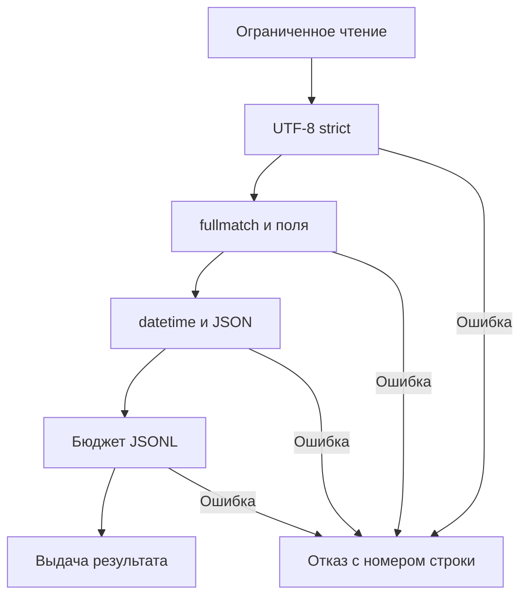

# 12. Регулярные выражения (regex)

Регулярное выражение — небольшой язык для описания текстовых шаблонов. Он полезен при проверке формата, извлечении полей, поиске повторений и преобразовании текста. Чтобы уверенно применять regex в рабочем сервисе, нужно понимать не только синтаксис, но и контракт входных данных, поведение движка, Unicode, стоимость неуспешного поиска и ограничения результата.

Цель главы — научиться писать выражения, которые можно объяснить, протестировать и сопровождать. Разберём стандартный модуль `re`, возможности отдельного пакета `regex` и практический конвейер преобразования логов в JSONL.

**Как читать и запускать примеры.** Базовая версия — Python 3.12+. Примеры с возможностями Python 3.14 помечены явно. Каждый учебный блок Python самодостаточен: его можно сохранить в отдельный файл и выполнить. `assert` здесь фиксирует ожидаемый результат примера; проверки внешних данных в практическом проекте используют исключения и работают при `python -O`.

Для примеров с пометкой `regex` нужен отдельный пакет. Для упражнений с генеративными тестами нужен Hypothesis. Версии закреплены для воспроизводимости проверки этой главы, а не как требование всегда использовать именно их.

```bash
python -m venv .venv
# Linux / macOS:
source .venv/bin/activate
# PowerShell в Windows:
# .venv\Scripts\Activate.ps1
python -m pip install "regex==2026.9.29" "pytest==9.1.1" "hypothesis==6.170.1"
```

**Содержание**

1. [Введение в регулярные выражения](#introduction)
2. [Синтаксис regex: Символы и метасимволы](#syntax)
3. [Классы символов](#character-classes)
4. [Квантификаторы: повторения](#quantifiers)
5. [Якоря и границы](#anchors-and-boundaries)
6. [Группировка и захват](#groups)
7. [Опережающие и ретроспективные проверки (Lookahead / Lookbehind)](#lookaround)
8. [Флаги (модификаторы) компиляции](#flags)
9. [Функции модуля `re`](#re-functions)
10. [Объекты Match и работа с результатами](#match-objects)
11. [Продвинутые техники](#advanced-techniques)
12. [Производительность regex](#performance)
13. [Отладка и тестирование регулярных выражений](#debugging-and-tests)
14. [Юникод и регулярные выражения](#unicode)
15. [Практические примеры и паттерны](#practical-patterns)
16. [Лучшие практики](#best-practices)
17. [Частые ошибки](#common-mistakes)
18. [Частые вопросы и ключевые выводы](#questions-and-takeaways)

<a id="introduction"></a>

## Введение в регулярные выражения

### Что такое регулярное выражение и зачем оно нужно

Шаблон описывает допустимые символы, их порядок и повторения. Например, `[A-Z]{2}-[0-9]{4}` означает две заглавные латинские буквы, дефис и четыре ASCII-цифры.

```python
import re

ticket = re.compile(r"[A-Z]{2}-[0-9]{4}")
assert ticket.fullmatch("PY-2048") is not None
assert ticket.fullmatch("PY-2048 extra") is None
assert ticket.findall("Исправлены PY-2048 и IO-0102") == ["PY-2048", "IO-0102"]
```

**Основные задачи.**

| Задача | Вопрос | Типичный API |
| --- | --- | --- |
| Поиск | Есть ли подходящий фрагмент? | `search` |
| Проверка формата | Подходит ли вся строка? | `fullmatch` |
| Извлечение | Какие значения и где найдены? | `finditer`, группы |
| Преобразование | Чем заменить найденное? | `sub`, `subn` |
| Разделение | Где проходят разделители? | `split` |

У регулярного выражения нет знания о бизнес-смысле. Форма даты `2024-02-31` может соответствовать шаблону, но такой даты нет в календаре. Успешное совпадение URL не доказывает, что к адресу разрешено обращаться. Формат и смысл проверяются отдельными шагами.

Термин «регулярный» исторически связан с регулярными языками и конечными автоматами. Современные движки добавляют обратные ссылки и другие расширения; произвольный Python-шаблон не следует автоматически считать выражением с линейной сложностью.

### Модуль `re` — основной инструмент работы

`re` входит в стандартную библиотеку. Основные сущности:

- `str` или `bytes` с текстом шаблона;
- `re.Pattern[str]` или `re.Pattern[bytes]` — скомпилированный шаблон;
- `re.Match[...]` — результат одного совпадения;
- `None` — совпадение не найдено.

```python
import re

pattern: re.Pattern[str] = re.compile(r"job=(?P<name>[a-z_]+)")
match: re.Match[str] | None = pattern.search("INFO job=daily_load")
if match is None:
    raise ValueError("Поле job отсутствует")
assert match["name"] == "daily_load"
assert match.re is pattern
assert match.string == "INFO job=daily_load"
```

Отсутствие совпадения — обычный результат, а не исключение. Ошибка синтаксиса шаблона — отдельная ситуация:

```python
import re

try:
    re.compile(r"(?P<job>[a-z]+")
except re.error as error:
    assert error.pos is not None
    print(error.msg, error.pos, error.lineno, error.colno)
else:
    raise AssertionError("Ожидалась ошибка компиляции")
```

Начиная с Python 3.13 основное имя исключения — `re.PatternError`; `re.error` сохранено как совместимый псевдоним. Для кода, который также запускают на 3.12, удобно использовать `re.error`.

### "Сырые" строки (`r"pattern"`) — почему это важно для regex

Шаблон проходит два разбора: сначала Python создаёт строковый объект, затем движок интерпретирует содержимое как regex. Префикс `r` меняет первый разбор, но не отключает второй.

```python
import re

assert r"\d+" == "\\d+"
assert len(r"\n") == 2
assert len("\n") == 1
assert re.fullmatch(r"\n", "\n") is not None
assert re.fullmatch(r"\\n", r"\n") is not None

# В обычной строке \b уже превращается Python в backspace.
assert "\b" == "\x08"
assert re.search("\bcat\b", "cat") is None
assert re.search(r"\bcat\b", "cat") is not None
```

`r"\d+"` содержит обратный слеш и букву `d`; движок видит команду «цифра». `r"\."` содержит команду «буквальная точка», а не произвольный символ.

Raw-литерал не может заканчиваться нечётным числом обратных слешей: закрывающая кавычка оказалась бы экранированной. Когда нужна строка с одним конечным слешем, используйте `"\\"` или подходящую конкатенацию. Raw-строки также не отменяют правила кавычек самого Python.

Не полагайтесь на неизвестные escape-последовательности обычных литералов. В современных версиях Python они вызывают `SyntaxWarning` и могут стать синтаксической ошибкой в будущих версиях.

### Этапы работы: компиляция, поиск, извлечение

Практический порядок: определить формат → собрать шаблон → скомпилировать → выбрать операцию → проверить наличие совпадения → извлечь поля → проверить значения → преобразовать в предметный объект.

```python
import re
from dataclasses import dataclass


@dataclass(frozen=True)
class Metric:
    name: str
    value: int


METRIC = re.compile(r"(?P<name>[a-z_]{1,32})=(?P<value>[0-9]{1,6})")


def parse_metric(text: str) -> Metric:
    if len(text) > 39:
        raise ValueError("Слишком длинная метрика")
    match = METRIC.fullmatch(text)
    if match is None:
        raise ValueError("Ожидается name=integer")
    value = int(match["value"])
    if value > 100_000:
        raise ValueError("Значение превышает предметное ограничение")
    return Metric(match["name"], value)


assert parse_metric("rows=2048") == Metric("rows", 2048)
```

Проверка длины до сопоставления ограничивает объём работы. `fullmatch` задаёт границу формата. Преобразование `int` делает значение числом, а предметное ограничение проверяет его смысл.

<a id="syntax"></a>

## Синтаксис regex: Символы и метасимволы

### Литералы (простые символы)

Литералы соответствуют самим себе. Шаблон `ERROR` ищет эту последовательность символов с учётом регистра. В Python нет обязательных слешей вокруг шаблона: `r"/error/"` ищет и оба слеша.

```python
import re

assert re.findall("ERROR", "ERROR error ERROR") == ["ERROR", "ERROR"]
assert re.fullmatch("кот", "кот") is not None
assert re.fullmatch(r"/api/v1", "/api/v1") is not None
assert re.fullmatch(r"/error/", "error") is None
```

Без специальных флагов пробел в шаблоне — тоже литерал. Некоторые символы меняют роль внутри `[...]` или при `re.VERBOSE`; смысл зависит от контекста.

### Метасимволы: `. ^ $ * + ? { } [ ] \ | ( )`

| Конструкция | Идея | Пример |
| --- | --- | --- |
| `.` | Один символ, обычно кроме `\n` | `a.c` |
| `^`, `$` | Проверка позиции начала или конца | `^INFO` |
| `*`, `+`, `?`, `{m,n}` | Повторение предыдущего элемента | `[0-9]{2,4}` |
| `[...]` | Один символ из набора | `[A-F0-9]` |
| `A\|B` | Альтернативы | `GET\|POST` |
| `(...)` | Группа с захватом | `(ab)+` |
| `\` | Escape-последовательность | `\d`, `\.` |

**Порядок альтернатив имеет значение.** Движок ищет подходящую позицию слева направо, а в этой позиции пробует ветви в указанном порядке. Первая успешно завершившаяся альтернатива побеждает; это не правило «выбрать самый длинный вариант».

```python
import re

assert re.search(r"cat|catalog", "catalog").group() == "cat"
assert re.search(r"catalog|cat", "catalog").group() == "catalog"
# Для полного совпадения первая короткая ветвь не завершает весь шаблон.
assert re.fullmatch(r"cat|catalog", "catalog").group() == "catalog"
assert re.findall(r"\*\*|\*", "a**b*c") == ["**", "*"]
```

Конкатенация связывает сильнее, чем `|`. `ab|cd` означает `ab` или `cd`; `a(?:b|c)d` означает `abd` или `acd`.

### Экранирование специальных символов (`\.`, `\*`, `\\`)

Чтобы искать метасимвол буквально, передайте движку обратный слеш перед ним.

```python
import re

assert re.fullmatch(r"report\.csv", "report.csv") is not None
assert re.fullmatch(r"report\.csv", "reportXcsv") is None
assert re.findall(r"\*", "2*3**4") == ["*", "*", "*"]
assert re.fullmatch(r"C:\\data\\file\.txt", r"C:\data\file.txt") is not None
assert re.fullmatch(r"[.*+?]", "*") is not None
```

Внутри класса `[.*]` точка и звёздочка уже литералы. Но `]`, `-`, `^` и `\` требуют внимания к позиции и экранированию. Последовательность `\q` не означает «обычная q»: неизвестные буквенные escapes движок отклоняет.

### Экранирование буквального текста через re.escape()

`re.escape(text)` подготавливает текст к включению в шаблон как литерал. Функция особенно полезна, когда значение приходит из конфигурации или формы поиска.

```python
import re

product = "C++ (pro)."
pattern = re.compile(r"product=" + re.escape(product))
assert pattern.search("product=C++ (pro).; enabled") is not None
assert pattern.search("product=CCC proX") is None

items = ["a+b", "a", "a+b+c"]
alternatives = "|".join(
    re.escape(item) for item in sorted(items, key=len, reverse=True)
)
assert re.search(alternatives, "a+b+c").group() == "a+b+c"
```

Длинные литералы в этом примере идут раньше коротких, чтобы одна ветвь не забирала общий префикс. Если поиск должен учитывать все пересекающиеся вхождения большого словаря, обычная alternation может оказаться неподходящим алгоритмом: рассмотрите trie или Aho–Corasick.

Экранирование не уменьшает число вариантов и не ограничивает размер шаблона. Тысячи пользовательских альтернатив по-прежнему требуют бюджета компиляции и памяти.

### Экранирование шаблона vs экранирование строки замены

Шаблон и строка замены используют разные мини-языки. В `re.sub` обратные слеши замены могут обозначать символы и ссылки на группы. `re.escape` для замены не подходит: он экранирует символы по правилам шаблона.

```python
import re

replacement = r"C:\new\1.txt"
text = "TARGET"

# Callable возвращает буквальный текст; повторного разбора как шаблона замены нет.
assert re.sub(r"TARGET", lambda match: replacement, text) == replacement

# Альтернатива для строки замены: удвоить только обратные слеши.
escaped_replacement = replacement.replace("\\", r"\\")
assert re.sub(r"TARGET", escaped_replacement, text) == replacement

assert re.sub(r"([0-9]+)", r"[\g<1>0]", "42") == "[420]"
```

`\g<1>0` однозначно означает группу 1 и затем `0`. Запись `\10` означает ссылку на десятую группу, если она существует, а не первую группу с нулём. `\g<0>` вставляет полное совпадение.

### Включение пользовательского текста в регулярное выражение

Сначала определите, что пользователь передаёт: буквальный поисковый текст или полноценную программу на языке regex. Это разные API с разными ограничениями.

```python
import re


def compile_literal_word(fragment: str) -> re.Pattern[str]:
    if not fragment or len(fragment) > 80:
        raise ValueError("Нужен непустой фрагмент длиной до 80 символов")
    # Граница задаётся через \w, а не через обязательную букву на краю.
    return re.compile(r"(?<!\w)" + re.escape(fragment) + r"(?!\w)")


pattern = compile_literal_word("C++")
assert pattern.search("Используем C++ здесь") is not None
assert pattern.search("XC++") is None
assert pattern.search("C++17") is None
```

`\b` вокруг произвольного литерала не всегда подходит: `C++` заканчивается не-словным символом, поэтому ожидаемая граница может отсутствовать. Даже lookaround здесь задаёт конкретное определение слова через `\w`; для поиска подстроки достаточно `fragment in text`.

В raw f-строках Python продолжает разбирать фигурные скобки. Для квантификатора нужны удвоенные скобки: `rf"{re.escape(prefix)}[0-9]{{4}}"`. Значения границ повторения проверяйте как числа до сборки шаблона.

<a id="character-classes"></a>

## Классы символов

### Квадратные скобки `[abc]`, `[a-z]`, `[0-9]`

Класс соответствует **одному** символу. `[cat]` — буква `c`, `a` или `t`; это не слово `cat`. Для слова нужна конкатенация, а для списка слов — группа с альтернативами.

```python
import re

assert re.findall(r"[cat]", "catalog") == ["c", "a", "t", "a"]
assert re.fullmatch(r"[0-9A-Fa-f]{6}", "c0ffee") is not None
assert re.fullmatch(r"[-a-z]+", "data-load") is not None
assert re.fullmatch(r"[\[\]()-]+", "[]()-") is not None
assert re.fullmatch(r"[а-я]+", "ёж") is None
assert re.fullmatch(r"[а-яё]+", "ёж") is not None
```

Диапазоны следуют значениям кодовых точек, а не алфавитному порядку языка. `[A-z]` захватывает лишние символы между `Z` и `a`: например, `[` и `_`. Для латиницы пишите `[A-Za-z]`.

Не рассчитывайте на операции над множествами из других движков. В стандартном `re` конструкции вроде `[a-z&&[^aeiou]]` не означают гарантированное пересечение; неоднозначные варианты могут вызывать `FutureWarning`.

### Отрицательные классы `[^abc]`

`^` в начале класса означает дополнение: один символ, который не входит в набор.

```python
import re

assert re.findall(r"[^,]+", "one,two,,three") == ["one", "two", "three"]
assert re.fullmatch(r"[^x]+", "a\nb") is not None
assert re.fullmatch(r"[^,\r\n]+", "a\nb") is None
assert re.fullmatch(r"[^^]+", "abc") is not None
```

Отрицательный класс вполне может захватить перевод строки. Если поле ограничено одной физической строкой, явно исключайте `\r` и `\n`. Для простого CSV даже `[^,]+` недостаточно: кавычки, пустые поля и переводы строк требуют CSV-парсера.

### Предопределенные классы

`\d`, `\w` и `\s` сокращают часто используемые наборы. Заглавный вариант означает дополнение. Их состав зависит от типа данных и флагов.

| Класс | В `str` без `re.ASCII` | В ASCII-режиме |
| --- | --- | --- |
| `\d` | Десятичные цифры Unicode | `[0-9]` |
| `\w` | Алфавитно-цифровые символы Unicode и `_` | `[A-Za-z0-9_]` |
| `\s` | Пробельные символы Unicode | Пробел, `\t\n\r\f\v` |
| `\D`, `\W`, `\S` | Дополнения соответствующих наборов | Дополнения ASCII-наборов |

Не выбирайте сокращение только ради краткости. Для номера протокола `[0-9]` часто точнее, чем `\d`; для однострочного разделителя `[ \t]` точнее, чем `\s`.

### `\d` (цифры) и `\D`

`\d` в Unicode-строке соответствует десятичным цифрам категории `Nd`. Это не все символы, похожие на числа.

```python
import re

assert re.fullmatch(r"\d+", "１２٣") is not None
assert re.fullmatch(r"[0-9]+", "１２٣") is None
assert re.fullmatch(r"\d", "²") is None
assert "²".isdigit()
assert re.sub(r"\D", "", "id=42; v2") == "422"
```

Последний пример показывает опасность «очистки до цифр»: из двух независимых чисел получается новое значение. Если требуется строгое поле, проверьте полную форму и отклоните лишнее.

### `\w` (буквы, цифры, подчеркивание) и `\W`

`\w` не означает только буквы и не совпадает с правилами идентификаторов Python. Например, цифра допустима в `\w` в любой позиции; некоторые комбинируемые знаки, допустимые в идентификаторе, не входят в этот класс.

```python
import re

assert re.findall(r"\w+", "Иса_42 + data") == ["Иса_42", "data"]
assert re.fullmatch(r"\w+", "42") is not None
assert re.fullmatch(r"\w+", "e\u0301") is None
assert "e\u0301".isidentifier()
assert re.sub(r"\W+", "-", "data / science") == "data-science"
```

Для идентификаторов самого Python используйте `str.isidentifier()` и при необходимости `keyword.iskeyword()`. Для slug, кода товара или имени поля задайте собственный алфавит.

### `\s` (пробельные символы) и `\S`

`\s` включает переводы строк, неразрывные пробелы и другие Unicode-пробелы. Это удобно для свободного текста, но может нарушить границы записей.

```python
import re

text = "a\u00a0b\tc\nd"
assert re.split(r"\s+", text) == ["a", "b", "c", "d"]
assert re.split(r"[ \t]+", text) == ["a\u00a0b", "c\nd"]
assert re.fullmatch(r"\S+", "job_42") is not None
assert re.fullmatch(r"\s", "\u200b") is None
```

Zero width space `U+200B` не считается пробельным для `\s`. «Невидимый символ» и «пробел по правилам Python» — разные множества. Для очистки пользовательского текста полезно сначала посмотреть `repr(text)` и кодовые точки подозрительных символов.

### Специфика Unicode (флаг `re.ASCII`)

`re.ASCII` сужает сокращённые классы и связанные границы. Он не запрещает Unicode-литералы и не превращает весь шаблон в проверку ASCII.

```python
import re

assert re.fullmatch(r"\w+", "Иса") is not None
assert re.fullmatch(r"\w+", "Иса", flags=re.ASCII) is None
assert re.fullmatch(r"Иса", "Иса", flags=re.ASCII) is not None
assert re.fullmatch(r".+", "Иса", flags=re.ASCII) is not None
assert re.fullmatch(r"(?a:\w+):\w+", "job:Иса") is not None
```

Для проверки ASCII всего значения можно использовать `text.isascii()` с отдельными правилами допустимых символов. Для протокола лучше явно описать разрешённый алфавит; ASCII содержит и управляющие символы.

### Специальные последовательности: `\b` (граница слова), `\B`, `\A`, `\Z`

`\A` проверяет начало всей исходной строки. `\Z` проверяет строгий конец области сопоставления. В отличие от `$`, он не разрешает позицию перед конечным `\n`.

`\b` — переход между `\w` и `\W` либо край строки рядом со словным символом. `\B` — позиция, которая не является такой границей. Обе проверки ничего не потребляют.

```python
import re
import sys

assert re.search(r"\Acat\Z", "cat") is not None
assert re.search(r"cat$", "cat\n") is not None
assert re.search(r"cat\Z", "cat\n") is None
assert re.findall(r"\Bcat\B", "scatalog cat") == ["cat"]
assert (re.search(r"\B", "") is not None) == (sys.version_info >= (3, 14))
assert re.fullmatch(r"[\b]", "\x08") is not None
```

С Python 3.14 добавлен строгий якорь `\z`; `\Z` остаётся совместимым написанием для старых версий. В 3.14 также изменилось поведение `\B` на пустой строке: теперь совпадение есть. Эти различия важны для тестов нулевой длины.

```python
# Python 3.14+
import re

assert re.search(r"done\z", "done") is not None
assert re.search(r"done\z", "done\n") is None
```

<a id="quantifiers"></a>

## Квантификаторы: повторения

### Жадные квантификаторы (`*`, `+`, `?`, `{n}`, `{n,}`, `{n,m}`)

Квантификатор относится к предыдущему атому: символу, классу или группе. `ab+` означает `a` и несколько `b`, а `(?:ab)+` — повторение всей пары.

| Запись | Число повторений |
| --- | --- |
| `X*` | От нуля |
| `X+` | От одного |
| `X?` | Ноль или один |
| `X{n}` | Ровно `n` |
| `X{n,}` | Не меньше `n` |
| `X{n,m}` | От `n` до `m` включительно |

```python
import re

assert re.fullmatch(r"ab+", "abbb") is not None
assert re.fullmatch(r"(?:ab)+", "abab") is not None
assert re.fullmatch(r"colou?r", "color") is not None
assert re.fullmatch(r"colou?r", "colour") is not None
assert re.fullmatch(r"[0-9]{2,4}", "1234") is not None
assert re.fullmatch(r"[0-9]{2,4}", "12345") is None
assert re.fullmatch(r"a*", "") is not None
```

Жадный квантификатор сначала пробует больше повторений, но может вернуть часть символов следующему элементу. Он не обещает «всегда захватить максимальный фрагмент строки».

Непосредственная запись `a**` ошибочна. Скобки позволяют вложить повторения, но форма `(a+)+` уже создаёт неоднозначные способы разбить одну последовательность и требует отдельного анализа сложности.

### Ленивые (нерадивые) квантификаторы (`*?`, `+?`, `??`, `{n,m}?`)

Ленивый квантификатор начинает с меньшего числа повторений и расширяется, если иначе остаток шаблона не совпадает.

```python
import re

text = "<first> middle <second>"
assert re.findall(r"<.*>", text) == [text]
assert re.findall(r"<.*?>", text) == ["<first>", "<second>"]
assert re.fullmatch(r"a+?", "aaaa").group() == "aaaa"
assert re.search(r"a{2,4}?", "aaaa").group() == "aa"
```

`fullmatch` заставляет даже ленивый `a+?` покрыть всю строку. «Ленивый» не означает «быстрый» или «безопасный»: `.*?` по-прежнему может много раз проверять остаток выражения.

Если формат говорит «до закрывающей кавычки», часто точнее `"[^"\r\n]*"`. Для экранированных кавычек потребуется более подробная грамматика, а для вложенной структуры — подходящий парсер.

### Ревнивые (сверхжадные) квантификаторы (`*+`, `++`, `?+` — possessive) и атомарные группы

Possessive-квантификатор забирает доступные повторения и не возвращает их при неудаче последующего выражения. Атомарная группа `(?>...)` запрещает возвращаться к внутренним вариантам после успешного выхода из неё. Эти возможности доступны в стандартном `re` с Python 3.11.

```python
import re

assert re.fullmatch(r"a+a", "aaaa") is not None
assert re.fullmatch(r"a++a", "aaaa") is None
assert re.fullmatch(r"(?>a+)a", "aaaa") is None
assert re.fullmatch(r'"[^"]*+"', '"hello"') is not None
assert re.fullmatch(r"(?:ab){1,3}+", "abab") is not None
```

У шаблона `"[^"]*+"` содержимое не может поглотить закрывающую кавычку, поэтому отказ от возврата не мешает найти разделитель. А замена `.*` на `.*+` перед обязательной кавычкой сломала бы смысл: точка уже поглотила бы саму кавычку.

Атомарность — изменение семантики выбора вариантов. Её применяют после понимания формата и подтверждают тестами, а не добавляют ко всем группам автоматически.

### Сравнение жадности и влияние на производительность (катастрофический бэктрекинг)

При backtracking движок пробует вариант, а после неудачи возвращается к развилке. У `(a+)+` строку из нескольких `a` можно разбить на внутренние повторения множеством способов. Несовпадающий хвост заставляет перебирать эти разбиения.

```python
import re

# Намеренно маленькие входы: это иллюстрация неоднозначности, не стресс-тест.
bad = re.compile(r"(a+)+")
simple = re.compile(r"a+")
atomic = re.compile(r"(?>a+)+")
for size in range(1, 10):
    accepted = "a" * size
    rejected = accepted + "!"
    assert bad.fullmatch(accepted) is not None
    assert bad.fullmatch(rejected) is None
    assert simple.fullmatch(rejected) is None
    assert atomic.fullmatch(rejected) is None
```

В этом примере вложенное повторение вообще не нужно: `a+` описывает тот же набор принимаемых строк. Отдельные детали результатов захватывающих групп при переписывании также входят в контракт и могут измениться.

Стоимость зависит не только от жадности, но и от неоднозначных альтернатив, вложенных повторений, места отказа, режима поиска и длины входа. Даже квадратичное время опасно на больших данных. Ограничение длины входа и улучшение шаблона решают разные части задачи.

<a id="anchors-and-boundaries"></a>

## Якоря и границы

### Начало строки: `^` и конец строки: `$`

Якоря проверяют позиции. Они не извлекают дополнительные символы. Без `MULTILINE` `^` относится к началу текста, а `$` допускает конец текста и позицию перед единственным завершающим `\n`.

```python
import re

assert re.match(r"^[0-9]+$", "42\n") is not None
assert re.fullmatch(r"[0-9]+", "42\n") is None
assert [match.span() for match in re.finditer(r"$", "x\n")] == [(1, 1), (2, 2)]

text = "xxabcYY"
plain = re.compile(r"abc")
assert plain.fullmatch(text, 2, 5).span() == (2, 5)
assert re.compile(r"\Aabc").search(text, 2, 5) is None
assert re.compile(r"abc\Z").search(text, 2, 5).span() == (2, 5)
```

У методов `Pattern` есть параметры `pos` и `endpos`. Они ограничивают область работы, но не равны созданию среза: `\A` и `^` продолжают видеть настоящее начало строки; lookbehind может видеть символы перед `pos`. При этом `endpos` задаёт эффективный конец области для конечных якорей. Индексы `Match` остаются индексами исходной строки.

Проверяя целое внешнее значение, обычно выбирайте `fullmatch` вместо попытки собрать эквивалент из `^...$`.

### Многострочный режим: флаг `re.MULTILINE`

`MULTILINE` добавляет позиции начала после `\n` и конца перед `\n`. Он не меняет точку и не заставляет `match` искать начало каждой строки.

```python
import re

text = "INFO ready\nERROR broken\nERROR retry"
assert re.findall(r"^ERROR[^\n]*", text, flags=re.MULTILINE) == [
    "ERROR broken",
    "ERROR retry",
]
assert re.match(r"^ERROR", text, flags=re.MULTILINE) is None
assert re.search(r"^ERROR", text, flags=re.MULTILINE).start() == 11
assert re.search(r"INFO.*retry", text, flags=re.MULTILINE) is None
```

В `re` эти якоря ориентированы на `\n`. Не считайте их универсальной моделью всех Unicode-разделителей строк. Если нужен разбор записей файла с конкретными окончаниями строк, лучше явно определить политику чтения и терминаторов.

### Границы слов: `\b`

Граница слова определяется классом `\w` и флагами, а не естественным языком. Дефис разделяет слова, подчёркивание — нет.

```python
import re

text = "cat cat_food cat-food bobcat"
assert [match.span() for match in re.finditer(r"\bcat\b", text)] == [
    (0, 3),
    (13, 16),
]
assert re.search(r"\bC\+\+\b", "C++ ") is None
assert re.search(r"\bкот\b", "кот!") is not None
assert re.search(r"\bкот\b", "кот!", flags=re.ASCII) is None
```

Для номера, окружённого только ASCII-цифрами, полезны `(?<![0-9])` и `(?![0-9])`. Для токенов собственного формата полезно явно определить допустимых соседей. Для лингвистического разбиения нужны правила сегментации, а не обещание, что `\b` понимает все языки.

<a id="groups"></a>

## Группировка и захват

### Захватывающие группы: `(abc)`

Скобки одновременно группируют элементы и сохраняют фрагмент совпадения. Нумерация начинается с 1 по открывающим скобкам слева направо; группа 0 — всё совпадение.

```python
import re

match = re.fullmatch(r"([a-z]+)-([0-9]+)", "batch-42")
assert match is not None
assert match.group(0) == "batch-42"
assert match.groups() == ("batch", "42")
assert match.group(1, 2) == ("batch", "42")

repeated = re.fullmatch(r"([a-z])+", "abc")
assert repeated.group(1) == "c"
```

При повторении сохраняется последний захват группы, а не история всех итераций. Если нужны все элементы, используйте отдельный `finditer` по содержимому или специализированный интерфейс другого движка.

Добавление лишних захватывающих скобок может изменить номера групп, результат `findall` и элементы `split`. Это изменение интерфейса функции, а не только косметика шаблона.

### Нумерованные обратные ссылки: `\1`, `\2` внутри regex, `group(1)` в коде

Обратная ссылка требует повторить **тот же текст**, который уже захвачен, а не ещё один текст такой же формы.

```python
import re

same_word = re.compile(r"\b([a-z]+)[ \t]+\1\b")
assert same_word.search("go go now").group() == "go go"
assert same_word.search("go no") is None

two_codes = re.compile(r"([A-Z]{2})/([A-Z]{2})")
assert two_codes.fullmatch("AB/CD") is not None
assert re.fullmatch(r"([A-Z]{2})/\1", "AB/CD") is None
assert re.fullmatch(r"([A-Z]{2})/\1", "AB/AB") is not None
```

Обратные ссылки усложняют анализ времени работы и ограничивают переносимость между движками. Например, RE2 их не поддерживает. Не путайте `\1` в шаблоне, `\g<1>` в строке замены и `match.group(1)` в Python: это разные контексты.

### Именованные группы: `(?P<name>...)` и обратные ссылки `(?P=name)`

Имена объясняют смысл полей и уменьшают зависимость кода от порядка скобок.

```python
import re

quoted = re.compile(r"""(?P<quote>['"])(?P<body>[^'"\r\n]*)(?P=quote)""")
match = quoted.fullmatch("'ready'")
assert match is not None
assert match["body"] == "ready"
assert match.groupdict() == {"quote": "'", "body": "ready"}
assert quoted.fullmatch("'ready\"") is None
assert quoted.groupindex == {"quote": 1, "body": 2}
```

Этот учебный формат запрещает обе кавычки в содержимом и не поддерживает escapes. Для JSON-строки нужен JSON-декодер; одинаковые внешние кавычки ещё не означают корректную строку соответствующего языка.

Имя группы в `str`-шаблоне должно быть допустимым идентификатором Python и не должно определяться повторно. Для `bytes`-шаблонов в Python 3.12+ имена ограничены ASCII.

### Незахватывающие группы: `(?:...)` (оптимизация и группировка без захвата)

Если значение не нужно извлекать, используйте `(?:...)`. Это сохраняет форму результата при структурных изменениях шаблона.

```python
import re

with_capture = re.compile(r"(GET|POST) /([a-z]+)")
without_capture = re.compile(r"(?:GET|POST) /(?P<resource>[a-z]+)")
text = "GET /users POST /jobs"
assert with_capture.findall(text) == [("GET", "users"), ("POST", "jobs")]
assert without_capture.findall(text) == ["users", "jobs"]
assert without_capture.groups == 1
```

Главный выигрыш — ясный контракт и отсутствие ненужных сохранённых полей. Нельзя обещать существенное ускорение только от замены захватывающих групп на незахватывающие: измеряйте конкретный шаблон. Они не устраняют backtracking сами по себе.

### Атомарные группы: `(?>...)` (для предотвращения бэктрекинга)

Атомарность действует на варианты **внутри** группы после выхода из неё; остальные части шаблона могут продолжать возвращаться к собственным развилкам.

```python
import re

assert re.fullmatch(r"(?:a|ab)c", "abc") is not None
assert re.fullmatch(r"(?>a|ab)c", "abc") is None
assert re.fullmatch(r"(?>ab|a)c", "abc") is not None
assert re.fullmatch(r"(?>[0-9]+):[a-z]+", "123:ok") is not None
```

В первом атомарном варианте ветвь `a` уже сработала. После неудачи на `c` движок не возвращается выбирать `ab`. В последнем примере цифры не могут забрать двоеточие, поэтому атомарность не мешает корректному разбору поля.

Проверяйте как принимаемые, так и отклоняемые примеры: оптимизация, которая «ускорила» программу за счёт потери допустимых строк, не сохраняет её поведение.

### Условные группы и зависимость сопоставления от предыдущего захвата

`(?(name)yes|no)` выбирает ветвь в зависимости от того, участвовала ли группа в совпадении. Это не произвольное Python-условие и не общий синтаксис lookahead-условий из других движков.

```python
import re

wrapped = re.compile(r"(?P<open><)?(?P<code>[A-Z]{2})(?(open)>)")
for text in ("AB", "<AB>"):
    assert wrapped.fullmatch(text) is not None
for text in ("<AB", "AB>", "<<AB>>"):
    assert wrapped.fullmatch(text) is None
```

Неучаствовавшая группа отличается от группы, которая участвовала и захватила пустую строку. Во втором случае условие истинно. Если таких зависимостей становится много, два простых выражения или обычный код часто читаются лучше одного сложного.

<a id="lookaround"></a>

## Опережающие и ретроспективные проверки (Lookahead / Lookbehind)

### Позитивный опережающий поиск: `(?=...)`

Lookahead проверяет текст справа от текущей позиции и не двигает конец совпадения. Это удобно, когда нужно найти поле, но оставить разделитель или единицу измерения за пределами результата.

```python
import re

text = "15ms 2s 300ms"
assert re.findall(r"[0-9]+(?=ms\b)", text) == ["15", "300"]
assert [(m.group(), m.span()) for m in re.finditer(r"(?=(aba))", "ababa")] == [
    ("", (0, 0)),
    ("", (2, 2)),
]
assert [m.group(1) for m in re.finditer(r"(?=(aba))", "ababa")] == ["aba", "aba"]
```

Второй пример находит пересекающиеся фрагменты: всё совпадение имеет нулевую длину, а содержимое находится в группе 1. Соответственно, `span()` и `span(1)` описывают разные интервалы.

Если группа внутри успешной позитивной проверки захватила значение, оно доступно в `Match`. Не приписывайте проверке свойство «не выполняет работу»: она может запускать нетривиальное сопоставление.

### Негативный опережающий поиск: `(?!...)`

Негативная проверка утверждает, что с текущей позиции указанный фрагмент не совпадает. Место проверки принципиально.

```python
import re

identifier = re.compile(r"(?!admin\Z)[a-z]{1,12}")
assert identifier.fullmatch("admin") is None
assert identifier.fullmatch("administrator") is None  # 13 символов
assert identifier.fullmatch("admin2") is None
assert identifier.fullmatch("adminx") is not None

assert re.fullmatch(r"(?!.*forbidden)[a-z ]+", "allowed text") is not None
assert re.fullmatch(r"(?!.*forbidden)[a-z ]+", "has forbidden text") is None
```

`(?!admin)` в начале запретил бы любой префикс `admin`, а `(?!admin\Z)` запрещает только полное значение `admin`. Для множества зарезервированных имён обычная проверка `value not in RESERVED` после проверки формата обычно понятнее.

Шаблон `.(?!bad)` сначала потребляет символ и лишь затем проверяет остаток. Он не равен `(?!bad).`. При отладке отмечайте позицию движка перед каждым утверждением.

### Позитивный ретроспективный поиск: `(?<=...)`

Lookbehind проверяет текст слева от текущей позиции, не включая его в полное совпадение.

```python
import re

assert re.findall(r"(?<=id=)[0-9]+", "id=17 other=99 id=204") == ["17", "204"]

pattern = re.compile(r"(?<=X)abc")
match = pattern.search("Xabc", 1)
assert match is not None and match.span() == (1, 4)
# Срез удалил контекст, который был виден перед pos.
assert pattern.search("Xabc"[1:]) is None
```

Если левый контекст сам нужно извлечь, его часто удобнее включить в основную часть выражения и выделить интересующее поле группой. Это также помогает избежать ограничений длины lookbehind.

### Негативный ретроспективный поиск: `(?<!...)`

Негативный lookbehind требует отсутствия заданного левого контекста. Он может сработать и в начале строки, если там нет запрещённого префикса.

```python
import re

assert re.findall(r"(?<![A-Za-z0-9_])[0-9]+(?![A-Za-z0-9_])", "42 x42 42x 7") == [
    "42",
    "7",
]
assert re.search(r"(?<!-)cat", "cat") is not None
assert re.search(r"(?<!-)cat", "-cat") is None
```

Чтобы выделить отдельное число, здесь ограничены оба края. Без правой проверки движок мог бы вернуть подходящий префикс более длинного токена. Без левой — подходящий суффикс после смещения позиции поиска.

### Ограничения ретроспективных проверок (фиксированная длина в Python)

В стандартном `re` внутреннее выражение lookbehind должно иметь фиксированную ширину. Варианты одинаковой длины допустимы, переменное повторение — нет.

```python
import re

assert re.search(r"(?<=ab|cd)X", "cdX") is not None
for source in (r"(?<=a+)X", r"(?<=a|bc)X", r"(?<=a{1,3})X"):
    try:
        re.compile(source)
    except re.error:
        pass
    else:
        raise AssertionError(source)

# Переносим переменный префикс в потребляющую часть.
match = re.search(r"(?:a|bc)(?P<value>X)", "bcX")
assert match is not None and match["value"] == "X"
```

Другой вариант для отдельных отрицательных условий — последовательность проверок `(?<!a)(?<!bc)`. Для положительного выбора иногда подходит `(?:(?<=a)|(?<=bc))`. Не выполняйте такие преобразования механически: сначала проверьте их логику на границах строки.

Если переменный lookbehind действительно нужен, отдельный пакет `regex` его поддерживает; перенос на другой движок требует повторных тестов, а не только замены импорта.

### Комбинирование проверок для сложных условий (например, пароль)

Несколько lookahead могут проверять независимые условия в одной позиции. Но не каждое правило удобно помещать в regex.

```python
import re

# Учебный формат кода доступа: 8–32 ASCII-символа из заданного набора,
# минимум одна буква и одна цифра. Это не рекомендация парольной политики.
ACCESS_CODE = re.compile(r"(?=[A-Za-z0-9_-]{8,32}\Z)(?=.*[A-Za-z])(?=.*[0-9]).+")
assert ACCESS_CODE.fullmatch("data_2024") is not None
assert ACCESS_CODE.fullmatch("only_letters") is None
assert ACCESS_CODE.fullmatch("12345678") is None
assert ACCESS_CODE.fullmatch("data_2024\n") is None
```

Каждая проверка может заново просматривать строку. Для нескольких фиксированных простых условий это несколько проходов, а не автоматически экспоненциальная работа. Однако сложные неоднозначные подвыражения внутри проверок сохраняют свои проблемы.

Для реальных паролей требования определяет отдельная политика: допустимая длина, обработка Unicode, проверка скомпрометированных значений и безопасное хранение. Regex проверяет только часть формальных свойств; он не оценивает стойкость пароля и не заменяет парольное хеширование.

<a id="flags"></a>

## Флаги (модификаторы) компиляции

### `re.IGNORECASE` / `re.I` — регистронезависимый поиск

`IGNORECASE` меняет правила сопоставления регистра, но не выполняет произвольную нормализацию текста. В Unicode-режиме диапазон `[a-z]` с этим флагом может принимать и некоторые не-ASCII-буквы.

```python
import re

assert re.fullmatch("ошибка", "ОШИБКА", flags=re.IGNORECASE) is not None
assert re.fullmatch(r"[a-z]+", "K", flags=re.IGNORECASE) is not None
assert re.fullmatch(r"[a-z]+", "K", flags=re.IGNORECASE | re.ASCII) is None
assert re.fullmatch("straße", "STRASSE", flags=re.IGNORECASE) is None
assert "straße".casefold() == "STRASSE".casefold()
```

У стандартного `re` регистронезависимость не равна полному сравнению `casefold()` с возможным расширением одного символа в несколько. Для ASCII-кода протокола используйте явный алфавит и `re.ASCII`; для свободного текста заранее определите подходящие правила Unicode.

Преобразование строки через `casefold` может менять длину. Позиции результата такого поиска относятся к преобразованной строке; их нельзя без отображения переносить в исходный текст.

### `re.MULTILINE` / `re.M` — многострочный режим

Флаг влияет на `^` и `$`. Его удобно применять к набору строк, но для небольших записей потоковая обработка отдельных строк даёт более явные границы.

```python
import re

record = "state=ok\nstate=failed\nnote=state=unknown"
pattern = re.compile(r"^state=(?P<state>[a-z]+)$", flags=re.MULTILINE)
assert [match["state"] for match in pattern.finditer(record)] == ["ok", "failed"]
assert re.search(r"\Astate=failed", record, flags=re.MULTILINE) is None
```

`\A` остаётся привязанным к началу всего текста. Помните, что значение `flags` становится частью контракта: тот же визуально похожий шаблон с другим флагом может извлечь дополнительные записи.

### `re.DOTALL` / `re.S` — точка соответствует любому символу, включая `\n`

`DOTALL` меняет только точку. Он не включает многострочные якоря и не меняет состав отрицательных классов.

```python
import re

text = "BEGIN\nline one\nline two\nEND"
assert re.search(r"BEGIN(.*?)END", text) is None
match = re.search(r"BEGIN(?P<body>.*?)END", text, flags=re.DOTALL)
assert match is not None and match["body"] == "\nline one\nline two\n"
assert re.search(r"BEGIN(?s:.*?)END", text) is not None
assert re.search(r"^line", text, flags=re.DOTALL) is None
```

Локальная форма `(?s:...)` ограничивает действие флага одной группой. Для больших многострочных документов сначала оцените, не лучше ли разбирать вход по структуре: свободное `.*?` через весь файл может обрабатывать гораздо больше текста, чем требуется.

### `re.UNICODE` / `re.U` — поддержка Unicode (по умолчанию)

Для `str` Unicode-поведение включено по умолчанию. `re.UNICODE` сохранён для совместимости и обычно ничего не добавляет.

```python
import re

text = "Москва １２"
assert re.findall(r"\w+", text) == re.findall(r"\w+", text, flags=re.UNICODE)
assert re.compile(r"\w+").flags & re.UNICODE

try:
    re.compile(rb"\w+", flags=re.UNICODE)
except ValueError:
    pass
else:
    raise AssertionError("Unicode-флаг несовместим с bytes")
```

Unicode-режим не включает нормализацию NFC, сегментацию графем и распознавание естественных слов. Он также не определяет кодировку байтов: для `bytes` нужен явный шаг декодирования, если требуется работать с текстом.

### `re.ASCII` / `re.A` — принудительное ASCII для `\w`, `\d`, `\b`

Помимо перечисленных классов, флаг влияет на `\s`, дополнения классов и `\B`. Часто он уместен в идентификаторах протоколов и технических полях.

```python
import re

name = re.compile(r"[A-Za-z_]\w{0,31}", flags=re.ASCII)
assert name.fullmatch("job_42") is not None
assert name.fullmatch("job_Иса") is None
assert re.findall(r"\s", "\u00a0", flags=re.ASCII) == []
assert re.fullmatch(r"(?a:\d+)-(?u:\w+)", "42-Иса") is not None
```

Локальные `a`, `u` и `L` задают альтернативные режимы, а не независимые переключатели. `re.LOCALE` работает с байтовыми шаблонами и зависит от locale процесса; для нового Unicode-кода обычно выбирают явное декодирование и правила `str`.

### `re.VERBOSE` / `re.X` — красивое форматирование regex с комментариями

В verbose-режиме неэкранированные пробелы вне классов игнорируются, а `#` начинает комментарий вне класса.

```python
import re

PAIR = re.compile(
    r"""
    (?P<key>[a-z_]{1,16})  # Имя поля
    [ \t]* = [ \t]*       # Горизонтальные пробелы
    (?P<value>[0-9]{1,6}) # Ограниченное целое
    """,
    flags=re.VERBOSE,
)
assert PAIR.fullmatch("rows = 2048").groupdict() == {"key": "rows", "value": "2048"}
assert re.fullmatch(r"a[ ]b", "a b", flags=re.VERBOSE) is not None
assert re.fullmatch(r"a\#b", "a#b", flags=re.VERBOSE) is not None
```

Если пробел значим, используйте `[ ]` или `\ `. Если нужен `#`, используйте `[#]` или `\#`. Внутри многосимвольных конструкций нельзя произвольно вставлять пробелы: `(?:` и `*?` должны оставаться цельными.

Комментарий объясняет причину ограничения: «ASCII-идентификатор из контракта API», «не пересекать границу записи». Пересказ «здесь цифры» мало помогает сопровождению.

### `re.DEBUG` — отладка и просмотр внутренней структуры regex

Флаг печатает разобранную структуру и инструкции движка. Он полезен, чтобы увидеть группы, повторения и неожиданные литералы после нескольких слоёв экранирования.

```python
import contextlib
import io
import re

buffer = io.StringIO()
with contextlib.redirect_stdout(buffer):
    pattern = re.compile(r"(?P<id>[0-9]{2,4})", flags=re.DEBUG)
assert pattern.fullmatch("2048") is not None
assert buffer.getvalue()
print(buffer.getvalue())
```

Формат вывода — диагностическая деталь реализации. Не делайте точный текст `DEBUG` частью бизнес-тестов. Он показывает устройство выражения, но не является трассировщиком каждого фактического возврата при конкретном поиске и не доказывает верхнюю границу времени.

### Комбинирование флагов: `re.IGNORECASE | re.VERBOSE`

Флаги объединяются побитовым `|`. Это элементы `re.RegexFlag`, а не строки и не аргументы, которые нужно складывать арифметически.

```python
import re

flags = re.IGNORECASE | re.VERBOSE | re.ASCII
pattern = re.compile(r"(?P<name>[a-z_]+) [ ]+ (?P<value>[0-9]+)", flags=flags)
assert pattern.fullmatch("ROWS 42").groupdict() == {"name": "ROWS", "value": "42"}
assert pattern.fullmatch("K 42") is None

# Глобальный i включён, локально выключен для суффикса.
assert re.fullmatch(r"(?i)prefix(?-i:END)", "PrefixEND") is not None
assert re.fullmatch(r"(?i)prefix(?-i:END)", "Prefixend") is None
```

Глобальная запись `(?i)` должна стоять в начале шаблона в Python 3.11+. Для середины используйте scoped-группу `(?i:...)`. Для нейтрального исходного значения флагов есть `re.NOFLAG`, эквивалентный `0`.

Уже скомпилированному шаблону не передавайте дополнительные ненулевые флаги через функции модуля: создайте `Pattern` с нужным набором заранее. Методы `Pattern` и функции модуля имеют разные сигнатуры.

<a id="re-functions"></a>

## Функции модуля `re`

### Компиляция: `re.compile()` — зачем, когда и почему это может быть быстрее

Компиляция отделяет проверку и разбор выражения от обработки данных. Шаблон становится именованной зависимостью с доступными `pattern`, `flags`, `groups` и `groupindex`.

```python
import re

REQUEST_ID: re.Pattern[str] = re.compile(r"[A-Za-z0-9_-]{1,64}", flags=re.ASCII)
assert REQUEST_ID.pattern == r"[A-Za-z0-9_-]{1,64}"
assert REQUEST_ID.fullmatch("req_42") is not None
assert REQUEST_ID.groups == 0
```

Функции модуля тоже используют кэш недавно встречавшихся шаблонов. Поэтому вызов `re.search` с постоянной строкой не означает полную компиляцию на каждом проходе. Явная компиляция помогает читаемости, раннему обнаружению ошибок, повторному использованию и иногда уменьшает накладные расходы; размер ускорения измеряют.

Храните стабильные шаблоны на уровне модуля или передавайте как зависимость. Не компилируйте их внутри цикла без причины и не сохраняйте безграничный словарь произвольных пользовательских выражений.

### Поиск первого совпадения: `re.search()`

`search` ищет первую позицию, из которой выражение может успешно совпасть. После нахождения результат содержит выбранный фрагмент, а не обязательно всю строку.

```python
import re

match = re.search(r"status=(?P<code>[0-9]{3})", "INFO status=503 retry")
if match is None:
    raise ValueError("Статус не найден")
assert match["code"] == "503"
assert match.span() == (5, 15)
assert re.search(r"status=[0-9]{3}", "status=2000").group() == "status=200"
```

Последняя строка демонстрирует совпадение префикса более длинного значения. Если поле должно закончиться разделителем, добавьте соответствующую границу. Если вся запись обязана соответствовать формату, выберите `fullmatch`.

У `re.search` нет аргументов `pos` и `endpos`. Они есть у `compiled.search`. Третий позиционный аргумент функции модуля — `flags`, что делает случайную подмену интерфейсов особенно неприятной.

### Поиск в начале строки: `re.match()` (важное отличие от `search`)

`match` проверяет совпадение только в начале, а метод `Pattern.match` — в заданной позиции `pos`. Остаток строки может остаться непроверенным.

```python
import re

pattern = re.compile(r"[A-Z]+")
assert pattern.match("xx ERROR") is None
assert pattern.search("xx ERROR").group() == "ERROR"
assert pattern.match("xx ERROR", 3).span() == (3, 8)
assert pattern.match("ERROR trailing").group() == "ERROR"
assert pattern.fullmatch("ERROR trailing") is None
```

При построении токенизатора `match(text, pos)` полезен: он не перескакивает через неизвестный символ. После каждого успешного шага требуется продвигать `pos` и проверять, что весь вход разобран.

### Проверка полного совпадения: re.fullmatch()

`fullmatch` требует покрыть всю строку или всю область `[pos:endpos]` метода скомпилированного шаблона. Это естественный API для валидации формата отдельного значения.

```python
import re

port = re.compile(r"[0-9]{1,5}")
assert port.fullmatch("443") is not None
assert port.fullmatch("443\n") is None
assert port.fullmatch(" 443") is None
assert port.fullmatch("99999") is not None


def parse_port(text: str) -> int:
    if port.fullmatch(text) is None:
        raise ValueError("Ожидается от 1 до 5 ASCII-цифр")
    value = int(text)
    if not 1 <= value <= 65535:
        raise ValueError("Порт вне диапазона")
    return value


assert parse_port("443") == 443
```

Не вызывайте `strip()` автоматически перед строгой проверкой. Он меняет принимаемый язык: значение с лишним переводом строки будет принято после удаления хвоста. Нормализация допустима, если это явно предусмотрено контрактом.

### Поиск всех совпадений: `re.findall()` (возврат строк или кортежей)

Тип и форма результата зависят от числа захватывающих групп.

| Число групп | Один элемент результата |
| --- | --- |
| Ноль | Полное совпадение |
| Одна | Содержимое этой группы |
| Две и больше | Кортеж содержимого групп |

```python
import re

text = "x=10 y=20"
assert re.findall(r"[a-z]=[0-9]+", text) == ["x=10", "y=20"]
assert re.findall(r"[a-z]=([0-9]+)", text) == ["10", "20"]
assert re.findall(r"([a-z])=([0-9]+)", text) == [("x", "10"), ("y", "20")]
assert re.findall(r"(a)?b", "b ab") == ["", "a"]
assert re.findall(r"aba", "ababa") == ["aba"]
```

Неучаствовавшая группа в `findall` представлена пустой строкой. Если требуется отличать её от реально захваченного пустого значения, используйте `Match` через `finditer`: там будет `None`.

Совпадения не пересекаются. `findall` сразу создаёт список, поэтому для большого входа и большого количества результатов удобнее итерация с явным пределом.

### Итератор совпадений: `re.finditer()` (для экономии памяти)

`finditer` выдаёт `Match` по мере обхода. Можно извлекать только нужные поля и останавливаться, не создавая список всех результатов.

```python
import re

text = "id=10 id=20 id=30"
records = []
for match in re.finditer(r"id=(?P<id>[0-9]+)", text):
    if len(records) >= 2:
        break
    records.append((int(match["id"]), match.span()))
assert records == [(10, (0, 5)), (20, (6, 11))]
```

Это уменьшает память под результаты, но не делает исходный текст потоковым. Итератор и сохранённые `Match` могут удерживать всю строку через `match.string`. Если сохраняете результат надолго, извлекайте нужные небольшие значения, а не коллекцию `Match` на огромном документе.

Произвольный regex нельзя безопасно применить к независимым чанкам и просто склеить ответы: совпадение может пересекать границу. Для ограниченной максимальной ширины можно спроектировать перекрытие и дедупликацию; для безграничной ширины фиксированный overlap не даёт общего решения. У записей с явными разделителями предпочтительнее потоковый разбор записей.

### Разделение строки: `re.split()` (с захватом групп для сохранения разделителей)

Без захватывающих групп разделитель исчезает. С захватывающими группами их значения включаются в результат.

```python
import re

assert re.split(r"[,;][ \t]*", "a, b;c") == ["a", "b", "c"]
assert re.split(r"([,;])", "a,b;c") == ["a", ",", "b", ";", "c"]
assert re.split(r",", ",a,") == ["", "a", ""]
assert re.split(r",", "a,b,c", maxsplit=1) == ["a", "b,c"]
assert re.split(r"(?<=,)", "a,b,c") == ["a,", "b,", "c"]
```

Пустые элементы на краях могут быть значимыми. Если у разделителя есть необязательные группы, в результате могут появиться `None`. Не очищайте список вслепую, если позиция пустого поля важна для формата.

Для одного буквального разделителя обычно проще `str.split`. В новых версиях Python параметры `maxsplit` и `flags` у функции модуля передавайте по имени: их позиционная передача объявлена устаревающей с 3.13.

### Замена: `re.sub()` и `re.subn()` (с использованием строк и функций)

`sub` возвращает новую строку, `subn` — пару «новая строка, число замен». Исходная строка не меняется.

```python
import re

text = "rows=10 rows=20"
assert re.sub(r"rows=([0-9]+)", r"count=\g<1>", text, count=1) == "count=10 rows=20"
assert re.subn(r"rows=([0-9]+)", r"count=\g<1>", text) == ("count=10 count=20", 2)


def double(match: re.Match[str]) -> str:
    return str(int(match["value"]) * 2)


assert re.sub(r"(?P<value>[0-9]+)", double, "10 20") == "20 40"
```

Callable получает `Match` и должен вернуть текст подходящего типа. Его результат вставляется буквально. Если функция выбрасывает исключение, операция не возвращает успешно собранную строку; уже совершённые побочные эффекты callback автоматически не откатываются.

`count=0` означает отсутствие ограничения, а не ноль замен. Ограничивайте длину результата и стоимость callback отдельно: быстрый поиск не гарантирует дешёвое преобразование. Параметры `count` и `flags` у функций модуля передавайте по имени.

### Освобождение памяти: `re.purge()`

`re.purge()` очищает внутренние кэши регулярных выражений. Это не универсальный сборщик памяти и не команда «освободить все regex в приложении».

```python
import re

pattern = re.compile(r"job_[0-9]+")
assert pattern.fullmatch("job_42") is not None
re.purge()
assert pattern.fullmatch("job_42") is not None
```

Явная ссылка на `Pattern` остаётся рабочей. Ссылки из коллекций, итераторов и результатов также продолжают удерживать свои объекты. Размер RSS процесса не обязан уменьшиться сразу после очистки кэша.

В обычной обработке запроса `purge` чаще ухудшит повторное использование шаблонов. Его уместно применять в контролируемом измерении холодной компиляции или при диагностике нагрузки с большим разнообразием выражений.

<a id="match-objects"></a>

## Объекты Match и работа с результатами

### Методы Match-объекта: `group()`, `groups()`, `groupdict()`

`group` получает отдельную группу или несколько групп. `groups` возвращает все захваты по номерам, `groupdict` — только именованные.

```python
import re

pattern = re.compile(r"(?P<name>[a-z]+)(?:=(?P<value>[0-9]*))?")
absent = pattern.fullmatch("rows")
empty = pattern.fullmatch("rows=")
assert absent is not None and empty is not None
assert absent.group() == "rows"
assert absent["value"] is None
assert absent.groups(default="<missing>") == ("rows", "<missing>")
assert absent.groupdict(default="<missing>") == {"name": "rows", "value": "<missing>"}
assert empty["value"] == ""
```

Не путайте отсутствие группы, пустую строку и отсутствие самого совпадения. Это три разных состояния. Сам объект `Match` истинен даже при совпадении нулевой длины; проверка `if match` не означает «найден непустой текст».

У `Match` также доступны `re`, `string`, `pos`, `endpos`, `lastindex` и `lastgroup`. Они полезны для токенизатора и диагностики. `lastgroup` — имя последней захваченной группы по правилам движка, а не обязательно имя семантически главного поля.

### Индексы совпадения: `start()`, `end()`, `span()`

Индексы задают полуоткрытый интервал `[start, end)`. Для неучаствовавшей группы оба значения равны `-1`.

```python
import re

text = "Иса:42"
match = re.search(r"(?P<name>\w+):(?P<value>[0-9]+)(?P<unit>ms)?", text)
assert match is not None
assert match.span("value") == (4, 6)
assert text[match.start("value") : match.end("value")] == "42"
assert match.span("unit") == (-1, -1)
assert match.span() == (0, 6)

binary = re.search(rb"[0-9]+", text.encode("utf-8"))
assert binary is not None and binary.span() == (7, 9)
```

Для `str` индексы измеряются кодовыми точками Python-строки; для `bytes` — байтами. Ни то ни другое не обязано совпадать с количеством пользовательских графем. После нормализации, casefold или декодирования индексы относятся уже к новой последовательности.

Не используйте `(-1, -1)` как обычный срез для отсутствующей группы: сначала проверьте участие. Например, `text[-1:-1]` даёт пустую строку и скрывает отсутствие значения.

### Получение текста совпадения и именованных групп

Преобразуйте результаты в предметные значения в одном понятном месте. Так ошибки формата, преобразования и диапазона не смешиваются с остальным приложением.

```python
import re
from dataclasses import dataclass


@dataclass(frozen=True)
class Job:
    name: str
    retries: int


JOB = re.compile(r"job=(?P<name>[a-z_]{1,32});retries=(?P<retries>[0-9]{1,2})")


def parse_job(text: str) -> Job:
    match = JOB.fullmatch(text)
    if match is None:
        raise ValueError("Некорректная запись задания")
    retries = int(match["retries"])
    if retries > 10:
        raise ValueError("Слишком много повторов")
    return Job(name=match["name"], retries=retries)


assert parse_job("job=daily_load;retries=3") == Job("daily_load", 3)
```

Аннотация `re.Match[str]` полезна статическому анализатору, но не доказывает, что всякая необязательная группа присутствует. В сложных шаблонах учитывайте `None` явно. Когда все поля обязательны по синтаксису, это ограничение желательно описать рядом с выражением.

<a id="advanced-techniques"></a>

## Продвинутые техники

### Динамические regex: компиляция с флагами

Динамическую сборку лучше ограничить небольшим набором заранее определённых фрагментов. Данные экранируются, количество альтернатив и длина ограничиваются, флаги выбираются из разрешённого набора.

```python
import re
from functools import lru_cache


@lru_cache(maxsize=64)
def compile_terms(terms: tuple[str, ...], ignore_case: bool = False) -> re.Pattern[str]:
    if not 1 <= len(terms) <= 20:
        raise ValueError("Нужно от 1 до 20 терминов")
    if any(not term or len(term) > 80 for term in terms):
        raise ValueError("Некорректная длина термина")
    alternatives = "|".join(map(re.escape, sorted(set(terms), key=len, reverse=True)))
    flags = re.IGNORECASE if ignore_case else re.NOFLAG
    return re.compile(f"(?:{alternatives})", flags=flags)


assert compile_terms(("C++", "Python"), True).search("python").group() == "python"
assert compile_terms.cache_info().maxsize == 64
```

Кэш имеет предел по количеству записей; входные ограничения дополнительно ограничивают размер одной записи. В многопоточном коде не храните изменяемое состояние конкретного запроса в глобальном объекте рядом с шаблоном. Стабильный `Pattern` можно переиспользовать, а итератор и позиция обхода относятся к конкретной операции.

Если пользователь действительно вводит произвольный regex, это уже выполнение программы ограниченного языка. Нужно отдельно контролировать компиляцию, время поиска, память, размер входа и результата.

### Использование callable в `re.sub()` для динамической замены

Функция замены полезна, когда результат зависит от значения поля, словаря или нескольких групп. Она также позволяет безопасно вставить буквальный текст с обратными слешами.

```python
import re

VARIABLE = re.compile(r"\$\{(?P<name>[A-Z_]{1,32})\}")
values = {"ROOT": r"C:\new", "TABLE": "events"}


def replace_variable(match: re.Match[str]) -> str:
    name = match["name"]
    if name not in values:
        raise ValueError(f"Неизвестная переменная: {name}")
    return values[name]


assert VARIABLE.sub(replace_variable, "${ROOT}/${TABLE}") == r"C:\new/events"
assert VARIABLE.sub(replace_variable, "${TABLE}") == "events"
```

Вставленный текст не обрабатывается заново тем же `sub`. Если словарь содержит `"${OTHER}"`, получится буквальная последовательность. Рекурсивное раскрытие шаблонов требует отдельной модели глубины, циклов и бюджета результата.

Не используйте `eval` для обработки найденных фрагментов. Для арифметики нужны разбор и разрешённые операции; для SQL — параметры драйвера; для HTML — экранирование соответствующего контекста. Regex-замена не является общим механизмом безопасной интерполяции.

### Вложенные regex и рекурсия в regex (обзор `(?R)` — доступно в PyPI regex)

Стандартный `re` не поддерживает рекурсивное `(?R)`. В пакете `regex` можно описать ограниченный язык вложенных скобок.

```python
# Требуется пакет regex.
import regex

balanced = regex.compile(r"\((?:[^()]++|(?R))*+\)", flags=regex.VERSION1)
assert balanced.fullmatch("(a(b)c)", timeout=0.1) is not None
assert balanced.fullmatch("(a(b)", timeout=0.1) is None
assert balanced.fullmatch("a(b)", timeout=0.1) is None
```

Это распознаватель скобок, а не парсер Python, JSON или SQL. Он не строит дерево, не знает строковые литералы и комментарии соответствующего языка и нуждается в ограничении входа и времени.

Для реальной вложенной грамматики стек или синтаксический парсер обычно проще расширять, снабжать позиционными ошибками и проверять на предельной глубине. Даже там, где рекурсивный шаблон возможен, он не обязательно лучший интерфейс сопровождения.

### Обзор сторонней библиотеки `regex` (поддержка Unicode категорий, рекурсии, переменной длины в lookbehind)

`regex` — отдельная зависимость, а не другое имя `re`. Важные расширения можно проверить небольшим самостоятельным примером:

```python
# Требуется пакет regex.
import regex

letters = regex.compile(r"\p{L}+", flags=regex.VERSION1)
assert letters.fullmatch("PythonИса", timeout=0.1) is not None
assert letters.fullmatch("Python42", timeout=0.1) is None

assert regex.findall(r"(?<=id=[0-9]{1,4}:)[a-z]+", "id=12:ok", timeout=0.1) == ["ok"]
assert regex.findall(r"aba", "ababa", overlapped=True, timeout=0.1) == ["aba", "aba"]
assert regex.findall(r"\X", "e\u0301🙂", flags=regex.VERSION1, timeout=0.1) == [
    "e\u0301",
    "🙂",
]
assert regex.fullmatch("straße", "STRASSE", flags=regex.VERSION1 | regex.I) is not None
```

Явно выбирайте `VERSION0` или `VERSION1`, если используете зависящую от режима семантику. В частности, в режиме 1 доступны расширенные операции над множествами и полное Unicode case folding. Не рассчитывайте на неизменность `DEFAULT_VERSION` между окружениями.

`timeout` задаётся в секундах на операцию; при превышении выбрасывается встроенный `TimeoutError`. Это полезный ограничитель, но не обещание жёсткого дедлайна операционной системы и не ограничение объёма результата. Не путайте его с отсутствующим аналогичным аргументом у `re`.

Дополнительно у `regex` есть история захватов, fuzzy matching, branch reset и другие расширения. Каждое требует тестов семантики, затрат и совместимости. Расширения движка не следует включать только потому, что они доступны.

### Пустые совпадения

Шаблон может успешно совпасть, не потребив ни одного символа: `a*` на пустом входе, якорь или lookaround. Это полноценный `Match`, а не `None`.

```python
import re

empty = re.search(r"a*", "bbb")
assert empty is not None
assert bool(empty) is True
assert empty.group() == ""
assert empty.span() == (0, 0)
assert [(m.group(), m.span()) for m in re.finditer(r"x*", "ab")] == [
    ("", (0, 0)),
    ("", (1, 1)),
    ("", (2, 2)),
]
assert re.sub(r"x*", "-", "ab") == "-a-b-"
assert [(m.group(), m.span()) for m in re.finditer(r".*?", "a")] == [
    ("", (0, 0)),
    ("a", (0, 1)),
    ("", (1, 1)),
]
```

Встроенные функции управляют продвижением с учётом пустых результатов. Самописный цикл `while pattern.search(...)`, который ставит `pos = match.end()`, может зациклиться на нулевой длине. Простое увеличение `pos` также может пропустить допустимое непустое совпадение в той же позиции. Если нужна стандартная семантика, используйте `finditer`.

Токенизатору обычно следует запретить шаблоны токенов нулевой длины и явно проверять продвижение позиции. У валидатора нужно решить, допустима ли пустая строка по контракту.

### Регулярные выражения для str и bytes

Тип шаблона, входа и замены должен быть согласован. `str` работает с Unicode-кодовыми точками, `bytes` — с отдельными байтами.

```python
import re

assert re.findall(rb"\w+", b"id=42") == [b"id", b"42"]
assert re.sub(rb"id=([0-9]+)", rb"key=\g<1>", b"id=42") == b"key=42"
assert re.findall(rb".", "я".encode("utf-8")) == [b"\xd1", b"\x8f"]

try:
    re.search(r"[0-9]+", b"42")
except TypeError:
    pass
else:
    raise AssertionError("Смешение str и bytes должно быть ошибкой")
```

У bytes-классов `\d` и `\s` ASCII-семантика; `\w` тоже ASCII, если не включён особый `LOCALE`. Символьные escapes `\u`, `\U` и `\N{...}` относятся к `str`-шаблонам.

В текстовом протоколе обычно сначала ограничивают размер байтовой записи, затем декодируют с явной кодировкой и `errors="strict"`, после чего проверяют текстовый формат. `errors="ignore"` удаляет данные и способен превратить некорректный ввод в другое допустимое значение.

<a id="performance"></a>

## Производительность regex

### Кэширование regex (как работает `re` под капотом)

У функций модуля есть внутренний кэш недавно использованных шаблонов. Ключ учитывает выражение и флаги; строковое и байтовое выражения различаются. Это ускоряет повторные вызовы, но не является контрактом бесконечного хранения.

```python
import re

for _ in range(3):
    assert re.search(r"id=[0-9]+", "id=42") is not None

# Собственная ссылка не зависит от вытеснения из внутреннего кэша.
stable = re.compile(r"id=[0-9]+")
re.purge()
assert stable.search("id=42") is not None
```

Число кэшей, их размер и политика вытеснения относятся к деталям версии CPython. Не обращайтесь в прикладном коде к приватным `re._cache` и подобным объектам. Не проверяйте корректность программы через идентичность объектов, возвращаемых двумя вызовами `compile`.

Стабильный шаблон компилируется один раз и хранится явно. Для небольшого пространства динамических выражений подходит собственный ограниченный кэш. Для большого потока уникальных пользовательских выражений нужен бюджет компиляции и ограничение кардинальности.

### Проблема катастрофического бэктрекинга (экспоненциальное время)

Проблема возникает, когда одно и то же начало можно разобрать множеством способов, а отказ обнаруживается поздно. Типичные подозрительные формы: вложенные повторения `(a+)+`, перекрывающиеся альтернативы `(a|aa)+`, несколько повторений одного широкого класса рядом.

Для `n` одинаковых символов число способов разделить их на непустые группы равно `2^(n-1)`. Это объясняет потенциальный взрыв у некоторых выражений. Не каждое подозрительное выражение обязательно ведёт себя одинаково: оптимизации движка и последующий контекст влияют на фактическую работу.

**Безопасная демонстрация ограничения стандартного движка отдельным процессом:**

```python
import subprocess
import sys

program = """
import re
value = "a" * 28 + "!"
print(re.fullmatch(r"(a+)+", value) is None)
"""
try:
    completed = subprocess.run(
        [sys.executable, "-I", "-c", program],
        capture_output=True,
        text=True,
        timeout=0.2,
        check=True,
    )
except subprocess.TimeoutExpired:
    print("Бюджет ожидания исчерпан; subprocess.run завершил дочерний процесс")
else:
    assert completed.stdout.strip() == "True"
```

Этот пример не измеряет чистую стоимость regex: в бюджет входит инициализация дочернего Python. Само создание процесса на уровне ОС на некоторых платформах не прерывается таймером и может задержать возврат сверх указанного timeout. При `TimeoutExpired` `subprocess.run` убивает и дожидается непосредственного дочернего процесса; произвольное дерево потомков требует отдельной политики завершения.

В обычном потоке выполнения `re` нет параметра `timeout`. `Future.result(timeout=...)` прекращает ожидание результата, но не гарантирует остановку уже выполняющегося выражения. Асинхронный timeout также не прерывает синхронную работу движка, блокирующую этот поток.

### Как избежать Catastrophic Backtracking

Сначала уменьшайте неоднозначность, затем добавляйте ограничения исполнения.

1. Опишите точный формат и границы записи.
2. Замените широкие `.*` на конкретные поля и разделители, где это сохраняет смысл.
3. Уберите ненужные вложенные повторения и пересекающиеся ветви.
4. Ограничьте длину входа, число записей и количество результатов.
5. Проверьте длинные почти подходящие строки с ошибкой в конце.
6. При необходимости выберите движок с нужными гарантиями или изолируйте выполнение.

`^` или `fullmatch` убирают перебор стартовых позиций, но сами по себе не устраняют внутреннюю экспоненту. Ленивый квантификатор меняет порядок перебора, но не обязательно число вариантов. Компиляция и кэш ускоряют подготовку выражения, но не исправляют его сложность.

RE2 спроектирован для линейного по длине входа сопоставления при фиксированном выражении и ограничивает ресурсы движка. За это он исключает, в частности, обратные ссылки и lookaround. Длину и стоимость самого пользовательского шаблона всё равно нужно ограничивать; гарантия на один поиск не ограничивает число поисков и объём выдачи.

### Использование атомарных групп

Добавляйте атомарность там, где уже доказано, что последующий фрагмент не должен забирать символы из группы.

```python
import re

normal = re.compile(r"[0-9]+:[a-z]+")
possessive = re.compile(r"[0-9]++:[a-z]++")
atomic = re.compile(r"(?>[0-9]+):(?>[a-z]+)")
for text in ("123:ok", "1:a", "123:", "123x:ok", "123:ok!"):
    expected = normal.fullmatch(text) is not None
    assert (possessive.fullmatch(text) is not None) == expected
    assert (atomic.fullmatch(text) is not None) == expected
```

Здесь двоеточие не входит в класс цифр, а после последнего поля нет потребляющего фрагмента. Это понятная причина, почему отказ от возвратов сохраняет проверку формата.

Атомарность одной группы не превращает весь шаблон в линейный алгоритм. Неоднозначность может остаться снаружи, а `search` может повторно запускать сопоставление из разных позиций.

### Уточнение квантификаторов

Границы повторений должны происходить из требований формата, а не из попытки угадать «безопасное число».

```python
import re

field = re.compile(r"[A-Z][A-Z0-9_]{0,31}=[0-9]{1,9}")
assert field.fullmatch("ROWS=2048") is not None
assert field.fullmatch("R" * 33 + "=1") is None
assert field.fullmatch("ROWS=" + "1" * 10) is None
assert field.fullmatch("ROWS=1\nNEXT=2") is None
```

`{0,1000000}` формально ограничен, но не обязательно дёшев. Несколько ограниченных повторений могут по-прежнему создавать много вариантов. Общий предел входа и разумные ограничения отдельных полей нужны одновременно.

Необоснованное усечение текста перед проверкой опасно: `text[:100]` может удалить недопустимый хвост. Если значение слишком длинное, отклоните его целиком, а не проверяйте только префикс.

### Переписывание паттерна

Лучшее выражение часто получается после упрощения модели данных.

| Неудачная идея | Более ясная замена | Что проверить |
| --- | --- | --- |
| `(a+)+` | `a+` | Нужны ли старые захваты |
| `(.+)+` для всего поля | Конкретный класс и одна граница длины | Какие символы действительно допустимы |
| `.*ERROR.*` через `match` | `"ERROR" in text` | Нужен ли текст вокруг |
| Regex для JSON | `json.loads` | Размер и схема |
| Regex для URL целиком | `urlsplit` и предметные проверки | Схема, authority, политика адресов |

```python
import re

old = re.compile(r"(a+)+")
new = re.compile(r"a+")
samples = ["", "a", "aaaa", "b", "aaa!", "aa\n"]
assert all(
    (old.fullmatch(value) is not None) == (new.fullmatch(value) is not None)
    for value in samples
)
assert "ERROR" in "INFO then ERROR"
```

Набор примеров не является доказательством эквивалентности для всех строк. Для важного преобразования полезны рассуждение о языке, генеративные тесты и сравнение старой и новой реализации на сохранённом корпусе. Если изменились захваты, позиции или порядок результатов, эквивалентность только по `True/False` недостаточна.

### Сравнение `re.compile()` против прямого вызова функций

Разделите стоимость холодной компиляции, доступа к кэшу и самого сопоставления. Иначе сравнение смешивает разные задачи.

```python
import re
import statistics
import timeit

source = r"request_id=[A-Za-z0-9_-]{1,64}"
text = "INFO request_id=req_42 status=200"
compiled = re.compile(source)
assert compiled.search(text) is not None
assert re.search(source, text) is not None

measurements = {
    "module_with_warm_cache": timeit.repeat(
        lambda: re.search(source, text), number=3000, repeat=3
    ),
    "compiled_method": timeit.repeat(
        lambda: compiled.search(text), number=3000, repeat=3
    ),
}
for name, samples in measurements.items():
    print(name, statistics.median(samples))
```

У этого примера нет утверждения «второй всегда быстрее на X%»: это зависит от окружения. Для холодной компиляции организуйте отдельный эксперимент с `re.purge` вне измеряемого поиска или с контролируемым набором новых выражений. Не очищайте общий кэш в середине рабочих запросов ради бенчмарка.

Микрооптимизация вызова редко компенсирует неоднозначный шаблон или чтение всего файла в память.

### Инструменты для тестирования производительности

Используйте инструменты по назначению:

- `timeit` — небольшие повторяемые операции;
- `time.perf_counter` — время участка конвейера;
- `cProfile` — распределение времени между вызовами;
- `tracemalloc` — Python-аллокации;
- pyperf — более управляемые сравнительные измерения с несколькими запусками.

```python
import re
import time
import tracemalloc

pattern = re.compile(r"id=[0-9]{1,6}")
text = " ".join(f"id={number}" for number in range(1000))
tracemalloc.start()
started = time.perf_counter()
count = sum(1 for _ in pattern.finditer(text))
elapsed = time.perf_counter() - started
current, peak = tracemalloc.get_traced_memory()
tracemalloc.stop()
assert count == 1000
assert peak >= current >= 0
print({"matches": count, "seconds": elapsed, "python_peak_bytes": peak})
```

`tracemalloc` не равен полному RSS и не учитывает произвольную нативную память всех расширений. Профиль одного вызова движка может выглядеть как одна длинная C-функция; он не показывает дерево backtracking.

Проверяйте несколько длин входа, успешные строки и почти успешные отказы, начало и конец текста, разные доли совпадений. Записывайте версию Python, движок, флаги, размер шаблона, размер входа и число результатов. Для потенциально плохих выражений используйте изоляцию; не увеличивайте вход до зависания основного процесса.

### Обработка недоверенных данных

Ограничивать нужно и шаблон, и данные. Даже безопасно экранированный литерал может быть очень большим; даже линейный поиск может создать слишком большой результат.

| Ресурс | Пример ограничения |
| --- | --- |
| Вход | Байты до декодирования, символы после нормализации |
| Шаблон | Длина, число альтернатив, разрешённый синтаксис |
| Подготовка | Бюджет компиляции, ограниченный кэш |
| Выполнение | Предсказуемый движок, timeout или изоляция |
| Выход | Число совпадений, суммарные байты, стоимость callback |
| Нагрузка | Число параллельных запросов и очередь |

```python
# Требуется пакет regex.
import regex


def bounded_find(pattern: regex.Pattern[str], text: str, limit: int = 10) -> list[str]:
    if not 1 <= limit <= 100 or len(text) > 4096:
        raise ValueError("Превышены ограничения запроса")
    result = []
    try:
        for match in pattern.finditer(text, timeout=0.05):
            if len(result) >= limit:
                raise ValueError("Слишком много совпадений")
            result.append(match.group())
    except TimeoutError as error:
        raise ValueError("Поиск превысил бюджет") from error
    return result


assert bounded_find(regex.compile(r"[0-9]{1,4}", regex.VERSION1), "id=42") == ["42"]
```

Этот helper принимает уже скомпилированный шаблон: время и память его компиляции сюда не входят. Он ограничивает количество элементов, но для произвольного применения нужен также общий предел байтов результата. Конкретный timeout — инженерный бюджет, а не способ доказать линейную сложность.

Не рассчитывайте на GIL как механизм отмены или изоляции. Доступность другого потока, освобождение GIL конкретным движком и возможность остановить вычисление — разные свойства. Free-threaded-сборка Python тоже не добавляет `re` автоматического дедлайна.

<a id="debugging-and-tests"></a>

## Отладка и тестирование регулярных выражений

### Использование флага `re.DEBUG`

Порядок диагностики: посмотреть реальный текст через `repr` → проверить `pattern.pattern` и `pattern.flags` → уменьшить пример → посмотреть структуру → добавить тест, который фиксирует причину ошибки.

```python
import contextlib
import io
import re

bad = "\bjob\b"
good = r"\bjob\b"
assert repr(bad) != repr(good)
diagnostic = io.StringIO()
with contextlib.redirect_stdout(diagnostic):
    re.compile(good, flags=re.DEBUG)
assert diagnostic.getvalue()
assert re.search(good, "job ready") is not None
print({"bad_literal": repr(bad), "good_literal": repr(good)})
```

`repr` помогает обнаружить backspace вместо границы, лишний слеш, `\r` перед концом записи и невидимый Unicode-символ. Для эксплуатационного лога не печатайте целиком реальные строки с токенами, адресами и персональными данными: создавайте минимальный обезличенный пример.

### Онлайн-тестеры (regex101.com, pythex.org)

Онлайн-тестер удобен для визуального изучения групп, но его результат нужно воспроизвести локально тем же Python и теми же флагами. Диалект PCRE, JavaScript и Python может различаться по именам групп, lookbehind, Unicode, якорям, рекурсии и атомарности.

Не переносите в Python слеши-ограничители вида `/pattern/gi`. В Python шаблон — строка, а флаги передаются отдельно или записываются поддерживаемой inline-конструкцией.

```python
import re

pattern = re.compile(r"(?P<key>[a-z]+)=(?P<value>[0-9]+)", flags=re.ASCII)
sample = "rows=42"
match = pattern.fullmatch(sample)
assert match is not None
print(
    {
        "pattern": pattern.pattern,
        "flags": pattern.flags,
        "sample": repr(sample),
        "groups": match.groupdict(),
        "span": match.span(),
    }
)
```

Внешнему сервису передавайте синтетические данные. Секреты и реальные логи могут уйти за границу вашего окружения. Даже если тестер показывает удобное объяснение, проверка в целевом runtime остаётся необходимой.

### Написание unit-тестов для сложных regex

Хороший набор проверяет не только успешность, но и точные поля, позиции, ошибки и ограничения длины.

```python
import re
import unittest

CODE = re.compile(r"(?P<prefix>[A-Z]{2})-(?P<number>[0-9]{4})")


class CodeTests(unittest.TestCase):
    def test_fields(self) -> None:
        match = CODE.fullmatch("PY-2048")
        self.assertIsNotNone(match)
        if match is None:
            self.fail("Ожидалось совпадение")
        self.assertEqual(match.groupdict(), {"prefix": "PY", "number": "2048"})
        self.assertEqual(match.span("number"), (3, 7))

    def test_rejected_values(self) -> None:
        for text in ("", "py-2048", "PY-204", "PY-20480", "PY-２０４８", "PY-2048\n"):
            with self.subTest(text=repr(text)):
                self.assertIsNone(CODE.fullmatch(text))


if __name__ == "__main__":
    unittest.main()
```

Для генеративных тестов важна независимая проверка свойства. Генератор `from_regex` удобен, но сам по себе не доказывает корректность выражения: он строит значения из того же описания.

```python
# Требуется пакет hypothesis.
import re

from hypothesis import given, settings, strategies as st

CODE = re.compile(r"(?P<prefix>[A-Z]{2})-(?P<number>[0-9]{4})")


@settings(max_examples=40, derandomize=True, deadline=None)
@given(
    prefix=st.text(alphabet="ABCDEFGHIJKLMNOPQRSTUVWXYZ", min_size=2, max_size=2),
    number=st.integers(min_value=0, max_value=9999),
)
def test_code_roundtrip(prefix: str, number: int) -> None:
    text = f"{prefix}-{number:04d}"
    match = CODE.fullmatch(text)
    assert match is not None
    assert match["prefix"] == prefix
    assert int(match["number"]) == number
    assert CODE.fullmatch(text + "\n") is None


test_code_roundtrip()
```

Держите рядом позитивные, негативные и почти подходящие примеры; пустой вход; максимальную длину и превышение на один; `\n` и `\r\n`; Unicode-цифры и комбинируемые знаки; необязательные группы; нулевые совпадения. Проверку производительности организуйте отдельно с управляемым бюджетом, а не как хрупкий тест «всегда быстрее 1 мс».

<a id="unicode"></a>

## Юникод и регулярные выражения

### Проблемы работы с Unicode

Одинаково выглядящий текст может иметь разные последовательности кодовых точек. Один видимый символ может состоять из нескольких точек; похожие буквы разных алфавитов не становятся равными только из-за сходства.

```python
import re
import unicodedata

composed = "é"
decomposed = "e\u0301"
assert composed != decomposed
assert len(composed) == 1 and len(decomposed) == 2
assert re.fullmatch(r".", composed) is not None
assert re.fullmatch(r".", decomposed) is None
assert re.fullmatch(composed, decomposed) is None
assert unicodedata.normalize("NFC", decomposed) == composed
assert "a" != "а"  # Latin a и Cyrillic а.
```

`.` означает кодовую точку в `str`, а не графему и не экранную колонку. `\w` не является универсальным описанием человеческого имени; `\b` не выполняет полноценную сегментацию языка.

Для идентификаторов выбирайте разрешённый алфавит, политику смешения письменностей и нормализацию на уровне домена. NFC не устраняет все омографы, а регистронезависимость не защищает от подмены похожими символами.

### Категории Unicode (`\p{L}` в библиотеке `regex`)

Стандартный `re` не поддерживает `\p{...}`. Пакет `regex` позволяет задавать свойства Unicode и работать с графемными кластерами.

```python
# Требуется пакет regex.
import regex

# Упрощённый формат слова: буква, затем буквы и комбинируемые знаки.
word = regex.compile(r"\p{L}[\p{L}\p{M}]*", flags=regex.VERSION1)
assert word.fullmatch("e\u0301", timeout=0.1) is not None
assert word.fullmatch("Москва", timeout=0.1) is not None
assert word.fullmatch("42", timeout=0.1) is None
assert regex.findall(r"\X", "👨‍👩‍👧‍👦", flags=regex.VERSION1, timeout=0.1) == [
    "👨‍👩‍👧‍👦"
]
```

Этот формат слова — пример технического контракта, а не валидатор всех имён мира. Дефисы, апострофы, пробелы и правила разных языков требуют отдельных решений.

Состав свойств зависит от Unicode-данных конкретной версии библиотеки. Если классификация символов влияет на совместимость хранимых идентификаторов, закрепляйте версии и проверяйте миграцию на собственном корпусе.

### Флаг `re.UNICODE` и его поведение

Явное `re.UNICODE` не меняет точность поиска и не включает дополнительные алгоритмы обработки текста. Для `str` это стандартный режим классов.

```python
import re
import unicodedata

assert re.fullmatch(r"\d+", "١٢", flags=re.UNICODE) is not None
assert re.fullmatch(r"[0-9]+", "١٢", flags=re.UNICODE) is None
assert re.fullmatch("é", "e\u0301", flags=re.UNICODE) is None
assert re.fullmatch("é", unicodedata.normalize("NFC", "e\u0301")) is not None
```

Для аудита поведения смотрите тип входа, `pattern.flags`, локальные scoped-флаги и предварительные преобразования. Один глобальный флаг не описывает весь конвейер обработки текста.

### Нормализация текста перед применением regex

Нормализация должна быть частью контракта данных. NFC объединяет канонически эквивалентные представления; NFKC дополнительно сводит некоторые совместимые формы, что может менять смысл идентификаторов.

```python
import re
import unicodedata


def normalized_words(text: str) -> list[str]:
    if len(text) > 4096:
        raise ValueError("Слишком длинный текст")
    normalized = unicodedata.normalize("NFC", text)
    if len(normalized) > 4096:
        raise ValueError("Превышение после нормализации")
    return re.findall(r"\w+", normalized)


assert normalized_words("cafe\u0301") == ["café"]
assert unicodedata.normalize("NFC", "Ａ") == "Ａ"
assert unicodedata.normalize("NFKC", "Ａ") == "A"
assert unicodedata.normalize("NFKC", "①") == "1"
```

Позиции совпадений относятся к нормализованной строке. Если интерфейс должен подсветить фрагмент исходного текста, храните отображение позиций или выбирайте алгоритм, сохраняющий необходимую связь. Не используйте индексы нормализованного текста как индексы исходного без проверки.

Для пользовательского поиска нормализация может быть полезна; для подписи, контрольной суммы или строгого протокола незаметное изменение байтов недопустимо. Порядок «декодирование → нормализация → casefold → поиск» нужно задать и протестировать явно.

<a id="practical-patterns"></a>

## Практические примеры и паттерны

### Валидация email (и почему идеального нет)

Один короткий шаблон не покрывает все формы почтовых адресов и все требования конкретного продукта. Встречаются quoted local parts, международные адреса, IDN-домены и другие варианты. Популярная форма `\w+@\w+\.\w+` одновременно отклоняет допустимые адреса и принимает неподходящие для конкретного контракта значения.

**Пример ограниченного формата приложения**, которое сознательно поддерживает только часть ASCII-адресов:

```python
import re

LOCAL = re.compile(r"[A-Za-z0-9]+(?:[._+-][A-Za-z0-9]+)*")
LABEL = re.compile(r"[A-Za-z0-9](?:[A-Za-z0-9-]{0,61}[A-Za-z0-9])?")


def accepted_email(text: str) -> bool:
    if not text.isascii() or len(text) > 254 or text.count("@") != 1:
        return False
    local, domain = text.split("@")
    if not 1 <= len(local) <= 64 or LOCAL.fullmatch(local) is None:
        return False
    labels = domain.split(".")
    return len(labels) >= 2 and all(
        LABEL.fullmatch(label) is not None for label in labels
    )


assert accepted_email("isa.bay+book@example.com")
assert not accepted_email("isa..bay@example.com")
assert not accepted_email("isa@example.com\n")
assert not accepted_email("isa@-example.com")
```

Этот валидатор не заявляет соответствие всем почтовым стандартам и не проверяет возможность доставки. Для широкого формата используйте профильную библиотеку с явно выбранной политикой международных адресов. Владение почтовым ящиком подтверждают отдельным процессом верификации.

Не переводите весь адрес в нижний регистр без обоснованной политики. Домен и локальная часть имеют разную семантику. DNS-запись или синтаксическая валидность также не доказывают, что пользователь контролирует адрес.

### Парсинг URL и доменов

Для выделения компонентов URL применяйте `urllib.parse`. Затем проверяйте условия приложения. Сам разбор не является полной валидацией и не делает сетевой запрос безопасным.

```python
from urllib.parse import SplitResult, urlsplit


def parse_service_url(text: str) -> SplitResult:
    if (
        len(text) > 2048
        or not text.isascii()
        or any(ord(char) <= 32 or ord(char) == 127 for char in text)
        or "\\" in text
    ):
        raise ValueError("Недопустимое представление URL")
    try:
        parts = urlsplit(text)
        port = parts.port
    except ValueError as error:
        raise ValueError("Некорректный authority") from error
    if (
        parts.scheme != "https"
        or parts.hostname != "api.example.com"
        or parts.username is not None
        or parts.password is not None
        or port not in (None, 443)
        or parts.fragment
    ):
        raise ValueError("URL не соответствует политике сервиса")
    return parts


assert parse_service_url("https://api.example.com/v1/items?q=42").path == "/v1/items"
for value in (
    "https://api.example.com.evil.test/",
    "https://user@api.example.com/",
    "http://api.example.com/",
    "https://api.example.com:bad/",
):
    try:
        parse_service_url(value)
    except ValueError:
        pass
    else:
        raise AssertionError(value)
```

Это пример узкой прикладной политики, а не универсальный URL-валидатор. Для международных доменов отдельно определите IDNA-профиль и правила сравнения. Для проверки DNS-имени важны длины меток, допустимые символы и назначение имени.

Если URL используется для запроса, дополнительно учитываются DNS-разрешение, фактический IP, перенаправления, прокси и ограничения соединения. Проверка строки не заменяет политику сетевого доступа.

### Извлечение дат и времени

Regex выделяет структуру и контролирует лексическую форму. Календарную корректность проверяет `datetime`.

```python
import re
from datetime import date

DATE = re.compile(
    r"(?<![0-9])(?P<year>[0-9]{4})-(?P<month>[0-9]{2})-(?P<day>[0-9]{2})(?![0-9])"
)


def extract_dates(text: str) -> list[date]:
    if len(text) > 4096:
        raise ValueError("Слишком длинный текст")
    result = []
    for match in DATE.finditer(text):
        result.append(date(int(match["year"]), int(match["month"]), int(match["day"])))
    return result


assert extract_dates("Отчёты за 2024-02-29 и 2024-03-01") == [
    date(2024, 2, 29),
    date(2024, 3, 1),
]
try:
    extract_dates("2024-02-31")
except ValueError:
    pass
else:
    raise AssertionError("Невозможная дата должна быть отклонена")
```

Здесь политика строгая: одна лексически подходящая, но несуществующая дата отклоняет всю операцию. Для извлечения «найти только корректные даты» можно собирать значения и отдельные ошибки; такой контракт должен быть виден вызывающему коду.

Для времени заранее задайте точность, допустимость секунд, долей, смещения и обязательность часового пояса. Регулярное выражение не определяет DST-переходы, неоднозначность локального времени и смысл наивного `datetime`.

### Поиск HTML-тегов (и предостережения против парсинга HTML regex-ами)

Шаблон `<[^>]+>` находит похожие на теги фрагменты, но не понимает кавычки, комментарии, вложенность и правила восстановления HTML. Например, `>` может находиться внутри значения атрибута.

```python
from html.parser import HTMLParser


class LinkCollector(HTMLParser):
    def __init__(self) -> None:
        super().__init__(convert_charrefs=True)
        self.links: list[str] = []

    def handle_starttag(self, tag: str, attrs: list[tuple[str, str | None]]) -> None:
        if tag == "a":
            for name, value in attrs:
                if name == "href" and value is not None:
                    self.links.append(value)


parser = LinkCollector()
parser.feed('<a href="/search?q=a>b&amp;x=1">search</a>')
parser.close()
assert parser.links == ["/search?q=a>b&x=1"]
```

`HTMLParser` подходит для простого событийного извлечения. Для дерева документа и сложных запросов выбирают HTML-парсер с нужной моделью документа. Извлечение атрибутов не является HTML-санитизацией; безопасность дальнейшего отображения или загрузки ссылок требует отдельной обработки.

Regex допустим для локальной задачи на уже известном текстовом фрагменте. Например, после получения содержимого атрибута можно проверить формат внутреннего идентификатора.

### Чистка текста (удаление лишних пробелов, пунктуации)

Любая чистка теряет информацию. Сначала определите, какие различия допустимо удалить: несколько пробелов, переносы абзацев, дефисы, символы валют, emoji и пунктуация могут иметь значение.

```python
import re
import unicodedata


def clean_prose(text: str) -> str:
    normalized = unicodedata.normalize("NFC", text)
    without_punctuation = "".join(
        " " if unicodedata.category(char).startswith("P") else char
        for char in normalized
    )
    return re.sub(r"[ \t]+", " ", without_punctuation).strip(" \t")


assert clean_prose("Привет,   мир!\nЦена: 10€ 🙂") == "Привет мир \nЦена 10€ 🙂"
assert re.sub(r"\s+", " ", "one\n\ntwo") == "one two"
```

В первом варианте сохранены переводы строк, символ валюты и emoji; во втором все пробельные разделители сведены к пробелу. Это разные задачи.

Не используйте `re.sub(r"\W+", "", text)` как универсальное удаление пунктуации: оно убирает гораздо больше, а подчёркивания оставляет. Для денежных сумм, подписанных документов и идентификаторов «очищать, пока не станет допустимо» особенно опасно.

### Разбор логов

Лог-запись лучше разбирать по документированному формату, а не пытаться угадать структуру произвольного текста.

```python
import re

LINE = re.compile(
    r"""
    (?P<level>INFO|WARNING|ERROR)
    [ ] request_id=(?P<request_id>[A-Za-z0-9_-]{1,64})
    [ ] status=(?P<status>[1-5][0-9]{2})
    """,
    flags=re.VERBOSE | re.ASCII,
)
match = LINE.fullmatch("INFO request_id=req_42 status=200")
assert match is not None
record = {
    "level": match["level"],
    "request_id": match["request_id"],
    "status": int(match["status"]),
}
assert record == {"level": "INFO", "request_id": "req_42", "status": 200}
```

Для production-конвейера нужны ещё ограничения длины, корректное декодирование, политика ошибок, нормализация времени и тесты повреждённых записей. Необходимость этих шагов не исчезает, если исходный шаблон помещается в одну строку.

Если вы управляете форматом генерации логов, структурированные JSONL-записи часто удобнее последующего восстановления полей из свободного текста. Практический проект в конце главы показывает конвертер для существующего фиксированного формата.

<a id="best-practices"></a>

## Лучшие практики

### Комментирование сложных regex через `re.VERBOSE`

Пишите рядом с выражением его назначение, допустимый формат и пример. Комментарии внутри verbose-шаблона должны объяснять границы и причины.

```python
import re

# Контракт: ASCII-код задания; до 24 символов; далее двоеточие и 1–8 цифр.
# Пример: nightly_load:2048. Пробелы и переводы строк не допускаются.
JOB_KEY = re.compile(
    r"""
    (?P<job>[A-Za-z_][A-Za-z0-9_]{0,23})
    :
    (?P<sequence>[0-9]{1,8})  # Ограничение размера до int-преобразования
    """,
    flags=re.VERBOSE,
)
assert JOB_KEY.fullmatch("nightly_load:2048") is not None
assert JOB_KEY.fullmatch("nightly_load:2048\n") is None
```

Не разделяйте один маленький литерал на десятки фрагментов без причины. Объединяйте выражения, если это уменьшает дублирование, но сохраняйте возможность прочитать итоговый `pattern.pattern` и понять границы каждого поля.

### Именованные группы для читаемости кода

Выделяйте только те поля, которые нужны коду. Служебную группировку делайте незахватывающей; имена выбирайте из предметной области.

```python
import re

pattern = re.compile(r"(?:GET|HEAD)[ ]/(?P<resource>[a-z_]+)")
match = pattern.fullmatch("GET /daily_jobs")
assert match is not None
assert match["resource"] == "daily_jobs"
assert pattern.groups == 1
```

Изменение имени группы — изменение интерфейса. Тест, который проверяет `groupdict`, помогает заметить его сразу. Если разные альтернативы описывают принципиально разные записи, отдельные шаблоны иногда понятнее одного выражения с множеством необязательных полей.

### Тестирование на граничных случаях

Проверяйте обе стороны каждой границы: длины `n-1`, `n`, `n+1`; разрешённый и соседний запрещённый символ; завершение входа непосредственно после каждого обязательного элемента.

```python
import re

pattern = re.compile(r"[A-Z]{2}-[0-9]{4}")
accepted = ["AA-0000", "ZZ-9999"]
rejected = [
    "A-0000",
    "AAA-0000",
    "AA-000",
    "AA-00000",
    "AA-0000\n",
    "AA-0000\r\n",
    "АA-0000",  # Первая буква — кириллическая.
    "AA-٠٠٠٠",
    "\x00AA-0000",
]
assert all(pattern.fullmatch(value) is not None for value in accepted)
assert all(pattern.fullmatch(value) is None for value in rejected)
```

Добавляйте повреждённый байтовый ввод, если система принимает файлы или сеть. Неправильная кодировка должна обрабатываться до regex с предсказуемой ошибкой. При обновлении Python и пакета `regex` прогоняйте сохранённый корпус, особенно для Unicode и нулевых совпадений.

### Предварительная компиляция часто используемых regex

Стабильные выражения удобно хранить как именованные константы рядом с парсером. Ошибка синтаксиса тогда обнаруживается при импорте или инициализации, а не посреди обработки конкретной записи.

```python
import re

REQUEST_ID = re.compile(r"[A-Za-z0-9][A-Za-z0-9_-]{0,63}")


def is_request_id(text: str) -> bool:
    return REQUEST_ID.fullmatch(text) is not None


assert is_request_id("req-42")
assert not is_request_id("_req")
```

Для конфигурируемых выражений обработайте ошибку компиляции при загрузке конфигурации и не начинайте работу с частично применённым набором правил. Нельзя безопасно публиковать новый набор валидаторов, если половина из них не скомпилировалась.

### "Написать regex, который ломает код" — как не надо делать

Проблемы создаёт не только плохая сложность. Можно случайно разрешить дополнительный символ, захватить часть значения вместо целого или изменить форму результата.

```python
import re

bad_filename = re.compile(r"report.csv")
good_filename = re.compile(r"report\.csv")
assert bad_filename.fullmatch("reportXcsv") is not None
assert good_filename.fullmatch("reportXcsv") is None

assert re.findall(r"(?:x|y)=[0-9]+", "x=1 y=2") == ["x=1", "y=2"]
assert re.findall(r"(x|y)=[0-9]+", "x=1 y=2") == ["x", "y"]
```

На review полезно попросить автора назвать: полный принимаемый формат, максимально допустимый вход, пример неуспешного длинного ввода, форму результата и способ обработки ошибок. Если объяснить выражение трудно, разделите задачу на несколько проверок.

Измеряйте поведение на синтетическом корпусе. Намеренно плохие выражения запускайте только с ограниченным входом или в изолированном процессе с гарантированной уборкой.

<a id="common-mistakes"></a>

## Частые ошибки

### Забыл экранировать точку или слеш

Точку в имени файла экранировать нужно; обычный прямой слеш `/` в Python-regex экранировать не требуется. Обратный слеш `\` имеет специальный смысл и на уровне литерала Python, и на уровне движка.

```python
import re

assert re.fullmatch(r"/api/v1/items", "/api/v1/items") is not None
assert re.fullmatch(r"data\.json", "data.json") is not None
assert re.fullmatch(r"data\.json", "dataXjson") is None
assert re.fullmatch(r"\\", "\\") is not None
assert re.escape("a/b") == "a/b"
```

Файловые пути лучше собирать через `pathlib`. URL — через средства работы с URL. Regex-экранирование не заменяет ни построение пути, ни shell quoting, ни SQL-параметризацию.

### Непонимание разницы между `re.match()` и `re.search()`

Название `match` часто ошибочно воспринимают как общее «найти совпадение». Выбор API должен следовать задаче.

```python
import re

text = "prefix id=42"
assert re.match(r"id=[0-9]+", text) is None
assert re.search(r"id=[0-9]+", text).group() == "id=42"
assert re.fullmatch(r"id=[0-9]+", text) is None
assert re.match(r"id=[0-9]+", "id=42suffix") is not None
assert re.fullmatch(r"id=[0-9]+", "id=42suffix") is None
```

Сначала сформулируйте требование словами: «в любом месте», «ровно с начала», «всё значение». Затем выбирайте `search`, `match` или `fullmatch`. Добавление `.*` в начало выражения ради имитации `search` обычно усложняет выбор результата.

### Жадность квантификаторов (и неожиданные результаты)

Жадное выражение может захватить больше ожидаемого, а ленивое — остановиться раньше ожидаемого. Оба варианта могут оказаться неверной моделью данных.

```python
import re

text = '"one" "two"'
assert re.findall(r'".*"', text) == ['"one" "two"']
assert re.findall(r'".*?"', text) == ['"one"', '"two"']
assert re.findall(r'"[^"\r\n]*"', text) == ['"one"', '"two"']
```

Последний шаблон точнее только для формата без escaped-кавычек. Для JSON `"a\"b"` нельзя разбирать тем же правилом. Выбирайте выражение по спецификации строки, а не по первому удобному примеру.

### Путаница с обратным слешем в обычных и сырых строках

При диагностике отдельно смотрите исходный литерал, фактический строковый объект и значение, которое интерпретирует движок.

```python
import re

ordinary = "\\bjob\\b"
raw = r"\bjob\b"
assert ordinary == raw
assert re.search(raw, "job ready") is not None
assert re.fullmatch(r"\\d", r"\d") is not None
assert re.fullmatch(r"\d", "7") is not None
assert re.fullmatch(r"\d", r"\d") is None
```

Дополнительный слой JSON, YAML, shell или конфигурационного языка имеет собственные правила escape. Не считайте количество слешей по тексту на экране: получите фактическое значение и выведите его через `repr` в контролируемом примере.

### Использование regex для parsing вместо lexing

**Lexing** выделяет токены; **parsing** проверяет их структуру и строит представление. Regex хорошо подходит для отдельных токенов. Скобки, приоритеты операторов и контекст обычно удобнее передать парсеру.

```python
import re

TOKEN = re.compile(
    r"""
    (?P<SPACE>[ \t]+)
    | (?P<NUMBER>(?:0|[1-9][0-9]*)(?:\.[0-9]+)?)
    | (?P<NAME>[A-Za-z_][A-Za-z0-9_]*)
    | (?P<OP>==|=|\+|-|\*|/|\(|\))
    """,
    flags=re.VERBOSE,
)


def tokenize(text: str) -> list[tuple[str, str]]:
    if len(text) > 4096:
        raise ValueError("Слишком длинное выражение")
    result: list[tuple[str, str]] = []
    position = 0
    while position < len(text):
        match = TOKEN.match(text, position)
        if match is None:
            raise ValueError(f"Неизвестный символ в позиции {position}")
        if match.end() <= position:
            raise ValueError("Токен не продвигает позицию")
        kind = match.lastgroup
        if kind is None:
            raise ValueError("Токен без типа")
        if kind != "SPACE":
            result.append((kind, match.group()))
        position = match.end()
    return result


assert tokenize("total = 2 + rows") == [
    ("NAME", "total"),
    ("OP", "="),
    ("NUMBER", "2"),
    ("OP", "+"),
    ("NAME", "rows"),
]
try:
    tokenize("x = 2 @ 3")
except ValueError as error:
    assert "позиции 6" in str(error)
else:
    raise AssertionError("Неизвестный символ нельзя пропустить")
```

Здесь специально применяется `match` с текущей позицией, чтобы не пропускать мусор. Но токенизатор ещё не проверяет грамматику: последовательность `2 3` или несбалансированные скобки могут успешно разбиться на токены. Для языка нужна следующая стадия и её собственные ограничения глубины и размера.

Используйте `json` для JSON, `csv` для CSV, `ast` и `tokenize` для Python, профильные парсеры для SQL и других языков. Расширение регулярного выражения до рекурсии не добавляет автоматически качественные ошибки, дерево и удобство поддержки.

<a id="questions-and-takeaways"></a>

## Частые вопросы и ключевые выводы

### Когда использовать regex, а когда — строковые методы?

| Требование | Обычно достаточно |
| --- | --- |
| Есть ли буквальный фрагмент | `fragment in text` |
| Известный префикс или суффикс | `startswith`, `endswith` |
| Удалить известный префикс | `removeprefix` |
| Один постоянный разделитель | `split`, `partition` |
| Буквальная замена | `replace` |
| Несколько вариантов разделителей | `re.split` |
| Проверка текстового формата | `re.fullmatch` |
| Извлечение полей по форме | `re.finditer` и группы |
| Вложенный документ | Парсер формата |

Строковые методы часто проще читать и предсказывать. Regex оправдан, когда форма действительно содержит классы, повторения, альтернативы и контекстные проверки. При выборе учитывайте поддержку, а не только число строк кода.

### Как прочитать чужой сложный regex?

1. Найдите место вызова: `search` и `fullmatch` могут давать разный смысл одному выражению.
2. Проверьте тип данных, флаги и преобразования до поиска.
3. Разделите выражение на альтернативы и группы.
4. Отметьте, что потребляет символы, а что только проверяет позицию.
5. Подпишите извлекаемые поля и возможные `None`.
6. Постройте минимальные успешные и неуспешные примеры.
7. Отдельно проверьте стоимость неуспеха и размер результата.

Перевод в `VERBOSE` помогает, но требует аккуратности: пробелы и `#` меняют смысл. После преобразования сравните поведение на корпусе и не считайте форматирование автоматически семантически нейтральным.

### Как отлаживать медленный regex?

Сохраните минимальный обезличенный пример, версию движка, флаги и способ вызова. Проверьте, тратится ли время на компиляцию, поиск, callback замены или формирование результата.

Затем уменьшите длину входа и посмотрите, где появляется рост. Ищите повторения, которые могут потреблять одни и те же символы несколькими способами. Проверьте, не запускается ли дорогое выражение заново для каждой стартовой позиции или каждой записи.

Измерения подозрительных выражений проводите с ограничением времени вне основного процесса. После переписывания проверяйте одновременно язык принимаемых строк, извлекаемые поля, позиции и рост затрат. Таймер без сохранения корректности не является достаточной проверкой.

### Стоит ли использовать `re.compile`?

Да, если выражение стабильно, используется многократно или является частью парсера. Оно получает имя, проверяется заранее и делает зависимость явной. Для короткого одноразового поиска прямой вызов функции модуля тоже нормален.

Выбор `compile` не заменяет выбор правильного API, ограничение входа и анализ backtracking. Не обещайте ускорение только на основании наличия скомпилированного объекта: сравнивайте реальные сценарии с тёплым и холодным кэшем.

### Итоговая шпаргалка по синтаксису

| Запись | Значение или замечание |
| --- | --- |
| `r"..."` | Raw-литерал Python; движок всё равно разбирает regex |
| `\.`, `\\` | Буквальная точка, буквальный обратный слеш |
| `[abc]`, `[^abc]` | Один символ из набора или вне набора |
| `[0-9]` | ASCII-цифра |
| `\d`, `\w`, `\s` | Классы, зависящие от типа и флагов |
| `*`, `+`, `?`, `{m,n}` | Число повторений |
| `*?`, `+?` | Ленивый порядок выбора |
| `*+`, `++`, `{m,n}+` | Повторение без возврата; Python 3.11+ |
| `(?>...)` | Атомарная группа; Python 3.11+ |
| `A\|B` | Альтернативы в указанном порядке |
| `(...)`, `(?:...)` | Группировка с захватом и без захвата |
| `(?P<name>...)` | Именованный захват |
| `\1`, `(?P=name)` | Обратные ссылки внутри шаблона |
| `\g<name>`, `\g<1>` | Ссылки в строке замены |
| `(?=...)`, `(?!...)` | Позитивный и негативный lookahead |
| `(?<=...)`, `(?<!...)` | Lookbehind; в `re` фиксированная ширина |
| `(?(name)yes\|no)` | Выбор по участию группы |
| `^`, `$` | Якоря; учитывать `MULTILINE` и конечный `\n` |
| `\A`, `\Z` | Начало исходной строки, строгий конец области |
| `\z` | Строгий конец; Python 3.14+ |
| `\b`, `\B` | Граница через `\w` и отсутствие границы |
| `(?i:...)`, `(?-i:...)` | Локальное включение и выключение флага |
| `re.escape(text)` | Буквальный текст внутри шаблона |
| `sub(lambda m: text, ...)` | Буквальная вставка результата callback |
| `\p{L}`, `\X`, `(?R)` | Расширения пакета `regex`; в `re` отсутствуют |

**Короткий алгоритм выбора.** Определите данные и ограничения → выберите строковый метод, regex или парсер → задайте тип и Unicode-политику → используйте подходящий API → проверьте результат → преобразуйте и проверьте значения → протестируйте ошибки и ресурсы.


**Практический проект: ограниченный конвертер логов в JSONL**

Сохраним один фиксированный формат входа и получим типизированные записи. Проект намеренно не принимает пользовательские regex: выражение задаёт разработчик, а внешний вход содержит только данные.

**Контракт V1.**

| Поле | Правило |
| --- | --- |
| Время | UTC, строго `YYYY-MM-DDTHH:MM:SS.mmmZ`; реальная дата и время |
| Уровень | `DEBUG`, `INFO`, `WARNING`, `ERROR`, `CRITICAL` |
| Request ID | 1–64 ASCII-символа; сначала буква или цифра, затем также `_` и `-` |
| Метод | `GET`, `POST`, `PUT`, `PATCH`, `DELETE`, `HEAD`, `OPTIONS` |
| Path | Начальный `/`, до 1024 символов всего, ограниченный ASCII-набор в коде |
| Status | Целое 100–599; это диапазон формата, а не проверка реестра HTTP-кодов |
| Duration | Миллисекунды, 0–86 400 000; без знака и лишних ведущих нулей |
| Message | JSON-строка; до 1024 кодовых точек после декодирования |
| Разделители | Ровно один ASCII-пробел между полями; порядок фиксирован |
| Записи | UTF-8 без BOM; LF или CRLF; последняя строка может быть без терминатора |

Пустой файл допустим, пустая запись — ошибка. Unicode разрешён в сообщении; непарные суррогаты отклоняются. Экранированные JSON-переносы строк разрешены внутри сообщения и при выдаче снова экранируются. Регистронезависимого или частичного совпадения нет.

`path` — ограниченное поле этого лог-формата. Конвертер не декодирует percent-escapes, не проверяет маршруты и не считает поле безопасным путём файловой системы или разрешённым URL.

**Бюджеты по умолчанию:** 8192 байта содержимого одной строки без терминатора; 4 МиБ входа вместе с терминаторами; 10 000 записей; 16 МиБ сериализованного результата. Это настройки примера, которые в реальном конвейере выбирают по контракту источника и доступным ресурсам.

Разбор выполняется так:



`readline(limit + 3)` ограничивает один запрос чтения даже для длинной строки без LF. До декодирования проверяется размер байтов. `fullmatch` задаёт лексическую форму, `datetime` проверяет календарь, `json.loads` интерпретирует escapes сообщения. Числа ограничены до преобразования и проверяются по предметным диапазонам.

В сообщении обычные символы, короткие escapes и `\uXXXX` имеют непересекающиеся начала. Обычная последовательность не может поглотить кавычку или обратный слеш. Possessive-повторения сохраняют это разделение и не пытаются заново дробить уже прочитанный фрагмент.

`iter_events` — потоковый внутренний интерфейс: он может выдать несколько событий до поздней ошибки. `convert` собирает ограниченный результат и возвращает его только после успешной обработки всего входа. CLI публикует результат после завершения `convert`, поэтому ошибка формата на второй строке не выдаёт первую запись в stdout.

Это ограниченная пакетная обработка: память расходуется на накопленный результат и временные объекты, а не только на одну запись. В конце `bytes(result)` создаёт дополнительную копию. Предел байтов результата не равен точному пределу RSS процесса.

**Файлы проекта.** Создайте отдельную папку и сохраните в неё следующие четыре файла.

**`log_to_jsonl.py`**

```python
# project: log_to_jsonl.py
from __future__ import annotations

import argparse
import json
import re
import sys
from collections.abc import Iterator, Sequence
from dataclasses import dataclass
from datetime import UTC, datetime
from pathlib import Path
from typing import BinaryIO


@dataclass(frozen=True)
class Limits:
    max_line_bytes: int = 8192
    max_total_bytes: int = 4 * 1024 * 1024
    max_lines: int = 10_000
    max_message_chars: int = 1024
    max_output_bytes: int = 16 * 1024 * 1024

    def __post_init__(self) -> None:
        for name, value in vars(self).items():
            if type(value) is not int or value <= 0:
                raise ValueError(f"{name} must be a positive integer")


DEFAULT_LIMITS = Limits()

# V1: one physical line, exact field order, literal ASCII spaces.
# Disjoint message alternatives: ordinary run, short escape, Unicode escape.
# Neither an ordinary run nor an escape can consume the closing quote.
LINE: re.Pattern[str] = re.compile(
    r"""
    (?P<timestamp>[0-9]{4}-[0-9]{2}-[0-9]{2}T
        [0-9]{2}:[0-9]{2}:[0-9]{2}\.[0-9]{3}Z)
    [ ](?P<level>DEBUG|INFO|WARNING|ERROR|CRITICAL)
    [ ]request_id=(?P<request_id>[A-Za-z0-9][A-Za-z0-9_-]{0,63})
    [ ]method=(?P<method>GET|POST|PUT|PATCH|DELETE|HEAD|OPTIONS)
    [ ]path=(?P<path>/[A-Za-z0-9_./?=&%+~-]{0,1023})
    [ ]status=(?P<status>[1-5][0-9]{2})
    [ ]duration_ms=(?P<duration_ms>0|[1-9][0-9]{0,8})
    [ ]message=(?P<message>
        "(?:[^"\\\x00-\x1f]++|\\["\\/bfnrt]|\\u[0-9A-Fa-f]{4})*+"
    )
    """,
    flags=re.VERBOSE | re.ASCII,
)


class LogError(ValueError):
    def __init__(self, line_number: int, code: str) -> None:
        self.line_number = line_number
        self.code = code
        # Never include the original record: it may contain secrets.
        super().__init__(f"line {line_number}: {code}")


@dataclass(frozen=True)
class Event:
    line_number: int
    timestamp: datetime
    level: str
    request_id: str
    method: str
    path: str
    status: int
    duration_ms: int
    message: str

    def to_dict(self) -> dict[str, str | int]:
        return {
            "line_number": self.line_number,
            "timestamp": self.timestamp.isoformat(timespec="milliseconds").replace(
                "+00:00", "Z"
            ),
            "level": self.level,
            "request_id": self.request_id,
            "method": self.method,
            "path": self.path,
            "status": self.status,
            "duration_ms": self.duration_ms,
            "message": self.message,
        }


def parse_line(
    text: str,
    *,
    line_number: int = 1,
    limits: Limits = DEFAULT_LIMITS,
) -> Event:
    if type(line_number) is not int or line_number < 1:
        raise ValueError("line_number must be a positive integer")
    # A cheap character bound avoids encoding an already oversized str.
    if len(text) > limits.max_line_bytes:
        raise LogError(line_number, "line_too_long")
    try:
        encoded_length = len(text.encode("utf-8", errors="strict"))
    except UnicodeEncodeError as error:
        raise LogError(line_number, "invalid_unicode") from error
    if encoded_length > limits.max_line_bytes:
        raise LogError(line_number, "line_too_long")
    match = LINE.fullmatch(text)
    if match is None:
        raise LogError(line_number, "invalid_format")
    try:
        # Regex fixes the lexical form; datetime validates the calendar and clock.
        value = match["timestamp"]
        timestamp = datetime(
            int(value[0:4]),
            int(value[5:7]),
            int(value[8:10]),
            int(value[11:13]),
            int(value[14:16]),
            int(value[17:19]),
            int(value[20:23]) * 1000,
            tzinfo=UTC,
        )
    except ValueError as error:
        raise LogError(line_number, "invalid_timestamp") from error
    try:
        message = json.loads(match["message"])
    except json.JSONDecodeError as error:
        raise LogError(line_number, "invalid_json_string") from error
    if not isinstance(message, str):
        raise LogError(line_number, "invalid_json_string")
    if any(0xD800 <= ord(char) <= 0xDFFF for char in message):
        raise LogError(line_number, "unpaired_surrogate")
    if len(message) > limits.max_message_chars:
        raise LogError(line_number, "message_too_long")
    duration = int(match["duration_ms"])
    if duration > 86_400_000:
        raise LogError(line_number, "duration_out_of_range")
    return Event(
        line_number=line_number,
        timestamp=timestamp,
        level=match["level"],
        request_id=match["request_id"],
        method=match["method"],
        path=match["path"],
        status=int(match["status"]),
        duration_ms=duration,
        message=message,
    )


def iter_events(
    stream: BinaryIO, *, limits: Limits = DEFAULT_LIMITS
) -> Iterator[Event]:
    total = 0
    line_number = 0
    while True:
        # At most content limit + CRLF + one byte to detect overflow.
        raw = stream.readline(limits.max_line_bytes + 3)
        if not raw:
            return
        line_number += 1
        if line_number > limits.max_lines:
            raise LogError(line_number, "too_many_lines")
        total += len(raw)
        if total > limits.max_total_bytes:
            raise LogError(line_number, "input_too_large")
        if raw.endswith(b"\n"):
            raw = raw[:-1]
            if raw.endswith(b"\r"):
                raw = raw[:-1]
        if len(raw) > limits.max_line_bytes:
            raise LogError(line_number, "line_too_long")
        try:
            text = raw.decode("utf-8", errors="strict")
        except UnicodeDecodeError as error:
            raise LogError(line_number, "invalid_utf8") from error
        yield parse_line(text, line_number=line_number, limits=limits)


def convert(stream: BinaryIO, *, limits: Limits = DEFAULT_LIMITS) -> bytes:
    # Staged output: input/validation errors cannot publish a valid prefix.
    result = bytearray()
    for event in iter_events(stream, limits=limits):
        payload = (
            json.dumps(event.to_dict(), ensure_ascii=True, separators=(",", ":")) + "\n"
        ).encode("ascii")
        if len(result) + len(payload) > limits.max_output_bytes:
            raise LogError(event.line_number, "output_too_large")
        result.extend(payload)
    return bytes(result)


def main(argv: Sequence[str] | None = None) -> int:
    parser = argparse.ArgumentParser(
        description="Validate V1 log records and emit JSONL"
    )
    parser.add_argument("input", type=Path)
    args = parser.parse_args(argv)
    try:
        with args.input.open("rb") as stream:
            payload = convert(stream)
    except (OSError, LogError) as error:
        diagnostic: dict[str, str | int]
        if isinstance(error, LogError):
            diagnostic = {"error": error.code, "line_number": error.line_number}
        else:
            diagnostic = {"error": "input_io_error"}
        print(json.dumps(diagnostic, ensure_ascii=True), file=sys.stderr)
        return 2
    try:
        sys.stdout.buffer.write(payload)
        sys.stdout.buffer.flush()
    except BrokenPipeError:
        return 1
    return 0


if __name__ == "__main__":
    raise SystemExit(main())
```

**`test_log_to_jsonl.py`**

```python
# project: test_log_to_jsonl.py
from __future__ import annotations

import io
import json
import subprocess
import sys
from dataclasses import replace
from datetime import UTC, datetime
from pathlib import Path

import pytest
from hypothesis import given, settings
from hypothesis import strategies as st

from log_to_jsonl import (
    DEFAULT_LIMITS,
    Limits,
    LogError,
    convert,
    iter_events,
    parse_line,
)


def record(message: str = "ok", **overrides: str) -> str:
    fields = {
        "timestamp": "2024-02-29T12:34:56.123Z",
        "level": "INFO",
        "request_id": "req_42",
        "method": "GET",
        "path": "/v1/items?page=2",
        "status": "200",
        "duration_ms": "12",
    }
    fields.update(overrides)
    return (
        f"{fields['timestamp']} {fields['level']} request_id={fields['request_id']} "
        f"method={fields['method']} path={fields['path']} status={fields['status']} "
        f"duration_ms={fields['duration_ms']} message={json.dumps(message, ensure_ascii=True)}"
    )


def test_fields_and_types() -> None:
    event = parse_line(record(), line_number=7)
    assert event.line_number == 7
    assert event.timestamp == datetime(2024, 2, 29, 12, 34, 56, 123000, tzinfo=UTC)
    assert event.to_dict() == {
        "line_number": 7,
        "timestamp": "2024-02-29T12:34:56.123Z",
        "level": "INFO",
        "request_id": "req_42",
        "method": "GET",
        "path": "/v1/items?page=2",
        "status": 200,
        "duration_ms": 12,
        "message": "ok",
    }


@pytest.mark.parametrize("level", ["DEBUG", "INFO", "WARNING", "ERROR", "CRITICAL"])
def test_levels(level: str) -> None:
    assert parse_line(record(level=level)).level == level


@pytest.mark.parametrize(
    "method", ["GET", "POST", "PUT", "PATCH", "DELETE", "HEAD", "OPTIONS"]
)
def test_methods(method: str) -> None:
    assert parse_line(record(method=method)).method == method


@pytest.mark.parametrize(
    ("field", "value"),
    [
        ("level", "info"),
        ("level", "WARN"),
        ("method", "get"),
        ("method", "CONNECT"),
        ("request_id", ""),
        ("request_id", "_req"),
        ("request_id", "r" * 65),
        ("request_id", "rёq"),
        ("path", "relative"),
        ("path", "/a b"),
        ("path", "/a\u00a0b"),
        ("path", "/путь"),
        ("path", "/" + "a" * 1024),
        ("status", "099"),
        ("status", "600"),
        ("status", "２００"),
        ("duration_ms", "-1"),
        ("duration_ms", "00"),
        ("duration_ms", "1.2"),
        ("duration_ms", "1" * 10),
    ],
)
def test_reject_field_shape(field: str, value: str) -> None:
    with pytest.raises(LogError) as caught:
        parse_line(record(**{field: value}))
    assert caught.value.code == "invalid_format"


@pytest.mark.parametrize("status", ["100", "599"])
def test_status_boundaries(status: str) -> None:
    assert parse_line(record(status=status)).status == int(status)


@pytest.mark.parametrize("duration", ["0", "86400000"])
def test_duration_boundaries(duration: str) -> None:
    assert parse_line(record(duration_ms=duration)).duration_ms == int(duration)


def test_duration_semantics() -> None:
    with pytest.raises(LogError, match="duration_out_of_range"):
        parse_line(record(duration_ms="86400001"))


@pytest.mark.parametrize(
    "timestamp",
    [
        "2023-02-29T12:34:56.123Z",
        "2024-02-30T12:34:56.123Z",
        "0000-01-01T00:00:00.000Z",
        "2024-13-01T00:00:00.000Z",
        "2024-01-00T00:00:00.000Z",
        "2024-01-01T24:00:00.000Z",
        "2024-01-01T23:60:00.000Z",
        "2024-01-01T23:59:60.000Z",
    ],
)
def test_calendar_and_clock(timestamp: str) -> None:
    with pytest.raises(LogError, match="invalid_timestamp"):
        parse_line(record(timestamp=timestamp))


@pytest.mark.parametrize(
    "timestamp",
    [
        "2024-02-29 12:34:56.123Z",
        "2024-02-29T12:34:56Z",
        "2024-02-29T12:34:56.1234Z",
        "2024-02-29T12:34:56.123+00:00",
        "2024-02-29T12:34:56.123z",
    ],
)
def test_timestamp_lexical_profile(timestamp: str) -> None:
    with pytest.raises(LogError, match="invalid_format"):
        parse_line(record(timestamp=timestamp))


@pytest.mark.parametrize("suffix", [" ", "\n", "\r\n", " extra=1"])
def test_parse_line_does_not_strip(suffix: str) -> None:
    with pytest.raises(LogError, match="invalid_format"):
        parse_line(record() + suffix)


def test_no_prefix_search_or_skipping() -> None:
    with pytest.raises(LogError, match="invalid_format"):
        parse_line("junk " + record())
    with pytest.raises(LogError, match="invalid_format"):
        parse_line(record().replace("INFO request_id", "INFO  request_id"))


@pytest.mark.parametrize("message", ["", 'a"b', r"C:\new\1", "Иса🙂", "\n\t\x00"])
def test_json_string_roundtrip(message: str) -> None:
    assert parse_line(record(message)).message == message


@pytest.mark.parametrize("raw", [r'"\x41"', r'"\q"', '"unterminated', '"a\nb"', "null"])
def test_invalid_json_lexical_form(raw: str) -> None:
    line = record().rsplit("message=", 1)[0] + "message=" + raw
    with pytest.raises(LogError, match="invalid_format"):
        parse_line(line)


@pytest.mark.parametrize("message", ["\ud800", "\udfff", "ok\ud800bad"])
def test_escaped_unpaired_surrogate(message: str) -> None:
    with pytest.raises(LogError, match="unpaired_surrogate"):
        parse_line(record(message))


def test_raw_surrogate_in_str() -> None:
    with pytest.raises(LogError, match="invalid_unicode"):
        parse_line(record().replace('"ok"', '"\ud800"'))


def test_message_length_after_decoding() -> None:
    limits = replace(DEFAULT_LIMITS, max_message_chars=2)
    assert parse_line(record("🙂a"), limits=limits).message == "🙂a"
    with pytest.raises(LogError, match="message_too_long"):
        parse_line(record("🙂ab"), limits=limits)


def test_utf8_line_byte_boundary() -> None:
    line = record("я").replace(r"\u044f", "я")
    size = len(line.encode("utf-8"))
    assert size > len(line)
    assert parse_line(line, limits=replace(DEFAULT_LIMITS, max_line_bytes=size))
    with pytest.raises(LogError, match="line_too_long"):
        parse_line(line, limits=replace(DEFAULT_LIMITS, max_line_bytes=size - 1))


@pytest.mark.parametrize("ending", [b"", b"\n", b"\r\n"])
def test_reader_terminators(ending: bytes) -> None:
    line = record().encode()
    limits = replace(DEFAULT_LIMITS, max_line_bytes=len(line))
    assert len(list(iter_events(io.BytesIO(line + ending), limits=limits))) == 1


def test_lone_cr_is_not_a_terminator() -> None:
    with pytest.raises(LogError, match="invalid_format"):
        convert(io.BytesIO(record().encode() + b"\r"))


def test_invalid_utf8() -> None:
    raw = record().encode().replace(b'"ok"', b'"\xff"')
    with pytest.raises(LogError, match="invalid_utf8"):
        convert(io.BytesIO(raw))


def test_empty_and_blank_inputs() -> None:
    assert convert(io.BytesIO(b"")) == b""
    with pytest.raises(LogError, match="invalid_format"):
        convert(io.BytesIO(b"\n"))


def test_bom_is_not_silently_removed() -> None:
    with pytest.raises(LogError, match="invalid_format"):
        convert(io.BytesIO(b"\xef\xbb\xbf" + record().encode()))


def test_total_byte_limit_includes_terminators() -> None:
    raw = record().encode() + b"\r\n"
    assert convert(
        io.BytesIO(raw), limits=replace(DEFAULT_LIMITS, max_total_bytes=len(raw))
    )
    with pytest.raises(LogError, match="input_too_large"):
        convert(
            io.BytesIO(raw),
            limits=replace(DEFAULT_LIMITS, max_total_bytes=len(raw) - 1),
        )


def test_line_count_limit() -> None:
    raw = (record() + "\n").encode() * 2
    with pytest.raises(LogError) as caught:
        convert(io.BytesIO(raw), limits=replace(DEFAULT_LIMITS, max_lines=1))
    assert (caught.value.line_number, caught.value.code) == (2, "too_many_lines")


def test_output_byte_limit() -> None:
    raw = (record("я🙂") + "\n").encode()
    expected = convert(io.BytesIO(raw))
    assert (
        convert(
            io.BytesIO(raw),
            limits=replace(DEFAULT_LIMITS, max_output_bytes=len(expected)),
        )
        == expected
    )
    with pytest.raises(LogError, match="output_too_large"):
        convert(
            io.BytesIO(raw),
            limits=replace(DEFAULT_LIMITS, max_output_bytes=len(expected) - 1),
        )


def test_escaped_newlines_preserve_one_physical_output_line() -> None:
    payload = convert(io.BytesIO(record("one\nsecond\x00").encode()))
    assert payload.count(b"\n") == 1
    assert json.loads(payload)["message"] == "one\nsecond\x00"


def test_iterator_reports_late_error() -> None:
    events = iter_events(io.BytesIO((record() + "\nbad\n").encode()))
    assert next(events).line_number == 1
    with pytest.raises(LogError) as caught:
        next(events)
    assert caught.value.line_number == 2


def test_readline_is_bounded() -> None:
    class ObservedStream(io.BytesIO):
        def __init__(self, data: bytes) -> None:
            super().__init__(data)
            self.sizes: list[int] = []

        def readline(self, size: int = -1) -> bytes:
            self.sizes.append(size)
            return super().readline(size)

    stream = ObservedStream(b"x" * 100_000)
    limits = replace(DEFAULT_LIMITS, max_line_bytes=128)
    with pytest.raises(LogError, match="line_too_long"):
        convert(stream, limits=limits)
    assert stream.sizes == [131]
    assert stream.tell() == 131


def test_long_nearly_matching_message_is_rejected() -> None:
    # No wall-clock assertion: this tests rejection under a bounded input.
    line = record().rsplit("message=", 1)[0] + 'message="' + "a" * 7000 + "\\"
    with pytest.raises(LogError, match="invalid_format"):
        parse_line(line)


@pytest.mark.parametrize("bad", [0, -1, True, 1.5])
def test_limits_reject_invalid_values(bad: object) -> None:
    with pytest.raises(ValueError):
        Limits(max_lines=bad)  # type: ignore[arg-type]


@pytest.mark.parametrize("bad", [0, -1, True])
def test_line_number_validation(bad: int) -> None:
    with pytest.raises(ValueError):
        parse_line(record(), line_number=bad)


@settings(max_examples=100, derandomize=True, deadline=None)
@given(
    message=st.text(alphabet=st.characters(exclude_categories=("Cs",)), max_size=60),
    status=st.integers(min_value=100, max_value=599),
    duration=st.integers(min_value=0, max_value=86_400_000),
)
def test_generated_roundtrip(message: str, status: int, duration: int) -> None:
    line = record(message, status=str(status), duration_ms=str(duration))
    payload = convert(io.BytesIO(line.encode("utf-8")))
    assert payload.count(b"\n") == 1
    output = json.loads(payload)
    assert output["message"] == message
    assert output["status"] == status
    assert output["duration_ms"] == duration


@pytest.mark.parametrize("optimized", [False, True])
def test_cli_no_partial_output_on_late_error(tmp_path: Path, optimized: bool) -> None:
    path = tmp_path / "input.log"
    path.write_text(record("PRIVATE-SECRET") + "\nbad\n", encoding="utf-8")
    command = [sys.executable]
    if optimized:
        command.append("-O")
    command.extend([str(Path(__file__).with_name("log_to_jsonl.py")), str(path)])
    completed = subprocess.run(command, capture_output=True, timeout=10, check=False)
    assert completed.returncode == 2
    assert completed.stdout == b""
    assert json.loads(completed.stderr) == {"error": "invalid_format", "line_number": 2}
    assert b"PRIVATE-SECRET" not in completed.stderr


def test_cli_missing_file(tmp_path: Path) -> None:
    completed = subprocess.run(
        [
            sys.executable,
            str(Path(__file__).with_name("log_to_jsonl.py")),
            str(tmp_path / "missing"),
        ],
        capture_output=True,
        timeout=10,
        check=False,
    )
    assert completed.returncode == 2
    assert completed.stdout == b""
    assert json.loads(completed.stderr) == {"error": "input_io_error"}
```

**`pyproject.toml`**

```toml
# project: pyproject.toml
[project]
name = "bounded-log-to-jsonl"
version = "0.1.0"
requires-python = ">=3.12"
dependencies = []

[project.optional-dependencies]
test = ["pytest==9.1.1", "hypothesis==6.170.1"]

[tool.pytest.ini_options]
testpaths = ["."]
addopts = "-ra"

[tool.ruff]
target-version = "py312"
line-length = 88

[tool.ruff.lint]
select = ["E4", "E7", "E9", "F", "I", "B", "UP"]

[tool.mypy]
python_version = "3.12"
strict = true
```

**`sample.log`**

<!-- project: sample.log -->

```text
2024-02-29T12:34:56.123Z INFO request_id=req_42 method=GET path=/v1/items?page=2 status=200 duration_ms=12 message="Loaded 2 items"
2024-03-01T00:00:00.000Z ERROR request_id=req_43 method=POST path=/v1/jobs status=503 duration_ms=250 message="Retry\nscheduled"
```

**Запуск.** В проекте нет runtime-зависимостей за пределами стандартной библиотеки. Виртуальное окружение создаётся в папке проекта.

```bash
python -m venv .venv
source .venv/bin/activate
python -m pip install "pytest==9.1.1" "hypothesis==6.170.1"
python -m pytest -q
python log_to_jsonl.py sample.log > events.jsonl
```

В PowerShell активируйте окружение через `.venv\Scripts\Activate.ps1`. Первая запись результата имеет следующий вид; порядок ключей здесь соответствует сериализатору, но для потребителя JSON значимы сами ключи и значения.

```jsonl
{"line_number":1,"timestamp":"2024-02-29T12:34:56.123Z","level":"INFO","request_id":"req_42","method":"GET","path":"/v1/items?page=2","status":200,"duration_ms":12,"message":"Loaded 2 items"}
```

При корректном входе код завершения — `0`. Ошибка чтения или входных данных даёт код `2`, диагностический JSON в stderr и пустой stdout. Исходная запись в диагностике не печатается. Ошибки аргументов обрабатывает `argparse` своим стандартным текстовым сообщением.

Перенаправление `> events.jsonl` создаёт или обнуляет файл ещё до запуска программы. Поэтому отсутствие частичного JSONL в stdout при ошибке валидации не является транзакционной публикацией файла. Если нужна атомарная замена готового файла, добавьте временный файл и `os.replace` по правилам главы о вводе-выводе.

Готовые сообщения выводятся полностью. Конвертер не занимается обезличиванием или удалением секретов из успешных записей; отсутствие исходного текста в диагностике не превращает его в систему редактирования логов.

Бюджеты ограничивают объём вычислений над известным шаблоном и обычным файловым входом, но не вводят дедлайн блокирующего чтения. Файл на зависшем сетевом хранилище или специальный файл требует отдельной политики I/O. Здесь также нет обработки произвольных схем логов, сжатых архивов, вращения файлов и восстановления после повреждённой записи.

**Что проверяют тесты.** Поля и типы результата; все разрешённые уровни и методы; границы идентификаторов, путей, статуса и длительности; високосные даты и недопустимое время; UTF-8 и BOM; кавычки, escapes и суррогаты; разные терминаторы; точные байтовые границы; ограниченность вызова `readline`; позднюю ошибку; отсутствие публикации префикса через CLI, включая `python -O`. Генеративный тест создаёт 100 комбинаций Unicode-сообщений, статусов и длительностей и проверяет независимый JSON round trip.

**Почему недостаточно одного regex.** Выражение описывает форму записи. Конструктор `datetime` знает календарь и диапазоны времени. JSON-декодер знает escapes и пары суррогатов. Python-код выражает ограничения длительности, длины и объёма. Каждое правило находится на том уровне, где его проще объяснить и проверить.

**Упражнения.**

1. Добавьте поле `bytes_sent` с диапазоном и запретом лишних ведущих нулей. Проверьте формат, значение и JSON-тип.
2. Добавьте режим пропуска повреждённых записей с отдельным ограниченным отчётом ошибок. Явно определите итоговый код завершения и политику пустого результата.
3. Реализуйте атомарную публикацию в выходной файл. Проверьте, что существующий файл сохраняется при ошибке последней записи.
4. Сравните этот разбор с источником, который сразу пишет JSONL. Сохраните те же предметные ограничения и бюджеты.
5. Соберите корпус валидных и почти валидных строк нескольких длин. Измерьте рост времени без хрупкого требования «быстрее 1 мс».
6. Добавьте версию схемы и второе выражение для V2. Не допускайте неоднозначного угадывания версии по частичному совпадению.
7. Спроектируйте потоковую выдачу для больших файлов. Укажите, как потребитель узнает о поздней ошибке после уже полученных записей.

**Вопросы для самопроверки.**

- Почему `fullmatch` подходит здесь лучше, чем `search` или `^...$`?
- Почему `[0-9]` предпочтительнее `\d` в полях протокола?
- Почему `re.ASCII` не запрещает Unicode внутри сообщения?
- Почему нельзя использовать `strip()` для удаления окончания записи?
- Чем отличаются байты строки, кодовые точки сообщения и байты JSONL-результата?
- Почему escaped `\n` не создаёт вторую физическую JSONL-запись?
- Что удерживает исходную строку, если сохранить объект `Match`?
- В каких случаях атомарность меняет язык принимаемых строк?
- Почему таймаут ожидания `Future` не гарантирует остановку regex?
- Где заканчиваются гарантии этого конвертера и начинается политика файлового I/O?

**Первичные источники и дальнейшее чтение.**

- [Python 3.14: модуль re, синтаксис и изменения версий](https://docs.python.org/3.14/library/re.html).
- [Python 3.14: Regular Expression HOWTO](https://docs.python.org/3.14/howto/regex.html).
- [Python 3.14: Unicode HOWTO](https://docs.python.org/3.14/howto/unicode.html).
- [Python 3.14: unicodedata](https://docs.python.org/3.14/library/unicodedata.html).
- [Python 3.14: urllib.parse и ограничения URL-разбора](https://docs.python.org/3.14/library/urllib.parse.html#url-parsing-security).
- [Python 3.14: HTMLParser](https://docs.python.org/3.14/library/html.parser.html).
- [Python 3.14: timeit](https://docs.python.org/3.14/library/timeit.html).
- [Python 3.14: subprocess и timeout](https://docs.python.org/3.14/library/subprocess.html).
- [Пакет regex: документация автора и параметры timeout](https://pypi.org/project/regex/2026.9.29/).
- [RE2: модель ресурсов и поддерживаемые возможности](https://github.com/google/re2).
- [RE2: таблица синтаксиса и несовместимых конструкций](https://github.com/google/re2/wiki/Syntax).
- [Hypothesis: стратегии генерации данных](https://hypothesis.readthedocs.io/en/latest/reference/strategies.html).
- [pyperf: документация проекта](https://pyperf.readthedocs.io/en/latest/).

**Проверка материала.** Сохранены 18 тем и 100 пунктов README в исходном порядке; дополнительных уровней заголовков нет. В главе 98 блоков Python: 96 самостоятельных примеров и два файла практического проекта. Выполнен 191 успешный запуск самостоятельных примеров: 95 на CPython 3.12.14 и 96 на CPython 3.14.8; пример с `\z` пропущен на 3.12 по версии.

Практический проект прошёл 97 тестов на каждой из этих версий, включая 100 генеративных случаев в отдельном property-тесте. Проверены Ruff и строгий mypy для основного модуля, а также штатный запуск CLI и проверка ошибок при `python -O`. Пакет `regex` проверен в версии 2026.9.29. Среда проверки — Linux x86-64; Windows, macOS, PyPy и free-threaded-сборки отдельно не проверялись. Приведённые измерительные примеры не устанавливают универсальных нормативов скорости.

