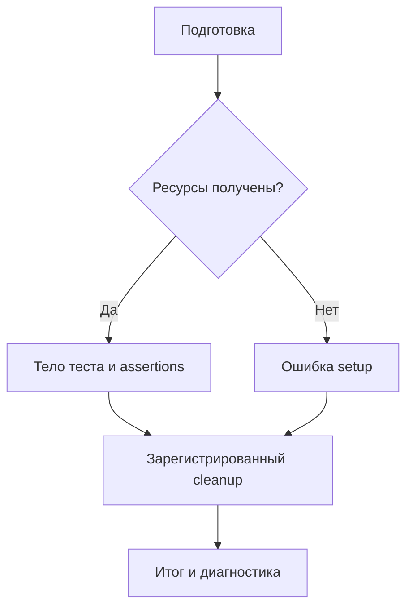

# 13. Тестирование

Хороший тест фиксирует важное свойство программы и объясняет, какое поведение нарушилось. Он помогает менять реализацию без потери контракта, воспроизводить ошибки и проверять предположения о внешних системах. Большое количество тестов само по себе не означает, что программа надёжна: важны сценарии, независимость проверок и качество ожидаемого результата.

Эта глава проходит путь от первого unit-теста до тестовой стратегии сервиса или библиотеки: pytest и unittest, фикстуры, моки, покрытие, асинхронность, конкурентность, интеграции, безопасность, CI, генеративные и контрактные проверки. В конце находится самостоятельный проект: пакет загрузки событий в SQLite с идемпотентностью и атомарностью партии.

**Как запускать примеры.** Базовая версия — Python 3.12+. Блок с комментарием `# run: pytest` сохраните как `test_example.py` и запустите `python -m pytest -q test_example.py`. Обычные Python-блоки запускаются как скрипты. Отдельные примеры с `# run: external` требуют указанного приложения, браузера или другой инфраструктуры; это явно отмечено рядом. Примеры разных пунктов независимы и не предполагают объединения всех определений в один модуль.

Для основных примеров используйте отдельное окружение:

```bash
python -m venv .venv
source .venv/bin/activate
# В PowerShell: .venv\Scripts\Activate.ps1
python -m pip install "pytest==9.1.1" "pytest-mock==3.17.0" "pytest-asyncio==1.4.0" "pytest-cov==7.1.0" "coverage==7.16.2" "pytest-xdist==3.8.0" "hypothesis==6.170.1" "Faker==40.43.0" "httpx==0.28.1"
```

Версии закреплены для воспроизводимости этой главы. Дополнительные зависимости для веб-фреймворков и браузерных сценариев указаны в соответствующих пунктах. Не переносите большой набор тестовых зависимостей в runtime-окружение приложения без необходимости.

Для всех локальных примеров с дополнительными библиотеками ниже:

```bash
python -m pip install "Django==6.1.2" "Flask==3.1.3" "fastapi==0.147.0" "starlette==1.9.0" "httpx2==2.14.0" "jsonschema==4.26.0" "pytest-benchmark==5.3.0"
```

**Содержание**

1. [Введение в тестирование](#introduction)
2. [Модуль unittest](#unittest)
3. [Библиотека pytest](#pytest)
4. [Моки (Mocking)](#mocking)
5. [Покрытие кода (Code Coverage)](#coverage)
6. [Тестирование конфигурации и окружения](#configuration-and-environment)
7. [Тестирование исключений](#exceptions)
8. [Тестирование асинхронного кода](#async-testing)
9. [Тестирование конкурентного кода](#concurrency)
10. [Интеграционное тестирование](#integration)
11. [Функциональное и end-to-end тестирование](#functional-and-e2e)
12. [Нагрузочное тестирование](#load-testing)
13. [Тестирование безопасности (Security Testing)](#security)
14. [Тестирование в CI/CD](#ci-cd)
15. [Фикстуры и тестовые данные](#fixtures-and-data)
16. [Детерминированность и независимость тестов](#determinism)
17. [Отладка и диагностика тестов](#debugging)
18. [Тестирование разных типов приложений](#application-types)
19. [Продвинутые техники тестирования](#advanced-techniques)
20. [Организация тестов в проекте](#test-organization)
21. [Лучшие практики тестирования](#best-practices)

<a id="introduction"></a>

## Введение в тестирование

### Зачем нужно тестирование

Тест связывает условия, действие и наблюдаемый результат. Он особенно ценен там, где ошибка дорого обходится или её трудно заметить: повторная обработка события, пропуск строки, неверная авторизация, потеря транзакции, утечка фоновой задачи.

```python
# run: pytest
def partition_sizes(total: int, size: int) -> list[int]:
    if total < 0 or size <= 0:
        raise ValueError("Некорректные размеры")
    full, tail = divmod(total, size)
    return [size] * full + ([tail] if tail else [])


def test_partition_preserves_all_records() -> None:
    # Arrange: партия не делится на размер чанка без остатка.
    total = 10
    # Act
    result = partition_sizes(total, 4)
    # Assert: порядок и последний неполный чанк входят в контракт.
    assert result == [4, 4, 2]
    assert sum(result) == total
```

Ожидаемый результат — **oracle**, источник истины для проверки. Он может происходить из спецификации, независимой модели, известного эталона или свойства данных. Если тест вычисляет ожидание тем же алгоритмом, который проверяет, обе реализации могут повторить одну ошибку.

Тесты дают свидетельства для проверенных сценариев, но не математическое доказательство отсутствия всех ошибок. Отдельно нужны разумный дизайн, review, статический анализ, наблюдаемость и проверка поведения в эксплуатации.

### Виды тестов

Слова «unit», «integration» и «E2E» описывают границы проверки; «security», «performance» и «accessibility» — проверяемые свойства. Эти классификации пересекаются.

| Вид | Граница | Пример |
| --- | --- | --- |
| Unit | Небольшая единица поведения с управляемыми зависимостями | Расчёт разбиения партии |
| Компонентный | Компонент через публичный интерфейс | HTTP-приложение с локальными адаптерами |
| Интеграционный | Реальная граница между частями | Репозиторий и настоящий PostgreSQL |
| Контрактный | Согласованное взаимодействие сторон | Формат события и семантика ошибок |
| E2E | Целый пользовательский путь через выбранные границы | Отправка формы и появление записи |
| Регрессионный | Воспроизведение ранее найденной ошибки | Повторный импорт не создаёт дубликат |
| Нефункциональный | Производительность и другие свойства | Ограничение памяти при большой партии |

Unit-тест не обязан проверять ровно один метод или всегда использовать моки. Проверка чистой функции может быть полностью настоящей. Тест HTTP через in-process client проверяет приложение, но не реальный TCP, TLS и reverse proxy.

При описании теста полезнее указать реальные зависимости, чем спорить о названии категории.

### Пирамида тестирования

Пирамида — ориентир по стоимости обратной связи: много быстрых проверок, достаточно проверок важных интеграций и небольшой набор дорогих сквозных сценариев.

| Уровень | Сильная сторона | Типичная цена |
| --- | --- | --- |
| Быстрые локальные тесты | Быстро находят нарушение конкретного правила | Ограниченная уверенность в интеграции |
| Интеграционные тесты | Проверяют настоящие адаптеры и протоколы | Подготовка ресурсов и изоляция |
| E2E | Проверяют связность пользовательского пути | Медленные, более трудная диагностика |

Проценты не универсальны. Для SQL-репозитория реальные проверки базы могут давать больше пользы, чем десятки моков курсора. Для библиотеки алгоритмов основу составят unit- и property-based-тесты. Для фронтенда важны компонентные и браузерные сценарии.

Выбирайте минимальную границу, на которой можно обнаружить интересующую ошибку, и дополняйте её проверкой критических реальных интеграций.

### TDD (Test-Driven Development)

Цикл TDD: сформулировать небольшое требование → получить ожидаемое падение → реализовать достаточно кода для прохождения → улучшить структуру с сохранением поведения.

```python
# run: pytest
import pytest


def retry_delay(attempt: int, cap: int = 8) -> int:
    if attempt < 0 or cap <= 0:
        raise ValueError("Некорректный аргумент")
    return min(2 ** min(attempt, cap.bit_length()), cap)


@pytest.mark.parametrize("attempt, expected", [(0, 1), (1, 2), (3, 8), (1000, 8)])
def test_retry_delay_is_capped(attempt: int, expected: int) -> None:
    assert retry_delay(attempt) == expected


def test_retry_delay_rejects_negative_attempt() -> None:
    with pytest.raises(ValueError):
        retry_delay(-1)
```

Падение должно происходить из-за отсутствующего поведения. Синтаксическая ошибка, неверный импорт или неподготовленная база не подтверждают, что тест чувствителен к нужному дефекту.

TDD полезен для небольших определённых правил. Исследование нового API или производительности иногда требует прототипа до теста. Это не отменяет необходимости затем зафиксировать найденный контракт.

### BDD (Behavior-Driven Development)

BDD делает акцент на совместном понимании поведения через примеры. Формат Given–When–Then помогает отделить условия, действие и наблюдаемый эффект.

```gherkin
Feature: Повторная загрузка событий
  Scenario: Повтор той же партии
    Given в хранилище уже есть событие event_42 со значением 3
    When загрузчик получает event_42 с тем же потоком и значением
    Then число сохранённых событий не меняется
    And результат сообщает об одном дубликате
```

Gherkin и инструменты вроде behave или pytest-bdd — возможная автоматизация, а не обязательная часть BDD. Обычный pytest-тест также может выражать понятный бизнес-сценарий.

Не описывайте шаги через клики и внутренние методы, если правило относится к предметной области. «Повтор не создаёт событие» устойчивее, чем «вызвать repository.insert три раза».

<a id="unittest"></a>

## Модуль unittest

### Основы unittest

`unittest` входит в стандартную библиотеку. Тесты оформляются методами `test_*` в наследниках `unittest.TestCase`.

```python
import unittest


def normalize_name(value: str) -> str:
    return value.strip().casefold()


class NameTests(unittest.TestCase):
    def test_normalizes_whitespace_and_case(self) -> None:
        self.assertEqual(normalize_name("  Orders  "), "orders")

    def test_keeps_inner_spaces(self) -> None:
        self.assertEqual(normalize_name("Daily Orders"), "daily orders")


if __name__ == "__main__":
    unittest.main()
```

Каждый тест должен возвращать `None`. Новый экземпляр `TestCase` для метода не гарантирует изоляцию глобальных переменных, файлов, базы и внешнего сервиса: ими всё равно нужно управлять.

### Assert-методы

Выбирайте утверждение, которое лучше описывает ожидаемое отношение.

| Метод | Назначение |
| --- | --- |
| `assertEqual` | Равенство значений и содержимого |
| `assertIs`, `assertIsNone` | Идентичность, отсутствие объекта |
| `assertIn`, `assertNotIn` | Принадлежность |
| `assertCountEqual` | Одинаковые элементы с учётом кратности, без порядка |
| `assertAlmostEqual` | Приближённое числовое сравнение |
| `assertRaises` | Исключение |
| `assertLogs` | Записи logging |
| `assertWarns` | Предупреждение |

```python
import unittest


class AssertionTests(unittest.TestCase):
    def test_collection_contract(self) -> None:
        self.assertCountEqual(["a", "b", "a"], ["a", "a", "b"])
        self.assertNotEqual(["a", "b"], ["b", "a"])
        self.assertAlmostEqual(0.1 + 0.2, 0.3)
        self.assertIsNone({"a": 1}.get("missing"))


if __name__ == "__main__":
    unittest.main()
```

Если порядок важен, `assertCountEqual` скрывает ошибку. Если сравниваете деньги или целые счётчики, приближённое сравнение может быть неуместно. Утверждение должно следовать контракту данных.

### Фикстуры (Fixtures) в unittest

`setUp` выполняется перед каждым тестом, `tearDown` — после успешно завершившегося `setUp`. Если подготовка падает посередине, обычный `tearDown` не спасает уже созданные ресурсы. Регистрируйте cleanup сразу после получения ресурса.

```python
import sqlite3
import unittest


class DatabaseTests(unittest.TestCase):
    def setUp(self) -> None:
        self.connection = sqlite3.connect(":memory:")
        self.addCleanup(self.connection.close)
        self.connection.execute("CREATE TABLE items (name TEXT NOT NULL)")

    def test_insert(self) -> None:
        self.connection.execute("INSERT INTO items VALUES (?)", ("orders",))
        rows = self.connection.execute("SELECT name FROM items").fetchall()
        self.assertEqual(rows, [("orders",)])

    def test_new_test_has_no_rows(self) -> None:
        rows = self.connection.execute("SELECT name FROM items").fetchall()
        self.assertEqual(rows, [])


if __name__ == "__main__":
    unittest.main()
```

Есть также `setUpClass`, `tearDownClass`, `addClassCleanup` и модульные фикстуры. Общий дорогой ресурс ускоряет suite, но разделяемое изменяемое состояние увеличивает риск зависимости от порядка. Для нескольких ресурсов удобен `contextlib.ExitStack` и немедленная регистрация закрытия.

### Пропуск тестов

Skip означает «сценарий не выполнен», а не «свойство подтверждено». Указывайте конкретную причину.

```python
import os
import unittest


class PlatformTests(unittest.TestCase):
    @unittest.skipUnless(os.name == "posix", "Проверка интерфейса POSIX")
    def test_posix_path_separator(self) -> None:
        self.assertEqual(os.sep, "/")


if __name__ == "__main__":
    unittest.main()
```

`expectedFailure` предназначен для известного дефекта с ожидаемым падением. Не превращайте его в бессрочное хранилище сломанных тестов. Причина, ссылка на задачу и срок пересмотра помогают отличить временную блокировку от отсутствующей проверки.

### Подтесты (subTest)

Подтесты позволяют проверить несколько входов в рамках одного метода и получить информацию о конкретном наборе параметров.

```python
import unittest


class ChunkCountTests(unittest.TestCase):
    def test_counts(self) -> None:
        cases = [(0, 4, 0), (1, 4, 1), (8, 4, 2), (9, 4, 3)]
        for total, size, expected in cases:
            with self.subTest(total=total, size=size):
                self.assertEqual((total + size - 1) // size, expected)


if __name__ == "__main__":
    unittest.main()
```

Это по-прежнему один тестовый метод с общей подготовкой. В pytest параметризация обычно создаёт отдельные test items, которые можно отдельно выбрать и распределить по worker-процессам. Для сложных сценариев не скрывайте половину suite в большом цикле.

### Загрузка и запуск тестов

```bash
python -m unittest discover -s tests -p "test_*.py" -v
python -m unittest tests.test_parser.ParserTests.test_empty_input
python -m unittest discover -s tests -k parser -f
```

Эти команды предполагают существующую структуру проекта. `-f` останавливает запуск после первой ошибки, `-k` отбирает имена. Конкретный модуль должен импортироваться из ожидаемого окружения.

Обнаружение тестов использует импорт: модульный код выполняется уже на этапе collection. Не запускайте при импорте реальные миграции, сетевые вызовы и загрузку production-конфигурации.

Правила discovery namespace-пакетов менялись между версиями Python. Для переносимого простого проекта используйте обычные пакеты тестов с `__init__.py` либо явно проверяйте поддерживаемую схему discovery.

### Организация тестов в проекте

Отделяйте runtime-код от тестов, а тесты — по наблюдаемой области поведения.

```text
src/sample_package/__init__.py
src/sample_package/parser.py
tests/__init__.py
tests/test_parser.py
tests/test_storage.py
pyproject.toml
```

Это перечень путей, которые нужно создать, а не готовый пакет. Для `src`-структуры установите проект в тестовое окружение. Проверка импортов из случайной рабочей директории может незаметно тестировать checkout вместо собранного пакета.

Не стройте сложную иерархию наследования `TestCase` ради нескольких строк подготовки. Общий helper или небольшая фабрика данных часто дают более понятную композицию.

<a id="pytest"></a>

## Библиотека pytest

### Введение в pytest

В pytest тест часто выглядит как обычная функция с `assert`. Фикстуры запрашиваются аргументами, а плагины расширяют запуск и отчётность.

```python
# run: pytest
import pytest


def parse_size(text: str) -> int:
    if not text.isascii() or not text.isdecimal():
        raise ValueError("Ожидаются ASCII-цифры")
    return int(text)


def test_parse_size() -> None:
    assert parse_size("2048") == 2048


def test_rejects_unicode_digits() -> None:
    with pytest.raises(ValueError):
        parse_size("２０４８")
```

Обычно обнаруживаются файлы `test_*.py` и `*_test.py`, функции `test_*` и классы `Test*` без собственного `__init__`. pytest также умеет запускать `unittest.TestCase`, но фикстуры-аргументы не внедряются в методы `TestCase` обычным pytest-способом.

### Assert в pytest

Pytest переписывает assert в собираемых тестовых модулях, чтобы показывать подробности сравнения. Поэтому `assert actual == expected` информативнее, чем предварительно спрятанное булево `ok`.

```python
# run: pytest
import pytest


def test_float_comparison_uses_explicit_tolerance() -> None:
    assert 0.1 + 0.2 == pytest.approx(0.3, rel=1e-12, abs=1e-12)


def test_structure_has_meaningful_fields() -> None:
    result = {"inserted": 2, "duplicates": 1}
    assert result == {"inserted": 2, "duplicates": 1}
    assert type(result["inserted"]) is int
```

`True == 1` в Python, поэтому иногда равенства недостаточно для проверки типа JSON-поля. Для floating point задавайте допуски из смысла расчёта, а не ради прохождения теста.

Assert в тестах не следует переносить в production-валидацию. Обычный `assert` в приложении может исчезнуть при `python -O`. Переписывание тестовых assert не делает такие проверки в runtime-коде надёжными.

### Фикстуры (Fixtures) в pytest

Фикстура описывает получение ресурса или данных. pytest строит граф зависимостей по именам параметров.

```python
# run: pytest
from collections.abc import Iterator
import sqlite3

import pytest


@pytest.fixture
def database() -> Iterator[sqlite3.Connection]:
    connection = sqlite3.connect(":memory:")
    try:
        connection.execute("CREATE TABLE events (event_id TEXT PRIMARY KEY)")
        yield connection
    finally:
        connection.close()


def test_unique_event_id(database: sqlite3.Connection) -> None:
    database.execute("INSERT INTO events VALUES (?)", ("e1",))
    with pytest.raises(sqlite3.IntegrityError):
        database.execute("INSERT INTO events VALUES (?)", ("e1",))
```

Здесь `finally` охватывает и подготовку до `yield`. В форме «создать несколько ресурсов, затем yield, затем закрыть» падение до `yield` не запускает код после него. Разделяйте получение ресурсов на небольшие фикстуры или используйте `ExitStack`.

Полезные встроенные фикстуры: `tmp_path`, `monkeypatch`, `capsys`, `capfd`, `caplog` и `request`. Явно запрашивайте зависимость; скрытый `autouse` удобен для общих инвариантов, но способен сделать тест непонятным вне своего окружения.

### Жизненный цикл и изоляция фикстур

Scope определяет время жизни: `function`, `class`, `module`, `package`, `session`. Это не глубина копирования объекта и не гарантия отсутствия общих внешних данных.

```python
# run: pytest
import pytest


@pytest.fixture
def names() -> list[str]:
    return []


def test_first_consumer(names: list[str]) -> None:
    names.append("orders")
    assert names == ["orders"]


def test_second_consumer_starts_empty(names: list[str]) -> None:
    assert names == []
```

По умолчанию каждый test item получает новый экземпляр function-scoped-фикстуры. В пределах одного теста повторные запросы той же фикстуры обычно получают тот же закэшированный объект.

Порядок инициализации зависит от scope, зависимостей и autouse, а не от порядка аргументов или расположения функций в файле. Teardown идёт в обратном порядке для успешно полученных ресурсов. Широкая фикстура не может обычным образом зависеть от более узкой: session-объект не должен держать ресурс только одного теста.

При xdist `session` означает сессию отдельного worker-процесса. Фикстура может выполниться несколько раз для одного распределённого запуска.

### Параметризация тестов

Параметризуйте классы эквивалентных сценариев и границы. Читаемые `ids` помогают выбрать упавший случай.

```python
# run: pytest
import pytest


@pytest.mark.parametrize(
    "total,size,expected",
    [
        pytest.param(0, 4, 0, id="empty"),
        pytest.param(1, 4, 1, id="partial"),
        pytest.param(8, 4, 2, id="exact"),
        pytest.param(9, 4, 3, id="tail"),
    ],
)
def test_chunk_count(total: int, size: int, expected: int) -> None:
    assert (total + size - 1) // size == expected
```

Параметризуются также фикстуры; `indirect=True` передаёт параметр в фикстуру через `request.param`. Комбинация нескольких декораторов создаёт декартово произведение, которое может неожиданно увеличить suite в сотни раз.

Изменяемые параметры не копируются автоматически. Если тест меняет переданный словарь или список, создавайте свежие данные фабрикой или копируйте на уровне, который соответствует структуре объекта.

### Маркеры (Markers)

Маркеры классифицируют тесты и управляют отдельными сценариями. Зарегистрируйте свои имена и включите строгую проверку, чтобы опечатка не превратилась в молча проигнорированную настройку.

```python
# run: pytest
import pytest


@pytest.mark.integration
def test_storage_contract_example() -> None:
    # Здесь реальная интеграция показана минимальным локальным действием.
    from pathlib import Path
    import tempfile

    with tempfile.TemporaryDirectory() as directory:
        path = Path(directory) / "event.txt"
        path.write_text("e1", encoding="utf-8")
        assert path.read_text(encoding="utf-8") == "e1"


@pytest.mark.xfail(reason="Учебный пример известного дефекта", strict=True)
def test_known_defect_is_visible() -> None:
    assert 1 + 1 == 3
```

`skip` не выполняет тело; `xfail` обычно выполняет и фиксирует ожидаемое падение. При `strict=True` неожиданное прохождение, XPASS, ломает запуск и заставляет пересмотреть ожидание.

Метка `integration` сама по себе не отключает тест. Выбор делается через `-m` или явную логику skip. Нельзя рассчитывать, что дорогой сценарий «помечен и поэтому не запускается».

### Конфигурация pytest

Для переносимости между версиями pytest удобна конфигурация `[tool.pytest.ini_options]` в `pyproject.toml`.

```toml
[tool.pytest.ini_options]
testpaths = ["tests"]
addopts = ["--strict-markers", "--strict-config", "--import-mode=importlib", "-ra"]
markers = [
    "unit: быстрые локальные проверки",
    "integration: реальные локальные адаптеры",
    "e2e: сквозные сценарии",
    "slow: дорогие проверки",
]
filterwarnings = ["error"]
asyncio_mode = "strict"
asyncio_default_fixture_loop_scope = "function"
asyncio_default_test_loop_scope = "function"
```

Последние три параметра требуют `pytest-asyncio`. Неизвестные параметры при `--strict-config` должны приводить к ошибке, поэтому установленные плагины и конфигурация проверяются вместе.

Режим `importlib` уменьшает неожиданное изменение `sys.path` при collection. Он не устанавливает ваш пакет: для `src`-структуры всё равно нужна установка. Конфигурационные файлы pytest не следует считать автоматически объединяемыми; проверьте выбранный `rootdir` и фактически загруженный файл.

Не добавляйте глобальное `ignore::Warning` ради зелёного suite. Для известного предупреждения используйте точное исключение или `pytest.warns` и заведите работу по устранению причины.

### Плагины pytest

Плагин меняет поведение тестового процесса: добавляет фикстуры, hooks, CLI-параметры, способы collection. Он является исполняемой зависимостью, а не только инструментом отчётности.

| Плагин | Возможность |
| --- | --- |
| pytest-mock | Фикстура `mocker` |
| pytest-asyncio | Async-тесты и loop lifecycle |
| pytest-cov | Coverage.py в запуске pytest |
| pytest-xdist | Несколько worker-процессов |
| pytest-benchmark | Измерения повторяемых операций |
| pytest-django | Управление окружением Django |
| pytest-playwright | Браузерные фикстуры Playwright |

```bash
python -m pytest --trace-config
python -m pytest -p no:cacheprovider
# Воспроизводимый запуск с отключённым автоматическим поиском плагинов:
PYTEST_DISABLE_PLUGIN_AUTOLOAD=1 python -m pytest -p pytest_asyncio.plugin -p pytest_mock
```

Последняя форма задаёт переменную окружения в POSIX-shell; в PowerShell используйте `$env:PYTEST_DISABLE_PLUGIN_AUTOLOAD="1"`. Нужные плагины при таком запуске подключаются явно.

Лишние установленные плагины могут объяснять различие между локальной машиной и CI. Закрепляйте тестовые зависимости и проверяйте их совместимость при обновлении pytest.

### Запуск тестов с pytest

```bash
python -m pytest
python -m pytest tests/test_parser.py::test_empty_input -q
python -m pytest -k "parser and not large" -x
python -m pytest -m "not e2e" --durations=10
python -m pytest --collect-only -q
python -m pytest --lf
python -m pytest --junitxml=artifacts/junit.xml
```

Команды с конкретными путями применяются к проекту, где такие тесты существуют. `--lf` использует кэш прошлых падений и удобен локально, но обычно не заменяет полный обязательный набор CI.

Код завершения `0` означает успешный запуск, `1` — падение тестов, `2` — прерывание, `3` — внутренняя ошибка pytest, `4` — ошибка использования, `5` — отсутствие собранных тестов. «Ничего не собралось» не следует незаметно считать успехом.

<a id="mocking"></a>

## Моки (Mocking)

### Введение в моки

Test double — замена зависимости в тесте. Полезно различать её роль:

| Вид | Роль |
| --- | --- |
| Dummy | Передаётся, но не используется в сценарии |
| Stub | Возвращает заранее заданный ответ |
| Spy | Записывает обращения, иногда вызывает реальную функцию |
| Mock | Позволяет проверить ожидаемые взаимодействия |
| Fake | Упрощённая работающая реализация |

Названия могут пересекаться в конкретной библиотеке. Смысл важнее терминологии: что именно подменено и какие реальные свойства поэтому не проверяются?

Мокируйте управляемую границу — часы, HTTP-клиент, отправку сообщения — когда сценарий относится к логике вызывающего кода. Не заменяйте все внутренние методы: тест, копирующий порядок реализации, мешает рефакторингу и часто пропускает ошибки интеграции.

### Модуль unittest.mock

`Mock` позволяет задавать ответы и проверять обращения. `MagicMock` дополнительно реализует многие специальные методы. `create_autospec` ограничивает интерфейс и проверяет сигнатуры.

```python
# run: pytest
from unittest.mock import create_autospec


class Sender:
    def send(self, topic: str, payload: bytes) -> None:
        raise NotImplementedError


def publish(sender: Sender, event_id: str) -> None:
    sender.send("events", event_id.encode("ascii"))


def test_publish_uses_protocol_contract() -> None:
    sender = create_autospec(Sender, instance=True, spec_set=True)
    publish(sender, "e1")
    sender.send.assert_called_once_with("events", b"e1")
```

Обычный `Mock` создаёт неизвестные атрибуты автоматически и может принять опечатку как новый интерфейс. `spec_set` запрещает произвольные атрибуты, `autospec` дополнительно моделирует доступные сигнатуры. Эти ограничения всё равно не доказывают, что реальная система принимает данный payload.

### patch — замена объектов

Подменяйте имя **в пространстве, где его ищет проверяемый код**. Если модуль сделал `from uuid import uuid4`, он хранит собственную ссылку `uuid4`.

```python
# run: pytest
from uuid import UUID, uuid4
from unittest.mock import patch


def new_key() -> str:
    return f"event_{uuid4().hex}"


def test_patches_the_consuming_module() -> None:
    fixed = UUID("00000000-0000-0000-0000-000000000042")
    with patch(f"{__name__}.uuid4", return_value=fixed, autospec=True) as generate:
        assert new_key() == "event_00000000000000000000000000000042"
    generate.assert_called_once_with()
```

Здесь `__name__` — имя самого тестового модуля, который содержит и учебную функцию. В реальном проекте подмена выглядела бы как `patch("package.service.uuid4")`, если lookup происходит в `package.service`.

Контекстный менеджер восстанавливает значение после выхода, включая исключение. Для постоянной работы `patcher.start()` обязательно регистрируйте `stop` через cleanup. Не оставляйте глобальную подмену следующему тесту.

### Точность мокирования

Проверяйте взаимодействия только тогда, когда они являются частью поведения: не отправлять секрет в запросе, повторить временную ошибку, не вызвать платёж повторно. Само число внутренних вызовов не всегда важно.

```python
# run: pytest
from unittest.mock import Mock


def read_with_one_retry(fetch) -> bytes:
    try:
        return fetch()
    except TimeoutError:
        return fetch()


def test_retry_only_after_timeout() -> None:
    fetch = Mock(side_effect=[TimeoutError("temporary"), b"ok"])
    assert read_with_one_retry(fetch) == b"ok"
    assert fetch.call_count == 2


def test_success_does_not_retry() -> None:
    fetch = Mock(return_value=b"ok")
    assert read_with_one_retry(fetch) == b"ok"
    fetch.assert_called_once_with()
```

`side_effect` может быть исключением, последовательностью или функцией. Добавьте тесты других исключений, исчерпания попыток и очистки ресурсов, если это часть реального контракта.

Возвращаемые моком коллекции и словари могут быть тем же изменяемым объектом для нескольких вызовов. Если код их меняет, используйте функцию, создающую свежий ответ, или намеренно проверяйте разделяемость.

### pytest-mock

Фикстура `mocker` предоставляет интерфейс подмен и снимает их после теста. Spy помогает наблюдать настоящую реализацию.

```python
# run: pytest
from pathlib import Path

from pytest_mock import MockerFixture


def load_text(path: Path) -> str:
    return path.read_text(encoding="utf-8")


def test_read_uses_real_file(tmp_path: Path, mocker: MockerFixture) -> None:
    path = tmp_path / "event.txt"
    path.write_text("e1", encoding="utf-8")
    spy = mocker.spy(Path, "read_text")
    assert load_text(path) == "e1"
    spy.assert_called_once_with(path, encoding="utf-8")
```

Такой spy-тест проверяет и результат настоящего чтения, и выбранный параметр кодировки. В обычном тесте результата проверка вызова `read_text` может быть лишней; здесь она показана как конкретный контракт адаптера.

Не используйте `mocker` как механизм объединения независимых тестов: lifecycle ограничен test item, а состояние приложения нужно изолировать отдельно.

### Продвинутое мокирование

Управляйте цепочками вызовов осторожно. Чем глубже настройка вроде `client.session.request().json()`, тем сильнее тест привязан к внутреннему устройству. Небольшой адаптер с одним понятным методом упрощает и код, и подмены.

```python
# run: pytest
from unittest.mock import Mock, call


def notify_all(send, names: list[str]) -> None:
    for name in names:
        send(name)


def test_keeps_required_notification_order() -> None:
    send = Mock()
    notify_all(send, ["accepted", "committed"])
    assert send.call_args_list == [call("accepted"), call("committed")]
```

`assert_has_calls` может допускать дополнительные вызовы до или после ожидаемой последовательности. Если нужна точная полная последовательность, сравнивайте `call_args_list`. `reset_mock` очищает историю, но по умолчанию не сбрасывает все настройки ответов и side effects.

Для файлов есть `mock_open`, для свойств — `PropertyMock`, для async — `AsyncMock`. Не используйте мок файла для проверки настоящих прав, атомарного переименования и поведения файловой системы.

### Альтернативы мокам

Часто зависимость лучше передать явно:

```python
from collections.abc import Callable
from datetime import UTC, datetime


def event_record(event_id: str, now: Callable[[], datetime]) -> dict[str, str]:
    timestamp = now()
    if timestamp.tzinfo is None or timestamp.utcoffset() is None:
        raise ValueError("Нужен aware datetime")
    return {"event_id": event_id, "received_at": timestamp.astimezone(UTC).isoformat()}


fixed = datetime(2024, 2, 29, 12, tzinfo=UTC)
assert event_record("e1", lambda: fixed) == {
    "event_id": "e1",
    "received_at": "2024-02-29T12:00:00+00:00",
}
```

Другие варианты: in-memory fake репозитория, настоящий временный файл, SQLite для SQLite-адаптера, HTTP transport с управляемым ответом, локальный контейнер настоящей базы.

Fake полезно прогонять через общий контракт вместе с реальной реализацией. Иначе fake постепенно начинает позволять то, что реальный сервис запрещает. SQLite не является полной заменой PostgreSQL для проверки SQL-диалекта, блокировок и изоляции.

<a id="coverage"></a>

## Покрытие кода (Code Coverage)

### Что такое покрытие кода

Coverage измеряет, какие участки программы исполнялись при наблюдаемом запуске. Он помогает находить непроверенные пути, но не оценивает правильность утверждений.

| Метрика | Что показывает | Чего не гарантирует |
| --- | --- | --- |
| Statement/line coverage | Выполненные инструкции или строки | Проверку результата |
| Branch coverage | Пройденные варианты переходов | Все комбинации условий |
| Condition coverage | Значения отдельных условий | Все сочетания и порядки событий |
| Mutation score | Способность тестов замечать изменения кода | Полноту спецификации |

Coverage.py различает statements и ветви; не стоит автоматически называть его branch coverage полноценным MC/DC или полным condition coverage.

Тест может вызвать функцию, игнорировать результат и получить 100% покрытия строк. Отсутствующие проверки порядка, типов и недопустимого ввода при этом останутся незамеченными.

### Модуль coverage.py

Стандартная схема запуска — выполнить тесты под coverage, затем сформировать отчёт. Ниже самостоятельный эксперимент с намеренно непокрытой ветвью:

```python
import json
from pathlib import Path
import subprocess
import sys
import tempfile

with tempfile.TemporaryDirectory() as directory:
    root = Path(directory)
    program = root / "sample.py"
    program.write_text(
        "def classify(value):\n"
        "    if value < 0:\n"
        "        return 'negative'\n"
        "    if value == 0:\n"
        "        return 'zero'\n"
        "    return 'positive'\n"
        "assert classify(-1) == 'negative'\n"
        "assert classify(1) == 'positive'\n",
        encoding="utf-8",
    )
    data = root / ".coverage"
    report = root / "coverage.json"
    subprocess.run(
        [
            sys.executable,
            "-m",
            "coverage",
            "run",
            "--branch",
            f"--data-file={data}",
            str(program),
        ],
        cwd=root,
        check=True,
    )
    subprocess.run(
        [
            sys.executable,
            "-m",
            "coverage",
            "json",
            f"--data-file={data}",
            "-o",
            str(report),
        ],
        cwd=root,
        check=True,
        capture_output=True,
    )
    measured = next(iter(json.loads(report.read_text())["files"].values()))
    assert measured["missing_lines"]
    assert measured["summary"]["num_branches"] > 0
    assert measured["summary"]["percent_covered"] < 100
```

Для проекта явно задайте измеряемый пакет через `source` или `--source`. Иначе легко получить отчёт только по импортированным модулям и не заметить файл, который тесты вообще не загрузили.

`coverage report -m` показывает пропуски в терминале, `coverage html` — подробный локальный отчёт, `coverage xml` и JSON удобны для CI. Отчёты по разным запускам нельзя произвольно склеивать без согласованной конфигурации.

### pytest-cov

Плагин интегрирует измерение с запуском pytest:

```bash
python -m pytest --cov=sample_package --cov-branch --cov-report=term-missing
python -m pytest --cov=sample_package --cov-branch --cov-report=xml:artifacts/coverage.xml
python -m pytest --cov=sample_package --cov-report=html:artifacts/htmlcov --cov-fail-under=90
```

Здесь `sample_package` — имя измеряемого пакета, который должен существовать в проекте. Порог 90 — пример командной настройки, а не универсальный критерий качества.

Покрытие дочернего CLI-процесса требует отдельного внимания. В pytest-cov 7 прежняя автоматическая поддержка subprocess удалена; для современных версий Coverage.py используется настройка `patch = ["subprocess"]`. Такая настройка и объединение данных должны быть проверены на фактическом способе запуска процессов.

Не утверждайте, что CLI покрыт в родительском процессе только потому, что `subprocess.run` был выполнен внутри теста.

### Анализ покрытия

Начинайте с смысла непроверенных путей: отрицательный ввод, отказ зависимости, rollback, timeout, отсутствие разрешения, освобождение ресурса. Не добавляйте бессодержательный вызов функции ради окрашенной строки.

Условие `if a and b` может иметь важные комбинации: `False/False`, `False/True`, `True/False`, `True/True`. Branch coverage не следует без проверки считать доказательством всех этих случаев.

```python
# run: pytest
import pytest


def may_publish(authenticated: bool, has_scope: bool) -> bool:
    return authenticated and has_scope


@pytest.mark.parametrize(
    "authenticated,has_scope,expected",
    [
        (False, False, False),
        (False, True, False),
        (True, False, False),
        (True, True, True),
    ],
)
def test_both_requirements_are_mandatory(
    authenticated: bool, has_scope: bool, expected: bool
) -> None:
    assert may_publish(authenticated, has_scope) is expected
```

Мутация `and` в `or` должна быть замечена этим набором. Если утверждение проверяло бы только успешный случай, обе реализации прошли бы тест.

### Интерпретация результатов покрытия

100% строк полезны как информация о достигнутых участках, но не означают:

- правильный oracle и достаточные утверждения;
- проверку всех размеров, типов и Unicode-значений;
- корректность транзакций и конкурентных interleavings;
- совместимость с настоящей внешней системой;
- отсутствие уязвимостей и регрессий производительности.

Исключения вроде `# pragma: no cover` требуют обоснования. Не исключайте неудобный код обработки ошибок только потому, что его трудно запустить: возможно, именно этот код стоит перепроектировать для управляемого fault injection.

Смотрите на изменение покрытия и риск изменённого кода. Большой старый модуль не должен скрывать отсутствие тестов новой критической ветви за высоким общим процентом.

### Интеграция с CI/CD

Измеряйте согласованный набор тестов и сохраняйте machine-readable отчёт вместе с версией исходного кода. Для шардов и worker-процессов используйте механизм объединения соответствующего инструмента.

Coverage-порог обычно является одним из gates: рядом остаются успешные тесты, статические проверки и проверки критических контрактов. Снижение порога не исправляет падение теста.

Различайте «тесты завершились с ошибкой» и «отчёт не сформирован». Шаг загрузки артефактов запускайте и при падении, но обязательный test step не должен получать `continue-on-error` ради зелёного статуса.

<a id="configuration-and-environment"></a>

## Тестирование конфигурации и окружения

### Тестирование с разными настройками

Конфигурацию удобнее разбирать явной функцией, чем читать переменные окружения при импорте. Тогда можно проверить значения, ошибки и взаимодействие настроек без перезагрузки модулей.

```python
# run: pytest
from dataclasses import dataclass
from collections.abc import Mapping

import pytest


@dataclass(frozen=True)
class Settings:
    batch_size: int
    dry_run: bool


def load_settings(env: Mapping[str, str]) -> Settings:
    size = int(env.get("BATCH_SIZE", "100"))
    flag = env.get("DRY_RUN", "false").casefold()
    if not 1 <= size <= 10000 or flag not in {"true", "false"}:
        raise ValueError("Некорректная конфигурация")
    return Settings(size, flag == "true")


def test_defaults() -> None:
    assert load_settings({}) == Settings(100, False)


@pytest.mark.parametrize(
    "env", [{"BATCH_SIZE": "0"}, {"DRY_RUN": "yes"}, {"BATCH_SIZE": "x"}]
)
def test_rejects_invalid_configuration(env: dict[str, str]) -> None:
    with pytest.raises(ValueError):
        load_settings(env)
```

Проверяйте приоритеты: значения по умолчанию, файл, env, аргументы CLI. Если две настройки несовместимы, отдельный тест должен фиксировать ошибку, а не случайный порядок их применения.

### Переменные окружения в тестах

`monkeypatch` восстанавливает изменения env после теста. Не полагайтесь на содержимое окружения машины разработчика.

```python
# run: pytest
import os

import pytest


def endpoint() -> str:
    return os.environ.get("SERVICE_ENDPOINT", "http://localhost")


def test_explicit_endpoint(monkeypatch: pytest.MonkeyPatch) -> None:
    monkeypatch.setenv("SERVICE_ENDPOINT", "http://service.test")
    assert endpoint() == "http://service.test"


def test_default_endpoint(monkeypatch: pytest.MonkeyPatch) -> None:
    monkeypatch.delenv("SERVICE_ENDPOINT", raising=False)
    assert endpoint() == "http://localhost"
```

Env принадлежит всему процессу. Такие изменения не изолированы от параллельных потоков этого же процесса. Xdist использует отдельные процессы, но внешние файлы и сервисы по-прежнему могут быть общими.

Для subprocess можно передать отдельный `env`. Не очищайте все переменные без необходимости: дочернему интерпретатору могут быть нужны системные настройки. Управляйте только необходимыми ключами и не печатайте env с секретами в диагностике.

### Тестирование conditional logic

Таблица решений помогает увидеть комбинации, которые пропускает один happy path. Отдельно проверяйте границы и короткое замыкание.

```python
# run: pytest
from unittest.mock import Mock


def can_read(enabled: bool, authorize) -> bool:
    return enabled and authorize()


def test_disabled_feature_does_not_call_authorization_provider() -> None:
    authorize = Mock(side_effect=RuntimeError("Не должен вызываться"))
    assert can_read(False, authorize) is False
    authorize.assert_not_called()
```

Для более сложных условий не пытайтесь покрыть все сочетания вслепую. Найдите независимые правила, классы эквивалентности и наиболее рискованные взаимодействия. Если вариантов слишком много, это повод упростить конфигурационную модель.

### Тестирование feature flags

У флага важны оба режима, безопасное значение по умолчанию, совместимость данных и поведение при недоступности провайдера.

```python
# run: pytest
import pytest


def choose_batch_size(new_batching: bool, configured_size: int) -> int:
    if configured_size <= 0:
        raise ValueError("Размер должен быть положительным")
    return configured_size if new_batching else 1


@pytest.mark.parametrize("enabled, expected", [(False, 1), (True, 100)])
def test_both_flag_states(enabled: bool, expected: int) -> None:
    assert choose_batch_size(enabled, 100) == expected
```

Флаг rollout не должен обходить авторизацию, валидацию входа или обязательные инварианты. Если флаг меняет формат записи, проверьте чтение старых и новых данных во время смешанного развёртывания и отката.

Стабильно включённый флаг следует удалить вместе с устаревшей ветвью и её временными тестами, сохранив проверки действующего поведения.

<a id="exceptions"></a>

## Тестирование исключений

### Проверка исключений в unittest

Ограничивайте контекст операцией, которая должна упасть. Не помещайте всю подготовку в `assertRaises`: тест может пройти из-за ошибки в setup.

```python
import unittest


def require_positive(value: int) -> int:
    if value <= 0:
        raise ValueError("value must be positive")
    return value


class PositiveTests(unittest.TestCase):
    def test_rejects_zero(self) -> None:
        with self.assertRaisesRegex(ValueError, r"^value must be positive$"):
            require_positive(0)


if __name__ == "__main__":
    unittest.main()
```

`assertRaises` принимает и подклассы указанного исключения. Если точный тип является контрактом, проверьте `type(caught.exception)` отдельно. Не сравнивайте весь нестабильный системный текст ошибки, если достаточно типа и собственного поля.

### Проверка исключений в pytest

`pytest.raises` проверяет тип и при необходимости regex для сообщения.

```python
# run: pytest
import re

import pytest


def reject_name(name: str) -> None:
    raise ValueError(f"Unknown name: {name}")


def test_message_is_treated_as_regex() -> None:
    expected = "Unknown name: a+b"
    with pytest.raises(ValueError, match="^" + re.escape(expected) + "$") as caught:
        reject_name("a+b")
    assert type(caught.value) is ValueError
```

Параметр `match` — регулярное выражение, а не буквальная строка. После строки, выбрасывающей исключение, код внутри того же `with` не выполнится. Проверки состояния после ошибки располагайте после контекстного блока.

### Тестирование пользовательских исключений

Тип и структурированные поля часто стабильнее текста сообщения.

```python
# run: pytest
import pytest


class InvalidRecord(ValueError):
    def __init__(self, line_number: int, code: str) -> None:
        self.line_number = line_number
        self.code = code
        super().__init__(f"line {line_number}: {code}")


def test_structured_error() -> None:
    with pytest.raises(InvalidRecord) as caught:
        raise InvalidRecord(7, "missing_event_id")
    assert caught.value.line_number == 7
    assert caught.value.code == "missing_event_id"
```

Для CLI или HTTP отдельно проверяйте преобразование исключения в код завершения или response: формат ответа, отсутствие частичного успеха, допустимые диагностические поля.

Ошибка с чувствительным входом не должна автоматически копировать весь payload в сообщение, которое попадёт в логи или артефакты CI.

### Тестирование цепочек исключений (raise from)

Причина ошибки помогает диагностике, а внешний тип сохраняет предметный интерфейс.

```python
# run: pytest
import pytest


class ConfigurationError(ValueError):
    pass


def parse_limit(text: str) -> int:
    try:
        return int(text)
    except ValueError as error:
        raise ConfigurationError("invalid limit") from error


def test_preserves_explicit_cause() -> None:
    with pytest.raises(ConfigurationError) as caught:
        parse_limit("bad")
    assert isinstance(caught.value.__cause__, ValueError)
    assert caught.value.__suppress_context__ is True
```

`raise ... from None` скрывает контекст в обычном traceback, но не удаляет магически все ссылки на исходную ошибку из объекта. Политика публичной диагностики и внутренней причины — разные решения.

Для `ExceptionGroup` в async-коде учитывайте все вложенные ошибки. Проверка «в группе встречается ValueError» не доказывает отсутствие дополнительных неожиданных исключений.

### Тестирование предупреждений (warnings)

Предупреждение не равно исключению, но test runner может сделать его ошибкой через фильтр.

```python
# run: pytest
import warnings

import pytest


def old_name() -> str:
    warnings.warn("use new_name", DeprecationWarning, stacklevel=2)
    return "ok"


def test_deprecation_is_explicit() -> None:
    with pytest.warns(DeprecationWarning, match="^use new_name$") as captured:
        assert old_name() == "ok"
    assert len(captured) == 1
```

Проверяйте категорию, смысл сообщения и при необходимости место вызова. Фильтры warnings и реестры предупреждений могут влиять на повторный показ, поэтому тест должен явно управлять условиями захвата.

При переходе на новую версию Python warnings помогают заранее увидеть будущую несовместимость. Исключения из политики «warnings as errors» делайте точными и объяснимыми.

<a id="async-testing"></a>

## Тестирование асинхронного кода

### Проблемы тестирования асинхронного кода

Создать coroutine object — ещё не выполнить корутину. Async-тест должен дождаться результата, проверить исключения и завершить принадлежащие ему задачи. Иначе тест может пройти раньше, чем сломается фоновая работа.

Важные границы: event loop, срок жизни клиента, cancellation, timeout, закрытие async generators и исключения задач. Объект, созданный в одном loop, не всегда допустимо использовать в другом.

Не используйте `asyncio.run` внутри уже работающего event loop теста. Sync-тест может вызвать `asyncio.run`, а `async def` под управлением плагина должен использовать `await`.

### pytest-asyncio

В strict-режиме async-тест отмечается `pytest.mark.asyncio`, async-фикстура — `pytest_asyncio.fixture`.

```python
# run: pytest
from collections.abc import AsyncIterator

import pytest
import pytest_asyncio


@pytest_asyncio.fixture
async def opened_resource() -> AsyncIterator[dict[str, bool]]:
    state = {"closed": False}
    try:
        yield state
    finally:
        state["closed"] = True


@pytest.mark.asyncio
async def test_async_fixture(opened_resource: dict[str, bool]) -> None:
    assert opened_resource["closed"] is False
```

Этот тест показывает использование ресурса; проверка teardown должна наблюдать состояние после выхода lifecycle, а не пытаться доказать закрытие до завершения теста. Для реального ресурса удобно отдельно тестировать сам async context manager.

В auto-режиме плагин автоматически берёт подходящие async-тесты и фикстуры; strict полезен при совместном использовании нескольких async-плагинов. Loop scope и fixture scope — связанные, но разные настройки. Loop должен жить не меньше обслуживаемой async-фикстуры; задавайте совместимые `loop_scope` и scope явно при общем ресурсе.

### unittest.IsolatedAsyncioTestCase

Стандартная библиотека тоже поддерживает async-тесты с отдельным loop на тест.

```python
import asyncio
import unittest


class AsyncTests(unittest.IsolatedAsyncioTestCase):
    async def asyncSetUp(self) -> None:
        self.queue: asyncio.Queue[str] = asyncio.Queue()
        self.addAsyncCleanup(self.clear_queue)

    async def clear_queue(self) -> None:
        while not self.queue.empty():
            self.queue.get_nowait()
            self.queue.task_done()

    async def test_roundtrip(self) -> None:
        await self.queue.put("e1")
        item = await self.queue.get()
        try:
            self.assertEqual(item, "e1")
        finally:
            self.queue.task_done()
        await self.queue.join()


if __name__ == "__main__":
    unittest.main()
```

Доступны `asyncSetUp`, `asyncTearDown` и `addAsyncCleanup`. Автоматическая уборка loop не заменяет проверку правильного завершения вашей задачи: cancellation в конце runner может замаскировать отсутствие штатного закрытия.

### Мокирование асинхронного кода

`AsyncMock` различает вызов, создающий awaitable, и фактический `await`. Для async-контракта проверяйте именно await.

```python
# run: pytest
from unittest.mock import AsyncMock

import pytest


async def read_status(fetch) -> str:
    payload = await fetch("e1")
    return payload["status"]


@pytest.mark.asyncio
async def test_async_dependency_is_awaited() -> None:
    fetch = AsyncMock(return_value={"status": "ready"})
    assert await read_status(fetch) == "ready"
    fetch.assert_awaited_once_with("e1")
```

`assert_called_once_with` не доказывает, что возвращённая корутина была ожидаема. Для async context manager отдельно настраиваются `__aenter__` и `__aexit__`, для async iterator — `__aiter__`.

Не считайте каждый метод async-клиента корутиной: у HTTP-библиотеки создание request context manager и чтение response могут иметь разные интерфейсы. Подмена должна соответствовать фактическому API.

### Тестирование asyncio.Queue, asyncio.Event и т.д.

Событие задаёт наблюдаемую точку готовности, очередь — передачу элемента. Ограниченный timeout нужен для диагностики зависания, а не для управления порядком через задержку.

```python
# run: pytest
import asyncio
from contextlib import suppress

import pytest


@pytest.mark.asyncio
async def test_consumer_processes_before_join_returns() -> None:
    queue: asyncio.Queue[str] = asyncio.Queue()
    ready = asyncio.Event()
    processed: list[str] = []

    async def consume() -> None:
        ready.set()
        item = await queue.get()
        try:
            processed.append(item.upper())
        finally:
            queue.task_done()

    task = asyncio.create_task(consume())
    try:
        async with asyncio.timeout(2):
            await ready.wait()
            await queue.put("e1")
            await queue.join()
            await task
        assert processed == ["E1"]
    finally:
        task.cancel()
        with suppress(asyncio.CancelledError):
            await task
```

`queue.join` следит за балансом `put` и `task_done`. Он не является подтверждением записи в удалённую базу и не переносит автоматически исключение consumer. Поэтому в примере также выполняется `await task`.

### Тестирование таймаутов и задержек

Для unit-теста retry-политики подменяйте sleep зависимостью и проверяйте требуемые задержки, не ожидая их в реальном времени. Отдельно проверяйте настоящую механику timeout.

```python
# run: pytest
import asyncio
from unittest.mock import AsyncMock, call

import pytest


async def wait_backoff(sleep) -> None:
    for delay in (1, 2, 4):
        await sleep(delay)


@pytest.mark.asyncio
async def test_delay_policy_without_real_waiting() -> None:
    sleep = AsyncMock()
    await wait_backoff(sleep)
    assert sleep.await_args_list == [call(1), call(2), call(4)]


@pytest.mark.asyncio
async def test_zero_budget_cancels_blocked_await() -> None:
    never = asyncio.Event()
    with pytest.raises(TimeoutError):
        async with asyncio.timeout(0):
            await never.wait()
```

Подмена sleep проверяет политику, но не фактическое ожидание. Проверка времени на обычном CI не должна требовать точного интервала вроде «ровно 10.000 мс».

Различайте общий дедлайн, timeout одной попытки и число попыток. `asyncio.wait_for` ожидает обработку отмены, поэтому фактический возврат может занять больше указанного timeout. Блокирующая sync-функция в loop может задержать даже доставку отмены.

<a id="concurrency"></a>

## Тестирование конкурентного кода

### Управление порядком выполнения через события и барьеры

Конкурентный тест должен привести систему к нужному состоянию, а затем освободить следующий шаг. «Поспать 100 мс и надеяться» не задаёт требуемую последовательность.

```python
# run: pytest
from threading import Event, Thread


def test_thread_has_explicit_readiness_and_shutdown() -> None:
    ready = Event()
    stop = Event()
    completed = Event()

    def work() -> None:
        ready.set()
        try:
            stop.wait(5)
        finally:
            completed.set()

    thread = Thread(target=work)
    thread.start()
    try:
        assert ready.wait(2), "Worker не сообщил о готовности"
        assert not completed.is_set()
    finally:
        stop.set()
        thread.join(timeout=2)
    assert not thread.is_alive()
    assert completed.is_set()
```

Каждое блокирующее ожидание должно иметь контролируемый выход. После `join(timeout)` нужно проверить `is_alive`: сам возврат `join` не означает завершение потока.

### Проверка гонок данных

Гонка — отсутствие необходимого порядка или синхронизации, а не обязательное падение каждого запуска. Контролируемый interleaving помогает воспроизвести конкретную ошибку.

```python
# run: pytest
from concurrent.futures import ThreadPoolExecutor
from threading import Barrier


def test_demonstrates_lost_update_interleaving() -> None:
    state = {"value": 0}
    both_read = Barrier(2, timeout=2)

    def unsafe_increment() -> None:
        before = state["value"]
        both_read.wait()
        state["value"] = before + 1

    with ThreadPoolExecutor(max_workers=2) as pool:
        futures = [pool.submit(unsafe_increment) for _ in range(2)]
        for future in futures:
            future.result(timeout=3)
    # Ожидаем именно воспроизведённый дефект: два увеличения дали один.
    assert state["value"] == 1
```

Это демонстрация испорченного алгоритма, а не корректный счётчик. Исправление должно защищать весь read–modify–write одним lock либо использовать другой атомарный протокол.

GIL не делает составную операцию бизнес-уровня атомарной. Free-threaded-сборки требуют тех же явно сформулированных инвариантов; внутренней защиты структуры dict недостаточно для логики «прочитать, проверить, записать».

Один расписанный interleaving не покрывает все возможные. Дополняйте его моделью состояния, стресс-запусками в нужных сборках и review границ синхронизации.

### Проверка отмены

Проверяйте, что задача вошла в интересующую фазу, получила cancellation и выполнила cleanup.

```python
# run: pytest
import asyncio

import pytest


@pytest.mark.asyncio
async def test_cancellation_runs_cleanup() -> None:
    started = asyncio.Event()
    cleaned = asyncio.Event()

    async def worker() -> None:
        started.set()
        try:
            await asyncio.Event().wait()
        finally:
            cleaned.set()

    task = asyncio.create_task(worker())
    try:
        async with asyncio.timeout(2):
            await started.wait()
            task.cancel()
            with pytest.raises(asyncio.CancelledError):
                await task
        assert cleaned.is_set()
    finally:
        task.cancel()
        if not task.done():
            try:
                await task
            except asyncio.CancelledError:
                pass
```

`CancelledError` наследуется от `BaseException`, поэтому обычный `except Exception` её не ловит. Если cancellation перехвачена для уборки, её обычно нужно передать дальше.

Отмена asyncio-задачи, ожидающей `to_thread`, не гарантирует остановку уже выполняющейся функции в потоке. Такому worker нужен собственный протокол остановки или изоляция процессом.

### Проверка очистки ресурсов

Проверяйте наблюдаемое закрытие даже при ошибке внутри блока.

```python
# run: pytest
from collections.abc import AsyncIterator
from contextlib import asynccontextmanager

import pytest


@pytest.mark.asyncio
async def test_resource_closes_on_failure() -> None:
    trace: list[str] = []

    @asynccontextmanager
    async def resource() -> AsyncIterator[None]:
        trace.append("opened")
        try:
            yield
        finally:
            trace.append("closed")

    with pytest.raises(RuntimeError):
        async with resource():
            raise RuntimeError("operation failed")
    assert trace == ["opened", "closed"]
```

Для настоящих ресурсов проверяйте соответствующее свойство: соединение закрыто, транзакция завершена, файл можно удалить на целевой ОС, lock освобождён, задача не осталась pending.

Не подменяйте сам `close` на пустой Mock в тесте, который должен доказать фактическое освобождение ресурса. Проверка вызова и проверка эффекта — разные уровни.

### Проверка завершения потоков и процессов

Процесс можно завершить принудительно, но его всё равно нужно дождаться. Для переносимого примера используем `spawn`, явную передачу результата и закрытие каналов.

```python
from multiprocessing import get_context
from multiprocessing.connection import Connection


def child(send: Connection) -> None:
    try:
        send.send({"processed": 1})
    finally:
        send.close()


if __name__ == "__main__":
    context = get_context("spawn")
    receive, send = context.Pipe(duplex=False)
    process = context.Process(target=child, args=(send,))
    process.start()
    send.close()
    try:
        assert receive.poll(3), "Нет ответа дочернего процесса"
        assert receive.recv() == {"processed": 1}
        process.join(timeout=3)
        assert not process.is_alive()
        assert process.exitcode == 0
    finally:
        if process.is_alive():
            process.terminate()
            process.join(timeout=3)
        if process.is_alive():
            process.kill()
            process.join(timeout=3)
        receive.close()
        process.close()
```

Этот пример рассчитан на обычный файл, а не интерактивную ячейку: `spawn` должен импортировать доступную top-level-функцию. Проверки потоков и процессов нужны и на целевой платформе, поскольку способы запуска и семантика сигналов различаются.

Принудительное завершение не даёт гарантий выполнения `finally` в дочернем процессе. Целостность файлов, транзакций и внешних операций должна обеспечиваться их собственным протоколом.

### Проверка отсутствия оставшихся фоновых задач

Лучше владеть явным набором задач, чем после каждого теста отменять всё, что есть в loop, включая задачи самого фреймворка.

```python
# run: pytest
import asyncio

import pytest


@pytest.mark.asyncio
async def test_owned_tasks_finish_with_task_group() -> None:
    result: list[int] = []

    async def work(value: int) -> None:
        result.append(value)

    async with asyncio.TaskGroup() as group:
        owned = [group.create_task(work(value)) for value in range(3)]
    assert all(task.done() and not task.cancelled() for task in owned)
    assert sorted(result) == [0, 1, 2]
```

TaskGroup ограничивает время жизни дочерних задач блоком. При ошибке учитывайте cancellation соседей и возможный `ExceptionGroup`. Успех теста не должен зависеть от того, что test runner молча отменит забытые задачи на выходе.

### Почему случайные sleep() делают тесты нестабильными

`sleep` ничего не утверждает о готовности системы. На свободной машине он может оказаться избыточным, а под нагрузкой — недостаточным.

Заменяйте его наблюдаемым условием: событие готовности, состояние очереди, завершение Future, конкретный HTTP-ответ, видимость элемента в браузере. У ожидания должен быть общий дедлайн и диагностическое сообщение.

Короткий polling допустим, если API не предоставляет уведомления. Тогда задайте bounded retry, проверяемое условие и финальную ошибку. Не используйте безграничный цикл «подождать ещё чуть-чуть».

<a id="integration"></a>

## Интеграционное тестирование

### Что такое интеграционное тестирование

Интеграционный тест отвечает на вопрос, согласованы ли реальные интерфейсы частей: кодировка, схема SQL, формат JSON, таймауты, заголовки, транзакции и закрытие ресурсов.

Хороший интеграционный тест имеет управляемую среду, свою область данных и понятную уборку. Он не обязан обращаться к общедоступному production-сервису.

Тест через MockTransport полезен для клиентского адаптера, но не проверяет сокет и TLS. Тест через настоящий локальный HTTP-сервер проверяет больше транспорта, но не внешний load balancer. Указывайте границу честно.

### Тестирование работы с базами данных

Проверяйте ограничения, транзакции, запросы и ошибки на том движке, для которого написан адаптер.

```python
# run: pytest
from contextlib import closing
import sqlite3

import pytest


def test_failed_transaction_keeps_preexisting_data() -> None:
    with closing(sqlite3.connect(":memory:")) as connection:
        connection.execute("CREATE TABLE items (id TEXT PRIMARY KEY)")
        with connection:
            connection.execute("INSERT INTO items VALUES (?)", ("existing",))
        with pytest.raises(sqlite3.IntegrityError):
            with connection:
                connection.execute("INSERT INTO items VALUES (?)", ("new",))
                connection.execute("INSERT INTO items VALUES (?)", ("existing",))
        rows = connection.execute("SELECT id FROM items ORDER BY id").fetchall()
        assert rows == [("existing",)]
        assert connection.in_transaction is False
```

`with connection` управляет транзакцией, но не закрывает SQLite-соединение; поэтому используется `closing`. Это поведение не следует переносить на любой DB-driver без проверки.

Для PostgreSQL используйте отдельную тестовую БД, схему или контейнер. Откат вокруг каждого теста быстр, но может скрывать поведение реального commit, on-commit callbacks, других соединений и блокировок. Такие сценарии требуют специальных интеграционных тестов.

### Тестирование внешних API

На локальном уровне управляйте ответом транспорта и проверяйте то, что отправляет ваш адаптер.

```python
# run: pytest
import httpx


def test_http_adapter_request_and_response() -> None:
    def handler(request: httpx.Request) -> httpx.Response:
        assert request.method == "POST"
        assert request.url.path == "/events"
        assert request.headers["authorization"] == "Bearer test-token"
        assert request.content == b'{"event_id":"e1"}'
        return httpx.Response(201, json={"accepted": True})

    with httpx.Client(
        transport=httpx.MockTransport(handler), base_url="https://service.test"
    ) as client:
        response = client.post(
            "/events",
            json={"event_id": "e1"},
            headers={"authorization": "Bearer test-token"},
        )
        response.raise_for_status()
        assert response.json() == {"accepted": True}
```

Добавьте ответы 4xx/5xx, неправильный JSON, обязательные заголовки, временные ошибки и исчерпание retry. Повторяемость запроса должна учитывать идемпотентность операции.

Sandbox провайдера или отдельный контрактный запуск проверяет реальный API. Сохранённые HTTP-записи полезны как фикстуры, но могут устаревать и содержать секреты; очищайте их и задавайте политику обновления.

### Тестирование кэширования

Проверяйте hit, miss, TTL, инвалидирование и разделение ключей. Часы TTL должны быть управляемыми и обычно монотонными.

```python
# run: pytest
from unittest.mock import Mock


class Cache:
    def __init__(self, now, load, ttl: float) -> None:
        self.now, self.load, self.ttl = now, load, ttl
        self.values: dict[str, tuple[float, str]] = {}

    def get(self, key: str) -> str:
        entry = self.values.get(key)
        if entry is not None and self.now() < entry[0]:
            return entry[1]
        value = self.load(key)
        self.values[key] = (self.now() + self.ttl, value)
        return value


def test_expiration_at_exact_boundary() -> None:
    clock = [100.0]
    load = Mock(side_effect=["first", "second"])
    cache = Cache(lambda: clock[0], load, ttl=10)
    assert cache.get("e1") == "first"
    clock[0] = 109.999
    assert cache.get("e1") == "first"
    clock[0] = 110.0
    assert cache.get("e1") == "second"
    assert load.call_count == 2
```

Это учебный однопоточный кэш без ограничения памяти. Для настоящего кэша отдельно нужны размер, eviction, сериализация, negative caching и поведение при одновременном miss. In-memory fake не подтверждает семантику Redis.

### Тестирование очередей

У очереди важны не только put/get, но и подтверждение обработки, повторная доставка, дедупликация, порядок в пределах ключа, poison messages и остановка consumer.

Тестирующий producer и consumer через настоящий брокер должен дождаться наблюдаемого результата с дедлайном. «Очередь опустела» ещё не означает, что операция зафиксирована в целевом хранилище.

Для Kafka проверяйте offset, ключ партиционирования, повторы и границы транзакций отдельно. Для RabbitMQ — ack/nack, redelivery и dead-letter policy. Условия доставки задаются протоколом системы; вызов mocked `send` их не подтверждает.

Не используйте одну общую очередь для параллельных запусков. Выделяйте namespace по запуску и тесту, а уборку делайте ограниченной и проверяемой.

### Тестирование файловой системы

`tmp_path` даёт отдельный временный каталог. Проверяйте настоящее содержимое и необходимые метаданные.

```python
# run: pytest
from pathlib import Path


def test_utf8_roundtrip_and_no_extra_file(tmp_path: Path) -> None:
    destination = tmp_path / "events.txt"
    destination.write_text("Иса\n", encoding="utf-8", newline="\n")
    assert destination.read_bytes() == "Иса\n".encode("utf-8")
    assert [path.name for path in tmp_path.iterdir()] == ["events.txt"]
```

Для atomic replace, permissions, symlink, fsync и crash consistency нужны отдельные проверки на целевой ОС и файловой системе. Поведение Windows и POSIX может различаться, особенно для открытых файлов.

Fake-файловая система ускоряет тесты логики путей, но не доказывает реальные гарантии rename, блокировок и дисковой устойчивости.

### Тестирование сети

Локальный сервер на порту `0` получает свободный порт от ОС и уменьшает конфликты между тестами.

```python
# run: pytest
from http.server import BaseHTTPRequestHandler, ThreadingHTTPServer
from threading import Thread
from urllib.request import urlopen


def test_real_loopback_http() -> None:
    class Handler(BaseHTTPRequestHandler):
        def do_GET(self) -> None:
            payload = b'{"status":"ok"}'
            self.send_response(200)
            self.send_header("Content-Length", str(len(payload)))
            self.end_headers()
            self.wfile.write(payload)

        def log_message(self, format: str, *args) -> None:
            pass

    server = ThreadingHTTPServer(("127.0.0.1", 0), Handler)
    thread = Thread(target=server.serve_forever)
    thread.start()
    try:
        port = server.server_address[1]
        with urlopen(f"http://127.0.0.1:{port}/health", timeout=2) as response:
            assert response.status == 200
            assert response.read() == b'{"status":"ok"}'
    finally:
        server.shutdown()
        server.server_close()
        thread.join(timeout=2)
    assert not thread.is_alive()
```

Это настоящий loopback HTTP без TLS, DNS и внешнего сервиса. Для сетевых отказов полезны управляемый proxy или fault injection: разрыв соединения, задержка, частичный ответ, reset, неверный сертификат.

Не доказывайте устойчивость к сети только выброшенным вручную `TimeoutError`: так проверяется реакция кода на исключение, а не работа реального транспортного timeout.

<a id="functional-and-e2e"></a>

## Функциональное и end-to-end тестирование

### Что такое E2E-тесты

E2E проверяет выбранный пользовательский путь через несколько реальных границ. Например: отправить событие через API → дождаться обработки → прочитать результат публичным API. Для библиотеки такой границей может быть установленный пакет и его CLI.

Опишите, что в окружении настоящее, а что заменено. Browser-тест с mocked backend не проверяет всю цепочку сохранения данных, хотя хорошо проверяет UI. In-process API client не проверяет ingress.

Небольшой E2E-набор обычно охватывает критический happy path, отказ доступа и один значимый сценарий восстановления. Детальные комбинации удобнее проверять на более узкой границе.

### Selenium WebDriver

Selenium управляет настоящим браузером. Используйте устойчивые локаторы и ожидание наблюдаемого состояния.

**Нужны Selenium, установленный Chrome и совместимый driver.** Пример открывает локальный data URL и проверяет небольшой UI; он не обращается к чужому приложению.

```python
# run: external
from urllib.parse import quote

from selenium import webdriver
from selenium.webdriver.common.by import By
from selenium.webdriver.support import expected_conditions as conditions
from selenium.webdriver.support.ui import WebDriverWait

html = """
<button id="add" onclick="document.getElementById('count').textContent='1'">
  Add
</button><output id="count">0</output>
"""
options = webdriver.ChromeOptions()
options.add_argument("--headless=new")
driver = webdriver.Chrome(options=options)
try:
    driver.get("data:text/html," + quote(html))
    driver.find_element(By.ID, "add").click()
    WebDriverWait(driver, 5).until(
        conditions.text_to_be_present_in_element((By.ID, "count"), "1")
    )
    assert driver.find_element(By.ID, "count").text == "1"
finally:
    driver.quit()
```

Не смешивайте implicit и explicit waits без понимания суммарного ожидания. При падении сохраняйте screenshot, URL и необходимые browser logs, предварительно оценив чувствительные данные.

Настоящие пользовательские пути создавайте через публичные действия, а подготовку большого объёма данных обычно выносите в API или fixture, чтобы не тратить минуты на повторение одинаковых кликов.

### Playwright для Python

Playwright предоставляет browser contexts, locators с ожиданием готовности и повторяемые assertions. Он поддерживает sync- и async-API; выбирайте один стиль для конкретного теста.

Установка для отдельного браузерного окружения:

```bash
python -m pip install playwright pytest-playwright
python -m playwright install chromium
```

**Нужен установленный браузер Playwright.**

```python
# run: external
from playwright.sync_api import expect, sync_playwright

with sync_playwright() as playwright:
    browser = playwright.chromium.launch()
    try:
        context = browser.new_context()
        try:
            page = context.new_page()
            page.set_content(
                "<button onclick=\"document.querySelector('output').textContent='1'\">"
                'Add</button><output aria-label="Count">0</output>'
            )
            page.get_by_role("button", name="Add").click()
            expect(page.locator("output")).to_have_text("1")
        finally:
            context.close()
    finally:
        browser.close()
```

У pytest-playwright обычно используют фикстуру `page` и отдельный context на тест. Предпочитайте доступные роли и подписи или согласованные test IDs, а не хрупкие цепочки CSS по случайной разметке.

Auto-wait не знает произвольного бизнес-условия. Если нужно дождаться завершения обработки на backend, ожидайте соответствующее состояние, а не просто факт видимости кнопки.

### pytest-selenium

Плагин предоставляет browser fixture и настройку driver через pytest. Это экономит lifecycle-код, но не снимает необходимость изоляции и cleanup.

```python
# run: external
from urllib.parse import quote

from selenium.webdriver.common.by import By


def test_local_page_title(selenium) -> None:
    selenium.get("data:text/html," + quote("<h1>Events</h1>"))
    assert selenium.find_element(By.TAG_NAME, "h1").text == "Events"
```

Сохраните пример как `test_ui.py` и запускайте при установленных браузере, driver и `pytest-selenium`:

```bash
python -m pytest test_ui.py --driver Chrome
```

Для удалённого Grid добавляются его адрес и capabilities. Секреты авторизации Grid не должны попадать в CLI-аргументы, общие логи и сохраняемые browser capabilities.

### Тестирование API

Проверяйте не только status code: схему, типы полей, смысл значений, заголовки, изменения состояния и отсутствие лишних данных.

```python
# run: pytest
import httpx


def test_response_contract() -> None:
    response = httpx.Response(
        201,
        json={"event_id": "e1", "accepted": True},
        headers={"location": "/events/e1"},
    )
    assert response.status_code == 201
    assert response.headers["location"] == "/events/e1"
    payload = response.json()
    assert set(payload) == {"event_id", "accepted"}
    assert payload["event_id"] == "e1"
    assert type(payload["accepted"]) is bool and payload["accepted"] is True
```

Это локальная проверка формы response; она не вызывает реальный endpoint. В тесте приложения аналогичные утверждения применяются к результату test client, а интеграция проверяет фактическую запись данных.

Отдельные сценарии: malformed JSON, неправильный content type, неизвестные поля, pagination, idempotency key, повтор запроса, 401/403/404, конфликт версии, отсутствие прав на чужой объект.

### Тестирование CLI-приложений

Сквозной CLI-тест запускает отдельный процесс. Проверяйте stdout, stderr, return code, выходные файлы и работу из другой директории.

```python
# run: pytest
import json
from pathlib import Path
import subprocess
import sys


def test_cli_process_contract(tmp_path: Path) -> None:
    module = tmp_path / "cli.py"
    module.write_text(
        "import json, sys\n"
        "if len(sys.argv) != 2:\n"
        "    print(json.dumps({'error': 'argument_required'}), file=sys.stderr)\n"
        "    raise SystemExit(2)\n"
        "print(json.dumps({'event_id': sys.argv[1]}))\n",
        encoding="utf-8",
    )
    result = subprocess.run(
        [sys.executable, str(module), "e1"],
        cwd=tmp_path,
        capture_output=True,
        text=True,
        timeout=5,
    )
    assert result.returncode == 0
    assert result.stderr == ""
    assert json.loads(result.stdout) == {"event_id": "e1"}
    failed = subprocess.run(
        [sys.executable, str(module)],
        cwd=tmp_path,
        capture_output=True,
        text=True,
        timeout=5,
    )
    assert failed.returncode == 2 and failed.stdout == ""
    assert json.loads(failed.stderr) == {"error": "argument_required"}
```

Для установленного пакета предпочтительнее `python -m package` или console script из того же окружения. In-process runner Click/Typer быстрее и полезен для логики команд, но не проверяет упаковку и отдельный процесс.

Не вызывайте shell, если достаточно списка аргументов. Проверка UTF-8 и поведения перенаправлений требует отдельного внимания, особенно на Windows.

### Тестирование GUI (графического интерфейса)

Отделяйте модель и операции приложения от виджетов. Чистые преобразования и правила проверяются обычными unit-тестами, а UI-набор проверяет привязку событий, валидацию, focus и отображение результата.

Для Qt используется, например, pytest-qt и фикстура `qtbot`. Для Tkinter и других toolkit нужны соответствующий event loop и дисплей. Headless-режим не всегда эквивалентен настоящему desktop-окружению.

Проверяйте доступность с клавиатуры, масштабирование, locale, DPI и целевые ОС. Сравнение screenshot чувствительно к шрифтам и рендерингу, поэтому эталоны должны иметь управляемое окружение и осмысленные допуски.

<a id="load-testing"></a>

## Нагрузочное тестирование

### Виды нагрузочного тестирования

| Вид | Вопрос |
| --- | --- |
| Load | Выполняется ли SLO при ожидаемой нагрузке? |
| Stress | Где находится предел и как система отказывает? |
| Spike | Что происходит при резком скачке? |
| Soak | Накапливаются ли утечки и деградация со временем? |
| Capacity | Сколько ресурсов нужно для заданного потока? |

Перед запуском задайте workload: размер запросов, распределение ключей, долю чтения/записи, cache hit ratio, число соединений, arrival rate и продолжительность.

Closed-модель с фиксированным числом клиентов и open-модель с внешней интенсивностью поступления отвечают на разные вопросы. Если медленные ответы сами уменьшают частоту новых запросов, измерение может скрыть деградацию — это одна из форм coordinated omission.

### Инструменты для нагрузочного тестирования

Locust позволяет описывать поведение на Python. Для отдельных задач подходят также k6, JMeter и специализированные нагрузочные клиенты протокола.

**Нужны Locust и собственный тестовый сервис с endpoint `/health`.** Код сам по себе не запускает нагрузку; его исполняет runner Locust.

```python
# run: external
from locust import HttpUser, between, task


class HealthUser(HttpUser):
    wait_time = between(0.5, 1.0)

    @task
    def health(self) -> None:
        with self.client.get("/health", catch_response=True) as response:
            if response.status_code != 200:
                response.failure("unexpected status")
```

Пример команды для локального стенда:

```bash
locust -f locustfile.py --headless --host http://127.0.0.1:8000 --users 10 --spawn-rate 2 --run-time 30s --csv artifacts/load
```

Этот запуск выполняйте на своём стенде с установленными ресурсными границами. Проверяйте, что генератор нагрузки сам не стал bottleneck. Не используйте unit-бенчмарк функции как доказательство производительности распределённого сервиса.

### Анализ результатов нагрузочного тестирования

Смотрите одновременно на throughput, ошибки, latency distribution, очередь, CPU, память, I/O, пул соединений и метрики зависимостей. Низкая средняя latency при большом числе отказов не означает успех.

Процентили требуют достаточного числа наблюдений. Важно понимать, входят ли timeout и ошибки в распределение и учитывается ли время ожидания в очереди.

Не усредняйте p99 разных worker-процессов как обычные числа: для общего процентиля нужны объединённые измерения или совместимые гистограммы. Отличайте длительность отдельной операции от полного end-to-end времени.

Для batch/DE-задач дополнительно важны строки в секунду, bytes/sec, skew ключей, размер состояния, лаг consumer, длительность checkpoint и восстановление после отказа.

<a id="security"></a>

## Тестирование безопасности (Security Testing)

### Основы безопасности для тестировщиков

Начните с активов, доверительных границ и возможного злоупотребления интерфейсом. Превратите значимые требования в проверки: нельзя читать чужой tenant, обходить разрешения через альтернативный endpoint, запускать произвольную команду, принимать опасную сериализацию.

Security-тесты включают позитивные и негативные сценарии. Ответ `403` недостаточен, если перед ним уже произошла запрещённая запись или в теле ответа утекли данные.

Тестовые стенды должны содержать синтетические данные и отдельные credentials. Активные проверки выполняются для систем, на тестирование которых есть разрешение; конкретный scope и интенсивность должны соответствовать задаче.

### SAST (Static Application Security Testing)

SAST исследует код без обычного выполнения сценария. Для Python применяются Bandit, Semgrep и другие анализаторы.

```bash
python -m bandit -r src -f json -o artifacts/bandit.json
```

Команда предполагает установленный Bandit и существующий `src`. Правила могут находить опасные вызовы, небезопасные настройки и некоторые потоки данных. Они не доказывают корректность авторизации и не видят все особенности бизнес-логики.

Разбирайте false positives по причине, а не отключайте целые категории. Исключение должно объяснять, почему конкретное место безопасно, и при необходимости дополняться тестом.

### DAST (Dynamic Application Security Testing)

DAST проверяет работающее приложение снаружи. Например, OWASP ZAP может анализировать тестовый web-стенд и его ответы.

Нужно подготовить аутентифицированный контекст, контролируемые данные и scope маршрутов. Иначе scanner может проверить только страницу входа и создать ложное ощущение покрытия.

Пассивный анализ ответов и активные запросы имеют разную нагрузку и последствия. В CI обычно начинают с ограниченных сценариев на одноразовом стенде. Результаты требуют triage и регрессионных тестов на исправленные дефекты.

### Тестирование на проникновение (Penetration testing)

Penetration testing ищет цепочки злоупотребления, включая дизайн, настройки и взаимодействие компонентов. Оно шире набора автоматически сгенерированных запросов.

Автоматические тесты особенно полезны после найденной проблемы: воспроизвести разрешённый минимальный сценарий, исправить причину и проверить, что обход больше не работает и допустимый путь сохранён.

Не храните чувствительные реальные payload, credentials и выгрузки данных в обычных тестовых fixtures. Для отчёта и regression suite создавайте минимальный синтетический пример.

### Проверка зависимостей

SCA проверяет используемые компоненты и известные уязвимости. Для Python один из вариантов — pip-audit.

```bash
python -m pip_audit -r requirements.txt
```

Проверка должна относиться к фактически разрешённым версиям и платформе. Прямые версии в `pyproject.toml` не всегда описывают весь транзитивный граф; для воспроизводимости нужен соответствующий lock или зафиксированное окружение.

Отсутствие известных advisory не означает отсутствие вредоносного кода, неизвестных уязвимостей и проблем происхождения пакета. Обновление по результатам аудита требует тестов совместимости; автоматическое исправление не следует бесконтрольно применять к рабочему окружению.

### Тестирование авторизации и аутентификации

Аутентификация устанавливает субъекта, авторизация решает, что ему разрешено. Проверяйте роли, tenant, владельца объекта и отсутствие identity.

```python
# run: pytest
import pytest


def may_read(actor_tenant: str | None, resource_tenant: str, role: str) -> bool:
    return (
        actor_tenant is not None
        and actor_tenant == resource_tenant
        and role in {"reader", "admin"}
    )


@pytest.mark.parametrize(
    "actor,resource,role,expected",
    [
        ("a", "a", "reader", True),
        ("a", "a", "admin", True),
        ("a", "a", "guest", False),
        ("a", "b", "admin", False),
        (None, "a", "admin", False),
    ],
)
def test_tenant_boundary(actor, resource, role, expected) -> None:
    assert may_read(actor, resource, role) is expected
```

Это unit-модель правила, а не проверка настоящего login и middleware. В тесте приложения повторите негативные сценарии через публичный endpoint и проверьте отсутствие запрещённых side effects.

Отдельные контракты: срок действия и отзыв токена, неправильный issuer/audience, refresh, CSRF для cookie-сессий, принудительное завершение сессии и отсутствие секретов в response и логах.

### OWASP Top 10 для Python

OWASP Top 10 относится к рискам web-приложений в целом, а не к отдельному Python-диалекту. Указывайте редакцию списка: для ориентира ниже используется 2025.

| Риск | Пример проверки Python-приложения |
| --- | --- |
| Broken Access Control | Чужой tenant и прямой доступ по ID |
| Security Misconfiguration | Debug, CORS, доверенные hosts, production-настройки |
| Software Supply Chain Failures | Происхождение зависимостей и build pipeline |
| Cryptographic Failures | Политика хранения секретов и конфигурация TLS |
| Injection | SQL-параметры, shell-аргументы, шаблоны |
| Insecure Design | Обход лимитов и нарушение обязательного порядка действий |
| Authentication Failures | Неверные и отозванные credentials |
| Software or Data Integrity Failures | Проверка доверия к артефактам и сериализованным данным |
| Security Logging and Alerting Failures | Нужное событие видно, секреты не записаны |
| Mishandling of Exceptional Conditions | Ошибка не переводит систему в разрешающий режим |

Не превращайте список в единственный security-план. Выберите применимые требования, угрозы конкретного сервиса и тесты доверительных границ. Например, для DE-пайплайна важны также доступ к object storage, секреты коннекторов и обработка недоверенного файла.

<a id="ci-cd"></a>

## Тестирование в CI/CD

### Интеграция тестов в CI-пайплайн

Хороший test job воспроизводит среду, устанавливает пакет, выполняет обязательные проверки и сохраняет диагностику. Начинайте с быстрых проверок, а дорогие интеграции выделяйте в отдельные jobs.

Матрица должна соответствовать обещаниям проекта: версии Python, ОС, архитектуры и варианты интерпретатора. Проверка только CPython с GIL не подтверждает поддержку PyPy и free-threaded-сборки.

Для релизной библиотеки проверяйте wheel и при необходимости sdist. Editable install удобен при разработке, но способен скрыть отсутствие файла в собранном дистрибутиве.

Не выполняйте код недоверенного pull request в контексте с production-секретами. Тесты, hooks установки и плагины — исполняемый код.

### Параллельный запуск тестов

pytest-xdist распределяет test items по worker-процессам:

```bash
python -m pytest -n 2
python -m pytest -n auto --dist loadscope
```

Параллельный запуск ускоряет suite, когда хватает ресурсов и тесты независимы. `-n auto` не учитывает автоматически все ограничения БД и внешнего API: иногда меньше worker-процессов дают лучший результат.

У каждого worker свой Python-процесс, collection и session-scoped-фикстуры. Внешние БД, S3-prefixes, очереди, фиксированные порты и файлы могут оставаться общими. Используйте идентификатор запуска и worker плюс отдельный идентификатор теста.

Случайный или зависимый от hash порядок параметров может привести к разной collection у workers. Генерируйте стабильный список, сортируйте set и не создавайте тестовые IDs через неконтролируемое случайное состояние.

### Артефакты тестирования

Полезные артефакты: JUnit XML, coverage XML/HTML, обезличенные логи, browser trace, screenshot, отчёт benchmark, версия зависимостей и seed воспроизведения.

```bash
python -m pytest --junitxml=artifacts/junit.xml --cov=sample_package --cov-branch --cov-report=xml:artifacts/coverage.xml --cov-report=term-missing
```

Выбирайте разные имена по job, версии Python и shard, чтобы параллельные результаты не перезаписывались. Ограничивайте срок хранения и объём; browser traces и core dumps могут содержать чувствительные данные.

Отчёт нужен и при неуспехе тестов. При этом отсутствие обязательного артефакта следует отличать от провалившегося upload step.

### Уведомления о результатах

Уведомление должно отвечать на вопросы: какой commit, какой job, что упало, кто отвечает и где диагностика. Полный traceback в общий канал обычно хуже короткой ссылки на ограниченный отчёт.

Разделяйте новое падение, известную нестабильность и проблему инфраструктуры. Постоянно шумящий канал перестаёт выполнять свою функцию.

Для этой главы достаточно статуса CI и сохранённых артефактов; настройка отправки сообщений зависит от процессов команды. Публикация тестового отчёта не должна раскрывать секреты или реальные пользовательские данные.

<a id="fixtures-and-data"></a>

## Фикстуры и тестовые данные

### Фабрики данных

Фабрика создаёт минимально валидный объект с возможностью явно изменить существенные для теста поля. Это уменьшает шум и не скрывает условия сценария.

```python
# run: pytest
from dataclasses import dataclass, replace


@dataclass(frozen=True)
class Event:
    event_id: str
    stream: str
    value: int


def make_event(**changes) -> Event:
    return replace(Event("e1", "orders", 1), **changes)


def test_factory_keeps_the_significant_field_visible() -> None:
    event = make_event(value=0)
    assert event == Event("e1", "orders", 0)
```

Не используйте огромный объект «как в production» для каждого теста. В нём трудно увидеть правило, а случайное обязательное поле ломает десятки несвязанных сценариев.

Фабрика не должна исправлять специально неверные данные. Для теста валидации создавайте нужный некорректный payload явно. Для вложенных mutable-объектов следите за свежими экземплярами и осмысленной глубиной копирования.

### Faker — генерация правдоподобных данных

Faker полезен для разнообразных имён и строк, но правдоподобие не является валидностью вашего домена.

```python
from faker import Faker

first = Faker("ru_RU")
second = Faker("ru_RU")
first.seed_instance(42)
second.seed_instance(42)

first_names = [first.name() for _ in range(3)]
second_names = [second.name() for _ in range(3)]
assert first_names == second_names
assert all(isinstance(name, str) and name for name in first_names)
email = first.user_name() + "@example.test"
assert email.endswith("@example.test")
```

Используйте instance-level seed вместо изменения общего генератора всех тестов. Для контактов выбирайте зарезервированные тестовые домены и не рассылайте сообщения на сгенерированные адреса.

Одинаковый seed воспроизводит последовательность при той же версии провайдера и том же порядке вызовов. После обновления Faker конкретные строки могут измениться. У `fake.unique` есть своё состояние и возможность исчерпания вариантов.

### Фикстуры в pytest (повторение и углубление)

Фабрика-фикстура удобна, когда одному тесту нужно несколько самостоятельных ресурсов.

```python
# run: pytest
from collections.abc import Callable
from pathlib import Path

import pytest


@pytest.fixture
def make_file(tmp_path: Path) -> Callable[[str], Path]:
    counter = 0

    def create(content: str) -> Path:
        nonlocal counter
        counter += 1
        path = tmp_path / f"input_{counter}.txt"
        path.write_text(content, encoding="utf-8")
        return path

    return create


def test_two_independent_inputs(make_file: Callable[[str], Path]) -> None:
    first = make_file("e1")
    second = make_file("e2")
    assert first != second
    assert first.read_text(encoding="utf-8") == "e1"
    assert second.read_text(encoding="utf-8") == "e2"
```

Для внешних записей фабрика должна регистрировать созданные ID и удалять только свою область данных. Регистрируйте cleanup сразу после создания, чтобы ошибка следующего шага не оставила мусор.

Избегайте гигантского `conftest.py` с десятками autouse-фикстур и скрытыми сетевыми вызовами. Фикстура должна иметь понятное назначение и минимальный необходимый scope.

### Тестовые данные в файлах

Файл уместен для больших примеров, бинарных форматов и регрессионных payload. Маленькое правило проще увидеть прямо в тесте.

```python
# run: pytest
import json
from pathlib import Path


def test_json_fixture_preserves_unicode_and_types(tmp_path: Path) -> None:
    fixture = tmp_path / "event.json"
    fixture.write_text(
        '{"event_id":"e1","name":"Иса","value":0}',
        encoding="utf-8",
    )
    payload = json.loads(fixture.read_text(encoding="utf-8"))
    assert payload == {"event_id": "e1", "name": "Иса", "value": 0}
    assert type(payload["value"]) is int
```

Статические fixtures ищите относительно `__file__` или через `importlib.resources` для пакетных данных, а не относительно случайного current working directory.

Храните происхождение, назначение и лицензию крупных корпусов. Обезличивание — отдельная проверка: простое изменение имени не гарантирует удаления идентификаторов и токенов из вложенного содержимого.

<a id="determinism"></a>

## Детерминированность и независимость тестов

### Управляемые часы

Разделяйте wall clock для календарного времени и monotonic clock для длительностей. Тест должен управлять именно той зависимостью, от которой зависит правило.

```python
# run: pytest
from dataclasses import dataclass


@dataclass
class FakeClock:
    value: float = 0.0

    def now(self) -> float:
        return self.value

    def advance(self, seconds: float) -> None:
        if seconds < 0:
            raise ValueError("Время длительности не движется назад")
        self.value += seconds


def test_deadline_boundary() -> None:
    clock = FakeClock(100)
    deadline = clock.now() + 10
    clock.advance(9)
    assert clock.now() < deadline
    clock.advance(1)
    assert clock.now() >= deadline
```

Инъекция часов обычно прозрачнее глобальной заморозки `datetime`. Freezegun и time-machine полезны для существующего кода, но нужно понимать их взаимодействие с event loop, monotonic, потоками и нативными библиотеками.

Не сравнивайте результат с новым вызовом `datetime.now()` на точное равенство. Если проверяется реальное время, задайте осмысленный диапазон, но не используйте его вместо управляемых часов там, где это возможно.

### Управляемые генераторы случайных чисел

Передавайте отдельный RNG, а не меняйте глобальное состояние `random` для всего процесса.

```python
import random


def choose_shard(rng: random.Random, count: int) -> int:
    if count <= 0:
        raise ValueError("Нужен положительный count")
    return rng.randrange(count)


left = random.Random(42)
right = random.Random(42)
assert [choose_shard(left, 4) for _ in range(10)] == [
    choose_shard(right, 4) for _ in range(10)
]
```

Такой RNG подходит для моделирования и тестовых данных. Он не является криптографическим генератором. В тесте кода, использующего `secrets` или UUID, подменяйте соответствующую границу, не меняя production-алгоритм на предсказуемый.

### Фиксация и воспроизведение seed

Сохраняйте seed вместе с версией кода, зависимостями и конфигурацией. Seed без порядка вызовов и версии генератора может быть недостаточен.

```bash
python -m pytest --hypothesis-seed=42
# Hash randomization задаётся до запуска интерпретатора:
PYTHONHASHSEED=42 python -m pytest
```

`PYTHONHASHSEED` не фиксирует `random`, UUID, время и планировщик потоков. Он влияет на соответствующее hash-поведение нового интерпретатора; установка переменной внутри уже работающего Python не перестраивает существующие hash-таблицы.

У Hypothesis есть собственная база примеров, shrinking и средства воспроизведения. Сохранение минимального найденного примера как обычного регрессионного теста часто полезнее бессрочной зависимости от одной случайной последовательности.

### Зависимость от порядка запуска

Тесты должны проходить отдельно, вместе и в ином порядке. Признаки нарушения: тест зелёный только после авторизации в другом тесте, общий счётчик, изменённый locale, оставшийся monkeypatch.

Не исправляйте зависимость добавлением имени `test_00_setup`. Подготовка должна быть fixture или явным шагом сценария.

Периодический запуск с изменённым порядком помогает выявить утечки, но не заменяет изоляцию. Плагин рандомизации и его seed также входят в воспроизводимое окружение.

### Изоляция внешнего состояния

Изолируйте файлы, БД, cache keys, очереди, env, current directory, locale, timezone и внешние credentials.

```python
# run: pytest
from pathlib import Path
import os

import pytest


def test_working_directory_is_scoped(
    tmp_path: Path, monkeypatch: pytest.MonkeyPatch
) -> None:
    monkeypatch.chdir(tmp_path)
    Path("result.txt").write_text("ok", encoding="utf-8")
    assert Path.cwd() == tmp_path
    assert os.listdir() == ["result.txt"]
```

`chdir` и locale меняются на весь процесс, поэтому не используйте их одновременно с несвязанными рабочими потоками. Для CLI зачастую проще задать `cwd` только дочернему процессу.

«Удалить всю тестовую таблицу» опасно, если в ней работают другие тесты. Убирайте собственный namespace, а общие схемы готовьте согласованным lifecycle.

### Изоляция при параллельном запуске

Учитывайте три масштаба: запуск CI, worker и отдельный test item. Имя `test.db` на общем сетевом диске не изолировано, даже если каждый worker — отдельный процесс.

Для локальных файлов используйте `tmp_path`. Для внешних ресурсов формируйте namespace из run ID, worker ID и стабильного идентификатора теста. Не полагайтесь на PID как глобально уникальное имя между машинами.

Случайный свободный порт выбирайте привязкой к `port=0`, а не схемой «найти свободный порт, закрыть сокет, потом открыть сервер»: между шагами порт может занять другой процесс.

Для интеграций с ограниченным ресурсом допустим отдельный последовательный job. Главное — явное ограничение, а не случайный порядок коллекции.

<a id="debugging"></a>

## Отладка и диагностика тестов

### Запуск отладчика при падении

```bash
python -m pytest tests/test_parser.py -x --pdb
python -m pytest tests/test_parser.py --trace
python -m pytest -s tests/test_parser.py
```

`--pdb` входит в debugger после ошибки, `--trace` — в начале выбранного теста. Используйте локально, где есть интерактивный терминал; CI не должен бесконечно ждать ввода.

`-s` отключает capture. Для xdist вывод worker-процессов и интерактивная отладка имеют ограничения, поэтому сложный сбой сначала воспроизведите в одном процессе и на минимальном test item.

### Логирование в тестах

`caplog` позволяет проверить структурированную диагностику и не зависеть от форматирования всего текстового лога.

```python
# run: pytest
import logging

import pytest

logger = logging.getLogger("events")


def accept(event_id: str) -> None:
    logger.info("event accepted", extra={"event_id": event_id})


def test_structured_log(caplog: pytest.LogCaptureFixture) -> None:
    with caplog.at_level(logging.INFO, logger="events"):
        accept("e1")
    assert len(caplog.records) == 1
    record = caplog.records[0]
    assert record.getMessage() == "event accepted"
    assert record.event_id == "e1"
    assert record.levelno == logging.INFO
```

Для stdout/stderr есть `capsys`, для вывода через файловые дескрипторы — `capfd`. Они не являются универсальным сборщиком вывода всех удалённых процессов.

При падении часто полезны входные ID и фаза операции, но не полный чувствительный payload. Проверяйте отсутствие токена в логах на синтетическом значении.

### Профилирование тестов

Начните с длительностей setup, call и teardown. Один медленный session fixture может тормозить весь suite, даже если тела тестов быстрые.

```bash
python -m pytest --durations=20 --durations-min=0.1
python -m cProfile -o artifacts/pytest.prof -m pytest tests/test_parser.py
```

Отдельно измеряйте collection, импорт больших библиотек, миграции, создание контейнеров и сеть. Ускорение через общий mutable fixture может сэкономить секунды, но создать дорогие flakiness и зависимости.

Сравнивайте полное время suite, а не только среднее время одного теста. Параллельность также увеличивает память и конкуренцию за базу.

### Флейковые тесты (flaky tests)

Flaky-тест меняет исход без соответствующего изменения проверяемой системы или объявленных условий. Частые причины:

| Причина | Направление исправления |
| --- | --- |
| Гонка и `sleep` | Наблюдаемая готовность и синхронизация |
| Время и timezone | Управляемые часы и явная TZ |
| Случайность | Локальный RNG, seed, сохранённый пример |
| Общие данные | Namespace и cleanup |
| Внешний сервис | Локальная граница плюс отдельный контрактный запуск |
| Недостаточный ресурс CI | Измерение лимитов и ограничение parallelism |
| Нестабильный порядок | Явная сортировка там, где это часть контракта |

Retry может помочь собрать диагностику, но не исправляет тест. Отдельно фиксируйте первоначальный failure, число повторов и владельца проблемы.

Временный quarantine должен иметь причину, задачу и срок. Не превращайте накопленные нестабильные проверки в бессрочный «необязательный» job, который никто не смотрит.

### Визуализация тестов

JUnit-отчёт, дерево тестов в IDE и timeline длительностей помогают понять, где произошла ошибка. Разделяйте setup error, assertion failure и teardown error.



На схеме cleanup означает только уже зарегистрированные действия: несуществующий или неуспешно созданный ресурс закрыть нельзя. При нескольких ошибках важно не потерять исходную причину за исключением во время уборки.

Не оценивайте качество suite по красивому dashboard без возможности перейти к исходному test item, версии кода и воспроизведению.

<a id="application-types"></a>

## Тестирование разных типов приложений

### Тестирование Django-приложений

У Django есть test client и классы для разных границ: `SimpleTestCase` для сценариев без БД, `TestCase` для большинства ORM-тестов, `TransactionTestCase` для поведения настоящих транзакций.

Минимальный самостоятельный пример HTTP-слоя требует `Django==6.1.2`:

```python
# run: pytest
import django
from django.conf import settings
from django.http import JsonResponse
from django.test import Client
from django.urls import path

settings.configure(
    SECRET_KEY="test-only",
    ROOT_URLCONF=__name__,
    MIDDLEWARE=[],
    ALLOWED_HOSTS=["testserver"],
)
django.setup()


def health(request):
    return JsonResponse({"status": "ok"})


urlpatterns = [path("health/", health)]


def test_django_response() -> None:
    response = Client().get("/health/")
    assert response.status_code == 200
    assert response.json() == {"status": "ok"}
```

В существующем Django-проекте не вызывайте `settings.configure` повторно: используйте его test runner или pytest-django с заданным settings module. Для ORM нужны подготовленная тестовая БД и разрешение соответствующего плагина.

`setUpTestData` помогает создавать исходные данные для класса. Для on-commit callbacks, видимости данных другим соединениям и блокировок выбирайте транзакционные проверки: обычный откатываемый тест способен скрыть реальную границу commit.

### Тестирование Flask-приложений

App factory позволяет каждому тесту получить изолированное приложение с нужной конфигурацией. Пример требует `Flask==3.1.3`.

```python
# run: pytest
from flask import Flask, request


def create_app() -> Flask:
    app = Flask(__name__)
    app.config.update(TESTING=True)

    @app.post("/events")
    def create_event():
        payload = request.get_json()
        if not isinstance(payload, dict) or set(payload) != {"event_id"}:
            return {"error": "invalid_payload"}, 400
        return {"event_id": payload["event_id"]}, 201

    return app


def test_flask_request() -> None:
    app = create_app()
    with app.test_client() as client:
        response = client.post("/events", json={"event_id": "e1"})
        assert response.status_code == 201
        assert response.json == {"event_id": "e1"}
```

Отдельно проверяйте session, auth, application/request context и teardown. Флаг `TESTING` меняет обработку некоторых исключений, поэтому тест публичного error response может требовать отдельной конфигурации.

Test client не заменяет проверку реального WSGI-server, reverse proxy и TLS. Не смешивайте настройку global app и несколько разных тестовых БД в одном общем объекте.

### Тестирование FastAPI-приложений

Dependency overrides позволяют управлять внешней границей. Контекстный менеджер TestClient запускает lifespan приложения. Для проверенной здесь связки `FastAPI==0.147.0` и `Starlette==1.9.0` нужен `httpx2==2.14.0` для TestClient:

```bash
python -m pip install "fastapi==0.147.0" "starlette==1.9.0" "httpx2==2.14.0"
```

Это отдельный пакет `httpx2`. Учебные примеры транспортного адаптера выше используют `httpx==0.28.1`; не следует молча считать набор зависимостей всех версий TestClient одинаковым.

```python
# run: pytest
from collections.abc import AsyncIterator
from contextlib import asynccontextmanager

from fastapi import Depends, FastAPI
from fastapi.testclient import TestClient


def current_tenant() -> str:
    raise RuntimeError("В примере identity должна быть задана тестом")


@asynccontextmanager
async def lifespan(app: FastAPI) -> AsyncIterator[None]:
    app.state.ready = True
    try:
        yield
    finally:
        app.state.ready = False


app = FastAPI(lifespan=lifespan)


@app.get("/tenant")
def tenant(identity: str = Depends(current_tenant)):
    return {"tenant": identity}


def test_dependency_and_lifespan() -> None:
    app.dependency_overrides[current_tenant] = lambda: "test-tenant"
    try:
        with TestClient(app) as client:
            assert app.state.ready is True
            assert client.get("/tenant").json() == {"tenant": "test-tenant"}
        assert app.state.ready is False
    finally:
        app.dependency_overrides.clear()
```

Здесь auth-зависимость заменена: этот тест не доказывает правильность реальной аутентификации. Для auth нужны отдельные сценарии без такого override.

Для async HTTPX-клиента используется `ASGITransport`; запуск lifespan нужно обеспечить отдельно. Не смешивайте loop-bound async-ресурс одного loop с TestClient, который управляет своим async-окружением.

### Тестирование библиотек и пакетов

Проверяйте публичные imports, поддерживаемые версии Python, типизацию, package data, console scripts и устанавливаемость дистрибутива.

Минимальная релизная проверка: собрать wheel → создать чистое окружение → установить wheel → запустить тесты из директории вне исходников. Если нужен source distribution, отдельно соберите из него wheel.

Editable install может работать благодаря файлу, который не попал в wheel. Изолированный запуск с `python -I` помогает заметить случайную зависимость от текущего каталога и `PYTHONPATH`, но не заменяет чистое окружение.

Совместимость публичного API — это также типы, исключения, формат сериализации и порядок результатов, если он обещан. Тестировать приватные имена вместо публичного контракта обычно не стоит.

### Тестирование Jupyter-ноутбуков

Notebook должен запускаться с чистого kernel сверху вниз. Скрытое состояние предыдущей интерактивной сессии — частый источник невоспроизводимости.

Для автоматизации используются nbclient, nbconvert и nbmake. Пример команды при установленном nbmake:

```bash
python -m pytest --nbmake notebooks --nbmake-timeout=120
```

Команда предполагает существующие notebooks и доступный kernel. В этой главе она приведена как способ интеграции, а не как выполненная проверка чужих notebook-файлов.

Вычислительную логику выносите в обычные модули и тестируйте там. Для notebook проверяйте воспроизводимый запуск, ожидаемые выходные артефакты, версии данных и отсутствие интерактивного ввода.

Не сравнивайте без нормализации весь JSON ноутбука: execution counts, metadata и нестабильный вывод создают шум. При этом нормализация не должна скрывать значимые результаты.

<a id="advanced-techniques"></a>

## Продвинутые техники тестирования

### Property-based тестирование (Hypothesis)

Вместо нескольких заранее выбранных входов задайте класс данных и свойство. Hypothesis генерирует примеры, ищет нарушение и уменьшает найденный контрпример через shrinking.

```python
# run: pytest
from hypothesis import given, settings, strategies as st


def chunks(values: list[int], size: int) -> list[list[int]]:
    if size <= 0:
        raise ValueError("size must be positive")
    return [values[index : index + size] for index in range(0, len(values), size)]


@settings(max_examples=100, derandomize=True, deadline=None)
@given(values=st.lists(st.integers(), max_size=100), size=st.integers(1, 20))
def test_partition_invariants(values: list[int], size: int) -> None:
    result = chunks(values, size)
    assert [value for chunk in result for value in chunk] == values
    assert all(1 <= len(chunk) <= size for chunk in result)
    assert all(len(chunk) == size for chunk in result[:-1])
```

Полезные свойства: round trip, идемпотентность, сохранение количества и порядка, монотонность, коммутативность там, где она обещана, эквивалентность независимой модели.

Стройте валидные данные конструктивно, а не отбрасывайте почти всё через `filter` и `assume`. Неверные данные тоже генерируются осознанно, по нарушаемому правилу.

**Проверка модели состояния.** Когда результат зависит от истории операций, используйте stateful testing:

```python
from hypothesis import settings, strategies as st
from hypothesis.stateful import (
    RuleBasedStateMachine,
    invariant,
    rule,
    run_state_machine_as_test,
)


class IdempotentCollector:
    def __init__(self) -> None:
        self.seen: set[int] = set()
        self.accepted = 0

    def add(self, value: int) -> bool:
        if value in self.seen:
            return False
        self.seen.add(value)
        self.accepted += 1
        return True


class CollectorModel(RuleBasedStateMachine):
    def __init__(self) -> None:
        super().__init__()
        self.actual = IdempotentCollector()
        self.history: list[int] = []

    @rule(value=st.integers(min_value=-3, max_value=3))
    def add(self, value: int) -> None:
        expected_new = value not in self.history
        assert self.actual.add(value) is expected_new
        self.history.append(value)

    @invariant()
    def count_matches_unique_history(self) -> None:
        assert self.actual.accepted == len(set(self.history))


run_state_machine_as_test(
    CollectorModel,
    settings=settings(
        max_examples=20, stateful_step_count=25, derandomize=True, deadline=None
    ),
)
```

Такой тест моделирует последовательную историю. Он сам по себе не проверяет потокобезопасность collector.

Function-scoped fixture создаётся для test item, а не заново для каждого примера Hypothesis. Если состояние меняется между примерами, создавайте его внутри property или через явно управляемый lifecycle. Не отключайте соответствующую health check без устранения причины.

### Мутационное тестирование (Mutation testing)

Mutation tool меняет небольшой фрагмент программы: `<` на `<=`, `and` на `or`, убирает проверку или меняет возвращаемое значение. Хороший тест должен заметить значимую мутацию.

```python
# run: pytest
def allowed(value: int) -> bool:
    return 0 <= value <= 10


def mutant(value: int) -> bool:
    return value >= 0 or value <= 10


def test_boundary_case_distinguishes_wrong_logic() -> None:
    assert allowed(11) is False
    assert mutant(11) is True
```

Это ручная демонстрация чувствительности теста, а не замена mutation runner. Для автоматизации можно использовать mutmut с конфигурацией под проект.

```bash
mutmut run
mutmut results
```

Surviving mutant может означать слабый тест, эквивалентную мутацию или недостижимый участок. Timeout мутации и некорректная сборка — отдельные исходы. Не повышайте mutation score бессмысленными утверждениями о приватной реализации.

Начинайте с критических чистых правил и небольшого scope: полный mutation run может быть значительно дороже обычного suite.

### Снимки (Snapshot testing)

Snapshot сохраняет ожидаемое представление результата. Он полезен для достаточно больших, но понятных структур: response, SQL-план, форматированный документ.

```python
import json


def canonical_json(payload: dict) -> str:
    return json.dumps(
        payload, ensure_ascii=False, sort_keys=True, separators=(",", ":")
    )


actual = {"duplicates": 1, "inserted": 2}
expected_snapshot = '{"duplicates":1,"inserted":2}'
assert canonical_json(actual) == expected_snapshot
```

Нормализуйте только объявленные нестабильные детали. Сортировка ключей JSON обычно безвредна для объекта; сортировка списка может скрыть нарушение обещанного порядка.

Обновление snapshot — изменение ожидаемого поведения и требует review. Кнопка «принять все новые снимки» не заменяет понимание отличий. Для важных полей добавляйте явные assertions, чтобы смысл не терялся в большом diff.

### Золотые файлы (Golden master)

Golden file хранит заранее проверенный эталон полного артефакта: CSV, JSONL, текстового отчёта или бинарного файла.

Тест вычисляет результат и сравнивает его с эталоном, который **не генерируется заново проверяемой реализацией во время теста**. Для текстовых файлов задайте кодировку и line endings. Для бинарных форматов выясните, есть ли timestamps и нестабильные метаданные.

Большой golden master удобен для безопасного рефакторинга legacy-кода, но может закрепить существующую ошибку. Объясните, как эталон был проверен и какие правила дополнительно выражены отдельными тестами.

### Дифф-тестирование (Diff testing)

Сравнивайте две независимые реализации на одинаковом входе. Полезно при переписывании алгоритма, смене сериализатора и обновлении движка.

```python
# run: pytest
from hypothesis import given, settings, strategies as st


def maximum(values: list[int]) -> int:
    if not values:
        raise ValueError("empty")
    result = values[0]
    for value in values[1:]:
        if value > result:
            result = value
    return result


@settings(max_examples=60, derandomize=True, deadline=None)
@given(st.lists(st.integers(), min_size=1, max_size=100))
def test_matches_independent_reference(values: list[int]) -> None:
    assert maximum(values) == max(values)
```

Расхождение показывает различие, но не автоматически виновную сторону. Старое поведение может быть ошибочным, а новая спецификация — намеренно другой.

Проверяйте типы, исключения, порядок, точность чисел и побочные эффекты, а не только строковое представление результата.

### Контрактное тестирование (Contract testing)

Контракт описывает взаимные ожидания consumer и provider: запрос, ответ, ошибки, обязательные поля и допустимые изменения. JSON Schema проверяет структуру, но не весь протокол поведения.

```python
# run: pytest
# Требуется jsonschema==4.26.0.
import pytest
from jsonschema import Draft202012Validator, ValidationError

SCHEMA = {
    "type": "object",
    "properties": {
        "event_id": {"type": "string", "minLength": 1, "maxLength": 64},
        "value": {"type": "integer", "minimum": 0, "maximum": 1_000_000},
    },
    "required": ["event_id", "value"],
    "additionalProperties": False,
}
validator = Draft202012Validator(SCHEMA)


def test_valid_contract() -> None:
    validator.validate({"event_id": "e1", "value": 3})


def test_boolean_is_not_an_integer_in_json_schema() -> None:
    with pytest.raises(ValidationError):
        validator.validate({"event_id": "e1", "value": True})
```

Consumer-driven contract, например в Pact, требует проверки опубликованного контракта на стороне provider. Сохранённый consumer-mock без provider verification не подтверждает совместимость систем.

Для событий важны также semantic versioning схемы, значения по умолчанию, неизвестные поля, key semantics, ordering и поведение старого consumer при новом producer. «Добавить необязательное поле» совместимо только при согласованной политике чтения.

### Тестирование документации

Примеры документации — публичное обещание. Doctest подходит для небольшого стабильного вывода.

```python
import doctest


def batches_needed(total: int, size: int) -> int:
    """Вычислить число непустых партий.

    >>> batches_needed(0, 4)
    0
    >>> batches_needed(9, 4)
    3
    """
    if total < 0 or size <= 0:
        raise ValueError("invalid size")
    return (total + size - 1) // size


result = doctest.testmod()
assert result.failed == 0
assert result.attempted == 2
```

Для больших примеров удобнее отдельные исполняемые файлы, импортируемые документацией, либо extraction и запуск блоков в CI.

Проверяйте поддерживаемые версии и зависимости. Документационный код с credentials, реальной рассылкой или удалением данных не следует выполнять в общем job без изолированного стенда.

### Тестирование производительности (регрессия)

Регрессионный benchmark сравнивает одинаковый workload в управляемых условиях. Не смешивайте корректность результата и случайный жёсткий порог времени.

```python
# run: pytest
# Требуется pytest-benchmark==5.3.0.
def test_benchmark_keeps_result(benchmark) -> None:
    values = list(range(100))
    result = benchmark.pedantic(
        sum,
        args=(values,),
        rounds=3,
        iterations=2,
        warmup_rounds=1,
    )
    assert result == 4950
```

Этот небольшой пример проверяет API инструмента и результат; он не устанавливает допустимую скорость сложения для проекта.

Для реального сравнения фиксируйте Python, зависимости, CPU и условия запуска, прогрев, размер данных и долю ошибок. Сравнивайте распределения, а для алгоритмов — рост затрат с размером входа.

Систематический benchmark лучше вынести в отдельное окружение. Обычный нагруженный CI полезен для грубых регрессий, но плохо подходит для доказательства разницы в несколько процентов.

<a id="test-organization"></a>

## Организация тестов в проекте

### Структура тестовой директории

Структура должна помогать найти правило и выбрать нужный набор.

```text
src/event_inbox/core.py
src/event_inbox/cli.py
tests/conftest.py
tests/unit/test_parser.py
tests/integration/test_sqlite.py
tests/e2e/test_cli.py
tests/property/test_invariants.py
tests/data/events.jsonl
pyproject.toml
```

Это пример разделения по границам, а не требование создавать все каталоги заранее. Для маленького пакета достаточно нескольких понятных файлов.

Не дублируйте одну и ту же матрицу входов на каждом уровне. Unit-тест подробно проверяет parser, интеграционный — запись и rollback, E2E — связность публичного пути.

### conftest.py — общие фикстуры

Pytest автоматически обнаруживает `conftest.py` по области collection. Тесты получают фикстуры по имени, без ручного импорта из conftest.

```python
# run: pytest
import pytest


# Эту фикстуру можно перенести в tests/conftest.py без изменения теста.
@pytest.fixture
def valid_payload() -> dict[str, str | int]:
    return {"event_id": "e1", "stream": "orders", "value": 3}


def test_payload_example(valid_payload: dict[str, str | int]) -> None:
    assert valid_payload["stream"] == "orders"
    assert valid_payload["value"] == 3
```

Локальный conftest для интеграционных тестов не должен заставлять unit-набор поднимать БД. Выносите фикстуры ближе к месту использования и оставляйте общий корень небольшим.

Conftest исполняется при collection. Не выполняйте там необратимые действия и подключения к production по умолчанию.

### Именование тестовых файлов и функций

Имя должно выражать действие и ожидаемое поведение: `test_replay_does_not_insert_duplicate`, `test_conflicting_event_rolls_back_batch`.

Избегайте `test_1`, `test_success` и общего `test_function` для разных правил. У параметров используйте короткие ids, которые объясняют класс входа: `empty`, `upper-bound`, `unicode-digit`.

Для pytest-класса не нужен constructor. Если grouping не даёт дополнительного смысла, набор обычных функций проще инициализировать и выбирать.

### Разделение тестов по категориям

Каталоги и маркеры должны соответствовать командам запуска. Одна метка не делает тест автоматически быстрым, безопасным или выключенным.

Разделяйте как минимум быстрый локальный набор и проверки с внешней инфраструктурой. Для последних заранее определите доступность сервиса: явный skip на рабочей машине или обязательное падение в интеграционном CI-job.

Не маскируйте отсутствие обязательного сервиса условием «если не подключились — успешно закончили». В обязательном job это неисправная среда, а не положительный результат теста.

### Тестовые вспомогательные функции (helpers)

Helper должен убирать повторяемую механику: создать валидный payload, прочитать таблицу, дождаться условия с диагностикой. Существенное для сценария ожидание лучше оставить в самом тесте.

Избыточный слой вроде `assert_everything_ok(result)` скрывает причины и делает разные тесты одинаковыми. Хороший helper сообщает, какие значения сравнивались и что нарушено.

Тестовый код тоже требует review, но не всякий helper нуждается в отдельном тесте. Если он содержит нетривиальный алгоритм oracle, его независимая проверка может быть оправдана.

### Документирование тестов

Обычно достаточно выразительного имени и очевидного Arrange–Act–Assert. Docstring нужен, когда важен контекст: номер старого дефекта, ограничение протокола, причина необычного interleaving.

Документируйте условия запуска внешних наборов, требуемые сервисы, способ очистки, seed воспроизведения и ограничения платформы.

У slow, skip, xfail и quarantine должны быть причины. Старое объяснение, уже не соответствующее системе, может быть вреднее отсутствующего комментария.

<a id="best-practices"></a>

## Лучшие практики тестирования

### Принципы хороших тестов

Хороший тест понятен, воспроизводим, независим и чувствителен к значимой ошибке. Он проверяет небольшой связанный сценарий и даёт полезную диагностику.

«Один тест — одно поведение» не означает «ровно один assert». Для rollback естественно проверить и исключение, и сохранённые данные, и отсутствие открытой транзакции.

Изолируйте причины отказа, а не саму программу от реальности. Несколько настоящих интеграций часто важнее сотни моков, которые подтверждают только собственные настройки.

### Что и как тестировать

Начинайте с контракта и риска: обычный результат, границы, повреждённые данные, отказ зависимости, повтор, отмена, очистка и отсутствие нежелательных side effects.

Для DE особенно полезны:

- сохранение количества и порядка, где они обещаны;
- повторная доставка и идемпотентность;
- конфликт одного ID с разным содержимым;
- атомарность партии и восстановление после ошибки;
- schema evolution, nullability и типы;
- UTC, timezone и границы времени;
- ограничения входа, результата и состояния.

Используйте независимые ожидания. Не вычисляйте expected тем же helper, который формирует actual, если именно этот helper может содержать проверяемую ошибку.

### Поддержка тестов

Изменение контракта требует осмысленного изменения ожидаемого результата. Изменение внутренней реализации по возможности не должно ломать тесты публичного поведения.

Удаляйте дублирующие и утратившие смысл тесты. Сохраняйте маленький regression case для каждого значимого исправленного дефекта.

При обновлении зависимостей проверяйте warnings, plugin compatibility, правила collection и внешние адаптеры. Закреплённая версия помогает воспроизводимости, но не заменяет регулярное обновление.

### Культура тестирования в команде

Тесты — часть реализации и review. Обсуждайте не только «зелёное ли», но и «какую ошибку это обнаружит».

Для критических правил полезно заранее согласовать примеры и границы. Для сложной интеграции — явно записать, какие зависимости реально проверяются и какие остаются предположением.

Время на исправление flaky-тестов и медленного feedback loop — инженерная работа. Бессрочное отключение проблемного набора снижает доверие ко всему CI.

### Чек-лист для написания тестов

1. Названо конкретное поведение и источник ожидаемого результата.
2. Видны существенные условия, действие и наблюдаемые эффекты.
3. Проверены важные границы и негативный сценарий.
4. Зависимости времени, случайности и окружения управляемы.
5. Внешние ресурсы изолированы и убираются при ошибке.
6. Моки стоят на правильной границе и соответствуют интерфейсу.
7. Ожидания и фоновые операции имеют понятное завершение.
8. Проверены типы, side effects и отсутствие частичного результата, где это нужно.
9. Тест проходит отдельно и не зависит от порядка.
10. При падении достаточно диагностики без утечки секретов.

Этот список используется для выбора уместных проверок, а не требует десять новых тестов для любой тривиальной правки.

### Антипаттерны тестирования

| Антипаттерн | Почему мешает | Более полезный подход |
| --- | --- | --- |
| Только happy path | Не проверяет отказ и границы | Негативные сценарии по контракту |
| Тест вычисляет expected тем же алгоритмом | Повторяет ошибку | Независимая модель или фиксированный oracle |
| Моки всех внутренних методов | Привязка к реализации | Публичное поведение и несколько реальных интеграций |
| Случайный `sleep` | Не задаёт порядок | Событие, Future, состояние с дедлайном |
| Общая изменяемая fixture | Зависимость от порядка | Свежие данные и ограниченный scope |
| Пустой `except Exception` | Скрывает падение | Проверка ожидаемого типа |
| Обновить все snapshots | Закрепляет дефект | Review конкретного изменения |
| 100% coverage как единственная цель | Не оценивает смысл assertions | Анализ риска, ветвей и mutation |
| Retry до зелёного | Маскирует нестабильность | Исправление причины и учёт первого падения |
| Запуск только из checkout | Скрывает ошибки упаковки | Установленный wheel вне исходников |

**Практическое завершение главы.** Следующий проект объединяет unit, integration, property и E2E на одном небольшом публичном интерфейсе. В нём нет настоящего внешнего брокера и web-сервера: границы проверки — JSONL, пакет Python, SQLite и отдельный CLI-процесс.


**Практический проект: тестируемый загрузчик событий**

Загрузчик принимает ограниченный JSONL-файл и атомарно сохраняет события в SQLite. Повтор того же события считается дубликатом. Тот же ID с другим потоком или значением — конфликт, который откатывает всю новую партию.

**Контракт данных и обработки.**

| Правило | Поведение |
| --- | --- |
| Поля | Ровно `event_id`, `stream`, `value` |
| Идентификаторы | 1–64 ASCII-символа; первая буква или цифра, далее также `_` и `-` |
| Значение | Именно int, 0–1 000 000; bool, float и числовая строка запрещены |
| ID | Глобально уникален в одной БД, а не отдельно в каждом stream |
| Повтор | Совпадают ID, stream и value; новая строка не добавляется |
| Конфликт | Совпадает ID, но отличается stream или value |
| Партия | Все её новые строки фиксируются вместе или откатываются |
| Время | Управляемые aware-часы; один timestamp на партию, нормализация в UTC |
| Вход | UTF-8 без BOM; одна JSON-запись на строку; LF или CRLF |
| JSON | Неизвестные поля, повторные ключи, NaN и Infinity отклоняются |
| Пустой файл | Допустим; пустая строка внутри файла — ошибка |

Один конечный перевод строки разрешён; последняя запись может быть без него. Пробелы, допускаемые самим JSON вокруг объекта и разделителей, не меняют полей. Структура и значения проверяются после JSON-разбора.

По умолчанию: не больше 65 536 байт входа вместе с терминаторами, 4096 байт содержимого строки без CRLF, 1000 событий. CLI читает обычный файл с пределом `max_input_bytes + 1` и валидирует весь вход **до открытия БД**. Для ошибки общего размера используется `line_number=0`, поскольку она относится ко всему входу.

**Границы тестирования.**

| Набор | Что реально проверяется |
| --- | --- |
| Unit | JSON, форма, типы, ограничения и структурированные ошибки |
| Integration | Настоящий SQLite, уникальность, транзакция и visibility commit |
| Property | Генеративный round trip, идемпотентность и rollback произвольного префикса |
| E2E | Установленный пакет и отдельный `python -m event_inbox` |

Реальная SQLite-интеграция здесь полезнее мока `cursor.execute`. Временные ошибки создаются настоящими SQL triggers: `RAISE(ABORT)` оставляет транзакцию для rollback вызывающим кодом, а `RAISE(ROLLBACK)` откатывает её самим движком. Тесты проверяют оба пути.

`now` передаётся явно и проверяется через autospec и фиксированное время. Property-тесты создают соединение внутри каждого примера, а не используют одну function-scoped fixture на всю последовательность Hypothesis.

`BEGIN IMMEDIATE` задаёт границу партии и получает необходимую SQLite-блокировку записи. При конфликте, SQL-ошибке или ошибке источника проверяется отсутствие частично сохранённых новых событий. API не захватывает уже открытую транзакцию вызывающего кода.

Локальная идемпотентность не является end-to-end exactly-once для брокера и внешних side effects. Здесь нет Kafka offsets, распределённой транзакции, HTTP-доставки и outbox. Busy/locked или I/O-ошибка SQLite дают ошибку БД; автоматический retry не реализован.

Для API используется обычное SQLite-соединение с ожидаемой схемой и стандартной формой строк результата. Входной транспорт и CLI применяют бюджет, а прямой вызов `ingest` принимает доверенный iterable доменных `Event`. Если такой iterable бесконечен, сам API не добавляет ему дедлайн или максимальную длину.

**Файлы проекта.** Создайте отдельный каталог и сохраните следующие файлы по указанным относительным путям. Принадлежащий книге Markdown-файл в runtime-пакет не входит.

**`pyproject.toml`**

```toml
# project: pyproject.toml
[build-system]
requires = ["hatchling==1.32.4"]
build-backend = "hatchling.build"

[project]
name = "tested-event-inbox"
version = "0.1.0"
requires-python = ">=3.12"
dependencies = []

[project.scripts]
event-inbox = "event_inbox.cli:main"

[project.optional-dependencies]
test = [
    "pytest==9.1.1",
    "pytest-cov==7.1.0",
    "coverage==7.16.2",
    "pytest-xdist==3.8.0",
    "pytest-mock==3.17.0",
    "hypothesis==6.170.1",
]

[tool.hatch.build.targets.wheel]
packages = ["src/event_inbox"]

[tool.pytest.ini_options]
testpaths = ["tests"]
addopts = ["--strict-markers", "--strict-config", "--import-mode=importlib", "-ra"]
filterwarnings = ["error"]
markers = [
    "unit: input and domain checks",
    "integration: actual SQLite behavior",
    "e2e: installed CLI subprocess",
    "property: generated invariants",
]

[tool.coverage.run]
branch = true
source = ["event_inbox"]
relative_files = true
patch = ["subprocess"]

[tool.coverage.report]
show_missing = true
fail_under = 90

[tool.ruff]
target-version = "py312"
line-length = 88

[tool.ruff.lint]
select = ["E4", "E7", "E9", "F", "I", "B", "UP"]

[tool.mypy]
python_version = "3.12"
strict = true
```

**`src/event_inbox/core.py`**

```python
# project: src/event_inbox/core.py
from __future__ import annotations

import json
import re
import sqlite3
from collections.abc import Callable, Iterable
from dataclasses import dataclass
from datetime import UTC, datetime

IDENTIFIER = re.compile(r"[A-Za-z0-9][A-Za-z0-9_-]{0,63}")


@dataclass(frozen=True)
class Limits:
    max_input_bytes: int = 65_536
    max_line_bytes: int = 4096
    max_events: int = 1000

    def __post_init__(self) -> None:
        for name, value in vars(self).items():
            if type(value) is not int or value <= 0:
                raise ValueError(f"{name} must be a positive integer")


DEFAULT_LIMITS = Limits()


@dataclass(frozen=True)
class Event:
    event_id: str
    stream: str
    value: int

    def __post_init__(self) -> None:
        for name in ("event_id", "stream"):
            text = getattr(self, name)
            if not isinstance(text, str) or IDENTIFIER.fullmatch(text) is None:
                raise ValueError(f"invalid {name}")
        if type(self.value) is not int or not 0 <= self.value <= 1_000_000:
            raise ValueError("invalid value")


class InputError(ValueError):
    def __init__(self, line_number: int, code: str) -> None:
        self.line_number = line_number
        self.code = code
        super().__init__(f"line {line_number}: {code}")


class ConflictError(ValueError):
    def __init__(self, event_id: str) -> None:
        self.event_id = event_id
        super().__init__("event_id has different content")


@dataclass(frozen=True)
class Summary:
    inserted: int
    duplicates: int

    def to_dict(self) -> dict[str, int]:
        return {"inserted": self.inserted, "duplicates": self.duplicates}


def _unique_object(pairs: list[tuple[str, object]]) -> dict[str, object]:
    result: dict[str, object] = {}
    for key, value in pairs:
        if key in result:
            raise ValueError("duplicate JSON key")
        result[key] = value
    return result


def _reject_constant(value: str) -> object:
    raise ValueError("non-standard JSON constant")


def parse_jsonl(data: bytes, *, limits: Limits = DEFAULT_LIMITS) -> tuple[Event, ...]:
    if len(data) > limits.max_input_bytes:
        raise InputError(0, "input_too_large")
    if not data:
        return ()
    lines = data.split(b"\n")
    if lines[-1] == b"":
        lines.pop()
    if len(lines) > limits.max_events:
        raise InputError(limits.max_events + 1, "too_many_events")
    events = []
    for number, raw in enumerate(lines, 1):
        if raw.endswith(b"\r"):
            raw = raw[:-1]
        if len(raw) > limits.max_line_bytes:
            raise InputError(number, "line_too_long")
        try:
            text = raw.decode("utf-8", errors="strict")
        except UnicodeDecodeError as error:
            raise InputError(number, "invalid_utf8") from error
        try:
            payload = json.loads(
                text, object_pairs_hook=_unique_object, parse_constant=_reject_constant
            )
        except (ValueError, RecursionError) as error:
            raise InputError(number, "invalid_json") from error
        if not isinstance(payload, dict) or set(payload) != {
            "event_id",
            "stream",
            "value",
        }:
            raise InputError(number, "invalid_shape")
        try:
            event = Event(
                event_id=payload["event_id"],
                stream=payload["stream"],
                value=payload["value"],
            )
        except ValueError as error:
            raise InputError(number, "invalid_event") from error
        events.append(event)
    return tuple(events)


def initialize(connection: sqlite3.Connection) -> None:
    if connection.in_transaction:
        raise ValueError("connection already has a transaction")
    connection.execute(
        """
        CREATE TABLE IF NOT EXISTS events (
            event_id TEXT PRIMARY KEY,
            stream TEXT NOT NULL,
            value INTEGER NOT NULL CHECK(value BETWEEN 0 AND 1000000),
            received_at TEXT NOT NULL
        )
        """
    )


def ingest(
    connection: sqlite3.Connection,
    events: Iterable[Event],
    *,
    now: Callable[[], datetime],
) -> Summary:
    if connection.in_transaction:
        raise ValueError("connection already has a transaction")
    timestamp = now()
    if timestamp.tzinfo is None or timestamp.utcoffset() is None:
        raise ValueError("clock must return aware datetime")
    received_at = timestamp.astimezone(UTC).isoformat().replace("+00:00", "Z")
    inserted = duplicates = 0
    connection.execute("BEGIN IMMEDIATE")
    try:
        for event in events:
            existing = connection.execute(
                "SELECT stream, value FROM events WHERE event_id = ?", (event.event_id,)
            ).fetchone()
            if existing is not None:
                if existing != (event.stream, event.value):
                    raise ConflictError(event.event_id)
                duplicates += 1
                continue
            connection.execute(
                "INSERT INTO events (event_id, stream, value, received_at) VALUES (?, ?, ?, ?)",
                (event.event_id, event.stream, event.value, received_at),
            )
            inserted += 1
        # SQL COMMIT also works when a caller uses sqlite3 autocommit=True.
        connection.execute("COMMIT")
    except BaseException:
        if connection.in_transaction:
            connection.execute("ROLLBACK")
        raise
    return Summary(inserted, duplicates)
```

**`src/event_inbox/cli.py`**

```python
# project: src/event_inbox/cli.py
from __future__ import annotations

import argparse
import json
import sqlite3
import sys
from collections.abc import Sequence
from contextlib import closing
from datetime import UTC, datetime
from pathlib import Path

from .core import (
    DEFAULT_LIMITS,
    ConflictError,
    InputError,
    ingest,
    initialize,
    parse_jsonl,
)


def main(argv: Sequence[str] | None = None) -> int:
    parser = argparse.ArgumentParser(
        description="Import bounded JSONL events into SQLite"
    )
    parser.add_argument("input", type=Path)
    parser.add_argument("--db", required=True, type=Path)
    args = parser.parse_args(argv)
    try:
        with args.input.open("rb") as stream:
            data = stream.read(DEFAULT_LIMITS.max_input_bytes + 1)
        events = parse_jsonl(data)
        with closing(
            sqlite3.connect(args.db, isolation_level=None, timeout=1)
        ) as connection:
            initialize(connection)
            summary = ingest(connection, events, now=lambda: datetime.now(UTC))
    except InputError as error:
        print(
            json.dumps({"error": error.code, "line_number": error.line_number}),
            file=sys.stderr,
        )
        return 2
    except OSError:
        print(json.dumps({"error": "input_io_error"}), file=sys.stderr)
        return 2
    except ConflictError:
        print(json.dumps({"error": "event_conflict"}), file=sys.stderr)
        return 3
    except sqlite3.Error:
        print(json.dumps({"error": "database_error"}), file=sys.stderr)
        return 4
    print(json.dumps(summary.to_dict(), sort_keys=True))
    return 0
```

**`src/event_inbox/__init__.py`**

```python
# project: src/event_inbox/__init__.py
from .core import (
    ConflictError,
    Event,
    InputError,
    Limits,
    Summary,
    ingest,
    initialize,
    parse_jsonl,
)

__all__ = [
    "ConflictError",
    "Event",
    "InputError",
    "Limits",
    "Summary",
    "ingest",
    "initialize",
    "parse_jsonl",
]
```

**`src/event_inbox/__main__.py`**

```python
# project: src/event_inbox/__main__.py
from .cli import main

if __name__ == "__main__":
    raise SystemExit(main())
```

**`tests/conftest.py`**

```python
# project: tests/conftest.py
import json
import sqlite3
from collections.abc import Iterator
from datetime import UTC, datetime

import pytest

from event_inbox import initialize


@pytest.fixture
def database() -> Iterator[sqlite3.Connection]:
    connection = sqlite3.connect(":memory:", isolation_level=None)
    try:
        initialize(connection)
        yield connection
    finally:
        connection.close()


@pytest.fixture
def fixed_time() -> datetime:
    return datetime(2024, 2, 29, 12, tzinfo=UTC)


@pytest.fixture
def payload_factory():
    def make(**changes: object) -> bytes:
        payload = {"event_id": "e1", "stream": "orders", "value": 3}
        payload.update(changes)
        return json.dumps(payload, ensure_ascii=True, separators=(",", ":")).encode()

    return make
```

**`tests/unit/test_parser.py`**

```python
# project: tests/unit/test_parser.py
import json
from dataclasses import replace

import pytest

from event_inbox import Event, InputError, Limits, parse_jsonl

pytestmark = pytest.mark.unit


def test_valid_payload_and_domain_type(payload_factory) -> None:
    assert parse_jsonl(payload_factory()) == (Event("e1", "orders", 3),)


@pytest.mark.parametrize("ending", [b"", b"\n", b"\r\n"])
def test_record_terminators(payload_factory, ending: bytes) -> None:
    assert parse_jsonl(payload_factory() + ending) == (Event("e1", "orders", 3),)


def test_empty_file() -> None:
    assert parse_jsonl(b"") == ()


@pytest.mark.parametrize(
    "raw",
    [
        b"\n",
        b" ",
        b'{"event_id":',
        b'{"event_id":"e1","event_id":"e2","stream":"orders","value":3}',
        b'{"event_id":"e1","stream":"orders","value":NaN}',
        b'{"event_id":"e1","stream":"orders","value":Infinity}',
        b"\xef\xbb\xbf{}",
        b"[[[[",
    ],
    ids=[
        "blank",
        "whitespace",
        "truncated",
        "duplicate-key",
        "nan",
        "infinity",
        "bom",
        "nesting",
    ],
)
def test_invalid_json(raw: bytes) -> None:
    with pytest.raises(InputError) as caught:
        parse_jsonl(raw)
    assert caught.value.code == "invalid_json"
    assert caught.value.line_number == 1
    assert caught.value.__cause__ is not None


@pytest.mark.parametrize(
    "payload",
    [
        [],
        None,
        42,
        {},
        {"event_id": "e1"},
        {"event_id": "e1", "stream": "orders", "value": 3, "extra": 1},
    ],
)
def test_exact_shape(payload: object) -> None:
    with pytest.raises(InputError, match="invalid_shape"):
        parse_jsonl(json.dumps(payload).encode())


@pytest.mark.parametrize("value", [True, False, 0.0, "1", None, [], {}, -1, 1_000_001])
def test_strict_integer_and_range(payload_factory, value: object) -> None:
    with pytest.raises(InputError, match="invalid_event"):
        parse_jsonl(payload_factory(value=value))


@pytest.mark.parametrize("value", [0, 1_000_000])
def test_value_boundaries(payload_factory, value: int) -> None:
    assert parse_jsonl(payload_factory(value=value))[0].value == value


@pytest.mark.parametrize("field", ["event_id", "stream"])
@pytest.mark.parametrize("value", ["", "_x", "я", "a\n", "a" * 65, 1, None])
def test_identifiers(payload_factory, field: str, value: object) -> None:
    with pytest.raises(InputError, match="invalid_event"):
        parse_jsonl(payload_factory(**{field: value}))


def test_identifier_maximum_length(payload_factory) -> None:
    event = parse_jsonl(payload_factory(event_id="a" * 64, stream="b" * 64))[0]
    assert event.event_id == "a" * 64
    assert event.stream == "b" * 64


def test_invalid_utf8() -> None:
    with pytest.raises(InputError) as caught:
        parse_jsonl(b'{"event_id":"\xff","stream":"orders","value":3}')
    assert caught.value.code == "invalid_utf8"
    assert isinstance(caught.value.__cause__, UnicodeDecodeError)


def test_error_has_actual_line_number(payload_factory) -> None:
    with pytest.raises(InputError) as caught:
        parse_jsonl(payload_factory() + b"\ninvalid\n")
    assert caught.value.line_number == 2


def test_input_byte_limit(payload_factory) -> None:
    raw = payload_factory() + b"\n"
    assert parse_jsonl(raw, limits=Limits(max_input_bytes=len(raw)))
    with pytest.raises(InputError, match="input_too_large") as caught:
        parse_jsonl(raw, limits=Limits(max_input_bytes=len(raw) - 1))
    assert caught.value.line_number == 0


def test_line_byte_limit_excludes_crlf(payload_factory) -> None:
    raw = payload_factory()
    assert parse_jsonl(raw + b"\r\n", limits=Limits(max_line_bytes=len(raw)))
    with pytest.raises(InputError, match="line_too_long"):
        parse_jsonl(raw, limits=Limits(max_line_bytes=len(raw) - 1))


def test_event_count_limit(payload_factory) -> None:
    raw = (payload_factory() + b"\n") * 2
    with pytest.raises(InputError, match="too_many_events") as caught:
        parse_jsonl(raw, limits=Limits(max_events=1))
    assert caught.value.line_number == 2


def test_two_trailing_newlines_are_not_silently_ignored(payload_factory) -> None:
    with pytest.raises(InputError) as caught:
        parse_jsonl(payload_factory() + b"\n\n")
    assert (caught.value.line_number, caught.value.code) == (2, "invalid_json")


@pytest.mark.parametrize("name", ["max_input_bytes", "max_line_bytes", "max_events"])
@pytest.mark.parametrize("value", [0, -1, True, 1.5])
def test_invalid_limits(name: str, value: object) -> None:
    with pytest.raises(ValueError):
        replace(Limits(), **{name: value})


def test_domain_constructor_also_validates() -> None:
    with pytest.raises(ValueError):
        Event("e1", "orders", True)
```

**`tests/integration/test_sqlite.py`**

```python
# project: tests/integration/test_sqlite.py
import sqlite3
from contextlib import closing
from datetime import datetime, timedelta, timezone
from pathlib import Path

import pytest
from pytest_mock import MockerFixture

from event_inbox import ConflictError, Event, Summary, ingest, initialize

pytestmark = pytest.mark.integration


def rows(database: sqlite3.Connection) -> list[tuple]:
    return database.execute(
        "SELECT event_id, stream, value, received_at FROM events ORDER BY event_id"
    ).fetchall()


def test_inserted_fields_and_clock(
    database: sqlite3.Connection, fixed_time: datetime, mocker: MockerFixture
) -> None:
    clock = mocker.create_autospec(lambda: fixed_time, return_value=fixed_time)
    assert ingest(database, [Event("e1", "orders", 3)], now=clock) == Summary(1, 0)
    clock.assert_called_once_with()
    assert rows(database) == [("e1", "orders", 3, "2024-02-29T12:00:00Z")]
    assert database.in_transaction is False


def test_duplicate_within_batch_and_replay(database, fixed_time) -> None:
    events = [Event("e1", "orders", 3), Event("e1", "orders", 3)]
    assert ingest(database, events, now=lambda: fixed_time) == Summary(1, 1)
    assert ingest(
        database, events, now=lambda: fixed_time + timedelta(days=1)
    ) == Summary(0, 2)
    assert rows(database) == [("e1", "orders", 3, "2024-02-29T12:00:00Z")]


@pytest.mark.parametrize("changed", [Event("e1", "orders", 4), Event("e1", "other", 3)])
def test_conflict_rolls_back_all_new_rows(database, fixed_time, changed: Event) -> None:
    ingest(database, [Event("e1", "orders", 3)], now=lambda: fixed_time)
    before = rows(database)
    with pytest.raises(ConflictError) as caught:
        ingest(database, [Event("new", "orders", 9), changed], now=lambda: fixed_time)
    assert caught.value.event_id == "e1"
    assert rows(database) == before
    assert database.in_transaction is False
    assert ingest(
        database, [Event("after", "orders", 1)], now=lambda: fixed_time
    ) == Summary(1, 0)


def test_conflict_inside_new_batch(database, fixed_time) -> None:
    with pytest.raises(ConflictError):
        ingest(
            database,
            [Event("e1", "orders", 1), Event("e1", "orders", 2)],
            now=lambda: fixed_time,
        )
    assert rows(database) == []


def test_actual_sqlite_failure_rolls_back(database, fixed_time) -> None:
    database.execute(
        """CREATE TRIGGER reject_fail BEFORE INSERT ON events
        WHEN NEW.stream = 'fail' BEGIN SELECT RAISE(ABORT, 'injected failure'); END"""
    )
    with pytest.raises(sqlite3.IntegrityError):
        ingest(
            database,
            [Event("first", "orders", 1), Event("bad", "fail", 2)],
            now=lambda: fixed_time,
        )
    assert rows(database) == []
    assert database.in_transaction is False
    database.execute("DROP TRIGGER reject_fail")
    assert ingest(
        database, [Event("later", "orders", 2)], now=lambda: fixed_time
    ) == Summary(1, 0)


def test_sqlite_can_rollback_transaction_before_control_returns(
    database, fixed_time
) -> None:
    database.execute(
        """CREATE TRIGGER rollback_fail BEFORE INSERT ON events
        WHEN NEW.stream = 'fail' BEGIN SELECT RAISE(ROLLBACK, 'forced rollback'); END"""
    )
    with pytest.raises(sqlite3.IntegrityError, match="forced rollback"):
        ingest(
            database,
            [Event("first", "orders", 1), Event("bad", "fail", 2)],
            now=lambda: fixed_time,
        )
    assert rows(database) == []
    assert database.in_transaction is False


def test_source_failure_rolls_back(database, fixed_time) -> None:
    def source():
        yield Event("new", "orders", 1)
        raise RuntimeError("source failed")

    with pytest.raises(RuntimeError, match="source failed"):
        ingest(database, source(), now=lambda: fixed_time)
    assert rows(database) == []
    assert database.in_transaction is False


def test_base_exception_also_rolls_back(database, fixed_time) -> None:
    class StopBatch(BaseException):
        pass

    def source():
        yield Event("new", "orders", 1)
        raise StopBatch

    with pytest.raises(StopBatch):
        ingest(database, source(), now=lambda: fixed_time)
    assert rows(database) == []
    assert database.in_transaction is False


def test_timezone_is_normalized(database) -> None:
    local = datetime(2024, 2, 29, 15, tzinfo=timezone(timedelta(hours=3)))
    ingest(database, [Event("e1", "orders", 3)], now=lambda: local)
    assert rows(database)[0][3] == "2024-02-29T12:00:00Z"


def test_naive_clock_fails_before_writing(database) -> None:
    with pytest.raises(ValueError, match="aware datetime"):
        ingest(database, [Event("e1", "orders", 3)], now=lambda: datetime(2024, 1, 1))
    assert rows(database) == []
    assert database.in_transaction is False


def test_clock_failure_does_not_begin_transaction(database) -> None:
    def failed_clock() -> datetime:
        raise RuntimeError("clock failed")

    with pytest.raises(RuntimeError, match="clock failed"):
        ingest(database, [Event("e1", "orders", 3)], now=failed_clock)
    assert rows(database) == []
    assert database.in_transaction is False


def test_does_not_take_over_callers_transaction(database, fixed_time) -> None:
    database.execute("BEGIN")
    try:
        with pytest.raises(ValueError, match="already has a transaction"):
            ingest(database, [], now=lambda: fixed_time)
        with pytest.raises(ValueError, match="already has a transaction"):
            initialize(database)
        assert database.in_transaction is True
    finally:
        database.execute("ROLLBACK")


def test_empty_batch(database, fixed_time) -> None:
    assert ingest(database, [], now=lambda: fixed_time) == Summary(0, 0)
    assert rows(database) == []
    assert database.in_transaction is False


@pytest.mark.parametrize("autocommit", [sqlite3.LEGACY_TRANSACTION_CONTROL, True])
def test_data_is_committed_for_another_connection(
    tmp_path: Path, fixed_time: datetime, autocommit
) -> None:
    path = tmp_path / "events.sqlite"
    with closing(
        sqlite3.connect(path, isolation_level=None, autocommit=autocommit)
    ) as connection:
        initialize(connection)
        initialize(connection)
        ingest(connection, [Event("e1", "orders", 3)], now=lambda: fixed_time)
        with closing(sqlite3.connect(path)) as observer:
            assert observer.execute(
                "SELECT event_id, value FROM events"
            ).fetchall() == [("e1", 3)]


def test_no_sql_injection_through_data(database, fixed_time) -> None:
    # Domain identifiers allow only ASCII letters, digits, underscore and hyphen.
    with pytest.raises(ValueError):
        Event("e1'); DROP TABLE events;--", "orders", 3)
    assert ingest(
        database, [Event("valid", "orders", 3)], now=lambda: fixed_time
    ) == Summary(1, 0)
```

**`tests/e2e/test_cli.py`**

```python
# project: tests/e2e/test_cli.py
import json
import sqlite3
import subprocess
import sys
from contextlib import closing
from pathlib import Path

import pytest

pytestmark = pytest.mark.e2e


def invoke(
    tmp_path: Path, data: bytes, *, optimized: bool = False, db: Path | None = None
):
    path = tmp_path / "input.jsonl"
    path.write_bytes(data)
    command = [sys.executable, "-I"]
    if optimized:
        command.append("-O")
    command += [
        "-m",
        "event_inbox",
        str(path),
        "--db",
        str(db or tmp_path / "events.sqlite"),
    ]
    return subprocess.run(
        command, cwd=tmp_path, capture_output=True, timeout=10, check=False
    )


@pytest.mark.parametrize("optimized", [False, True])
def test_import_then_replay(tmp_path: Path, optimized: bool) -> None:
    data = (Path(__file__).parents[1] / "data/events.jsonl").read_bytes()
    first = invoke(tmp_path, data, optimized=optimized)
    assert first.returncode == 0 and first.stderr == b""
    assert json.loads(first.stdout) == {"inserted": 2, "duplicates": 1}
    second = invoke(tmp_path, data, optimized=optimized)
    assert second.returncode == 0 and second.stderr == b""
    assert json.loads(second.stdout) == {"inserted": 0, "duplicates": 3}
    with closing(sqlite3.connect(tmp_path / "events.sqlite")) as connection:
        assert connection.execute(
            "SELECT event_id, stream, value FROM events ORDER BY event_id"
        ).fetchall() == [("e1", "orders", 3), ("e2", "orders", 0)]


@pytest.mark.parametrize("optimized", [False, True])
def test_invalid_late_record_does_not_create_database(
    tmp_path: Path, payload_factory, optimized: bool
) -> None:
    result = invoke(tmp_path, payload_factory() + b"\ninvalid\n", optimized=optimized)
    assert result.returncode == 2 and result.stdout == b""
    assert json.loads(result.stderr) == {"error": "invalid_json", "line_number": 2}
    assert not (tmp_path / "events.sqlite").exists()


@pytest.mark.parametrize("optimized", [False, True])
def test_bool_is_rejected_with_and_without_optimization(
    tmp_path: Path, payload_factory, optimized: bool
) -> None:
    result = invoke(tmp_path, payload_factory(value=True), optimized=optimized)
    assert result.returncode == 2 and result.stdout == b""
    assert json.loads(result.stderr)["error"] == "invalid_event"


def test_conflict_exit_code_and_rollback(tmp_path: Path, payload_factory) -> None:
    assert invoke(tmp_path, payload_factory()).returncode == 0
    new = payload_factory(event_id="new")
    conflict = payload_factory(value=99)
    result = invoke(tmp_path, new + b"\n" + conflict + b"\n")
    assert result.returncode == 3 and result.stdout == b""
    assert json.loads(result.stderr) == {"error": "event_conflict"}
    with closing(sqlite3.connect(tmp_path / "events.sqlite")) as connection:
        assert connection.execute("SELECT event_id, value FROM events").fetchall() == [
            ("e1", 3)
        ]


def test_error_diagnostic_has_no_payload(tmp_path: Path, payload_factory) -> None:
    result = invoke(tmp_path, payload_factory(value="PRIVATE-TEST-SECRET"))
    assert result.returncode == 2
    assert b"PRIVATE-TEST-SECRET" not in result.stderr


def test_input_byte_limit(tmp_path: Path) -> None:
    result = invoke(tmp_path, b"x" * 65_537)
    assert result.returncode == 2 and result.stdout == b""
    assert json.loads(result.stderr) == {"error": "input_too_large", "line_number": 0}
    assert not (tmp_path / "events.sqlite").exists()


def test_missing_input_file(tmp_path: Path) -> None:
    result = subprocess.run(
        [
            sys.executable,
            "-I",
            "-m",
            "event_inbox",
            str(tmp_path / "missing"),
            "--db",
            str(tmp_path / "db"),
        ],
        cwd=tmp_path,
        capture_output=True,
        timeout=10,
        check=False,
    )
    assert result.returncode == 2 and result.stdout == b""
    assert json.loads(result.stderr) == {"error": "input_io_error"}


def test_unusable_database_path(tmp_path: Path, payload_factory) -> None:
    result = invoke(tmp_path, payload_factory(), db=tmp_path)
    assert result.returncode == 4 and result.stdout == b""
    assert json.loads(result.stderr) == {"error": "database_error"}


def test_missing_cli_arguments(tmp_path: Path) -> None:
    result = subprocess.run(
        [sys.executable, "-I", "-m", "event_inbox"],
        cwd=tmp_path,
        capture_output=True,
        timeout=10,
        check=False,
    )
    assert result.returncode == 2 and result.stdout == b""
    assert b"usage:" in result.stderr


def test_empty_file(tmp_path: Path) -> None:
    result = invoke(tmp_path, b"")
    assert result.returncode == 0 and result.stderr == b""
    assert json.loads(result.stdout) == {"inserted": 0, "duplicates": 0}
```

**`tests/property/test_invariants.py`**

```python
# project: tests/property/test_invariants.py
import json
import sqlite3
from contextlib import closing
from dataclasses import asdict
from datetime import UTC, datetime

import pytest
from hypothesis import given, settings
from hypothesis import strategies as st

from event_inbox import ConflictError, Event, Summary, ingest, initialize, parse_jsonl

pytestmark = pytest.mark.property
FIXED_TIME = datetime(2024, 2, 29, 12, tzinfo=UTC)
identifier = st.builds(
    lambda first, rest: first + rest,
    st.sampled_from("abcdefghijklmnopqrstuvwxyz0123456789"),
    st.text(alphabet="abcdefghijklmnopqrstuvwxyz0123456789_-", max_size=7),
)
event_strategy = st.builds(
    Event, event_id=identifier, stream=identifier, value=st.integers(0, 1_000_000)
)


@settings(max_examples=60, derandomize=True, deadline=None)
@given(events=st.lists(event_strategy, max_size=30))
def test_jsonl_roundtrip(events: list[Event]) -> None:
    raw = b"".join((json.dumps(asdict(event)) + "\n").encode() for event in events)
    assert parse_jsonl(raw) == tuple(events)


@settings(max_examples=60, derandomize=True, deadline=None)
@given(keys=st.lists(st.integers(0, 20), max_size=30))
def test_idempotence_and_independent_content_model(keys: list[int]) -> None:
    events = [Event(f"e{key}", f"stream_{key % 2}", key % 11) for key in keys]
    with closing(sqlite3.connect(":memory:", isolation_level=None)) as connection:
        initialize(connection)
        first = ingest(connection, events, now=lambda: FIXED_TIME)
        assert first == Summary(len(set(keys)), len(keys) - len(set(keys)))
        actual = connection.execute(
            "SELECT event_id, stream, value FROM events ORDER BY event_id"
        ).fetchall()
        expected = sorted(
            [(f"e{key}", f"stream_{key % 2}", key % 11) for key in set(keys)]
        )
        assert actual == expected
        assert ingest(connection, events, now=lambda: FIXED_TIME) == Summary(
            0, len(keys)
        )
        assert (
            connection.execute(
                "SELECT event_id, stream, value FROM events ORDER BY event_id"
            ).fetchall()
            == expected
        )


@settings(max_examples=40, derandomize=True, deadline=None)
@given(keys=st.lists(st.integers(0, 20), unique=True, max_size=10))
def test_conflict_rolls_back_arbitrary_valid_prefix(keys: list[int]) -> None:
    with closing(sqlite3.connect(":memory:", isolation_level=None)) as connection:
        initialize(connection)
        ingest(connection, [Event("existing", "orders", 1)], now=lambda: FIXED_TIME)
        prefix = [Event(f"new_{key}", "orders", key) for key in keys]
        with pytest.raises(ConflictError):
            ingest(
                connection,
                [*prefix, Event("existing", "orders", 2)],
                now=lambda: FIXED_TIME,
            )
        assert connection.execute("SELECT event_id, value FROM events").fetchall() == [
            ("existing", 1)
        ]
        assert connection.in_transaction is False
```

**`tests/data/events.jsonl`**

<!-- project: tests/data/events.jsonl -->

```jsonl
{"event_id":"e1","stream":"orders","value":3}
{"event_id":"e2","stream":"orders","value":0}
{"event_id":"e1","stream":"orders","value":3}
```

**`.github/workflows/tests.yml`**

```yaml
# project: .github/workflows/tests.yml
name: tests

on: [push, pull_request]

permissions:
  contents: read

jobs:
  test:
    runs-on: ubuntu-latest
    timeout-minutes: 10
    strategy:
      fail-fast: false
      matrix:
        python: ["3.12", "3.14"]
    steps:
      - uses: actions/checkout@v6
      - uses: actions/setup-python@v5
        with:
          python-version: ${{ matrix.python }}
      - name: Install package and test dependencies
        run: python -m pip install ".[test]"
      - name: Test installed package
        run: python -m pytest -n 2 --junitxml=artifacts/junit.xml --cov=event_inbox --cov-branch --cov-report=term-missing --cov-report=xml:artifacts/coverage.xml
      - name: Upload reports
        if: always()
        uses: actions/upload-artifact@v4
        with:
          name: tests-python-${{ matrix.python }}
          path: artifacts/
          if-no-files-found: warn
```

**Установка и запуск.**

```bash
python -m venv .venv
source .venv/bin/activate
python -m pip install ".[test]"
python -m pytest -q
python -m event_inbox tests/data/events.jsonl --db demo.sqlite
python -m event_inbox tests/data/events.jsonl --db demo.sqlite
```

В PowerShell активируйте окружение через `.venv\Scripts\Activate.ps1`. `pip install ".[test]"` устанавливает пакет обычным способом, без editable mode. Pytest использует import mode `importlib`; тестируемый runtime-код должен импортироваться из установленного пакета.

Для новой `demo.sqlite` первый запуск возвращает:

```json
{"duplicates": 1, "inserted": 2}
```

Повторный запуск той же команды возвращает:

```json
{"duplicates": 3, "inserted": 0}
```

Исходная запись `e1` не меняет сохранённый timestamp при повторе. Событие с тем же ID и другим содержимым даёт конфликт.

| Код CLI | Значение |
| --- | --- |
| `0` | Успешная обработка; summary в stdout |
| `2` | Ошибка входа или чтения; диагностический JSON в stderr |
| `3` | Конфликт содержимого события; диагностический JSON в stderr |
| `4` | Ошибка SQLite; диагностический JSON в stderr |

При ошибке загрузки stdout пуст. Ошибки аргументов `argparse` также дают код 2, но стандартный текст usage вместо JSON. Диагностика предметных ошибок не копирует исходный payload.

Данные партии транзакционны; создание схемы является отдельной подготовкой. При ошибке после создания нового SQLite-файла сам файл и таблица могут существовать. Пример не обещает crash durability сверх гарантий выбранной SQLite-конфигурации и файловой системы.

**Измерение покрытия.**

```bash
python -m pytest -n 2 --cov=event_inbox --cov-branch --cov-report=term-missing --cov-report=xml:artifacts/coverage.xml --junitxml=artifacts/junit.xml
```

`patch = ["subprocess"]` в Coverage.py нужен для измерения кода, выполняемого дочерним CLI. Xdist и coverage должны сохранять и объединять данные worker-процессов. Не включайте параллельные несвязанные запуски в один и тот же файл coverage без согласованного lifecycle.

Порог 90% в проекте — пример gate. Более высокий результат полезен как наблюдение, но не доказывает корректность распределённых операций, всех interleavings и всех отказов файловой системы.

**Проверка упаковки.** Дополнительно соберите wheel и установите его в новое окружение:

```bash
python -m pip install "build==1.6.1"
python -m build --wheel
python -m venv /tmp/event-inbox-wheel
/tmp/event-inbox-wheel/bin/python -m pip install dist/tested_event_inbox-0.1.0-py3-none-any.whl
cd /tmp
/tmp/event-inbox-wheel/bin/python -I -c "import event_inbox; print(event_inbox.__file__)"
```

Последнюю команду выполняйте из каталога вне исходного проекта. Путь к wheel в примере относителен к каталогу проекта до перехода. Чтобы не зависеть от текущего каталога, можно передать абсолютный путь к своему wheel.

В CI workflow используется обычная установка пакета и матрица Python 3.12/3.14 на Linux. Это готовый пример для корня **отдельного проекта**. В общем репозитории справочника нужно либо выделить проект, либо явно задать его рабочий каталог для шагов; одной вставки workflow рядом с главами недостаточно.

Workflow приведён с опубликованными major tags actions. Для управляемого production CI команда обычно закрепляет проверенные commit SHA и обновляет их через review. Здесь не создаётся и не запускается workflow в удалённом репозитории.

**Какие ошибки обнаруживает suite.**

- Принятие bool вместо int или Unicode-символа в техническом ID.
- Молчаливое принятие неизвестного поля и повторного JSON-ключа.
- Потеря номера повреждённой строки.
- Превышение лимита и игнорирование лишней пустой строки.
- Повторная вставка события или изменение его исходного timestamp.
- Сохранение первой половины конфликтующей партии.
- Отсутствие rollback после SQL-ошибки, ошибки источника и `BaseException`.
- Попытка забрать открытую транзакцию вызывающего кода.
- Отсутствие настоящего commit, видимого другому соединению.
- Исчезновение runtime-валидации при `python -O`.
- Утечка payload в публичную диагностику.
- Ошибочный import или CLI вне текущего каталога исходников.

**Упражнения.**

1. Добавьте отдельный лимит длины каждого stream, отличающийся от event ID. Сначала сформулируйте границы и ожидаемые ошибки.
2. Сделайте ID уникальным в паре `(stream, event_id)`. Обновите контракт, схему и сценарии replay/conflict.
3. Реализуйте ограниченный retry для SQLite busy/locked. Передайте часы и sleep зависимостями, а реальную блокировку проверьте двумя соединениями.
4. Добавьте режим dry run. Проверьте отсутствие записей и корректность результата при конфликте.
5. Создайте общий контракт репозитория для SQLite и in-memory fake; затем добавьте настоящую PostgreSQL-реализацию в отдельном интеграционном наборе.
6. Настройте mutation testing только для валидации и идемпотентности. Разберите survived mutants, не обновляя ожидаемые результаты автоматически.
7. Проверьте wheel в матрице Windows и Linux. Не отмечайте платформу поддержанной только потому, что код не содержит очевидных POSIX-вызовов.
8. Добавьте миграцию схемы V1 → V2 и сценарии обновления существующего файла. Задайте политику несовместимого старого приложения.

**Вопросы для самопроверки.**

- Почему SQLite-адаптер нельзя полноценно проверить моком execute?
- Чем ошибка `RAISE(ABORT)` отличается от `RAISE(ROLLBACK)` для lifecycle транзакции?
- Почему `bool` требует отдельной проверки при ожидании Python int?
- Где заканчиваются гарантии parser и начинается контракт доменного объекта?
- Почему fixture function scope не означает новое соединение для каждого примера Hypothesis?
- Что доказывает проверка чтения через второе соединение?
- Почему повторное событие не должно обновлять received_at?
- Почему 100% покрытия строк не исключает ошибку в идемпотентности?
- Как увидеть ошибку packaging, которую скрыл editable install?
- Какие части показанного CI не выполнялись на удалённом runner в рамках этой главы?

**Первичные источники.**

- [Python 3.14: unittest](https://docs.python.org/3.14/library/unittest.html).
- [Python 3.14: unittest.mock и правила patch](https://docs.python.org/3.14/library/unittest.mock.html).
- [Python 3.14: asyncio tasks, cancellation и TaskGroup](https://docs.python.org/3.14/library/asyncio-task.html).
- [Pytest: документация и конфигурация](https://docs.pytest.org/en/stable/).
- [Pytest: lifecycle fixtures](https://docs.pytest.org/en/stable/how-to/fixtures.html).
- [Pytest: хорошие практики структуры и импорта](https://docs.pytest.org/en/stable/explanation/goodpractices.html).
- [pytest-mock](https://pytest-mock.readthedocs.io/en/latest/).
- [pytest-asyncio: конфигурация и loop scope](https://pytest-asyncio.readthedocs.io/en/stable/reference/configuration.html).
- [pytest-xdist: отдельные workers и общие ресурсы](https://pytest-xdist.readthedocs.io/en/stable/how-to.html).
- [Coverage.py](https://coverage.readthedocs.io/en/latest/).
- [pytest-cov: subprocess support](https://pytest-cov.readthedocs.io/en/latest/subprocess-support.html).
- [Hypothesis](https://hypothesis.readthedocs.io/en/latest/).
- [Hypothesis: stateful testing](https://hypothesis.readthedocs.io/en/latest/stateful.html).
- [Faker](https://faker.readthedocs.io/en/master/).
- [Django 6.1: тестирование](https://docs.djangoproject.com/en/6.1/topics/testing/overview/).
- [Flask: тестирование](https://flask.palletsprojects.com/en/stable/testing/).
- [FastAPI: dependency overrides](https://fastapi.tiangolo.com/advanced/testing-dependencies/).
- [Starlette: TestClient, lifespan и HTTPX2](https://starlette.dev/testclient/).
- [HTTPX: transports](https://www.python-httpx.org/advanced/transports/).
- [Playwright Python: assertions](https://playwright.dev/python/docs/test-assertions).
- [Selenium: waiting strategies](https://www.selenium.dev/documentation/webdriver/waits/).
- [pytest-selenium](https://pytest-selenium.readthedocs.io/en/latest/user_guide.html).
- [Locust: определение нагрузки](https://docs.locust.io/en/stable/writing-a-locustfile.html).
- [Bandit](https://bandit.readthedocs.io/en/latest/).
- [pip-audit](https://github.com/pypa/pip-audit).
- [OWASP Top 10:2025 — официальный исходный список](https://github.com/OWASP/Top10/blob/master/2025/docs/en/index.md).
- [Mutmut](https://mutmut.readthedocs.io/en/latest/).
- [pytest-benchmark](https://pytest-benchmark.readthedocs.io/en/latest/).
- [nbmake](https://github.com/treebeardtech/nbmake).
- [GitHub Actions: Python build and test](https://docs.github.com/en/actions/tutorials/build-and-test-code/python).

**Проверка материала.** Сохранены 21 тема и 124 пункта README в исходном порядке, без дополнительных уровней заголовков. В главе 82 Python-блока: 69 локальных учебных примеров, четыре примера для внешнего окружения и девять Python-файлов практического проекта.

Все 69 локальных примеров прошли проверку на CPython 3.12.14 и 3.14.8 — 138 успешных запусков. Для тестовых модулей использовался pytest, для обычных примеров — отдельный Python-процесс. Браузерные примеры и locustfile проверены синтаксически; браузеры, нагрузочный стенд, внешний брокер, PostgreSQL, desktop GUI и notebooks здесь не запускались.

Практический проект прошёл 97 тестов на каждой версии Python. Три property-теста дополнительно выполняют в сумме 160 сгенерированных случаев на один прогон. Проверены последовательный запуск, xdist с двумя workers, coverage дочернего CLI, обычный и оптимизированный запуск CLI. Измерено 100% исполняемых инструкций и 45 из 46 ветвей; совокупная метрика Coverage.py — 99,50%. Это результат конкретного набора, а не доказательство отсутствия всех ошибок.

Wheel установлен без runtime-зависимостей в два чистых окружения и проверен вне каталога исходников. Код пакета прошёл Ruff и строгий mypy. Оглавление, точное соответствие плану, баланс блоков, TOML/JSON/YAML и shell-синтаксис проверены отдельно; встроенные файлы совпадают с подготовленным проектом. GitHub Actions workflow не запускался в удалённом репозитории.

Среда выполнения — Linux x86-64, обычные сборки CPython с GIL. Windows, macOS, PyPy и free-threaded-сборки отдельно не проверялись. Версии дополнительных библиотек, с которыми выполнены примеры, указаны в тексте главы.
