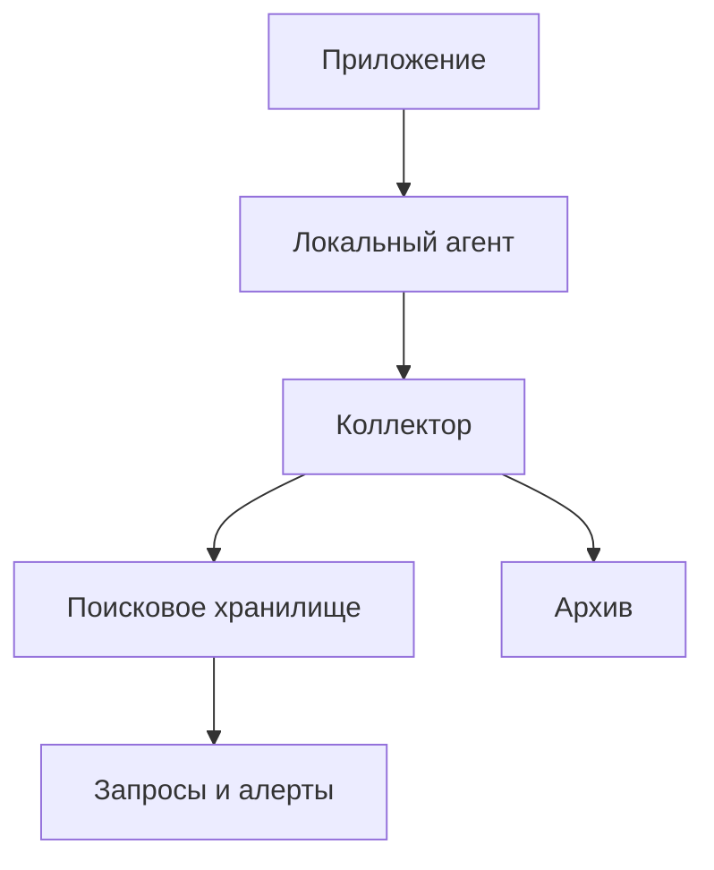

# Логирование (Logging)

Логирование — создание событий о работе программы, которые помогают объяснить её поведение после того, как оно произошло. Хороший лог позволяет понять, какая операция выполнялась, в каком контексте, чем закончилась и какое действие требуется дальше.

В этой главе последовательно разобраны темы раздела 17 из README: от первого вызова `logging.info()` до проектирования ограниченной очереди, безопасной схемы событий и корректного завершения приложения. Названия и порядок тем сохранены.

Базовая версия примеров — **Python 3.12+**. Отличия Python 3.13 и 3.14 отмечены рядом с соответствующим API. Примеры с зависимостями содержат комментарий `# requires: ...`. Последний пункт включает полный учебный проект, файлы тестов, команды запуска и задания.

**Содержание**

1. [Введение в логирование](#introduction)
2. [Модуль logging — основы](#logging-basics)
3. [Компоненты системы логирования](#components)
4. [Конфигурация логирования](#configuration)
5. [Продвинутые техники](#advanced)
6. [Логирование в библиотеках vs приложениях](#libraries-and-applications)
7. [Логирование и исключения](#exceptions)
8. [Логирование в веб-приложениях](#web-applications)
9. [Централизованный сбор логов](#centralized-collection)
10. [Мониторинг и алертинг на основе логов](#monitoring)
11. [Производительность логирования](#performance)
12. [Безопасность и логирование](#security)
13. [Тестирование логирования](#testing)
14. [Альтернативные библиотеки](#alternatives)
15. [Форматы логов и стандарты](#formats)
16. [Лучшие практики](#best-practices)
17. [Частые ошибки](#common-mistakes)
18. [Частые вопросы и ключевые выводы](#faq)

<a id="introduction"></a>

## Введение в логирование

### Зачем нужно логирование: отладка, мониторинг, аудит

Во время разработки можно остановить программу отладчиком. В работающем сервисе нужно восстановить ситуацию по оставленным свидетельствам: какие входные условия были существенными, какой компонент отказал, сработал ли повторный запрос, дошла ли операция до подтверждённого результата.

Логи помогают искать отдельные события, метрики показывают состояние множества операций, трассировки связывают участки распределённого запроса. Например, метрика сообщает о росте доли ошибок, трассировка показывает медленный вызов зависимости, а лог содержит безопасный код причины отказа.

У события должны быть назначение и предполагаемый читатель. Запись «ошибка» бесполезна без имени операции и результата. Запись всего содержимого запроса может дать много текста, но одновременно создать утечку, затраты и шум.

Полезный набор полей: время, уровень, имя компонента, устойчивое имя события, идентификатор корреляции, результат, длительность и безопасные параметры операции. Логировать следует наблюдаемый факт: «отправка запрошена», «сервер подтвердил приём», «транзакция зафиксирована» — разные события.

### Диагностические логи vs события аудита

Диагностический поток отвечает на вопрос «почему программа так себя ведёт?». Аудит отвечает на вопросы «кто, когда, над каким объектом и какое действие совершил; каков подтверждённый результат?».

| Свойство | Диагностика | Аудит |
| --- | --- | --- |
| Основная цель | Поиск неисправности и анализ поведения | Подотчётность и расследование действий |
| Допустимость сэмплинга | Часто допустим для подробных событий | Для обязательных событий обычно неприемлем |
| Изменение уровня | Может резко уменьшать поток | Не должно отключать обязательный аудит |
| Потери при перегрузке | Возможны по явной политике | Нужны отдельные гарантии и процедура отказа |
| Доступ | Разработчики и эксплуатация в пределах полномочий | Более строгие роли и контроль чтения |
| Связь с транзакцией | Обычно отсутствует | Может требовать транзакционного outbox |

Вызов `logger.info("permission.changed")` сам по себе не создаёт надёжный аудит. Процесс может упасть до записи, коллектор — потерять событие, а пользователь с доступом к файлу — изменить его.

Если бизнес-действие и аудит должны согласованно сохраняться, проектируют транзакционную запись события, последующую доставку, идентификаторы для дедупликации и контроль целостности. Даже append-only файл без ограничения привилегий не обеспечивает неизменяемость.

### print() для вывода программы; logging для диагностики

У CLI есть публичный вывод: JSON, CSV, результат вычисления. Его читают люди и другие программы. Диагностика должна иметь отдельный канал, чтобы информационное сообщение не испортило `tool | jq`.

Обычно результат направляют в `stdout`, диагностические логи — в `stderr`. По умолчанию `StreamHandler()` использует `stderr`. В контейнерном сервисе организация может выбрать JSON-события в `stdout`; это соглашение процесса, которое нужно согласовать со сборщиком.

```python
import io
import json
import logging

result_stream = io.StringIO()
diagnostic_stream = io.StringIO()
logger = logging.Logger("example.cli", level=logging.INFO)
handler = logging.StreamHandler(diagnostic_stream)
handler.setFormatter(logging.Formatter("%(levelname)s %(message)s"))
logger.addHandler(handler)

try:
    logger.info("calculation.completed")
    print(json.dumps({"answer": 42}), file=result_stream)
    assert json.loads(result_stream.getvalue()) == {"answer": 42}
    assert diagnostic_stream.getvalue() == "INFO calculation.completed\n"
finally:
    logger.removeHandler(handler)
    handler.close()
```

Здесь `logging.Logger(...)` создаёт изолированный учебный логгер. В обычном модуле приложения используют `logging.getLogger(__name__)`, чтобы участвовать в общей иерархии.

### Уровни логирования: DEBUG, INFO, WARNING, ERROR, CRITICAL

| Уровень | Значение | Пример |
| --- | --- | --- |
| `DEBUG` | Подробности для исследования работы компонента | Промах кэша, выбор стратегии |
| `INFO` | Значимое штатное изменение состояния | Запуск процесса, завершение задания |
| `WARNING` | Отклонение, после которого работа ещё продолжается | Временная деградация, приближение к лимиту |
| `ERROR` | Конкретная операция не выполнена | Исчерпан бюджет повторов запроса |
| `CRITICAL` | Отказ, угрожающий работе существенной части приложения | Невозможность запустить обязательный компонент |

Числа стандартных уровней: `DEBUG=10`, `INFO=20`, `WARNING=30`, `ERROR=40`, `CRITICAL=50`. `NOTSET=0` используется при настройке, а не как обычная степень серьёзности.

Уровень не управляет бизнес-логикой. `critical()` не завершает процесс, `error()` не возбуждает исключение, `warning()` не запускает повторный запрос. Если приложение должно завершиться, оно делает это явно.

### Что должно идти в каждый уровень (практические рекомендации)

Согласуйте уровни в команде через наблюдаемые условия. «Любое исключение — ERROR» плохое правило: ожидаемая ошибка валидации пользовательского ввода не означает отказ сервиса. «Каждый retry — ERROR» создаёт несколько ошибок на одну в итоге успешную операцию.

Для цепочки попыток можно записывать промежуточные сбои в `DEBUG` или `WARNING` по их значимости, а окончательный отказ — один раз в `ERROR`. Для штатного 404 уровень зависит от продукта: ожидаемый поиск отсутствующего объекта отличается от внезапного исчезновения обязательного ресурса.

`INFO` должен помогать объяснить работу системы при обычном режиме эксплуатации. Не обязательно писать начало и конец каждого внутреннего вызова: итоговое событие операции часто содержит всё необходимое.

Для каждого события зафиксируйте владельца, поля, уровень, ожидаемую частоту и полезное действие при расследовании. Отдельно решите, какие события подходят для алертов. Сам по себе уровень `CRITICAL` ещё не определяет адресата, группировку и порядок реагирования.

<a id="logging-basics"></a>

## Модуль logging — основы

### Базовая конфигурация: logging.basicConfig()

`basicConfig()` удобно применять в небольшом приложении: функция настраивает корневой логгер и создаёт стандартный обработчик, если конфигурация ещё отсутствует.

```python
import io
import logging

stream = io.StringIO()
logging.basicConfig(
    level=logging.INFO,
    format="%(levelname)s %(name)s %(message)s",
    stream=stream,
    force=True,
)
try:
    logging.getLogger("demo.startup").info("application.started")
    assert stream.getvalue() == "INFO demo.startup application.started\n"
finally:
    root = logging.getLogger()
    for handler in root.handlers[:]:
        root.removeHandler(handler)
        handler.close()
```

При уже существующих обработчиках root обычный вызов ничего не перестраивает. Это часто встречается в Jupyter, тестах и приложениях с серверным раннером. `force=True` удаляет и закрывает существующие обработчики root; применять его можно там, где вы действительно владеете конфигурацией процесса.

Настройку выполняют в точке входа до запуска рабочих потоков. Библиотека не должна вызывать `basicConfig()` за приложение. Параметры `stream` и `filename` взаимоисключающие; для нескольких назначений создайте обработчики явно.

### Простейшее логирование: logging.debug(), logging.info(), и т.д.

Функции уровня модуля `logging.info(...)` и `logging.error(...)` обращаются к root. Если у root нет обработчиков, эти удобные функции могут автоматически вызвать `basicConfig()`.

В модулях приложения предпочтителен собственный именованный логгер. У него есть имя компонента и возможность отдельной настройки. Сам вызов `getLogger()` конфигурацию не устанавливает.

```python
import io
import logging

output = io.StringIO()
logger = logging.Logger("demo.worker", level=logging.INFO)
handler = logging.StreamHandler(output)
logger.addHandler(handler)
try:
    logger.debug("cache.lookup")
    logger.info("job.completed items=%s", 3)
    logger.warning("dependency.degraded")
    assert output.getvalue().splitlines() == [
        "job.completed items=3",
        "dependency.degraded",
    ]
finally:
    logger.removeHandler(handler)
    handler.close()
```

При стандартной исходной конфигурации эффективный порог root — `WARNING`. Поэтому отсутствие `INFO` не доказывает, что строка кода не выполнилась: сначала проверьте уровни логгера и обработчика.

### Формат сообщений: параметр format

Есть два разных форматирования. Сначала `LogRecord.getMessage()` объединяет `msg` и `args` сообщения. Затем `Formatter` строит окончательное представление записи с уровнем, временем и остальными полями.

В `logger.info("items=%s", count)` используется подстановка через `%`. Параметр `style="{"` у форматтера меняет шаблон всей строки, но не синтаксис аргументов `logger.info()`.

```python
import logging

record = logging.LogRecord(
    "demo.format",
    logging.INFO,
    "worker.py",
    17,
    "items=%s",
    (4,),
    None,
    func="run",
)
formatter = logging.Formatter("{levelname} {name} {message}", style="{")
assert formatter.format(record) == "INFO demo.format items=4"
assert record.msg == "items=%s"
assert record.args == (4,)
```

Не передавайте пользовательскую строку в качестве шаблона с несогласованными аргументами. Безопаснее хранить шаблон в коде, а значения передавать отдельно. Структурированная запись идёт дальше: событие и параметры сохраняются как отдельные поля, а не восстанавливаются парсером из текста.

### Атрибуты LogRecord: asctime, name, levelname, message, filename, lineno, funcName

`LogRecord` — объект события. Часть его полей создаётся сразу, часть вычисляется при форматировании.

| Атрибут | Смысл |
| --- | --- |
| `created` | Время создания записи как Unix timestamp |
| `asctime` | Текстовое время, создаваемое форматтером при необходимости |
| `name` | Имя логгера-источника |
| `levelno`, `levelname` | Число и название уровня |
| `msg`, `args` | Исходное сообщение и аргументы |
| `message` | Результат `getMessage()`, обычно установленный форматтером |
| `filename`, `pathname` | Имя и путь исходного файла |
| `lineno`, `funcName` | Строка и функция места вызова |
| `process`, `threadName` | Контекст процесса и потока |
| `taskName` | Имя текущей asyncio-задачи, поле доступно с Python 3.12 |
| `exc_info`, `exc_text` | Информация об исключении и её текстовый кэш |

`extra` добавляет пользовательские атрибуты, но не позволяет перезаписывать зарезервированные поля. Например, `extra={"message": "..."}` приводит к ошибке. Используйте собственные имена вроде `event`, `request_id`, `duration_ms`.

### Кастомные форматы даты: datefmt

Для распределённой системы удобно записывать UTC и явное обозначение часового пояса. Сравнение строк локального времени без offset неоднозначно при переходах времени и при работе нескольких регионов.

```python
from datetime import datetime, timezone
import logging


class UTCFormatter(logging.Formatter):
    def formatTime(self, record, datefmt=None):
        value = datetime.fromtimestamp(record.created, timezone.utc)
        return value.isoformat(timespec="milliseconds").replace("+00:00", "Z")


record = logging.LogRecord("demo.time", logging.INFO, "", 0, "ready", (), None)
record.created = 0.125
formatter = UTCFormatter("%(asctime)s %(message)s")
assert formatter.format(record) == "1970-01-01T00:00:00.125Z ready"
```

Стандартный `datefmt` использует правила `time.strftime()`; ожидать `%f` как у `datetime.strftime()` нельзя. Для миллисекунд есть `%(msecs)03d` либо собственный `formatTime()`.

Время события берите из `record.created`, а не из текущего времени listener: ожидание в очереди иначе исказит картину. Длительность операции измеряйте через `time.perf_counter()` или `monotonic()`, поскольку системные часы могут корректироваться.

### Запись в файл: filename и filemode

Для простого скрипта можно передать `filename`, `encoding="utf-8"` и `filemode="a"` в `basicConfig()`. Режим `"w"` очищает файл при открытии; для сервиса это обычно нежелательно.

```python
import logging
from pathlib import Path
from tempfile import TemporaryDirectory

with TemporaryDirectory() as directory:
    path = Path(directory) / "application.log"
    logger = logging.Logger("demo.file", level=logging.INFO)
    handler = logging.FileHandler(path, encoding="utf-8", errors="backslashreplace")
    handler.setFormatter(logging.Formatter("%(message)s"))
    logger.addHandler(handler)
    try:
        logger.info("Сервис запущен")
        handler.flush()
        assert path.read_text(encoding="utf-8") == "Сервис запущен\n"
    finally:
        logger.removeHandler(handler)
        handler.close()
```

Заранее создайте каталог и задайте подходящие права. Файловый обработчик не создаёт всю структуру директорий. Не формируйте путь по непроверенному полю запроса.

`flush()` передаёт буфер потока дальше, но не равен `fsync()` и не гарантирует сохранность при отключении питания. Для обычной диагностики это часто приемлемо; для обязательного аудита нужны отдельные требования.

<a id="components"></a>

## Компоненты системы логирования

### Логгеры (Loggers) — интерфейс для кода

Логгер определяет источник события и первоначальный допуск по уровню. Обработчик определяет назначение. Форматтер строит представление. Фильтр принимает решение о записи или дополняет контекст.

Последовательность для обычного вызова следующая:

1. Проверяется, разрешён ли уровень на логгере.
2. Создаётся `LogRecord`, определяется место вызова.
3. Применяются фильтры исходного логгера.
4. Запись передаётся его обработчикам и, при пропагации, обработчикам предков.
5. Для каждого назначения проверяются уровень обработчика и его фильтры.
6. Обработчик форматирует и отправляет запись.

До первого шага Python уже вычислил аргументы функции. Поэтому очередь и ленивое форматирование не отменяют дорогой вызов, который вы передали как аргумент.

Логгеры из `getLogger()` переиспользуются по имени. Не создавайте отдельное имя на каждый запрос или пользователя: реестр имён будет расти, а настройка иерархии усложнится.

### Иерархия логгеров и точечная настройка

Имена разделены точками: `shop` — родитель `shop.payments`, а тот — родитель `shop.payments.client`. Файловая структура сама по себе не создаёт иерархию; связь определяется строкой имени.

Если у логгера уровень `NOTSET`, эффективный уровень ищется у предков до root. Это наследование **порога допуска исходного вызова**. Оно отличается от дальнейшего распространения уже созданной записи.

Полезная конфигурация: приложение работает на `INFO`, `shop.payments` временно включён на `DEBUG`, а слишком подробный `httpcore` оставлен на `WARNING`. Обработчик, куда должны попасть подробности, также обязан пропускать `DEBUG`.

`setLevel()` не изменяет уровни дочерних логгеров, явно настроенных отдельно. Если диагностика не появляется, проверьте `getEffectiveLevel()`, `isEnabledFor()`, `disabled`, `logging.disable()`, уровни обработчиков, фильтры и пропагацию.

Глобальный `logging.disable(level)` подавляет события этого уровня и ниже на уровне менеджера; его иногда используют тестовые утилиты. Не забывайте восстанавливать состояние.

### Пропагация (propagation) записей по иерархии

Самая важная тонкость: при пропагации запись передаётся **обработчикам предков**. Уровни и фильтры самих родительских логгеров повторно не проверяются.

```python
import io
import logging

stream = io.StringIO()
parent = logging.getLogger("example.propagation")
child = logging.getLogger("example.propagation.worker")
parent.setLevel(logging.ERROR)
parent.propagate = False
child.setLevel(logging.DEBUG)
child.propagate = True
handler = logging.StreamHandler(stream)
handler.setLevel(logging.DEBUG)
parent.addHandler(handler)

try:
    child.debug("child.debug.accepted")
    assert stream.getvalue() == "child.debug.accepted\n"
finally:
    parent.removeHandler(handler)
    handler.close()
```

Уровень `ERROR` родителя не отбрасывает принятый `DEBUG` потомка. Чтобы ограничить назначение, задайте уровень обработчика.

Если один обработчик установлен у дочернего логгера и у root, пропагация может привести к двум записям. Обычно выбирают одну точку подключения обработчиков на ветке либо осознанно ставят `propagate=False` у ветки с собственными назначениями.

### Получение логгера: logging.getLogger(__name__) — стандартный паттерн

На уровне модуля достаточно `logger = logging.getLogger(__name__)`. Имя автоматически следует за импортируемым модулем: `shop.payments.client` удобно включить отдельно от `shop.catalog`.

Не нужно передавать один глобальный логгер во все функции только ради доступа к `logging`. Но передавать объект интерфейса событий бывает полезно, если компонент должен работать с конкретным прикладным контрактом или изолироваться от глобального состояния.

Изменяемый контекст запроса не храните как атрибут модульного логгера. При конкурентных запросах `logger.request_id = ...` приводит к смешиванию контекстов. Для этого подходят `LoggerAdapter`, `ContextVar` и фильтры с явно определённым местом чтения.

Запуск модуля как скрипта даёт имя `__main__`. Если приложению важна стабильная ветка при разных способах запуска, выделите настоящую логику в импортируемый пакет, а `__main__.py` используйте как небольшую точку входа.

### stacklevel для обёрток над логированием

Без дополнительной настройки запись из вспомогательной функции указывает на саму обёртку. Параметр `stacklevel` позволяет указать вызывающую сторону.

```python
import logging


class Capture(logging.Handler):
    def __init__(self):
        super().__init__()
        self.records = []

    def emit(self, record):
        self.records.append(record)


logger = logging.Logger("demo.stacklevel", logging.INFO)
handler = Capture()
logger.addHandler(handler)


def report():
    logger.info("operation.completed", stacklevel=2)


def business_operation():
    report()


try:
    business_operation()
    assert handler.records[0].funcName == "business_operation"
finally:
    logger.removeHandler(handler)
    handler.close()
```

Для дополнительной вложенной обёртки может понадобиться ещё один уровень. Не подбирайте большое число «на всякий случай»: это даст неверную функцию, а в разных путях вызова ошибка останется незаметной.

### Сохранение корректного места вызова в LogRecord

Место вызова фиксируется на стороне производителя. Если создать новый `LogRecord` в listener, `filename` и `lineno` могут начать указывать на инфраструктуру доставки.

При преобразовании записи в JSON сохраняйте исходные поля источника, если они нужны для поиска и допустимы по политике раскрытия. Полные абсолютные пути могут показывать структуру окружения; часто достаточно модуля, функции и строки.

Проверяйте обёртки тестом на `funcName` и относительный смысл строки, а не только глазами в консоли. Не привязывайте десятки тестов к конкретным номерам строк: обычное добавление импорта не должно ломать контракт.

`stack_info=True` добавляет стек текущего вызова, `exc_info` — сведения о пойманном исключении. Это разные данные. Записывать оба поля в каждый `INFO` дорого и обычно не требуется.

Если включена оптимизация места вызова сторонней библиотекой, сравнивайте реальное поведение именно установленной версии. Скорость без правильного источника события может оказаться неудачным обменом.

### Обработчики (Handlers) — куда отправлять

Одна запись может идти в консоль, файл, очередь и экспортёр. У каждого назначения свои порог, фильтры, формат и поведение при отказе.

`Handler.handle()` применяет фильтры и использует блокировку обработчика, а реализация `emit()` выполняет отправку. Проверка порога `handler.level` обычно происходит при маршрутизации из логгера или `QueueListener` с `respect_handler_level=True`. Прямой вызов `handler.handle(record)` сам по себе не эквивалентен `logger.info()`.

Новый обработчик должен корректно освобождать ресурсы и определять политику ошибки. Не вызывайте обычное логирование из `emit()` того же пути: рекурсия и обратный порядок захвата блокировок могут привести к зависанию.

`logging.raiseExceptions=False` влияет на диагностику ошибок через `handleError()`. Этот флаг не является универсальным `try/except` вокруг всей системы: пользовательский фильтр, фабрика или обработчик способны выбросить исключение иначе. Отказоустойчивость нужно проектировать и проверять.

### StreamHandler (stdout, stderr)

`StreamHandler` пишет текст и разделитель записи в переданный поток. По умолчанию это `sys.stderr`. После `emit()` стандартная реализация выполняет `flush()`.

Поток может быть терминалом, перенаправленным файлом, pipe или адаптером коллектора. Запись в pipe способна блокироваться, если потребитель не успевает читать. Поэтому «логи в stdout» не означает «стоимость I/O исчезла».

Зафиксированный при создании `StreamHandler` объект не обязан следовать за последующей заменой `sys.stderr`. Для переназначения есть `setStream()`; при тестировании удобнее сразу передать `StringIO`.

Не добавляйте ANSI-раскраску в JSON-поток. Цвета уместны в интерактивном представлении, а машинному потоку нужны чистая кодировка, однозначная граница записи и стабильная схема.

Обычно обработчик закрывает собственные служебные ресурсы, а не весь переданный внешним владельцем `stdout`. Для пользовательских обработчиков явно опишите владение потоком и порядок завершения.

### FileHandler (запись в файл)

`FileHandler` подходит, когда файл — назначение одного процесса и известна политика хранения. Параметр `delay=True` откладывает открытие до первой записи, но не устраняет последующие ошибки прав, места и файловой системы.

При работе нескольких потоков один экземпляр обработчика сериализует запись. Два независимых обработчика на один путь имеют разные блокировки, даже если находятся в одном процессе. Несколько процессов добавляют ещё больше рисков.

Следите за дескрипторами при повторной конфигурации. Удалить обработчик из списка логгера и закрыть его — разные действия. `logger.removeHandler(handler)` сам по себе файл не закрывает.

После внешнего переименования открытый дескриптор может продолжить указывать на старый файл. На Unix для внешней ротации рассматривают `WatchedFileHandler`. Поведение Windows и сетевых файловых систем отличается; тестируйте реальную платформу.

Не считайте локальный файл гарантией сохранения после удаления контейнера. Он должен находиться на нужном томе либо своевременно собираться агентом.

### RotatingFileHandler и TimedRotatingFileHandler (ротация логов)

`RotatingFileHandler` переключает файлы по размеру, `TimedRotatingFileHandler` — по времени при наступлении очередной записи. Таймерного потока, создающего пустой файл строго в полночь, у второго обработчика нет.

```python
import logging
from logging.handlers import RotatingFileHandler
from pathlib import Path
from tempfile import TemporaryDirectory

with TemporaryDirectory() as directory:
    path = Path(directory) / "service.log"
    handler = RotatingFileHandler(
        path,
        maxBytes=100,
        backupCount=2,
        encoding="utf-8",
        errors="backslashreplace",
    )
    handler.setFormatter(logging.Formatter("%(message)s"))
    logger = logging.Logger("demo.rotation", logging.INFO)
    logger.addHandler(handler)
    try:
        for index in range(20):
            logger.info("event-%02d %s", index, "x" * 20)
    finally:
        logger.removeHandler(handler)
        handler.close()
    files = list(Path(directory).glob("service.log*"))
    assert 1 < len(files) <= 3
    assert "event-19" in path.read_text(encoding="utf-8")
```

Для размера нужны положительные `maxBytes` и `backupCount`. Это не жёсткая квота диска: отдельная огромная запись может превысить ожидаемый размер, рядом могут находиться другие файлы, а сжатие и внешние копии тоже занимают место.

Для временной ротации учитывайте `when`, `interval`, `utc`, `atTime` и выбранную зону. Не сочетайте две независимые системы переименования одного файла без согласованного протокола.

### HTTPHandler (отправка по HTTP)

Стандартный `HTTPHandler` отправляет поля записи HTTP-запросом; это не готовый JSON/OTLP-экспортёр. Он использует собственный `mapLogRecord()`, а обычный форматтер не превращает запрос в ожидаемый JSON-контракт.

Параметры `host`, `url`, `method` и `secure` задают назначение. Для TLS проверяйте сертификат через корректный SSL-контекст. Не отправляйте секреты в URL: они могут попасть в access-логи промежуточных компонентов.

Главное архитектурное ограничение — сетевой I/O находится на пути вызова обработчика. На критическом пути приложения нужны ограниченные ожидания, очередь и понятная политика отказа; стандартный обработчик не заменяет полноценную надёжную доставку.

Для production чаще разумнее писать в локально собираемый поток, а HTTP-доставку поручить агенту или использовать профильный экспортёр с нужным протоколом, TLS, batching и backoff.

Не повторяйте отправку бесконечно из `emit()`: при отказе коллектора это может остановить бизнес-запросы и создать лавину повторных событий.

### SMTPHandler (отправка по email для критических ошибок)

`SMTPHandler` позволяет отправить событие по почте, но каждая отправка зависит от SMTP-сервера и сетевых задержек. Настройка `timeout` ограничивает соответствующие сетевые операции, а не гарантирует общий дедлайн всей системы уведомлений.

Встроенный параметр `secure` связан с STARTTLS при использовании аутентификации; это не универсальная замена клиенту для любого SMTP/TLS-режима. Проверяйте требования почтового сервера и выбранную конфигурацию по документации.

Не направляйте каждую ошибку высоконагруженного сервиса в отдельное письмо. При инциденте получится шторм уведомлений, лимиты провайдера и дополнительная нагрузка.

Обычно приложение создаёт структурированное событие, а внешняя система алертинга группирует ошибки, применяет окно, подавляет повторы и доставляет сообщение нужной дежурной группе.

В учебных примерах главы почта не отправляется. Для тестов подставляют транспорт или локальный контролируемый сервер. Настоящая рассылка не нужна для проверки уровня, шаблона и маршрутизации события.

### SysLogHandler (отправка в syslog)

`SysLogHandler` интегрирует приложение с syslog через локальный сокет или сетевой транспорт. Адрес локального сокета зависит от ОС; наличие `/dev/log` нельзя считать переносимой гарантией.

UDP-передача не подтверждает доставку и может терять сообщения. TCP даёт поток байтов, но требует согласованного framing, а также не доказывает, что сервер надёжно сохранил событие.

Проверяйте facility, сопоставление severity, `ident`, `append_nul`, максимальную длину сообщения и требования принимающей стороны. Параметр `timeout` у `SysLogHandler` появился в Python 3.14; пример для 3.12 с этим аргументом не переносим.

Формат RFC 5424 и обычная строка, отправленная этим обработчиком, не обязаны совпадать по всем полям. Само использование syslog-сокета не создаёт полноценное структурированное событие RFC 5424.

При работе в контейнере часто проще использовать стандартный поток и агент хоста. Выбор зависит от инфраструктуры, требований к потере и доступных протоколов.

### NullHandler (заглушка для библиотек)

`NullHandler` обозначает, что библиотека не выбирает назначение вывода. Обычно его добавляют один раз к логгеру верхнего пакета.

```python
import logging

library_logger = logging.getLogger("example_library")
handler = logging.NullHandler()
library_logger.addHandler(handler)
try:
    library_logger.debug("library.cache.miss")
    assert library_logger.hasHandlers()
    assert library_logger.propagate is True
finally:
    library_logger.removeHandler(handler)
    handler.close()
```

`NullHandler` не отключает пропагацию: если приложение настроит root, события библиотеки продолжат доходить до его обработчиков. Это желательное поведение.

Не путайте заглушку с `propagate=False` или `disabled=True`. Последние настройки могут помешать приложению получать нужную диагностику.

При отсутствии подходящих обработчиков у обычного именованного логгера может сработать `logging.lastResort` — стандартный резервный вывод для `WARNING` и выше. Именно поэтому «мы не вызвали basicConfig» не означает «библиотека точно ничего не выведет».

### QueueHandler / QueueListener (асинхронная обработка)

Производитель передаёт запись в очередь, listener читает её в отдельном потоке и вызывает целевые обработчики. Это перенос I/O с вызывающего потока, а не превращение `logging.info()` в coroutine.

```python
import io
import logging
from logging.handlers import QueueHandler, QueueListener
from queue import Queue

queue = Queue(maxsize=8)
stream = io.StringIO()
target = logging.StreamHandler(stream)
target.setLevel(logging.WARNING)
producer = QueueHandler(queue)
logger = logging.Logger("demo.queue", logging.DEBUG)
logger.addHandler(producer)
listener = QueueListener(queue, target, respect_handler_level=True)
listener.start()
try:
    logger.info("filtered.by.target")
    logger.warning("dependency.slow")
finally:
    logger.removeHandler(producer)
    listener.stop()
    producer.close()
    target.close()

assert stream.getvalue() == "dependency.slow\n"
```

Этот небольшой пример гарантированно не заполняет очередь. Для реальной нагрузки отдельно нужны политика переполнения, наблюдаемость потерь и корректная остановка.

Стандартный `QueueHandler.prepare()` форматирует сообщение на производителе и подготавливает запись к передаче. Он очищает некоторые поля, включая `args` и `exc_info`; информация об исключении может уже оказаться в тексте сообщения. Сохранение исходного traceback для произвольного последующего форматирования требует собственного контракта подготовки.

### Форматтеры (Formatters) — как оформлять

Форматтер отвечает за представление события в конкретном назначении. Один обработчик может выводить удобный человеку текст, другой — JSON со стабильными именами полей.

Не смешивайте форматирование и бизнес-решения. Форматтер не должен выполнять запросы в базу, обогащать пользователя по HTTP или получать секреты. Медленный форматтер остаётся медленным даже после переноса в listener и увеличивает очередь.

Событие желательно преобразовывать детерминированно: одинаковые входные поля дают одинаковое представление, кроме явно ожидаемых различий. Это упрощает тестирование.

Осторожно с изменением `record`. Одна запись может использоваться несколькими обработчиками. Мутация `msg`, `args` или пользовательских полей в первом назначении повлияет на следующее. Для локальной обработки применяйте копию.

Стандартный форматтер также кэширует `exc_text`. Если разные форматтеры по-разному представляют исключение, нужно управлять этим кэшем, обычно изолируя запись.

### Создание кастомных форматов

Сначала определите контракт полей. Для текстового потока это может быть время, уровень, имя и сообщение. Для JSON — `schema_version`, `timestamp`, `severity`, `service`, `event`, `request_id` и прикладные поля.

Не добавляйте все атрибуты `record.__dict__` автоматически. Там могут находиться несериализуемые объекты, секреты из `extra` и внутренние данные. Безопаснее явно выбрать поля.

JSON должен создаваться настоящим сериализатором, а не ручным склеиванием кавычек. Иначе перевод строки и кавычки в значении способны испортить запись или создать поддельную строку.

Для текстового формата также учитывайте инъекцию переводов строк, табуляций и терминальных управляющих последовательностей. Замена нескольких известных слов не решает эту задачу.

Версионируйте схему при изменении смысла полей. Переименование `duration` в `duration_ms` может обнаружить старую неоднозначность, но потребует обновления запросов, дашбордов и алертов.

### Использование logging.Formatter

Форматтер назначается обработчику через `setFormatter()`. Он не назначается логгеру: источник и представление разделены.

```python
import logging

formatter = logging.Formatter(
    "%(levelname)s %(request_id)s %(message)s",
    defaults={"request_id": "-"},
)
record = logging.LogRecord("demo.defaults", logging.INFO, "", 0, "ready", (), None)
assert formatter.format(record) == "INFO - ready"
record.request_id = "request-7"
assert formatter.format(record) == "INFO request-7 ready"
```

`defaults` у самого `Formatter` доступен с Python 3.10. Возможность передать это поле через стандартную схему форматтера `dictConfig` добавлена в Python 3.12.

Значения по умолчанию полезны для сторонних записей без прикладного контекста, но не должны маскировать поломку обязательного поля. Если `request_id` необходим для конкретного события, проверяйте его отдельно.

Ошибка формата может привести к пропуску записи и внутреннему сообщению `Logging error`. Поэтому отдельно тестируют не только вызов `logger.info()`, но и конечное представление в назначении.

### Фильтры (Filters) — что логировать

Фильтр может пропускать события, дополнять контекст или возвращать подготовленную копию записи. На Python 3.12+ фильтр может вернуть другой `LogRecord`; для обработчика это удобно, когда изменение должно действовать только в одном назначении.

```python
import copy
import io
import logging


class ReplaceMessage(logging.Filter):
    def filter(self, record):
        result = copy.copy(record)
        result.msg = "public.event"
        result.args = ()
        return result


first_stream, second_stream = io.StringIO(), io.StringIO()
first = logging.StreamHandler(first_stream)
second = logging.StreamHandler(second_stream)
first.addFilter(ReplaceMessage())
logger = logging.Logger("demo.filter.copy", logging.INFO)
logger.addHandler(first)
logger.addHandler(second)
try:
    logger.info("internal.event")
    assert first_stream.getvalue() == "public.event\n"
    assert second_stream.getvalue() == "internal.event\n"
finally:
    for handler in (first, second):
        logger.removeHandler(handler)
        handler.close()
```

Поверхностная копия не копирует вложенные словари. Если требуется менять `record.payload["x"]`, создайте новый безопасный payload, а не рассчитывайте на `copy.copy()`.

Фильтры, установленные на root-логгер, не являются универсальным фильтром для событий потомков. Для общей политики назначений фильтры размещают на обработчиках.

### Фильтрация по уровню

`setLevel(logging.WARNING)` означает «WARNING и выше», а не «только WARNING». Для диапазона, например INFO/WARNING в один поток и ERROR/CRITICAL в другой, нужен верхний предел в фильтре первого обработчика.

```python
import io
import logging


class BelowError(logging.Filter):
    def filter(self, record):
        return record.levelno < logging.ERROR


ordinary, errors = io.StringIO(), io.StringIO()
low = logging.StreamHandler(ordinary)
low.setLevel(logging.INFO)
low.addFilter(BelowError())
high = logging.StreamHandler(errors)
high.setLevel(logging.ERROR)
logger = logging.Logger("demo.levels", logging.DEBUG)
logger.addHandler(low)
logger.addHandler(high)
try:
    logger.info("ready")
    logger.error("failed")
    assert ordinary.getvalue() == "ready\n"
    assert errors.getvalue() == "failed\n"
finally:
    for handler in (low, high):
        logger.removeHandler(handler)
        handler.close()
```

При `QueueListener` явно задавайте `respect_handler_level=True`, если рассчитываете на пороги целевых обработчиков. Это частый источник неожиданной маршрутизации.

### Контекстные фильтры: добавление дополнительных полей

Контекстный фильтр читает `request_id` из `ContextVar` и добавляет его к записи. Место чтения существенно: listener работает в другом потоке и не имеет контекста задачи-производителя.

Добавляйте контекст **до помещения в очередь**. Если фильтр стоит только на файловом обработчике listener, все записи могут получить пустой контекст самого listener.

При нескольких обработчиках решите, контекст добавляется один раз в общей точке либо каждый обработчик получает собственную копию. Не допускайте конфликтов имён с `extra` или глобальной фабрикой записи.

`setLogRecordFactory()` подходит для глобального обогащения, но влияет на весь процесс. Нужно сохранять предыдущую фабрику, корректно вызывать её и восстанавливать состояние в тестах. Фабрика вызывается до применения `extra`; одинаковое поле в двух местах приведёт к конфликту.

Контекст — не разрешение на запись любых данных. Даже валидный `user_id` может быть персональными данными; согласуйте необходимость, доступ и срок хранения.

<a id="configuration"></a>

## Конфигурация логирования

### Программная конфигурация (создание логгеров, хендлеров в коде)

Программная настройка полезна, когда ресурсы создаются явно: открывается поток, запускается listener, подключается обработчик, затем приложение гарантированно освобождает их.

У настройки должен быть один владелец. Повторный вызов функции, которая каждый раз делает `addHandler()`, создаёт дубликаты. Проверка `if not logger.handlers` тоже не универсальна: наличие обработчика не доказывает, что он нужного типа и назначения.

В приложении можно строить объект runtime, который хранит созданные ресурсы и отвечает за закрытие. В библиотеке обычно достаточно объявить логгер; созданием назначений владеет вызывающее приложение.

Не меняйте конфигурацию конкурентно с работой обработчиков без процедуры переключения. Наличие внутренних блокировок `logging` не делает произвольный жизненный цикл ресурсов транзакционным.

Хорошая функция настройки либо вызывается строго один раз, либо документированно заменяет только свои ресурсы. Закрывать все обработчики процесса из импортируемого модуля нельзя.

### Конфигурация через словарь: logging.config.dictConfig() (рекомендуемый способ)

`dictConfig()` удобно описывает назначения и иерархию в одном месте. Словарь можно создать в Python или получить из проверенного конфигурационного файла.

```python
import io
import logging
import logging.config

stream = io.StringIO()
logging.config.dictConfig(
    {
        "version": 1,
        "disable_existing_loggers": False,
        "formatters": {
            "plain": {"format": "%(levelname)s %(name)s %(message)s"},
        },
        "handlers": {
            "console": {
                "class": "logging.StreamHandler",
                "stream": stream,
                "level": "INFO",
                "formatter": "plain",
            },
        },
        "loggers": {
            "demo.config": {
                "handlers": ["console"],
                "level": "DEBUG",
                "propagate": False,
            },
        },
    }
)
logger = logging.getLogger("demo.config")
try:
    logger.debug("hidden")
    logger.info("ready")
    assert stream.getvalue() == "INFO demo.config ready\n"
finally:
    for handler in logger.handlers[:]:
        logger.removeHandler(handler)
        handler.close()
```

Для конфигурации приложения обычно явно пишут `disable_existing_loggers=False`. Иначе уже созданные сторонние логгеры могут неожиданно отключиться. Эта настройка не гарантирует сохранение всех старых обработчиков: полная переконфигурация способна закрывать существующие ресурсы.

### Структура dictConfig: loggers, handlers, formatters, filters

| Ключ | Назначение |
| --- | --- |
| `version` | Версия схемы, используется `1` |
| `formatters` | Именованные способы представления |
| `filters` | Именованные фильтры |
| `handlers` | Обработчики с уровнями, форматтерами и назначениями |
| `loggers` | Настройки отдельных веток по имени |
| `root` | Настройка корневого логгера |
| `disable_existing_loggers` | Политика уже существующих именованных логгеров |
| `incremental` | Ограниченное изменение существующей конфигурации |

Ключи внутри `handlers` и `formatters` — локальные идентификаторы конфигурации, а не имена Python-модулей. Ссылки `formatter: "plain"` и `handlers: ["console"]` должны разрешаться в объявленные объекты.

`ext://sys.stderr` обозначает внешний Python-объект. `cfg://...` ссылается внутрь конфигурации. Обработчики создаются в определённом порядке; для сложных взаимных ссылок важно учитывать порядок конфигурации.

При настройке очередей через `dictConfig` на Python 3.12+ можно получить связанный listener через `handler.listener`. Его всё равно нужно запустить и корректно остановить; наличие объекта не означает работающий поток.

### Инъекция объектов через () в dictConfig

Ключ `"()"` задаёт фабрику: callable или импортируемый путь. Остальные параметры передаются фабрике как аргументы. Так подключают собственные форматтеры, фильтры и обработчики.

```python
import io
import logging
import logging.config


class EventFilter(logging.Filter):
    def __init__(self, prefix):
        super().__init__()
        self.prefix = prefix

    def filter(self, record):
        return record.getMessage().startswith(self.prefix)


stream = io.StringIO()
logging.config.dictConfig(
    {
        "version": 1,
        "disable_existing_loggers": False,
        "filters": {"events": {"()": EventFilter, "prefix": "job."}},
        "handlers": {
            "sink": {
                "class": "logging.StreamHandler",
                "stream": stream,
                "filters": ["events"],
            },
        },
        "loggers": {
            "demo.factory": {
                "handlers": ["sink"],
                "level": "INFO",
                "propagate": False,
            },
        },
    }
)
logger = logging.getLogger("demo.factory")
try:
    logger.info("job.completed")
    logger.info("cache.miss")
    assert stream.getvalue() == "job.completed\n"
finally:
    for handler in logger.handlers[:]:
        logger.removeHandler(handler)
        handler.close()
```

Конфигурация с импортами и фабриками — исполняемая возможность. Даже `yaml.safe_load()` только безопасно разбирает YAML; передача результата в `dictConfig()` всё ещё может импортировать и вызывать указанные объекты. Не принимайте такую конфигурацию из недоверенного HTTP-запроса.

### Конфигурация через файл: fileConfig()

`fileConfig()` читает INI-конфигурацию. Он полезен для поддержки существующих приложений, но хуже подходит для современных сложных графов объектов и фильтров.

Укажите `disable_existing_loggers=False`, если нельзя отключать уже созданные логгеры. Для файла задайте ожидаемую кодировку. В Python 3.12 поведение ошибок отсутствующего, пустого и некорректного файла стало более явным; не рассчитывайте на молчаливое продолжение.

INI с именами классов и аргументами — тоже доверенная конфигурация. Не путайте его с безобидным набором строк.

Для нового приложения словарь обычно проще проверять, расширять и подготавливать из окружения. Важнее самого формата файла остаются владение ресурсами, порядок запуска и тест конечного вывода.

Не размещайте пароли от сетевых назначений в коммитируемом INI. Секреты должны приходить через предназначенный механизм, а если они всё же передаются обработчику, конфигурацию целиком нельзя логировать.

### Конфигурация через переменные окружения

Переменная `LOG_LEVEL` — соглашение вашего приложения, а не автоматически работающий параметр стандартного `logging`.

```python
import logging


def parse_level(value):
    allowed = {
        "DEBUG": logging.DEBUG,
        "INFO": logging.INFO,
        "WARNING": logging.WARNING,
        "ERROR": logging.ERROR,
        "CRITICAL": logging.CRITICAL,
    }
    normalized = value.strip().upper()
    if normalized not in allowed:
        raise ValueError("invalid LOG_LEVEL")
    return allowed[normalized]


assert parse_level(" info ") == logging.INFO
try:
    parse_level("verbose-ish")
except ValueError:
    pass
else:
    raise AssertionError("unknown level must be rejected")
```

Разбирайте отдельно уровень, формат и допустимое назначение. Строка `"false"` не должна превращаться в `True` через `bool(value)`.

Не позволяйте произвольной переменной окружения задавать импортируемую фабрику, путь к любому файлу или URL отправки. Даже если оператор доверенный, ошибка конфигурации не должна превращаться в неожиданную отправку всех логов.

Для диагностического включения `DEBUG` полезны срок действия и автоматический возврат, чтобы подробный режим не оставался бессрочно.

### Перезагрузка конфигурации на лету

Самый простой вид изменения — управляемая смена уровней существующих логгеров и обработчиков. Полная перестройка с заменой файлов, очередей и экспортёров требует существенно более аккуратного жизненного цикла.

`dictConfig({"version": 1, "incremental": True, ...})` не означает произвольное добавление новых форматтеров и фильтров. Инкрементальный режим ограничен: он предназначен главным образом для изменения уровней и пропагации уже существующей структуры.

Для полной замены сначала проверьте параметры, создайте необходимые ресурсы в контролируемом месте, прекратите приём в старый путь, дождитесь или учтите его остаток и закройте назначения. Опишите, что происходит с событиями во время переключения.

Не запускайте `logging.config.listen()` как незащищённый административный интерфейс. Загружаемая конфигурация может выполнять код; localhost не является достаточной границей доверия на многопользовательской машине.

Для сигналов ОС лучше ставить флаг или будить основной цикл, а саму настройку выполнять в обычном контексте. Конкурентная переконфигурация из произвольного обработчика сигнала особенно трудна для проверки.

<a id="advanced"></a>

## Продвинутые техники

### Логирование в JSON (структурированные логи)

Структурированное событие хранит значения отдельно. Вместо разбора строки `"paid order=42 duration=12ms"` поисковая система получает `event="order.paid"`, числовое `duration_ms=12` и разрешённый идентификатор объекта.

JSON решает задачу представления, но не определяет полезную схему автоматически. JSON-объект с единственным полем `message` и произвольным текстом даёт меньше возможностей, чем согласованный набор типизированных полей.

Для JSON Lines каждая физическая строка содержит один JSON-объект. Переводы строк внутри значений сериализуются как escape-последовательности. Это сохраняет границу события даже при многострочном traceback.

Определите типы: статус HTTP — число, длительность — число с известной единицей, отсутствующее поле — либо `null`, либо отсутствующий ключ по единому правилу. Не передавайте иногда число, иногда объект в одном поле: индексация может сломаться.

Отдельно ограничивайте размер события и количество вложенных элементов. Валидный JSON размером в сотни мегабайт остаётся эксплуатационной проблемой.

### Кастомный JsonFormatter

Минимальный форматтер явно выбирает поля и использует `json.dumps()`. Пример ниже рассчитан на заранее проверенные прикладные значения; свободный текст сообщения и исключения он намеренно считает диагностическими данными, требующими отдельной политики.

```python
from datetime import datetime, timezone
import json
import logging
import math


class JsonFormatter(logging.Formatter):
    def format(self, record):
        result = {
            "schema_version": 1,
            "timestamp": datetime.fromtimestamp(record.created, timezone.utc).isoformat(
                timespec="milliseconds"
            ),
            "severity": record.levelname,
            "logger": record.name,
            "message": record.getMessage(),
        }
        duration = getattr(record, "duration_ms", None)
        if type(duration) in (int, float) and math.isfinite(duration):
            result["duration_ms"] = duration
        if record.exc_info:
            result["exception"] = self.formatException(record.exc_info)
        return json.dumps(result, ensure_ascii=False, allow_nan=False)


record = logging.LogRecord(
    "example.json", logging.INFO, "", 0, "line one\nline two", (), None
)
record.duration_ms = 12.5
line = JsonFormatter().format(record)
assert "\n" not in line
event = json.loads(line)
assert event["message"] == "line one\nline two"
assert event["duration_ms"] == 12.5
```

Не используйте `default=str` как универсальную безопасность. Это вызывает пользовательский `__str__`, который может быть дорогим, ошибочным или содержащим секрет. В практическом проекте в конце главы используется более строгий контракт: каталог событий, только разрешённые поля и отказ от свободного текста исключения.

### Библиотека python-json-logger

`python-json-logger` предоставляет готовые форматтеры для стандартного `logging`. В проверенной здесь версии **4.2.0** используется импорт `from pythonjsonlogger.json import JsonFormatter`. Старые статьи могут показывать другой путь.

```python
# requires: python-json-logger
import io
import json
import logging
from pythonjsonlogger.json import JsonFormatter

stream = io.StringIO()
handler = logging.StreamHandler(stream)
handler.setFormatter(JsonFormatter("%(levelname)s %(name)s %(message)s"))
logger = logging.Logger("demo.pythonjsonlogger", logging.INFO)
logger.addHandler(handler)
try:
    logger.info("job.completed", extra={"item_count": 5})
    event = json.loads(stream.getvalue())
    assert event["message"] == "job.completed"
    assert event["item_count"] == 5
finally:
    logger.removeHandler(handler)
    handler.close()
```

Библиотека сокращает инфраструктурный код, но не определяет допустимость полей за вас. Проверьте правила добавления `extra`, переименования, обработки исключений и сериализации нестандартных типов.

Если запись содержит ORM-объект или `Authorization`, JSON-форматтер не делает их безопасными. Политику минимизации и удаления чувствительных значений нужно применять до назначения и, при необходимости, до очереди.

### Зачем нужны структурированные логи (ELK, Splunk)

Структура позволяет искать `event="payment.failed"` и `error_kind="dependency_timeout"`, группировать по версии приложения, строить распределение длительности и связывать события одного запроса.

Текст «payment failed after 3 retries» можно разобрать регулярным выражением, но изменение формулировки ломает парсер. Отдельные поля дают более устойчивый контракт между приложением и эксплуатацией.

Структурированность не означает, что все поля надо индексировать. Индекс повышает стоимость хранения и записи. Для некоторых идентификаторов достаточно хранения в теле события с возможностью поиска в выбранном диапазоне времени.

Стабильное имя события и ограниченный набор причин ошибки полезнее бесконечного множества сообщений. Например, `error_kind="timeout"` и безопасное поле зависимости позволяют группировать события, а `message=str(exception)` часто даёт уникальную строку на каждый отказ.

Схема должна сохранять смысл при экспорте в разные системы: единицы длительности, UTC, идентификаторы, окружение и версия приложения не должны переопределяться каждым коллектором по-своему.

### Контекстное логирование

Контекст — данные, общие для группы событий: `request_id`, идентификатор задания, версия релиза, имя сервиса. Часть контекста постоянна для процесса, часть живёт внутри операции.

| Контекст | Подходящее место |
| --- | --- |
| Имя сервиса и окружение | Конфигурация приложения или форматтер |
| Данные конкретного объекта-компонента | `LoggerAdapter` или связанный structlog logger |
| Контекст конкурентного запроса | `ContextVar` и чтение на производителе |
| Trace/span ID | Интеграция с системой трассировки |

Контекст запроса устанавливается при входе в операцию и сбрасывается в `finally`. Без сброса последующая операция может получить чужой идентификатор.

Идентификатор корреляции должен иметь ограниченную длину и допустимый формат. Внешний заголовок может содержать мусор, управляющие символы или значение, выбранное злоумышленником. Иногда проще создать внутренний ID, а внешнюю корреляцию хранить отдельно после проверки.

Контекст не переносится через сеть или процесс автоматически. Его нужно передать по согласованному протоколу и восстановить на другой стороне.

### Добавление контекста (request_id, user_id) через logging.LoggerAdapter

`LoggerAdapter` хранит контекст и дополняет вызовы базового логгера. Он удобен для компонента с небольшим набором постоянных полей.

```python
import io
import logging

stream = io.StringIO()
handler = logging.StreamHandler(stream)
handler.setFormatter(logging.Formatter("%(request_id)s %(message)s"))
base = logging.Logger("demo.adapter", logging.INFO)
base.addHandler(handler)
adapter = logging.LoggerAdapter(base, {"request_id": "req-17"})
try:
    adapter.info("operation.completed")
    assert stream.getvalue() == "req-17 operation.completed\n"
finally:
    base.removeHandler(handler)
    handler.close()
```

По умолчанию `extra` самого адаптера имеет приоритет над отдельно переданным `extra`: стандартный адаптер не объединяет их автоматически. С Python 3.13 есть `merge_extra=True`.

```python
# Python 3.13+
import io
import logging

stream = io.StringIO()
handler = logging.StreamHandler(stream)
handler.setFormatter(logging.Formatter("%(request_id)s %(item_count)d %(message)s"))
base = logging.Logger("demo.adapter.merge", logging.INFO)
base.addHandler(handler)
adapter = logging.LoggerAdapter(base, {"request_id": "req-18"}, merge_extra=True)
try:
    adapter.info("job.completed", extra={"item_count": 2})
    assert stream.getvalue() == "req-18 2 job.completed\n"
finally:
    base.removeHandler(handler)
    handler.close()
```

При объединении ключ конкретного вызова может переопределить ключ адаптера. Если часть полей должна быть защищена от переопределения, нужен собственный контракт, а не просто `merge_extra=True`.

### Использование фильтров для добавления контекста

Фильтр на `QueueHandler` — удобная точка для снимка контекста до границы потока. Контекст listener здесь уже не используется.

```python
from contextvars import ContextVar
import io
import logging
from logging.handlers import QueueHandler, QueueListener
from queue import Queue

request_id = ContextVar("example_request_id", default="-")


class RequestContext(logging.Filter):
    def filter(self, record):
        record.request_id = request_id.get()
        return True


queue = Queue(maxsize=4)
stream = io.StringIO()
target = logging.StreamHandler(stream)
target.setFormatter(logging.Formatter("%(request_id)s %(message)s"))
producer = QueueHandler(queue)
producer.addFilter(RequestContext())
logger = logging.Logger("demo.context.queue", logging.INFO)
logger.addHandler(producer)
listener = QueueListener(queue, target, respect_handler_level=True)
listener.start()
try:
    token = request_id.set("req-queue")
    try:
        logger.info("operation.completed")
    finally:
        request_id.reset(token)
finally:
    logger.removeHandler(producer)
    listener.stop()
    producer.close()
    target.close()
assert stream.getvalue() == "req-queue operation.completed\n"
assert request_id.get() == "-"
```

Не храните в `ContextVar` общий изменяемый словарь и не меняйте его из нескольких задач. Копирование контекста не является глубоким копированием значений. Обычно в контексте держат небольшие неизменяемые значения.

### Библиотека structlog (обзор)

`structlog` строит обработку вокруг словаря события и последовательности processors: добавить контекст, нормализовать время, обработать исключение, отфильтровать поля, отрендерить JSON.

```python
# requires: structlog
import io
import json
import structlog
from structlog.contextvars import (
    bind_contextvars,
    clear_contextvars,
    merge_contextvars,
)

stream = io.StringIO()
structlog.configure(
    processors=[
        merge_contextvars,
        structlog.processors.add_log_level,
        structlog.processors.JSONRenderer(),
    ],
    logger_factory=structlog.PrintLoggerFactory(file=stream),
    cache_logger_on_first_use=False,
)
try:
    clear_contextvars()
    bind_contextvars(request_id="req-structlog")
    structlog.get_logger().bind(component="worker").info("job.completed", item_count=3)
    event = json.loads(stream.getvalue())
    assert event["request_id"] == "req-structlog"
    assert event["item_count"] == 3
finally:
    clear_contextvars()
    structlog.reset_defaults()
```

Порядок processors имеет значение: после превращения события в окончательную строку последующие шаги уже не получают исходный словарь. Для интеграции со стандартным `logging` используются другие фабрики и `ProcessorFormatter`.

Пример проверен с **structlog 26.1.0**. В гибридном приложении контексты синхронного кода, потоков и asyncio нужно проверять отдельно: наличие middleware не доказывает перенос через каждую границу.

### Асинхронное логирование

Слово «асинхронное» может означать разные решения: очередь и поток, coroutine-экспортёр, отправку через агент или отдельный процесс.

Уточняйте, где выполняются сбор контекста, форматирование, сериализация и запись. Если JSON создаётся до `put_nowait()`, CPU на JSON остаётся на производителе. Если после — очередь может удерживать исходные большие объекты.

Для сетевого экспортёра важны размер batch, таймауты, число одновременно отправляемых запросов, повторы, лимит буфера и поведение при недоступности коллектора.

Не создавайте новую `asyncio.Task` на каждую строку без ограничения. Это заменит очередь неограниченным множеством задач. У приложения должен быть владелец этих задач, учёт ошибок и процедура завершения.

Отправка через агент выносит значительную часть доставки из процесса приложения, но требует контроля агента и его буфера. Любая граница оставляет конкретную точку, после которой приложение уже не знает результат без подтверждения.

### QueueHandler + QueueListener для неблокирующего логирования

Стандартный `QueueHandler.enqueue()` использует `put_nowait()`. Это устраняет ожидание свободного места очереди, но вызов всё ещё захватывает блокировки и выполняет `prepare()`.

Поэтому корректнее говорить «без ожидания места в очереди и без I/O целевого назначения на производителе». Это не алгоритмическая гарантия lock-free и не обещание постоянной задержки.

`QueueListener` вызывает назначения последовательно в одном потоке. Один медленный SMTP-обработчик способен задержать и файловый обработчик той же очереди. При независимых требованиях используйте разные пути с отдельными ограничениями.

Если очередь предназначена для межпроцессной передачи, используйте подходящую `multiprocessing.Queue`. Обычная `queue.Queue` связывает потоки одного процесса, а не произвольные worker-процессы.

Не направляйте внутренний отладочный лог `multiprocessing` в ту же очередь, которую он обслуживает: это способно вызвать рекурсию или deadlock. Внутреннюю диагностику транспорта следует разводить с его собственным транспортом.

### Потеря сообщений при аварийном завершении

Событие проходит несколько стадий: создано, принято в память, извлечено listener, записано в буфер, передано ОС, сохранено локально, доставлено, подтверждено хранилищем. Это разные гарантии.

Возврат из `logger.info()` с `QueueHandler` обычно означает только завершение локальной подготовки и попытки помещения в очередь. Даже положительный счётчик accepted не доказывает долговременное сохранение.

При `SIGKILL`, `os._exit()`, падении интерпретатора или отключении питания `finally` не гарантирован. У daemon-потока нет обязательства дописать очередь при завершении процесса.

Для диагностики потери могут быть приемлемы в заданном бюджете. Для аудита и критичных бизнес-событий нужен отдельный долговечный механизм: транзакционный outbox, durable spool или другой протокол с подтверждением и повторной доставкой.

Повторная доставка порождает дубликаты. Нужен устойчивый `event_id`, если получатель обязан их различать. Ровно одна строка в памяти приложения не означает exactly-once во всей цепочке.

### Политика переполнения очереди логирования

Без лимита очередь ограничена только памятью процесса. При отказе назначения она может привести к OOM и потерять одновременно приложение и диагностику.

Для конечной очереди выберите политику заранее:

| Политика | Преимущество | Цена |
| --- | --- | --- |
| Отбросить новое событие | Сохраняет задержку приложения | Теряется свежая диагностика |
| Отбросить старое | Остаётся более свежая картина | Теряется начало инцидента |
| Подождать ограниченное время | Снижает кратковременные потери | Увеличивает задержку операции |
| Заблокировать до освобождения | Подстраивает производителя под назначение | Может остановить приложение |
| Резервный путь | Даёт минимальный сигнал о деградации | Нужен независимый, также ограниченный канал |

Размер в количестве записей не ограничивает суммарные байты, если запись может удерживать произвольные объекты. Сочетайте лимит очереди с лимитом события и безопасной подготовкой.

Следите за dropped, глубиной очереди, возрастом старейшей записи, временем записи и ошибками назначения. Само предупреждение о переполнении нельзя бесконечно отправлять в уже переполненную очередь.

### Блокирование, отбрасывание и резервная запись

Ниже очередь специально не обслуживается: пример проверяет решение при полном буфере без гонки с listener.

```python
import logging
from logging.handlers import QueueHandler
from queue import Full, Queue


class DroppingHandler(QueueHandler):
    def __init__(self, queue):
        super().__init__(queue)
        self.dropped = 0

    def enqueue(self, record):
        try:
            self.queue.put_nowait(record)
        except Full:
            self.dropped += 1


queue = Queue(maxsize=1)
handler = DroppingHandler(queue)
logger = logging.Logger("demo.overflow", logging.INFO)
logger.addHandler(handler)
try:
    logger.info("first")
    logger.info("second")
    assert queue.qsize() == 1
    assert handler.dropped == 1
    assert queue.get_nowait().getMessage() == "first"
    queue.task_done()
finally:
    logger.removeHandler(handler)
    handler.close()
```

Счётчик здесь обновляется внутри сериализованного `emit()` этого обработчика. Для чтения одновременно с записью и для нескольких путей обновления потребуется собственная синхронизация.

Резервный `stderr.write()` тоже способен блокироваться и падать. В жёстко ограниченном пути лучше обновить независимый счётчик состояния и передать минимальную диагностику через внешний мониторинг. Не копируйте в fallback секретное исходное событие.

### Завершение QueueListener

Остановка начинается с прекращения производства новых записей. Затем помещается маркер завершения, listener обрабатывает предыдущие события, завершает работу, после чего закрываются назначения.

У стандартного `QueueListener.stop()` нет параметра общего таймаута. Более того, стандартный `enqueue_sentinel()` использует `put_nowait()`: при полной конечной очереди возможен `queue.Full`.

Можно переопределить `enqueue_sentinel()`, используя контролируемое ожидание. Но даже успешно добавленный sentinel не прерывает зависший `emit()`. Если требуется ограничить время ожидания владельца, нужен соответствующий runtime и ограниченные операции назначения.

С Python 3.14 доступен контекстный менеджер:

```python
# Python 3.14+
import io
import logging
from logging.handlers import QueueHandler, QueueListener
from queue import Queue

queue = Queue(maxsize=4)
stream = io.StringIO()
target = logging.StreamHandler(stream)
producer = QueueHandler(queue)
logger = logging.Logger("demo.queue.context", logging.INFO)
logger.addHandler(producer)
try:
    with QueueListener(queue, target, respect_handler_level=True):
        logger.info("ready")
finally:
    logger.removeHandler(producer)
    producer.close()
    target.close()
assert stream.getvalue() == "ready\n"
```

`with` упрощает обычный жизненный цикл, но не добавляет таймаут, долговечность или специальную политику переполнения.

### Доставка оставшихся записей при остановке приложения

Для сервиса корректный порядок обычно такой:

1. Прекратить приём новых операций.
2. Дождаться или отменить операции по политике сервиса.
3. Дождаться завершения производителей логов.
4. Закрыть приём в очередь логирования.
5. Обработать принятый остаток и дождаться listener.
6. Сбросить буферы и закрыть принадлежащие runtime назначения.

После sentinel никто не должен добавлять записи в ту же очередь. Иначе они останутся за маркером и не будут обработаны. Простая проверка `queue.empty()` не решает гонку между проверкой и новым `put()`.

`logging.shutdown()` сбрасывает и закрывает обработчики, но не заменяет явную остановку всех созданных listener и экспортёров.

Ограниченный graceful shutdown должен укладываться в бюджет остановки контейнера или supervisor. Если зависшая файловая операция не прерывается, поток нельзя безопасно «убить» обычным Python API. Нужно сообщить об остатке и дать владельцу процесса принять решение.

### Логирование в многопоточных приложениях

Стандартный `logging` рассчитан на использование из нескольких потоков. Это не освобождает от синхронизации собственного контекста, счётчиков и пользовательских обработчиков.

Очередь сериализует порядок помещения, но бизнес-порядок между независимыми потоками остаётся конкурентным. Временные метки могут совпадать, а начало одной операции не обязано оказаться рядом с её завершением.

Для восстановления операции используйте идентификаторы и, при необходимости, локальный порядковый номер. Не пытайтесь восстановить причинность только по тому, как строки стоят в файле.

Один огромный обработчик с сетевой отправкой удерживает собственную блокировку и замедляет все потоки, которые пишут через него. Очередь уменьшает связанность с I/O, но может стать общей точкой конкуренции по CPU и блокировкам.

В free-threaded Python полагаться на GIL для атомарности собственного состояния особенно неверно. Гарантии конкретных объектов и составные операции проверяют отдельно; официальные блокировки `logging` не защищают ваш соседний словарь.

### Безопасность потоков в logging

Внутренние блокировки защищают общие структуры `logging` и вызовы обработчика. При этом фильтр обработчика выполняется до захвата его I/O-блокировки; изменяемое состояние фильтра требует собственной защиты.

Не вызывайте конфигурационные API из `emit()`: поток настройки может держать глобальную блокировку и ждать обработчик, а обработчик — ждать глобальную блокировку. Обратный порядок захвата создаёт deadlock.

Не запускайте рекурсивный `logger.error()` при ошибке того же обработчика. Используйте отдельный счётчик, callback с узким контрактом или независимый контролируемый канал.

Потокобезопасность одного обработчика не гарантирует согласованность двух обработчиков, пишущих в один файл. Не гарантирует она и безопасность межпроцессной ротации.

Кастомный форматтер с общим изменяемым буфером также нуждается в анализе: он может использоваться несколькими обработчиками с разными блокировками. Предпочтительны локальные переменные и неизменяемая конфигурация.

### Логирование из разных потоков с контекстом

Передавайте контекст явно на границе executor. Для каждого независимого запуска создавайте собственную копию `Context`: один экземпляр нельзя одновременно входить из нескольких потоков.

```python
from concurrent.futures import ThreadPoolExecutor
from contextvars import ContextVar, copy_context

request_id = ContextVar("thread_request_id", default="-")


def work():
    return request_id.get()


token = request_id.set("req-thread")
try:
    with ThreadPoolExecutor(max_workers=2) as pool:
        first = pool.submit(copy_context().run, work)
        second = pool.submit(copy_context().run, work)
        assert first.result(timeout=3) == "req-thread"
        assert second.result(timeout=3) == "req-thread"
finally:
    request_id.reset(token)
assert request_id.get() == "-"
```

`asyncio.to_thread()` переносит текущий контекст в выполняемую функцию. Для `loop.run_in_executor()` такого общего обещания нет: при необходимости используйте явную копию.

В Python 3.14 у `threading.Thread` есть параметр `context`; поведение по умолчанию также связано с настройкой наследования контекста и типом сборки. Явная передача предпочтительна там, где корректность не должна зависеть от окружения.

### Логирование в многопроцессных приложениях

Каждый процесс имеет собственное состояние интерпретатора и конфигурацию логирования. При `spawn` рабочий процесс импортирует модули заново. Настройку выполняют в initializer или функции worker, а не рассчитывают на случайно унаследованный root.

Обычная схема — workers отправляют подготовленные записи в межпроцессную очередь, а единственный владелец назначения пишет файл.

```python
import io
import logging
from logging.handlers import QueueHandler, QueueListener
import multiprocessing as mp


def worker(queue):
    logger = logging.getLogger("example.process.worker")
    logger.setLevel(logging.INFO)
    logger.propagate = False
    handler = QueueHandler(queue)
    logger.addHandler(handler)
    try:
        logger.info("job.completed")
    finally:
        logger.removeHandler(handler)
        handler.close()
        queue.close()
        queue.join_thread()


def main():
    context = mp.get_context("spawn")
    queue = context.Queue(maxsize=8)
    stream = io.StringIO()
    target = logging.StreamHandler(stream)
    listener = QueueListener(queue, target, respect_handler_level=True)
    process = context.Process(target=worker, args=(queue,))
    listener.start()
    started = False
    try:
        process.start()
        started = True
        process.join(timeout=10)
        if process.is_alive():
            raise TimeoutError("worker did not stop")
        assert process.exitcode == 0
    finally:
        if started and process.is_alive():
            process.terminate()
            process.join(timeout=5)
        listener.stop()
        target.close()
        queue.close()
        queue.join_thread()
        process.close()
    assert stream.getvalue() == "job.completed\n"


if __name__ == "__main__":
    main()
```

Пример передаёт одну запись и использует постоянно работающего потребителя. Для большого потока нужны отдельные решения по перегрузке, аварийному завершению worker и оставшимся сообщениям.

### Проблема одновременной записи в один файл

Блокировки стандартного `FileHandler` находятся в памяти процесса. Они не координируют независимые процессы, даже если путь файла одинаков.

Проблема особенно заметна при ротации: два процесса одновременно решают переименовать файл, один продолжает писать через старый дескриптор, другой удаляет архив, а порядок имён перестаёт соответствовать ожиданиям.

Не стройте переносимость на предположении «append всегда атомарен». Условия зависят от ОС, файловой системы, размера записи, буферизации и механизма открытия. На сетевой файловой системе поведение может отличаться.

Предпочтительный вариант — один writer на назначение, отдельные файлы worker либо стандартные потоки с внешним сбором. Выбор определяется эксплуатационной архитектурой.

Если библиотека обработчика обещает межпроцессную координацию, проверьте её требования к блокировкам, одинаковой конфигурации всех writers и поддерживаемым файловым системам. Наличие слова concurrent в имени не отменяет эти ограничения.

### Решения: ConcurrentRotatingFileHandler, SocketHandler, отдельный процесс-логгер

`ConcurrentRotatingFileHandler` поставляется пакетом `concurrent-log-handler`. Он добавляет межпроцессные механизмы координации, но требует согласованной настройки writers и проверки на вашей файловой системе.

`SocketHandler` передаёт запись отдельному получателю. Стандартное представление использует pickle-совместимый протокол. Нельзя принимать и распаковывать такие сообщения от недоверенных отправителей: десериализация pickle способна выполнять код.

Локальный сокет не решает проблему доверия автоматически. Нужны права доступа, а для удалённой передачи — аутентификация, шифрование, ограничение размера, framing и безопасный формат.

Выделенный процесс-логгер должен иметь явного владельца. Сначала запускают получателя, затем producers; при остановке завершают producers, дренируют сообщения и останавливают получателя.

Передавайте по границе минимальное безопасное представление. Произвольные объекты из `extra` могут быть несериализуемыми или удерживать ненужные данные. Сами механизмы IPC не обеспечивают надёжность после падения обеих сторон.

### Логирование в асинхронном коде (asyncio)

`logging.info()` — синхронный вызов даже внутри `async def`. Синхронный файловый или сетевой обработчик блокирует поток event loop до завершения своего участка работы.

Очередь с быстрым producer-путём подходит для вынесения I/O. Альтернатива — специализированный async-экспортёр с ограниченным буфером и управляемым lifecycle.

Не делайте `await asyncio.to_thread(logger.info, ...)` для каждой мелкой записи по привычке. Это добавляет dispatch в executor и меняет момент фактического вызова. Проще один раз правильно настроить назначения.

Закрывать блокирующий runtime из event loop можно через `await asyncio.to_thread(runtime.close, ...)`, когда это соответствует его контракту. При этом всё равно нужны дедлайн и понимание, что отмена ожидающей coroutine не убивает рабочий поток.

Для coroutine-sink учитывайте, кто владеет loop, когда он закрывается и как ожидаются оставшиеся отправки. Запланировать задачу и сразу завершить `asyncio.run()` недостаточно.

### Особенности и подводные камни

Отмена задачи — штатная часть asyncio. Не превращайте каждую `CancelledError` в ошибку сервиса и не подавляйте её ради успешной записи лога.

Критичная очистка ресурсов должна оставаться корректной, даже если логирование отказало. Например, сброс `ContextVar` выполняется в `finally` независимо от результата записи.

В ASGI нужно различать возвращённый объект response и завершение отправки тела. Streaming-response может отправить заголовки, затем упасть при передаче данных. Ошибка после начала ответа не означает, что клиент получил 500.

Контекст фоновой задачи может быть копией контекста запроса. Если задача переживает ответ, явно определите её собственный идентификатор и связь с инициировавшей операцией.

При перегрузке event loop задерживается и бизнес-код, и код, который должен создать событие. Очередь логирования не компенсирует блокирующий CPU-код в event loop; нужны измерения задержки самого цикла.

### Контекст в asyncio (contextvars)

Задача получает снимок контекста при создании. Изменения переменной в одной задаче не должны менять значение в другой, если сами значения неизменяемы.

```python
import asyncio
from contextvars import ContextVar

request_id = ContextVar("async_request_id", default="-")


async def operation(value):
    token = request_id.set(value)
    try:
        await asyncio.sleep(0)
        assert request_id.get() == value
        from_thread = await asyncio.to_thread(request_id.get)
        assert from_thread == value
        return request_id.get()
    finally:
        request_id.reset(token)


async def main():
    async with asyncio.TaskGroup() as group:
        first = group.create_task(operation("request-A"))
        second = group.create_task(operation("request-B"))
    assert {first.result(), second.result()} == {"request-A", "request-B"}
    assert request_id.get() == "-"


asyncio.run(main())
```

`ContextVar` помогает изолировать контекст, но не сериализует обращения к общему внешнему объекту. Если значением является один общий изменяемый словарь, его содержимое может изменяться из разных задач.

На границе процесса контекст нужно передавать отдельно. На границе очереди логирования сохраняйте нужные значения в подготовленное событие до выхода из задачи.

<a id="libraries-and-applications"></a>

## Логирование в библиотеках vs приложениях

### Правила для разработчиков библиотек

Библиотека должна предоставлять полезную диагностику, оставляя приложению выбор назначения, формата, уровней и хранения.

Имена логгеров привязывают к пакету и модулям, штатные подробности обычно помещают в `DEBUG`. Публичная документация может описывать основные имена и события, если пользователям нужно точечно включать диагностику.

Не перехватывайте исключение только для записи и немедленного повторного выбрасывания на каждом слое. Это создаёт дубликаты. Библиотека может добавить контекст через тип исключения, chaining или документированный код причины, а решение о финальном логе оставить границе приложения.

Не логируйте входные значения целиком без ясной необходимости. Библиотека HTTP-клиента не знает, какие заголовки содержат секреты пользователя.

Если библиотека создаёт собственные фоновые отправители или обработчики как часть явного API, она должна документировать их lifecycle. Сам импорт пакета не должен незаметно запускать listener и открывать файл.

### Никакой конфигурации в библиотеке

Импортируемый модуль не должен вызывать `basicConfig()`, `dictConfig()`, менять root, очищать чужие handlers или задавать всему процессу `DEBUG`.

Иначе результат зависит от порядка импортов. Приложение, импортировавшее библиотеку раньше сервера, получит одну конфигурацию, а при другом порядке — другую.

Допустимо предоставить явную вспомогательную функцию настройки для отдельного CLI, если пользователь сознательно её вызывает. Ещё лучше держать точку входа CLI отдельно от импортируемого API.

В тестах библиотечного импорта проверяйте отсутствие записи в stdout/stderr, открытия файлов и новых фоновых потоков. Такой тест защищает реальный контракт использования.

Само создание `getLogger(__name__)` безопасно в смысле назначения вывода: оно не открывает файлы и не подключает сеть. Но предупреждение от логгера без заглушки всё же может попасть в `lastResort`.

### Использование NullHandler по умолчанию

Обычный шаблон: у верхнего логгера пакета есть `NullHandler`, а пропагация остаётся включённой. Если приложение ничего не настроило, библиотека не выбирает собственный терминальный вывод.

Добавлять отдельный `NullHandler` в каждый внутренний модуль обычно не нужно: достаточно точки на верхней ветке. При этом логгеры модулей продолжают создаваться через `__name__`.

Не используйте заглушку как способ спрятать проблемную диагностику от приложения. Пользователь должен иметь возможность включить нужные уровни и получить события через свою конфигурацию.

При повторной загрузке модулей в необычных окружениях стоит контролировать повторное добавление инфраструктурных объектов. Для обычного импорта Python выполняет модуль один раз, но `reload()` и тестовые манипуляции способны изменить это предположение.

`NullHandler` не означает, что библиотека обязана молчать о серьёзных ошибках через API. Исключения и возвращаемые результаты остаются основным способом сообщить вызывающему коду об отказе.

### Создание логгера с __name__

`logger = logging.getLogger(__name__)` на уровне модуля даёт предсказуемое имя. Его не нужно пересоздавать на каждом вызове функции.

В отличие от файлового пути имя логгера остаётся логическим идентификатором. Оно не обязано содержать абсолютную директорию установки, имя пользователя ОС или случайный путь временного окружения.

Не создавайте `getLogger(f"package.user.{user_id}")`. Пользовательский контекст — поле записи, а не часть бесконечно растущей иерархии.

Имена полезно считать эксплуатационным интерфейсом: массовое переименование модулей может изменить правила `LOG_LEVEL` и поиска. При существенном рефакторинге проверьте конфигурацию и документацию диагностики.

Исключения возможны: для отдельного протокола событий можно сознательно выбрать стабильную ветку вроде `myapp.audit`. Тогда имя отражает назначение и имеет документированный контракт, а не создаётся случайно в каждом модуле.

### Логирование через logger.debug() — никогда не захламлять stdout пользователя

Вывод библиотеки не должен ломать формат результата вызывающего приложения. `print("connected")` внутри парсера или клиента способен испортить JSON, который приложение пишет в stdout.

Для подробной внутренней диагностики используйте именованный логгер и подходящий уровень. Сообщение должно быть полезным при включении `DEBUG` и не содержать чувствительных значений.

Однако `DEBUG` не равно «безопасно»: оператор может включить этот уровень в production. Пароли и приватные ключи нельзя прятать за низким уровнем и считать задачу решённой.

Для обратной связи, необходимой пользователю API, используйте возвращаемые результаты, callback прогресса или исключения по контракту. Логи не должны быть единственным каналом, по которому вызывающий код узнаёт об успехе.

Тестировать отсутствие лишнего вывода лучше на уровне публичного сценария, включая зависимости. Подавление stdout в тестовой обёртке способно скрыть саму проблему.

### Правила для приложений

Приложение выбирает политику логирования для всего процесса: уровень по умолчанию, формат, назначения, подключение сторонних пакетов, хранение и lifecycle.

Сначала определите, кто владеет конфигурацией: ваш `main()`, Django, Uvicorn, Gunicorn или другой runner. Несколько независимых владельцев обычно приводят к дубликатам или закрытым обработчикам.

Настраивайте логирование до запуска рабочих задач, чтобы ошибки старта были наблюдаемы. Если само назначение недоступно, заранее выберите поведение: отказ старта, минимальный fallback или продолжение с явным состоянием деградации.

На остановке завершайте producers, затем путь доставки и ресурсы. Ошибка записи не должна скрывать исходное исключение приложения.

Версия приложения, имя сервиса и окружение обычно добавляются централизованно. Не заставляйте каждый модуль вручную передавать один и тот же набор постоянных полей.

### Настройка корневого логгера и обработчиков

Root удобен как общая точка для логов приложения и зависимостей. Обычно к нему подключают назначения, а логгеры модулей оставляют без собственных handlers и с включённой пропагацией.

Альтернатива — отдельная ветка приложения с `propagate=False`, если root уже принадлежит внешнему фреймворку или нужен изолированный поток.

Определите пороги на двух уровнях: какие события вообще создаются и что допускается в каждое назначение. Например, подробный файл может принимать `DEBUG`, а консоль — `INFO`.

Не оставляйте лишний старый обработчик после смены конфигурации. При удалении из графа закройте принадлежащий вам ресурс, но не закрывайте назначения другого владельца без согласованного lifecycle.

Проверяйте конфигурацию при реальном способе запуска. Поведение `python -m app` и worker под серверным runner может отличаться из-за заранее установленного logging setup.

### Контроль логов от сторонних библиотек

Сторонний пакет может быть очень подробным. Настраивайте его ветку отдельно, например `httpcore=WARNING`, сохраняя `INFO` приложения.

Не отключайте все зависимости через массовое `disabled=True` без необходимости. Так можно потерять предупреждения о деградации или ошибках подключения.

Некоторые библиотеки используют `warnings`, а не `logging`. `logging.captureWarnings(True)` перенаправляет предупреждения в `py.warnings`; это дополнительный выбор приложения, который нужно согласовать с фильтрами предупреждений и тестами.

Не включайте отладку сетевого клиента в production без проверки содержания: там могут быть URL, query-параметры и заголовки.

Если зависимость сама подключает handler, удалять его следует только при понимании владельца. Лучше использовать документированные настройки фреймворка, чем исправлять последствия многократной глобальной переконфигурацией.

<a id="exceptions"></a>

## Логирование и исключения

### Логирование исключений: logger.exception()

`logger.exception()` создаёт событие уровня `ERROR` и добавляет текущую информацию об исключении. Обычно его вызывают внутри `except`.

```python
import io
import logging

stream = io.StringIO()
handler = logging.StreamHandler(stream)
logger = logging.Logger("demo.exception", logging.INFO)
logger.addHandler(handler)
try:
    try:
        int("not-a-number")
    except ValueError:
        logger.exception("input.conversion.failed")
    text = stream.getvalue()
    assert "input.conversion.failed" in text
    assert "Traceback (most recent call last)" in text
    assert "ValueError" in text
finally:
    logger.removeHandler(handler)
    handler.close()
```

Вызов вне `except` без явно переданной информации не восстановит прошедшее исключение. Можно получить бесполезное `NoneType: None`.

Traceback способен раскрыть аргументы исключения, пути файлов и строки исходного кода. Это нужно учитывать отдельно от маскирования `extra`. В ограниченном production-потоке иногда сохраняют только разрешённый класс причины, а подробную диагностику направляют в более защищённое назначение.

### Аргумент exc_info=True в logger.error()

`logger.error("operation.failed", exc_info=True)` внутри `except` обычно даёт тот же уровень и traceback, что `logger.exception("operation.failed")`.

`exc_info` можно использовать и с другими уровнями, когда действительно нужен traceback при ином решении о серьёзности события. Не выбирайте `ERROR` только ради получения стека.

Возможна передача явного экземпляра исключения или кортежа `(type, value, traceback)`. Если запись откладывается, нужно понимать время жизни traceback: он удерживает frames, а вместе с ними локальные объекты.

Для очереди стандартный `QueueHandler.prepare()` обычно превращает информацию в текст до передачи и очищает `exc_info`. Если вы переопределили подготовку и оставили исходный traceback, очередь может удерживать значительную память и секреты локального окружения.

Не используйте `exc_info=True` как флаг «сделать лог более подробным» вне обработки исключения. Для текущего стека есть `stack_info`, но он тоже нужен только по конкретной причине.

### Получение полного traceback

Стандартный форматтер умеет выводить цепочки исключений: исходную ошибку, `raise ... from ...` и соответствующие traceback. Поддерживаются и группы исключений; при больших группах стандартное представление может применять ограничения глубины и ширины.

Не обещайте безусловно «полный стек до каждого локального значения». Обычный traceback не включает автоматически все локальные переменные. Некоторые сторонние инструменты добавляют locals отдельно, что повышает риск утечки.

`traceback.TracebackException` полезен для управляемого представления, но `capture_locals=True` не следует включать по умолчанию. Даже без locals текст самого исключения может содержать секреты.

Если несколько форматтеров обрабатывают одну запись и по-разному форматируют исключение, учитывайте кэш `record.exc_text`. Иначе второй форматтер может использовать текст первого.

Не записывайте `traceback.format_exc()` в каждую строку вручную: так проще потерять структуру, добавить лишние переводы строк и продублировать исключение. Выбирайте единый формат на уровне назначения.

### Логирование и повторный подъем исключений

Основной принцип — логировать окончательный отказ на той границе, где принимается решение о результате: HTTP-ответ, завершение задания, exit code.

Если каждый слой делает `logger.exception(...); raise`, один сбой создаёт несколько почти одинаковых событий. Слой ниже может добавить полезный контекст через тип исключения, chaining или структурированное поле, а логирование оставить владельцу операции.

Для повторного выбрасывания текущего исключения используйте `raise`. `raise exc` добавляет дополнительное место подъёма и меняет вид traceback. Для преобразования ошибки используйте осознанное `raise DomainError(...) from exc`.

Не допускайте, чтобы ошибка логирования заменила исходную бизнес-ошибку. Особенно внимательно тестируйте путь: назначение отказало одновременно с основной операцией.

Логирование не является обработкой ошибки само по себе. После записи всё ещё нужно вернуть корректный ответ, освободить ресурсы, откатить транзакцию или завершить процесс в соответствии с контрактом.

<a id="web-applications"></a>

## Логирование в веб-приложениях

### Логирование HTTP-запросов

Access-событие описывает результат HTTP-взаимодействия, прикладное событие — действие внутри сервиса. Запись `http.request.completed` не заменяет `order.created`, а завершение функции endpoint не обязательно означает завершение отправки тела.

Полезные поля access-события: метод, шаблон маршрута, статус, длительность, внутренний request ID, trace/span ID и объём данных, если он корректно измеряется. Записывайте `/users/{user_id}` вместо полного пути с личным идентификатором, когда нужен именно класс запросов.

Не считайте `Content-Length` фактически отправленными байтами. Ответ может быть потоковым, сжатым или прерванным. Заголовок и реальное наблюдение — разные источники.

Не записывайте по умолчанию тело, cookies, query string и все заголовки. `GET /reset?token=...` содержит секрет даже без тела запроса.

Зафиксируйте точку измерения: middleware видит участок ASGI/WSGI-обработки, reverse proxy — свой участок, клиент — свой. Различие длительности между ними не обязательно является ошибкой измерения.

### Добавление request_id для трассировки запросов

Request ID связывает события одной операции внутри согласованной системы. Он не заменяет распределённую трассировку, в которой есть trace ID, span ID, родительские связи и контекст распространения.

Входящий `X-Request-ID` нельзя безусловно считать доверенным. Ограничьте формат и длину, учитывайте повторное использование чужого ID и источник заголовка. Часто внутренний ID генерируется сервисом, а доверенный edge-компонент передаёт отдельную проверенную корреляцию.

Если возвращаете ID клиенту, используйте то же безопасное значение, которое записано в событие. Не позволяйте пользовательскому полю `extra` случайно переопределить его.

Для исходящего вызова передавайте контекст явно по принятому протоколу. Установка `ContextVar` не создаёт заголовок автоматически. Аналогично worker очереди должен восстановить контекст задания из сообщения.

Не добавляйте request ID в имя логгера или label с неограниченной кардинальностью. Это атрибут события, который нужен для поиска конкретной операции.

### Интеграция с веб-фреймворками (FastAPI, Django, Flask)

| Среда | Где согласовывать настройку | Что проверить |
| --- | --- | --- |
| FastAPI / Starlette | ASGI middleware, lifecycle и конфигурация сервера | `uvicorn.error`, `uvicorn.access`, streaming, контекст sync endpoint |
| Django | `LOGGING` и стандартные имена Django | `django.request`, `django.server`, обработка исключений и почтовые назначения |
| Flask | Ранний application setup, `app.logger` и WSGI-сервер | Не добавлен ли default handler, не дублирует ли сервер access-поток |
| Gunicorn / несколько workers | Конфигурация runner и initialization worker | Один файл из разных процессов, fork/spawn и lifecycle экспортёров |

Настраивайте Flask logging до первого обращения к `app.logger`, если хотите контролировать стандартный обработчик. В Django изменение `disable_existing_loggers` способно скрыть сообщения существующих веток.

Для FastAPI нужно различать логи приложения и Uvicorn: это отдельные источники с собственными обработчиками. Запуск через CLI сервера может применить настройки до импорта приложения.

Проверяйте интеграцию тем же способом запуска, что используется в production. Встроенный тестовый клиент не воспроизводит автоматически конфигурацию supervisor, количество workers и сбор стандартных потоков.

### Логирование ошибок и 500-х ответов

500 может быть сформирован обработчиком исключений, а исключение — возникнуть после отправки заголовков. Эти ситуации нельзя свести к одному правилу «если исключение, значит статус 500».

Разделяйте `status_code`, факт начала ответа, завершение тела и исход обработки. При ошибке после `http.response.start` нельзя честно заменить ранее наблюдавшийся статус на 500 в access-событии.

Если приложение преобразовало ожидаемую доменную ошибку в 409 или 422, не обязательно создавать инфраструктурный `ERROR`. Оценивайте результат по контракту операции.

Выберите место, где создаётся событие с traceback: middleware, централизованный exception handler либо runner. Несколько таких мест могут записать один сбой многократно.

Ошибка доступа к журналу не должна менять успешный HTTP-ответ в 500 без осознанной политики. Для диагностического потока обычно выбирают деградацию с отдельным сигналом состояния; для обязательного аудита бизнес-политика может быть строже.

### Middleware для логирования

Для ASGI удобно перехватывать сообщения `send` и фиксировать наблюдаемые стадии. Пример использует внутренний ID и не пишет URL, тело и текст исключения. Он работает в памяти через ASGI transport, без внешнего сервера.

```python
# requires: httpx
import asyncio
from contextvars import ContextVar
import logging
import time
from uuid import uuid4

import httpx

request_id = ContextVar("middleware_request_id", default=None)


class Capture(logging.Handler):
    def __init__(self):
        super().__init__()
        self.events = []

    def emit(self, record):
        self.events.append(
            {
                "event": record.getMessage(),
                "request_id": request_id.get(),
                "status": record.status_code,
                "body_completed": record.body_completed,
                "outcome": record.outcome,
            }
        )


class AccessLog:
    def __init__(self, app, logger):
        self.app, self.logger = app, logger

    async def __call__(self, scope, receive, send):
        if scope["type"] != "http":
            return await self.app(scope, receive, send)
        token = request_id.set(uuid4().hex)
        started = time.perf_counter()
        status, completed, outcome = None, False, "aborted"

        async def observed_send(message):
            nonlocal status, completed
            await send(message)
            if message["type"] == "http.response.start":
                status = message["status"]
            elif message["type"] == "http.response.body":
                completed = not message.get("more_body", False)

        try:
            await self.app(scope, receive, observed_send)
            outcome = "completed" if completed else "incomplete"
        except asyncio.CancelledError:
            outcome = "cancelled"
            raise
        except Exception:
            outcome = "failed"
            raise
        finally:
            try:
                failed = outcome in {"failed", "incomplete", "aborted"}
                level = (
                    logging.ERROR if failed or (status or 0) >= 500 else logging.INFO
                )
                self.logger.log(
                    level,
                    "http.request.finished",
                    extra={
                        "status_code": status,
                        "body_completed": completed,
                        "outcome": outcome,
                        "duration_ms": (time.perf_counter() - started) * 1000,
                    },
                )
            finally:
                request_id.reset(token)


async def app(scope, receive, send):
    await send({"type": "http.response.start", "status": 200, "headers": []})
    if scope["path"] == "/broken-stream":
        raise RuntimeError("private data is not logged")
    await send({"type": "http.response.body", "body": b"OK"})


async def main():
    logger = logging.Logger("example.access", logging.INFO)
    handler = Capture()
    logger.addHandler(handler)
    try:
        transport = httpx.ASGITransport(app=AccessLog(app, logger))
        async with httpx.AsyncClient(
            transport=transport, base_url="http://test"
        ) as client:
            assert (await client.get("/ok")).status_code == 200
            try:
                await client.get("/broken-stream")
            except RuntimeError:
                pass
            else:
                raise AssertionError("stream failure must propagate")
        first, second = handler.events
        assert first["outcome"] == "completed"
        assert second["outcome"] == "failed"
        assert second["status"] == 200
        assert second["body_completed"] is False
        assert first["request_id"] != second["request_id"]
        assert request_id.get() is None
    finally:
        logger.removeHandler(handler)
        handler.close()


asyncio.run(main())
```

Возврат `send` означает передачу сообщения следующему ASGI-слою, а не подтверждение чтения клиентом. Для реального сервера дополнительно тестируйте disconnect, потоковый ответ, отмену, ошибку transport и порядок внешнего exception middleware.

Пример не перехватывает `KeyboardInterrupt` и `SystemExit` как обычные HTTP-ошибки. Сброс контекста остаётся в `finally`.

<a id="centralized-collection"></a>

## Централизованный сбор логов

### Архитектура: агенты, сборщики, хранилища

Частая архитектура: приложение создаёт события, агент читает стандартный поток или файлы, коллектор нормализует и маршрутизирует, хранилище индексирует или сохраняет данные.



Для каждой стрелки нужно знать протокол, границу доверия, буфер, подтверждение, политику повторов и последствия перезапуска. Отправить байты агенту и получить подтверждение долговременного хранения — разные события.

У файлового агента важны позиция чтения и идентичность файла. Ротация с rename, удаление открытого файла и copytruncate по-разному влияют на потери и дубликаты.

В централизованном потоке обычно есть tenant, service, environment и release. Их нельзя полностью доверять произвольному содержимому события, если на этих полях строится изоляция доступа.

Сам конвейер должен наблюдаться отдельно: задержка доставки, размер буфера, ошибки парсинга, dropped-события, недоступность хранилища и отставание агента.

### Отправка логов в Logstash/Fluentd

Способ доставки выбирают под конкретный input: чтение файла, forward-протокол, HTTP, TCP с согласованным framing или другой транспорт. `SocketHandler` стандартной библиотеки не является универсальным клиентом всех этих протоколов.

При отправке JSON Lines по TCP согласуйте кодировку, максимальную строку и поведение при разрыве посередине записи. TCP не сохраняет границы ваших `write()`.

Для batching фиксируют максимальное число событий, байты и время ожидания. Нельзя бесконечно собирать batch в надежде, что назначение восстановится.

Повторы после неопределённого результата могут создавать дубликаты. Если это существенно, передавайте устойчивый ID события и определите правила дедупликации.

Агент и коллектор должны применять TLS и аутентификацию там, где это требует граница доверия. Успешный парсинг JSON не означает, что отправитель имеет право записывать события за другой сервис.

Проверяйте ограничения и подтверждения выбранного input/plugin по документации его версии. Названия Logstash и Fluentd не задают единый контракт доставки.

### ELK Stack (Elasticsearch, Logstash, Kibana)

Elasticsearch хранит и ищет индексируемые документы, Logstash преобразует и маршрутизирует события, Kibana предоставляет интерфейсы исследования и визуализации. В реальной архитектуре часть компонентов может быть заменена агентами и ingest pipelines.

Задайте mappings или шаблоны для важных полей. Если `duration_ms` сначала пришёл строкой, а потом числом, случайная динамическая схема может конфликтовать с ожидаемой аналитикой.

Избегайте field explosion: произвольные ключи JSON из пользовательского тела не должны становиться бесконечным набором индексируемых полей. Это ещё один аргумент в пользу явной схемы событий.

Согласуйте имена с принятой схемой, например Elastic Common Schema, если она используется организацией. Соблюдение схемы требует правильного смысла и типа, а не только похожего имени ключа.

Проектируйте lifecycle индексов, права чтения, разделение окружений, предел стоимости и восстановление. Удаление локального файла не удаляет копию из индекса и архива.

### Grafana Loki

Loki использует labels для организации потоков и индексирует их иначе, чем полнотекстовый поисковый движок. Выбор labels существенно влияет на кардинальность и эффективность хранения.

Хорошие кандидаты обычно имеют ограниченное число значений: сервис, окружение, кластер. `request_id`, email и уникальный URL запроса дают огромное число комбинаций и обычно не подходят в качестве labels.

Высокую кардинальность полезно хранить в теле структурированного события или в поддерживаемых метаданных по принятой схеме, затем искать в ограниченном диапазоне времени.

Не переносите один и тот же набор индексируемых полей в Loki и Elasticsearch без анализа: архитектура индексации и стоимость различаются.

Проверяйте ограничения ingestion, retention, максимальный размер записи и требования текущей версии Loki. Валидный JSON приложения может быть отклонён сборщиком из-за лимита длины, возраста события или неверной метки tenant.

### Splunk, DataDog, Sentry (для ошибок)

Splunk и Datadog предоставляют платформенные возможности поиска, анализа и мониторинга. Sentry фокусируется на событиях ошибок и связанных диагностических данных. Возможности продуктов меняются; интеграцию выбирают под конкретный сценарий.

Перед подключением SDK проверьте, что он автоматически собирает: запросы, заголовки, breadcrumbs, user context, locals и текст исключений. Настройки `send_default_pii` или аналогичного механизма нужно выбирать осознанно, а не считать все умолчания одинаковыми.

Ошибка, отправленная и через logging integration, и напрямую через `capture_exception()`, может продублироваться. Определите один основной путь либо настройте понятную дедупликацию.

Группировка исключений, сэмплинг и ограничения скорости влияют на наблюдаемое число событий. Число карточек ошибок не всегда равно числу неуспешных бизнес-операций.

Учитывайте бюджет доставки, регион хранения, доступ и удаление данных. Экспорт в SaaS — ещё одна копия диагностической информации со своим lifecycle.

<a id="monitoring"></a>

## Мониторинг и алертинг на основе логов

### Корреляция ошибок

Корреляция связывает отдельные события по контексту: request ID, trace ID, job ID, release, зависимости и безопасному коду ошибки.

Не группируйте только по полному тексту исключения: один и тот же дефект с разными адресами или идентификаторами может дать тысячи уникальных сообщений. Для группировки полезнее устойчивое имя события и нормализованный класс причины.

Для фонового задания добавляйте различие между идентификатором задания, попыткой и конкретным событием. Один `job_id` может объединять несколько попыток, которые закончились разными результатами.

Корреляция не доказывает причинность. Два сервиса могли использовать один внешний ID, а часы — иметь разное смещение. Для причинных связей нужны границы операций и контекст распределённой трассировки.

При расследовании сохраняйте запрос, диапазон времени, релиз и наблюдаемые симптомы. Это помогает отличить исправленную причину от временного исчезновения симптома.

### Настройка алертов на CRITICAL логи

`CRITICAL` — удобный сигнал, но полезный алерт должен определять условие, окно, группировку, владельца, канал и действие.

Например: «обязательный компонент не запущен в production; одно уведомление на сервис и релиз; ссылка на runbook; повтор только при смене состояния». Это информативнее письма на каждую строку.

Добавьте подавление повторов, период восстановления, защиту от шторма и правила эскалации. Не создавайте автоматическое уведомление о сбое уведомления через тот же сломанный путь.

Отсутствие `CRITICAL` не доказывает здоровье сервиса: приложение может перестать генерировать логи вообще. Нужны независимые проверки доступности, latency, error rate и состояния конвейера.

Алерт на единичное диагностическое событие подходит не для всех ситуаций. Для пользовательского влияния часто лучше доля ошибок и SLO burn rate, а логи использовать для объяснения.

### Метрики из логов (частоты ошибок)

Чтобы построить долю отказов, нужны корректные числитель и знаменатель за одинаковое окно. «100 ERROR за минуту» без числа операций не показывает вероятность отказа.

Не считайте промежуточные retries как отдельные неуспешные пользовательские запросы, если метрика описывает конечный результат. Схема должна различать попытку и операцию.

Сэмплинг, переполнение очереди, дедупликация и задержка доставки искажают статистику. Восстановить точную метрику по потоку с неизвестными потерями нельзя.

Для важных счётчиков обычно создают метрики непосредственно в приложении с ограниченными labels, а события дают контекст отдельных случаев. Логи остаются полезны для ретроспективной аналитики и поиска новых срезов.

Не превращайте `request_id` в label метрики. Высокая кардинальность способна сделать систему мониторинга дорогой и нестабильной.

<a id="performance"></a>

## Производительность логирования

### Ленивое форматирование через %s; аргументы вычисляются до вызова логгера

`logger.debug("result=%s", value)` откладывает строковую подстановку, пока сообщение действительно не потребуется. `logger.debug(f"result={value}")` строит строку до проверки уровня.

Но Python вычисляет все аргументы вызова заранее. `logger.debug("result=%s", expensive())` всё равно вызывает `expensive()` даже при отключённом `DEBUG`.

```python
import logging

logger = logging.Logger("demo.lazy", logging.INFO)
calls = []


def expensive():
    calls.append("computed")
    return 42


logger.debug("value=%s", expensive())
assert calls == ["computed"]
calls.clear()
if logger.isEnabledFor(logging.DEBUG):
    logger.debug("value=%s", expensive())
assert calls == []
```

Объект также может быть изменён до отложенного форматирования, если пользовательская очередь хранит исходную ссылку. Стандартный `QueueHandler.prepare()` обычно форматирует раньше, а собственный pipeline должен явно решать, когда создаётся снимок данных.

### Проверка уровня логирования: if logger.isEnabledFor(logging.DEBUG):

Проверка оправдана перед дорогим построением диагностического значения: сортировкой большого набора, вычислением статистики или сериализацией безопасного снимка.

Для обычного скалярного аргумента она часто лишняя: `logging` уже делает соответствующую проверку. Дополнительные `if` вокруг каждой строки ухудшают читаемость и сами стоят времени.

`isEnabledFor()` оценивает допуск логгера, но не гарантирует, что событие пройдёт все фильтры и назначения. Обработчик может иметь более высокий порог, а очередь — переполниться.

Между проверкой и вызовом конфигурация теоретически может измениться. Это оптимизация вычисления аргумента, а не транзакционная гарантия записи.

Не полагайтесь на проверку уровня как на защиту секрета. Даже временное включение `DEBUG` не должно раскрывать значения, которые запрещено сохранять.

### Стоимость вызова логирования

Стоимость состоит из проверки допуска, создания записи, определения места вызова, чтения контекста, фильтров, форматирования, сериализации, блокировок и доставки.

В одном приложении доминирует I/O, в другом — JSON или обработка traceback. Измерять только отключённый `debug()` недостаточно для оценки production-потока.

Для честного benchmark фиксируйте число событий, размер payload, уровни, число producers, тип sink, flush, размер очереди и долю потерь. Быстрый результат, полученный отбрасыванием половины событий, нельзя сравнивать с полной доставкой.

Измеряйте не только throughput, но и p95/p99 задержки производителя, максимальный буфер, CPU и время дренирования. Среднее время не показывает редкое зависание sink.

Не публикуйте коэффициент ускорения сторонней библиотеки как универсальную характеристику. Микробенчмарк без сети и диска не предсказывает весь сервис.

### Асинхронная обработка для высоконагруженных систем

Очередь сглаживает кратковременный всплеск, но не исправляет постоянный дефицит пропускной способности. Если производители создают 10 тысяч событий в секунду, а sink обрабатывает 5 тысяч, любой конечный буфер когда-нибудь заполнится.

Увеличение очереди меняет время до переполнения и возраст событий. Оно не увеличивает скорость назначения.

Batching снижает число операций I/O, но добавляет задержку и увеличивает потенциальную потерю при аварии. Нужны лимиты по числу событий, байтам и времени.

Разделяйте назначения с разными характеристиками. Медленный сетевой exporter не должен без необходимости задерживать локальный диагностический поток.

Для оценки памяти учитывайте содержимое очереди и число producers. Даже при короткой очереди несколько потоков могут одновременно удерживать исходные большие аргументы до окончания `emit()`.

### Сэмплинг (sampling) логов

Сэмплинг уменьшает поток подробных штатных событий. Он должен сохранять объяснимую политику: что выбирается, с какой вероятностью и как интерпретировать результат.

При выборке отдельных строк можно сохранить начало операции и потерять завершение. Выборка по request ID оставляет согласованный набор событий одной выбранной операции.

```python
from hashlib import blake2b


def selected(request_id, per_mille):
    if not 0 <= per_mille <= 1000:
        raise ValueError("sampling rate must be between 0 and 1000")
    digest = blake2b(request_id.encode("ascii"), digest_size=8).digest()
    bucket = int.from_bytes(digest, "big") % 1000
    return bucket < per_mille


assert selected("request-17", 0) is False
assert selected("request-17", 1000) is True
assert selected("request-17", 100) == selected("request-17", 100)
```

Встроенный `hash()` для строк обычно меняется между запусками, поэтому для воспроизводимой выборки нужен стабильный алгоритм. Идентификатор при этом должен быть ограниченным и проверенным.

Ошибки и обязательный аудит требуют отдельного решения. Если request ID выбирает клиент, детерминированная выборка по нему может быть предсказуема; внутренний случайный ID или ключевой хеш уменьшают возможность управлять выборкой извне.

### isEnabledFor() перед дорогим вычислением аргументов сообщения

Кроме CPU, диагностическая подготовка может иметь побочные эффекты. Обход ORM-объекта способен вызвать lazy query, `repr()` — прочитать приватные поля, сериализация — пройти большой граф.

Подготовьте отдельную функцию безопасного снимка, которая возвращает небольшой набор разрешённых значений и не выполняет I/O. Вызывайте её только при нужном уровне.

Не передавайте ленивую функцию в расчёте, что стандартный `logging` сам её вычислит. `logger.debug("state=%s", lambda: build_state())` обычно выведет представление функции, а не вызовет её.

Не помещайте в диагностический guard действия, необходимые бизнес-логике. Изменение `LOG_LEVEL` не должно менять результат программы.

Если дорогая статистика нужна постоянно для мониторинга, её лучше собирать как собственную метрику. Логирование при каждом вызове может быть неверной формой измерения.

### Границы блокирующих обработчиков и сериализации объектов

Определите producer-путь явно: проверка схемы, чтение контекста, создание ограниченного представления и попытка помещения в буфер. Опишите, какие из этих шагов синхронны.

Сериализовать до очереди — значит заплатить CPU раньше, зато не удерживать исходный граф объектов и зафиксировать значения. Сериализовать после — значит разгрузить producer, но взять на себя безопасность ссылок, копирования и памяти.

Даже `put_nowait()` использует синхронизацию; это не гарантия отсутствия ожидания блокировок ОС или планировщика. Аналогично `write()` в stdout может ждать читателя pipe.

При остановке `join(timeout)` ограничивает ожидание владельца, но не прерывает зависшую системную операцию в потоке. Не закрывайте поток из другого места, пока writer ещё использует его.

Практический проект ниже выбирает небольшой JSON-снимок до очереди. Это осознанный компромисс: ограничение памяти и отсутствие секретных исходных объектов важнее переноса всей CPU-работы в listener.

<a id="security"></a>

## Безопасность и логирование

### Никогда не логировать: пароли, токены, PII (персональные данные)

Пароли, приватные ключи, session cookies, access/refresh tokens и коды восстановления не должны попадать в диагностику. Отладочный уровень, тестовый стенд и «временная запись» не делают их безопасными.

Для персональных данных исходная политика — не включать их без конкретной необходимости и согласованного основания. Некоторые журналы аудита обоснованно содержат идентификатор действующего лица; это требует отдельной схемы, доступа и хранения, а не произвольного дампа профиля.

PII может находиться в URL, исключении, имени файла, SQL-параметрах и нестандартном `repr()`. Проверка только ключей `password` и `token` недостаточна.

Даже непрямой идентификатор может позволять связать записи с человеком. Хеш email не становится автоматически анонимным: пространство адресов можно перебирать, а стабильная метка сохраняет возможность корреляции.

Сначала уменьшайте собираемые данные, затем применяйте маскирование и ограничение доступа. Если секрет уже попал в журнал, одного исправления форматтера недостаточно: оценивают копии, доступы, необходимость удаления и ротации скомпрометированного секрета.

### Маскирование чувствительных данных

Маскирование заменяет чувствительную часть значения, например оставляет допустимый ограниченный фрагмент для диагностики. Полное удаление поля обычно безопаснее, если фрагмент не нужен.

Список запрещённых имён полезен как дополнительный слой, но он не видит секрет в `details`, в строке исключения или в неизвестном вложенном поле. Разрешающий список полей даёт более предсказуемую границу.

Политику применяют ко всем назначениям: основному файлу, консоли, fallback, сетевому экспортёру и тестовому отчёту. Фильтр только у одного handler оставляет остальные пути открытыми.

Если исходный объект не должен удерживаться в памяти очереди, безопасное преобразование выполняют до enqueue. Маскирование только на стороне коллектора не устраняет локальные копии.

Для псевдонимизации нужен отдельный анализ: ключевой HMAC обычно лучше простого хеша для защиты от перебора, но остаются управление ключом, сроки, ротация и правовой статус результата. Не создавайте собственную криптографическую схему ради красивого поля в логе.

### Сериализация объектов для логов без утечек

Не сериализуйте `obj.__dict__`, ORM-модель, `dataclasses.asdict()` или запрос целиком по умолчанию. Эти операции раскрывают структуру, которую прикладной код мог не считать публичной.

Лучше явная проекция с проверкой типов и диапазонов:

```python
import json


def public_job_fields(source):
    result = {}
    count = source.get("item_count")
    if type(count) is int and 0 <= count <= 1_000_000_000:
        result["item_count"] = count
    outcome = source.get("outcome")
    if type(outcome) is str and outcome in {"success", "failed", "cancelled"}:
        result["outcome"] = outcome
    return result


class SecretObject:
    def __str__(self):
        raise AssertionError("must not stringify arbitrary object")


event = public_job_fields(
    {
        "item_count": 3,
        "outcome": "success",
        "password": "do-not-store",
        "payload": SecretObject(),
    }
)
assert event == {"item_count": 3, "outcome": "success"}
assert "password" not in json.dumps(event)
```

Проверка `type(value) is int` здесь сознательно исключает `bool` и пользовательские подклассы. Для общей бизнес-валидации могут быть другие правила, но диагностический контракт лучше держать узким.

Разрешённое строковое поле также может содержать секрет. Проверка формы ID не доказывает его происхождение; доверенность источника и смысл значения остаются частью контракта.

### Ротация логов и защита от заполнения диска

Оцените бюджет: число событий в секунду × средний размер × время хранения, затем добавьте индексы, реплики, архив и запас. При 1000 событий/с и 600 байт за 7 суток получается около 363 ГБ исходных данных до этих накладных расходов.

Ограничивайте не только файлы, но и длину события, очереди, spool агента, временные архивы и объём индексирования. Неограниченный traceback или пользовательский payload способен нарушить расчёт.

Не помещайте диагностику на тот же ограниченный том, где критична запись базы, без квот и наблюдаемости. Полный диск может превратить диагностический шум в отказ основного сервиса.

Проверяйте сценарии: `ENOSPC`, отсутствие прав, read-only mount, исчезновение каталога, ошибка ротации и медленный диск. В тестах безопаснее инъекция отказа назначения, чем реальное заполнение системного тома.

Порог предупреждения о месте должен оставлять время на действие. Если сигнал идёт только через заполненный журнал, он может не дойти.

### Правовые аспекты: GDPR, PCI DSS и хранение логов

Для персональных данных GDPR предусматривает принципы ограничения цели, минимизации, ограничения хранения и защиты. Из них не следует универсальное правило «все технические логи хранить 30/90 дней». Период зависит от цели, состава данных и применимых обязанностей.

PCI DSS содержит специальные требования к аудиту в своей области применимости. Их нельзя автоматически переносить на любой Python-сервис или заменять общим сроком из статьи. Используйте актуальную редакцию стандарта и согласованный scope.

Практическая политика должна определять категории событий, допустимые поля, основания обработки, роли чтения, сроки активного и архивного хранения, порядок удаления, резервные копии и исключения вроде legal hold.

Удаление из одного поискового индекса не означает удаление из всех экспортов и backup. Псевдонимизация также не всегда выводит данные из режима защиты персональных данных.

Применимость и конкретные сроки согласуют с ответственными за privacy, безопасность и соответствующие требования организации. Первичные материалы: [принципы GDPR у European Commission](https://commission.europa.eu/law/law-topic/data-protection/information-business-and-organisations/principles-gdpr_en), [EDPB](https://www.edpb.europa.eu/topics/key-gdpr-concepts/basic-principles_en), [документы PCI SSC](https://www.pcisecuritystandards.org/document_library/).

<a id="testing"></a>

## Тестирование логирования

### Перехват логов в тестах: assertLogs()

`unittest.TestCase.assertLogs()` проверяет, что в выбранной ветке появились события нужного уровня. У контекстного менеджера есть исходные `records` и упрощённый текст `output`.

```python
import logging
import unittest


class LoggingTests(unittest.TestCase):
    def test_business_event(self):
        logger = logging.getLogger("example.tests.worker")
        with self.assertLogs(logger, level="INFO") as captured:
            logger.info("job.completed", extra={"item_count": 7})
        self.assertEqual(len(captured.records), 1)
        record = captured.records[0]
        self.assertEqual(record.levelno, logging.INFO)
        self.assertEqual(record.getMessage(), "job.completed")
        self.assertEqual(record.item_count, 7)

    def test_no_unexpected_warning(self):
        logger = logging.getLogger("example.tests.quiet")
        with self.assertNoLogs(logger, level="WARNING"):
            logger.info("ordinary.operation")


if __name__ == "__main__":
    unittest.main()
```

`assertLogs` временно подключает свой handler и меняет настройки выбранного логгера. Он не доказывает, что production JSON-форматтер, очередь, ротация и внешний sink работают.

Для этих свойств нужны отдельные интеграционные проверки конечного представления. Событие, которое удалось перехватить на логгере, ещё может потеряться при переполнении или ошибке сериализации.

### Мокирование логгеров

Мок полезен, когда тест проверяет взаимодействие: функция на определённом пути вызывает `logger.warning()` с нужным именем события и безопасными полями.

```python
import logging
from unittest.mock import patch

logger = logging.getLogger("example.mock")


def process_count(count):
    if count < 0:
        logger.warning("input.rejected", extra={"error_kind": "negative_count"})
        return False
    return True


with patch.object(logger, "warning") as warning:
    assert process_count(-1) is False
    warning.assert_called_once_with(
        "input.rejected", extra={"error_kind": "negative_count"}
    )
```

Патчить нужно объект там, где тестируемый код его использует. Если модуль сохранил `logger` при импорте, поздний патч `logging.getLogger` не заменит уже сохранённую ссылку.

Мок не проверяет форматирование `%s`, конфликт имён `extra`, наличие контекста у реального `LogRecord` и поведение обработчика. Сочетайте небольшой тест взаимодействия с проверкой реального события.

Не утверждайте порядок независимых конкурентных событий без соответствующей гарантии. Обычно сравнивают множество событий по идентификаторам и проверяют только причинно значимый порядок.

### Проверка, что нужные сообщения были залогированы

В pytest используется `caplog`. Для прикладного контракта проверяйте уровень, имя события и типизированные поля, а не полную строку с текущим временем и номером строки.

```python
# pytest example
import logging

logger = logging.getLogger("example.caplog")


def test_event_contract(caplog):
    with caplog.at_level(logging.INFO, logger=logger.name):
        logger.info("job.completed", extra={"item_count": 4})
    records = [record for record in caplog.records if record.name == logger.name]
    assert len(records) == 1
    assert records[0].levelno == logging.INFO
    assert records[0].getMessage() == "job.completed"
    assert records[0].item_count == 4
```

Если тестируемый код полностью перенастраивает root через `dictConfig()`, он может убрать handler pytest. Отсутствие `caplog.records` тогда связано с конфигурацией, а не с отсутствием вызова.

Для очереди проверяйте поток после завершения producers и успешного drain. Случайный `sleep(0.1)` не является синхронизацией. Для перегрузки удобен sink с `Event`: он даёт детерминированно заполнить очередь.

Обязательно проверяйте отрицательные свойства: нет токена ни в JSON, ни в stderr; после отказа sink бизнес-операция сохраняет результат; runtime закрывается; после закрытия новые события учитываются по политике.

<a id="alternatives"></a>

## Альтернативные библиотеки

### loguru — удобный синтаксис "из коробки"

`loguru` предоставляет готовый глобальный logger, sinks, удобное связывание контекста, ротацию и обработку исключений. Это сокращает начальную настройку, но приложение всё равно должно выбрать назначения и политику данных.

```python
# requires: loguru
import io
import json
from loguru import logger

stream = io.StringIO()
# This standalone application owns Loguru configuration.
logger.remove()
sink_id = logger.add(
    stream,
    serialize=True,
    format="{message}",
    backtrace=False,
    diagnose=False,
    enqueue=False,
)
try:
    logger.bind(request_id="req-loguru").info("job.completed")
    event = json.loads(stream.getvalue())
    assert event["record"]["message"] == "job.completed"
    assert event["record"]["extra"]["request_id"] == "req-loguru"
finally:
    logger.remove(sink_id)
```

Пример проверен с **Loguru 0.7.3**. `diagnose=False` особенно важен для защиты локальных значений в представлении исключений. При этом текст самого исключения всё ещё может раскрывать данные.

`enqueue=True` требует понимания используемого транспорта и корректного завершения. `logger.complete()` участвует в ожидании очередей и coroutine-sinks по документированному контракту.

Не применяйте `logger.catch` без оценки поведения: декоратор может перехватить исключение и изменить ожидаемое распространение. Интеграция со стандартным logging также требует проверки дубликатов и корректного места вызова.

### structlog — структурированные логи с контекстом

`structlog` особенно удобен, когда событие и контекст изначально представлены полями. Связанный logger через `bind()` обычно создаёт новый контекст, а processors задают общую обработку.

Для конкурентного запроса используйте поддерживаемую интеграцию с `contextvars` и очищайте контекст на границах. В начале обработки не должен оставаться контекст прежней операции.

Если стандартные библиотеки пишут через `logging`, настройте согласованный путь через `ProcessorFormatter`. Иначе приложение может выдавать JSON, а зависимости — отдельный несовместимый текстовый поток.

Согласуйте однократное добавление времени, уровня и exception-представления. Двойной рендеринг создаёт JSON-строку внутри JSON-поля и ухудшает поиск.

Выбор structlog не заменяет ограничение очередей, проверку разрешённых полей и lifecycle экспортёров. Это инструмент обработки событий, а не автоматическая гарантия доставки.

### picologging — высокопроизводительная замена (Microsoft)

`picologging` реализует значительную часть API в оптимизированной реализации. Потенциальный выигрыш полезен, если profiling показал заметную стоимость именно Python-части logging.

Не считайте совместимость полной без проверки. В документации проекта перечислены ограничения, в том числе отличия по пользовательским уровням и фабрике `LogRecord`. Совместимость с вашими форматтерами, фильтрами, SDK и версией Python нужно тестировать.

Микробенчмарки проекта не обещают такое же ускорение HTTP-сервиса. Если доминирует синхронный сетевой sink, замена API не устранит его задержки.

Отдельно проверьте доступность сборок для вашей платформы и free-threaded Python, если он используется. Наличие wheel для обычного CPython не доказывает совместимость с другой ABI.

В этой главе picologging рассматривается теоретически; executable-примеры на него не завязаны. Источник ограничений: [официальная документация проекта](https://microsoft.github.io/picologging/limitations.html).

### Сравнение: когда что использовать

| Инструмент | Когда удобен | Что остаётся ответственностью приложения |
| --- | --- | --- |
| Стандартный `logging` | Совместимость с экосистемой, явная конфигурация | Схема, контекст, безопасные поля, lifecycle |
| `python-json-logger` | Нужен JSON поверх существующего logging | Политика данных и доставка |
| `structlog` | События и processors являются частью архитектуры | Интеграция зависимостей и ограничения конвейера |
| `loguru` | Важно быстро получить удобные sinks и интерфейс | Глобальная настройка, исключения, совместимость |
| `picologging` | Измерен существенный CPU bottleneck стандартного пути | Проверка ограничений и реального ускорения |

При выборе начните с требования: какой формат, сколько событий, какие назначения и где находится предел производительности. Не меняйте библиотеку только ради более короткого `info()`.

Для библиотеки, которую будут встраивать в чужие приложения, стандартный `logging` часто даёт наиболее привычную интеграцию. Для приложения допустим более специализированный интерфейс, если границы и эксплуатация проверены.

<a id="formats"></a>

## Форматы логов и стандарты

### Common Log Format (CLF)

CLF — исторический текстовый формат access-логов: адрес клиента, идентификационные поля, время, строка запроса, статус и размер ответа.

```text
192.0.2.10 - - [19/Oct/2026:12:00:00 +0000] "GET /health HTTP/1.1" 200 2
```

Адрес `192.0.2.10` относится к диапазону для документации. Пример не содержит настоящего IP пользователя.

CLF полезен для совместимости со старыми инструментами, но плохо расширяется без дополнительных соглашений. Знак `-` обычно означает отсутствие значения; его нельзя автоматически интерпретировать как пустую строку любого поля.

Строка запроса способна содержать query-параметры и секреты. Исторически привычный формат не отменяет минимизацию данных.

Не считайте такой лог доказательством того, что клиент полностью получил тело или бизнес-транзакция зафиксирована. Значение поля размера зависит от конкретного сервера и его точки измерения.

### Combined Log Format

Combined добавляет к CLF referrer и user-agent. Это помогает анализу клиентского трафика, но повышает риски: referrer может раскрывать URL, а user-agent — быть длинной недоверенной строкой.

```text
192.0.2.10 - - [19/Oct/2026:12:00:00 +0000] "GET /health HTTP/1.1" 200 2 "-" "ExampleClient/1.0"
```

Экранирование и ограничения длины зависят от сервера. Самодельное `f'"{header}"'` без корректной обработки управляющих символов может создать поддельную строку журнала.

При изменении формата обновляйте парсеры и проверяйте реальные поля на всех промежуточных слоях. Reverse proxy и приложение способны писать разные представления одной операции.

Если используете JSON access-логи, сохраняйте смысл: `http.status_code` — число, метод и route template — отдельные поля, referrer и user-agent включаются только при согласованной необходимости.

### JSON-логи как современный стандарт

JSON — распространённый формат структурированных событий, но единой универсальной JSON-схемы всех систем нет. Elastic ECS, OpenTelemetry и собственный контракт организации используют разные имена и модели.

Внутри проекта нужен один документированный набор полей и правила преобразования. Например, `timestamp` обозначает время события, `observed_timestamp` — время наблюдения сборщиком, `duration_ms` — миллисекунды.

Для переносимого JSON избегайте `NaN` и бесконечности. Стандартный `json.dumps()` Python допускает их по умолчанию, поэтому для строгого потока полезен `allow_nan=False`.

Не форматируйте JSON с отступами в потоке JSON Lines: одно событие распадётся на несколько физических строк. Human-readable pretty print лучше выполнять в инструменте просмотра.

Валидность JSON проверяют парсером, а соответствие схеме — отдельной валидацией. Одно не заменяет другое.

### OpenTelemetry и логи

Модель логов OpenTelemetry разделяет время события и наблюдения, severity, body, attributes, resource, instrumentation scope и связь с trace/span ID.

Существующий `logging` можно связать с OTel через соответствующий bridge/handler и отправлять в Collector, например по OTLP. Напечатанный JSON с ключом `trace_id` сам по себе не является OTLP-сообщением.

Уровни стандартного logging и `SeverityNumber` OTel имеют разные числовые шкалы. Не копируйте `logging.ERROR == 40` напрямую в поле OTel без правильного mapping.

Resource обычно описывает сервис и окружение, attributes — свойства события, а trace/span ID связывают его с активной трассировкой. Нулевой или отсутствующий span не нужно заменять случайным ID, выдавая его за настоящую трассировку.

На дату подготовки главы официальный статус логов **OpenTelemetry Python — Development**; API и интеграции нужно сверять с установленной версией. Это отличается от стабильности других сигналов и от статуса самой спецификации.

Экспортёр также имеет очередь, batching, timeout, flush и shutdown. Его диагностику нельзя бездумно направлять обратно в него же. Источники: [модель данных](https://opentelemetry.io/docs/specs/otel/logs/data-model/) и [статус Python SDK](https://opentelemetry.io/docs/languages/python/).

<a id="best-practices"></a>

## Лучшие практики

### Именование логгеров по модулям

Используйте логические имена веток, обычно `__name__`. Имя помогает включить диагностику компонента и найти источник события.

Контекст операции храните в полях. `orders.customer.123456` как имя логгера смешивает конфигурацию и данные и создаёт неограниченный реестр.

Устойчивые имена событий вроде `job.completed` лучше случайных формулировок «Всё хорошо!!!». Текст может объяснять ситуацию человеку, но машинная группировка должна опираться на явное поле.

Имена событий полезно описывать в небольшом каталоге: смысл, поля, типы и уровни. Это особенно важно, когда по ним уже работают алерты и отчёты.

При изменении семантики события обновляйте схему. Если `completed` раньше означало «задача поставлена в очередь», а теперь «результат сохранён», одинаковое название создаст ошибочную аналитику.

### Разные обработчики для разных уровней

Настройте назначения по их реальной задаче: обычная диагностика, подробное исследование, ошибки и обязательный аудит.

Помните, что `INFO` у обработчика пропускает также `WARNING`, `ERROR` и `CRITICAL`. Для непересекающихся диапазонов используйте фильтр верхней границы.

Старайтесь не дублировать один и тот же поток в stdout и stderr без необходимости: коллектор может прочитать оба и удвоить число событий.

Если локальный JSON и удалённый exporter обслуживаются одной очередью, отказ или задержка одного назначения может влиять на другое. Разделяйте их, когда требования независимы.

Смысл уровня должен сохраняться при экспорте. Переименование `WARNING` в другой текст допустимо в согласованном mapping, а превращение каждого исключения в `CRITICAL` искажает мониторинг.

### Ротация и ограничения хранения с учётом архитектуры сбора логов

Назначьте владельца ротации: приложение, внешний logrotate, контейнерный runtime или платформа сбора. Несколько независимых владельцев одного файла создают трудно воспроизводимые потери.

Согласуйте период хранения с максимальным отставанием агента. Если файл удаляется раньше, чем агент его прочитает, увеличение retention в централизованном хранилище уже не поможет.

Различайте локальный оперативный запас, активный поисковый слой и долговременный архив. У них могут быть разные сроки и права, но удаление должно учитывать все копии.

Проверяйте восстановление агента после перезапуска и смены имён файлов. Изменение пути или шаблона glob иногда приводит к повторному чтению либо пропуску.

`backupCount=5` — локальная техническая настройка, а не самостоятельная политика соответствия требованиям хранения и удаления.

### Логи должны быть читаемыми и машиночитаемыми

Стабильная структура помогает машине, точный смысл события — человеку. Эти цели совместимы: JSON можно удобно показать инструментом просмотра.

Записывайте единицы измерения в имени или схеме: `duration_ms` понятнее неоднозначного `time`. Для результата используйте небольшое фиксированное множество значений.

Не складывайте всё в `message` и не дублируйте каждое поле в длинном тексте. Это увеличивает объём и риск расхождения двух представлений.

Время, уровень и service обычно добавляются централизованно. Прикладной код сообщает только то, что знает: операция, безопасные аргументы, результат.

Для важных событий добавляйте действие или код причины. «Dependency timeout; retry budget exhausted» информативнее «Something went wrong», но текст исключения не следует безусловно считать безопасным объяснением.

### Включать достаточно контекста для воспроизведения проблемы

Обычно полезны релиз, компонент, стадия, тип операции, конфигурационный режим, ограниченный код причины и идентификатор корреляции.

Воспроизведение не требует копирования всего пользовательского запроса в журнал. Можно сохранить безопасный класс входа, число элементов, версию схемы и ID тестового сценария, а чувствительные данные оставить в предназначенном хранилище с контролем доступа.

Записывайте наблюдаемый результат. «Запрос отправлен» не доказывает подтверждение, «соединение установлено» не доказывает успешную транзакцию.

Если лог содержит длительность, укажите начало и конец измеряемого участка. Иначе одинаковое поле в разных компонентах будет описывать разные интервалы.

После инцидента проверьте, каких данных не хватило. Добавляйте конкретное поле с целью и тестом, а не переводите всю систему на постоянный `DEBUG`.

### Не логировать в цикле без необходимости

Для обработки миллионов строк событие на каждую строку создаёт больше стоимости, чем диагностической пользы. Предпочтительны итог, редкие точки прогресса и отдельные значимые отказы.

Прогресс можно писать по количеству элементов или времени, с ограниченной частотой. Не создавайте строку на каждом шаге только для того, чтобы фильтр позже её отбросил.

Для повторяющегося сбоя полезно агрегировать число повторов и периодически показывать summary. Это не должно скрывать первый значимый отказ или окончательный результат.

Внутренние retries и health checks требуют особого внимания: они способны доминировать в потоке во время инцидента.

Если используется сэмплинг, документируйте его и не выдавайте число сохранённых событий за точное количество операций.

### Использовать structured logging для production

Для production полезен единый контракт событий с типами, стабильными именами и минимальными безопасными данными. Конкретная библиотека вторична.

Согласуйте конфигурацию с эксплуатацией: где собирается поток, как распознаётся schema version, какие поля индексируются, кто видит данные и что происходит при отказе доставки.

Проверяйте production-сценарии до релиза: startup, shutdown, полная очередь, медленный sink, отказ сериализации, ошибки сторонних библиотек и несколько workers.

Не делайте принятие диагностического события обязательным условием каждой бизнес-операции без явного требования. Для аудита и надёжных событий используйте соответствующий отдельный путь.

Наблюдайте здоровье самого конвейера. Тихо работающий сервис с нулём логов может быть и здоровым, и полностью потерявшим диагностику.

<a id="common-mistakes"></a>

## Частые ошибки

### Не настроен формат (нет даты, уровня)

Непонятное `"failed"` без источника и времени трудно связать с другими событиями. Минимальный полезный набор определяется назначением, но обычно нужны хотя бы время, серьёзность, компонент и смысл.

При этом централизованный агент может добавлять часть полей. Проверьте итоговое событие, а не только строку приложения: двукратные timestamps могут обозначать разные часы.

Ошибка другого рода — настроить формат с обязательным `request_id` для всех событий и забыть записи сторонних библиотек. Нужны допустимое значение по умолчанию или обогащение общей точки.

В тесте проверьте конечный output и типы JSON-полей. Тест наличия `logger.info()` не выявит ошибку форматтера.

### Логирование в корневой логгер без конфигурации

Удобный `logging.warning()` может автоматически создать basic-конфигурацию root. Поздний `basicConfig()` с вашим форматом уже не подействует, если обработчик существует.

В приложении явно настройте точку входа, в модулях используйте именованные логгеры. В notebook учитывайте уже существующую среду.

Не исправляйте это безусловным `force=True` из библиотеки: так можно закрыть обработчики сервера и тестового раннера.

Для диагностики посмотрите реальные `root.handlers` и настройки ветки. Наличие записи в stderr не доказывает, что задуманная конфигурация успешно применилась.

### Форматирование строк до вызова логгера (потеря ленивости)

`logger.debug(f"items={build_items()}")` выполняет и вычисление, и форматирование заранее. Передача шаблона и аргументов откладывает только строковую часть.

При дорогом вычислении используйте `isEnabledFor()`, а при простом скалярном значении обычно достаточно `logger.debug("items=%s", count)`.

Не передавайте в `%s` произвольный секретный объект: его представление может раскрыть больше, чем ожидается. Ленивость — свойство производительности, а не контроль доступа.

При собственном queue handler определите момент снимка. Если mutable-объект изменился до обработки, лог может описывать состояние, которого ещё не было в момент вызова.

### Забытая пропагация (дублирование логов)

Частая причина: handler установлен у `app.module` и у root, а `propagate=True`. Одна запись проходит обе точки.

Другие причины: настройка выполнена дважды; два агента читают один файл; приложение пишет и в файл, и в stdout, которые собираются вместе; ошибка повторно логируется на нескольких слоях.

Не ставьте `propagate=False` везде автоматически. Это способно отключить часть назначений и скрыть события зависимостей.

Найдите слой дублирования. Для этого сравните event ID, время, logger и путь доставки. Если дубликат возникает после коллектора, изменение Python-логгера может быть бессмысленным.

### Логирование чувствительных данных

Самые опасные места — дампы запросов и конфигурации, `repr()` объектов, exception messages, query strings и «резервная запись при ошибке маскирования».

Безопасная политика должна действовать до каждого внешнего назначения. Проверяйте её тестом с заведомо узнаваемым тестовым секретом и объектом, чей `__str__` запрещено вызывать.

Объект-маркер в тесте помогает обнаружить неявную сериализацию. Проверяйте также неизвестные поля и вложенные структуры.

Если секрет обнаружен в production-журнале, исправление кода прекращает новые утечки, но не отзывает уже раскрытые значения и не удаляет старые копии.

### Настройка логирования в библиотеках

Глобальная настройка при импорте меняет чужое приложение и делает результат зависимым от порядка импортов.

Оставьте библиотеке именованные логгеры и `NullHandler` верхнего пакета. Приложение выбирает handlers и формат.

Если пакету нужен собственный CLI, настройка выполняется в его явной точке входа. Импортировать бизнес-функцию CLI не должно означать открыть файл журнала.

В тестах проверяйте импорт из чистого дочернего процесса: так проще увидеть случайный stdout, файл или новый поток, который был скрыт прежней глобальной конфигурацией.

### Синхронная запись в файл в высоконагруженном приложении

Запись может удерживать поток и блокировку обработчика. В asyncio это задерживает остальные задачи того же event loop.

Очередь помогает убрать I/O из producer-пути, но требует ограничений и наблюдаемости. Просто заменить файл на неограниченную очередь — значит перенести проблему в память.

Не оптимизируйте вслепую. Иногда достаточно уменьшить число событий и убрать огромные payload. Иногда нужен отдельный агент или другой формат.

Проверяйте p99 producer latency, число потерь и время завершения, а не только средний throughput на `StringIO`.

### Игнорирование ротации логов (падение диска)

Неограниченный файл способен заполнить том и нарушить работу других компонентов. Отсутствие ошибок в приложении не означает отсутствие роста.

Контролируйте размер, retention, права и ошибки ротации, а также файлы, которые уже удалены по имени, но остаются открытыми процессом.

В контейнере за стандартными потоками тоже находятся буферы и файлы runtime. Ротация приложения не управляет ими автоматически.

Проверьте поведение при полном диске через контролируемый отказ sink. Не тестируйте этот сценарий заполнением общего рабочего диска.

<a id="faq"></a>

## Частые вопросы и ключевые выводы

### Чем отличается logger.error() от logger.exception()?

Оба обычно создают `ERROR`. `exception()` по умолчанию добавляет текущую информацию об исключении; `error()` делает это при `exc_info=True` или явно переданном исключении.

Используйте `exception()` внутри `except`, если нужен traceback и разрешено его содержание. Для события `dependency.unavailable` с безопасным кодом причины может быть достаточно `error()` без полного текста.

Ни один из вызовов не изменяет управление программой сам по себе. После записи нужно выполнить предусмотренную обработку: повтор, отказ, откат или повторный подъём.

### Как добавить request_id в каждый лог?

Устанавливайте контекст на входе операции, читайте его при создании/подготовке события и сбрасывайте в `finally`.

Для asyncio подходит `ContextVar`, для объекта с постоянным контекстом — `LoggerAdapter`. При очереди контекст должен оказаться в записи до перехода к listener.

Обеспечьте корректное отсутствие контекста у startup-событий и зависимостей. Не создавайте случайный новый request ID в каждом formatter: события одной операции перестанут связываться.

### Почему логи дублируются и как это исправить?

Проверьте handlers на ветке и root, пропагацию и повторный вызов setup. Затем проверьте независимые пути доставки и повторное логирование исключения.

Оставьте одну осознанную точку подключения на ветке или отключите пропагацию там, где ветка полностью обслуживается самостоятельно.

Если дубликат появляется из-за повторной доставки, нужен отдельный event ID и политика получателя. `propagate=False` не исправит сетевой retry коллектора.

### Как настроить ротацию логов по размеру/времени?

Для одного процесса используйте `RotatingFileHandler` или `TimedRotatingFileHandler` с положительным числом сохраняемых архивов и осмысленными параметрами.

Для нескольких процессов предпочтительны один writer, отдельные потоки или проверенный обработчик межпроцессной координации. Обычная ротация стандартного FileHandler не решает эту задачу.

При внешней ротации согласуйте переоткрытие файла и поведение агента. Проверьте реальное число файлов, ограничения объёма и сценарий отказа переименования.

### Что такое structured logging и зачем он нужен?

Это представление события как набора полей с устойчивым смыслом и типами. JSON — один из способов сериализации такого события.

Структура помогает поиску, группировке, корреляции и аналитике без зависимости от случайной формулировки текста.

Для результата нужны согласованная схема, ограничения данных и совместимый сбор. Просто обернуть старую строку в `{"message": "..."}` недостаточно, чтобы получить все преимущества.

### Итоговая шпаргалка по logging

| Задача | Основной приём |
| --- | --- |
| Логгер модуля | `logging.getLogger(__name__)` |
| Настройка приложения | Один владелец, `dictConfig` или явный runtime |
| Библиотека | Без настройки root; `NullHandler` верхнего пакета |
| Порог создания | Уровень исходного логгера и эффективный уровень |
| Порог назначения | Уровень и фильтры handler |
| Дублирование | Проверить цепочку handlers и `propagate` |
| Исключение | `exception()` внутри `except` либо `exc_info` |
| Источник обёртки | `stacklevel` |
| Контекст | Adapter / ContextVar, снимок до очереди |
| JSON | Сериализатор, явная схема, строгие числа |
| Производительность | Отложенное форматирование, guard дорогих аргументов |
| Перегрузка | Конечный буфер, явная политика, счётчики потерь |
| Завершение | Остановить producers, закрыть приём, drain, закрыть ресурсы |
| Аудит | Отдельные требования и долговечный путь |
| Безопасность | Минимизация, разрешённые поля, защита всех назначений |
| Тесты | Контракт события, конечный output, отказ и shutdown |

**Отличия версий, которые важно запомнить**

| Версия | Возможность |
| --- | --- |
| Python 3.10 | `Formatter(defaults=...)` |
| Python 3.12 | Фильтр может вернуть новый `LogRecord`; `taskName`; расширенная настройка QueueHandler/QueueListener через dictConfig |
| Python 3.13 | `LoggerAdapter(..., merge_extra=True)` |
| Python 3.14 | Контекстный менеджер QueueListener; повторный `start()` работающего listener вызывает RuntimeError; timeout у SysLogHandler |

Обновление API не меняет основного контракта: очередь в памяти не даёт долговечность, thread safety не даёт межпроцессную координацию, а JSON не делает данные безопасными автоматически.

**Практический проект: ограниченный конвейер диагностических событий**

Проект `bounded-events` использует стандартный `logging` и не требует runtime-зависимостей. Он демонстрирует одну конкретную архитектуру: несколько producers одного процесса, конечная очередь и один поток записи JSON Lines.

Прикладной код использует `pipeline.logger`. Логгер изолирован от глобальной конфигурации, чтобы пример можно было безопасно запускать отдельно. Для большого приложения его producer-handler можно встроить в принадлежащую приложению ветку после согласования lifecycle.

Контракт проекта:

- Каталог событий: `job.started`, `job.completed`, `job.failed`, `batch.completed`.
- Только стандартные уровни и небольшой разрешённый набор числовых полей.
- Внутренний request ID фиксируется на производителе, до очереди.
- Произвольные объекты, неизвестные поля, текст исключения и traceback не сериализуются.
- В очереди находятся готовые неизменяемые JSON-строки, а не исходные LogRecord и payload.
- Размер одной строки вместе с переводом строки ограничен; очередь ограничена количеством строк.
- При полном буфере новое событие отбрасывается, `dropped_full` увеличивается.
- Ошибка записи учитывается в `failed`, не вызывает рекурсивный лог и не повторяет потенциально частичную запись.
- Закрытие прекращает приём и ожидает обработку всех принятых строк.
- При истечении бюджета `close()` поднимает TimeoutError; живой writer сохраняется, поток вывода не закрывается.
- Повторный `close()` позволяет дождаться освобождённого назначения.

Здесь намеренно используется собственный небольшой цикл потребителя и стандартный `QueueHandler` на producer-стороне. Это позволяет задать ограниченный бюджет ожидания закрытия без обращения к приватным атрибутам `QueueListener`. Обычная пара QueueHandler/QueueListener подробно показана выше.

Потребитель проверяет пустоту после закрытия приёма под той же блокировкой, которая защищает enqueue. Нельзя закончить работу только потому, что `get(timeout)` однажды вернул Empty: производитель мог успеть добавить запись перед закрытием.

`written` означает, что `write()` и `flush()` вернулись успешно. Это не подтверждение `fsync`, чтения агентом или сохранения внешним хранилищем. После успешного закрытия выполняется `accepted == written + failed`. Потери до enqueue и отклонённые записи учитываются отдельно.

**Ограничения проекта**

Поток назначения принадлежит вызывающему коду. Он должен поддерживать обычный контракт текстовых `write()` и `flush()`. Если I/O завис навсегда, `close(timeout)` ограничивает ожидание вызывающего кода, но не убивает системный вызов. Writer не daemon: окончательное завершение процесса остаётся обязанностью владельца. В CLI используется обычный файл или stderr; это не жёсткая гарантия времени завершения при неисправном устройстве.

Частичная запись или ошибка `flush` может оставить фрагмент либо уже видимую строку. Проект учитывает её как failed и не пытается угадать результат. Для audit/durable delivery требуется другая архитектура.

Предел очереди ограничивает подготовленные строки, а не всю память процесса. Вызывающий код способен создать огромный исходный объект ещё до логирования; проект не контролирует чужие локальные переменные и число producers.

Ограничение формы request ID и имени сервиса не доказывает, что пользователь не спрятал секрет в синтаксически допустимом значении. В демонстрации ID создаётся внутри программы. Используйте такие поля только по принятому контракту происхождения.

Полные traceback в этом потоке отсутствуют по осознанной политике. Для разрешённой подробной диагностики можно создать отдельное защищённое назначение с собственными правилами.

**Файлы проекта**

Создайте каталог `bounded-events`. Следующие файлы приведены целиком; комментарий `# project: ...` обозначает относительный путь и может остаться в Python-файле.

**`pyproject.toml`**

<!-- project: pyproject.toml -->
```toml
[build-system]
requires = ["hatchling==1.32.4"]
build-backend = "hatchling.build"

[project]
name = "bounded-events"
version = "1.0.0"
description = "A bounded diagnostic JSON logging pipeline"
requires-python = ">=3.12"
dependencies = []

[project.optional-dependencies]
test = ["pytest==9.1.1", "hypothesis==6.170.2"]

[project.scripts]
bounded-events = "bounded_events.cli:main"

[tool.hatch.build.targets.wheel]
packages = ["src/bounded_events"]

[tool.pytest.ini_options]
addopts = "--strict-config --strict-markers"
filterwarnings = ["error"]
testpaths = ["tests"]
```

**`src/bounded_events/context.py`**

```python
# project: src/bounded_events/context.py
from contextlib import contextmanager
from contextvars import ContextVar
import re
from uuid import uuid4

_request_id: ContextVar[str | None] = ContextVar("bounded_events_request", default=None)
_ID = re.compile(r"[0-9a-f]{32}\Z")


def current_request_id() -> str | None:
    return _request_id.get()


@contextmanager
def bind_request(value: str | None = None):
    if value is None:
        value = uuid4().hex
    if type(value) is not str or _ID.fullmatch(value) is None:
        raise ValueError("request_id must be 32 lowercase hex characters")
    token = _request_id.set(value)
    try:
        yield value
    finally:
        _request_id.reset(token)
```

**`src/bounded_events/schema.py`**

```python
# project: src/bounded_events/schema.py
from datetime import datetime, timezone
import json
import logging
import math
import re

from .context import current_request_id

EVENTS = frozenset(
    {
        "job.started",
        "job.completed",
        "job.failed",
        "batch.completed",
    }
)
LEVELS = {
    logging.DEBUG: "DEBUG",
    logging.INFO: "INFO",
    logging.WARNING: "WARNING",
    logging.ERROR: "ERROR",
    logging.CRITICAL: "CRITICAL",
}
SERVICE = re.compile(r"[a-z][a-z0-9_.-]{0,31}\Z")
ERROR_KINDS = frozenset({"invalid_input", "timeout", "io_error", "unexpected"})
EXCEPTION_KINDS = {
    ValueError: "invalid_input",
    TimeoutError: "timeout",
    OSError: "io_error",
}


def encode_record(record: logging.LogRecord, service: str, max_bytes: int) -> str:
    if type(record.msg) is not str or record.msg not in EVENTS:
        raise ValueError("unknown event")
    if record.args is not None and not (
        type(record.args) is tuple and len(record.args) == 0
    ):
        raise ValueError("event arguments are forbidden")
    if type(record.levelno) is not int or record.levelno not in LEVELS:
        raise ValueError("unsupported severity")
    if type(record.created) not in (int, float) or not math.isfinite(record.created):
        raise ValueError("invalid timestamp")
    timestamp = datetime.fromtimestamp(record.created, timezone.utc)
    event = {
        "schema_version": 1,
        "timestamp": timestamp.isoformat(timespec="milliseconds").replace(
            "+00:00", "Z"
        ),
        "service": service,
        "severity": LEVELS[record.levelno],
        "event": record.msg,
        "request_id": current_request_id(),
    }
    for name, minimum, maximum in (
        ("attempt", 1, 100),
        ("item_count", 0, 1_000_000_000),
    ):
        value = getattr(record, name, None)
        if value is not None:
            if type(value) is not int or not minimum <= value <= maximum:
                raise ValueError("invalid numeric field")
            event[name] = value
    duration = getattr(record, "duration_ms", None)
    if duration is not None:
        if (
            type(duration) not in (int, float)
            or not math.isfinite(duration)
            or not 0 <= duration <= 1_000_000_000
        ):
            raise ValueError("invalid duration")
        event["duration_ms"] = duration
    error_kind = getattr(record, "error_kind", None)
    if error_kind is not None:
        if type(error_kind) is not str or error_kind not in ERROR_KINDS:
            raise ValueError("invalid error kind")
        event["error_kind"] = error_kind
    if record.exc_info:
        # Never stringify an exception, its args, traceback or local variables.
        event["error_kind"] = EXCEPTION_KINDS.get(
            type(record.exc_info[1]), "unexpected"
        )
    text = json.dumps(event, ensure_ascii=True, allow_nan=False, separators=(",", ":"))
    if len(text.encode("utf-8")) + 1 > max_bytes:
        raise ValueError("event exceeds byte limit")
    return text
```

**`src/bounded_events/pipeline.py`**

```python
# project: src/bounded_events/pipeline.py
from dataclasses import asdict, dataclass
import logging
from logging.handlers import QueueHandler
import math
from queue import Empty, Full, Queue
from threading import Event, Lock, Thread, current_thread
import time
from typing import TextIO

from .schema import SERVICE, encode_record


@dataclass(frozen=True)
class Stats:
    state: str
    accepted: int
    written: int
    failed: int
    dropped_full: int
    invalid: int
    rejected_closed: int
    flush_errors: int

    def as_dict(self):
        return asdict(self)


class SafeQueueHandler(QueueHandler):
    def __init__(self, owner):
        super().__init__(owner._queue)
        self.owner = owner

    def prepare(self, record):
        return encode_record(record, self.owner.service, self.owner.max_event_bytes)

    def emit(self, record):
        self.owner._publish(record, self)


class Pipeline:
    """One process, one writer; the caller owns the stream.

    Accepted events are immutable JSON strings. close() closes admission first,
    then drains accepted events. A timeout never kills or closes a live writer.
    """

    def __init__(
        self,
        stream: TextIO,
        *,
        service: str = "example-worker",
        capacity: int = 256,
        max_event_bytes: int = 2048,
    ):
        if type(service) is not str or SERVICE.fullmatch(service) is None:
            raise ValueError("invalid service")
        if type(capacity) is not int or not 1 <= capacity <= 1_000_000:
            raise ValueError("capacity must be between 1 and 1000000")
        if type(max_event_bytes) is not int or not 64 <= max_event_bytes <= 65536:
            raise ValueError("max_event_bytes must be between 64 and 65536")
        self.service = service
        self.max_event_bytes = max_event_bytes
        self._stream = stream
        self._queue: Queue[str] = Queue(maxsize=capacity)
        self._gate = Lock()
        self._close_lock = Lock()
        self._stop = Event()
        self._state = "open"
        self._counts = {
            "accepted": 0,
            "written": 0,
            "failed": 0,
            "dropped_full": 0,
            "invalid": 0,
            "rejected_closed": 0,
            "flush_errors": 0,
        }
        self._handler = SafeQueueHandler(self)
        # This application owns an isolated logger; global logging is untouched.
        self.logger = logging.Logger("bounded_events.application", logging.INFO)
        self.logger.propagate = False
        self.logger.addHandler(self._handler)
        self._thread = Thread(
            target=self._consume, name="bounded-events-writer", daemon=False
        )
        try:
            self._thread.start()
        except BaseException:
            self._handler.close()
            raise

    def snapshot(self) -> Stats:
        with self._gate:
            return Stats(state=self._state, **self._counts)

    def _publish(self, record, handler):
        with self._gate:
            if self._state != "open":
                self._counts["rejected_closed"] += 1
                return
            try:
                text = handler.prepare(record)
            except (ValueError, TypeError, OverflowError, OSError):
                self._counts["invalid"] += 1
                return
            try:
                self._queue.put_nowait(text)
            except Full:
                self._counts["dropped_full"] += 1
            else:
                self._counts["accepted"] += 1

    def _consume(self):
        try:
            while True:
                try:
                    text = self._queue.get(timeout=0.02)
                except Empty:
                    # Recheck after acquiring the admission gate: a producer
                    # could enqueue between the get timeout and close().
                    with self._gate:
                        if self._stop.is_set() and self._queue.empty():
                            break
                    continue
                try:
                    line = text + "\n"
                    count = self._stream.write(line)
                    if count != len(line):
                        raise OSError("short write")
                    self._stream.flush()
                except Exception:
                    with self._gate:
                        self._counts["failed"] += 1
                else:
                    with self._gate:
                        self._counts["written"] += 1
                finally:
                    self._queue.task_done()
        finally:
            try:
                self._stream.flush()
            except Exception:
                with self._gate:
                    self._counts["flush_errors"] += 1

    def close(self, timeout: float = 5.0):
        if (
            type(timeout) not in (int, float)
            or not math.isfinite(timeout)
            or not 0 < timeout <= 3600
        ):
            raise ValueError("timeout must be finite and in (0, 3600]")
        if current_thread() is self._thread:
            raise RuntimeError("writer cannot close itself")
        deadline = time.monotonic() + timeout
        if not self._close_lock.acquire(timeout=timeout):
            raise TimeoutError("another close is still running")
        try:
            remaining = deadline - time.monotonic()
            if not self._gate.acquire(timeout=max(0, remaining)):
                raise TimeoutError("admission did not stop in time")
            try:
                if self._state == "closed":
                    return
                self._state = "closing"
                self._stop.set()
            finally:
                self._gate.release()
            self._thread.join(timeout=max(0, deadline - time.monotonic()))
            if self._thread.is_alive():
                raise TimeoutError("writer is still draining")
            with self._gate:
                self._state = "closed"
            self._handler.close()
        finally:
            self._close_lock.release()
```

**`src/bounded_events/cli.py`**

```python
# project: src/bounded_events/cli.py
import argparse
from concurrent.futures import ThreadPoolExecutor
from contextlib import ExitStack
import json
from pathlib import Path
import sys
import time

from .context import bind_request
from .pipeline import Pipeline


def positive_integer(value):
    try:
        result = int(value)
    except ValueError as error:
        raise argparse.ArgumentTypeError("expected integer") from error
    if not 1 <= result <= 1000:
        raise argparse.ArgumentTypeError("expected integer between 1 and 1000")
    return result


def run_job(pipeline, index):
    with bind_request():
        started = time.perf_counter()
        pipeline.logger.info("job.started", extra={"attempt": 1})
        try:
            if index % 5 == 0:
                raise ValueError("private input must never reach a log")
            result = index * index
        except ValueError:
            pipeline.logger.exception("job.failed")
            return False
        pipeline.logger.info(
            "job.completed",
            extra={
                "duration_ms": (time.perf_counter() - started) * 1000,
                "item_count": 1,
            },
        )
        return result >= 0


def main(argv=None):
    parser = argparse.ArgumentParser(description="Bounded diagnostic JSON demo")
    parser.add_argument("--count", type=positive_integer, default=8)
    parser.add_argument("--capacity", type=positive_integer, default=256)
    parser.add_argument("--output", type=Path)
    options = parser.parse_args(argv)
    try:
        with ExitStack() as stack:
            stream = (
                stack.enter_context(
                    options.output.open("a", encoding="utf-8", errors="strict")
                )
                if options.output is not None
                else sys.stderr
            )
            pipeline = Pipeline(stream, capacity=options.capacity)
            try:
                with ThreadPoolExecutor(max_workers=2) as pool:
                    outcomes = list(
                        pool.map(
                            lambda index: run_job(pipeline, index),
                            range(1, options.count + 1),
                        )
                    )
                pipeline.logger.info(
                    "batch.completed", extra={"item_count": len(outcomes)}
                )
            finally:
                pipeline.close(timeout=5)
            stats = pipeline.snapshot()
            result = {
                "jobs": len(outcomes),
                "succeeded": sum(outcomes),
                "logging": stats.as_dict(),
            }
            print(json.dumps(result, sort_keys=True))
            if (
                stats.failed
                or stats.flush_errors
                or stats.dropped_full
                or stats.invalid
            ):
                return 3
            return 0
    except TimeoutError:
        print("logging shutdown timed out", file=sys.stderr)
        return 124
    except OSError:
        print("logging output is unavailable", file=sys.stderr)
        return 1
    except KeyboardInterrupt:
        return 130


if __name__ == "__main__":
    raise SystemExit(main())
```

**`src/bounded_events/__init__.py`**

```python
# project: src/bounded_events/__init__.py
from .context import bind_request, current_request_id
from .pipeline import Pipeline, Stats

__all__ = ["Pipeline", "Stats", "bind_request", "current_request_id"]
```

**`src/bounded_events/__main__.py`**

```python
# project: src/bounded_events/__main__.py
from .cli import main

raise SystemExit(main())
```

**`tests/test_schema.py`**

```python
# project: tests/test_schema.py
import io
import json
import logging

import pytest
from hypothesis import given, settings, strategies as st

from bounded_events import Pipeline, bind_request
from bounded_events.schema import encode_record


def record(message="job.completed", level=logging.INFO, **extra):
    value = logging.LogRecord("test", level, "", 0, message, (), None)
    value.created = 0
    value.__dict__.update(extra)
    return value


def test_exact_schema_and_utc():
    with bind_request("a" * 32):
        event = json.loads(encode_record(record(item_count=4), "worker", 2048))
    assert event == {
        "schema_version": 1,
        "timestamp": "1970-01-01T00:00:00.000Z",
        "service": "worker",
        "severity": "INFO",
        "event": "job.completed",
        "request_id": "a" * 32,
        "item_count": 4,
    }


class Unprintable:
    def __str__(self):
        raise AssertionError("serialization must not invoke __str__")

    __repr__ = __str__


def test_unknown_objects_and_secret_fields_are_not_serialized():
    value = record(
        password="TOP-SECRET",
        token="TOP-SECRET",
        payload={"nested": Unprintable()},
        user=Unprintable(),
    )
    text = encode_record(value, "worker", 2048)
    assert "TOP-SECRET" not in text
    assert set(json.loads(text)) == {
        "schema_version",
        "timestamp",
        "service",
        "severity",
        "event",
        "request_id",
    }


@pytest.mark.parametrize(
    "error,kind",
    [
        (ValueError("TOP-SECRET"), "invalid_input"),
        (TimeoutError("TOP-SECRET"), "timeout"),
        (OSError("TOP-SECRET"), "io_error"),
        (RuntimeError("TOP-SECRET"), "unexpected"),
    ],
)
def test_exception_text_and_traceback_do_not_escape(error, kind):
    value = record("job.failed", logging.ERROR)
    try:
        raise error
    except Exception as caught:
        value.exc_info = (type(caught), caught, caught.__traceback__)
        text = encode_record(value, "worker", 2048)
    event = json.loads(text)
    assert event["error_kind"] == kind
    assert "TOP-SECRET" not in text
    assert "Traceback" not in text


@pytest.mark.parametrize(
    "message",
    [
        "unknown",
        "job.completed\nforged",
        "%s",
        None,
        Unprintable(),
    ],
)
def test_unknown_or_free_text_event_rejected(message):
    with pytest.raises(ValueError):
        encode_record(record(message), "worker", 2048)


def test_event_with_format_arguments_rejected():
    value = record()
    value.args = (Unprintable(),)
    with pytest.raises(ValueError):
        encode_record(value, "worker", 2048)


@pytest.mark.parametrize(
    "extra",
    [
        {"item_count": True},
        {"item_count": -1},
        {"item_count": 1_000_000_001},
        {"attempt": 0},
        {"attempt": 101},
        {"attempt": "1"},
        {"duration_ms": float("nan")},
        {"duration_ms": float("inf")},
        {"duration_ms": -0.1},
        {"duration_ms": True},
        {"error_kind": "TOP-SECRET"},
        {"error_kind": []},
    ],
)
def test_invalid_allowed_fields_rejected(extra):
    with pytest.raises(ValueError):
        encode_record(record(**extra), "worker", 2048)


@pytest.mark.parametrize("created", [float("nan"), float("inf"), "now", True])
def test_invalid_timestamp_rejected(created):
    with pytest.raises(ValueError):
        encode_record(record(created=created), "worker", 2048)


def test_nonstandard_level_rejected():
    with pytest.raises(ValueError):
        encode_record(record(level=25), "worker", 2048)


def test_size_limit_includes_newline():
    value = record()
    line = encode_record(value, "worker", 2048)
    size = len(line.encode("utf-8")) + 1
    assert encode_record(value, "worker", size) == line
    with pytest.raises(ValueError):
        encode_record(value, "worker", size - 1)


@settings(max_examples=60, deadline=None)
@given(
    count=st.integers(min_value=0, max_value=1_000_000_000),
    secret=st.text(max_size=500),
)
def test_property_projection_preserves_only_permitted_fields(count, secret):
    value = record(item_count=count, arbitrary_payload={"secret": secret})
    event = json.loads(encode_record(value, "worker", 2048))
    assert event["item_count"] == count
    assert "arbitrary_payload" not in event
    assert set(event) == {
        "schema_version",
        "timestamp",
        "service",
        "severity",
        "event",
        "request_id",
        "item_count",
    }


def test_pipeline_counts_invalid_events_and_continues():
    stream = io.StringIO()
    pipeline = Pipeline(stream, max_event_bytes=2048)
    try:
        pipeline.logger.info("not.in.catalog")
        pipeline.logger.info("job.completed", extra={"duration_ms": float("nan")})
        pipeline.logger.info("job.completed", extra={"item_count": 1})
    finally:
        pipeline.close()
    stats = pipeline.snapshot()
    assert stats.invalid == 2
    assert stats.accepted == stats.written == 1
    assert json.loads(stream.getvalue())["item_count"] == 1


def test_pipeline_rejects_oversize_without_partial_output():
    stream = io.StringIO()
    pipeline = Pipeline(stream, max_event_bytes=64)
    try:
        pipeline.logger.info("job.completed")
    finally:
        pipeline.close()
    assert pipeline.snapshot().invalid == 1
    assert stream.getvalue() == ""
```

**`tests/test_pipeline.py`**

```python
# project: tests/test_pipeline.py
from concurrent.futures import ThreadPoolExecutor
import io
import json
import logging
from threading import Barrier, Event

import pytest

from bounded_events import Pipeline, bind_request, current_request_id


class GateStream(io.StringIO):
    def __init__(self):
        super().__init__()
        self.entered = Event()
        self.release = Event()

    def write(self, text):
        self.entered.set()
        if not self.release.wait(timeout=3):
            raise TimeoutError("test writer gate was not released")
        return super().write(text)


def test_full_queue_timeout_retry_and_late_producer():
    stream = GateStream()
    pipeline = Pipeline(stream, capacity=1)
    try:
        pipeline.logger.info("job.started")
        assert stream.entered.wait(timeout=2)
        pipeline.logger.info("job.completed")
        pipeline.logger.warning("job.failed")
        assert pipeline.snapshot().dropped_full == 1
        with pytest.raises(TimeoutError):
            pipeline.close(timeout=0.01)
        assert pipeline.snapshot().state == "closing"
        pipeline.logger.info("batch.completed")
        assert pipeline.snapshot().rejected_closed == 1
    finally:
        stream.release.set()
        pipeline.close(timeout=3)
    stats = pipeline.snapshot()
    assert stats.state == "closed"
    assert stats.accepted == stats.written == 2
    assert stats.failed == 0
    assert [json.loads(line)["event"] for line in stream.getvalue().splitlines()] == [
        "job.started",
        "job.completed",
    ]
    assert not stream.closed


def test_drain_context_snapshot_and_order():
    stream = io.StringIO()
    pipeline = Pipeline(stream, capacity=64)
    try:
        for index in range(30):
            with bind_request(f"{index:032x}"):
                pipeline.logger.info("job.completed", extra={"item_count": index})
    finally:
        pipeline.close()
    events = [json.loads(line) for line in stream.getvalue().splitlines()]
    assert [event["item_count"] for event in events] == list(range(30))
    assert [event["request_id"] for event in events] == [
        f"{index:032x}" for index in range(30)
    ]
    assert current_request_id() is None
    assert pipeline.snapshot().accepted == pipeline.snapshot().written == 30


def test_enqueue_between_empty_timeout_and_close_is_not_lost(monkeypatch):
    from queue import Empty, Queue
    import bounded_events.pipeline as module

    parked, release = Event(), Event()

    class ControlledQueue(Queue):
        paused_once = False

        def get(self, block=True, timeout=None):
            try:
                return super().get(block=block, timeout=timeout)
            except Empty:
                if not self.paused_once:
                    self.paused_once = True
                    parked.set()
                    if not release.wait(timeout=3):
                        raise TimeoutError("test gate was not released")
                raise

    monkeypatch.setattr(module, "Queue", ControlledQueue)
    stream = io.StringIO()
    pipeline = Pipeline(stream)
    try:
        assert parked.wait(timeout=2)
        pipeline.logger.info("job.completed")
        with ThreadPoolExecutor(max_workers=1) as pool:
            closing = pool.submit(pipeline.close, timeout=3)
            try:
                assert pipeline._stop.wait(timeout=2)
            finally:
                release.set()
            closing.result(timeout=4)
    finally:
        release.set()
        pipeline.close(timeout=3)
    assert pipeline.snapshot().accepted == pipeline.snapshot().written == 1
    assert json.loads(stream.getvalue())["event"] == "job.completed"


class FailOnceStream(io.StringIO):
    def __init__(self, stage):
        super().__init__()
        self.stage = stage
        self.failed_once = False

    def write(self, text):
        if self.stage == "write" and not self.failed_once:
            self.failed_once = True
            raise OSError("private storage details")
        if self.stage == "short" and not self.failed_once:
            self.failed_once = True
            return 1
        return super().write(text)

    def flush(self):
        if self.stage == "flush" and not self.failed_once:
            self.failed_once = True
            raise OSError("private storage details")
        return super().flush()


@pytest.mark.parametrize("stage", ["write", "short", "flush"])
def test_sink_failure_accounted_and_next_event_attempted(stage, capsys):
    stream = FailOnceStream(stage)
    pipeline = Pipeline(stream, capacity=8)
    try:
        pipeline.logger.info("job.started")
        pipeline.logger.info("job.completed")
    finally:
        pipeline.close()
    stats = pipeline.snapshot()
    assert stats.accepted == 2
    assert stats.failed == 1
    assert stats.written == 1
    assert "private storage details" not in stream.getvalue()
    assert capsys.readouterr() == ("", "")


def test_final_flush_failure_is_separate():
    class BrokenFlush(io.StringIO):
        def flush(self):
            raise OSError("unavailable")

    stream = BrokenFlush()
    pipeline = Pipeline(stream)
    pipeline.close()
    assert pipeline.snapshot().flush_errors == 1
    assert pipeline.snapshot().failed == 0


def test_close_is_idempotent_and_closed_pipeline_rejects():
    pipeline = Pipeline(io.StringIO())
    pipeline.close()
    before = pipeline.snapshot()
    pipeline.close()
    assert pipeline.snapshot() == before
    pipeline.logger.warning("job.failed")
    assert pipeline.snapshot().rejected_closed == 1


def test_concurrent_producers_keep_context():
    stream = io.StringIO()
    pipeline = Pipeline(stream, capacity=128)

    def produce(index):
        with bind_request(f"{index:032x}"):
            pipeline.logger.info("job.completed", extra={"item_count": index})

    try:
        with ThreadPoolExecutor(max_workers=4) as pool:
            list(pool.map(produce, range(80)))
    finally:
        pipeline.close()
    events = [json.loads(line) for line in stream.getvalue().splitlines()]
    assert {event["item_count"] for event in events} == set(range(80))
    assert all(event["request_id"] == f"{event['item_count']:032x}" for event in events)
    assert pipeline.snapshot().accepted == pipeline.snapshot().written == 80


def test_concurrent_close_is_safe():
    pipeline = Pipeline(io.StringIO())
    barrier = Barrier(3)

    def close():
        barrier.wait(timeout=3)
        pipeline.close(timeout=3)

    with ThreadPoolExecutor(max_workers=2) as pool:
        first, second = pool.submit(close), pool.submit(close)
        barrier.wait(timeout=3)
        first.result(timeout=5)
        second.result(timeout=5)
    assert pipeline.snapshot().state == "closed"


def test_close_rejects_call_from_writer_thread():
    class ReentrantStream(io.StringIO):
        caught = False

        def write(self, text):
            try:
                pipeline.close()
            except RuntimeError:
                self.caught = True
            return super().write(text)

    stream = ReentrantStream()
    pipeline = Pipeline(stream)
    try:
        pipeline.logger.info("job.started")
    finally:
        pipeline.close()
    assert stream.caught
    assert pipeline.snapshot().written == 1


@pytest.mark.parametrize("timeout", [0, -1, float("nan"), float("inf"), True, 3601])
def test_invalid_timeout_does_not_stop_runtime(timeout):
    pipeline = Pipeline(io.StringIO())
    try:
        with pytest.raises(ValueError):
            pipeline.close(timeout)
        assert pipeline.snapshot().state == "open"
    finally:
        pipeline.close()


@pytest.mark.parametrize(
    "options",
    [
        {"capacity": 0},
        {"capacity": True},
        {"capacity": 1_000_001},
        {"max_event_bytes": 63},
        {"max_event_bytes": 65537},
        {"service": "bad\nservice"},
        {"service": ""},
        {"service": 123},
    ],
)
def test_invalid_configuration(options):
    with pytest.raises(ValueError):
        Pipeline(io.StringIO(), **options)


def test_no_global_configuration_mutation():
    root = logging.getLogger()
    before = (root.level, root.disabled, tuple(root.handlers), tuple(root.filters))
    pipeline = Pipeline(io.StringIO())
    try:
        pipeline.logger.info("job.started")
    finally:
        pipeline.close()
    assert (
        root.level,
        root.disabled,
        tuple(root.handlers),
        tuple(root.filters),
    ) == before
```

**`tests/test_context.py`**

```python
# project: tests/test_context.py
import asyncio
from concurrent.futures import ThreadPoolExecutor
from contextvars import copy_context
import io
import json

import pytest

from bounded_events import Pipeline, bind_request, current_request_id


@pytest.mark.parametrize("value", ["bad", "A" * 32, "a" * 31, "a" * 33, "", 123, True])
def test_invalid_request_id(value):
    with pytest.raises(ValueError):
        with bind_request(value):
            pytest.fail("invalid context was entered")
    assert current_request_id() is None


def test_nested_context_restored_after_exception():
    with bind_request("a" * 32):
        with pytest.raises(ValueError):
            with bind_request("b" * 32):
                assert current_request_id() == "b" * 32
                raise ValueError("business failure")
        assert current_request_id() == "a" * 32
    assert current_request_id() is None


def test_generated_ids_are_valid_and_distinct():
    with bind_request() as first:
        assert current_request_id() == first
    with bind_request() as second:
        assert current_request_id() == second
    assert len(first) == 32
    assert int(first, 16) >= 0
    assert first != second


def test_explicit_executor_context_transfer():
    with bind_request("c" * 32):
        with ThreadPoolExecutor(max_workers=1) as pool:
            future = pool.submit(copy_context().run, current_request_id)
            assert future.result(timeout=3) == "c" * 32


def test_async_tasks_to_thread_and_cancellation():
    stream = io.StringIO()
    pipeline = Pipeline(stream, capacity=16)

    async def operation(value, count):
        with bind_request(value):
            await asyncio.sleep(0)
            pipeline.logger.info("job.started", extra={"item_count": count})
            await asyncio.to_thread(
                pipeline.logger.info, "job.completed", extra={"item_count": count}
            )

    async def cancelled(entered):
        with bind_request("d" * 32):
            entered.set()
            await asyncio.Event().wait()

    async def main():
        async with asyncio.TaskGroup() as group:
            group.create_task(operation("a" * 32, 1))
            group.create_task(operation("b" * 32, 2))
        entered = asyncio.Event()
        task = asyncio.create_task(cancelled(entered))
        await entered.wait()
        task.cancel()
        with pytest.raises(asyncio.CancelledError):
            await task
        assert current_request_id() is None

    try:
        asyncio.run(main())
    finally:
        pipeline.close()
    events = [json.loads(line) for line in stream.getvalue().splitlines()]
    assert len(events) == 4
    assert all(
        event["request_id"] == ("a" if event["item_count"] == 1 else "b") * 32
        for event in events
    )
```

**`tests/test_cli.py`**

```python
# project: tests/test_cli.py
import json
import os
import subprocess
import sys

import pytest


def run_cli(directory, *arguments, optimized=False):
    return subprocess.run(
        [
            sys.executable,
            "-I",
            "-X",
            "dev",
            "-W",
            "error",
            *(["-O"] if optimized else []),
            "-m",
            "bounded_events",
            *arguments,
        ],
        cwd=directory,
        env={**os.environ, "PYTHONASYNCIODEBUG": "1"},
        capture_output=True,
        text=True,
        timeout=15,
        check=False,
    )


@pytest.mark.parametrize("optimized", [False, True])
def test_installed_cli_output_contract(tmp_path, optimized):
    destination = tmp_path / "events.jsonl"
    result = run_cli(
        tmp_path, "--count", "8", "--output", str(destination), optimized=optimized
    )
    assert result.returncode == 0, result.stderr
    assert result.stderr == ""
    summary = json.loads(result.stdout)
    assert summary["jobs"] == 8
    assert summary["succeeded"] == 7
    assert summary["logging"]["state"] == "closed"
    assert summary["logging"]["accepted"] == summary["logging"]["written"] == 17
    lines = destination.read_text(encoding="utf-8").splitlines()
    assert len(lines) == 17
    events = [json.loads(line) for line in lines]
    failed = [event for event in events if event["event"] == "job.failed"]
    assert len(failed) == 1
    assert failed[0]["error_kind"] == "invalid_input"
    assert events[-1]["event"] == "batch.completed"
    assert "private input" not in destination.read_text(encoding="utf-8")


def test_default_stderr_is_jsonl_and_stdout_is_summary(tmp_path):
    result = run_cli(tmp_path, "--count", "2")
    assert result.returncode == 0
    assert json.loads(result.stdout)["jobs"] == 2
    assert len([json.loads(line) for line in result.stderr.splitlines()]) == 5


@pytest.mark.parametrize(
    "arguments",
    [
        ("--count", "0"),
        ("--count", "x"),
        ("--capacity", "-1"),
        ("--count", "1001"),
    ],
)
def test_bad_cli_options(tmp_path, arguments):
    result = run_cli(tmp_path, *arguments, optimized=True)
    assert result.returncode == 2
    assert not result.stdout


def test_unavailable_output_path(tmp_path):
    result = run_cli(tmp_path, "--output", str(tmp_path / "missing" / "events.jsonl"))
    assert result.returncode == 1
    assert result.stdout == ""
    assert result.stderr == "logging output is unavailable\n"
```


**Установка и запуск**

Из каталога проекта:

```bash
python3.12 -m venv .venv
source .venv/bin/activate
python -m pip install ".[test]"
python -m pytest -q
python -m bounded_events --count 8 --output demo-events.jsonl
```

На Windows виртуальное окружение активируют через `.venv\Scripts\Activate.ps1` в PowerShell. Для проверки на Python 3.14 создайте отдельное окружение соответствующим интерпретатором.

В рабочем варианте события идут в указанный файл в режиме append. Без `--output` они идут в stderr. В stdout выводится только итоговый JSON.

Для восьми демонстрационных заданий семь завершаются успешно, одно специально получает ошибку валидации. При отсутствии перегрузки один запуск добавляет 17 событий: по два на задание и одно итоговое.

Пример итогового stdout:

```json
{
  "jobs": 8,
  "logging": {
    "accepted": 17,
    "dropped_full": 0,
    "failed": 0,
    "flush_errors": 0,
    "invalid": 0,
    "rejected_closed": 0,
    "state": "closed",
    "written": 17
  },
  "succeeded": 7
}
```

Специально созданный ValueError не попадает в поток своим сообщением. В событии `job.failed` есть только `error_kind="invalid_input"` и безопасный контекст. Ошибка одного демонстрационного задания здесь ожидаема; код завершения отражает состояние самой демонстрации и логирования.

| Код CLI | Значение |
| --- | --- |
| `0` | Демонстрация выполнена, принятые события записаны без обнаруженных ошибок |
| `1` | Не удалось открыть или использовать выходной путь на внешнем уровне |
| `2` | Некорректные аргументы |
| `3` | Обнаружены потеря при переполнении, отказ sink, ошибка финального flush или недопустимое событие |
| `124` | Истёк бюджет ожидания shutdown; это не принудительная остановка writer |
| `130` | Обработка KeyboardInterrupt |

Для наблюдения перегрузки можно уменьшить `--capacity`, однако конкретное число dropped зависит от скорости назначения и планировщика. Детерминированная проверка находится в тесте с GateStream.

**Проверка установленного пакета**

Проект важно проверять и как установленный wheel, чтобы импорт не зависел от текущего каталога:

```bash
python -m pip install build
python -m build --wheel
python -m pip install --force-reinstall dist/bounded_events-1.0.0-py3-none-any.whl
python -I -O -m bounded_events --count 2
```

В тестах CLI запускается из временного каталога с `-I` и отдельно с `-O`. Валидация runtime использует явные проверки, поэтому оптимизированный режим не отключает её вместе с `assert`.

**Какие свойства проверяют тесты**

| Область | Проверяемое поведение |
| --- | --- |
| Схема | Точный набор полей, UTC, типы, диапазоны, строгие JSON-числа |
| Минимизация | Неизвестные объекты не сериализуются; `__str__` не вызывается |
| Исключения | Текст и traceback отсутствуют; причина выбирается из разрешённого каталога |
| Контекст | Вложенность, сброс после ошибки, перенос в executor и asyncio.to_thread |
| Очередь | Детерминированное переполнение и отдельный счётчик dropped |
| Shutdown | Timeout, повторное закрытие, поздний producer, параллельные close |
| Гонка завершения | Событие между Empty и закрытием приёма сохраняется |
| Sink | Ошибка write, short write, ошибка flush, продолжение обработки |
| Изоляция | Root-конфигурация не меняется, внешний поток не закрывается |
| CLI | Реальный subprocess, stdout/stderr, аргументы, недоступный путь, `-I`/`-O` |
| Свойства | Hypothesis генерирует разрешённое число и произвольный запрещённый payload |

После успешного drain проверяется баланс принятых и обработанных событий. Для live snapshot этот баланс может временно не выполняться: событие находится в очереди или обрабатывается writer.

`failed` не означает «точно нет никаких байтов в назначении». Например, write мог завершиться, а flush — отказать. Это неопределённый результат записи, поэтому проект не повторяет её автоматически.

**Результаты проверки главы**

Примеры проверены на CPython **3.12.14** и **3.14.8**. Выполнено **72 совместимых запуска** 37 независимых Python-примеров, включая пример pytest. На Python 3.12 пропущены два явно отмеченных примера новых API: объединение extra в LoggerAdapter и контекстный менеджер QueueListener.

Практический проект прошёл **78 тестов на каждом интерпретаторе**. Hypothesis дополнительно выполняет до 60 генерируемых случаев свойства. Проверки запускались с режимом разработки, повышением предупреждений до ошибок и отключённой автоматической загрузкой посторонних pytest-плагинов.

Версии optional-зависимостей в проверке: `python-json-logger 4.2.0`, `structlog 26.1.0`, `loguru 0.7.3`, `httpx 0.28.1`; тесты — `pytest 9.1.1` и `Hypothesis 6.170.2`.

Сетевые примеры главы не отправляют email и события внешним получателям. Обзоры syslog, ELK, Loki, OTel, SaaS и picologging не выдаются за проверку развёрнутой инфраструктуры. ASGI-пример использует внутрипроцессный transport; межпроцессный пример запускает локальный spawn-worker.

**Задания для практики**

1. Постройте иерархию с DEBUG-потомком и ERROR-родителем. Покажите тестом, что уровень обработчика предка определяет судьбу уже созданной записи.
2. Настройте непересекающиеся назначения INFO/WARNING и ERROR/CRITICAL. Проверьте каждый стандартный уровень, отсутствие дубликатов и формат.
3. Сделайте обёртку с `stacklevel` и проверьте, что источник указывает на бизнес-функцию. Добавьте второй уровень обёртки и осознанно измените контракт.
4. Добавьте в каталог проекта новое событие с конкретной схемой. Не разрешайте произвольные поля только ради одного случая.
5. Добавьте необязательный локальный sequence number. Объясните, внутри какой области он упорядочивает события и почему не создаёт глобального порядка процессов.
6. Реализуйте детерминированную выборку по внутреннему request ID для INFO. Сохраните все ошибки и явно учитывайте число отфильтрованных событий.
7. Добавьте отдельный экспорт snapshot-метрик без использования того же logging-пути. Проверьте работу при постоянно сломанном sink.
8. Расширьте ASGI-тесты: streaming из нескольких chunks, отмена, статус 500 без исключения и ошибка после начала ответа.
9. Создайте sink с batching и ограничением по числу строк, байтам и времени. Проверьте flush остатка и неопределённый результат частичной отправки.
10. Спроектируйте несколько процессов с одним writer. Выберите transport, формат, политику перегрузки и порядок остановки; не пишите из всех workers в один стандартный RotatingFileHandler.
11. Сравните синхронный handler и очередь по throughput, p99 producer latency, памяти и потерям. Включите медленный sink, а не только StringIO.
12. Спроектируйте аудит изменения прав. Укажите транзакционную границу, durable storage, event ID, дедупликацию, доступ и отличие от диагностического pipeline.

**Самопроверка**

1. Почему `root.setLevel(ERROR)` не обязательно отбрасывает DEBUG-запись потомка? — Пропагация обращается к обработчикам предков, не повторяя проверку уровня их логгеров.
2. Почему `%s` не предотвращает вызов `expensive()`? — Аргументы вычисляются до входа в метод логгера.
3. Почему `QueueHandler` не гарантирует неблокирующий вызов во всех смыслах? — Подготовка, сериализация и блокировки остаются синхронными.
4. Где читать ContextVar при очереди? — На производителе, до перехода к listener.
5. Что означает accepted? — Успешный локальный enqueue по контракту runtime.
6. Что означает written в проекте? — Write и flush вернулись без ошибки; долговечность не подтверждена.
7. Почему нельзя решить shutdown одной проверкой `empty()`? — Проверка может разойтись с конкурентным enqueue; нужен закрытый приём и согласованная синхронизация.
8. Почему при полном буфере стандартный QueueListener.stop способен не сработать? — Его стандартное помещение sentinel использует put_nowait.
9. Почему таймаут join не завершает зависший поток? — Он ограничивает ожидание вызывающего кода, не прерывая работу потока.
10. Почему JSON с `default=str` рискован? — Вызывается произвольное представление объекта, способное раскрыть данные и выполнять дорогую работу.
11. Почему caplog не доказывает доставку? — Перехват события происходит отдельно от production sink и его отказов.
12. Почему request ID не подходит как label любой системы? — Высокая кардинальность увеличивает число потоков или временных рядов.
13. Чем отличается ошибка после начала streaming-response? — Заголовки могли быть уже переданы; наблюдавшийся статус нельзя переписать задним числом.
14. Почему audit нельзя реализовать только INFO-строкой? — Нет автоматической связи с транзакцией, долговечности, контроля целостности и подтверждения.
15. Почему проект не повторяет failed-запись? — Некоторые байты могли уже попасть в sink; без отдельного протокола результат неопределён.
