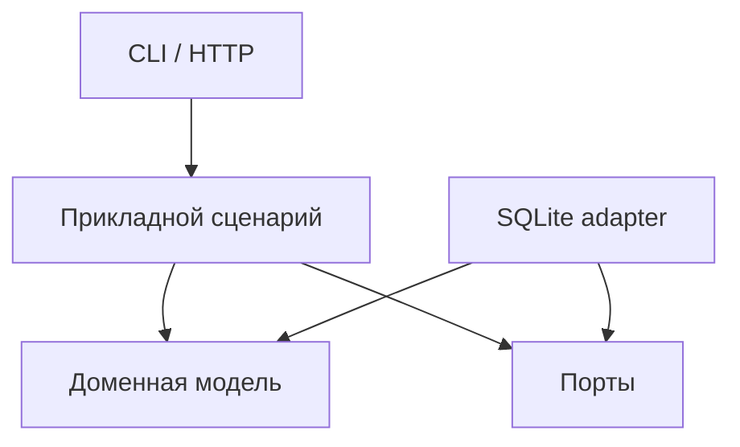

Скачиваемый файл сейчас создать не удалось: среда работы с файлами недоступна. Ниже — Markdown для `chapters/21. application_architecture_and_design.md`. Примеры и тесты включены, но в этой сессии не запускались.

# Архитектура и проектирование Python-приложений

Архитектура определяет, где принимаются решения, как взаимодействуют части приложения, кто владеет состоянием и что происходит при ошибках.

Хорошая архитектура помогает отвечать на конкретные вопросы:

- Где изменить бизнес-правило?
- Какие компоненты затронет замена базы данных?
- Кто открывает и закрывает соединение?
- Что произойдёт, если операция выполнится повторно?
- Какие изменения должны сохраниться атомарно?
- Как проверить сценарий без HTTP-сервера и внешних сервисов?
- Как понять, что рефакторинг сохранил поведение?

Количество классов, интерфейсов и директорий само по себе не показывает качество проектирования. Оценивайте архитектуру по стоимости изменений, понятности поведения и способности системы выполнять свои обязательства.

Основные примеры рассчитаны на Python 3.12+.

**Содержание**

1. [Границы модулей и ответственность](#module-boundaries)
2. [Управление зависимостями и ресурсами](#dependencies-and-resources)
3. [Проектирование публичного API](#public-api)
4. [Паттерны в прикладной архитектуре](#application-patterns)
5. [Работа с существующей кодовой базой](#existing-codebases)
6. [Инженерное ревью и принятие решений](#engineering-decisions)

<a id="module-boundaries"></a>

## Границы модулей и ответственность

### Связность, связанность и направления зависимостей

**Два разных свойства**

В этой главе используются следующие значения терминов:

| Термин | Английский термин | Смысл |
|---|---|---|
| Связность | Cohesion | Насколько содержимое компонента относится к одной ответственности |
| Связанность | Coupling | Насколько компонент зависит от других компонентов |

Модуль с высокой связностью объединяет функции и данные, которые участвуют в одной понятной задаче.

Например, модуль регистрации наборов данных может содержать:

- Проверку идентификатора batch.
- Правила повторной регистрации.
- Результат регистрации.
- Ошибки этого сценария.

Если рядом находятся настройка логирования, отправка писем, SQL-запросы и форматирование HTTP-ответов, причину совместного размещения объяснить сложнее.

**Ответственность — причина изменения**

Фраза «модуль работает с заказами» слишком широка для большого приложения.

Полезнее различать причины изменения:

- Изменились правила расчёта стоимости.
- Поменялся формат внешнего API.
- Изменилась схема хранения.
- Появился другой способ доставки результата.

Если все четыре изменения требуют редактировать одну функцию, в ней смешаны разные ответственности.

Однако одна ответственность не означает одну строку или один метод. Десятки маленьких файлов могут образовать настолько связанную конструкцию, что понимать её будет сложнее одного последовательного модуля.

**Виды связанности**

| Вид зависимости | Пример |
|---|---|
| От конкретного типа | Сценарий создаёт `SqliteRepository` |
| От структуры данных | Код знает внутренние ключи чужого `dict` |
| От порядка действий | Перед `save()` обязательно вызвать `prepare()` |
| От глобального состояния | Результат зависит от изменяемого singleton |
| От времени жизни | Объект работает только пока открыта чужая session |
| От протокола ошибок | Вызывающий код анализирует текст исключения |
| От внутренней реализации | Тест проверяет точное количество приватных вызовов |

Сокращение импортов не обязательно уменьшает связанность. Скрытый service locator может убрать прямые импорты и одновременно сделать реальные зависимости менее заметными.

**Направление зависимостей**

Стабильные правила желательно отделять от деталей, которые меняются по внешним причинам.

Например:



Стрелки здесь обозначают зависимости исходного кода.

Во время выполнения сценарий вызывает SQLite adapter через предоставленный объект. Для этого ему не обязательно импортировать класс адаптера.

**Как выбирать границы**

Обратите внимание на совместные изменения:

- Какие файлы почти всегда меняются вместе?
- Какие понятия постоянно передаются между модулями?
- Где повторяются одинаковые проверки?
- Какой компонент знает слишком много о соседях?

Граница полезна, если она локализует изменения и позволяет описать понятный контракт взаимодействия.

### Доменная модель, прикладные сценарии и инфраструктура

**Три разные ответственности**

| Часть приложения | Главный вопрос |
|---|---|
| Доменная модель | Какие состояния и действия допустимы? |
| Прикладной сценарий | Как выполнить конкретную операцию приложения? |
| Инфраструктура | Как взаимодействовать с БД, сетью, файлами и другими системами? |

Для реестра batch доменными правилами могут быть:

- Число строк неотрицательно.
- Checksum имеет заданный формат.
- Повторная регистрация того же batch с другими данными запрещена.

Прикладной сценарий:

1. Найти существующую регистрацию.
2. Проверить повторный запрос.
3. Создать новую запись при необходимости.
4. Записать событие.
5. Зафиксировать транзакцию.

Инфраструктура определяет, как это сохранить в SQLite или PostgreSQL.

**Домен не обязан знать способ доставки запроса**

Бизнес-правило не должно зависеть от того, пришла команда через:

- CLI.
- HTTP.
- Message broker.
- Планировщик.
- Другой Python-модуль.

Например:

```python
from dataclasses import dataclass


class InvalidQuantity(ValueError):
    pass


@dataclass(frozen=True, slots=True)
class Quantity:
    value: int

    def __post_init__(self) -> None:
        if type(self.value) is not int or self.value < 0:
            raise InvalidQuantity("quantity must be a non-negative integer")


assert Quantity(0).value == 0

try:
    Quantity(True)
except InvalidQuantity:
    pass
else:
    raise AssertionError("bool must not be accepted as a quantity")
```

Обратите внимание на `type(value) is int`: в Python `bool` является подклассом `int`, но логическое значение здесь не соответствует предметному смыслу.

**Прикладной слой координирует**

Он может:

- Открыть Unit of Work.
- Получить необходимые данные.
- Вызвать доменную операцию.
- Сохранить изменения.
- Сформировать результат.

В нём не стоит повторять SQL-маппинг или HTTP parsing.

**Инфраструктура переводит представления**

Например:

- SQL row → доменный объект.
- Доменное событие → JSON envelope.
- Ошибка драйвера → ошибка хранилища.
- HTTP response → результат прикладного порта.

Такой перевод создаёт дополнительный код, но не позволяет деталям внешней системы распространяться по всему приложению.

**Когда богатая доменная модель не нужна**

Если операция представляет собой простую загрузку таблицы без сложных правил, достаточно функции или transaction script.

Создание десятков сущностей для копирования колонок не добавляет полезной модели.

Усложняйте представление там, где действительно существуют инварианты, переходы состояний и предметные решения.

### Functional core / imperative shell

**Отделяйте вычисление решения от выполнения эффектов**

Functional core получает значения и возвращает значения.

Imperative shell:

- Читает вход.
- Получает время.
- Обращается к внешним системам.
- Вызывает вычисление.
- Выполняет необходимые изменения.

Этот подход позволяет проверять значительную часть поведения без инфраструктуры. Он описан, в частности, Gary Bernhardt как functional core / imperative shell. [destroyallsoftware.com](https://www.destroyallsoftware.com/screencasts/catalog/functional-core-imperative-shell?utm_source=chatgpt.com)

**Пример чистого вычисления**

```python
from dataclasses import dataclass


@dataclass(frozen=True, slots=True)
class Partition:
    name: str
    rows: int


@dataclass(frozen=True, slots=True)
class ImportSummary:
    total_rows: int
    empty_partitions: tuple[str, ...]


def summarize(partitions: tuple[Partition, ...]) -> ImportSummary:
    if any(partition.rows < 0 for partition in partitions):
        raise ValueError("row count must be non-negative")

    return ImportSummary(
        total_rows=sum(partition.rows for partition in partitions),
        empty_partitions=tuple(
            partition.name
            for partition in partitions
            if partition.rows == 0
        ),
    )


result = summarize(
    (
        Partition("2026-10-19", 100),
        Partition("2026-10-20", 0),
    )
)

assert result == ImportSummary(
    total_rows=100,
    empty_partitions=("2026-10-20",),
)
```

Функция не читает файлы и не получает текущее время. Для одинаковых значений входа она даёт одинаковый результат.

**Скрытые эффекты тоже важны**

Функция может выглядеть чистой, но зависеть от:

- Глобального кэша.
- Текущей даты.
- Порядка элементов внешней коллекции.
- Случайного числа.
- Callback с побочными эффектами.
- Iterator, который читает сеть при `next()`.

Аннотация `Iterable[Record]` сама по себе не гарантирует отсутствие I/O.

**Не требуется загружать всё в память**

Для большого потока можно отделить:

- Получение очередного ограниченного batch.
- Чистое преобразование этого batch.
- Сохранение результата.

Другой вариант — чистая функция перехода:

```python
def advance_total(current: int, next_value: int) -> int:
    if next_value < 0:
        raise ValueError("negative value")
    return current + next_value


total = 0
for value in (10, 20, 30):
    total = advance_total(total, value)

assert total == 60
```

**Граница имеет практический смысл**

Если тест требует подменить время, сеть и файловую систему ради проверки арифметического правила, возможно, вычисление и эффекты смешаны слишком тесно.

При этом shell тоже требует тестов: ошибки часто находятся именно в транзакциях, cleanup и обработке частичного успеха.

### Слои, ports and adapters и выбор достаточной сложности

**Слой группирует ответственность**

Типичная схема:

- Presentation.
- Application.
- Domain.
- Infrastructure.

Однако слои не обязаны быть четырьмя верхнеуровневыми директориями. В большом приложении часто удобнее группировка по предметным возможностям:

```text
src/
    application/
        datasets/
            domain.py
            services.py
            ports.py
            adapters/
        billing/
            domain.py
            services.py
            ports.py
            adapters/
```

Такая организация помогает видеть, какой функциональности принадлежит изменение.

**Порт описывает необходимое взаимодействие**

Например, сценарию требуется получить регистрацию по ключу. Ему не нужен весь API конкретного ORM.

```python
from dataclasses import dataclass
from typing import Protocol


@dataclass(frozen=True, slots=True)
class Registration:
    batch_id: str
    rows: int


class RegistrationReader(Protocol):
    def get(self, batch_id: str) -> Registration | None:
        ...


class MemoryReader:
    def __init__(self, values: dict[str, Registration]) -> None:
        self._values = dict(values)

    def get(self, batch_id: str) -> Registration | None:
        return self._values.get(batch_id)


def exists(reader: RegistrationReader, batch_id: str) -> bool:
    return reader.get(batch_id) is not None


reader = MemoryReader({"batch-1": Registration("batch-1", 10)})
assert exists(reader, "batch-1")
```

`Protocol` поддерживает структурную типизацию: явное наследование от него для реализации обычно не требуется. Аннотации при этом не обеспечивают автоматическую runtime-проверку поведения объекта. [Python 3.14.8 documentation](https://docs.python.org/3.14/library/typing.html?utm_source=chatgpt.com)

**Адаптер реализует взаимодействие**

Им может быть:

- SQLite repository.
- HTTP client.
- Обёртка SDK.
- In-memory implementation.
- CLI handler, вызывающий прикладной сценарий.

Ports and adapters отделяет внутреннее поведение приложения от технологий взаимодействия с внешним миром. Исходное описание подхода принадлежит Alistair Cockburn. [alistair.cockburn.us](https://alistair.cockburn.us/hexagonal-architecture/?utm_source=chatgpt.com)

**Каждая абстракция имеет цену**

Она добавляет:

- Новый контракт.
- Дополнительный переход при чтении кода.
- Тесты совместимости реализаций.
- Решение о преобразовании ошибок.
- Поддержку эволюции интерфейса.

Порт полезен, когда изолирует значимую внешнюю зависимость или выражает понятную потребность потребителя.

**Модульный монолит**

Для многих приложений достаточно одного процесса и одной поставляемой системы с ясными внутренними границами.

Выделение отдельного сервиса добавляет:

- Сетевые отказы.
- Раздельные транзакции.
- Версионирование сообщений.
- Наблюдаемость взаимодействий.
- Отдельный deployment.
- Дополнительную эксплуатацию.

Решение о сервисе должно опираться на требования к независимому жизненному циклу, масштабированию и владению, а не только на размер директории.

<a id="dependencies-and-resources"></a>

## Управление зависимостями и ресурсами

### Dependency injection и composition root

**Dependency injection — явная передача зависимости**

```python
from collections.abc import Callable
from datetime import datetime, timezone


def create_label(
    name: str,
    *,
    now: Callable[[], datetime],
) -> str:
    timestamp = now()
    if timestamp.tzinfo is None or timestamp.utcoffset() is None:
        raise ValueError("timezone-aware timestamp required")
    return f"{name}:{timestamp.astimezone(timezone.utc).date().isoformat()}"


fixed = datetime(2026, 10, 20, tzinfo=timezone.utc)
assert create_label("daily", now=lambda: fixed) == "daily:2026-10-20"
```

Функция не выбирает источник времени самостоятельно.

Точно так же можно передать repository, отправитель событий или стратегию расчёта.

**Container не обязателен**

Для небольшого приложения обычные конструкторы и функции часто достаточны.

Главное — отделить сборку объектов от их использования. Это центральная идея, подробно рассматриваемая Martin Fowler при сравнении dependency injection и service locator. [martinfowler.com](https://martinfowler.com/articles/injection.html?utm_source=chatgpt.com)

**Composition root собирает приложение**

В одном месте определяются:

- Конфигурация.
- Конкретные адаптеры.
- Фабрики ресурсов.
- Прикладные сценарии.
- Внешние handlers.

Например:

```python
from dataclasses import dataclass
from functools import partial
from collections.abc import Callable


def calculate(value: int, *, factor: int) -> int:
    return value * factor


@dataclass(frozen=True)
class Application:
    calculate: Callable[[int], int]


def build_application(factor: int) -> Application:
    if factor <= 0:
        raise ValueError("positive factor required")
    return Application(calculate=partial(calculate, factor=factor))


application = build_application(3)
assert application.calculate(4) == 12
```

В реальном приложении вместо `factor` передаются более содержательные зависимости.

**Service locator скрывает зависимости**

```python
def execute():
    repository = global_container.resolve("repository")
```

Из сигнатуры такой функции неизвестно, что ей необходимо.

Это усложняет:

- Изолированное тестирование.
- Проверку конфигурации.
- Понимание времени жизни.
- Поиск реального графа зависимостей.

Если используется DI framework, желательно, чтобы его специальные механизмы оставались около composition root и внешних handlers.

### Время жизни объекта: запрос, задача, процесс и приложение

**Зависимость имеет scope**

| Scope | Примеры |
|---|---|
| Один вызов | Локальный результат, временный parser |
| Один запрос | Transaction, request context |
| Одна задача | Job state, progress tracker |
| Один worker | Некоторые клиенты и локальные кэши |
| Один процесс | Connection pool, конфигурация, metrics registry |
| Всё приложение | Логическая политика и deployment configuration |

Физически process-scoped объект существует отдельно в каждом процессе. Глобальная переменная не становится общей памятью нескольких workers.

**Время жизни владельца ограничивает вложенные зависимости**

Если долгоживущий объект сохраняет request-scoped connection, он может использовать её после завершения запроса.

Эта проблема часто называется captive dependency: короткоживущая зависимость оказывается захвачена более долгоживущим объектом.

Признаки:

- Background task использует session завершившегося запроса.
- Singleton содержит mutable данные конкретного пользователя.
- HTTP response stream возвращён после закрытия клиента.
- Generator читает закрытый файл.

**Долгоживущая фабрика и короткоживущий ресурс**

Полезно различать:

- Фабрику session — можно хранить долго.
- Конкретную session — использовать в ограниченном scope.

SQLAlchemy отдельно описывает требования к конкурентному использованию `Session` и `AsyncSession`; один изменяемый экземпляр не следует произвольно разделять между потоками или concurrent tasks. [SQLAlchemy 2.0 Documentation](https://docs.sqlalchemy.org/en/20/orm/session_basics.html?utm_source=chatgpt.com)

**Передавайте в фоновые задачи значения**

Хорошие кандидаты:

- Идентификатор объекта.
- Immutable command.
- Correlation ID.
- Snapshot необходимых параметров.

Background task создаёт собственные ресурсы внутри своего lifetime.

**ContextVar не управляет ресурсом**

Он удобен для metadata вроде trace ID.

Но сохранение connection в `ContextVar` не определяет:

- Кто её закрывает.
- Как завершить transaction.
- Можно ли использовать её конкурентно.
- Что происходит при создании дочерней task.

Scope контекста и протокол владения ресурсом нужно проектировать отдельно.

### Явное владение, cleanup и частичная инициализация

**У каждого ресурса должен быть владелец**

Владелец отвечает за завершение жизненного цикла.

Borrower временно использует ресурс и следует контракту владельца.

Пример:

- Unit of Work владеет connection.
- Repository заимствует connection.
- Прикладной сценарий владеет Unit of Work.
- CLI владеет выполнением сценария.

**Context manager выражает ограниченный scope**

```python
from contextlib import ExitStack
from pathlib import Path
from tempfile import TemporaryDirectory


class Client:
    def __init__(self) -> None:
        self.closed = False

    def close(self) -> None:
        self.closed = True


with TemporaryDirectory() as directory:
    path = Path(directory) / "input.txt"
    path.write_text("10\n20\n", encoding="utf-8")

    client = Client()

    with ExitStack() as stack:
        stream = stack.enter_context(path.open(encoding="utf-8"))
        stack.callback(client.close)

        total = sum(int(line) for line in stream)
        assert total == 30

    assert stream.closed
    assert client.closed
```

Если обработка завершится исключением, зарегистрированный cleanup всё равно выполняется.

`ExitStack` особенно полезен, когда ресурсы приобретаются последовательно и следующий шаг может завершиться ошибкой. [Python 3.14.8 documentation](https://docs.python.org/3.14/library/contextlib.html?utm_source=chatgpt.com)

**Ошибка в `__enter__` требует отдельной обработки**

Если `__enter__` не завершился успешно, Python не вызывает соответствующий `__exit__`.

Поэтому частично созданные ресурсы необходимо освободить внутри неуспешной инициализации.

Типичная последовательность:

1. Открыли connection.
2. Настроили её.
3. Начали transaction.
4. Создали repositories.

Ошибка на третьем шаге не должна оставлять connection открытой.

**Cleanup тоже может завершиться ошибкой**

Нужно решить:

- Как сохранить исходное исключение.
- Как сообщить об ошибке rollback.
- Можно ли продолжать использовать процесс.
- Известен ли итог внешней операции.

Если rollback выбросил исключение и затёр первоначальную ошибку, диагностика становится сложнее.

В зависимости от API применяют exception chaining, notes, группы исключений и отдельные события диагностики.

**Generator возвращает не только значения**

Если generator использует файл, срок жизни файла связан с потреблением generator.

Не стоит возвращать ленивое чтение из уже завершившегося `with`.

Вместо этого можно сделать контекст явным:

```python
from contextlib import contextmanager
from pathlib import Path
from tempfile import TemporaryDirectory


@contextmanager
def open_numbers(path: Path):
    with path.open(encoding="utf-8") as stream:
        yield (int(line) for line in stream)


with TemporaryDirectory() as directory:
    path = Path(directory) / "numbers.txt"
    path.write_text("1\n2\n3\n", encoding="utf-8")

    with open_numbers(path) as numbers:
        assert next(numbers) == 1
        # Даже при раннем завершении потребления файл закроется при выходе.
```

### Configuration objects и ограничение глобального состояния

**Конфигурация — вход приложения**

Она должна иметь:

- Определённые источники.
- Порядок приоритетов.
- Типы.
- Значения по умолчанию.
- Правила проверки.
- Момент применения.

Чтение environment из разных частей приложения создаёт распределённый неявный контракт.

**Предпочтительнее один этап преобразования**

```python
from dataclasses import dataclass
import math
from collections.abc import Mapping


@dataclass(frozen=True, slots=True)
class Settings:
    timeout_seconds: float
    max_workers: int

    def __post_init__(self) -> None:
        if (
            type(self.timeout_seconds) not in (int, float)
            or not math.isfinite(self.timeout_seconds)
            or self.timeout_seconds <= 0
        ):
            raise ValueError("positive finite timeout required")

        if type(self.max_workers) is not int or not 1 <= self.max_workers <= 64:
            raise ValueError("max_workers must be in 1..64")


def load_settings(environment: Mapping[str, str]) -> Settings:
    return Settings(
        timeout_seconds=float(environment.get("APP_TIMEOUT", "5")),
        max_workers=int(environment.get("APP_WORKERS", "4")),
    )


settings = load_settings({"APP_TIMEOUT": "2.5", "APP_WORKERS": "3"})
assert settings == Settings(timeout_seconds=2.5, max_workers=3)
```

Сам `os.environ` передаёт composition root.

**Frozen dataclass не обеспечивает глубокую immutable-модель**

Если поле содержит `dict`, его содержимое остаётся изменяемым.

Для действительно неизменяемой конфигурации выбирайте подходящие значения:

- `tuple`.
- `frozenset`.
- Frozen value objects.
- Контролируемые read-only representations.

**Не читайте конфигурацию слишком рано**

Создание клиента или чтение secrets при импорте модуля усложняет:

- Tests.
- CLI startup.
- Повторную сборку приложения с другой конфигурацией.
- Импорт модуля инструментами документации.

Импорт должен преимущественно определять объекты, а запуск — явно собирать и активировать приложение.

**Перезагрузка конфигурации**

Для reload нужны дополнительные решения:

- Что происходит с текущими запросами?
- Какие параметры можно менять без restart?
- Как заменить связанные ресурсы?
- Кто закрывает старый клиент?
- Как откатить неуспешное обновление?

Замена глобального `settings` не решает эти вопросы автоматически.

<a id="public-api"></a>

## Проектирование публичного API

### Параметры, результаты, ошибки, побочные эффекты и владение данными

**Сигнатура — только часть контракта**

Контракт операции включает:

| Часть | Вопрос |
|---|---|
| Параметры | Какие значения допустимы? |
| Результат | Что означает возвращённое значение? |
| Ошибки | Какие состояния представлены исключениями? |
| Эффекты | Какие данные могут измениться? |
| Атомарность | Что сохраняется вместе? |
| Повтор | Что происходит при повторном вызове? |
| Владение | Кто закрывает ресурсы и может изменять данные? |
| Конкурентность | Можно ли вызывать операцию одновременно? |

Например, `save(value) -> None` не объясняет:

- Выполнен ли commit.
- Можно ли менять `value` после вызова.
- Сохраняется snapshot или ссылка.
- Произошла ли запись при исключении.

**Используйте предметные результаты**

```python
from dataclasses import dataclass


@dataclass(frozen=True, slots=True)
class RegistrationResult:
    batch_id: str
    created: bool


first = RegistrationResult("batch-1", created=True)
repeated = RegistrationResult("batch-1", created=False)
```

`created=False` может означать успешный идемпотентный повтор, а не отказ.

**Отсутствие и `None` могут различаться**

Для частичного обновления:

- Поле отсутствует — не менять.
- Поле равно `None` — очистить.

Такой контракт нельзя выразить единственным default `None`, если оба состояния имеют разный смысл.

Нужен отдельный sentinel или DTO с явной информацией о присутствии поля.

**Ошибки должны иметь устойчивую семантику**

Полезно разделять:

- Неверный вход.
- Предметный конфликт.
- Отсутствие объекта.
- Недоступность инфраструктуры.
- Неопределённый результат внешнего действия.
- Ошибку реализации.

Не переводите любую ошибку SQL в `NotFound`: это скрывает outage и повреждение данных.

**Укажите владение результатом**

Если возвращён mutable объект из внутреннего cache, вызывающий код может изменить состояние следующих запросов.

Возможные контракты:

- Независимая копия.
- Immutable value.
- Borrowed view.
- Объект с явным lifetime.

Копирование тоже имеет стоимость, поэтому решение должно быть осознанным.

### Синхронный vs асинхронный интерфейс и контракт отмены

**Async API описывает способ исполнения**

Асинхронный интерфейс полезен, когда операция сотрудничает с event loop и использует совместимые неблокирующие зависимости.

Само наличие `async def` не делает синхронный driver неблокирующим.

**Не смешивайте два интерфейса случайно**

Обычно понятнее иметь:

```python
def load_manifest(...):
    ...
```

и отдельно:

```python
async def load_manifest_async(...):
    ...
```

чем возвращать иногда результат, а иногда awaitable.

**Определите cancellation contract**

Что происходит при отмене:

- Прекращается только ожидание?
- Операция действительно останавливается?
- Выполняется rollback?
- Может ли результат уже быть сохранён?
- Должен ли вызывающий код проверить состояние по operation ID?

`asyncio` использует кооперативную отмену. `CancelledError` требует корректного cleanup и обычно должен распространяться дальше после него. [Python 3.14.8 documentation](https://docs.python.org/3.14/library/asyncio-task.html?utm_source=chatgpt.com)

**Пример ограниченного владения task**

```python
import asyncio
from contextlib import suppress


async def worker(started: asyncio.Event, cleaned: asyncio.Event) -> None:
    try:
        started.set()
        await asyncio.Event().wait()
    finally:
        cleaned.set()


async def main() -> None:
    started = asyncio.Event()
    cleaned = asyncio.Event()

    task = asyncio.create_task(worker(started, cleaned))
    await started.wait()

    task.cancel()
    with suppress(asyncio.CancelledError):
        await task

    assert task.done()
    assert cleaned.is_set()


asyncio.run(main())
```

Пример показывает завершение task. Он не доказывает отмену уже выполненной записи в БД или отправленного HTTP-запроса.

**Timeout и результат операции**

Если клиент перестал ждать после commit, данные могли сохраниться.

Повторное выполнение должно использовать устойчивую идентичность операции и подходящий idempotency contract.

**Переход в thread**

Отмена ожидания `asyncio.to_thread()` не гарантирует остановку уже работающей функции в потоке.

Поэтому нужны:

- Ограничение числа таких операций.
- Собственные timeouts у blocking dependency.
- Протокол завершения worker.
- Контроль удерживаемых ресурсов.

Асинхронность не отменяет архитектуру владения.

### Композиция, callbacks, hooks и плагины

**Выбирайте минимальный механизм расширения**

| Потребность | Подход |
|---|---|
| Подставить небольшой алгоритм | Callable |
| Передать несколько связанных операций | Protocol/object |
| Обернуть поведение | Decorator/composition |
| Добавить несколько точек расширения | Hooks с явным порядком |
| Подключать внешние пакеты | Plugin API |

Простой выбор алгоритма не требует plugin framework.

**Callback — полноценная зависимость**

Нужно определить:

- Синхронный он или асинхронный.
- Когда вызывается.
- Что получает.
- Можно ли изменить аргументы.
- Что происходит при исключении.
- Допустим ли повторный вход.
- Может ли callback блокировать.

**Уведомление до и после commit имеет разный смысл**

Callback до commit может отменить сценарий, но не должен создавать необратимый внешний эффект без отдельного протокола.

Callback после commit может завершиться ошибкой, хотя основной результат уже сохранён.

Если уведомление должно пережить crash, обычного callback недостаточно.

**Plugins имеют жизненный цикл**

Обычно требуется определить:

1. Discovery.
2. Проверку совместимости.
3. Создание экземпляра.
4. Startup.
5. Использование.
6. Shutdown.

Для discovery установленных расширений Python предоставляет package entry points через `importlib.metadata`. Загрузка найденного entry point исполняет код соответствующего пакета. [Python 3.14.8 documentation](https://docs.python.org/3.14/library/importlib.metadata.html?utm_source=chatgpt.com)

```python
from importlib.metadata import entry_points


def discover_exporters() -> tuple[str, ...]:
    discovered = entry_points(group="manifest_registry.exporters")
    return tuple(sorted(entry.name for entry in discovered))


# Только обнаружение metadata; загрузка plugin здесь не выполняется.
names = discover_exporters()
assert isinstance(names, tuple)
```

**Определите политику отказов**

Если необязательный exporter не загрузился, приложение может продолжить работу с диагностикой.

Если не загрузился обязательный storage adapter, запуск обычно должен завершиться ошибкой.

Тихое игнорирование любой ошибки plugin создаёт систему, состояние которой трудно объяснить.

### Обратная совместимость, deprecation и миграции пользователей

**Совместимость шире сигнатуры**

Поведение может нарушиться после изменения:

- Default значения.
- Порядка результата.
- Типа исключения.
- Момента выполнения I/O.
- Ленивого результата на eager.
- Правил обработки `None`.
- Формата даты.
- Семантики повторного вызова.
- Времени жизни возвращаемого объекта.

Даже сохранение имени функции не обеспечивает совместимость.

**Deprecation должна вести к действию**

Пользователю нужны:

- Что устарело.
- Чем заменить.
- Как перенести код.
- В каких версиях действует переход.
- Когда старый путь будет удалён.

PEP 387 описывает политику совместимости Python. Для своей библиотеки следует определить собственную политику, учитывающую её пользователей и цикл выпуска. [peps.python.org](https://peps.python.org/pep-0387/?utm_source=chatgpt.com)

**Пример предупреждения**

```python
import warnings


def register_batch(*, batch_id: str) -> str:
    return batch_id


def save_batch(batch_id: str) -> str:
    warnings.warn(
        "save_batch() is deprecated; use register_batch(batch_id=...)",
        DeprecationWarning,
        stacklevel=2,
    )
    return register_batch(batch_id=batch_id)
```

`stacklevel` помогает указать вызывающий код, которому требуется изменение.

Предупреждение должно сопровождаться тестами старого и нового интерфейсов.

**Переходные адаптеры**

Полезная последовательность:

1. Добавить новый API.
2. Реализовать старый API через adapter.
3. Перенести внутренних потребителей.
4. Опубликовать migration guide.
5. Измерить использование старого пути, если это возможно.
6. Удалить его согласно политике.

**Номер версии не заменяет контракт**

Нужно отдельно определить:

- Что считается breaking change.
- Поддерживаемые Python versions.
- Совместимость wire formats.
- Совместимость соседних deployment versions.
- Период поддержки.

Правила package version ordering и политика совместимости API решают разные задачи.

### Стабильная сериализация и versioned contracts

**Wire contract проектируется отдельно от внутренних объектов**

Внутренний dataclass может изменяться вместе с реализацией.

Внешнее сообщение требует устойчивого соглашения:

```json
{
  "event_type": "batch.registered",
  "schema_version": 1,
  "event_id": "629297c2-70bd-4a19-9db1-e62e8f4352b0",
  "payload": {
    "dataset": "sales",
    "batch_id": "2026-10-20.001",
    "row_count": 1500,
    "checksum_sha256": "aaaaaaaaaaaaaaaaaaaaaaaaaaaaaaaaaaaaaaaaaaaaaaaaaaaaaaaaaaaaaaaa",
    "registered_at": "2026-10-20T12:00:00Z"
  }
}
```

**Определите представление каждого поля**

| Поле | Что нужно уточнить |
|---|---|
| Время | Timezone, точность, допустимый формат |
| Число | Диапазон, дробная часть, округление |
| Отсутствие | Missing vs `null` |
| Идентификатор | Формат и область уникальности |
| Коллекция | Значимость порядка и дубликатов |
| Enum | Поведение при неизвестном значении |
| Строка | Нормализация, длина, допустимые символы |

**Не привязывайте wire format к `__dict__`**

Такой подход случайно публикует:

- Приватные поля.
- Кэши.
- Новые внутренние атрибуты.
- Объекты, которые нельзя стабильно сериализовать.

Лучше явно перечислить внешние поля.

**Versioning требует политики чтения**

Например:

- Writer выпускает только v2.
- Reader понимает v1 и v2.
- Старые сообщения преобразуются в текущую внутреннюю модель.
- Неизвестная версия отклоняется понятной ошибкой.

Простое добавление `schema_version` без соответствующего decoder ничего не решает.

**Сериализация не заменяет валидацию**

Успешный `json.loads()` не подтверждает:

- Наличие обязательных полей.
- Правильные типы.
- Размер payload.
- Допустимость значений.
- Авторизацию действия.

Для durable events также учитывают срок хранения и возможность replay старых версий.

<a id="application-patterns"></a>

## Паттерны в прикладной архитектуре

### Repository, Unit of Work, Strategy и Adapter

**Repository**

Repository выражает операции доступа к предметным объектам.

Например:

```python
class ManifestRepository:
    def get(self, key):
        ...

    def add(self, manifest):
        ...
```

Это не обязательно универсальная коллекция со всеми CRUD-методами.

Repository может иметь предметные операции вроде:

- `find_pending_batches()`.
- `get_for_update()`.
- `list_expired_reservations()`.

Паттерн отделяет представление предметных объектов от деталей доступа к данным. [martinfowler.com](https://martinfowler.com/eaaCatalog/repository.html?utm_source=chatgpt.com)

**Unit of Work**

Unit of Work задаёт границу согласованного изменения:

```python
with uow_factory() as uow:
    ...
    uow.commit()
```

В варианте этой главы:

- Commit вызывается явно.
- Выход без commit означает rollback.
- Repositories используют одну transaction.
- Unit of Work закрывает принадлежащие ему ресурсы.

Связь Repository и Unit of Work подробно рассматривается в *Architecture Patterns with Python*. [cosmicpython.com](https://www.cosmicpython.com/book/chapter_06_uow.html?utm_source=chatgpt.com)

**Не делайте commit в каждом repository**

Если два repository должны участвовать в одной операции, внутренние независимые commits разрушают общую атомарность.

Владелец transaction должен быть определён на уровне сценария или явно заданной transaction boundary.

**Strategy**

Strategy подставляет способ принятия решения:

```python
from collections.abc import Callable


def choose_partition(
    key: str,
    *,
    strategy: Callable[[str], str],
) -> str:
    return strategy(key)


assert choose_partition(
    "2026-10-20T12:00:00",
    strategy=lambda value: value[:10],
) == "2026-10-20"
```

Для короткого алгоритма достаточно функции.

**Adapter**

Adapter переводит чужой интерфейс в необходимый приложению контракт.

Он может преобразовывать:

- Названия операций.
- Аргументы.
- Формат результата.
- Ошибки.
- Правила владения ресурсами.

**Fake должен соответствовать значимому контракту**

In-memory repository без transaction semantics плохо заменяет БД в тесте rollback.

Поэтому проверяют общий набор сценариев на fake и реальном adapter.

### Domain services, value objects и транзакционные границы

**Value object определяется значением**

Примеры:

- Batch key.
- Денежная сумма с валютой.
- Диапазон дат.
- Checksum.
- Количество строк.

Для него важны корректность создания, сравнение и отсутствие неожиданных изменений.

**Entity имеет идентичность**

Состояние сущности может изменяться, а предметная идентичность сохраняется.

Не каждая строка БД обязана становиться отдельной entity. Выбирайте модель по правилам приложения.

**Aggregate задаёт границу инвариантов**

Если несколько частей должны изменяться вместе, у них должен быть согласованный механизм проверки и фиксации.

Например, проверка остатка и создание резервирования требуют защиты от конкурентного изменения.

Обычного последовательного Python-кода недостаточно, если несколько процессов выполняют сценарий одновременно.

Используются подходящие:

- Transaction isolation.
- Locks.
- Optimistic concurrency.
- Условные updates.
- Unique constraints.

**Domain service выражает предметное решение**

Он полезен, когда правило не принадлежит естественным образом одному объекту.

Но класс `DomainService`, который лишь вызывает repository и отправляет HTTP, обычно содержит прикладную координацию, а не доменное решение.

**Transaction boundary имеет цену**

Длинная transaction может удерживать locks и connection.

Поэтому внешние медленные calls внутри неё требуют отдельного обоснования.

Часто полезно:

1. Подготовить необходимые внешние данные.
2. Открыть короткую transaction.
3. Перепроверить критичные условия.
4. Зафиксировать изменения.

Но перенос чтения за transaction может создать race. Необходимость повторной проверки зависит от инварианта.

### События, event-driven взаимодействие и цена распределённости

**Command и event имеют разный смысл**

Command выражает намерение:

> Зарегистрировать batch.

Event выражает факт:

> Batch зарегистрирован.

Handler команды может отклонить действие. Событие должно описывать уже произошедшее состояние в рамках выбранного контракта.

**Локальные и интеграционные события**

Локальное событие может использоваться для взаимодействия частей одного приложения.

Интеграционное сообщение пересекает границу:

- Процесса.
- Deployment.
- Команды.
- Организации.
- Версии схемы.

Поэтому оно требует более устойчивого wire contract.

**Проблема двойной записи**

Последовательность:

1. Commit в БД.
2. Publish в broker.

может завершиться crash между шагами.

Обратный порядок создаёт другую проблему: сообщение опубликовано, а transaction не сохранилась.

**Transactional outbox**

Прикладные данные и запись сообщения сохраняются в одной database transaction. Отдельный publisher доставляет накопленные записи. Это устраняет конкретную проблему атомарности записи данных и намерения отправить сообщение. [microservices.io](https://microservices.io/patterns/data/transactional-outbox.html?utm_source=chatgpt.com)

**Outbox не обеспечивает единственную доставку**

Publisher может:

1. Отправить сообщение.
2. Упасть до отметки об отправке.
3. Повторить отправку.

Consumer должен учитывать дубликаты, например через inbox или другой idempotency mechanism.

**Распределённость добавляет обязательства**

Нужно определить:

- Retry policy.
- Dead-letter processing.
- Порядок сообщений.
- Deduplication.
- Совместимость schemas.
- Replay.
- Backpressure.
- Наблюдаемость задержки.
- Восстановление после частичного успеха.

События уменьшают некоторые прямые зависимости, но добавляют временные и контрактные.

<a id="existing-codebases"></a>

## Работа с существующей кодовой базой

### Characterization tests и безопасный incremental refactoring

**Сначала зафиксируйте наблюдаемое поведение**

Characterization test описывает, что делает существующая система в выбранном сценарии.

Это помогает менять реализацию, когда исходный контракт документирован неполно.

Наблюдать стоит:

- Результат.
- Ошибки.
- Сохранённые данные.
- Внешние обращения.
- Правила порядка.
- Поведение на пустом входе.
- Повторное выполнение.

**Не закрепляйте случайные детали**

Тест на конкретное имя приватного метода может мешать рефакторингу, не защищая полезное поведение.

Полезнее проверить:

> Повтор команды не создаёт вторую запись.

чем:

> Метод `_prepare_internal_state()` вызывается один раз.

**Нормализуйте нестабильные значения**

Для snapshot/golden tests отдельно обрабатывают:

- Время.
- UUID.
- Порядок неупорядоченных результатов.
- Пути временных файлов.
- Версии внешних систем.

Предпочтительнее внедрить контролируемые зависимости, чем удалить из сравнения все неудобные поля.

**Переносите по одному сценарию**

Возможная последовательность:

1. Добавить characterization tests.
2. Выделить входной и выходной контракт.
3. Создать seam для зависимости.
4. Перенести вычисление.
5. Подключить новую реализацию.
6. Сравнить результат.
7. Удалить старый путь.

Подход постепенного замещения старой реализации связан с Strangler Fig pattern. [martinfowler.com](https://martinfowler.com/bliki/StranglerFigApplication.html?utm_source=chatgpt.com)

**Исправление поведения — отдельное изменение**

Если обнаружен баг, полезно:

- Зафиксировать текущий результат.
- Описать желаемый контракт.
- Добавить тест нового поведения.
- Отдельно изменить реализацию.

Так reviewer отличит перенос кода от изменения смысла.

### Разрыв циклических зависимостей и выделение интерфейсов

**Цикл часто показывает смешение ответственности**

Например:

- `services` импортирует `repositories`.
- `repositories` импортирует DTO из `services`.

Возможные решения:

- Перенести общие значения в независимый модуль.
- Определить порт со стороны потребителя.
- Вынести сборку в composition root.
- Разделить слишком широкий модуль.
- Убрать побочные эффекты import.

**Пример правильного направления**

```text
domain.py
    не зависит от application и adapters

ports.py
    зависит от domain

application.py
    зависит от domain и ports

sqlite_adapter.py
    зависит от domain и ports

bootstrap.py
    соединяет application и sqlite_adapter
```

Это распределение ответственности, а не обязательный шаблон имён.

**Не создавайте новый общий склад**

Перенос всех конфликтующих объектов в `common.py` может убрать import cycle и сохранить смысловую связанность.

Общий модуль должен иметь собственную понятную ответственность.

**Deferred import решает ограниченную задачу**

Импорт внутри функции может быть оправдан для:

- Необязательной зависимости.
- Ленивой загрузки тяжёлого компонента.
- Специфического framework lifecycle.

Но если это единственный способ импортировать основные модули приложения, следует проверить архитектурную причину.

**`TYPE_CHECKING` не меняет все зависимости**

Он помогает избежать некоторых runtime imports, необходимых только для аннотаций.

Если функция всё равно создаёт конкретный adapter, её архитектурная зависимость остаётся.

**Проверьте `__init__.py`**

Удобные re-exports могут незаметно импортировать большой граф модулей и запускать инициализацию.

Публичный package API должен быть явным и не превращать импорт одного value object в старт инфраструктуры.

### Technical debt: влияние, стоимость и приоритет изменений

**Технический долг описывается последствиями**

Вместо:

> Код некрасивый.

полезнее:

> Добавление одного формата требует менять двенадцать модулей, а ошибка в одном converter обнаруживается только в production.

Такое описание связывает проблему со стоимостью и риском.

**Оценивайте несколько факторов**

| Фактор | Вопрос |
|---|---|
| Частота изменений | Как часто затрагивается участок? |
| Последствия ошибки | Что происходит при нарушении? |
| Стоимость сопровождения | Сколько времени тратится регулярно? |
| Связность изменений | Сколько компонентов приходится менять? |
| Проверяемость | Есть ли воспроизводимый тест? |
| Обратимость | Можно ли безопасно выполнить migration? |

**Не всякая простота является долгом**

Прямой SQL в небольшом изолированном CLI может быть разумным решением.

Проблема возникает, когда он начинает дублировать критичные правила или препятствует необходимым изменениям.

**Выбирайте измеримый следующий шаг**

Примеры:

- Убрать повторную реализацию одного инварианта.
- Сократить scope transaction.
- Добавить idempotency key.
- Выделить стабильный порт.
- Закрыть утечку ресурсов.
- Добавить characterization test перед migration.

**Планируйте завершение**

Незавершённая migration с двумя параллельными путями может увеличить стоимость поддержки.

У задачи должны быть:

- Область.
- Критерий готовности.
- План перехода.
- План удаления старого пути.
- Проверка результата.

<a id="engineering-decisions"></a>

## Инженерное ревью и принятие решений

### Корректность, сложность, тестируемость и поведение при сбое

**Ревью начинается с контракта**

До обсуждения имён классов нужно понять:

- Что гарантирует операция?
- Где её граница?
- Какие состояния допустимы?
- Какие эффекты уже могли произойти при исключении?

**Полезная последовательность проверки**

1. Вход и инварианты.
2. Основной успешный путь.
3. Повторное выполнение.
4. Конкурентный вызов.
5. Ошибка до эффекта.
6. Ошибка после части эффектов.
7. Неопределённый результат commit.
8. Cleanup.
9. Наблюдаемость.
10. Совместимость.

**Проверяемость показывает качество границ**

Если простое бизнес-правило требует поднять весь deployment, возможно, его зависимости выражены слишком широко.

Если все тесты используют fake и ни один не проверяет настоящий adapter, возможно, не проверены важные инфраструктурные свойства.

Нужны оба уровня:

- Быстрые проверки правил.
- Проверки реального взаимодействия.

**Оценивайте сложность поведения**

Пять классов с неявным порядком вызовов могут быть сложнее одной функции.

Дополнительная абстракция должна объяснять, какое решение она локализует и какой контракт делает явным.

**Результат при сбое важнее формы исключения**

Проверяйте не только `assertRaises`, но и состояние после ошибки:

- Данные не изменились.
- Событие не появилось.
- Connection закрыта.
- Повтор остаётся возможен.
- Ошибка не превратилась в молчаливый успех.

### ADR, trade-offs, ограничения и проверка предположений

**ADR сохраняет причину решения**

Architecture Decision Record объясняет, почему в конкретном контексте выбран вариант и какие последствия приняты.

Исходная идея небольших записей архитектурных решений описана Michael Nygard. [cognitect.com](https://cognitect.com/blog/2011/11/15/documenting-architecture-decisions?utm_source=chatgpt.com)

**Пример ADR**

```markdown
Название: Хранить регистрацию batch и outbox в одной SQLite transaction

Статус: принято для учебного приложения

Контекст:
- Один процесс приложения.
- Небольшое число операций регистрации.
- Требуется атомарность manifest и события.
- Внешний broker не нужен для запуска примера.

Решение:
- Использовать Repository и Unit of Work.
- Применять явный commit.
- При выходе без commit выполнять rollback.
- Сохранять событие в outbox той же БД.
- Повтор определять по dataset + batch_id.

Последствия:
- Пример запускается без отдельного сервера.
- Записи SQLite конкурируют за writer lock.
- Требуется отдельный publisher для доставки событий.
- Автоматической доставки exactly once нет.

Условия пересмотра:
- Нужны несколько сервисных экземпляров с высокой нагрузкой записи.
- Возникли требования к другой модели блокировок.
- Измерения показывают неприемлемое ожидание writer lock.
```

**Отделяйте факт от предположения**

Факт:

> Приложение сохраняет обе записи одной transaction.

Предположение:

> Записей будет мало.

Предположение нужно проверять наблюдением и нагрузочным экспериментом.

**Определите стоимость пересмотра**

Наличие порта может облегчить замену adapter, но не гарантирует одинаковые:

- Isolation.
- Locking.
- SQL constraints.
- Retry semantics.
- Migration behavior.

После замены БД необходимо проверить её реальные свойства.

### Code review, Git, небольшие изменения и диагностика регрессий

**Одна логическая цель облегчает ревью**

Полезно отдельно выполнять:

- Перенос кода без изменения поведения.
- Изменение контракта.
- Обновление dependency.
- Добавление нового adapter.
- Оптимизацию.

Если эти действия смешаны, источник regression определить сложнее.

**Описание изменения должно объяснять результат**

Например:

> Повторная регистрация одного batch раньше создавала второе событие. Теперь запрос с теми же данными возвращает существующий manifest, а запрос с другими данными завершается конфликтом. Проверки покрывают обе storage implementations.

Такой текст полезнее списка переименованных классов.

**Проверки перед ревью**

```bash
git status --short
git diff --check
git diff --stat
git diff
```

После подготовки commit отдельно просмотрите staged diff:

```bash
git diff --staged
```

**Для regression нужен воспроизводитель**

У него должны быть:

- Фиксированные входы.
- Понятное ожидаемое поведение.
- Контролируемые зависимости.
- Машинно определяемый результат.

`git bisect` помогает найти изменение между известной рабочей и нерабочей ревизиями. Для `bisect run` код `0` означает хороший результат, а `125` позволяет пропустить непроверяемую ревизию. [git-bisect Documentation](https://git-scm.com/docs/git-bisect?utm_source=chatgpt.com)

Используйте отдельную рабочую копию или worktree, чтобы диагностика не мешала незавершённой работе.

**Архитектурное изменение заканчивается проверкой поведения**

Перенос по директориям завершён, когда:

- Сохранились нужные контракты.
- Проверены adapters.
- Определён lifecycle ресурсов.
- Старый путь удалён или имеет срок удаления.
- Изменение можно объяснить следующему разработчику.

---

**Практический проект: реестр метаданных batch**

Проект показывает один прикладной сценарий:

> Зарегистрировать метаданные batch и атомарно сохранить событие о регистрации.

Он подходит для демонстрации архитектуры небольшого data engineering компонента.

**Контракт**

- Batch идентифицируется парой `dataset + batch_id`.
- Первая регистрация создаёт manifest и событие.
- Повтор с теми же данными возвращает прежний manifest.
- Повтор с другими данными завершается предметным конфликтом.
- Время и event ID передаются зависимостями.
- Commit явный.
- Выход без commit откатывает изменения.
- Есть реализации в памяти и SQLite.
- Аналогичные сценарии проверяются на обеих реализациях.

Это реестр **метаданных**. Он не проверяет наличие файла, фактический checksum содержимого или реальное число строк.

Outbox сохраняет сообщение для будущей доставки. Publisher в проект не входит.

**Структура проекта**

```text
pyproject.toml
src/
    manifest_registry/
        __init__.py
        __main__.py
        domain.py
        ports.py
        application.py
        wire.py
        memory.py
        sqlite.py
        bootstrap.py
        cli.py
tests/
    test_registry.py
```

**`pyproject.toml`**

```toml
[build-system]
requires = ["setuptools>=77"]
build-backend = "setuptools.build_meta"

[project]
name = "manifest-registry"
version = "1.0.0"
requires-python = ">=3.12"
description = "Batch manifest registry with explicit transaction boundaries"

[project.scripts]
manifest-registry = "manifest_registry.cli:main"

[tool.setuptools.packages.find]
where = ["src"]
```

**`src/manifest_registry/domain.py`**

```python
from __future__ import annotations

from dataclasses import dataclass
from datetime import datetime, timezone
import re
from uuid import UUID


class InvalidBatch(ValueError):
    pass


class BatchConflict(Exception):
    pass


_DATASET = re.compile(r"[a-z][a-z0-9_]{0,62}")
_BATCH_ID = re.compile(r"[A-Za-z0-9][A-Za-z0-9._-]{0,63}")
_CHECKSUM = re.compile(r"[0-9a-f]{64}")


@dataclass(frozen=True, slots=True)
class BatchKey:
    dataset: str
    batch_id: str

    def __post_init__(self) -> None:
        if (
            not isinstance(self.dataset, str)
            or _DATASET.fullmatch(self.dataset) is None
        ):
            raise InvalidBatch("invalid dataset")

        if (
            not isinstance(self.batch_id, str)
            or _BATCH_ID.fullmatch(self.batch_id) is None
        ):
            raise InvalidBatch("invalid batch ID")


@dataclass(frozen=True, slots=True)
class BatchSpec:
    key: BatchKey
    row_count: int
    checksum_sha256: str

    def __post_init__(self) -> None:
        if not isinstance(self.key, BatchKey):
            raise InvalidBatch("BatchKey required")

        if (
            type(self.row_count) is not int
            or not 0 <= self.row_count <= 2**63 - 1
        ):
            raise InvalidBatch("invalid row count")

        if (
            not isinstance(self.checksum_sha256, str)
            or _CHECKSUM.fullmatch(self.checksum_sha256) is None
        ):
            raise InvalidBatch("invalid SHA-256 checksum")


@dataclass(frozen=True, slots=True)
class Manifest:
    spec: BatchSpec
    registered_at: datetime

    def __post_init__(self) -> None:
        if not isinstance(self.spec, BatchSpec):
            raise InvalidBatch("BatchSpec required")

        timestamp = self.registered_at
        if (
            not isinstance(timestamp, datetime)
            or timestamp.tzinfo is None
            or timestamp.utcoffset() is None
        ):
            raise InvalidBatch("timezone-aware timestamp required")

        object.__setattr__(
            self,
            "registered_at",
            timestamp.astimezone(timezone.utc),
        )


@dataclass(frozen=True, slots=True)
class BatchRegistered:
    event_id: str
    manifest: Manifest

    def __post_init__(self) -> None:
        if not isinstance(self.manifest, Manifest):
            raise InvalidBatch("Manifest required")

        if not isinstance(self.event_id, str):
            raise InvalidBatch("string event ID required")

        try:
            canonical = str(UUID(self.event_id))
        except ValueError as error:
            raise InvalidBatch("invalid event ID") from error

        object.__setattr__(self, "event_id", canonical)
```

**`src/manifest_registry/ports.py`**

```python
from __future__ import annotations

from collections.abc import Callable
from datetime import datetime
from types import TracebackType
from typing import Protocol, Self

from .domain import BatchKey, BatchRegistered, Manifest


class StorageFailure(RuntimeError):
    pass


class ManifestRepository(Protocol):
    def get(self, key: BatchKey) -> Manifest | None:
        ...

    def add(self, manifest: Manifest) -> None:
        ...


class EventRepository(Protocol):
    def add(self, event: BatchRegistered) -> None:
        ...


class UnitOfWork(Protocol):
    manifests: ManifestRepository
    events: EventRepository

    def __enter__(self) -> Self:
        ...

    def __exit__(
        self,
        exc_type: type[BaseException] | None,
        exc: BaseException | None,
        traceback: TracebackType | None,
    ) -> bool | None:
        ...

    def commit(self) -> None:
        ...


UowFactory = Callable[[], UnitOfWork]
Clock = Callable[[], datetime]
EventIdFactory = Callable[[], str]
```

**`src/manifest_registry/application.py`**

```python
from __future__ import annotations

from dataclasses import dataclass

from .domain import (
    BatchConflict,
    BatchRegistered,
    BatchSpec,
    Manifest,
)
from .ports import Clock, EventIdFactory, UowFactory


@dataclass(frozen=True, slots=True)
class Registration:
    manifest: Manifest
    created: bool


def register_batch(
    spec: BatchSpec,
    *,
    uow_factory: UowFactory,
    clock: Clock,
    new_event_id: EventIdFactory,
) -> Registration:
    with uow_factory() as uow:
        existing = uow.manifests.get(spec.key)

        if existing is not None:
            if existing.spec != spec:
                raise BatchConflict(
                    "batch already registered with different metadata"
                )
            return Registration(existing, created=False)

        manifest = Manifest(
            spec=spec,
            registered_at=clock(),
        )
        uow.manifests.add(manifest)

        event = BatchRegistered(
            event_id=new_event_id(),
            manifest=manifest,
        )
        uow.events.add(event)

        uow.commit()
        return Registration(manifest, created=True)
```

Повторный запрос не получает новое время и не создаёт новый event ID.

При возврате существующего manifest transaction завершается без commit, поскольку изменений не было.

**`src/manifest_registry/wire.py`**

```python
from __future__ import annotations

import json

from .domain import BatchRegistered, Manifest


def manifest_to_dict(manifest: Manifest) -> dict:
    return {
        "dataset": manifest.spec.key.dataset,
        "batch_id": manifest.spec.key.batch_id,
        "row_count": manifest.spec.row_count,
        "checksum_sha256": manifest.spec.checksum_sha256,
        "registered_at": (
            manifest.registered_at.isoformat()
            .replace("+00:00", "Z")
        ),
    }


def event_to_json(event: BatchRegistered) -> str:
    envelope = {
        "event_type": "batch.registered",
        "schema_version": 1,
        "event_id": event.event_id,
        "payload": manifest_to_dict(event.manifest),
    }
    return json.dumps(
        envelope,
        ensure_ascii=False,
        sort_keys=True,
        separators=(",", ":"),
        allow_nan=False,
    )
```

Wire format перечислен явно и не зависит от `__dict__` доменных объектов.

**`src/manifest_registry/memory.py`**

```python
from __future__ import annotations

from threading import RLock

from .domain import BatchKey, BatchRegistered, Manifest
from .ports import StorageFailure


class MemoryManifests:
    def __init__(self, values: dict[BatchKey, Manifest]) -> None:
        self._values = values

    def get(self, key: BatchKey) -> Manifest | None:
        return self._values.get(key)

    def add(self, manifest: Manifest) -> None:
        key = manifest.spec.key
        if key in self._values:
            raise StorageFailure("duplicate manifest")
        self._values[key] = manifest


class MemoryEvents:
    def __init__(self, values: dict[str, BatchRegistered]) -> None:
        self._values = values

    def add(self, event: BatchRegistered) -> None:
        if event.event_id in self._values:
            raise StorageFailure("duplicate event ID")
        self._values[event.event_id] = event


class MemoryStore:
    def __init__(self) -> None:
        self._lock = RLock()
        self._state: tuple[
            dict[BatchKey, Manifest],
            dict[str, BatchRegistered],
        ] = ({}, {})

    def __call__(self) -> MemoryUow:
        return MemoryUow(self)

    def counts(self) -> tuple[int, int]:
        with self._lock:
            manifests, events = self._state
            return len(manifests), len(events)


class MemoryUow:
    def __init__(self, store: MemoryStore) -> None:
        self._store = store
        self._used = False
        self._active = False
        self._committed = False

    def __enter__(self) -> MemoryUow:
        if self._used:
            raise RuntimeError("Unit of Work is single-use")

        self._used = True
        self._store._lock.acquire()

        try:
            manifests, events = self._store._state
            self._manifests = manifests.copy()
            self._events = events.copy()

            self.manifests = MemoryManifests(self._manifests)
            self.events = MemoryEvents(self._events)
            self._active = True
            return self
        except BaseException:
            self._store._lock.release()
            raise

    def commit(self) -> None:
        if not self._active or self._committed:
            raise RuntimeError("Unit of Work is not writable")

        # Подготавливаем новый snapshot до изменения общего состояния.
        manifests = self._manifests.copy()
        events = self._events.copy()

        self._store._state = (manifests, events)
        self._committed = True

    def __exit__(self, exc_type, exc, traceback) -> None:
        self._active = False
        self._store._lock.release()
```

Изменения выполняются в отдельном snapshot. Без commit он отбрасывается.

Lock сериализует операции этого in-memory store внутри одного процесса. Это не модель распределённой блокировки.

**`src/manifest_registry/sqlite.py`**

```python
from __future__ import annotations

from contextlib import closing, contextmanager
from datetime import datetime
from pathlib import Path
import sqlite3
import sys

from .domain import BatchKey, BatchRegistered, BatchSpec, Manifest
from .ports import StorageFailure
from .wire import event_to_json


SCHEMA = """
BEGIN IMMEDIATE;

CREATE TABLE IF NOT EXISTS manifests (
    dataset TEXT NOT NULL,
    batch_id TEXT NOT NULL,
    row_count INTEGER NOT NULL
        CHECK (typeof(row_count) = 'integer' AND row_count >= 0),
    checksum_sha256 TEXT NOT NULL
        CHECK (length(checksum_sha256) = 64),
    registered_at TEXT NOT NULL,
    PRIMARY KEY (dataset, batch_id)
);

CREATE TABLE IF NOT EXISTS outbox (
    event_id TEXT NOT NULL PRIMARY KEY,
    dataset TEXT NOT NULL,
    batch_id TEXT NOT NULL,
    payload_json TEXT NOT NULL,
    FOREIGN KEY (dataset, batch_id)
        REFERENCES manifests(dataset, batch_id)
);

COMMIT;
"""


def _query(
    connection: sqlite3.Connection,
    sql: str,
    parameters: tuple = (),
    *,
    one: bool = False,
):
    try:
        with closing(connection.cursor()) as cursor:
            cursor.execute(sql, parameters)
            return cursor.fetchone() if one else None
    except sqlite3.Error as error:
        raise StorageFailure("database operation failed") from error


def _cleanup(
    connection: sqlite3.Connection,
    primary_error: BaseException | None,
) -> None:
    errors: list[sqlite3.Error] = []

    try:
        if connection.in_transaction:
            with closing(connection.cursor()) as cursor:
                cursor.execute("ROLLBACK")
    except sqlite3.Error as error:
        errors.append(error)

    try:
        connection.close()
    except sqlite3.Error as error:
        errors.append(error)

    if errors:
        if primary_error is not None:
            primary_error.add_note(
                "SQLite cleanup also failed; connection must not be reused"
            )
        else:
            raise StorageFailure("database cleanup failed") from errors[0]


@contextmanager
def _connection(path: Path, *, create: bool = False):
    target = str(path) if create else path.as_uri() + "?mode=rw"

    try:
        connection = sqlite3.connect(
            target,
            uri=not create,
            timeout=5.0,
            autocommit=True,
        )
    except sqlite3.Error as error:
        raise StorageFailure("database could not be opened") from error

    primary_error = None

    try:
        _query(connection, "PRAGMA foreign_keys = ON")
        enabled = _query(
            connection,
            "PRAGMA foreign_keys",
            one=True,
        )
        if enabled != (1,):
            raise StorageFailure("foreign key enforcement unavailable")

        yield connection
    except BaseException as error:
        primary_error = error
        raise
    finally:
        _cleanup(connection, primary_error)


class SqliteManifests:
    def __init__(self, connection: sqlite3.Connection) -> None:
        self._connection = connection

    def get(self, key: BatchKey) -> Manifest | None:
        row = _query(
            self._connection,
            """
            SELECT row_count, checksum_sha256, registered_at
            FROM manifests
            WHERE dataset = ? AND batch_id = ?
            """,
            (key.dataset, key.batch_id),
            one=True,
        )

        if row is None:
            return None

        try:
            return Manifest(
                spec=BatchSpec(
                    key=key,
                    row_count=row[0],
                    checksum_sha256=row[1],
                ),
                registered_at=datetime.fromisoformat(row[2]),
            )
        except (ValueError, TypeError) as error:
            raise StorageFailure("stored manifest is invalid") from error

    def add(self, manifest: Manifest) -> None:
        spec = manifest.spec

        _query(
            self._connection,
            """
            INSERT INTO manifests (
                dataset,
                batch_id,
                row_count,
                checksum_sha256,
                registered_at
            )
            VALUES (?, ?, ?, ?, ?)
            """,
            (
                spec.key.dataset,
                spec.key.batch_id,
                spec.row_count,
                spec.checksum_sha256,
                manifest.registered_at.isoformat(),
            ),
        )


class SqliteEvents:
    def __init__(self, connection: sqlite3.Connection) -> None:
        self._connection = connection

    def add(self, event: BatchRegistered) -> None:
        key = event.manifest.spec.key

        _query(
            self._connection,
            """
            INSERT INTO outbox (
                event_id,
                dataset,
                batch_id,
                payload_json
            )
            VALUES (?, ?, ?, ?)
            """,
            (
                event.event_id,
                key.dataset,
                key.batch_id,
                event_to_json(event),
            ),
        )


class SqliteStore:
    def __init__(self, path: Path) -> None:
        self.path = Path(path).absolute()

    def initialize(self) -> None:
        self.path.parent.mkdir(parents=True, exist_ok=True)

        with _connection(self.path, create=True) as connection:
            try:
                with closing(connection.cursor()) as cursor:
                    cursor.executescript(SCHEMA)
            except sqlite3.Error as error:
                raise StorageFailure("schema initialization failed") from error

    def __call__(self) -> SqliteUow:
        return SqliteUow(self.path)

    def counts(self) -> tuple[int, int]:
        with _connection(self.path) as connection:
            _query(connection, "BEGIN")

            manifests = _query(
                connection,
                "SELECT COUNT(*) FROM manifests",
                one=True,
            )[0]
            events = _query(
                connection,
                "SELECT COUNT(*) FROM outbox",
                one=True,
            )[0]

            return manifests, events


class SqliteUow:
    def __init__(self, path: Path) -> None:
        self._path = path
        self._used = False
        self._active = False
        self._committed = False

    def __enter__(self) -> SqliteUow:
        if self._used:
            raise RuntimeError("Unit of Work is single-use")

        self._used = True
        self._context = _connection(self._path)
        self._connection = self._context.__enter__()

        try:
            _query(self._connection, "BEGIN IMMEDIATE")

            self.manifests = SqliteManifests(self._connection)
            self.events = SqliteEvents(self._connection)
            self._active = True
            return self
        except BaseException:
            self._context.__exit__(*sys.exc_info())
            raise

    def commit(self) -> None:
        if not self._active or self._committed:
            raise RuntimeError("Unit of Work is not writable")

        _query(self._connection, "COMMIT")
        self._committed = True

    def __exit__(self, exc_type, exc, traceback):
        self._active = False
        return self._context.__exit__(exc_type, exc, traceback)
```

**Смысл transaction settings**

Проект использует `autocommit=True` на уровне Python API и явные SQL-команды `BEGIN`, `COMMIT`, `ROLLBACK`.

Это важно: методы `Connection.commit()` и `rollback()` при таком режиме не заменяют выбранный здесь протокол явных SQL transactions. [Python 3.14.8 documentation](https://docs.python.org/3.14/library/sqlite3.html?utm_source=chatgpt.com)

`BEGIN IMMEDIATE` заранее приобретает право на запись. Это упрощает последовательность проверки и регистрации, но сериализует writers и может завершиться ошибкой ожидания блокировки. [sqlite.org](https://www.sqlite.org/lang_transaction.html?utm_source=chatgpt.com)

**`src/manifest_registry/bootstrap.py`**

```python
from __future__ import annotations

from collections.abc import Callable
from dataclasses import dataclass
from datetime import datetime, timezone
from functools import partial
from pathlib import Path
from uuid import uuid4

from .application import Registration, register_batch
from .domain import BatchSpec
from .sqlite import SqliteStore


@dataclass(frozen=True, slots=True)
class Settings:
    database: Path


@dataclass(frozen=True, slots=True)
class Application:
    register: Callable[[BatchSpec], Registration]


def utc_now() -> datetime:
    return datetime.now(timezone.utc)


def new_event_id() -> str:
    return str(uuid4())


def build_application(settings: Settings) -> Application:
    store = SqliteStore(settings.database)

    return Application(
        register=partial(
            register_batch,
            uow_factory=store,
            clock=utc_now,
            new_event_id=new_event_id,
        )
    )
```

Сборка приложения не создаёт schema. Инициализация storage — отдельное явное действие.

**`src/manifest_registry/cli.py`**

```python
from __future__ import annotations

import argparse
import json
from pathlib import Path
import sys

from .bootstrap import Settings, build_application
from .domain import BatchConflict, BatchKey, BatchSpec, InvalidBatch
from .ports import StorageFailure
from .sqlite import SqliteStore
from .wire import manifest_to_dict


def parser() -> argparse.ArgumentParser:
    root = argparse.ArgumentParser(prog="manifest-registry")
    root.add_argument(
        "--db",
        type=Path,
        default=Path("registry.sqlite3"),
    )

    commands = root.add_subparsers(dest="command", required=True)
    commands.add_parser("init")

    register = commands.add_parser("register")
    register.add_argument("--dataset", required=True)
    register.add_argument("--batch-id", required=True)
    register.add_argument("--rows", type=int, required=True)
    register.add_argument("--checksum", required=True)

    return root


def main(argv: list[str] | None = None) -> int:
    arguments = parser().parse_args(argv)
    settings = Settings(database=arguments.db)

    try:
        if arguments.command == "init":
            SqliteStore(settings.database).initialize()
            print(json.dumps({"status": "initialized"}))
            return 0

        spec = BatchSpec(
            key=BatchKey(
                dataset=arguments.dataset,
                batch_id=arguments.batch_id,
            ),
            row_count=arguments.rows,
            checksum_sha256=arguments.checksum,
        )

        application = build_application(settings)
        result = application.register(spec)

        print(
            json.dumps(
                {
                    "created": result.created,
                    "manifest": manifest_to_dict(result.manifest),
                },
                ensure_ascii=False,
                allow_nan=False,
            )
        )
        return 0

    except InvalidBatch as error:
        print(f"invalid input: {error}", file=sys.stderr)
        return 2
    except BatchConflict as error:
        print(f"conflict: {error}", file=sys.stderr)
        return 3
    except StorageFailure:
        print("storage operation failed", file=sys.stderr)
        return 4
    except OSError:
        print("filesystem operation failed", file=sys.stderr)
        return 4
```

CLI переводит предметный результат в JSON и документированные exit codes.

Она не возвращает успешную регистрацию при неизвестной ошибке storage.

**`src/manifest_registry/__init__.py`**

```python
"""Application architecture example: batch manifest registry."""
```

**`src/manifest_registry/__main__.py`**

```python
from .cli import main

if __name__ == "__main__":
    raise SystemExit(main())
```

**`tests/test_registry.py`**

```python
from __future__ import annotations

from datetime import datetime, timezone
import json
from pathlib import Path
import subprocess
import sys
from tempfile import TemporaryDirectory
import unittest

from manifest_registry.application import register_batch
from manifest_registry.domain import (
    BatchConflict,
    BatchKey,
    BatchRegistered,
    BatchSpec,
    InvalidBatch,
    Manifest,
)
from manifest_registry.memory import MemoryStore
from manifest_registry.ports import StorageFailure
from manifest_registry.sqlite import SqliteStore


NOW = datetime(2026, 10, 20, 12, 0, tzinfo=timezone.utc)
EVENT_ID = "00000000-0000-0000-0000-000000000001"


def make_spec(
    *,
    batch_id: str = "batch-1",
    rows: int = 100,
    checksum: str = "a" * 64,
) -> BatchSpec:
    return BatchSpec(
        key=BatchKey("sales", batch_id),
        row_count=rows,
        checksum_sha256=checksum,
    )


def make_store(kind: str, directory: str):
    if kind == "memory":
        return MemoryStore()

    store = SqliteStore(Path(directory) / "registry.sqlite3")
    store.initialize()
    return store


def register(spec: BatchSpec, store, *, event_id=EVENT_ID):
    return register_batch(
        spec,
        uow_factory=store,
        clock=lambda: NOW,
        new_event_id=lambda: event_id,
    )


class ContractTests(unittest.TestCase):
    def test_registration_and_idempotent_replay(self):
        for kind in ("memory", "sqlite"):
            with self.subTest(backend=kind), TemporaryDirectory() as directory:
                store = make_store(kind, directory)
                calls = []

                def clock():
                    calls.append("clock")
                    return NOW

                def identifier():
                    calls.append("id")
                    return EVENT_ID

                arguments = {
                    "uow_factory": store,
                    "clock": clock,
                    "new_event_id": identifier,
                }

                first = register_batch(make_spec(), **arguments)
                second = register_batch(make_spec(), **arguments)

                self.assertTrue(first.created)
                self.assertFalse(second.created)
                self.assertEqual(first.manifest, second.manifest)
                self.assertEqual(calls, ["clock", "id"])
                self.assertEqual(store.counts(), (1, 1))

    def test_conflicting_payload_keeps_original_state(self):
        for kind in ("memory", "sqlite"):
            with self.subTest(backend=kind), TemporaryDirectory() as directory:
                store = make_store(kind, directory)
                register(make_spec(), store)

                with self.assertRaises(BatchConflict):
                    register(make_spec(rows=200), store)

                self.assertEqual(store.counts(), (1, 1))

                with store() as uow:
                    existing = uow.manifests.get(BatchKey("sales", "batch-1"))
                    self.assertIsNotNone(existing)
                    self.assertEqual(existing.spec.row_count, 100)

    def test_exit_without_commit_rolls_back(self):
        for kind in ("memory", "sqlite"):
            with self.subTest(backend=kind), TemporaryDirectory() as directory:
                store = make_store(kind, directory)
                manifest = Manifest(make_spec(), NOW)

                with store() as uow:
                    uow.manifests.add(manifest)
                    uow.events.add(BatchRegistered(EVENT_ID, manifest))

                self.assertEqual(store.counts(), (0, 0))

    def test_event_failure_rolls_back_new_manifest(self):
        for kind in ("memory", "sqlite"):
            with self.subTest(backend=kind), TemporaryDirectory() as directory:
                store = make_store(kind, directory)

                register(make_spec(batch_id="batch-1"), store)

                # Другой batch пытается использовать уже занятый event ID.
                with self.assertRaises(StorageFailure):
                    register(make_spec(batch_id="batch-2"), store)

                self.assertEqual(store.counts(), (1, 1))

                with store() as uow:
                    self.assertIsNone(
                        uow.manifests.get(BatchKey("sales", "batch-2"))
                    )

    def test_base_exception_also_releases_transaction(self):
        for kind in ("memory", "sqlite"):
            with self.subTest(backend=kind), TemporaryDirectory() as directory:
                store = make_store(kind, directory)

                with self.assertRaises(KeyboardInterrupt):
                    with store() as uow:
                        uow.manifests.add(Manifest(make_spec(), NOW))
                        raise KeyboardInterrupt()

                self.assertEqual(store.counts(), (0, 0))

    def test_uow_is_single_use(self):
        for kind in ("memory", "sqlite"):
            with self.subTest(backend=kind), TemporaryDirectory() as directory:
                store = make_store(kind, directory)
                uow = store()

                with uow:
                    pass

                with self.assertRaises(RuntimeError):
                    with uow:
                        pass

    def test_invalid_values_are_rejected(self):
        for rows in (True, -1, 2**63):
            with self.subTest(rows=rows):
                with self.assertRaises(InvalidBatch):
                    make_spec(rows=rows)

        with self.assertRaises(InvalidBatch):
            make_spec(checksum="invalid")

        self.assertEqual(make_spec(rows=0).row_count, 0)


class InstalledCliTests(unittest.TestCase):
    def test_cli_roundtrip(self):
        with TemporaryDirectory() as directory:
            database = Path(directory) / "registry.sqlite3"

            def invoke(*arguments):
                return subprocess.run(
                    [
                        sys.executable,
                        "-I",
                        "-m",
                        "manifest_registry",
                        "--db",
                        str(database),
                        *arguments,
                    ],
                    cwd=directory,
                    capture_output=True,
                    text=True,
                    timeout=20,
                    check=False,
                )

            initialized = invoke("init")
            self.assertEqual(
                initialized.returncode,
                0,
                initialized.stderr,
            )

            command = (
                "register",
                "--dataset",
                "sales",
                "--batch-id",
                "batch-1",
                "--rows",
                "100",
                "--checksum",
                "a" * 64,
            )

            first = invoke(*command)
            second = invoke(*command)

            self.assertEqual(first.returncode, 0, first.stderr)
            self.assertEqual(second.returncode, 0, second.stderr)
            self.assertTrue(json.loads(first.stdout)["created"])
            self.assertFalse(json.loads(second.stdout)["created"])


if __name__ == "__main__":
    unittest.main()
```

**Установка и запуск**

Команды выполняются из корня проекта. Требуется Python 3.12+ с модулем `sqlite3`.

```bash
python -m venv .venv
. .venv/bin/activate

python -m pip install build
python -m build --wheel
python -m pip install dist/manifest_registry-1.0.0-py3-none-any.whl

python -m unittest discover -s tests -v

python -m manifest_registry --db registry.sqlite3 init

python -m manifest_registry --db registry.sqlite3 register \
  --dataset sales \
  --batch-id 2026-10-20.001 \
  --rows 1500 \
  --checksum aaaaaaaaaaaaaaaaaaaaaaaaaaaaaaaaaaaaaaaaaaaaaaaaaaaaaaaaaaaaaaaa
```

Повторите последнюю команду с теми же параметрами: по контракту `created` должен стать `false`, а первоначальное время регистрации — сохраниться.

Повторите с другим `--rows`: ожидается предметный конфликт и exit code `3`.

**Что демонстрирует проект**

| Решение | Зачем оно нужно |
|---|---|
| `BatchKey`, `BatchSpec` | Проверка предметных значений |
| `register_batch` | Один прикладной сценарий |
| `Protocol` | Контракт взаимодействия |
| `UowFactory` | Новый transaction scope на вызов |
| Clock и ID factory | Контролируемые внешние значения |
| Две storage implementations | Проверка отделения сценария от технологии |
| Явный commit | Видимая граница фиксации |
| Default rollback | Защита незавершённого сценария |
| Outbox | Атомарная запись намерения отправить событие |
| Composition root | Выбор конкретных реализаций |
| Wire module | Явный формат внешних данных |
| Contract tests | Проверка одинаковых обязательств adapters |

**Ограничения проекта**

- Schema initialization не является системой migrations.
- `CREATE TABLE IF NOT EXISTS` не проверяет совместимость уже существующей schema.
- Нет outbox publisher, acknowledgements и consumer deduplication.
- Нет проверки реальных файлов и их содержимого.
- Нет HTTP authentication/authorization.
- Нет автоматических retries.
- Не проверены нагрузка и конкурентные writers.
- У SQLite и in-memory implementation различаются физические механизмы блокировок.
- Успешный commit и последующая ошибка соединения могут потребовать проверки состояния по ключу операции.
- Прямое использование repositories после завершения Unit of Work не входит в контракт.

Для расширения приложения сначала определите необходимые гарантии, затем добавляйте инфраструктуру.

**Практические задания**

1. Добавьте чтение manifest отдельным query-сценарием без writer transaction.
2. Добавьте второй CLI handler, который вызывает тот же прикладной сценарий через другой входной DTO.
3. Добавьте outbox publisher. Опишите crash между отправкой и отметкой об отправке.
4. Реализуйте consumer inbox с unique event ID и атомарным сохранением результата обработки.
5. Перенесите SQLite schema initialization в migrations.
6. Добавьте PostgreSQL adapter и запустите те же contract tests. Отдельно проверьте конкурентную регистрацию.
7. Добавьте обработку неизвестного результата commit через повтор с тем же batch key.
8. Введите authorization на уровне прикладной операции: пользователь должен иметь право регистрировать batch указанного dataset.
9. Добавьте metrics для successful registrations, replays, conflicts и storage failures.
10. Добавьте API v2 с дополнительным необязательным полем, сохранив чтение старых событий.
11. Проведите incremental refactoring: перенесите прямой SQL из CLI в adapter, сохранив characterization tests.
12. Напишите ADR о границах transaction и о том, почему external publish не выполняется внутри неё.

**Вопросы для самопроверки**

1. Чем связность отличается от связанности?
2. Почему уменьшение числа импортов не всегда уменьшает coupling?
3. Чем прикладной сценарий отличается от доменного правила?
4. Какие действия относятся к imperative shell?
5. Почему `Iterable` не гарантирует отсутствие I/O?
6. Когда функции достаточно вместо отдельного класса стратегии?
7. Где находится composition root?
8. Что такое captive dependency?
9. Кто должен закрывать connection, переданную repository?
10. Что происходит, если `__enter__` завершился ошибкой?
11. Почему `cancel()` не означает отмену уже выполненного внешнего эффекта?
12. Какие части поведения относятся к обратной совместимости?
13. Почему внутренний dataclass не стоит автоматически публиковать как wire format?
14. Кто должен владеть commit?
15. Чем transaction в fake отличается от изменения обычного общего `dict`?
16. Какие гарантии даёт outbox и каких не даёт?
17. Что проверяет characterization test?
18. Почему перенос кода в `common.py` может сохранить архитектурную проблему?
19. Какие сведения должны быть в ADR?
20. Как воспроизводитель помогает отделить архитектурную regression от инфраструктурного шума?

**Статус проверки**

Структура сверена с README: **6 тем и 22 пункта** в исходном порядке. API и архитектурные ссылки сверены с первичными источниками. Из-за недоступной среды примеры, сборка wheel и тесты **не запускались**; результаты успешного исполнения для этой главы не заявляются.