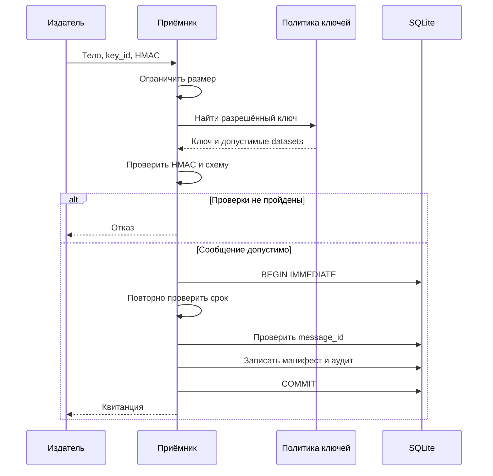

Ниже — содержимое `chapters/22. security_and_supply_chain.md`. Структура соответствует README: пять тем и 21 пункт.

Скачиваемый файл сейчас создать не удалось: среда выполнения недоступна. Примеры и тесты ниже прошли текстовую проверку, но **не запускались**.

# Безопасность Python-кода и цепочки поставки

Безопасность Python-приложения складывается из нескольких независимых задач:

- приложение обрабатывает данные в пределах заданного бюджета ресурсов;
- пользователь или сервис выполняет только разрешённые ему операции;
- внешние данные не превращаются в исполняемый код, SQL или команды оболочки;
- секреты доступны только тем компонентам, которым они необходимы;
- зависимости и сборочные инструменты поступают из контролируемых источников;
- в развёртывание попадают проверенные артефакты;
- события безопасности позволяют обнаружить проблему и восстановить последовательность действий.

Наличие аннотаций типов, HTTPS, контейнера или файла зависимостей решает лишь часть этих задач. Для каждого механизма нужно понимать его конкретную гарантию.

Примеры стандартной библиотеки ориентированы на **Python 3.12+**. Особенности Python 3.14 отмечены отдельно. Примеры с PyYAML, `defusedxml`, `argon2-cffi`, `cryptography` и `regex` требуют соответствующих сторонних пакетов.

## Границы доверия и валидация

### Источник данных, нормализация, схема и ограничения размера

**Граница доверия** — место, в котором данные или действия переходят между компонентами с разными полномочиями и предположениями о корректности.

Например:

| Переход | Что необходимо проверить |
|---|---|
| HTTP-запрос → обработчик | Размер, формат, идентичность клиента, разрешённую операцию |
| Сообщение очереди → worker | Отправителя, схему, версию, срок действия, повторную доставку |
| Загруженный файл → парсер | Реальный формат, размер, структуру, стоимость обработки |
| Конфигурация → приложение | Источник, схему, допустимые значения, права доступа |
| URL пользователя → HTTP-клиент | Допустимое назначение запроса и фактический сетевой маршрут |
| Имя файла → файловая система | Разрешённый объект, путь, тип файла, возможность подмены |
| Репозиторий → CI | Доверие к коду, workflow, инструментам и сборочным зависимостям |

«Внутренняя сеть» и «сообщение из нашей очереди» сами по себе не делают данные доверенными. Источником может оказаться скомпрометированный сервис, ошибочная интеграция или пользователь с ограниченными правами.

**Валидация должна отвечать на конкретные вопросы.**

1. Какие байты и кодировки разрешены?
2. Каков максимальный размер сообщения?
3. Какова структура документа?
4. Какие типы и диапазоны допустимы?
5. Какие поля обязательны?
6. Разрешены ли неизвестные поля?
7. Как трактуются повторяющиеся ключи?
8. Какие значения допустимы для конкретной операции?

Для внешнего протокола желательно описать эти правила явно, а не полагаться на поведение выбранного парсера.

**Сначала ограничивай вход, затем разбирай его.**

```python
from typing import BinaryIO


class InputTooLarge(ValueError):
    pass


def read_limited(stream: BinaryIO, limit: int) -> bytes:
    if limit < 0:
        raise ValueError("limit must be non-negative")

    chunks: list[bytes] = []
    total = 0

    while True:
        # Один дополнительный байт позволяет обнаружить превышение.
        requested = min(64 * 1024, limit + 1 - total)
        chunk = stream.read(requested)

        if not chunk:
            return b"".join(chunks)

        total += len(chunk)

        if total > limit:
            raise InputTooLarge("input exceeds size limit")

        chunks.append(chunk)
```

Функция рассчитана на обычный блокирующий бинарный поток. Время ожидания чтения должно ограничиваться транспортом или внешним supervisor.

Следующий вариант проверяет размер слишком поздно:

```python
# К моменту проверки память уже потрачена.
payload = stream.read()

if len(payload) > limit:
    raise InputTooLarge("input exceeds size limit")
```

Для HTTP ограничения нужны на нескольких уровнях: reverse proxy, сервер приложения и обработчик. Заголовок `Content-Length` полезен для раннего отказа, но фактическое количество прочитанных байтов всё равно необходимо учитывать.

При сжатии различай размер переданного тела и размер после распаковки.

**Аннотация типа не проверяет входные данные.**

```python
def process_rows(row_count: int) -> None:
    ...
```

Такую функцию можно вызвать с любым объектом. Даже `isinstance()` не всегда отражает требуемую схему:

```python
assert isinstance(True, int)
```

Если протокол разрешает именно целое число, а не логическое значение, проверяй это явно:

```python
def validate_row_count(value: object) -> int:
    if type(value) is not int:
        raise ValueError("row_count must be an integer")

    if not 0 <= value <= 1_000_000:
        raise ValueError("row_count is out of range")

    return value
```

Использование `type(value) is int` здесь намеренное: это проверка внешнего формата, в котором подклассы и неявные преобразования не нужны.

Не используй `assert` для обязательных проверок безопасности: оптимизированный запуск Python может удалить такие проверки.

**Нормализация должна быть частью контракта.**

Для разных сущностей правила отличаются:

| Значение | Возможная политика |
|---|---|
| Машинный идентификатор | Строгий ASCII-алфавит без преобразований |
| Отображаемое имя | Unicode с явно выбранной нормализацией |
| Имя пользователя | Нормализация и правила уникальности, согласованные с хранилищем |
| Пароль | Сохранение выбранной политики ввода без скрытых `strip()` и `lower()` |
| Криптографический токен | Точное сравнение установленного представления |
| Подписанный документ | Проверка исходных байтов либо согласованной канонической формы |

Нормализация способна объединить разные исходные значения. Если приложение считает их одинаковыми, это должны одинаково понимать валидатор, проверка прав и ограничение уникальности в БД.

Визуально похожие символы не обязательно становятся одинаковыми после Unicode-нормализации.

**У JSON тоже есть неоднозначности.**

Стандартный декодер Python по умолчанию допускает повторяющиеся ключи, сохраняя последнее значение, а также принимает некоторые числовые значения вне строгого JSON, включая `NaN`. Для протокола безопасности эти возможности часто нужно запретить. Кроме того, документация рекомендует ограничивать размер недоверенного JSON из-за затрат CPU и памяти. [Python 3.14.8 documentation](https://docs.python.org/3.14/library/json.html?utm_source=chatgpt.com)

Повторяющиеся ключи особенно опасны, если разные компоненты выбирают разные значения: например, шлюз проверяет первое поле `role`, а приложение использует последнее.

Для строгого JSON-протокола обычно нужны:

- запрет повторяющихся ключей;
- запрет неограниченных чисел и специальных констант;
- точная схема;
- ограничения вложенности;
- запрет лишних полей либо явно описанные правила расширения.

**Валидация и безопасное использование данных — разные этапы.**

Даже корректная строка должна передаваться в соответствующий API правильно:

- в SQL — через параметры;
- в HTML — с экранированием для конкретного контекста;
- в URL — как отдельный компонент;
- в subprocess — как данные или отдельный аргумент;
- в файловую систему — через разрешённый идентификатор и контролируемый способ открытия.

Одна универсальная функция `sanitize()` не может корректно обслужить все эти контексты.

### Глубина вложенности, стоимость вычисления и отказ в обслуживании

Небольшой вход способен вызвать большой расход ресурсов.

Примеры:

- глубоко вложенный документ переполняет стек;
- компактный архив распаковывается в большой объём данных;
- регулярное выражение перебирает огромное количество вариантов;
- короткое описание задания запускает слишком дорогую обработку;
- небольшой запрос к БД возвращает миллионы строк;
- множество допустимых запросов исчерпывает пул соединений.

Поэтому ограничение размера сообщения необходимо дополнять ограничением **стоимости операции**.

| Ресурс | Пример ограничения |
|---|---|
| Входные данные | Максимум байтов до и после декомпрессии |
| Структура | Максимальная глубина, число узлов, элементов и ключей |
| Числа | Диапазон, длина представления, допустимая точность |
| CPU | Ограниченные алгоритмы, бюджет времени, лимит worker |
| Память | Ограничение процесса или контейнера |
| Диск | Квота временного каталога и общего хранилища |
| Сеть | Число запросов, объём ответа, число перенаправлений |
| Конкурентность | Ограниченные очереди, semaphore, лимиты по клиенту |
| БД | Statement timeout, лимит строк, ограниченный пул |

**Проверка глубины после парсинга решает только часть задачи.**

```python
def validate_tree(
    value: object,
    *,
    max_depth: int = 8,
    max_nodes: int = 10_000,
) -> None:
    stack = [(value, 0)]
    visited = 0

    while stack:
        current, depth = stack.pop()
        visited += 1

        if visited > max_nodes:
            raise ValueError("too many nodes")

        if depth > max_depth:
            raise ValueError("maximum depth exceeded")

        if isinstance(current, dict):
            stack.extend(
                (item, depth + 1)
                for item in current.values()
            )
        elif isinstance(current, list):
            stack.extend(
                (item, depth + 1)
                for item in current
            )
```

Это пример проверки уже построенного дерева JSON-подобных значений. Он не защищает сам момент построения дерева.

Для форматов с циклическими ссылками потребуется также определять циклы. Например, граф, полученный из YAML, не всегда является деревом.

Если парсер не предоставляет необходимых ограничений, варианты защиты включают:

- более строгий формат;
- потоковый парсер;
- предварительное ограничение глубины для конкретного синтаксиса;
- отдельный процесс с ограничениями ресурсов;
- сочетание перечисленных подходов.

**Суммарная стоимость важнее отдельных лимитов.**

Допустим, разрешены:

- до 10 000 записей;
- до 10 000 правил проверки.

Если каждое правило применяется к каждой записи, получается до 100 миллионов проверок. Оба ограничения по отдельности выглядят умеренными.

Аналогично учитывай произведение:

```text
число одновременных запросов
× память одного запроса
× число worker
```

Без этого безопасный одиночный запрос может стать причиной отказа при параллельной обработке.

**Timeout не всегда прекращает вычисление.**

Особенно важно различать:

- прекращение ожидания результата;
- отмену coroutine;
- завершение потока;
- завершение процесса;
- завершение всего дерева дочерних процессов.

Отмена `Future` не обязана останавливать уже работающую функцию. Оборачивание тяжёлой синхронной функции в `asyncio.to_thread()` и `wait_for()` не даёт гарантии прекращения самого вычисления.

Для потенциально зависающего парсера или пользовательского вычисления нужен контролируемый worker, который можно завершить на уровне ОС.

**Защищай очередь до начала дорогой работы.**

Практический порядок:

1. Проверить дешёвые ограничения формата и размера.
2. Установить идентичность клиента, если протокол это позволяет.
3. Проверить квоту клиента.
4. Получить место в ограниченной очереди.
5. Выполнить дорогую проверку или вычисление.
6. Освободить ресурсы при любом исходе.

Очередь без ограничения превращает замедление downstream-сервиса в рост памяти приложения.

Лимиты должны сопровождаться понятной реакцией: отказом, backpressure или повтором с ограниченным бюджетом. Бесконечные автоматические повторы увеличивают нагрузку во время сбоя.

### Авторизация на границе операции и принцип минимальных привилегий

**Аутентификация** устанавливает, кто обращается к приложению.

**Авторизация** определяет, разрешено ли этому субъекту выполнить конкретную операцию над конкретным объектом.

Успешная аутентификация не означает право читать любой документ или изменять любую запись.

Для операции полезно сформулировать решение так:

```text
субъект
+ действие
+ объект
+ контекст
→ разрешить или отказать
```

Например:

```text
сервис ingestion-a
+ зарегистрировать манифест
+ dataset=events
+ действующий ключ и непросроченное сообщение
→ разрешить
```

**Не принимай права из тела запроса.**

```python
# Небезопасная модель:
# пользователь сам сообщает, какие у него полномочия.
if request_data["is_admin"]:
    perform_admin_operation()
```

Идентичность и права должны поступать из доверенного контекста: проверенной сессии, валидированного токена, серверной записи или доверенной конфигурации.

Даже подписанный токен требует проверки его назначения: issuer, audience, срока действия и допустимого алгоритма. Значение `role` становится пригодным для авторизации только после полной проверки токена и правил приложения.

**Проверяй права на уровне объекта.**

Типичная ошибка — разрешить операцию всем пользователям с ролью `editor`, забыв проверить принадлежность конкретного документа.

```python
import sqlite3
from dataclasses import dataclass


@dataclass(frozen=True)
class Principal:
    tenant_id: str
    permissions: frozenset[str]


def rename_document(
    connection: sqlite3.Connection,
    principal: Principal,
    document_id: int,
    new_title: str,
) -> None:
    if "documents:write" not in principal.permissions:
        raise PermissionError("operation is not allowed")

    if not isinstance(new_title, str):
        raise ValueError("title must be a string")

    if not 1 <= len(new_title) <= 200:
        raise ValueError("invalid title length")

    cursor = connection.execute(
        """
        UPDATE documents
        SET title = ?
        WHERE id = ? AND tenant_id = ?
        """,
        (
            new_title,
            document_id,
            principal.tenant_id,
        ),
    )

    if cursor.rowcount != 1:
        raise LookupError("document is unavailable")
```

Предполагается, что `Principal` создал доверенный слой аутентификации, а вызывающий код управляет транзакцией.

Ограничение `tenant_id` входит в сам запрос изменения. Это уменьшает риск забыть проверку между отдельным чтением и последующей записью.

Если решение зависит от изменяемого состояния — статуса документа, владельца, лимита или отзыва полномочий — проверку и изменение необходимо согласовать транзакцией, блокировкой или условным запросом.

**Применяй отказ по умолчанию.**

Новая операция, новый тип объекта или неизвестная роль должны требовать явного разрешения. Полезно проверять каждый путь вызова: HTTP, CLI, фоновые задания, административные команды.

OWASP рекомендует минимальные привилегии, отказ по умолчанию и проверку разрешений для каждого запроса. [OWASP Cheat Sheet Series](https://cheatsheetseries.owasp.org/cheatsheets/Authorization_Cheat_Sheet.html?utm_source=chatgpt.com)

**Минимальные привилегии нужны и инфраструктуре.**

Примеры:

- web-приложение не должно подключаться к БД под superuser;
- worker чтения не должен иметь право удалять исходные файлы;
- сборочный job не должен получать ключ публикации;
- тесты внешнего PR не должны получать production-секреты;
- сервису обработки документов обычно не нужен произвольный исходящий доступ в сеть;
- процессу приложения не нужны права root для обычной обработки данных.

Для многопользовательских систем дополнительно нужны защита сессий, управление жизненным циклом учётных записей, MFA там, где она требуется, и согласованные правила отзыва доступа. Самостоятельно написанная проверка одного поля `role` не заменяет эти механизмы.

## Опасные способы исполнения и десериализации

### eval, exec, динамический import и недоверенные плагины

`eval()` вычисляет Python-выражение. `exec()` выполняет Python-код.

Если внешняя строка попадает в эти функции, приложение предоставляет отправителю возможность влиять на выполнение программы. Документация Python прямо предупреждает о риске выполнения пользовательского ввода. [Python 3.14.8 documentation](https://docs.python.org/3.14/library/functions.html?utm_source=chatgpt.com)

Опасные источники таких строк:

- поле HTTP-запроса;
- конфигурация, которую может редактировать пользователь;
- выражение из БД;
- сообщение очереди;
- шаблон задания;
- имя обработчика из внешнего документа.

**Для выбора поведения используй ограниченный реестр.**

```python
from collections.abc import Callable


TRANSFORMS: dict[str, Callable[[str], str]] = {
    "strip": str.strip,
    "lower": str.lower,
    "upper": str.upper,
}


def apply_transform(name: str, text: str) -> str:
    if type(name) is not str or type(text) is not str:
        raise ValueError("invalid input type")

    if len(text) > 10_000:
        raise ValueError("text is too long")

    try:
        transform = TRANSFORMS[name]
    except KeyError:
        raise ValueError("unknown transform") from None

    return transform(text)
```

Пользователь выбирает один из заранее разрешённых вариантов. Он не передаёт Python-выражение и не выбирает произвольный атрибут объекта.

Если нужен язык правил, его возможности должны быть явно ограничены:

- фиксированные операции;
- заданные типы значений;
- отсутствие произвольных вызовов;
- ограничения размера выражения;
- ограничения числа операций;
- ограничения промежуточных результатов.

Например, разрешение операции возведения в степень без ограничения операндов способно сделать даже маленький язык вычислительно опасным.

**Динамический импорт тоже выполняет код.**

```python
import importlib

module = importlib.import_module(module_name)
```

При первом импорте исполняется код модуля и его зависимостей. Это не безопасный способ «просто найти класс».

Различай:

1. Обнаружение метаданных плагина.
2. Загрузку объекта плагина.
3. Исполнение его кода.

Плагин, выполняемый внутри процесса, получает полномочия этого процесса. Для недоверенного плагина интерфейс `Protocol`, entry point или базовый класс не создаёт ограничений доступа к файлам и сети.

**Учитывай цепочку разрешения импортов.**

Проблемы возникают, если приложение загружает модуль:

- из каталога, доступного постороннему пользователю;
- из неожиданного рабочего каталога;
- через неконтролируемый `PYTHONPATH`;
- из изменяемого окружения зависимостей.

Опции `-I` и `-P` помогают контролировать часть путей импорта. Их назначение и ограничения необходимо учитывать отдельно от изоляции исполнения. [Python 3.14.8 documentation](https://docs.python.org/3.14/library/security_warnings.html?utm_source=chatgpt.com)

Исполняемые строки в `.pth` могут запускаться при инициализации `site`. Поэтому оценивать доверие к установленному пакету только по моменту явного `import package` недостаточно. [Python 3.14.8 documentation](https://docs.python.org/3.14/library/site.html?utm_source=chatgpt.com)

### Ограничение globals не создаёт безопасную Python-песочницу

Следующий подход не следует использовать как границу безопасности:

```python
# Не использовать для исполнения недоверенного кода.
result = eval(
    expression,
    {"__builtins__": {}},
    {},
)
```

Удаление привычных имён не превращает Python в специально спроектированный безопасный язык выражений.

Причины:

- Python предоставляет богатую объектную модель и интроспекцию;
- переданный объект может открывать доступ к другим объектам;
- операции способны вызывать специальные методы;
- вычисления могут расходовать неограниченные ресурсы;
- ошибки в ограничениях становятся частью механизма исполнения;
- сторонние расширения добавляют новые возможности и собственные ошибки.

Особенно опасно передавать в такое окружение объекты приложения: ORM-модели, соединения, функции, классы, сервисы и объекты запроса.

**Другие распространённые заблуждения:**

| Подход | Что он действительно даёт |
|---|---|
| `venv` | Разделение Python-окружений и зависимостей |
| `python -I` | Более контролируемую инициализацию и пути импорта |
| Отдельный поток | Отдельный поток выполнения в том же процессе |
| Отдельный процесс того же пользователя | Разделение адресных пространств, но часто те же права ОС |
| Audit hook | Наблюдаемость отдельных событий |
| Контейнер | Механизмы изоляции, сила которых зависит от конфигурации |

Python audit hooks не предназначены для создания sandbox; hooks, добавленные через `sys.addaudithook()`, могут быть обойдены недоверенным кодом. [Python 3.14.8 documentation](https://docs.python.org/3.14/library/sys.html?utm_source=chatgpt.com)

**Для исполнения чужого кода нужна внешняя граница.**

В зависимости от модели угроз это может включать:

- отдельную непривилегированную учётную запись;
- отдельную файловую систему или ограниченные mounts;
- запрет исходящей сети;
- ограничения CPU, памяти, числа процессов и диска;
- удаление capabilities;
- системные ограничения вызовов;
- виртуальную машину;
- уничтожение окружения после задания.

Наличие Docker в команде запуска ещё не подтверждает выполнение этих условий. Например, доступ к Docker socket способен предоставить процессу значительно больше полномочий, чем предполагается.

**Продумай обратный канал.**

Даже правильно изолированный worker может отправить родительскому процессу опасные данные.

Если родитель десериализует ответ worker через `pickle`, компрометация worker способна привести к исполнению кода уже в доверенном процессе.

На границе изолированного исполнения используй ограниченный протокол байтов с:

- точной схемой;
- ограничением размера;
- ограничением частоты сообщений;
- проверкой завершения задания;
- безопасным разбором ответа.

### pickle и shelve только для доверенных данных

`pickle` восстанавливает Python-объекты и способен запускать код в процессе десериализации. Документация запрещает распаковывать pickle из недоверенного источника. [Python 3.14.8 documentation](https://docs.python.org/3.14/library/pickle.html?utm_source=chatgpt.com)

Поэтому нельзя принимать pickle:

- из HTTP-запроса;
- из пользовательской загрузки;
- из недоверенной очереди;
- из общего каталога с неконтролируемой записью;
- из внешнего кэша без надёжного контроля авторства;
- из ответа недоверенного worker.

`shelve` использует pickle и наследует соответствующую модель доверия.

Сериализация может быть скрыта внутри других библиотек и IPC-механизмов. Проверяй реальный формат объектов, модельных артефактов, кэшей и сообщений.

**Файл внутри компании не обязательно доверенный.**

Нужно знать:

- кто может его создать;
- кто может заменить его после проверки;
- какие системы его копируют;
- можно ли подменить ожидаемый checksum;
- допускается ли загрузка старой версии;
- какой код имеет право быть сериализованным.

**SHA-256 не делает pickle безопасным.**

Если злоумышленник заменил и файл, и расположенный рядом checksum, проверка совпадёт.

HMAC или цифровая подпись могут подтвердить происхождение при правильной модели ключей, но доверенный отправитель такого артефакта фактически получает право поставлять исполняемое поведение.

Даже аутентифицированный pickle остаётся связанным с:

- доступными классами и функциями;
- версиями библиотек;
- побочными эффектами восстановления;
- состоянием окружения;
- ошибками в коде доверенного отправителя.

**Ограниченный `Unpickler` требует отдельного анализа.**

Переопределение `find_class()` может уменьшить доступную поверхность, но не является универсальным способом безопасно принимать произвольный pickle.

Если задача состоит в передаче данных, чаще удобнее выбрать формат с простой моделью значений и строгой схемой: JSON, ограниченный бинарный протокол или специализированный формат данных с проверенными настройками.

**`ast.literal_eval()` тоже требует ограничений.**

Он не предназначен для исполнения произвольного Python-кода, однако специально подготовленный вход способен вызвать чрезмерные затраты памяти, CPU или стека. Документация отдельно предупреждает об этом. [Python 3.14.8 documentation](https://docs.python.org/3.14/library/ast.html?utm_source=chatgpt.com)

Для внешнего протокола не стоит выбирать Python-литералы только потому, что `literal_eval()` удобнее, чем описание схемы.

### YAML safe loaders, XML external entities и безопасные форматы

**YAML.**

Для конфигурации обычно требуется загрузка обычных значений, без восстановления произвольных Python-объектов.

В PyYAML для этого предназначен `safe_load()` и семейство safe loaders. Возможности обычных и небезопасных loaders отличаются; используемый loader должен быть выбран явно и соответствовать источнику данных. [pyyaml.org](https://pyyaml.org/wiki/PyYAMLDocumentation?utm_source=chatgpt.com)

```python
import yaml


def load_config(raw: bytes) -> dict[str, object]:
    if len(raw) > 4096:
        raise ValueError("configuration is too large")

    try:
        text = raw.decode("utf-8")
        data = yaml.safe_load(text)
    except (UnicodeDecodeError, yaml.YAMLError):
        raise ValueError("invalid configuration") from None

    if type(data) is not dict:
        raise ValueError("configuration must be a mapping")

    if set(data) != {"format", "batch_size"}:
        raise ValueError("unexpected configuration fields")

    output_format = data["format"]
    batch_size = data["batch_size"]

    if type(output_format) is not str:
        raise ValueError("format must be a string")

    if output_format not in {"json", "csv"}:
        raise ValueError("unsupported format")

    if type(batch_size) is not int:
        raise ValueError("batch_size must be an integer")

    if not 1 <= batch_size <= 1000:
        raise ValueError("batch_size is out of range")

    return {
        "format": output_format,
        "batch_size": batch_size,
    }
```

Этот пример ограничивает размер и проверяет плоскую схему.

При этом `safe_load()`:

- не задаёт бизнес-правила;
- не ограничивает всю стоимость обработки;
- не делает неизвестную конфигурацию авторизованной;
- сам по себе не вводит желаемую политику повторяющихся ключей.

Дополнительные constructors и расширения safe loader также становятся частью доверенного кода.

Если конфигурация используется как подписанный или межсервисный протокол, неоднозначности YAML могут оказаться лишней сложностью. Строгий JSON с ограниченной схемой часто проще проверять.

**XML.**

Опасности XML включают:

- внешние сущности и обращения к ресурсам;
- раскрытие локальных файлов при соответствующих настройках;
- сетевые обращения;
- экспоненциальное расширение сущностей;
- большие токены;
- чрезмерно глубокое дерево;
- декомпрессию большого содержимого.

Поведение зависит от конкретного парсера, настроек и версии нативной библиотеки. Нельзя одинаково описывать все XML API Python. Документация рекомендует учитывать используемую версию Expat; сам Expat по умолчанию не открывает локальные файлы и не создаёт сетевые соединения. [Python 3.14.8 documentation](https://docs.python.org/3.14/library/xml.html?utm_source=chatgpt.com)

Для ограниченного приёма XML можно использовать явный API `defusedxml`:

```python
from defusedxml import ElementTree


def parse_xml(raw: bytes):
    if len(raw) > 64 * 1024:
        raise ValueError("XML document is too large")

    root = ElementTree.fromstring(
        raw,
        forbid_dtd=True,
        forbid_entities=True,
        forbid_external=True,
    )

    return root
```

Здесь DTD, объявления сущностей и внешние ссылки запрещены явно. Эти параметры описаны в документации проекта. [tiran/defusedxml · GitHub](https://github.com/tiran/defusedxml?utm_source=chatgpt.com)

Далее всё равно нужна проверка допустимых элементов, атрибутов и объёма содержимого.

Отдельно оценивай действия после парсинга: XInclude, XSLT, загрузку внешних схем и пользовательские resolver. Защита одного вызова `fromstring()` не распространяется автоматически на следующие операции.

**Выбор формата должен учитывать весь путь данных.**

| Формат | Что необходимо оценить |
|---|---|
| JSON | Размер, числа, повторяющиеся ключи, глубину, схему |
| YAML | Loader, constructors, aliases, типы, повторяющиеся ключи |
| XML | Сущности, DTD, внешние ресурсы, нативный парсер |
| CSV | Размер строк и полей, кодировку, формулы при экспорте в таблицы |
| Архив | Пути, ссылки, количество элементов, распакованный объём |
| Формат модели | Возможность исполнения кода и доверие к загрузчику |
| Бинарный протокол | Длины, вложенность, версии, обязательные поля |

«Формат данных» не является синонимом «безопасного парсера».

## Инъекции и файловые атаки

### SQL injection: параметризация и allowlist идентификаторов

SQL injection возникает, когда данные пользователя влияют на структуру SQL-запроса.

Правильная параметризация передаёт SQL и значения отдельно.

```python
import sqlite3


def find_user(
    connection: sqlite3.Connection,
    email: str,
):
    return connection.execute(
        """
        SELECT id, email
        FROM users
        WHERE email = ?
        """,
        (email,),
    ).fetchone()
```

Для SQLite используется placeholder `?`. У других драйверов синтаксис параметров может отличаться. Нужно следовать API конкретного драйвера. [docs.python.org](https://docs.python.org/3.14/library/sqlite3.html?utm_source=chatgpt.com)

Не добавляй кавычки вокруг placeholder самостоятельно:

```python
# Неверно: placeholder оказался внутри SQL-строки.
sql = "SELECT id FROM users WHERE email = '?'"
```

**Параметры предназначены для значений.**

Имя таблицы, столбца, направление сортировки и SQL-оператор обычно нельзя передать как обычный параметр.

Для таких вариантов используй фиксированное отображение:

```python
import sqlite3


SORT_COLUMNS = {
    "created": "created_at",
    "name": "name",
}


def list_projects(
    connection: sqlite3.Connection,
    tenant_id: str,
    sort_by: str,
    limit: int,
):
    try:
        column = SORT_COLUMNS[sort_by]
    except KeyError:
        raise ValueError("unsupported sort order") from None

    if type(limit) is not int or not 1 <= limit <= 100:
        raise ValueError("invalid limit")

    # column берётся только из констант разработчика.
    sql = f"""
        SELECT id, name, created_at
        FROM projects
        WHERE tenant_id = ?
        ORDER BY {column} ASC
        LIMIT ?
    """

    return connection.execute(
        sql,
        (tenant_id, limit),
    ).fetchall()
```

Проверки «в строке нет пробела» недостаточно для разрешения произвольного SQL-идентификатора. Проще принимать публичное имя варианта и выбирать заранее известный фрагмент.

**Учитывай семантику операции.**

Параметризация защищает структуру SQL, но не ограничивает:

- доступ к чужим строкам;
- слишком широкий поиск;
- дорогие join;
- число возвращаемых записей;
- полномочия пользователя БД.

Параметризированный `LIKE` также сохраняет смысл `%` и `_` как шаблонных символов. Если нужен буквальный поиск, правила экранирования шаблона задаются отдельно.

Использование ORM помогает лишь в тех местах, где код действительно использует безопасный API. Конкатенация пользовательских строк внутри raw SQL сохраняет риск инъекции.

### Command injection: аргументы subprocess и shell

При запуске внешней программы различай два уровня интерпретации:

1. Разбор команды оболочкой.
2. Разбор аргументов самой программой.

Передача списка аргументов с `shell=False` обычно позволяет избежать первого уровня, но не решает автоматически второй.

Например, строка, начинающаяся с `-`, может восприниматься программой как опция. Некоторые программы принимают аргументы, которые сами являются кодом, шаблоном, URL или именем конфигурации.

**По возможности передавай пользовательские данные через stdin.**

```python
import subprocess
import sys


MAX_INPUT = 1024 * 1024

# Это фиксированный код разработчика.
CHILD_CODE = """
import hashlib
import sys

payload = sys.stdin.buffer.read(1024 * 1024 + 1)

if len(payload) > 1024 * 1024:
    raise SystemExit(2)

sys.stdout.write(hashlib.sha256(payload).hexdigest())
"""


def digest_in_child(payload: bytes) -> str:
    if type(payload) is not bytes:
        raise TypeError("payload must be bytes")

    if len(payload) > MAX_INPUT:
        raise ValueError("payload is too large")

    result = subprocess.run(
        [
            sys.executable,
            "-I",
            "-c",
            CHILD_CODE,
        ],
        input=payload,
        stdout=subprocess.PIPE,
        stderr=subprocess.DEVNULL,
        timeout=5,
        check=True,
        shell=False,
    )

    if len(result.stdout) != 64:
        raise RuntimeError("unexpected child response")

    digest = result.stdout.decode("ascii")

    if any(char not in "0123456789abcdef" for char in digest):
        raise RuntimeError("invalid child response")

    return digest
```

Здесь внешний ввод не входит в Python-код и не становится аргументом оболочки. `capture` допустим благодаря контракту фиксированной дочерней программы, которая возвращает короткий результат.

Для произвольной программы захват неограниченного stdout способен исчерпать память. Ограничение времени не заменяет ограничение объёма вывода.

Документация `subprocess` отдельно описывает правила `shell`, обработку timeout и особенности запуска batch-файлов в Windows. Файлы `.bat` и `.cmd` могут обрабатываться системной оболочкой даже при отсутствии ожидаемого явного shell-вызова. [Python 3.14.8 documentation](https://docs.python.org/3.14/library/subprocess.html?utm_source=chatgpt.com)

**Дополнительно контролируй:**

- исполняемый файл и доверие к нему;
- рабочий каталог;
- переменные окружения;
- передаваемые дескрипторы;
- права процесса;
- доступ к сети;
- объём stdout и stderr;
- завершение дочерних процессов.

`shlex.quote()` предназначен для определённых правил shell и не является универсальным экранированием для Windows, SQL или аргументов произвольной программы.

Если используемая программа поддерживает `--` как окончание опций, это помогает отделить имена файлов от опций. Поддержку необходимо проверять для конкретной программы.

Если задачу можно надёжно выполнить Python API, запуск внешней команды часто добавляет лишнюю границу интерпретации.

### Path traversal, symlink attacks и TOCTOU

**Path traversal** возникает, когда внешний путь позволяет обратиться к объекту вне разрешённого пространства.

Примеры проблемных возможностей:

- `..`;
- абсолютные пути;
- альтернативные разделители;
- платформенные префиксы;
- символические ссылки;
- неоднозначная нормализация;
- специальные имена файлов;
- повторное декодирование.

Предпочтительная модель — принимать **идентификатор объекта**, а реальный путь выбирать на сервере.

```text
публичный document_id
→ проверка прав
→ серверная запись
→ внутренний storage key
```

Это уменьшает число правил, которые приходится применять к внешнему пути.

**Проверка строкового префикса ненадёжна.**

Путь `/srv/data-other/report.csv` начинается со строки `/srv/data`, но не находится внутри каталога `/srv/data`.

Структурная проверка выглядит понятнее:

```python
from pathlib import Path


def resolve_inside(root: Path, relative_name: str) -> Path:
    base = root.resolve(strict=True)
    candidate = (base / relative_name).resolve(strict=True)

    if not candidate.is_relative_to(base):
        raise ValueError("path is outside the allowed directory")

    return candidate
```

Но между `resolve()` и последующим `open()` состояние файловой системы может измениться.

**TOCTOU** — time of check to time of use — возникает, когда проверка относится к одному состоянию объекта, а использование происходит уже в другом.

Типичный сценарий:

1. Проверить путь.
2. Другой процесс заменяет элемент пути ссылкой.
3. Открыть изменившийся путь.

Для операций с чувствительными файлами нужно связывать проверку и использование с открытым объектом и учитывать возможности ОС.

**Пример ограниченного чтения одного файла относительно directory descriptor.**

Следующий код предназначен для POSIX-систем с необходимыми флагами. Он принимает только простое имя одного файла.

```python
import os
import re
import stat
from contextlib import ExitStack
from pathlib import Path


LEAF_NAME = re.compile(
    r"[a-z0-9][a-z0-9_.-]{0,79}",
    re.ASCII,
)


def read_regular_leaf(
    root: Path,
    name: str,
    *,
    limit: int = 1024 * 1024,
) -> bytes:
    required_flags = (
        "O_DIRECTORY",
        "O_NOFOLLOW",
        "O_NONBLOCK",
    )

    if any(not hasattr(os, flag) for flag in required_flags):
        raise NotImplementedError(
            "required POSIX file-opening features are unavailable"
        )

    if os.open not in os.supports_dir_fd:
        raise NotImplementedError("dir_fd is unavailable")

    if type(name) is not str or LEAF_NAME.fullmatch(name) is None:
        raise ValueError("invalid file name")

    if limit < 0:
        raise ValueError("limit must be non-negative")

    with ExitStack() as stack:
        root_fd = os.open(
            root,
            os.O_RDONLY | os.O_DIRECTORY | os.O_NOFOLLOW,
        )
        stack.callback(os.close, root_fd)

        file_fd = os.open(
            name,
            os.O_RDONLY | os.O_NOFOLLOW | os.O_NONBLOCK,
            dir_fd=root_fd,
        )
        stack.callback(os.close, file_fd)

        metadata = os.fstat(file_fd)

        if not stat.S_ISREG(metadata.st_mode):
            raise ValueError("only regular files are allowed")

        if metadata.st_size > limit:
            raise ValueError("file is too large")

        chunks: list[bytes] = []
        total = 0

        while True:
            chunk = os.read(
                file_fd,
                min(64 * 1024, limit + 1 - total),
            )

            if not chunk:
                return b"".join(chunks)

            total += len(chunk)

            if total > limit:
                raise ValueError("file is too large")

            chunks.append(chunk)
```

`dir_fd`, `O_NOFOLLOW` и проверки открытого дескриптора позволяют строить более точные гарантии, чем последовательность операций над строкой пути. Доступность механизмов зависит от платформы. [Python 3.14.8 documentation](https://docs.python.org/3.14/library/os.html?utm_source=chatgpt.com)

**Границы этого примера:**

- путь `root` и его родительские каталоги должны контролироваться приложением или администратором;
- `O_NOFOLLOW` при открытии `root` не запрещает ссылки во всех его предках;
- код не запрещает hard links;
- открытый дескриптор не делает содержимое файла неизменяемым;
- чужой процесс с правом записи в тот же файл способен менять его содержимое;
- проверка регулярного файла не заменяет корректные права на каталог и непривилегированный запуск.

Для обработки неизменяемого входа можно читать ограниченную копию в память или в собственный закрытый staging-каталог, а затем работать именно с этой копией.

**Для временных файлов используй `tempfile`.**

Не создавай имя через «проверить отсутствие → открыть позже». Безопасное создание должно происходить одной операцией.

Права временных файлов, общий доступ к каталогам и поведение на Windows нужно учитывать отдельно.

### Безопасная распаковка архивов, extraction filters и decompression bombs

Архив — это набор инструкций по созданию объектов, а не просто коллекция байтов.

Он может содержать:

- абсолютные и относительные пути;
- символические и жёсткие ссылки;
- специальные файлы;
- повторяющиеся имена;
- конфликтующие имена;
- огромные заявленные размеры;
- sparse-файлы;
- большое число элементов;
- вложенные архивы;
- сильно сжатое содержимое.

**Для TAR учитывай версию Python.**

Extraction filters появились в Python 3.12. Начиная с Python 3.14 фильтр `data` используется по умолчанию. В коде, поддерживающем несколько версий, полезно указывать политику явно. Даже `filter="data"` не обеспечивает полной защиты от всех опасных особенностей и отказа в обслуживании. [Python 3.14.8 documentation](https://docs.python.org/3.14/library/tarfile.html?utm_source=chatgpt.com)

**Пример собственной узкой политики.**

Здесь допускаются только обычные CSV-файлы с плоскими ASCII-именами. Распаковка выполняется во временный каталог, который удаляется и после ошибки.

```python
import io
import re
import tarfile
import tempfile
from pathlib import Path


MAX_ARCHIVE_BYTES = 2 * 1024 * 1024
MAX_MEMBERS = 32
MAX_FILE_BYTES = 1024 * 1024
MAX_TOTAL_BYTES = 8 * 1024 * 1024

CSV_NAME = re.compile(
    r"[a-z0-9][a-z0-9_-]{0,63}\.csv",
    re.ASCII,
)


def make_csv_filter():
    seen: set[str] = set()
    count = 0
    total_size = 0

    def csv_filter(
        member: tarfile.TarInfo,
        destination: str,
    ) -> tarfile.TarInfo:
        nonlocal count, total_size

        count += 1

        if count > MAX_MEMBERS:
            raise tarfile.FilterError("too many archive members")

        if not member.isfile():
            raise tarfile.FilterError("only regular files are allowed")

        if member.sparse is not None:
            raise tarfile.FilterError("sparse files are not allowed")

        if (
            len(member.name) > 68
            or CSV_NAME.fullmatch(member.name) is None
        ):
            raise tarfile.FilterError("invalid archive member name")

        if member.name in seen:
            raise tarfile.FilterError("duplicate archive member")

        if not 0 <= member.size <= MAX_FILE_BYTES:
            raise tarfile.FilterError("invalid member size")

        total_size += member.size

        if total_size > MAX_TOTAL_BYTES:
            raise tarfile.FilterError("archive content is too large")

        seen.add(member.name)

        filtered = tarfile.data_filter(
            member,
            destination,
        )

        # В нашей политике файлы не должны быть исполняемыми.
        return filtered.replace(mode=0o600)

    return csv_filter


def inspect_csv_archive(raw: bytes) -> list[str]:
    if len(raw) > MAX_ARCHIVE_BYTES:
        raise ValueError("archive is too large")

    with tempfile.TemporaryDirectory() as temporary:
        destination = Path(temporary)

        with tarfile.open(
            fileobj=io.BytesIO(raw),
            mode="r:*",
        ) as archive:
            archive.errorlevel = 2
            archive.extractall(
                path=destination,
                filter=make_csv_filter(),
            )

        return sorted(
            path.name
            for path in destination.iterdir()
        )
```

Это пример политики извлечения, а не универсальный обработчик недоверенных архивов.

Парсер может потратить ресурсы **до вызова фильтра**, например при обработке больших служебных заголовков или декомпрессии. Для враждебного входа дополнительно нужны ограничения процесса, CPU, памяти и диска.

Расширение `.csv` также не подтверждает структуру содержимого. После распаковки требуется ограниченный CSV-парсер с собственной схемой.

**Для ZIP нужна отдельная политика.**

Проверяй:

- размер самого ZIP;
- количество элементов;
- имена и коллизии;
- поддерживаемые методы сжатия;
- заявленный размер каждого элемента;
- фактически прочитанный распакованный объём;
- общий распакованный объём;
- ссылки и платформенные атрибуты;
- шифрование;
- CRC и ошибки чтения.

Документация `zipfile` отдельно предупреждает об исчерпании диска при распаковке специально подготовленных архивов. [Python 3.14.8 documentation](https://docs.python.org/3.14/library/zipfile.html?utm_source=chatgpt.com)

Коэффициент сжатия полезен как дополнительный сигнал, но его недостаточно для определения безопасного архива. Хорошо сжимаемые легитимные данные тоже могут иметь большой коэффициент.

**Публикуй результат только после полной проверки.**

Практический процесс:

1. Принять ограниченный вход.
2. Создать отдельный staging-каталог.
3. Распаковать с ограниченной политикой.
4. Проверить фактические файлы и содержимое.
5. Подготовить окончательный результат.
6. Опубликовать его контролируемой операцией.
7. Удалить staging при любом отказе.

Не распаковывай пользовательский архив поверх каталога приложения, конфигурации или существующего набора данных.

### ReDoS и лимиты обработки текста

**ReDoS** — отказ в обслуживании из-за чрезмерной стоимости регулярного выражения.

Проблема часто связана с большим количеством вариантов обратного перебора. Особенно внимательно проверяй:

- вложенные повторения;
- неоднозначные альтернативы;
- повторения над пересекающимися шаблонами;
- неограниченные участки перед ожидаемым суффиксом;
- пользовательские регулярные выражения.

Например, вложенное повторение вида `(a+)+` требует отдельной оценки на неуспешных сопоставлениях. Для демонстрации такой проблемы не нужно запускать нагрузку в основном процессе приложения.

**Для простых идентификаторов используй простой ограниченный шаблон.**

```python
import re


IDENTIFIER = re.compile(
    r"[A-Za-z0-9][A-Za-z0-9_-]{0,63}",
    re.ASCII,
)


def validate_identifier(value: object) -> str:
    if type(value) is not str:
        raise ValueError("identifier must be a string")

    if not 1 <= len(value) <= 64:
        raise ValueError("invalid identifier length")

    if IDENTIFIER.fullmatch(value) is None:
        raise ValueError("invalid identifier")

    return value
```

Длина ограничивается до сопоставления. Алфавит указан явно. Для проверки всей строки используется `fullmatch()`.

Следи за семантикой Unicode: `\w`, регистр и категории символов могут допускать больше значений, чем предполагает машинный протокол.

**У стандартного `re` нет универсального параметра timeout для сопоставления.**

Если требуется timeout отдельной операции, сторонний модуль `regex` предоставляет такой параметр. Это дополнительный механизм, который следует сочетать с ограничением входа и контролем шаблона. [Python 3.14.8 documentation](https://docs.python.org/3.14/library/re.html?utm_source=chatgpt.com)

```python
import regex


PATTERN = regex.compile(
    r"[A-Za-z0-9][A-Za-z0-9_-]{0,63}"
)


def matches_identifier(text: str) -> bool:
    if len(text) > 64:
        return False

    try:
        return PATTERN.fullmatch(
            text,
            timeout=0.05,
        ) is not None
    except TimeoutError:
        return False
```

Для этого конкретного простого шаблона сторонний модуль обычно не нужен. Пример показывает API ограничения времени.

**Если пользователь задаёт сам шаблон, оценивай ещё и компиляцию.**

Нужны ограничения:

- длины шаблона;
- поддерживаемых возможностей;
- числа шаблонов;
- объёма кэша;
- длины текста;
- общей стоимости запроса;
- конкурентных сопоставлений.

В зависимости от задачи может подойти движок с более ограниченным синтаксисом и предсказуемой сложностью либо отдельный worker.

Для разбора структурированных форматов используй специализированные парсеры. Сложная регулярка для произвольного HTML, XML или URL быстро становится самостоятельным источником ошибок.

### SSRF: URL, DNS, redirects и доступ к внутренним адресам

**SSRF** возникает, когда пользователь заставляет сервер выполнить запрос к назначению, доступ к которому пользователь напрямую не имеет.

Возможные цели:

- внутренние HTTP-сервисы;
- loopback;
- link-local адреса;
- cloud metadata endpoints;
- административные интерфейсы;
- сервисы внутри контейнерной сети.

SSRF также может приводить к отправке секретных заголовков постороннему получателю.

**Лучше принимать идентификатор ресурса, а не произвольный URL.**

```python
import re
from urllib.parse import quote


ORIGINS = {
    "catalog": "https://catalog.example.com",
    "reports": "https://reports.example.com",
}

RESOURCE_ID = re.compile(
    r"[0-9a-f]{32}",
    re.ASCII,
)


def build_resource_url(
    source: str,
    resource_id: str,
) -> str:
    try:
        origin = ORIGINS[source]
    except KeyError:
        raise ValueError("unknown source") from None

    if (
        type(resource_id) is not str
        or len(resource_id) != 32
        or RESOURCE_ID.fullmatch(resource_id) is None
    ):
        raise ValueError("invalid resource identifier")

    component = quote(resource_id, safe="")

    return f"{origin}/objects/{component}"
```

Это функция построения URL из серверного списка источников. Сетевой клиент для полученного URL всё равно должен иметь соответствующую политику.

**Парсер URL не является валидатором безопасности.**

`urlsplit()` и `urlparse()` разбирают вход, но не подтверждают, что адрес допустим для приложения. Разные библиотеки могут по-разному трактовать неоднозначную строку. [Python 3.14.8 documentation](https://docs.python.org/3.14/library/urllib.parse.html?utm_source=chatgpt.com)

Если произвольные URL действительно необходимы, проверяй как минимум:

| Компонент | Возможная политика |
|---|---|
| Scheme | Только `https` |
| Userinfo | Запрещено |
| Hostname | Серверный allowlist либо отдельная строгая политика |
| Port | Ограниченный список |
| Fragment | Не используется и отклоняется |
| Redirect | Запрещён либо проверяется на каждом переходе |
| DNS | Проверяются все фактические адреса назначения |
| Proxy | Явная конфигурация и доверие к маршрутизации |
| Response | Ограничение размера, времени и декомпрессии |

**DNS-проверка и соединение должны относиться к одному назначению.**

Следующая последовательность имеет гонку:

1. Разрешить hostname в IP.
2. Проверить IP.
3. Передать hostname обычному HTTP-клиенту.
4. Клиент повторно разрешает hostname.

Между двумя разрешениями DNS ответ может измениться.

Поэтому защита должна учитывать фактическое соединение: проверенные адреса, правила повторного разрешения, выбор IPv4/IPv6, retries и redirects. При закреплении IP необходимо сохранить правильные TLS SNI и проверку сертификата для исходного hostname.

OWASP рассматривает DNS-риски и рекомендует отключать автоматические перенаправления, если они позволяют обойти проверку назначения. [OWASP Cheat Sheet Series](https://cheatsheetseries.owasp.org/cheatsheets/Server_Side_Request_Forgery_Prevention_Cheat_Sheet.html?utm_source=chatgpt.com)

**Одной проверки `is_private` недостаточно.**

Нужно учитывать:

- loopback;
- link-local;
- multicast;
- unspecified;
- reserved и специальные диапазоны;
- IPv4-mapped IPv6;
- особенности выбранной сетевой среды;
- внутренние сервисы с публично маршрутизируемыми адресами.

Список разрешённых направлений обычно проще поддерживать, чем полный список запрещённых.

**Сетевое ограничение усиливает прикладную проверку.**

Для сервиса загрузки документов полезно использовать:

- отдельный egress proxy;
- запрет доступа к внутренним сетям;
- отсутствие доступа к metadata endpoints;
- ограничение допустимых портов;
- отдельные credentials для конкретных upstream;
- запрет передачи входящего `Authorization` в исходящий запрос.

Проверка URL в Python и сетевые правила должны поддерживать одну модель разрешённых направлений.

## Секреты и криптографические задачи

### secrets, compare_digest() и безопасное хранение токенов

Для токенов, ссылок восстановления, случайных ключей и других секретных значений используй криптографически подходящий генератор.

Модуль `secrets` предназначен для таких задач. `random` предназначен для моделирования и других задач, где непредсказуемость для противника не является требованием. [Python 3.14.8 documentation](https://docs.python.org/3.14/library/secrets.html?utm_source=chatgpt.com)

```python
import secrets


token = secrets.token_urlsafe(32)
```

Здесь случайная часть создаётся из 32 байтов, то есть из 256 бит. Длина текстового представления отличается от количества случайных байтов.

**Не выводи реальный токен в логи.**

Даже токен с хорошей энтропией перестаёт защищать операцию, если он оказался в:

- access log;
- traceback;
- системе аналитики;
- URL, переданном стороннему сервису;
- истории команд;
- отладочном дампе.

**Для непрозрачного bearer-токена можно хранить digest.**

```python
import hashlib
import re
import secrets


TOKEN_FORMAT = re.compile(
    r"[A-Za-z0-9_-]{43}",
    re.ASCII,
)


def issue_token() -> tuple[str, bytes]:
    token = secrets.token_urlsafe(32)
    digest = hashlib.sha256(
        token.encode("ascii")
    ).digest()

    return token, digest


def verify_token(
    candidate: object,
    expected_digest: bytes,
) -> bool:
    if type(candidate) is not str:
        return False

    if TOKEN_FORMAT.fullmatch(candidate) is None:
        return False

    actual_digest = hashlib.sha256(
        candidate.encode("ascii")
    ).digest()

    return secrets.compare_digest(
        actual_digest,
        expected_digest,
    )
```

Предполагается, что `expected_digest` загружен из доверенной записи и имеет ожидаемый формат.

Быстрый SHA-256 здесь подходит благодаря случайному высокоэнтропийному исходному токену. Для пользовательского пароля такая схема непригодна.

В полноценной записи токена дополнительно хранятся:

- идентификатор записи;
- субъект;
- назначение;
- разрешённые действия;
- время создания;
- срок действия;
- состояние отзыва;
- состояние использования для одноразового токена.

**Одноразовость требует атомарной операции.**

«Проверить `used=False`, выполнить действие, затем записать `used=True`» допускает гонку.

Проверка, изменение защищаемого состояния и погашение токена должны быть согласованы транзакцией или другим атомарным механизмом.

**`compare_digest()` решает узкую задачу.**

Он помогает избегать обычного посимвольного сравнения секретных значений с ранним выходом.

Но весь обработчик не становится автоматически независимым от времени:

- наличие записи влияет на путь выполнения;
- формат и длина могут отсеиваться раньше;
- запрос к БД занимает разное время;
- ответы могут различаться.

Сравниваемые значения должны иметь совместимые типы и заданное представление. Не выполняй скрытые преобразования регистра или пробелов для криптографического токена.

### Хэширование паролей специализированными библиотеками

Пароль обычно имеет значительно меньшую энтропию, чем случайный токен.

После утечки базы противник может проверять догадки офлайн. Поэтому нужен специализированный алгоритм, делающий каждую попытку достаточно дорогой по CPU и памяти.

Для новых систем OWASP рекомендует Argon2id; параметры выбираются с учётом ресурсов и требований приложения. [OWASP Cheat Sheet Series](https://cheatsheetseries.owasp.org/cheatsheets/Password_Storage_Cheat_Sheet.html?utm_source=chatgpt.com)

**Пример с `argon2-cffi`.**

```python
from argon2 import PasswordHasher
from argon2.exceptions import VerifyMismatchError
from argon2.low_level import Type


hasher = PasswordHasher(
    type=Type.ID,
    time_cost=3,
    memory_cost=64 * 1024,  # KiB: 64 MiB на вычисление.
    parallelism=2,
)


def validate_password_input(password: object) -> str:
    if type(password) is not str:
        raise ValueError("password must be a string")

    # Конкретный лимит — часть политики приложения.
    if len(password) > 1024:
        raise ValueError("password is too long")

    encoded = password.encode("utf-8")

    if not 1 <= len(encoded) <= 1024:
        raise ValueError("invalid password length")

    return password


def create_password_hash(password: str) -> str:
    password = validate_password_input(password)

    return hasher.hash(password)


def verify_password(
    stored_hash: str,
    password: str,
) -> tuple[bool, str | None]:
    password = validate_password_input(password)

    try:
        hasher.verify(stored_hash, password)
    except VerifyMismatchError:
        return False, None

    replacement = None

    if hasher.check_needs_rehash(stored_hash):
        replacement = hasher.hash(password)

    return True, replacement
```

Пример не перехватывает все ошибки проверки как «неверный пароль». Повреждённый формат хэша или сбой вычисления требует отдельной диагностики сервиса.

При этом внешний ответ не должен раскрывать хэш, внутреннюю ошибку или существование учётной записи.

`PasswordHasher` создаёт соль и предоставляет проверку необходимости rehash. Параметр `memory_cost` измеряется в KiB. [argon2-cffi 25.1.0 documentation](https://argon2-cffi.readthedocs.io/en/stable/howto.html?utm_source=chatgpt.com)

**Параметры необходимо измерять в целевой среде.**

Учитывай:

- время одной проверки;
- допустимую задержку входа;
- память контейнера;
- число одновременных проверок;
- число процессов приложения;
- поведение при нехватке памяти;
- возможность массовых попыток входа.

Например, сотня одновременных вычислений по 64 MiB уже требует нескольких гигабайт памяти, не считая остального приложения.

Поэтому ограничиваются также конкурентность, частота запросов и очередь аутентификации.

**Соль и pepper выполняют разные роли.**

- Соль уникализирует вычисление для каждого пароля и обычно хранится вместе с хэшем.
- Pepper — отдельный секрет, который хранится вне базы хэшей.

Pepper усложняет управление ключами и миграцию. Его применение требует продуманной схемы и не заменяет специализированный password hasher.

**Обновление хэшей выполняется постепенно.**

После успешной проверки:

1. Проверить параметры сохранённого хэша.
2. При необходимости вычислить новый хэш.
3. Сохранить его с защитой от конфликтующего изменения записи.

Для пользователей, которые давно не входили, может потребоваться отдельный процесс сброса пароля.

Не меняй незаметно обработку пароля между регистрацией и входом. `strip()`, изменение регистра и смена Unicode-политики способны привести к неожиданному объединению или изменению паролей.

### Подпись, шифрование и проверка целостности: выбор готовых решений

Разные криптографические механизмы отвечают на разные вопросы.

| Механизм | Основная задача |
|---|---|
| Криптографический хэш | Проверить совпадение содержимого с известным digest |
| HMAC | Проверить целостность и авторство относительно общего секрета |
| Цифровая подпись | Проверить подпись доверенным публичным ключом |
| Шифрование | Скрыть содержимое |
| AEAD | Скрыть содержимое и проверить его целостность |
| TLS | Защитить соединение и проверить сторону согласно настройкам протокола |

**Обычный хэш не подтверждает источник.**

Если файл и его checksum поступили из одного скомпрометированного места, совпадение SHA-256 не подтверждает доверие к файлу.

Ожидаемый digest должен поступать из источника, которому приложение действительно доверяет.

**HMAC предполагает общий секрет.**

Любой участник, способный проверить HMAC с общим ключом, обычно способен и сформировать новое допустимое сообщение.

Это удобно для ограниченного набора доверенных сервисов, но не подходит для ситуации, где проверяющий не должен иметь возможности выпускать сообщения.

Для HMAC используй готовый API:

```python
import hmac
import secrets


key = secrets.token_bytes(32)
message = b"protocol-v1\x00message-body"

signature = hmac.digest(
    key,
    message,
    "sha256",
)

valid = hmac.compare_digest(
    signature,
    hmac.digest(key, message, "sha256"),
)
```

Не заменяй HMAC самостоятельной конструкцией вида `sha256(key + message)`. API HMAC описан в стандартной библиотеке. [Python 3.14.8 documentation](https://docs.python.org/3.14/library/hmac.html?utm_source=chatgpt.com)

**Подписывай однозначное представление.**

Возможные варианты:

- точные исходные байты;
- стандартная каноническая сериализация;
- строго описанный бинарный формат.

`json.dumps(sort_keys=True)` сам по себе не является универсальным межъязыковым стандартом канонизации JSON.

В подписываемый контекст обычно включаются:

- версия протокола;
- назначение сообщения;
- получатель;
- идентификатор сообщения;
- срок действия;
- идентификатор ключа, если он влияет на выбор ключа.

Сама подпись не предотвращает повторную доставку. Для этого нужны nonce, идентификатор сообщения и согласованная политика повторов.

**Для шифрования выбирай готовые высокоуровневые решения.**

Например, Fernet из `cryptography` предоставляет аутентифицированное шифрование, а `MultiFernet` — механизм работы с несколькими ключами и ротацией.

```python
from cryptography.fernet import Fernet, MultiFernet


old_key = Fernet.generate_key()
new_key = Fernet.generate_key()

old_cipher = Fernet(old_key)
token = old_cipher.encrypt(b"example confidential payload")

keyring = MultiFernet(
    [
        Fernet(new_key),
        Fernet(old_key),
    ]
)

rotated = keyring.rotate(token)
plaintext = keyring.decrypt(rotated, ttl=300)

assert plaintext == b"example confidential payload"
```

В примере ключи создаются в памяти только для демонстрации. В приложении их жизненный цикл управляется отдельно.

Fernet содержит открытый timestamp, а ротация сохраняет исходное время токена. Формат и ограничения нужно учитывать при выборе решения. [Cryptography 50.0.2 documentation](https://cryptography.io/en/stable/fernet/?utm_source=chatgpt.com)

**При использовании низкоуровневого AEAD соблюдай требования nonce.**

Для AES-GCM повтор nonce с тем же ключом нарушает безопасность. Управление уникальностью nonce, количеством сообщений и ротацией становится частью протокола. Документация `cryptography` предупреждает об этом явно. [Cryptography 51.0.0-dev1 documentation](https://cryptography.io/en/latest/hazmat/primitives/aead/?utm_source=chatgpt.com)

Дополнительные аутентифицируемые данные — AAD — могут связывать ciphertext с tenant, типом записи или версией схемы. Они проверяются, но не шифруются.

**Для стандартных протоколов используй их библиотеки.**

При работе с JWT, OAuth, TLS, форматами подписи и envelope encryption не следует собирать новый протокол из отдельных примитивов без необходимости.

Особенно внимательно проверяй:

- фиксированный список алгоритмов;
- доверенный источник публичных ключей;
- issuer и audience;
- время действия;
- правила выбора ключа;
- возможность отзыва;
- ограничения размера;
- защиту от повторного использования.

Внешний `kid` должен выбирать ключ из доверенной конфигурации. Он не должен становиться произвольным путём к файлу или URL загрузки ключа.

### Ротация ключей, secret stores и исключение секретов из логов

Секрет имеет жизненный цикл:

```text
создание → выдача → использование → ротация → отзыв → удаление
```

Для каждого этапа должны быть определены ответственный компонент и условия доступа.

**Не смешивай разные назначения ключей.**

Желательно разделять ключи:

- по окружениям;
- по сервисам;
- по назначению;
- по протоколам;
- по уровням привилегий.

Ключ подписи манифестов не должен одновременно использоваться как ключ шифрования и секрет для административного API.

**Переменная окружения — способ передачи, а не универсальное хранилище секретов.**

Секрет из environment может попасть в:

- дочерний процесс;
- диагностическую выгрузку;
- crash report;
- ошибочный лог конфигурации;
- систему сбора состояния окружения.

В зависимости от инфраструктуры применяются secret managers, workload identity, KMS, ограниченные файлы или другие поддерживаемые платформой механизмы.

OWASP рассматривает централизованное управление, ограничение доступа, аудит, ротацию и отзыв как части управления секретами. [OWASP Cheat Sheet Series](https://cheatsheetseries.owasp.org/cheatsheets/Secrets_Management_Cheat_Sheet.html?utm_source=chatgpt.com)

**Обычная ротация ключа проверки сообщений выглядит так:**

1. Создать новый независимый ключ.
2. Добавить его в проверяющие сервисы.
3. Переключить отправителей на новый ключ.
4. Сохранять старый ключ на период допустимого чтения старых сообщений.
5. Дождаться окончания этого периода или миграции данных.
6. Удалить старый ключ.
7. Проверить работу восстановления из backup.

Для зашифрованных данных срок хранения старого ключа может быть значительно длиннее, чем для короткоживущего токена.

**Ротация и отзыв — разные операции.**

Ротация может сохранять возможность проверки старых сообщений. При компрометации требуется определить, какие старые сообщения больше нельзя принимать.

Удаление ключа также не отзывает уже раскрытый plaintext или данные, которые успели скопировать.

**Логируй события, а не секреты.**

Полезные поля:

- фиксированный код действия;
- результат;
- идентификатор запроса;
- публичный идентификатор субъекта;
- идентификатор ключа;
- код причины отказа;
- время;
- версия политики.

Обычно не нужны:

- пароль;
- bearer-токен;
- приватный ключ;
- полный заголовок `Authorization`;
- cookie сессии;
- полный connection string;
- тело запроса с персональными данными.

Структурированное логирование само по себе не исключает утечки: секрет может оказаться значением одного из структурированных полей.

**Allowlist полей надёжнее попытки угадать все секреты.**

```python
import logging
import uuid


logger = logging.getLogger("security")

ALLOWED_RESULTS = {
    "accepted",
    "rejected",
    "failed",
}


def log_manifest_event(
    request_id: uuid.UUID,
    result: str,
) -> None:
    if result not in ALLOWED_RESULTS:
        raise ValueError("invalid event result")

    logger.info(
        "manifest_request",
        extra={
            "request_id": str(request_id),
            "result": result,
        },
    )
```

Дополнительные фильтры редактирования полезны как второй слой, но не должны быть единственной защитой.

Если секрет попал в Git, удаления строки из последнего commit недостаточно. Нужно отозвать секрет, проверить историю использования и обработать доступные копии.

## Безопасность зависимостей и артефактов

### Dependency confusion, typosquatting и доверенные индексы

Зависимости и инструменты сборки исполняются с полномочиями окружения, в котором их запускают.

Доверие распространяется на:

- прямые зависимости;
- транзитивные зависимости;
- build backend;
- build dependencies;
- тестовые инструменты;
- плагины;
- инструменты линтинга;
- actions CI;
- базовый образ;
- нативные библиотеки;
- сам Python runtime.

**Typosquatting** использует похожие имена пакетов.

**Dependency confusion** возникает, когда разрешение зависимости выбирает пакет из неожиданного источника, например публичный пакет вместо внутреннего.

Особенно опасно предполагать, что `--extra-index-url` задаёт безопасный запасной источник. pip прямо предупреждает о риске dependency confusion при таком использовании. [pip documentation v26.2.2](https://pip.pypa.io/en/stable/cli/pip_install/?utm_source=chatgpt.com)

**Источник должен определяться политикой.**

Возможные модели:

- один доверенный корпоративный индекс;
- proxy с правилами владения внутренними именами;
- отдельные контролируемые окружения разрешения зависимостей;
- заранее подготовленный wheelhouse;
- явно одобренные артефакты с зафиксированными хэшами.

Один корпоративный URL не гарантирует защиту, если сам proxy без ограничений выбирает одноимённые пакеты из публичного upstream.

**Различай имя distribution и имя импортируемого пакета.**

Например:

| Distribution | Import |
|---|---|
| `PyYAML` | `yaml` |
| `argon2-cffi` | `argon2` |
| `Pillow` | `PIL` |

Нельзя определять название пакета для установки только по строке импорта из неизвестного примера.

При добавлении зависимости проверяй:

- официальный репозиторий;
- документацию проекта;
- правильное имя distribution;
- поддерживаемые версии Python;
- состав транзитивных зависимостей;
- используемые нативные компоненты;
- активность сопровождения;
- процесс выпуска;
- необходимость зависимости для задачи.

Популярность и красивое имя не подтверждают безопасность.

**Учитывай все способы указания источника.**

Requirements могут содержать:

- index options;
- direct URLs;
- VCS-зависимости;
- локальные пути;
- дополнительные requirements;
- `--find-links`.

Проверка только `--index-url` в команде установки не описывает полную модель происхождения зависимостей.

Также нельзя использовать `--trusted-host` как способ «сделать источник доверенным». Это влияет на проверки транспортной безопасности, а не подтверждает качество пакетов.

### Аудит уязвимостей, обновления и проверка хэшей

Нужно различать три проверки:

| Проверка | На какой вопрос отвечает |
|---|---|
| Аудит известных уязвимостей | Известны ли проблемы в используемых версиях |
| Проверка хэша | Совпадают ли байты с одобренным артефактом |
| Проверка происхождения | Кто и каким процессом выпустил артефакт |

Одна проверка не заменяет остальные.

**Фиксируй полное разрешённое окружение приложения.**

Для развёртываемого приложения полезно хранить точные версии и хэши всех зависимостей, включая транзитивные.

Например, `pip-tools` поддерживает генерацию requirements с хэшами:

```bash
pip-compile \
  --generate-hashes \
  --output-file=requirements.lock \
  requirements.in
```

Версии самого `pip-tools`, pip и Python также должны быть контролируемыми. Разрешение зависимостей выполняется в доверенном окружении и может обращаться к сборочным механизмам пакетов. [pip-tools.readthedocs.io](https://pip-tools.readthedocs.io/en/stable/?utm_source=chatgpt.com)

Сгенерированный lock-файл нужно проверять как изменение кода:

- какие пакеты добавлены;
- какие удалены;
- какие версии изменились;
- какие платформенные варианты разрешены;
- откуда получены артефакты.

`pip freeze` показывает часть состояния окружения, но не подтверждает происхождение и одобрение файлов, из которых оно создано.

**Используй hash-checking mode.**

```bash
python -m pip download \
  --index-url=https://packages.example.com/simple \
  --require-hashes \
  --only-binary=:all: \
  --dest=wheelhouse \
  -r requirements.lock
```

Пример предполагает реально настроенный доверенный индекс и существующий проверенный lock-файл.

Установка из подготовленного wheelhouse:

```bash
python -m pip install \
  --no-index \
  --find-links=wheelhouse \
  --require-hashes \
  --only-binary=:all: \
  -r requirements.lock
```

В режиме `--require-hashes` должны быть зафиксированы все необходимые зависимости и допустимые хэши. `--only-binary=:all:` запрещает использование source distributions в этой операции. [pip documentation v26.2.2](https://pip.pypa.io/en/stable/topics/secure-installs/?utm_source=chatgpt.com)

Если для нужной платформы нет одобренного wheel, установка должна завершиться отказом. Сборку такого пакета организуют отдельным контролируемым процессом.

Наличие wheel не делает пакет безвредным: его код и нативные расширения будут исполняться после установки, а содержимое может влиять и на запуск интерпретатора.

**Проверяй известные уязвимости.**

В подготовленном окружении инструментов:

```bash
pip-audit \
  --disable-pip \
  --require-hashes \
  -r requirements.lock \
  --format=json \
  --output=pip-audit.json
```

Для такого режима вход должен содержать полное разрешённое окружение.

`pip-audit` предназначен для известных уязвимостей зависимостей. Он не является анализатором безопасности исходного кода или универсальным детектором вредоносных пакетов. Без соответствующих ограничений разрешение зависимостей при аудите тоже может задействовать небезопасные для недоверенного входа механизмы. [GitHub](https://github.com/pypa/pip-audit?utm_source=chatgpt.com)

**Дополняй SCA анализом собственного кода.**

Например:

```bash
bandit \
  -r src \
  -f json \
  -o bandit.json
```

Bandit ищет определённые проблемные конструкции в Python-коде. Его результат требует оценки контекста. Отсутствие находок не доказывает отсутствие ошибок авторизации, SSRF или небезопасной бизнес-логики. [Bandit documentation](https://bandit.readthedocs.io/en/latest/?utm_source=chatgpt.com)

**Обновление должно быть процессом.**

Практическая последовательность:

1. Получить сведения об уязвимости.
2. Найти затронутые приложения и артефакты.
3. Оценить достижимость проблемного кода.
4. Определить срочность.
5. Обновить lock и связанные инструменты.
6. Выполнить тесты совместимости.
7. Выпустить новый артефакт.
8. Проверить фактическое развёртывание.
9. Зафиксировать исключение, если обновление временно невозможно.

Исключение должно иметь владельца, обоснование и срок пересмотра.

Отдельно обновляются CPython, OpenSSL, Expat, системные пакеты и базовые образы. Python dependency scanner может не видеть уязвимость в системной библиотеке, используемой расширением.

### Изолированная сборка, SBOM, provenance и воспроизводимость

**Build isolation в Python packaging — изоляция сборочных зависимостей.**

pip создаёт отдельное временное Python-окружение для build requirements. Это помогает разделять зависимости сборки и runtime, но само по себе не ограничивает полномочия выполняемого build backend на уровне ОС. [pip documentation v26.2.2](https://pip.pypa.io/en/stable/reference/build-system/?utm_source=chatgpt.com)

Поэтому сборочный процесс должен выполняться:

- без production-секретов;
- с ограниченными credentials;
- в отдельном окружении;
- с контролируемым сетевым доступом;
- с ограничениями ресурсов;
- с проверенными build dependencies.

**Фиксируй и инструменты сборки.**

Полного runtime lock недостаточно, если во время сборки backend получает произвольные новые версии вспомогательных библиотек.

Один из вариантов — заранее подготовить окружение по отдельному проверенному build lock, затем отключить автоматическое создание другого окружения:

```bash
python -m pip install \
  --require-hashes \
  --only-binary=:all: \
  -r requirements-build.lock

python -m build \
  --no-isolation
```

Это шаблон процесса: `requirements-build.lock` должен реально существовать, содержать полный набор выбранных build tools и соответствовать целевой платформе.

`--no-isolation` перекладывает управление build dependencies на вызывающую сторону.

**Разделяй исходники, сборку, тестирование и публикацию.**

Хороший процесс позволяет ответить:

- какой commit был собран;
- какие инструменты использовались;
- какие зависимости были доступны;
- какой digest получил wheel;
- какой wheel проходил тестирование;
- какой файл опубликован;
- какой файл развёрнут.

Тестирование исходников полезно, но не подтверждает корректность собранного wheel. В артефакт могут не попасть ресурсы, модули или корректные metadata.

**SBOM — состав поставляемого программного обеспечения.**

Software Bill of Materials описывает компоненты артефакта или окружения.

Для Python dependency graph можно получить CycloneDX-представление, например:

```bash
pip-audit \
  --disable-pip \
  --require-hashes \
  -r requirements.lock \
  --format=cyclonedx-json \
  --output=sbom.json
```

Нужно понимать область покрытия такого документа:

- только Python distributions;
- конкретное окружение;
- выбранные extras;
- определённая платформа;
- наличие или отсутствие bundled native libraries.

SBOM контейнера и SBOM Python-окружения могут содержать разный набор компонентов. Их связь с конкретным image digest или wheel digest должна сохраняться.

Сам SBOM не является подтверждением безопасности перечисленных компонентов.

**Provenance описывает происхождение артефакта.**

Обычно интересуют:

- digest результата;
- репозиторий и commit;
- система сборки;
- workflow;
- параметры и материалы сборки;
- идентичность процесса, выпустившего attestation.

SLSA описывает модель усиления цепочки поставки и форматы provenance. Наличие документа нужно дополнять проверкой подписей, идентичности и допустимой сборочной политики. [SLSA specification](https://slsa.dev/spec/?utm_source=chatgpt.com)

PyPI поддерживает attestations для distributions. Их наличие не отменяет необходимость политики проверки на стороне потребителя. [PyPI Docs](https://docs.pypi.org/attestations/?utm_source=chatgpt.com)

Например, ожидаемый репозиторий должен задаваться доверенной конфигурацией проверяющего, а не извлекаться как «истина» из самого скачанного документа.

**Воспроизводимость — отдельное свойство.**

Воспроизводимая сборка позволяет получить одинаковый результат из одинаковых определённых входов.

На неё влияют:

- timestamps;
- порядок файлов;
- абсолютные пути;
- locale;
- версия компилятора;
- нативные библиотеки;
- архитектура;
- настройки backend;
- недетерминированная генерация;
- данные из сети.

`SOURCE_DATE_EPOCH` помогает унифицировать время в поддерживающих его инструментах, но не делает произвольную сборку воспроизводимой автоматически. [reproducible-builds.org](https://reproducible-builds.org/docs/source-date-epoch/?utm_source=chatgpt.com)

Практическая проверка:

1. Определить все входы.
2. Собрать артефакт в двух независимых чистых окружениях.
3. Сравнить digest.
4. При расхождении исследовать содержимое и metadata.
5. Зафиксировать причину и ограничения.

Воспроизводимость помогает обнаруживать различия, но не подтверждает, что исходный код безопасен.

### Trusted Publishing, короткоживущие credentials и защита CI

**Trusted Publishing уменьшает необходимость хранить долгоживущий ключ публикации.**

Вместо сохранённого PyPI API token CI получает OIDC identity token и обменивает его на краткоживущие полномочия для конкретного проекта.

На PyPI заранее задаётся, какому publisher доверять. Для GitHub Actions это включает соответствующую идентичность репозитория и workflow, а при использовании environment — и выбранное окружение. [PyPI Docs](https://docs.pypi.org/trusted-publishers/?utm_source=chatgpt.com)

Это сокращает время полезности украденного credential, но сохраняет необходимость защищать сам процесс публикации.

**Разделяй полномочия job.**

| Job | Необходимые возможности |
|---|---|
| Проверка внешнего PR | Чтение кода и запуск тестов в отдельном runner |
| Сборка релиза | Получение доверенного commit и build dependencies |
| Проверка артефакта | Чтение готовых distributions |
| Публикация | Получение конкретных distributions и OIDC |
| Развёртывание | Отдельная идентичность и отдельная политика |

В job публикации желательно оставить минимальное число действий: получить подготовленные distributions и опубликовать их.

PyPI рекомендует отдельное окружение, права на уровне job и отделение build job от publish job. [PyPI Docs](https://docs.pypi.org/trusted-publishers/security-model/?utm_source=chatgpt.com)

**Пинь actions по полному commit SHA.**

Тег может переместиться. Полный SHA фиксирует выбранное состояние репозитория action. GitHub рекомендует такой способ фиксации и отдельно предупреждает о рисках исполнения недоверенного PR в привилегированном workflow. [GitHub Docs](https://docs.github.com/en/actions/security-for-github-actions/security-guides/security-hardening-for-github-actions?utm_source=chatgpt.com)

При этом нужно обновлять зафиксированные SHA и анализировать изменения. Сам факт фиксации не подтверждает качество выбранного action и его внутренних зависимостей.

**Не подставляй недоверенные значения прямо в shell-скрипт workflow.**

Значения из заголовка PR, branch name и других внешних полей могут изменить смысл скрипта, если интерполяция происходит до разбора shell.

Предпочтительны:

- фиксированные скрипты;
- передача значений через отдельные аргументы или environment;
- корректное использование этих значений внутри скрипта;
- ограничение длины и формата.

Передача через environment не отменяет последующие риски, если значение затем становится SQL, shell-кодом или небезопасным аргументом.

**Осторожно с привилегированными триггерами.**

Особенно внимательно анализируй:

- `pull_request_target`;
- `workflow_run`;
- checkout внешнего PR;
- загрузку артефактов из другого workflow;
- общие caches;
- self-hosted runners;
- доступ к Docker socket;
- reusable workflows.

Артефакт, произведённый недоверенным workflow, остаётся недоверенным входом для следующего этапа.

**Фрагмент job публикации.**

Это фрагмент существующего release workflow. Он предполагает, что доверенный job `build` создал единственный одобренный артефакт и вернул его ID через output `artifact-id`.

```yaml
jobs:
  publish:
    if: >-
      github.event_name == 'push' &&
      startsWith(github.ref, 'refs/tags/v')
    needs: build
    runs-on: ubuntu-24.04

    environment:
      name: pypi

    permissions:
      id-token: write

    steps:
      - name: Download approved distributions
        uses: actions/download-artifact@9000827ccba6bdab643e8b6fd33ac0654aef8333 # v8.0.2
        with:
          artifact-ids: ${{ needs.build.outputs.artifact-id }}
          merge-multiple: true
          path: dist/
          digest-mismatch: error

      - name: Publish to PyPI
        uses: pypa/gh-action-pypi-publish@dc37677b2e1c63e2034f94d8a5b11f265b73ba33 # v1.14.2
        with:
          packages-dir: dist/
          attestations: true
```

Перед использованием необходимо настроить Trusted Publisher на PyPI и защиту environment `pypi`. Право создавать релизные теги и изменять workflow должно соответствовать принятой политике выпуска.

SHA в примерах CI сверены с репозиториями actions на 20 октября 2026 года. Сами workflows здесь не запускались.

**Практический проект: приём подписанных манифестов**

Проект объединяет несколько механизмов главы:

- ограничение входных байтов;
- HMAC исходного тела;
- привязку подписи к протоколу и `key_id`;
- строгий JSON;
- проверку прав издателя;
- ограниченный срок действия;
- защиту от повторной регистрации;
- параметризованный SQL;
- атомарную запись манифеста и события аудита.

Приложение принимает **метаданные**, а не файл данных. Значение `sha256` регистрируется как заявление издателя. Проект не скачивает объект и не подтверждает соответствие checksum реальному содержимому.



**Модель доверия проекта**

- Издатель знает свой HMAC-ключ.
- Приёмник хранит ключи и допустимые datasets в доверенной конфигурации.
- Каждый `key_id` использует отдельный ключ.
- Внешнее сообщение не определяет права издателя.
- Путь к SQLite задаётся доверенным оператором.
- Каталог БД недоступен для записи посторонним.
- Время сервиса считается доверенным входом инфраструктуры.
- Конфигурация ключей статична на время жизни экземпляра сервиса.

Для немедленного распределённого отзыва ключей потребуется отдельный согласованный механизм обновления политики. Этот учебный проект его не реализует.

**Файлы проекта**

| Файл | Назначение |
|---|---|
| `signed_intake.py` | Проверка сообщения и транзакционная регистрация |
| `demo.py` | Локальная демонстрация без сетевых обращений |
| `tests/__init__.py` | Пакет тестов |
| `tests/test_signed_intake.py` | Проверки успешного пути и отказов |
| `.github/workflows/security.yml` | Запуск тестов без сторонних Python-зависимостей |

**Файл `signed_intake.py`**

```python
from __future__ import annotations

import hmac
import json
import re
import sqlite3
import time
import uuid

from collections.abc import Callable, Iterator, Mapping
from contextlib import contextmanager
from dataclasses import dataclass, field
from pathlib import Path
from types import MappingProxyType


MAX_BODY = 8192
MAX_DEPTH = 4
MAX_TTL = 300
MAX_BYTE_COUNT = 1024 ** 3
MAX_TIMESTAMP = 9_999_999_999

AUDIENCE = "manifest-intake"

# Разделение протоколов: ключ нельзя случайно использовать
# для подписи другого формата с тем же смыслом сообщения.
DOMAIN = b"python-zero-to-hero/manifest-intake/v1\x00"

KEY_ID = re.compile(
    r"[a-z0-9][a-z0-9_-]{0,31}",
    re.ASCII,
)

DATASET = re.compile(
    r"[a-z][a-z0-9_]{0,31}",
    re.ASCII,
)

SHA256 = re.compile(
    r"[0-9a-f]{64}",
    re.ASCII,
)

FIELDS = frozenset(
    {
        "v",
        "audience",
        "message_id",
        "dataset",
        "byte_count",
        "sha256",
        "issued_at",
        "expires_at",
    }
)


class Rejected(Exception):
    def __init__(self, code: str) -> None:
        self.code = code
        super().__init__(code)


class StorageFailure(RuntimeError):
    pass


@dataclass(frozen=True, slots=True)
class Publisher:
    key: bytes = field(repr=False)
    datasets: frozenset[str]
    enabled: bool = True

    def __post_init__(self) -> None:
        if type(self.key) is not bytes or len(self.key) != 32:
            raise ValueError("publisher key must contain 32 bytes")

        if type(self.datasets) is not frozenset:
            raise ValueError("datasets must be a frozenset")

        if not self.datasets:
            raise ValueError("at least one dataset is required")

        for dataset in self.datasets:
            if (
                type(dataset) is not str
                or DATASET.fullmatch(dataset) is None
            ):
                raise ValueError("invalid dataset in policy")

        if type(self.enabled) is not bool:
            raise ValueError("enabled must be a boolean")


@dataclass(frozen=True, slots=True)
class Manifest:
    message_id: str
    dataset: str
    byte_count: int
    sha256: str
    issued_at: int
    expires_at: int


@dataclass(frozen=True, slots=True)
class Receipt:
    message_id: str
    dataset: str
    received_at: int


def check_body(raw: bytes) -> None:
    if type(raw) is not bytes:
        raise TypeError("body must be bytes")

    if len(raw) > MAX_BODY:
        raise Rejected("body_too_large")


def mac_input(key_id: str, raw: bytes) -> bytes:
    return (
        DOMAIN
        + key_id.encode("ascii")
        + b"\x00"
        + raw
    )


def sign_message(
    key: bytes,
    key_id: str,
    raw: bytes,
) -> str:
    """Вспомогательная функция для доверенного издателя."""
    check_body(raw)

    if type(key) is not bytes or len(key) != 32:
        raise ValueError("key must contain 32 bytes")

    if (
        type(key_id) is not str
        or KEY_ID.fullmatch(key_id) is None
    ):
        raise ValueError("invalid key_id")

    return hmac.digest(
        key,
        mac_input(key_id, raw),
        "sha256",
    ).hex()


class Keyring:
    def __init__(
        self,
        publishers: Mapping[str, Publisher],
    ) -> None:
        copied = dict(publishers)

        if not 1 <= len(copied) <= 32:
            raise ValueError("invalid keyring size")

        materials: set[bytes] = set()

        for key_id, publisher in copied.items():
            if (
                type(key_id) is not str
                or KEY_ID.fullmatch(key_id) is None
            ):
                raise ValueError("invalid key_id in configuration")

            if not isinstance(publisher, Publisher):
                raise ValueError("invalid publisher configuration")

            if publisher.key in materials:
                raise ValueError(
                    "each key_id must use distinct key material"
                )

            materials.add(publisher.key)

        self._publishers = MappingProxyType(copied)

    def authenticate(
        self,
        key_id: object,
        signature: object,
        raw: bytes,
    ) -> Publisher:
        if (
            type(key_id) is not str
            or KEY_ID.fullmatch(key_id) is None
            or type(signature) is not str
            or SHA256.fullmatch(signature) is None
        ):
            raise Rejected("authentication_failed")

        publisher = self._publishers.get(key_id)

        if publisher is None or not publisher.enabled:
            raise Rejected("authentication_failed")

        expected = hmac.digest(
            publisher.key,
            mac_input(key_id, raw),
            "sha256",
        )

        received = bytes.fromhex(signature)

        if not hmac.compare_digest(expected, received):
            raise Rejected("authentication_failed")

        return publisher


def check_json_depth(text: str) -> None:
    """Ограничивает вложенность до вызова JSON-декодера."""
    depth = 0
    in_string = False
    escaped = False

    for char in text:
        if in_string:
            if escaped:
                escaped = False
            elif char == "\\":
                escaped = True
            elif char == '"':
                in_string = False

            continue

        if char == '"':
            in_string = True
        elif char in "[{":
            depth += 1

            if depth > MAX_DEPTH:
                raise Rejected("json_too_deep")
        elif char in "]}":
            depth -= 1

            if depth < 0:
                raise Rejected("invalid_json")

    if in_string or depth != 0:
        raise Rejected("invalid_json")


def unique_object(
    pairs: list[tuple[str, object]],
) -> dict[str, object]:
    result: dict[str, object] = {}

    for key, value in pairs:
        if key in result:
            raise Rejected("duplicate_json_key")

        result[key] = value

    return result


def small_integer(text: str) -> int:
    if len(text.lstrip("-")) > 12:
        raise Rejected("invalid_json_number")

    return int(text)


def reject_number(_text: str):
    raise Rejected("invalid_json_number")


def integer_field(
    document: dict[str, object],
    name: str,
    minimum: int,
    maximum: int,
) -> int:
    value = document[name]

    if type(value) is not int:
        raise Rejected("invalid_schema")

    if not minimum <= value <= maximum:
        raise Rejected("invalid_schema")

    return value


def parse_manifest(raw: bytes) -> Manifest:
    check_body(raw)

    try:
        text = raw.decode("utf-8")
    except UnicodeDecodeError:
        raise Rejected("invalid_json") from None

    check_json_depth(text)

    try:
        document = json.loads(
            text,
            object_pairs_hook=unique_object,
            parse_int=small_integer,
            parse_float=reject_number,
            parse_constant=reject_number,
        )
    except (json.JSONDecodeError, RecursionError):
        raise Rejected("invalid_json") from None

    if type(document) is not dict:
        raise Rejected("invalid_schema")

    if set(document) != FIELDS:
        raise Rejected("invalid_schema")

    if (
        type(document["v"]) is not int
        or document["v"] != 1
        or document["audience"] != AUDIENCE
    ):
        raise Rejected("invalid_schema")

    message_id = document["message_id"]

    if type(message_id) is not str or len(message_id) != 36:
        raise Rejected("invalid_schema")

    try:
        parsed_id = uuid.UUID(message_id)
    except ValueError:
        raise Rejected("invalid_schema") from None

    if str(parsed_id) != message_id:
        raise Rejected("invalid_schema")

    dataset = document["dataset"]

    if (
        type(dataset) is not str
        or DATASET.fullmatch(dataset) is None
    ):
        raise Rejected("invalid_schema")

    checksum = document["sha256"]

    if (
        type(checksum) is not str
        or SHA256.fullmatch(checksum) is None
    ):
        raise Rejected("invalid_schema")

    byte_count = integer_field(
        document,
        "byte_count",
        0,
        MAX_BYTE_COUNT,
    )

    issued_at = integer_field(
        document,
        "issued_at",
        0,
        MAX_TIMESTAMP,
    )

    expires_at = integer_field(
        document,
        "expires_at",
        0,
        MAX_TIMESTAMP,
    )

    if not 1 <= expires_at - issued_at <= MAX_TTL:
        raise Rejected("invalid_time_window")

    return Manifest(
        message_id=message_id,
        dataset=dataset,
        byte_count=byte_count,
        sha256=checksum,
        issued_at=issued_at,
        expires_at=expires_at,
    )


def read_clock(clock: Callable[[], int]) -> int:
    now = clock()

    if type(now) is not int or now < 0:
        raise RuntimeError("clock must return an integer timestamp")

    return now


def check_time(manifest: Manifest, now: int) -> None:
    if manifest.issued_at > now:
        raise Rejected("message_from_future")

    if now >= manifest.expires_at:
        raise Rejected("message_expired")


def system_clock() -> int:
    return int(time.time())


class Registry:
    def __init__(self, path: Path) -> None:
        # Это доверенная конфигурация приложения.
        # Код не обеспечивает безопасное открытие произвольной
        # пользовательской БД в изменяемом чужом каталоге.
        self.path = Path(path).absolute()

    @contextmanager
    def transaction(
        self,
        *,
        create: bool = False,
    ) -> Iterator[sqlite3.Connection]:
        target = (
            self.path
            if create
            else self.path.as_uri() + "?mode=rw"
        )

        try:
            connection = sqlite3.connect(
                target,
                uri=not create,
                timeout=2.0,
                autocommit=True,
            )
        except sqlite3.Error as error:
            raise StorageFailure("storage_unavailable") from error

        primary_error: BaseException | None = None

        try:
            connection.execute("PRAGMA foreign_keys = ON")
            connection.execute("BEGIN IMMEDIATE")

            yield connection

            connection.execute("COMMIT")

        except BaseException as error:
            primary_error = error

            if connection.in_transaction:
                try:
                    connection.execute("ROLLBACK")
                except sqlite3.Error:
                    error.add_note("transaction rollback failed")

            if isinstance(error, sqlite3.Error):
                raise StorageFailure(
                    "storage_unavailable"
                ) from error

            raise

        finally:
            try:
                connection.close()
            except sqlite3.Error as close_error:
                if primary_error is None:
                    raise StorageFailure(
                        "storage_unavailable"
                    ) from close_error

                primary_error.add_note(
                    "connection cleanup failed"
                )

    def initialize(self) -> None:
        with self.transaction(create=True) as connection:
            connection.execute(
                """
                CREATE TABLE IF NOT EXISTS accepted (
                    message_id TEXT NOT NULL PRIMARY KEY,
                    key_id TEXT NOT NULL,
                    dataset TEXT NOT NULL,
                    byte_count INTEGER NOT NULL
                        CHECK (byte_count >= 0),
                    sha256 TEXT NOT NULL
                        CHECK (length(sha256) = 64),
                    issued_at INTEGER NOT NULL,
                    expires_at INTEGER NOT NULL,
                    received_at INTEGER NOT NULL
                )
                """
            )

            connection.execute(
                """
                CREATE TABLE IF NOT EXISTS security_audit (
                    message_id TEXT NOT NULL PRIMARY KEY,
                    action TEXT NOT NULL
                        CHECK (action = 'manifest.accepted'),
                    occurred_at INTEGER NOT NULL,
                    FOREIGN KEY (message_id)
                        REFERENCES accepted(message_id)
                )
                """
            )

    def register(
        self,
        manifest: Manifest,
        key_id: str,
        clock: Callable[[], int],
    ) -> Receipt:
        with self.transaction() as connection:
            # Проверка повторяется уже после ожидания
            # блокировки записи SQLite.
            now = read_clock(clock)
            check_time(manifest, now)

            existing = connection.execute(
                """
                SELECT 1
                FROM accepted
                WHERE message_id = ?
                """,
                (manifest.message_id,),
            ).fetchone()

            if existing is not None:
                raise Rejected("replay")

            connection.execute(
                """
                INSERT INTO accepted (
                    message_id,
                    key_id,
                    dataset,
                    byte_count,
                    sha256,
                    issued_at,
                    expires_at,
                    received_at
                )
                VALUES (?, ?, ?, ?, ?, ?, ?, ?)
                """,
                (
                    manifest.message_id,
                    key_id,
                    manifest.dataset,
                    manifest.byte_count,
                    manifest.sha256,
                    manifest.issued_at,
                    manifest.expires_at,
                    now,
                ),
            )

            connection.execute(
                """
                INSERT INTO security_audit (
                    message_id,
                    action,
                    occurred_at
                )
                VALUES (?, 'manifest.accepted', ?)
                """,
                (manifest.message_id, now),
            )

        # Квитанция возвращается после выхода из транзакции.
        return Receipt(
            message_id=manifest.message_id,
            dataset=manifest.dataset,
            received_at=now,
        )


class IntakeService:
    def __init__(
        self,
        registry: Registry,
        keyring: Keyring,
        clock: Callable[[], int] = system_clock,
    ) -> None:
        self.registry = registry
        self.keyring = keyring
        self.clock = clock

    def accept(
        self,
        raw: bytes,
        key_id: str,
        signature: str,
    ) -> Receipt:
        check_body(raw)

        # HMAC проверяется до разбора JSON.
        publisher = self.keyring.authenticate(
            key_id,
            signature,
            raw,
        )

        manifest = parse_manifest(raw)

        # Права берутся из доверенной конфигурации.
        if manifest.dataset not in publisher.datasets:
            raise Rejected("dataset_forbidden")

        check_time(
            manifest,
            read_clock(self.clock),
        )

        return self.registry.register(
            manifest,
            key_id,
            self.clock,
        )
```

**Почему HMAC проверяется до JSON**

Это уменьшает поверхность парсинга для источников, которые не знают разрешённый ключ.

Размер входа ограничивается раньше HMAC, чтобы противник не заставил сервис вычислять MAC для неограниченного тела.

После проверки подписи всё равно выполняется полная валидация: доверенный издатель тоже может ошибиться или быть скомпрометирован.

**Почему подписываются исходные байты**

Приёмник не пытается пересериализовать JSON перед проверкой.

Следовательно:

- изменение пробелов меняет подпись;
- другое представление числа меняет подпись;
- изменение порядка ключей меняет подпись;
- проверяется именно то тело, которое сформировал издатель.

Обе стороны должны договориться, на каком уровне заканчиваются транспортные преобразования. Например, нельзя незаметно декодировать тело и изменить его переносы строк до проверки HMAC.

**Почему `message_id` глобален для реестра**

Один идентификатор нельзя зарегистрировать повторно даже с другим разрешённым ключом. Это сохраняет защиту от повторов при ротации ключей.

При этом разные `message_id` с одинаковым checksum разрешены. Защита от повторной доставки сообщения и бизнес-дедупликация содержимого — разные требования.

**Почему используется `BEGIN IMMEDIATE`**

Проверка отсутствия `message_id` и вставка выполняются под одной транзакцией записи. Два конкурентных обработчика не должны оба увидеть отсутствие записи и затем независимо принять одно сообщение.

Время повторно проверяется после получения блокировки: сообщение могло истечь, пока запрос ждал другого writer.

Момент решения о допустимости срока здесь определён как проверка внутри транзакции. Это не обещание, что физическая запись на носитель произойдёт до `expires_at`.

**Файл `demo.py`**

```python
import hashlib
import json
import secrets
import tempfile
import time
import uuid

from pathlib import Path

from signed_intake import (
    IntakeService,
    Keyring,
    Publisher,
    Registry,
    Rejected,
    sign_message,
)


def main() -> None:
    key = secrets.token_bytes(32)
    key_id = "publisher-a"

    now = int(time.time())
    content = b"id,value\n1,example\n"

    document = {
        "v": 1,
        "audience": "manifest-intake",
        "message_id": str(uuid.uuid4()),
        "dataset": "events",
        "byte_count": len(content),
        "sha256": hashlib.sha256(content).hexdigest(),
        "issued_at": now,
        "expires_at": now + 60,
    }

    body = json.dumps(
        document,
        separators=(",", ":"),
        allow_nan=False,
    ).encode("utf-8")

    signature = sign_message(
        key,
        key_id,
        body,
    )

    with tempfile.TemporaryDirectory() as temporary:
        registry = Registry(
            Path(temporary) / "registry.sqlite3"
        )
        registry.initialize()

        service = IntakeService(
            registry=registry,
            keyring=Keyring(
                {
                    key_id: Publisher(
                        key=key,
                        datasets=frozenset({"events"}),
                    )
                }
            ),
        )

        receipt = service.accept(
            body,
            key_id,
            signature,
        )

        print(
            "Accepted:",
            receipt.message_id,
            receipt.dataset,
        )

        try:
            service.accept(
                body,
                key_id,
                signature,
            )
        except Rejected as error:
            print("Second attempt:", error.code)


if __name__ == "__main__":
    main()
```

Демонстрация создаёт ключ и БД только на время процесса. Она не выводит ключ, тело запроса или HMAC.

Ожидаемое поведение:

- первая регистрация возвращает квитанцию;
- повторная регистрация отклоняется с кодом `replay`.

**Файл `tests/__init__.py`**

```python
# Пакет тестов.
```

**Файл `tests/test_signed_intake.py`**

```python
import json
import sqlite3
import tempfile
import threading
import unittest

from concurrent.futures import ThreadPoolExecutor
from contextlib import closing
from pathlib import Path
from unittest.mock import patch

from signed_intake import (
    MAX_BODY,
    MAX_TTL,
    IntakeService,
    Keyring,
    Publisher,
    Registry,
    Rejected,
    StorageFailure,
    sign_message,
)


NOW = 1_800_000_000

# Фиксированные значения используются только в тестах.
KEY_A = b"A" * 32
KEY_B = b"B" * 32

MESSAGE_ID = "11111111-1111-4111-8111-111111111111"


class IntakeTests(unittest.TestCase):
    def setUp(self) -> None:
        self.temporary = tempfile.TemporaryDirectory()
        self.addCleanup(self.temporary.cleanup)

        self.path = (
            Path(self.temporary.name)
            / "registry.sqlite3"
        )

        self.registry = Registry(self.path)
        self.registry.initialize()

        self.keyring = Keyring(
            {
                "publisher-a": Publisher(
                    key=KEY_A,
                    datasets=frozenset({"events"}),
                ),
                "publisher-b": Publisher(
                    key=KEY_B,
                    datasets=frozenset({"events"}),
                ),
            }
        )

        self.service = IntakeService(
            registry=self.registry,
            keyring=self.keyring,
            clock=lambda: NOW,
        )

    def document(self, **changes):
        result = {
            "v": 1,
            "audience": "manifest-intake",
            "message_id": MESSAGE_ID,
            "dataset": "events",
            "byte_count": 10,
            "sha256": "a" * 64,
            "issued_at": NOW - 1,
            "expires_at": NOW + 60,
        }
        result.update(changes)
        return result

    def encode(self, document) -> bytes:
        return json.dumps(
            document,
            separators=(",", ":"),
            allow_nan=False,
        ).encode("utf-8")

    def accept_document(self, document=None):
        if document is None:
            document = self.document()

        raw = self.encode(document)

        return self.service.accept(
            raw,
            "publisher-a",
            sign_message(KEY_A, "publisher-a", raw),
        )

    def assert_rejected_raw(
        self,
        raw: bytes,
        code: str,
    ) -> None:
        with self.assertRaises(Rejected) as captured:
            self.service.accept(
                raw,
                "publisher-a",
                sign_message(KEY_A, "publisher-a", raw),
            )

        self.assertEqual(
            captured.exception.code,
            code,
        )

    def counts(self) -> tuple[int, int]:
        with closing(
            sqlite3.connect(self.path)
        ) as connection:
            accepted = connection.execute(
                "SELECT COUNT(*) FROM accepted"
            ).fetchone()[0]

            audit = connection.execute(
                "SELECT COUNT(*) FROM security_audit"
            ).fetchone()[0]

        return accepted, audit

    def test_accepts_valid_manifest(self):
        receipt = self.accept_document()

        self.assertEqual(receipt.message_id, MESSAGE_ID)
        self.assertEqual(receipt.dataset, "events")
        self.assertEqual(receipt.received_at, NOW)
        self.assertEqual(self.counts(), (1, 1))

    def test_rejects_replay(self):
        self.accept_document()

        with self.assertRaises(Rejected) as captured:
            self.accept_document()

        self.assertEqual(captured.exception.code, "replay")
        self.assertEqual(self.counts(), (1, 1))

    def test_replay_protection_survives_service_restart(self):
        self.accept_document()

        restarted = IntakeService(
            registry=Registry(self.path),
            keyring=self.keyring,
            clock=lambda: NOW,
        )

        raw = self.encode(self.document())

        with self.assertRaises(Rejected) as captured:
            restarted.accept(
                raw,
                "publisher-a",
                sign_message(
                    KEY_A,
                    "publisher-a",
                    raw,
                ),
            )

        self.assertEqual(captured.exception.code, "replay")

    def test_replay_protection_survives_key_rotation(self):
        raw = self.encode(self.document())

        self.service.accept(
            raw,
            "publisher-a",
            sign_message(
                KEY_A,
                "publisher-a",
                raw,
            ),
        )

        with self.assertRaises(Rejected) as captured:
            self.service.accept(
                raw,
                "publisher-b",
                sign_message(
                    KEY_B,
                    "publisher-b",
                    raw,
                ),
            )

        self.assertEqual(captured.exception.code, "replay")
        self.assertEqual(self.counts(), (1, 1))

    def test_rejects_changed_body(self):
        original = self.encode(self.document())
        changed = self.encode(
            self.document(byte_count=11)
        )

        with self.assertRaises(Rejected) as captured:
            self.service.accept(
                changed,
                "publisher-a",
                sign_message(
                    KEY_A,
                    "publisher-a",
                    original,
                ),
            )

        self.assertEqual(
            captured.exception.code,
            "authentication_failed",
        )
        self.assertEqual(self.counts(), (0, 0))

    def test_authentication_happens_before_json_parsing(self):
        with patch(
            "signed_intake.parse_manifest",
            side_effect=AssertionError(
                "JSON parser must not be called"
            ),
        ):
            with self.assertRaises(Rejected) as captured:
                self.service.accept(
                    b"not-json",
                    "publisher-a",
                    "0" * 64,
                )

        self.assertEqual(
            captured.exception.code,
            "authentication_failed",
        )

    def test_rejects_unknown_key(self):
        raw = self.encode(self.document())

        with self.assertRaises(Rejected) as captured:
            self.service.accept(
                raw,
                "unknown-publisher",
                sign_message(
                    KEY_A,
                    "unknown-publisher",
                    raw,
                ),
            )

        self.assertEqual(
            captured.exception.code,
            "authentication_failed",
        )

    def test_rejects_disabled_key(self):
        service = IntakeService(
            registry=self.registry,
            keyring=Keyring(
                {
                    "publisher-a": Publisher(
                        key=KEY_A,
                        datasets=frozenset({"events"}),
                        enabled=False,
                    )
                }
            ),
            clock=lambda: NOW,
        )

        raw = self.encode(self.document())

        with self.assertRaises(Rejected) as captured:
            service.accept(
                raw,
                "publisher-a",
                sign_message(
                    KEY_A,
                    "publisher-a",
                    raw,
                ),
            )

        self.assertEqual(
            captured.exception.code,
            "authentication_failed",
        )

    def test_rejects_forbidden_dataset(self):
        with self.assertRaises(Rejected) as captured:
            self.accept_document(
                self.document(dataset="metrics")
            )

        self.assertEqual(
            captured.exception.code,
            "dataset_forbidden",
        )
        self.assertEqual(self.counts(), (0, 0))

    def test_rejects_unknown_field(self):
        document = self.document()
        document["is_admin"] = True

        with self.assertRaises(Rejected) as captured:
            self.accept_document(document)

        self.assertEqual(
            captured.exception.code,
            "invalid_schema",
        )

    def test_rejects_duplicate_json_key(self):
        raw = b'{"v":1,"v":1}'

        self.assert_rejected_raw(
            raw,
            "duplicate_json_key",
        )

    def test_rejects_equivalent_escaped_duplicate_key(self):
        raw = b'{"v":1,"\\u0076":1}'

        self.assert_rejected_raw(
            raw,
            "duplicate_json_key",
        )

    def test_rejects_excessive_depth(self):
        raw = b"[" * 5 + b"0" + b"]" * 5

        self.assert_rejected_raw(
            raw,
            "json_too_deep",
        )

    def test_rejects_invalid_utf8(self):
        self.assert_rejected_raw(
            b"\xff",
            "invalid_json",
        )

    def test_rejects_bool_as_integer(self):
        with self.assertRaises(Rejected) as captured:
            self.accept_document(
                self.document(byte_count=True)
            )

        self.assertEqual(
            captured.exception.code,
            "invalid_schema",
        )

    def test_rejects_float(self):
        raw = self.encode(
            self.document(byte_count=1.0)
        )

        self.assert_rejected_raw(
            raw,
            "invalid_json_number",
        )

    def test_rejects_non_finite_number(self):
        raw = b'{"v":NaN}'

        self.assert_rejected_raw(
            raw,
            "invalid_json_number",
        )

    def test_rejects_excessively_long_integer(self):
        raw = b'{"v":' + b"9" * 100 + b"}"

        self.assert_rejected_raw(
            raw,
            "invalid_json_number",
        )

    def test_rejects_wrong_audience(self):
        with self.assertRaises(Rejected) as captured:
            self.accept_document(
                self.document(audience="another-service")
            )

        self.assertEqual(
            captured.exception.code,
            "invalid_schema",
        )

    def test_rejects_expired_message(self):
        with self.assertRaises(Rejected) as captured:
            self.accept_document(
                self.document(expires_at=NOW)
            )

        self.assertEqual(
            captured.exception.code,
            "message_expired",
        )
        self.assertEqual(self.counts(), (0, 0))

    def test_rejects_message_from_future(self):
        with self.assertRaises(Rejected) as captured:
            self.accept_document(
                self.document(
                    issued_at=NOW + 1,
                    expires_at=NOW + 60,
                )
            )

        self.assertEqual(
            captured.exception.code,
            "message_from_future",
        )

    def test_rejects_excessive_ttl(self):
        with self.assertRaises(Rejected) as captured:
            self.accept_document(
                self.document(
                    issued_at=NOW,
                    expires_at=NOW + MAX_TTL + 1,
                )
            )

        self.assertEqual(
            captured.exception.code,
            "invalid_time_window",
        )

    def test_rechecks_time_inside_transaction(self):
        moments = iter([NOW, NOW + 1])

        service = IntakeService(
            registry=self.registry,
            keyring=self.keyring,
            clock=lambda: next(moments),
        )

        raw = self.encode(
            self.document(
                issued_at=NOW,
                expires_at=NOW + 1,
            )
        )

        with self.assertRaises(Rejected) as captured:
            service.accept(
                raw,
                "publisher-a",
                sign_message(
                    KEY_A,
                    "publisher-a",
                    raw,
                ),
            )

        self.assertEqual(
            captured.exception.code,
            "message_expired",
        )
        self.assertEqual(self.counts(), (0, 0))

    def test_accepts_body_at_size_limit(self):
        raw = self.encode(self.document())
        raw += b" " * (MAX_BODY - len(raw))

        self.assertEqual(len(raw), MAX_BODY)

        self.service.accept(
            raw,
            "publisher-a",
            sign_message(
                KEY_A,
                "publisher-a",
                raw,
            ),
        )

        self.assertEqual(self.counts(), (1, 1))

    def test_rejects_body_over_size_limit(self):
        with self.assertRaises(Rejected) as captured:
            self.service.accept(
                b"x" * (MAX_BODY + 1),
                "publisher-a",
                "0" * 64,
            )

        self.assertEqual(
            captured.exception.code,
            "body_too_large",
        )
        self.assertEqual(self.counts(), (0, 0))

    def test_audit_failure_rolls_back_manifest(self):
        with closing(
            sqlite3.connect(
                self.path,
                autocommit=True,
            )
        ) as connection:
            connection.execute(
                """
                CREATE TRIGGER deny_audit
                BEFORE INSERT ON security_audit
                BEGIN
                    SELECT RAISE(ABORT, 'test_failure');
                END
                """
            )

        with self.assertRaises(StorageFailure):
            self.accept_document()

        self.assertEqual(self.counts(), (0, 0))

        with closing(
            sqlite3.connect(
                self.path,
                autocommit=True,
            )
        ) as connection:
            connection.execute(
                "DROP TRIGGER deny_audit"
            )

        # Неудавшаяся транзакция не погасила message_id.
        self.accept_document()

        self.assertEqual(self.counts(), (1, 1))

    def test_keyring_copies_configuration(self):
        configuration = {
            "publisher-a": Publisher(
                key=KEY_A,
                datasets=frozenset({"events"}),
            )
        }

        keyring = Keyring(configuration)

        configuration["publisher-a"] = Publisher(
            key=KEY_B,
            datasets=frozenset({"events"}),
        )

        service = IntakeService(
            registry=self.registry,
            keyring=keyring,
            clock=lambda: NOW,
        )

        raw = self.encode(self.document())

        service.accept(
            raw,
            "publisher-a",
            sign_message(
                KEY_A,
                "publisher-a",
                raw,
            ),
        )

        self.assertEqual(self.counts(), (1, 1))

    def test_duplicate_key_material_is_rejected(self):
        with self.assertRaises(ValueError):
            Keyring(
                {
                    "publisher-a": Publisher(
                        key=KEY_A,
                        datasets=frozenset({"events"}),
                    ),
                    "publisher-b": Publisher(
                        key=KEY_A,
                        datasets=frozenset({"metrics"}),
                    ),
                }
            )

    def test_concurrent_duplicate_has_one_winner(self):
        raw = self.encode(self.document())
        signature = sign_message(
            KEY_A,
            "publisher-a",
            raw,
        )

        barrier = threading.Barrier(2)

        def attempt() -> str:
            barrier.wait(timeout=5)

            try:
                self.service.accept(
                    raw,
                    "publisher-a",
                    signature,
                )
            except Rejected as error:
                return error.code

            return "accepted"

        with ThreadPoolExecutor(
            max_workers=2
        ) as executor:
            futures = [
                executor.submit(attempt)
                for _ in range(2)
            ]

            outcomes = [
                future.result(timeout=10)
                for future in futures
            ]

        self.assertCountEqual(
            outcomes,
            ["accepted", "replay"],
        )

        self.assertEqual(self.counts(), (1, 1))


if __name__ == "__main__":
    unittest.main()
```

**Файл `.github/workflows/security.yml`**

Тестовый проект использует только стандартную библиотеку. Установка сторонних Python-пакетов для него не нужна.

```yaml
name: Security examples

on:
  push:
    branches:
      - main
  pull_request:

permissions:
  contents: read

jobs:
  test:
    runs-on: ubuntu-24.04
    timeout-minutes: 5

    strategy:
      fail-fast: false
      matrix:
        python-version:
          - "3.12"
          - "3.14"

    steps:
      - name: Checkout
        uses: actions/checkout@3d3c42e5aac5ba805825da76410c181273ba90b1 # v7.0.1
        with:
          persist-credentials: false

      - name: Set up Python
        uses: actions/setup-python@5fda3b95a4ea91299a34e894583c3862153e4b97 # v7.0.0
        with:
          python-version: ${{ matrix.python-version }}

      - name: Run tests
        run: python -m unittest discover -s tests -v
```

Workflow предназначен для GitHub-hosted runner без production-секретов. Тестирование кода внешнего PR означает исполнение этого кода, поэтому назначать такому job привилегированный self-hosted runner нельзя без отдельной модели изоляции.

**Команды локального запуска**

Из каталога проекта:

```bash
python demo.py
python -m unittest discover -s tests -v
```

Ожидается, что тесты проверят как успешную регистрацию, так и отказы без частично сохранённых данных.

Результаты выполнения этих команд в рамках подготовки главы не получены.

**Что необходимо добавить для использования в сервисе**

| Область | Необходимое продолжение |
|---|---|
| HTTP | Ограничение тела до накопления в памяти, TLS, timeouts |
| Нагрузка | Квоты издателя, ограниченная очередь и конкурентность |
| Секреты | Secret manager, выдача ключей, ротация и отзыв |
| Политики | Согласованное обновление datasets и состояния ключей |
| Хранилище | Миграции, backup, права каталога, мониторинг диска |
| Аудит | События отказов, централизованная доставка и контроль доступа |
| Наблюдаемость | Счётчики отказов, latency, блокировки и ошибки хранилища |
| Данные | Отдельная проверка фактического содержимого и checksum |
| Повторы | Определение ответа при неизвестном результате предыдущей операции |

При потере ответа после commit клиент может не знать, зарегистрировано ли сообщение. Повторный запрос в этом проекте получит `replay`.

Для идемпотентного API можно возвращать сохранённую квитанцию при повторе того же допустимого сообщения, но сначала необходимо определить правила сравнения тела, субъекта и полномочий.

Записи защиты от повторов здесь не очищаются. В работающей системе нужна политика хранения и ограничения роста БД.

**Практические задания**

1. Добавь счётчики отказов по фиксированным кодам, исключив тело и подпись из логов.
2. Реализуй идемпотентный повтор с возвратом прежней квитанции.
3. Определи поведение при совпадении `message_id` и различающемся содержимом.
4. Добавь версию схемы `v=2` и тесты совместимости.
5. Раздели идентичность издателя и идентификатор ключа, сохранив права при ротации.
6. Добавь загрузку ключей из доверенного secret store без вывода значений в диагностику.
7. Реализуй тест отзыва ключа между двумя запросами.
8. Добавь HTTP-адаптер с ограничением тела во время чтения.
9. Проверь, что ожидание SQLite не приводит к приёму просроченного сообщения.
10. Добавь генеративные тесты JSON-парсера с ограниченными входами.
11. Подготовь отдельный lock инструментов проверки и аудит его зависимостей.
12. Собери wheel в двух чистых окружениях и исследуй причины различий.

При fuzzing и нагрузочных проверках заранее ограничь ресурсы самого тестового процесса.

**Вопросы для самопроверки**

- Почему корректная схема не означает наличие права на операцию?
- Почему подписанное сообщение всё равно нужно валидировать?
- Чем ограничение размера отличается от ограничения стоимости?
- Почему timeout ожидания не обязательно останавливает поток?
- Почему `venv` не изолирует недоверенный код от файлов пользователя?
- Почему pickle из недоверенного worker опасен для родительского процесса?
- Что гарантирует `safe_load()` и какие проверки остаются приложению?
- Какие части SQL можно параметризовать?
- Почему `shell=False` не решает все риски запуска внешней программы?
- Как возникает гонка между `resolve()` и `open()`?
- Почему `filter="data"` недостаточно для произвольного архива?
- Как повторное DNS-разрешение позволяет обойти предварительную проверку URL?
- Почему SHA-256 подходит для случайного токена, но не для обычного пароля?
- Чем HMAC отличается от цифровой подписи по полномочиям проверяющего?
- Что произойдёт при повторном nonce в AES-GCM?
- Почему digest файла должен быть получен из доверенного источника?
- Чем аудит уязвимостей отличается от проверки происхождения?
- Почему build isolation не защищает секреты процесса сборки?
- Что описывают SBOM и provenance?
- Какие права действительно нужны publish job?
- Что остаётся защищать после перехода на Trusted Publishing?

**Статус проверки**

Структура главы сверена с README репозитория. Описанные API и существенные версионные различия проверены по первичным источникам.

Код, тесты, обработка архивов и workflows **не выполнялись** из-за недоступности среды запуска. Примеры требуют локального запуска и проверки в целевой конфигурации перед практическим использованием.