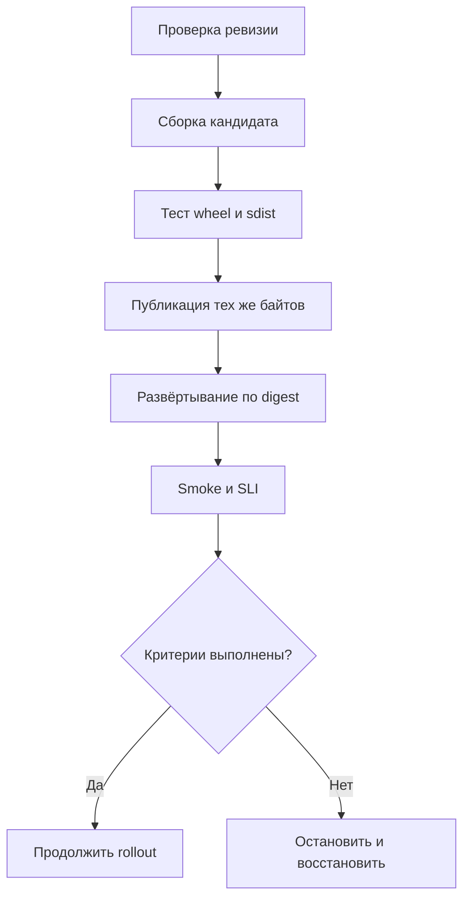
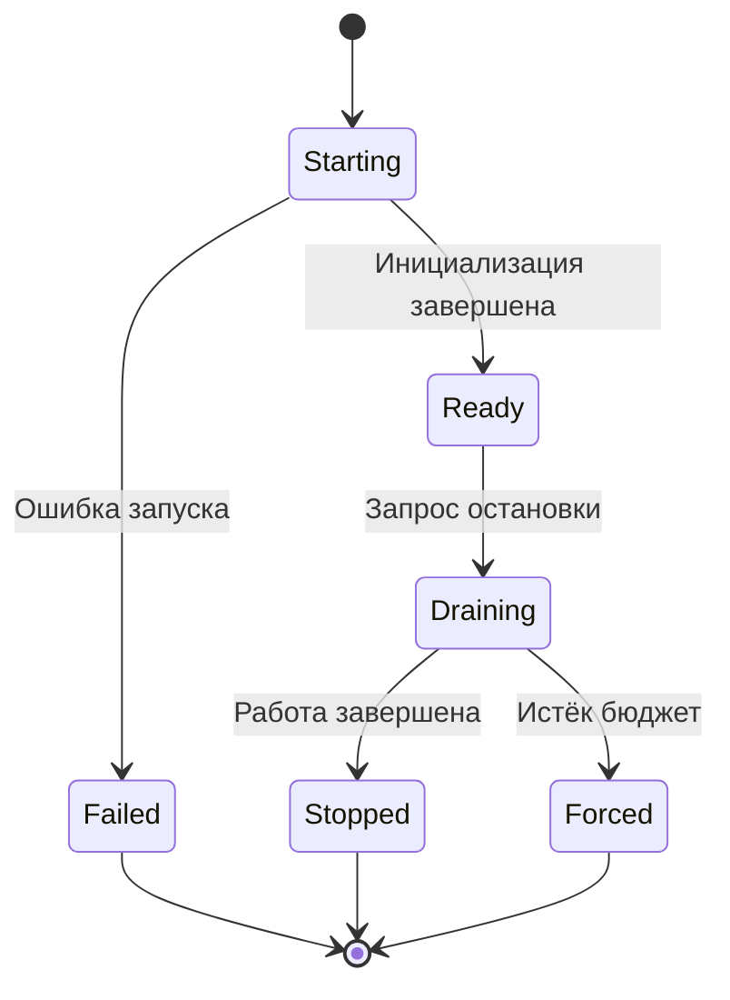

# 23. Документация, сборка, доставка и эксплуатация

Python-проект становится пригодным к использованию, когда другой человек может установить его, выполнить понятный сценарий, диагностировать отказ и безопасно обновить версию. Для сервиса к этому добавляются запуск в ограниченной среде, обработка остановки, наблюдаемость и восстановление данных.

Эта глава сохраняет **все 8 тем и 29 пунктов раздела 23 README**. Она продолжает главы [«Модули и пакеты»](04.%20modules_and_packages.md), [«Тестирование»](13.%20testing.md), [«Логирование»](17.%20logging.md), [«Производительность, профилирование и диагностика»](19.%20performance_profiling_and_diagnostics.md), [«Архитектура»](21.%20application_architecture_and_design.md) и [«Безопасность»](22.%20security_and_supply_chain.md). Здесь эти знания объединяются в жизненный цикл поставки и эксплуатации.

Основные Python-примеры рассчитаны на **Python 3.12+**. Сведения об инструментах и версиях сверены с официальной документацией на **20 октября 2026 года**. Особенности Python 3.15, включая Stable ABI для free-threaded сборок, отмечены отдельно. Рабочий проект фиксирует инструменты и проверяет их обновления: версия, названная без номера, не является обещанием неизменного поведения.

**Как читать примеры**

- Небольшие отдельные блоки объясняют один механизм.
- Файлы учебного пакета `parcelops-demo` используются совместно; полный комплект перечислен в практикуме.
- Примеры Docker, Kubernetes, Prometheus и OpenTelemetry — отдельные конфигурации для изучения соответствующего слоя. Они не составляют готовую инфраструктуру одного приложения.
- Команды публикации показывают процедуру выпуска. Для выполнения практикума публиковать пакет не требуется.
- Фактически выполненные проверки перечислены в конце главы. Ожидаемые результаты примеров не следует путать с отчётом об их запуске.

**Содержание**

1. [Инженерное окружение и проверки качества](#engineering-environment)
2. [Документация проекта](#project-documentation)
3. [Выпуск и доставка](#release-and-delivery)
4. [Конфигурация приложения](#application-configuration)
5. [Контейнеры и ограничения среды](#containers-and-resources)
6. [Жизненный цикл сервиса](#service-lifecycle)
7. [Наблюдаемость — Metrics, Traces и Logs](#observability)
8. [Обновление Python и зависимостей](#upgrades)
9. [Практикум: поставляемый пакет и проверка артефактов](#delivery-workshop)
10. [Самопроверка и инженерные задания](#self-check)
11. [Первичные источники](#primary-sources)

**Какие гарантии нужно различать**

| Утверждение | Что его действительно подтверждает |
| --- | --- |
| Исходники корректны | Тесты и анализ конкретной ревизии |
| Wheel можно установить | Установка именно этого wheel в подходящий чистый interpreter |
| Sdist полноценен | Сборка wheel из распакованного sdist вне checkout |
| Окружение восстанавливается | Восстановление по сохранённому lock и доступность указанных артефактов |
| Сборка побитово воспроизводима | Совпадение digest независимых сборок при определённых входах |
| Сервис готов обслуживать | Проверка готовности и успешный пользовательский сценарий |
| Изменение можно откатить | Проверка совместимости старого кода с текущими данными и конфигурацией |
| Backup пригоден | Успешное восстановление и проверка результата |

Один зелёный job не доказывает все эти свойства.

<a id="engineering-environment"></a>

## Инженерное окружение и проверки качества

### pyproject.toml как конфигурация инструментов

`pyproject.toml` объединяет метаданные дистрибутива и настройки инструментов, но разные таблицы читают разные программы. Файл не является универсальным установщиком, lock-файлом или менеджером процессов.

| Таблица | Ответственность |
| --- | --- |
| `[build-system]` | Каким backend и с какими сборочными зависимостями собрать проект |
| `[project]` | Имя, версия, поддерживаемый Python, runtime-зависимости, entry points |
| `[project.optional-dependencies]` | Extras, которые пользователь может запросить при установке |
| `[dependency-groups]` | Группы разработки, тестов и документации; не extras дистрибутива |
| `[tool.ruff]`, `[tool.mypy]` | Настройки соответствующего инструмента |
| `[tool.hatch...]` | Настройки выбранного backend; другой backend их не обязан понимать |

Стандартизированную часть описывает [PyPA: Writing your pyproject.toml](https://packaging.python.org/en/latest/guides/writing-pyproject-toml/). Поддержка таблицы инструментом зависит от его версии. Наличие dependency groups не означает, что любая старая версия `pip` умеет их устанавливать.

**Базовый файл учебного проекта: `pyproject.toml`**

```toml
[build-system]
requires = ["hatchling>=1.27"]
build-backend = "hatchling.build"

[project]
name = "parcelops-demo"
version = "0.1.0"
description = "A small package for studying Python delivery"
readme = "README.md"
requires-python = ">=3.12"
dependencies = []

[project.scripts]
parcelops = "parcelops.cli:main"

[dependency-groups]
dev = [
    "build",
    "hatchling>=1.27",
    "mypy",
    "pre-commit",
    "pytest",
    "ruff",
    "twine",
]
docs = ["sphinx"]

[tool.hatch.build.targets.wheel]
packages = ["src/parcelops"]

[tool.hatch.build.targets.sdist]
include = [
    "/src",
    "/tests",
    "/scripts",
    "/docs",
    "/pyproject.toml",
    "/README.md",
]

[tool.ruff]
target-version = "py312"
line-length = 88

[tool.ruff.lint]
select = ["E4", "E7", "E9", "F", "I", "B", "UP"]

[tool.ruff.format]
quote-style = "double"

[tool.mypy]
python_version = "3.12"
strict = true
files = ["src/parcelops"]

[tool.pytest.ini_options]
testpaths = ["tests"]
addopts = ["--import-mode=importlib", "-ra"]
markers = [
    "integration: tests requiring external services",
]
```

Зависимости инструментов здесь оставлены как **декларация**, а не готовый lock. После выбора версий команда проекта создаёт и коммитит разрешённое окружение.

**Декларация, lock и constraints решают разные задачи**

- Декларация задаёт множество допустимых версий.
- Lock записывает конкретное разрешение зависимостей и информацию, предусмотренную форматом.
- Constraints ограничивают выбор установщика, но сами по себе не перечисляют всё, что требуется установить.
- `pip freeze` фиксирует видимое установленное окружение, но не объясняет, какие зависимости прямые, какой использован backend и какие системные библиотеки требуются.

Для библиотеки публичные зависимости обычно выражают реальную совместимость, а не единственный набор разработчика. Для приложения deployment-окружение определяют точнее. Lock разработки библиотеки не навязывается всем потребителям.

Пример с `uv` после установки самого инструмента из доверенного источника:

```bash
uv lock
uv sync --locked --group dev --group docs
uv run --locked ruff check .
uv run --locked ruff format --check .
uv run --locked mypy
uv run --locked pytest
```

`uv sync --locked` откажется молча обновлять устаревший lock. `--frozen` имеет другую гарантию: использует существующий lock без проверки его актуальности относительно metadata. Их нельзя считать взаимозаменяемыми. Подробности: [uv: Locking and syncing](https://docs.astral.sh/uv/concepts/projects/sync/).

**На что смотреть в ревью**

1. Согласован ли минимальный Python в metadata, Ruff, mypy и CI?
2. Не попали ли инструменты разработки в runtime-зависимости?
3. Есть ли единственный понятный источник версии?
4. Не устанавливает ли CI лишние extras, скрывая отсутствующую обязательную зависимость?
5. Разделены ли ограничения для runtime, build backend и инструментов проверки?
6. Не используется ли source checkout вместо установленного пакета?

Один TOML-файл уменьшает дублирование настроек, но не устраняет необходимость понимать эти границы.

### Ruff, форматирование, статическая типизация и pre-commit

Проверки качества полезны, если каждая отвечает на определённый вопрос.

| Проверка | Вопрос | Чего она не доказывает |
| --- | --- | --- |
| Linter | Есть ли известные подозрительные конструкции? | Корректность бизнес-правил |
| Formatter | Соответствует ли текст принятому формату? | Правильность программы |
| Type checker | Согласованы ли статически видимые типовые контракты? | Корректность внешних данных |
| Unit tests | Выполняется ли выбранное поведение? | Полноту всех возможных сценариев |
| Integration tests | Работает ли граница с настоящей системой? | Корректность production-конфигурации |
| Проверка wheel | Содержит ли артефакт необходимые файлы? | Правильность всей поставки |

`ruff check` и `ruff format` — разные команды. Форматирование не заменяет lint. Большое количество правил не является целью: правила должны помогать читать и менять проект, а не генерировать постоянные исключения.

Минимальный цикл перед commit:

```bash
ruff check .
ruff format --check .
mypy
pytest
```

Автоисправления запускают отдельным действием, после которого просматривают diff:

```bash
ruff check --fix .
ruff format .
```

Даже безопасные по классификации инструмента исправления заслуживают просмотра. Небезопасные преобразования и codemods требуют понимания изменения поведения.

[Документация Ruff](https://docs.astral.sh/ruff/configuration/) описывает поиск конфигурации, выбор файлов и target version. Вложенные конфигурации и параметры запуска способны изменить результат.

**Типизация на границах**

Если `json.loads()` вернул `Any`, mypy не проверил данные за вас. Для внешней конфигурации нужна runtime-валидация. Если весь адаптер помечен `Any` или подавлен через общий `ignore_missing_imports`, большая часть заявленной строгости может обходиться.

Практичный порядок внедрения:

1. Типизировать публичные интерфейсы и объекты конфигурации.
2. Отделить нетипизированные адаптеры.
3. Установить правила обработки отсутствующих stubs.
4. Запретить новые необоснованные подавления.
5. Постепенно сокращать имеющийся долг.

Максимальная строгость ценой сотен строк `# type: ignore` без объяснения редко улучшает проект. Источник настроек: [mypy configuration](https://mypy.readthedocs.io/en/stable/config_file.html).

**Pre-commit — быстрая обратная связь**

Следующий вариант использует инструменты из подготовленного окружения. `language: system` не создаёт отдельное изолированное окружение hook.

Файл `.pre-commit-config.yaml`:

```yaml
repos:
  - repo: local
    hooks:
      - id: ruff-check
        name: Ruff lint
        entry: ruff check
        language: system
        types_or: [python, pyi]

      - id: ruff-format
        name: Ruff format
        entry: ruff format
        language: system
        types_or: [python, pyi]
```

```bash
pre-commit install
pre-commit run --all-files
```

Hook может изменить файл, после чего обновлённый diff просматривают и добавляют заново. Если нужны автоматически создаваемые отдельные окружения, используют remote hooks с зафиксированным `rev` и дополнительными зависимостями. Их версии тоже являются частью инструментального окружения.

Mypy часто удобнее запускать на всём пакете в CI, а не на случайном наборе staged-файлов. Анализ типов зависит от связанных модулей, plugins и stubs. Если он добавлен в pre-commit, следует осознанно выбрать `pass_filenames: false` и окружение со всеми зависимостями.

Hooks можно пропустить, они могут быть не установлены. Поэтому обязательные проверки выполняются в CI независимо от локальных hooks. Поведение описывает [pre-commit](https://pre-commit.com/).

### CI-матрица: версии Python, ОС и установленные артефакты

Матрица совместимости — проверяемое обещание пользователю, а не список всех существующих комбинаций.

| Измерение | Типовые ошибки |
| --- | --- |
| Версия Python | Удалённый API, новая семантика, несовместимый dependency |
| ОС | Пути, сигналы, encoding, блокировки и subprocess |
| Архитектура CPU | Отсутствующий wheel, системные библиотеки |
| GIL / free-threaded | Гонки, неподдерживаемые расширения, включение GIL |
| Способ установки | Ошибка wheel/sdist, отсутствующие resources или entry point |
| Набор зависимостей | Lower bounds, latest compatible, optional extras |

Полная декартова матрица может быть слишком дорогой. Тогда основные сочетания проверяются на каждом PR, расширенная матрица — перед релизом или по расписанию. Непроверенные платформы не объявляют гарантированно поддерживаемыми.

**Исходники и установленный артефакт**

`pip install -e .` полезен при разработке, но способен скрыть ошибки комплектации. Тесты из корня checkout могут импортировать локальные исходники. `src layout` и запуск из временного каталога уменьшают риск.

Практический минимум для релиза:

1. Собрать sdist и wheel.
2. Установить wheel в новое окружение.
3. Запустить CLI вне checkout.
4. Импортировать пакет и прочитать package resource.
5. Выполнить поведенческие тесты установленной версии.
6. Распаковать sdist во временное место.
7. Построить из него wheel и повторить проверки.

`pip check` выявляет несовместимость объявленных зависимостей в установленном окружении. Он не проверяет, что код объявил каждую фактическую зависимость, и не запускает программу.

`--import-mode=importlib` у pytest помогает избежать части изменений `sys.path`, но не гарантирует тестирование wheel. Важны каталог, окружение, layout и отсутствие `PYTHONPATH` с исходниками. См. [pytest: Good Integration Practices](https://docs.pytest.org/en/stable/explanation/goodpractices.html).

**Учебный workflow для пакета из практикума**

Это возможный `.github/workflows/package.yml` отдельного проекта `parcelops-demo`. Его не нужно добавлять в репозиторий справочника, где нет соответствующего пакета.

```yaml
name: Package compatibility

on:
  pull_request:
  push:
    branches: [main, develop]

permissions:
  contents: read

jobs:
  artifact-tests:
    runs-on: ${{ matrix.os }}
    timeout-minutes: 15
    strategy:
      fail-fast: false
      matrix:
        os: [ubuntu-24.04, windows-latest, macos-latest]
        python-version: ["3.12", "3.13", "3.14", "3.15"]

    steps:
      - uses: actions/checkout@3d3c42e5aac5ba805825da76410c181273ba90b1 # v7.0.1
        with:
          persist-credentials: false

      - uses: actions/setup-python@5fda3b95a4ea91299a34e894583c3862153e4b97 # v7.0.0
        with:
          python-version: ${{ matrix.python-version }}

      - name: Install build frontend
        run: python -m pip install build

      - name: Build wheel and sdist
        run: python -m build

      - name: Test installed distributions outside checkout
        run: python scripts/check_distribution.py
```

SHA этих actions проверены по тегам; это не обещание бессрочной актуальности. Версии `build` и backend в учебном workflow разрешаются при запуске. **Этот YAML проверяет совместимость, но ещё не задаёт полностью фиксированную сборочную среду.** В release pipeline используйте lock инструментов, контролируемый источник build requirements и явно выбранные runner images.

`latest` у runner — изменяемая среда. При диагностике сохраняют фактические версии ОС, Python, установщика и сборочных инструментов. Для воспроизводимого выпуска среду задают строже, чем для раннего обнаружения проблем.

Кэш ускоряет установку, но не заменяет проверку содержимого и не является единственным местом хранения релизного артефакта.

### Разделение быстрых проверок, интеграционных тестов и release pipeline

Разные этапы имеют разные требования к скорости, доверию и побочным эффектам.

| Этап | Когда | Что получает |
| --- | --- | --- |
| Быстрый feedback | Каждый PR | Код, lint, типы, unit tests |
| Интеграционные проверки | По правилам проекта | Эфемерные БД и тестовые сервисы |
| Проверка дистрибутива | PR и кандидат | Собранные wheel/sdist |
| Release verification | Доверенная ревизия | Точный комплект кандидата |
| Публикация | После проверки | Проверенные байты и минимальные полномочия |
| Deployment verification | После развёртывания | Новая версия и ограниченный smoke-сценарий |

Publish job должен получать **тот же проверенный артефакт**. Повторная сборка после тестов создаёт новые байты, для которых результат тестов уже не является прямым доказательством.



Это схема ответственности, а не требование к конкретному CI-сервису.

**Правила организации**

- Каждый job имеет лимит времени и понятный код завершения.
- Интеграционные тесты используют собственные namespace и данные.
- Секреты публикации не выдаются job недоверенного PR.
- Workflows не подставляют неэкранированный текст PR в shell.
- Параллелизм согласован с лимитами БД, CPU и памяти.
- Повторы не скрывают flaky-поведение.
- Результаты тестов и digest кандидата связываются с ревизией.
- Публикация сериализована там, где два выпуска могут конфликтовать.

Ошибка проектирования: release workflow произвольной ветки получает те же полномочия, что и доверенный tag. Защита тега полезна вместе с защитой workflow, среды и источника артефактов.

Проверка внешних ссылок может зависеть от сети. Быструю проверку внутренних ссылок делают обязательной, сетевые проверки запускают отдельно с определёнными retries и политикой исключений.

Pipeline оценивают по времени до полезного ответа, частоте ложных отказов и качеству доказательств выпуска. Количество jobs само по себе ничего не говорит о надёжности.


<a id="project-documentation"></a>

## Документация проекта

### README, quickstart, tutorials, how-to и API reference

Документация нужна людям с разными задачами. Новичок ещё не знает понятий проекта; пользователь решает конкретную проблему; сопровождающий ищет точную семантику параметра; дежурный восстанавливает работу под давлением времени. Один большой README редко удовлетворяет их всех.

Подход [Diátaxis](https://diataxis.fr/) различает обучение, инструкции к задачам, справочник и объяснение устройства. Он помогает выбрать цель страницы, но не требует обязательной структуры директорий.

| Вид текста | Вопрос | Пример для batch-сервиса |
| --- | --- | --- |
| README | Что это и подходит ли мне? | Назначение, поддерживаемые версии, ссылка на старт |
| Quickstart | Как получить первый результат? | Установить wheel и рассчитать число batches |
| Tutorial | Как освоить процесс? | Путь от входного файла до отчёта |
| How-to | Как выполнить известную задачу? | Изменить размер batch |
| API reference | Каков точный контракт? | Параметры, результат, исключения |
| Explanation | Почему так устроено? | Почему checkpoint хранится вне контейнера |
| Runbook | Как действовать при отказе? | Рост lag и безопасное восстановление |

**README как проверяемое обещание**

Он отвечает хотя бы на вопросы:

1. Какую задачу решает проект?
2. Какие Python и платформы поддерживаются?
3. Как установить распространяемый пакет?
4. Какая минимальная команда даёт результат?
5. Какой результат ожидается?
6. Где полная документация, ограничения и инструкции обновления?
7. Как разработчику запустить проверки?

Не начинайте установку пользовательского инструмента с клонирования репозитория и `PYTHONPATH=src`, если официальный способ доставки — wheel. Иначе quickstart проверяет другой путь.

**Quickstart ограничивает количество решений**

Не заставляйте читателя сначала выбирать из пяти ОС, трёх backends и четырёх БД. Дайте один определённый сценарий, альтернативы вынесите в отдельные инструкции.

```text
Команда: parcelops count --rows 2500 --batch-size 1000
Ожидаемый stdout: {"batches": 3}
Ожидаемый exit code: 0
```

Сценарий со сторонним сервисом объясняет его адрес, тестовые данные, время ожидания, очистку и типовые ошибки соединения.

**Tutorial и how-to**

В tutorial допустимо ограничить выбор, чтобы освоить понятие. В how-to нужны предусловия и варианты, влияющие на результат. Справочник не обязан объяснять весь путь новичка, но обязан точно называть ограничения.

Для инструкции с изменением состояния полезны:

- Предусловия и права.
- Влияние на текущую работу.
- Шаги.
- Критерий завершения.
- Проверка результата.
- Действия при частичном выполнении.
- Очистка временных объектов.

Это особенно важно для миграций, backfill, ротации ключа и переобработки событий.

**Документация — часть изменения**

Если PR добавляет обязательную настройку, меняет исключение или прекращает поддержку Python, документация меняется вместе с кодом. В ревью полезен вопрос: изменился ли пользовательский контракт?

Качество страницы определяется способностью выполнить её задачу. Длина текста, badges и автоматический API reference не заменяют эту проверку.

### Docstrings, примеры, типы и контракт ошибок

Аннотация `rows: int` не сообщает, разрешены ли отрицательные значения, какие единицы используются и допускается ли логическое значение. Сигнатура `-> bytes` не объясняет encoding и владение буфером. Docstring дополняет типы семантикой.

| Часть контракта | Что уточнить |
| --- | --- |
| Параметры | Смысл, единицы, диапазон, обязательность |
| Результат | Значение, порядок, точность, возможное отсутствие |
| Ошибки | Устойчивые типы исключений и условия |
| Побочные эффекты | Сеть, файлы, транзакции, логирование |
| Владение | Кто закрывает stream, разделяется ли память |
| Конкурентность | Разрешён ли совместный вызов |
| Отмена | Что могло сохраниться при timeout/cancellation |
| Совместимость | Стабильность API и deprecation |

**Пример контракта**

Файл `src/parcelops/core.py`:

```python
def batch_count(rows: int, batch_size: int = 1000) -> int:
    """Return the number of batches needed to process rows.

    Args:
        rows: Number of rows, a non-negative integer.
        batch_size: Maximum rows per batch, a positive integer.

    Returns:
        The smallest non-negative number of batches covering all rows.
        An empty input requires zero batches.

    Raises:
        TypeError: If an argument is not exactly an int, including bool.
        ValueError: If rows is negative or batch_size is not positive.

    The function performs no I/O and does not modify external state.

    Examples:
        >>> batch_count(0)
        0
        >>> batch_count(2500, 1000)
        3
        >>> batch_count(10, 0)
        Traceback (most recent call last):
            ...
        ValueError: batch_size must be positive
    """
    if type(rows) is not int or type(batch_size) is not int:
        raise TypeError("rows and batch_size must be integers")
    if rows < 0:
        raise ValueError("rows must be non-negative")
    if batch_size <= 0:
        raise ValueError("batch_size must be positive")
    return (rows + batch_size - 1) // batch_size
```

Строгая проверка `type(...) is int` — часть выбранного контракта учебной функции. Она нужна не каждой математической функции: иногда поддержка целочисленных подклассов полезна. Требование — согласованность документации и поведения.

**Исключения как интерфейс**

Пользователь может обрабатывать `ValueError`, но не должен зависеть от случайного текста traceback. Если нужен устойчивый machine-readable код ошибки, он становится отдельным полем или собственным типом.

CLI преобразует ошибку параметра в exit code `2` и безопасное сообщение. HTTP-адаптер преобразует ту же доменную ошибку в согласованный статус и структуру ответа. Ядро не обязано знать HTTP.

Для timeout опишите, был ли запрос точно не отправлен, мог ли сервер применить операцию и как безопасно её повторить. Одного «raises TimeoutError» недостаточно для изменяющего данные API.

**Что не нужно дублировать**

Docstring `value: int — integer value` почти ничего не добавляет. Объясняйте единицы, пределы, точность и крайние случаи. Не обещайте все внутренние исключения сторонних функций, если планируете нормализовать их.

Примеры показывают не только успешный путь. Для дат нужен timezone, для записи — повтор, для streaming API — способ закрыть итератор.

### Sphinx/autodoc и MkDocs; проверка ссылок и сборки

Sphinx и MkDocs строят документацию, но имеют разные привычные пути работы.

| Критерий | Sphinx | MkDocs |
| --- | --- | --- |
| Основной формат | reStructuredText; Markdown через расширения | Markdown |
| API reference | `autodoc` и extensions | Обычно plugins |
| Ссылки на Python-объекты | Roles и cross references | Зависит от plugins |
| Учебные страницы | Поддерживаются | Поддерживаются |
| Проверка примеров | Doctest builder и отдельные тесты | Обычно отдельный pipeline |

Выбирайте по требованиям и опыту команды. Генерация API reference не создаёт автоматически хорошие how-to.

**Минимальный Sphinx**

Файл `docs/conf.py`:

```python
from importlib.metadata import version

project = "ParcelOps"
release = version("parcelops-demo")
extensions = [
    "sphinx.ext.autodoc",
    "sphinx.ext.napoleon",
    "sphinx.ext.doctest",
]
nitpicky = True
exclude_patterns = ["_build"]
```

`napoleon` обрабатывает Google/NumPy style docstrings. Пакет должен быть установлен в окружение сборки. Добавление `src` в `sys.path` могло бы скрыть проблему установки.

Файл `docs/index.rst`:

```rst
ParcelOps
=========

The package counts batches without reading or changing input data.

.. testsetup::

   from parcelops.core import batch_count

API
---

.. autofunction:: parcelops.core.batch_count

Example
-------

.. doctest::

   >>> batch_count(2500, 1000)
   3
```

`testsetup` задаёт namespace и для примеров docstring, включённых через autodoc.

```bash
sphinx-build -n -W --keep-going -b html docs docs/_build/html
sphinx-build -W --keep-going -b doctest docs docs/_build/doctest
sphinx-build -W --keep-going -b linkcheck docs docs/_build/linkcheck
```

`-n` включает строгую проверку ссылок на объекты, `-W` превращает warnings в неуспешный результат. `--keep-going` позволяет собрать несколько диагностик. Детали флагов: [sphinx-build](https://www.sphinx-doc.org/en/master/man/sphinx-build.html).

**Autodoc выполняет импорт**

Если import запускает сервер, читает production-секрет или подключается к БД, сборка документации тоже может это выполнить. Соединения и запуск приложения размещают в явных функциях.

Предупреждение описано в [Sphinx autodoc](https://www.sphinx-doc.org/en/master/usage/extensions/autodoc.html). Массовый mock зависимостей способен скрыть проблемы интерфейса; `autodoc_mock_imports` применяют точечно.

**Альтернатива на MkDocs**

Файл `mkdocs.yml` для документации в `docs-md/`:

```yaml
site_name: ParcelOps
docs_dir: docs-md
site_dir: site
strict: true
nav:
  - Home: index.md
  - Configuration: configuration.md
validation:
  links:
    not_found: warn
    anchors: warn
```

Оба файла в `nav` нужно создать. Конфиг — альтернатива Sphinx, не обязательная часть практикума.

```bash
mkdocs build --strict
```

Настройки сверяют с [MkDocs configuration](https://www.mkdocs.org/user-guide/configuration/). `--strict` не делает MkDocs универсальным проверяющим всех внешних URL и fenced code blocks.

**Разные проверки документации**

1. Синтаксис и сборка.
2. Внутренние ссылки и cross references.
3. Внешние ссылки.
4. Исполняемые примеры.
5. Доступность документации нужной версии.
6. Установка, описанная в quickstart.

Для внешних URL учитывайте `429`, временные `5xx` и блокировки клиентов. Исключение имеет причину и владельца. Исключение всех проблемных URL делает проверку бессмысленной.

### doctest, исполняемые примеры и документация версий

`doctest` сравнивает вывод с текстом примера интерактивного сеанса. Он полезен для коротких детерминированных вычислений, где вывод является частью объяснения.

```bash
python -m doctest -v src/parcelops/core.py
```

Для проверки установленного модуля импортируют его из чистого окружения и используют `doctest.testmod()`. Такая проверка есть в практикуме.

Правила сопоставления: [Python doctest](https://docs.python.org/3/library/doctest.html). В Sphinx блоки собирает [sphinx.ext.doctest](https://www.sphinx-doc.org/en/master/usage/extensions/doctest.html). Обычный fenced block в Markdown сам не исполняется.

**Чего избегать**

- Текущей даты и wall-clock времени.
- Случайных идентификаторов без контроля источника.
- Порядка множеств.
- Сети к изменяемому ресурсу.
- Путей, зависящих от ОС.
- `repr` с адресом памяти.
- Чрезмерного `ELLIPSIS`, скрывающего результат.

Игнорирование всего нестабильного может превратить пример в проверку, проходящую при неправильном поведении.

Сложные сценарии лучше проверять обычными тестами: временные каталоги, fault injection, конкурентность, транзакции, отмена. Документация может включать код из тестируемого файла, чтобы не хранить расходящиеся копии.

**Проверка учебного примера**

Представьте, что его скопировали в пустой каталог:

1. Все ли импорты и файлы показаны?
2. Нужны ли скрытые переменные окружения?
3. Есть ли fixture, отсутствующая в инструкции?
4. Понятен ли рабочий каталог?
5. Нужны ли реальные секреты?
6. Указаны ли результат и очистка?

Quickstart полезно исполнять без dev extras. Иначе пользовательская инструкция может зависеть от пакета, доступного только автору.

**Документация версии**

У пользователя `1.4` должна оставаться возможность прочитать контракт `1.4` после выхода `2.0`.

| Адрес | Смысл |
| --- | --- |
| `/v1.4/` | Документация поддерживаемой линии |
| `/v2.0/` | Документация другой линии |
| `/stable/` | Указатель на выбранную стабильную версию |
| `/latest/` | Development-версия, если проект так определил |

`stable` и `latest` — политика проекта. Страница явно показывает версию.

Документация релиза строится из соответствующего tag или commit с согласованным пакетом. Для breaking change нужны migration guide и примеры до/после.

Постоянная замена API reference старой версии новым содержимым под тем же URL приводит к тому, что пользователь читает уже другой контракт.


<a id="release-and-delivery"></a>

## Выпуск и доставка

### Версия, changelog, теги и политика совместимости

Версия связывает публичный контракт, metadata дистрибутива, исходную ревизию, собранные файлы, документацию и deployment. Эта связь должна быть прослеживаемой.

Из строки `1.8.2` недостаточно понять, каким commit, backend, lock и базовым образом создан экземпляр приложения.

**Формат и обещание совместимости**

Python packaging использует правила записи и упорядочивания версий, известные по PEP 440. Семантическое версионирование — дополнительная политика проекта. Установщик сравнивает версии, но не доказывает сохранение API.

| Запись | Обычное назначение |
| --- | --- |
| `1.4.0` | Финальный релиз |
| `1.5.0a1` | Альфа |
| `1.5.0b1` | Бета |
| `1.5.0rc1` | Кандидат |
| `1.4.0.post1` | Post release; не скрытая замена старого файла |
| `1.6.0.dev1` | Development release |

Для constraints:

- `>=1.4,<2` — явная верхняя граница.
- `~=1.4` допускает версии до `2.0` по правилу совместимого релиза.
- `~=1.4.0` ограничивает выбор линией `1.4.*`.
- `==1.4.0` фиксирует версию, но не один файл для всех платформ.

Нормативный источник: [Version specifiers](https://packaging.python.org/en/latest/specifications/version-specifiers/). Правила SemVer не переносятся автоматически на каждую особенность PEP 440.

**Определите публичную поверхность**

| Поверхность | Пример breaking change |
| --- | --- |
| Python API | Новый обязательный параметр или тип результата |
| CLI | Другой флаг или exit code |
| Файлы | Новый checkpoint format |
| Конфигурация | Ранее допустимое значение отклоняется |
| Ошибки | Изменён класс исключения или код |
| Протокол | Удалено поле старого consumer |
| Среда | Повышен минимальный Python |
| Эксплуатация | Память выросла за допустимый бюджет |

Исправление бага на крайних значениях иногда ломает чьё-то использование. Это нужно описать, даже если политика не требует повышения major.

**Changelog для пользователя**

Он отвечает на вопросы «что изменилось?», «кому важно?» и «что нужно сделать?».

```markdown
## 1.5.0

### Changed
- CLI отклоняет нулевой размер batch с кодом 2.
  Ранее такой ввод приводил к необработанному исключению.

### Deprecated
- Флаг --size устаревает; используйте --batch-size.
  Удаление запланировано для 2.0.

### Operations
- Перед включением checkpoint v2 обновите consumers.
  Старый формат доступен через CHECKPOINT_V2=false.
```

Список commit messages сам по себе не объясняет влияние на пользователя.

**Tag и версия**

Tag может называться `v1.5.0`, metadata — `1.5.0`. Проверка сравнивает нормализованные значения по выбранному правилу. Tag указывает на commit, но не доказывает происхождение wheel.

Не храните вручную несколько независимых копий версии. Стратегии:

1. Статическая версия в `pyproject.toml`, чтение через `importlib.metadata.version()`.
2. Версия из VCS с настроенным backend/plugin.
3. Release automation, меняющая обязательные места одним проверяемым действием.

VCS-based версия требует сборки sdist без `.git`. Иначе проект может собираться только в checkout автора.

**Deprecation**

1. Обозначить замену.
2. Показать миграцию.
3. Выпустить подходящее предупреждение.
4. Указать срок или версию удаления.
5. Проверить собственных consumers.
6. Удалить после установленного окна.

Политика полезна, когда ей можно следовать предсказуемо. Отсутствие обещаний увеличивает стоимость использования библиотеки.

### Сборка wheel/sdist и тест установки в чистом окружении

Дистрибутив — единица поставки, отличная от import package.

- `Wheel` содержит устанавливаемые файлы, metadata и при необходимости нативный код.
- `Sdist` содержит исходный комплект для сборки.
- `Build frontend` организует вызов backend.
- `Build backend` выполняет сборку по своему контракту.

Установка wheel не требует повторной компиляции его исходников. Это не означает отсутствия платформенных ограничений или кода при последующем import.

Источники: [Packaging Flow](https://packaging.python.org/en/latest/flow/) и [PyPA build](https://build.pypa.io/en/stable/).

```bash
python -m pip install build twine
python -m build
python -m twine check dist/*
```

Последняя команда предполагает shell с раскрытием wildcard. В переносимом скрипте список получают через `pathlib` и передают в `subprocess.run([...])`.

Обычный `python -m build` создаёт sdist, затем wheel из sdist. Это полезная проверка комплектности source archive, но установка файлов и функциональные проверки остаются необходимыми.

**Содержимое wheel**

| Элемент учебного пакета | Зачем |
| --- | --- |
| `parcelops/__init__.py` | Обычный import package |
| `parcelops/core.py` | Публичный API |
| `parcelops/cli.py` | Entry point |
| `parcelops/defaults.json` | Package resource |
| `parcelops/py.typed` | Маркер типизации |
| `*.dist-info/METADATA` | Имя, версия, зависимости |
| `*.dist-info/entry_points.txt` | Console script |
| `*.dist-info/RECORD` | Сведения о файлах wheel |

`twine check` полезен для metadata и описания, но не доказывает функциональность пакета.

**Чистое окружение**

Исключите:

- локальный пакет через working directory;
- `PYTHONPATH` с исходниками;
- editable installation;
- системные site-packages;
- dev dependencies, скрывающие пропуски metadata;
- подмену interpreter через случайную команду `PATH`.

В практикуме создаются временный каталог и venv, wheel устанавливается туда, тесты запускаются из отдельной копии каталога тестов.

Для пакета с runtime-зависимостями отдельно проверяют разрешение публичного набора и определённый lock приложения. Это разные гарантии.

**Нативные wheels**

Имя wheel кодирует Python, ABI и платформу. Копирование `.so` с машины разработчика не обеспечивает переносимость. Для Linux важны libc и shared libraries; у других ОС свои правила.

Разработка расширений относится к главе 24. Здесь критерий поставки: wheel устанавливается и выполняет сценарий на заявленной чистой системе без компиляторов и случайных библиотек автора.

**Тест sdist**

Часто забывают:

- шаблоны и schema-файлы;
- generated sources;
- version-файл;
- лицензии;
- build configuration;
- дополнительные исходники расширения.

Сборка проверяется без checkout и `.git`. Если необходим генератор, его версия и inputs входят в сборочный контракт.

| Симптом | Вероятный слой |
| --- | --- |
| Не строится metadata | `pyproject`, backend, инструменты |
| Wheel устанавливается, import ломается | Файлы, зависимости, ABI |
| CLI отсутствует | Entry point или установка scripts |
| Работает только из checkout | Скрытые пути к исходникам и ресурсам |
| Wheel работает, sdist не собирается | Неполный source distribution |
| На новой ОС компилируются исходники | Нет подходящего wheel |

Добавление source path в `PYTHONPATH` пользователя не исправляет дефект дистрибутива.

### TestPyPI/PyPI, артефакты, откат и воспроизводимый выпуск

**TestPyPI**

Это отдельный индекс с отдельными аккаунтами и настройками доверия. Успешная загрузка не настраивает автоматически основной PyPI.

После выбора собственного уникального имени:

```bash
python -m twine upload --repository testpypi dist/*
```

Для тестового пакета без runtime-зависимостей:

```bash
python -m pip install --index-url https://test.pypi.org/simple/ --no-deps your-unique-project==0.1.0
```

`your-unique-project` заменяют своим именем. Команда не является автоматическим шагом практикума.

Набор пакетов TestPyPI отличается от PyPI. `--extra-index-url` добавляет задачу доверия к нескольким источникам и выбора совпадающих имён. Предпочтительнее установить проверенные dependencies отдельно, затем конкретный тестовый пакет без повторного разрешения. См. [Using TestPyPI](https://packaging.python.org/en/latest/guides/using-testpypi/).

**Trusted Publishing**

Автоматический выпуск предпочтительно использует короткоживущую авторизацию через OIDC. На PyPI связывают проект с repository, workflow и при выбранной политике environment.

- `id-token: write` получает только publish job.
- Он не исполняет произвольный PR.
- Workflow и environment защищены по принятой политике.
- Проверены проект и назначение загрузки.
- Publish получает проверенные artifacts.
- TestPyPI и PyPI настроены отдельно.

Документы: [PyPI Trusted Publisher](https://docs.pypi.org/trusted-publishers/using-a-publisher/) и [GitHub OIDC in PyPI](https://docs.github.com/en/actions/how-tos/secure-your-work/security-harden-deployments/oidc-in-pypi). Короткий срок token не защищает от кода в том же привилегированном job.

**Релизный комплект**

| Артефакт | Назначение |
| --- | --- |
| Wheel/sdist | Проверенные bytes |
| SHA-256 | Идентификация содержимого |
| Commit/tag | Связь с исходниками |
| Frontend/backend versions | Восстановление build environment |
| Lock/base image digest | Зависимости и системный слой |
| Test results | Связь проверок с кандидатом |
| SBOM/provenance | Состав и происхождение |
| Changelog/migration guide | Работа потребителя с обновлением |

Digest не является цифровой подписью и не сообщает автора. Его получают по доверенному пути.

```python
import hashlib
from pathlib import Path

for path in sorted(Path("dist").iterdir()):
    if not path.is_file() or path.suffix not in {".whl", ".gz"}:
        continue
    with path.open("rb") as stream:
        digest = hashlib.file_digest(stream, "sha256").hexdigest()
    print(f"{digest}  {path.name}")
```

**Откат**

Не планируйте заменять файл той же версии исправленными bytes. Выпускают новую версию. Удаление или yank не возвращает старый код автоматически на машины пользователей.

Yank влияет на обычный выбор установщика, но не равен удалению: точный pin может продолжить выбирать выпуск. Он ограничивает распространение дефекта, но не отзывает установленный код. Источник: [PyPI yanking](https://docs.pypi.org/project-management/yanking/).

Rollback приложения развёртывает сохранённый совместимый artifact/digest. Для библиотеки потребитель меняет собственный pin/lock.

**Уровни воспроизводимости**

1. Известное происхождение: source commit и inputs сохранены.
2. Повторяемая установка: выбранное окружение восстановлено.
3. Побитовая воспроизводимость: независимые сборки дали одинаковые bytes.

Из первого или lock-файла не следует третье.

Причины различий:

- timestamps и порядок файлов;
- версии backend и build dependencies;
- compiler, platform tags;
- абсолютные пути;
- locale и encoding;
- VCS metadata;
- недетерминированный generator;
- изменяемый base image tag.

`SOURCE_DATE_EPOCH` и режим backend помогают с отдельными источниками изменчивости, но не фиксируют автоматически ОС, compiler и сеть. См. [Hatch build configuration](https://hatch.pypa.io/latest/config/build/).

Повторяемой установке помогают точные версии, hashes и wheelhouse. Ограничения: [pip Repeatable Installs](https://pip.pypa.io/en/stable/topics/repeatable-installs/). Wheelhouse связан с Python, ABI и платформой.

**Критерий готовности**

Можно назвать проверенные bytes, вычислить digest, установить их вне checkout, связать с ревизией и объяснить путь к предыдущей версии. Повторное случайное разрешение dependencies во время recovery не является определённой процедурой восстановления.


<a id="application-configuration"></a>

## Конфигурация приложения

### Источники, приоритеты, типы, значения по умолчанию и ранняя валидация

Конфигурация определяет поведение процесса при заданных входах. Она становится контрактом, как только оператор, deployment или другой сервис начинает на неё рассчитывать.

Для каждого параметра определяют:

| Свойство | Пример |
| --- | --- |
| Имя | `timeout_seconds` |
| Тип | Конечное положительное число |
| Единица | Секунды |
| Источники | TOML, environment, CLI |
| Приоритет | CLI выше environment |
| Default | `2.0` для обычного запроса |
| Ограничения | Не выше внешнего deadline |
| Применение | Только при запуске или динамически |
| Диагностика | Значение можно безопасно показать |
| Ошибка | Отказ запуска с именем параметра |

**Приоритеты**

Распространённый вариант:

`defaults < config file < environment < CLI`

Это выбор проекта. Его нужно описать и проверить конфликтующие значения.

Если `APP_PORT=9000`, а в TOML `port=8080`, результат не должен зависеть от порядка импортов. Разрешение источников выполняется централизованно в composition root.

**Отсутствующее значение отличается от пустого**

Различайте:

- Переменная не определена.
- Определена как пустая строка.
- Передано строковое `"0"`.
- Передано строковое `"false"`.
- В TOML передан настоящий `false`.
- Передан `null` в формате, который его поддерживает.

`bool("false")` возвращает `True`. Поэтому `bool(value)` не является парсером логической настройки.

```python
def parse_bool(value: str) -> bool:
    normalized = value.strip().lower()
    if normalized in {"1", "true", "yes", "on"}:
        return True
    if normalized in {"0", "false", "no", "off"}:
        return False
    raise ValueError("expected a boolean value")
```

Варианты — часть контракта. Неизвестную строку лучше отклонить, чем трактовать как default.

**Сначала собрать, затем проверить весь объект**

Если `pool_size=50`, `workers=8`, а БД допускает `100` соединений приложения, каждое поле отдельно допустимо, но сочетание создаёт `400` соединений на replica.

Проверяют:

1. Форму и тип.
2. Диапазоны.
3. Согласованность полей.
4. Обязательные значения.
5. Применимость к выбранному режиму.
6. Внешние условия, необходимые для запуска.

Недоступность БД и некорректный `pool_size` требуют разных действий. Некорректную конфигурацию не следует бесконечно лечить restart.

**Законченный загрузчик**

Самостоятельный файл `settings_example.py` показывает приоритеты и валидацию. Он не является обязательной частью пакета практикума.

```python
import math
import re
import tomllib
from collections.abc import Mapping
from dataclasses import dataclass
from pathlib import Path

_KEYS = frozenset({"port", "workers", "timeout_seconds"})
_ENV_KEYS = {
    "APP_PORT": "port",
    "APP_WORKERS": "workers",
    "APP_TIMEOUT_SECONDS": "timeout_seconds",
}


class ConfigError(ValueError):
    """Configuration does not satisfy the application contract."""


@dataclass(frozen=True)
class Settings:
    port: int
    workers: int
    timeout_seconds: float


def _integer(value: object, name: str) -> int:
    if type(value) is int:
        return value
    if isinstance(value, str) and re.fullmatch(r"[0-9]+", value):
        try:
            return int(value)
        except ValueError:
            pass
    raise ConfigError(f"{name}: expected an integer")


def _positive_seconds(value: object, name: str) -> float:
    if isinstance(value, bool) or not isinstance(value, (str, int, float)):
        raise ConfigError(f"{name}: expected seconds")
    try:
        result = float(value)
    except (ValueError, OverflowError) as exc:
        raise ConfigError(f"{name}: invalid seconds") from exc
    if not math.isfinite(result) or not 0 < result <= 300:
        raise ConfigError(f"{name}: expected 0 < seconds <= 300")
    return result


def load_settings(
    path: Path | None,
    environ: Mapping[str, str],
    cli: Mapping[str, object],
) -> Settings:
    raw: dict[str, object] = {
        "port": 8080,
        "workers": 1,
        "timeout_seconds": 2.0,
    }

    if path is not None:
        with path.open("rb") as stream:
            document = tomllib.load(stream)
        if set(document) != {"app"}:
            raise ConfigError("config file: expected only the [app] table")
        section = document["app"]
        if not isinstance(section, dict):
            raise ConfigError("app: expected a table")
        unknown = set(section) - _KEYS
        if unknown:
            raise ConfigError("app: unknown option")
        raw.update(section)

    for env_name, key in _ENV_KEYS.items():
        if env_name in environ:
            raw[key] = environ[env_name]

    if set(cli) - _KEYS:
        raise ConfigError("CLI: unknown option")
    raw.update(cli)

    port = _integer(raw["port"], "port")
    workers = _integer(raw["workers"], "workers")
    timeout = _positive_seconds(raw["timeout_seconds"], "timeout_seconds")

    if not 1 <= port <= 65535:
        raise ConfigError("port: expected 1..65535")
    if not 1 <= workers <= 64:
        raise ConfigError("workers: expected 1..64")

    return Settings(
        port=port,
        workers=workers,
        timeout_seconds=timeout,
    )
```

`tomllib.load()` читает бинарный файл и разбирает TOML, но не знает схему приложения: [Python tomllib](https://docs.python.org/3/library/tomllib.html).

```toml
[app]
port = 8080
workers = 2
timeout_seconds = 3.5
```

Проверка приоритетов:

```python
settings = load_settings(
    path=None,
    environ={"APP_PORT": "9000", "APP_WORKERS": "4"},
    cli={"port": 9100},
)

assert settings == Settings(
    port=9100,
    workers=4,
    timeout_seconds=2.0,
)
```

Пустая environment variable считается переданным значением и отклоняется. Неизвестные поля файла отклоняются, чтобы опечатка не привела к незаметному default.

В реальном CLI используйте `default=argparse.SUPPRESS` или другой способ различить отсутствие флага и выбранный CLI default. Иначе argparse может перезаписать environment собственным значением.

Ошибки открытия и TOML синтаксиса здесь не преобразованы в `ConfigError`. На входе приложения их обрабатывают отдельно, не выводя весь исходный документ.

**Ранняя валидация**

Неправильный timeout обнаруживают до запуска workers и приёма запросов. Иначе часть операций выполнится, другая упадёт позднее, и возникнет частичный отказ.

Для диагностики полезен безопасный configuration summary: версия схемы, источники, несекретные значения, revision. Секреты туда не включают.

### Environment variables, конфиги, CLI и секреты

Источники отличаются не только удобством.

| Источник | Сильная сторона | Ограничение |
| --- | --- | --- |
| CLI | Явное одноразовое переопределение | Аргументы видны другим инструментам |
| Environment | Удобная передача процессу | Строки, утечки, сложная динамика |
| Config file | Структура и schema review | Права, история, доставка изменений |
| Secret manager | Выдача, аудит, ротация | Сетевая зависимость, bootstrap |
| Secret file | Разделение образа и секрета | Права, обновление, перечитывание |

Environment не шифрует данные. Имя `secrets.toml` тоже не обеспечивает секретность.

**Секреты и обычные настройки**

Адрес БД часто можно показать, пароль — нет. Но DSN способен содержать пароль, username и query-параметры. Поэтому полное строковое представление нельзя автоматически считать безопасным.

Не сохраняйте полный DSN в logs и labels метрик. Стройте отдельное диагностическое представление.

```python
from dataclasses import dataclass, field


@dataclass(frozen=True)
class Credentials:
    username: str
    password: str = field(repr=False)
```

`repr=False` защищает только сгенерированное представление dataclass. Он не удаляет пароль из `vars()`, `asdict()`, памяти и ручного форматирования.

**Секреты в image**

Удаление секрета следующим `RUN rm ...` не стирает предыдущий Docker layer. Build arguments и image environment не заменяют secret store.

Для приватного индекса на build используют build secrets и проверяют итоговые конфиги и logs. Механизм: [Docker Build secrets](https://docs.docker.com/build/building/secrets/).

**Bootstrap secret manager**

Приложению нужен способ получить право чтения. Предпочтительна workload identity с минимальными полномочиями и ограниченным временем жизни.

Определите:

1. Что происходит при недоступности выдачи на startup?
2. Можно ли продолжать с уже полученным значением?
3. Каков максимальный срок продолжения?
4. Как обнаруживается ротация/отзыв?
5. Нужен ли новый connection pool?
6. Что будет с активными операциями старого pool?

Ротация — изменение поведения работающей системы, а не только строки в хранилище.

**Ошибки и раскрытие**

Не включайте secret value в сообщение валидации: тест ошибки способен записать его в CI logs.

```text
DB_PASSWORD: value was not accepted by the configured provider
```

Диагностика может включать не секретную версию credential и срок действия, если политика допускает. Полное содержимое не требуется.

**Доверие к конфигурации**

Право выбрать config path не обязательно даёт право менять административные настройки сервиса. Для чувствительных параметров нужен подходящий канал и полномочия.

Загрузка Python-файла из недоверенного источника как конфига является выполнением кода. Для обычных данных предпочтительнее JSON/TOML и явная схема.

### Перезагрузка настроек и разделение конфигурации и состояния

Конфигурация отвечает на вопрос «как работать», состояние — «что произошло».

| Объект | Категория |
| --- | --- |
| Размер batch | Конфигурация |
| Последний подтверждённый offset | Состояние |
| Timeout | Конфигурация |
| Очередь активных запросов | Состояние |
| Доля включения flag | Конфигурация |
| Решение о flag для текущего задания | Контекст задания |
| Пароль БД | Секрет |
| Соединение БД | Runtime-ресурс |

Если offset хранится в изменяемом `settings` и сбрасывается при reload, настройка превратится в потерю прогресса.

**Что менять динамически**

Возможные кандидаты: уровень логирования, некоторые flags, лимит новых задач и будущих запросов.

Часто требуют перестройки ресурсов или restart: порт, interpreter, event loop policy, число процессов, TLS-контекст. Политика зависит от реализации.

Изменение environment deployment не обновляет уже запущенный process environment и не создаёт workers.

**Безопасный reload**

1. Прочитать полный кандидат.
2. Проверить его целиком.
3. Подготовить новые ресурсы.
4. Атомарно опубликовать snapshot.
5. Сохранить старый snapshot при ошибке.
6. Дать текущим операциям завершиться со старым.
7. Освободить ресурсы после исчезновения владельцев.
8. Записать безопасное событие с revision.

Не меняйте глобальные поля по одному: запрос может увидеть новый timeout и старый endpoint.

**Snapshot на операцию**

Фрагмент использует `Settings` из загрузчика:

```python
from threading import Lock


class SettingsStore:
    def __init__(self, initial: Settings) -> None:
        self._lock = Lock()
        self._settings = initial
        self._generation = 1

    def snapshot(self) -> tuple[int, Settings]:
        with self._lock:
            return self._generation, self._settings

    def replace(self, candidate: Settings) -> int:
        with self._lock:
            self._settings = candidate
            self._generation += 1
            return self._generation
```

Кандидат проверяется до `replace()`. Запрос получает одну пару generation/settings.

Frozen dataclass не замораживает вложенный `dict` автоматически. Для snapshot нужны устойчивые вложенные структуры.

Пример не управляет pools. Нельзя закрыть старый pool сразу после смены ссылки, если активные запросы ещё им пользуются. Нужны владение, drain или учёт пользователей.

**Файлы и environment**

Смонтированный файл может обновляться без restart, но приложение должно перечитать его. Некоторые mount-схемы, включая отдельные варианты subPath, имеют ограничения. Перечитывание должно видеть полную атомарную версию.

`SIGHUP` handler обычно инициирует процедуру в основном цикле. Длительное чтение, произвольные locks и перестройку ресурсов выполняют вне handler.

**Что тестировать**

- Документированные приоритеты.
- Отклонение неизвестной опции.
- Пустую строку.
- `NaN` и бесконечность.
- Согласованность полей.
- Сохранение generation при ошибке.
- Единый snapshot активной операции.
- Отсутствие секрета в диагностике.

Это проверки эксплуатационного контракта, а не повторение строк загрузчика.


<a id="containers-and-resources"></a>

## Контейнеры и ограничения среды

### Docker image, multi-stage build, зависимости и минимальные права

Контейнерный образ — артефакт поставки. Он объединяет приложение, interpreter, пользовательские библиотеки и выбранную часть ОС. Проверенный wheel внутри изменяемого image tag не делает всю поставку однозначной.

| Слой | Что фиксировать и проверять |
| --- | --- |
| Base image | Digest, архитектура, Python, libc, системные пакеты |
| Build tools | Frontend, backend, compiler при необходимости |
| Python dependencies | Разрешённый набор и wheels |
| Приложение | Проверенный wheel и digest |
| Runtime configuration | Передаётся при запуске |
| Секреты | Отдельная управляемая выдача |
| Состояние | Внешнее хранилище или persistent volume |

`python:3.12-slim` удобен в учебном примере, но в разные дни указывает на разные bytes. Release-процесс выбирает проверенный digest и обновляет его отдельным изменением.

**Multi-stage build**

Сборочной среде нужны инструменты, не требуемые runtime. Multi-stage build позволяет явно выбирать переносимые файлы. Механизм: [Docker multi-stage builds](https://docs.docker.com/build/building/multi-stage/).

Dockerfile **CLI из практикума**:

```dockerfile
ARG PYTHON_IMAGE=python:3.12-slim

FROM ${PYTHON_IMAGE} AS builder
WORKDIR /build
RUN python -m pip install --no-cache-dir build
COPY pyproject.toml README.md ./
COPY src/ src/
RUN python -m build --wheel --outdir /wheels

FROM ${PYTHON_IMAGE} AS runtime
ENV PYTHONDONTWRITEBYTECODE=1 \
    PYTHONUNBUFFERED=1
RUN --mount=type=bind,from=builder,source=/wheels,target=/wheels,ro \
    python -m pip install --no-cache-dir --no-index --no-deps /wheels/*.whl
USER 10001:10001
WORKDIR /tmp
ENTRYPOINT ["parcelops"]
CMD ["count", "--rows", "2500", "--batch-size", "1000"]
```

BuildKit mount не сохраняет wheelhouse отдельным runtime layer. `--no-deps` допустим здесь благодаря отсутствию runtime-зависимостей. В другом приложении сначала готовят полный проверенный wheelhouse.

```bash
docker build -t parcelops-demo:local .
docker run --rm --read-only --tmpfs /tmp:rw,noexec,nosuid,size=16m --cap-drop=ALL --security-opt=no-new-privileges parcelops-demo:local
```

Ожидается `{"batches": 3}`, затем завершение. Это batch CLI, от него не ожидаются HTTP-probes и постоянная работа.

`--build-arg PYTHON_IMAGE=...` позволяет передать выбранный digest. Без фиксации base image и tools пример не является побитово воспроизводимой сборкой.

**Минимальные права**

- Непривилегированный UID.
- Read-only root filesystem, когда допустимо.
- Явные writable paths.
- Минимальные capabilities.
- Отсутствие secrets в image.
- Отсутствие Docker socket без необходимости.
- Ограниченный доступ к внешним системам.

UID не создаёт права на volume автоматически. Их согласуют с владельцами каталогов.

**Перенос из builder**

Копирование целого venv между разными base images может сломать shebang, symlinks, ABI и shared libraries. Проще контролировать wheelhouse и установку в согласованный runtime.

Для native dependency сравнивают interpreter, архитектуру, libc и shared libraries обеих стадий. Уменьшение образа не должно удалить библиотеку, нужную при import.

**Build context и cache**

`.dockerignore` исключает venv, caches, временные выгрузки и secrets, но сохраняет необходимые ресурсы.

1. Dependency metadata копируют до исходников, если это соответствует сборке.
2. Набор dependencies задают явно.
3. Credential не включают в слой как обычный build argument.
4. Проверки связывают с digest итогового image.
5. Обновление base image считают изменением поставки.

Если сборка работает только после очистки cache, исследуйте декларацию входов, а не делайте удаление cache единственным способом выпуска.

### CPU/memory limits, workers и oversubscription

Ресурсы контейнера отличаются от ресурсов машины. Одного `os.cpu_count()` недостаточно для выбора worker count.

Учитывайте:

- CPU affinity и quota;
- ограничения оркестратора;
- совместные workloads;
- Python threads и process pools;
- нативные thread pools;
- долю I/O и compute.

Даже API с учётом affinity не обязано отражать все cgroup quota. Эксплуатационную concurrency лучше задавать явно и проверять нагрузкой.

Механизмы limits описаны в [Docker resource constraints](https://docs.docker.com/engine/containers/resource_constraints/). Limit и фактическая производительность — разные свойства.

**Oversubscription**

Пусть контейнеру разрешено 2 CPU, работают 4 Python workers, каждый выполняет 3 задачи, каждая вызывает библиотеку с 8 compute threads.

Точное число потоков зависит от устройства pools, но потенциальная конкуренция уже значительно превышает доступные CPU. Вместо ускорения появляются:

- переключения;
- throttling;
- рост p99;
- cache contention;
- память стеков;
- замедление завершения запросов.

`OMP_NUM_THREADS`, `OPENBLAS_NUM_THREADS`, `MKL_NUM_THREADS` применяются к конкретным библиотекам. Их задают до инициализации и проверяют фактическое поведение. Одна переменная не управляет всем native compute.

**Connection pools**

При `R` replicas, `W` workers на replica и `P` соединениях pool верхняя оценка:

`R × W × P`

`R=5, W=4, P=20` дают `400` соединений. Во время rollout дополнительно учитывают старые и новые replicas.

Default pool size локальной программы не является разрешением открыть столько соединений во всех экземплярах сервиса.

**Память**

Модель планирования:

`workers × (база worker + активные задачи × пик задачи) + общие расходы`

Общие расходы: queues, caches, telemetry, parent process, native libraries.

| Компонент | Оценка |
| --- | --- |
| База worker | 100 MiB |
| Пик задачи | 80 MiB |
| Три задачи на worker | 240 MiB поверх базы |
| Четыре workers | Около 1360 MiB до общих расходов |

План не соответствует container limit `1 GiB`. Тест одного маленького файла этого не обнаружит.

**Почему tracemalloc недостаточно**

Он помогает находить Python allocations, но не показывает обязательно весь RSS, native buffers и расходы контейнера.

Дополнительно наблюдают:

- RSS/PSS;
- cgroup memory;
- OOM events;
- page cache по правилам среды;
- очереди;
- tmpfs;
- пики сериализации и копирования.

Освобождение Python-объектов не обязательно немедленно уменьшает RSS. Allocator и фрагментация отличаются от живого размера данных.

**Ресурсный отказ**

Превышение memory limit может убить процесс без `MemoryError` и без `finally`. Поэтому нужны:

1. Bounded concurrency.
2. Ограничение размера задач.
3. Bounded queues.
4. Streaming/chunking.
5. Контролируемые buffers.
6. Долговечный checkpoint.
7. Повторяемая обработка.

**Подбор workers**

Начните с малого и измерьте throughput, p95/p99, throttling, peak memory и downstream load. Меняйте один параметр при одинаковом workload.

Формула «`2 × CPU + 1`» не является универсальной для ASGI, ETL, native compute и free-threaded Python. Улучшение среднего throughput ценой OOM и плохого p99 обычно не отвечает цели эксплуатации.

### Диск, сеть, временные файлы и сигналы PID 1

**Роли диска**

| Данные | Политика |
| --- | --- |
| Scratch | Ограниченный временный каталог |
| Cache | Допускает потерю, ограничен по росту |
| Checkpoint | Долговечное хранилище с recovery |
| Результат | Атомарная публикация и контракт сохранности |
| Logs | Управляемая доставка/ротация |
| Package resources | Read-only файлы пакета |

Writable layer контейнера обычно не подходит для единственной копии checkpoint. Потеря контейнера или перенос workload могут сделать его недоступным.

`tmpfs` использует память. Перенос большого spill в `/tmp` на tmpfs способен превратить дисковую проблему в OOM.

**Временные файлы**

Используйте `TemporaryDirectory()`/`NamedTemporaryFile()` с учётом платформы. Проверяйте объём, права, обычный cleanup и удаление остатков после аварии.

Библиотека не должна считать `/tmp` обязательным. Контейнерный deployment может выбрать его явно.

**Атомарность и долговечность**

Временный файл и `os.replace()` в одной файловой системе помогают не показать частично записанный результат. Это не равняется сохранности после потери питания.

Отдельно определяют:

- flush пользовательского буфера;
- `fsync` файла;
- замену;
- синхронизацию каталога, где требуется;
- гарантии файловой системы/storage;
- обработку каждой ошибки.

Object storage имеет другой API и гарантии; POSIX-рецепт нельзя переносить автоматически.

**Сеть**

`localhost` относится к сетевому пространству контейнера, а не обязательно к машине автора или соседнему сервису.

Задайте:

- DNS/service discovery;
- connect/read/write deadlines;
- connection limits;
- максимальные ответы;
- retries;
- TLS/CA;
- proxies;
- egress.

DNS/TLS errors отличаются от бизнес-отказа. Retry любой ошибки может повторить уже применённую запись.

Общий deadline охватывает ожидание pool, DNS, соединение, обмен и разрешённые retries. Несколько отдельных таймаутов по 10 секунд не дают общего лимита 10 секунд.

**PID 1**

Linux PID 1 имеет особое поведение и отвечает за reaping осиротевших детей. Запуск Python через shell не всегда передаёт `SIGTERM` как ожидается.

```dockerfile
ENTRYPOINT ["python", "-m", "your_service"]
```

`your_service` — пример имени настоящего server module. Shell wrapper обычно заканчивается `exec`, чтобы не оставлять оболочку между runtime и приложением.

Сигналы и shell form: [Docker JSONArgsRecommended](https://docs.docker.com/reference/build-checks/json-args-recommended/). Exec form помогает доставить сигнал, но graceful shutdown реализует приложение.

`--init` или минимальный init помогает reaping/forwarding, но не заменяет drain, checkpoint и закрытие pool.

**Короткий signal handler**

Обычно handler сообщает основному циклу о необходимости остановки. Долгую очистку выполняет управляемая shutdown procedure.

Python handlers исполняются в main thread; обработка может задержаться во время долгого native code. `SIGKILL` обработать нельзя. Ограничения: [Python signal](https://docs.python.org/3/library/signal.html).

Async-сервис использует lifecycle выбранного event loop/server. Блокирующая очистка непосредственно в handler мешает работе loop.

**Container smoke**

1. Непривилегированный UID.
2. Read-only root filesystem.
3. Только разрешённые записи.
4. Нет secrets в image/logs.
5. Ограничены CPU/memory/disk.
6. `SIGTERM` укладывается в бюджет.
7. Recovery после принудительного убийства.
8. Package resources доступны без checkout.

Такие проверки обнаруживают зависимости от машины разработчика до production.


<a id="service-lifecycle"></a>

## Жизненный цикл сервиса

### Startup, liveness, readiness и graceful shutdown

Процесс может существовать, но не обслуживать запросы. Открытый TCP-порт не гарантирует завершение загрузки модели, подготовку состояния и способность выполнить операцию.

| Проверка | Вопрос | Типовая реакция |
| --- | --- | --- |
| Startup | Закончен ли этап запуска? | После порога неуспеха перезапустить |
| Liveness | Выполняет ли процесс свою роль? | Перезапустить по правилам среды |
| Readiness | Направлять ли сюда новую работу? | Исключить из готовых endpoints |
| Business smoke | Работает ли пользовательский сценарий? | Решение release pipeline/оператора |

Startup probe Kubernetes позволяет не применять liveness/readiness до успешного старта. Она не делает инициализацию бесконечной: [Kubernetes probes](https://kubernetes.io/docs/tasks/configure-pod-container/configure-liveness-readiness-startup-probes/).

**Liveness не равна тесту всех dependencies**

Если общая БД недоступна, liveness, зависящая от неё, может перезапустить все replicas и усилить отказ.

Liveness обнаруживает состояния, для которых restart полезен. Readiness тоже не обязана проверять необязательный downstream: его сбой не должен автоматически удалять весь frontend из маршрутизации.

Для каждой зависимости решите, что ещё может работать без неё. Если возможны cache или отложенные задания, полная неготовность может быть неправильной реакцией.

**Startup и cleanup**

1. Загрузить/проверить settings.
2. Настроить logging.
3. Инициализировать telemetry.
4. Создать pools и клиентов.
5. Проверить необходимые условия.
6. Подготовить локальное состояние.
7. Начать intake.
8. Объявить readiness.

Отказ на шаге 5 требует освобождения ресурсов шагов 3–4. Помогают context managers, `ExitStack` и `AsyncExitStack`. `finally` последнего шага не освобождает всё, что создано раньше вне его области.

Startup network calls ограничивают deadline. Процесс завершает неудачный запуск с понятной причиной вместо бесконечного ожидания с открытым портом.



Readiness во время drain снимают. Но routers, connections и endpoints обновляются не одновременно: запросы могут ещё приходить.

**Graceful shutdown**

1. Зафиксировать начало остановки.
2. Остановить intake.
3. Снять readiness.
4. Ограниченно ждать активные операции.
5. Отменить оставшиеся по контракту.
6. Сохранить подтверждённое состояние.
7. Закрыть клиентов/pools.
8. Отправить telemetry в пределах бюджета.
9. Завершить процесс с понятным статусом.

Queue acknowledgement до долговечного результата создаёт риск потери задания. Потерянный acknowledgement после результата создаёт повтор. Graceful shutdown дополняет идемпотентность, а не заменяет её.

**Ограниченный drain asyncio**

Intake уже остановлен. В наборе нет самой shutdown task.

```python
import asyncio
from collections.abc import Iterable


async def drain_tasks(
    tasks: Iterable[asyncio.Task[None]],
    finish_timeout: float,
    cancel_timeout: float,
) -> bool:
    """Return whether all supplied tasks stopped within the two budgets."""
    snapshot = set(tasks)
    if not snapshot:
        return True

    finished, pending = await asyncio.wait(
        snapshot,
        timeout=finish_timeout,
    )
    if finished:
        await asyncio.gather(*finished, return_exceptions=True)

    if not pending:
        return True

    for task in pending:
        task.cancel()

    cancelled, still_running = await asyncio.wait(
        pending,
        timeout=cancel_timeout,
    )
    if cancelled:
        await asyncio.gather(*cancelled, return_exceptions=True)

    return not still_running
```

`True` означает отсутствие исполняющихся задач, а не успех всех операций. Их exceptions учитываются отдельно.

Helper не останавливает принудительно coroutine, блокирующую event loop, и длительный native call. Подавление `CancelledError` способно оставить task живой. Внешний supervisor определяет окончательный hard deadline.

`asyncio.run()` при завершении тоже ждёт отмены остальных tasks. Возврат `False` не равен принудительному выходу процесса. Согласуйте server lifecycle, cancellation и внешний kill budget.

**Бюджет остановки**

Из `40` секунд можно выделить `5` на распространение drain, `25` на операции, `5` на cleanup/telemetry и `5` резерва. Это пример, не универсальная настройка.

Многочасовой ETL требует checkpoints и возобновления, а не только большого timeout.

В Kubernetes `preStop` входит в общий grace period: нельзя потратить все 30 секунд на hook и ожидать ещё 30 для Python cleanup. См. [Pod Lifecycle](https://kubernetes.io/docs/concepts/workloads/pods/pod-lifecycle/).

**Deployment fragment HTTP-сервиса**

Это не deployment CLI практикума. Нужны настоящий image и реализованные endpoints.

```yaml
spec:
  replicas: 3
  strategy:
    type: RollingUpdate
    rollingUpdate:
      maxUnavailable: 0
      maxSurge: 1
  template:
    spec:
      terminationGracePeriodSeconds: 40
      containers:
        - name: api
          image: registry.example.com/batch-api:1.4.0
          ports:
            - name: http
              containerPort: 8080
          startupProbe:
            httpGet:
              path: /startupz
              port: http
            periodSeconds: 2
            failureThreshold: 30
          livenessProbe:
            httpGet:
              path: /livez
              port: http
            periodSeconds: 10
            timeoutSeconds: 1
            failureThreshold: 3
          readinessProbe:
            httpGet:
              path: /readyz
              port: http
            periodSeconds: 3
            timeoutSeconds: 1
            failureThreshold: 2
```

В релизе image заменяют проверенным digest. `example.com` обозначает пример. Пороги согласуют с workload.

**Тестирование lifecycle**

- Частичный startup освобождает созданные ресурсы.
- До readiness работа не принимается.
- Сигнал во время запроса не оставляет частичную запись.
- Превышение drain budget имеет определённый recovery.
- Readiness не остаётся зелёной после начала остановки.
- Ошибка фоновой task становится видимой.
- После `SIGKILL` состояние восстанавливается.

Остановка idle-процесса не покрывает эти сценарии.

### Rolling deployment, миграции схем и совместимость соседних версий

Во время rollout одновременно работают версии:

- старые/новые producers и consumers;
- разные schema readers;
- разные writers checkpoint;
- медленно обновляемые клиенты;
- фоновые задания предыдущего deployment.

Поэтому недостаточно проверки `v2 → v2`.

| Writer | Reader | Проверка |
| --- | --- | --- |
| Старый | Старый | Базовое поведение |
| Старый | Новый | Новый код понимает старые данные |
| Новый | Старый | Старый код переживает совместную работу |
| Новый | Новый | Новый контракт |

Для намеренно несовместимого формата нужна version routing или явная миграция. Само поле `schema_version` не создаёт совместимость.

**Expand → migrate → contract**

Замена `name` на `display_name`:

| Фаза | Схема | Код | Rollback |
| --- | --- | --- | --- |
| Исходная | `name` | Читает/пишет `name` | Базовый |
| Expand | Добавлен `display_name` | Старый код работает | Обычно возможен |
| Совместная работа | Оба поля | Поддержка обоих контрактов | Нужна согласованная запись |
| Migrate | Backfill | Учитывает незаполненные поля | Зависит от совместимости |
| Переключение | Оба поля | Читает новый контракт | Старые writes допустимы |
| Contract | Старое поле удалено | Новый контракт | Старый код может не работать |

Двойная запись в одной БД требует транзакционной границы. Между системами нужны механизмы частичных сбоев.

Backfill делают порционным, наблюдаемым, повторяемым. Он конкурирует с обычными writes: нельзя переписать свежие данные результатом из старого snapshot.

**DDL**

Добавление поля/индекса может требовать locks, сканирования и диска в зависимости от БД, версии и команды.

1. Оцените план изменения.
2. Проверьте репрезентативный объём.
3. Ограничьте lock waiting.
4. Наблюдайте replication lag/disk.
5. Определите остановку или продолжение.
6. Разделите schema change и тяжёлый backfill, когда необходимо.

Не запускайте тяжёлую миграцию одновременно в startup каждой replica. Обычно это отдельная контролируемая операция с определённым владельцем.

**Capacity rollout**

`maxUnavailable: 0` ограничивает потерю готовых replicas, `maxSurge` разрешает дополнительные. Сами параметры не гарантируют отсутствие простоя: нужны capacity, readiness, совместимость и routing. Механизм: [Kubernetes Deployments](https://kubernetes.io/docs/concepts/workloads/controllers/deployment/).

Дополнительные replicas создают pools, caches, consumers, periodic tasks и исходящие запросы. Лимиты считают для пика rollout.

**Долгоживущие данные**

- Старые messages остаются в очереди.
- Задание содержит старую сериализованную модель.
- Cache переживает код.
- Checkpoint новой версии непонятен старому reader.
- Удалённый flag нужен старому worker.

Окно совместимости учитывает фактический срок жизни данных.

### Rollback, feature flags и восстановление после сбоя

**Rollback**

Нужны:

1. Сохранённый предыдущий artifact.
2. Digest.
3. Совместимая конфигурация.
4. Совместимая schema.
5. Понимание совершённых эффектов.
6. Критерий восстановления сценария.

Возврат image недостаточен, если данные уже стали несовместимыми. Иногда безопаснее roll forward с исправлением новой версии. Выбор зависит от состояния системы.

**Остановка rollout**

Измеримые критерии:

- error rate;
- latency SLO;
- freshness;
- consumer lag;
- schema errors;
- restart frequency;
- отсутствие прогресса при зелёных probes.

Canary и baseline сравнивают при похожем traffic mix. Лёгкие запросы canary могут скрыть регрессию.

**Feature flags**

| Тип | Пример | Требование |
| --- | --- | --- |
| Release | Новый алгоритм | План удаления |
| Experiment | Доля пользователей | Устойчивое распределение и метрика |
| Operations | Отключение дорогой функции | Безопасный default |
| Permission | Доступ к capability | Модель авторизации |

Flag не подменяет проверку прав без соответствующего доверенного контракта.

Для pipeline решение принимают в согласованной точке. Иначе части batch могут использовать разные алгоритмы. Сохраните выбор в контексте задания.

У flag есть владелец, назначение, default, аудитория, срок пересмотра, тесты обоих путей, взаимодействия и способ проверить фактическое состояние. Старые release flags удаляют вместе с ветками кода: число сочетаний быстро растёт.

**RPO/RTO**

- RPO — допустимая потеря данных относительно сбоя.
- RTO — допустимое время восстановления уровня обслуживания.

Replication не заменяет backup: ошибочное удаление может реплицироваться. Backup не подтверждает RTO без проверки ключей, восстановления, replay и корректности.

ETL recovery включает:

1. Согласованный checkpoint.
2. Доступность input.
3. Ограниченный replay.
4. Дедупликацию/идемпотентность.
5. Проверку полноты/качества.
6. Возврат intake.
7. Контроль lag/freshness.

**Неизвестный результат**

После сетевого разрыва клиент может не знать, был ли commit. Для безопасного повтора используют idempotency key, уникальность, журнал, status query или reconciliation.

«После exception повторить всё» не является достаточным протоколом.

**Recovery exercise**

Чистая среда восстанавливается из доступных backups/artifacts. Сопоставляют:

- schema;
- полноту записей;
- бизнес-инварианты;
- queue positions/checkpoints;
- последнюю доступную точку;
- время до обычной обработки.

`restore finished` в логах не доказывает правильность пользовательского результата.


<a id="observability"></a>

## Наблюдаемость — Metrics, Traces и Logs

Наблюдаемость помогает от симптома перейти к проверяемому объяснению и действию.

| Сигнал | Сильная сторона | Ограничение |
| --- | --- | --- |
| Metrics | Агрегаты, trends, alerts | Ограниченные dimensions |
| Traces | Путь распределённой операции | Sampling и стоимость |
| Logs | Контекст отдельных событий | Объём, поиск, безопасность |

Подробные logs не заменяют знание масштаба ошибки, а общий `errors_total` не объясняет причину. Сигналы дополняют друг друга.

### Counters, gauges, histograms и выбор единиц измерения

Сначала выберите смысл измерения.

| Тип | Модель | Пример |
| --- | --- | --- |
| Counter | Накопление до reset | Завершённые batches |
| Gauge | Текущее значение вверх/вниз | Активные задачи, queue depth |
| Histogram | Распределение observations | Длительность, размер |

Counter после restart сбрасывается. Gauge не равен накопленному числу событий. Histogram не содержит список всех индивидуальных значений.

Источники: [Prometheus metric types](https://prometheus.io/docs/concepts/metric_types/).

**Единицы**

Предпочитайте `seconds` и `bytes` вместо смеси milliseconds, megabytes и неявных единиц:

- `batch_completed_total`;
- `batch_processing_duration_seconds`;
- `batch_inflight`;
- `queue_depth`;
- `output_size_bytes`;
- `last_success_timestamp_seconds`.

Timestamp содержит момент события, а не текущий возраст. Длительность внутри процесса измеряет монотонный timer `perf_counter()`.

Имена/labels являются интерфейсом dashboards и alerts. См. [Prometheus naming](https://prometheus.io/docs/practices/naming/).

**Инструментация синхронной операции**

После установки `prometheus-client`:

```python
from collections.abc import Callable
from time import perf_counter

from prometheus_client import CollectorRegistry, Counter, Gauge, Histogram

registry = CollectorRegistry()

completed = Counter(
    "batch_completed_total",
    "Completed batch attempts",
    labelnames=("outcome",),
    registry=registry,
)

inflight = Gauge(
    "batch_inflight",
    "Currently running batch attempts",
    registry=registry,
)

duration = Histogram(
    "batch_processing_duration_seconds",
    "Duration of a batch attempt",
    labelnames=("outcome",),
    buckets=(0.01, 0.05, 0.1, 0.25, 0.5, 1.0, 2.5, 5.0),
    registry=registry,
)

for outcome in ("ok", "error"):
    completed.labels(outcome=outcome)
    duration.labels(outcome=outcome)


def observe_batch(work: Callable[[], None]) -> None:
    started = perf_counter()
    outcome = "error"
    inflight.inc()
    try:
        work()
        outcome = "ok"
    finally:
        inflight.dec()
        completed.labels(outcome=outcome).inc()
        duration.labels(outcome=outcome).observe(
            perf_counter() - started
        )
```

Это число **попыток**, не уникальных заданий: retries увеличат counter снова. Для уникальных результатов нужен отдельный бизнес-сигнал.

Собственный registry упрощает тесты и предотвращает повторную регистрацию имён. Экспорт подключают в lifecycle приложения. Локальный `start_http_server` получает этот registry явно; библиотека не должна незаметно открывать порт при import.

API: [Counter](https://prometheus.github.io/client_python/instrumenting/counter/) и [Histogram](https://prometheus.github.io/client_python/instrumenting/histogram/).

**Rate и доля**

```promql
sum(rate(batch_completed_total[5m]))
```

```promql
sum(rate(batch_completed_total{outcome="error"}[5m]))
/
sum(rate(batch_completed_total[5m]))
```

Отсутствие трафика требует отдельной политики. Отношение без observations не превращают автоматически в 100% успеха.

Сначала `rate` каждой series, затем агрегация, чтобы корректно учитывать resets.

**Histogram**

Classic histogram экспортирует накопительные buckets, count и sum. Большой bucket включает observations меньших.

```promql
histogram_quantile(
  0.95,
  sum by (le) (
    rate(batch_processing_duration_seconds_bucket[5m])
  )
)
```

`le` требуется для classic histogram. Quantile оценивается по buckets, точность зависит от границ. См. [histograms](https://prometheus.io/docs/practices/histograms/) и [query functions](https://prometheus.io/docs/prometheus/latest/querying/functions/).

Если важен порог 0.5 секунды, включите его в buckets: долю не выше порога можно посчитать непосредственно, без оценки quantile.

Для тяжёлого ETL границы до 5 секунд могут оказаться бесполезными: почти всё попадёт в `+Inf`. Native histograms имеют другую модель; проверьте поддержку client, server и storage.

### Кардинальность labels и стоимость метрик

Каждая возникшая комбинация labels создаёт временной ряд. Высокая кардинальность увеличивает память, scrape, запись, запросы и хранение.

Хорошие dimensions:

- route template `/datasets/{id}`;
- outcome `ok/error`;
- известный тип операции;
- фиксированные регионы;
- согласованный класс статуса.

Плохие кандидаты обычных labels:

- `user_id` и `request_id`;
- полный URL;
- traceback;
- произвольное имя файла;
- SQL с данными;
- текст exception;
- timestamp как постоянно новое значение.

Детальные identifiers могут быть полезны в logs/traces с отдельной политикой хранения. Для каждого metric series они обычно не нужны.

Рекомендации: [Prometheus instrumentation](https://prometheus.io/docs/practices/instrumentation/).

**Оценка заранее**

Для histogram с 20 routes, 4 methods, 5 status classes, 10 replicas и 10 bucket series включая `+Inf` плюс sum/count:

`20 × 4 × 5 × 10 × 12 = 48 000` рядов.

Дополнительные labels, `_created` и остальные метрики ещё не учтены. Не все сочетания обязательно возникнут, но порядок стоимости виден.

Добавление каждого user ID делает множество практически неограниченным.

**Нормализация**

```text
Плохо:
http_requests_total{path="/datasets/8f301...", user_id="9371"}

Лучше:
http_requests_total{route="/datasets/{id}", method="GET", outcome="ok"}
```

Route берут из маршрутизатора, а не универсально заменяют числа regex. Неверная нормализация может объединить разные endpoints или оставить уникальные fragments.

**Удаление labels**

Удалённый label способен сделать разные series одинаковыми. Нужна корректная агрегация, а не слепое переименование. Для histogram сохраняют buckets/count, для counter учитывают resets.

**Снижение стоимости**

1. Убрать ненужные dimensions.
2. Ограничить значения до регистрации.
3. Выделить отдельную диагностику.
4. Recording rules для частых агрегатов.
5. Согласовать retention/scrape interval.
6. Контролировать active series.
7. Удалять неиспользуемые метрики.

Sampling traces не сокращает metric cardinality автоматически.

**Несколько Python processes**

Registry одного worker не видит counters других. Scrape случайных workers даёт неполную картину.

`prometheus-client` имеет multiprocess mode со своими файлами, настройками и ограничениями. Его проверяют для конкретного server lifecycle: [multiprocess mode](https://prometheus.github.io/client_python/multiprocess/).

Exporters/background threads согласуют с созданием workers. Наследование работающей telemetry через fork способно создать проблемы.

### Trace/span, context propagation, correlation и sampling

Trace объединяет причинно связанные действия операции. Span описывает участок: HTTP, SQL, публикацию message или batch.

Свойства span:

- устойчивое имя;
- trace/span ID;
- parent или links;
- начало и duration;
- status;
- bounded attributes;
- существенные events.

`process_batch` полезнее постоянно нового `process_batch_183829183`.

**Propagation**

При вызове A → B передают context согласованным протоколом. Совпадающий `request_id` в logs сам не строит trace.

HTTP часто использует W3C Trace Context; очередь — headers. Связь обработки выбирают с учётом redelivery, batching и retries. См. [OpenTelemetry context propagation](https://opentelemetry.io/docs/concepts/context-propagation/).

При настроенном SDK:

```python
from opentelemetry import propagate, trace

tracer = trace.get_tracer("parcelops.publisher")

with tracer.start_as_current_span("publish_batch"):
    headers: dict[str, str] = {}
    propagate.inject(headers)
    # Передайте headers реальному HTTP- или broker-client.
```

Приём:

```python
from opentelemetry import propagate, trace

tracer = trace.get_tracer("parcelops.consumer")

incoming_headers = {
    "traceparent": "00-0123456789abcdef0123456789abcdef-0123456789abcdef-01"
}
context = propagate.extract(incoming_headers)

with tracer.start_as_current_span("consume_batch", context=context):
    pass
```

Context фиксирован только для примера. В работе IDs генерирует SDK.

**Baggage и доверие**

Входящий context может быть пользовательским. Baggage не доказывает роль, tenant permission или оплаченный тариф. Не передавайте пароли и лишние персональные данные: baggage распространяется downstream.

**Асинхронность и потоки**

Span связан с execution context. Переход через очередь, process или background task требует проверки propagation.

`ContextVar` не сериализует context в broker и другой process. Auto instrumentation может выполнять часть работы; это подтверждают integration test.

Для batch из многих messages иногда нужны span links вместо произвольно выбранного единственного parent.

**Корреляция с logs**

Добавляйте trace/span ID активного span в structured log. Отсутствие trace в backend не доказывает отсутствие операции: возможны sampling и export loss.

Различайте наличие context и сохранение trace. Trace ID не является label обычной метрики. Exemplars могут связать observation с trace без постоянной dimension на каждый ID.

**Sampling**

| Подход | Момент решения | Особенность |
| --- | --- | --- |
| Head | Начало trace | Результат ещё неизвестен |
| Parent-based | По решению parent | Согласованность |
| Tail | После получения trace | Видны ошибки/latency, нужны buffers |

См. [OpenTelemetry sampling](https://opentelemetry.io/docs/concepts/sampling/).

Tail sampling требует лимитов памяти, timeout, обработки partial traces и согласованной маршрутизации spans одного trace.

**Ошибки по sampled traces**

Если сохраняются все ошибки и 1% успехов, error fraction сохранённых traces отличается от реальной. Для SLI нужны полные counters или статистически корректная схема.

Изменение sampling влияет на исторические сравнения. Политика sampling — часть наблюдаемой конфигурации.


### OpenTelemetry: instrumentation, exporters и collector

OpenTelemetry даёт API, SDK и протоколы telemetry, но не является само по себе хранилищем и dashboard.

| Компонент | Ответственность |
| --- | --- |
| Instrumentation | Создать span/observation/log record |
| API | Интерфейс сообщения telemetry |
| SDK | Sampling, buffering, обработка/export |
| Exporter | Передача по протоколу |
| Collector | Приём, обработка, маршрутизация |
| Backend | Хранение, запросы, визуализация |

Библиотека использует API, приложение настраивает global provider в composition root. Auto instrumentation создаёт технические HTTP/SQL spans, но бизнес-смысл обычно требует ручной инструментации.

**Минимальный exporter**

Нужны совместимые версии `opentelemetry-api`, `opentelemetry-sdk`, `opentelemetry-exporter-otlp-proto-http`.

```python
from opentelemetry import trace
from opentelemetry.exporter.otlp.proto.http.trace_exporter import (
    OTLPSpanExporter,
)
from opentelemetry.sdk.resources import Resource
from opentelemetry.sdk.trace import TracerProvider
from opentelemetry.sdk.trace.export import BatchSpanProcessor
from opentelemetry.sdk.trace.sampling import ParentBased, TraceIdRatioBased

provider = TracerProvider(
    resource=Resource.create(
        {
            "service.name": "parcelops-demo",
            "service.version": "0.1.0",
        }
    ),
    sampler=ParentBased(TraceIdRatioBased(0.1)),
)
provider.add_span_processor(
    BatchSpanProcessor(
        OTLPSpanExporter(
            endpoint="http://127.0.0.1:4318/v1/traces",
            timeout=2.0,
        )
    )
)
trace.set_tracer_provider(provider)
tracer = trace.get_tracer("parcelops.delivery-example")

try:
    with tracer.start_as_current_span("count_batches") as span:
        rows = 2500
        batch_size = 1000
        batches = (rows + batch_size - 1) // batch_size
        span.set_attribute("batch.rows", rows)
        span.set_attribute("batch.count", batches)
finally:
    provider.force_flush(timeout_millis=2000)
    provider.shutdown()
```

Пример предполагает локальный collector; он не является обязательной зависимостью практикума. `4318` — OTLP/HTTP, gRPC использует другой exporter/endpoint.

Signatures: [OpenTelemetry Python instrumentation](https://opentelemetry.io/docs/languages/python/instrumentation/). 0.1 относится к новым root traces; parent-based решение может отличаться.

`force_flush` имеет результат и timeout, которые учитывают в shutdown budget. `shutdown()` не доказывает сохранение каждой записи backend. Telemetry и commit имеют разные гарантии.

**Локальный collector**

```yaml
receivers:
  otlp:
    protocols:
      grpc:
        endpoint: 127.0.0.1:4317
      http:
        endpoint: 127.0.0.1:4318

processors:
  memory_limiter:
    check_interval: 1s
    limit_mib: 128
    spike_limit_mib: 32
  batch:
    timeout: 1s
    send_batch_size: 512

exporters:
  debug:
    verbosity: basic

service:
  pipelines:
    traces:
      receivers: [otlp]
      processors: [memory_limiter, batch]
      exporters: [debug]
```

Collector должен содержать эти components. Loopback подходит локальному процессу или общей network namespace. Для отдельного collector задают адрес, сеть и auth.

`debug` показывает путь данных, но не обеспечивает долговечное хранение. Component включают в pipeline; порядок processors важен. См. [Collector configuration](https://opentelemetry.io/docs/collector/configuration/).

**Telemetry наблюдает себя**

Нужны:

- queue occupancy;
- dropped records;
- exporter errors/retries;
- collector memory;
- batch processing time;
- ingestion delay;
- ошибки resource attributes.

При отказе backend buffers не растут бесконечно. Политика определяет bounded ожидание, потерю diagnostics или отдельный долговечный канал.

Audit events с обязательной сохранностью не следует автоматически считать best-effort telemetry.

**Двойная инструментация**

Auto instrumentation и ручной middleware способны дать два span и два increments. Проверьте реальный trace и observations.

Для metric export согласуйте temporality, units, histogram boundaries и conversion. Похожее имя метрики ещё не означает совместимую семантику.

### SLI/SLO, latency percentiles, error budgets и полезные алерты

SLI измеряет качество, SLO задаёт цель за окно. SLA — отдельное соглашение, иногда с обязательствами за пределами технического SLO.

Пример: доля допустимых запросов с успешным результатом не менее `99.9%` за скользящие 30 дней. Окно и исключения определены заранее.

**Good и eligible**

`SLI = good events / eligible events`

Метрика приложения не видит запросы, не дошедшие до него. Для availability источником может быть edge/proxy или внешняя проверка.

Определите:

- invalid requests;
- auth failures;
- cancellations;
- timeouts;
- retries;
- фоновые задания;
- частично успешные batches;
- плановые остановки.

Правила не меняют во время инцидента только ради улучшения процента.

**Инженерия данных**

| Задача | Возможный SLI |
| --- | --- |
| Ingestion | Доля событий, доступных downstream в срок |
| Batch pipeline | Доля правильных результатов до deadline |
| Freshness | Доля точек с допустимым возрастом данных |
| Completeness | Доля ожидаемых записей в цели |
| Quality | Доля результатов, прошедших проверки |

Зелёный exit code pipeline может сочетаться с красной freshness. HTTP `200` не доказывает правильность преобразования.

Отличайте уникальные операции от attempts. Counter выше считает attempts.

**Percentiles**

p95 — значение, не превышенное приблизительно 95% наблюдений выбранной совокупности. Есть окно, набор операций и способ оценки.

Среднее p95 разных replicas не равно общему p95. Для общего quantile агрегируют совместимые histograms, затем вычисляют quantile.

Разделяйте latency:

- успехов и ошибок;
- быстрых и тяжёлых routes;
- очереди и исполнения;
- server и end-to-end.

Среднее может скрыть тяжёлый хвост. p99 по десяти запросам не даёт устойчивой картины.

**Пороговый latency SLI**

Для цели «99% операций не дольше 0.5 секунды» полезна доля в bucket `le="0.5"`. Она связана с конкретным обещанием.

Быстрый `500` не становится хорошим событием только из-за latency. Условия успеха и скорости объединяют по контракту.

**Error budget**

При SLO `99.9%` плохая доля — `0.1%`. Для миллиона допустимых запросов бюджет — `1000` плохих событий. Если уже было `400`, остаётся `600` при том же итоговом знаменателе.

Скользящее окно меняется; бюджет не является вечным счётчиком. Time-based и request-based SLI имеют разные расчёты.

Бюджет помогает определить допустимый риск релизов и момент стабилизации. Для этого нужна политика решений, а не только dashboard.

**Burn rate**

`burn rate = observed bad fraction / allowed bad fraction`

`1.2% / 0.1% = 12×`.

При сопоставимом постоянном потоке приблизительный расход:

`burn rate × duration / SLO window`

При изменяющемся трафике request-based budget оценивают по counts.

**Multi-window alerts**

Длительное окно подтверждает расход, короткое — продолжающуюся проблему. Для SLO `99.9%` один стартовый вариант — `14.4×` на `1h` и `5m`. См. [Google SRE: Alerting on SLOs](https://sre.google/workbook/alerting-on-slos/).

Для отдельно определённого counter `api_requests_total`:

```promql
(
  sum(rate(api_requests_total{job="batch-api",outcome="error"}[1h]))
  /
  sum(rate(api_requests_total{job="batch-api"}[1h]))
  > 14.4 * 0.001
)
and
(
  sum(rate(api_requests_total{job="batch-api",outcome="error"}[5m]))
  /
  sum(rate(api_requests_total{job="batch-api"}[5m]))
  > 14.4 * 0.001
)
```

Counter должен соответствовать eligible events; в учебном пакете такого counter нет.

Для малого трафика нужна отдельная политика. Отсутствие трафика и исчезновение самой telemetry тоже рассматриваются отдельно.

**Полезный alert**

Он сообщает:

1. Пользовательский эффект.
2. Масштаб и окно.
3. Связанные версию/изменение.
4. Dashboard.
5. Runbook.
6. Ответственного.

CPU `90%` может быть нормой compute worker. Alert полезен при нарушении цели или близком исчерпании ресурса с понятным действием.

Page нужен немедленной реакции, долгосрочный capacity trend обычно становится плановой задачей.

### Runbooks, разбор инцидентов и проверка восстановления

Runbook связывает симптом с проверками и допустимыми действиями. Он должен быть доступен и при отказе основного сайта документации.

| Поле | Содержимое |
| --- | --- |
| Симптом | Alert/наблюдение пользователя |
| Эффект | Затронутые операции |
| Проверка | Queries и dashboards |
| Ограничения | Действия с опасными последствиями |
| Действия | Шаги с условиями |
| Успех | Критерий восстановления |
| Эскалация | Владелец и порядок |
| История | Случаи и последнее упражнение |

«Перезапустить сервис» не объясняет, почему restart поможет.

**Пример роста consumer lag**

1. Вырос ли input rate?
2. Упала ли подтверждённая processing rate?
3. Что с freshness?
4. Есть ли throttling/OOM/рост длительности?
5. Исчерпан ли pool БД?
6. Есть ли poison message и бесконечный retry?
7. Менялись ли версия/schema/config?
8. Движется ли checkpoint?

Действия зависят от причины:

- Bottleneck downstream может ухудшиться от добавления workers.
- Некорректное message требует определённой DLQ-политики.
- Регрессия новой версии требует остановки rollout и оценки rollback.
- Догоняющий всплеск pipeline требует оценки времени до freshness SLO.

**Успех**

Недостаточно остановки роста lag. Проверьте, что processing быстрее input, lag снижается, freshness восстановлена, дубли/потери контролируются, downstream стабилен, версия/config известны.

**Разбор**

1. Влияние и длительность.
2. Timeline в едином часовом поясе.
3. Обнаружение.
4. Механизм отказа.
5. Условия распространения.
6. Что помогло/мешало recovery.
7. Действия, владельцы, сроки.
8. Проверка эффективности действий.

«Человек ошибся» не объясняет отсутствие ограничений и восстановления. Причин может быть несколько: workload, pool, запоздалый alert, несовместимый rollback.

**После инцидента**

Хорошо: «Контрактный тест чтения checkpoint старым reader; несовместимый writer блокирует release».

Слабее: «Быть внимательнее».

Приоритет получают уменьшение влияния, ускорение обнаружения и recovery.

**Упражнения**

- Соединение потеряно после commit.
- Worker остановлен между записью и ack.
- Заполнен temporary disk.
- Telemetry backend недоступен.
- Частичный startup отказал.
- Reload некорректен.
- Checkpoint восстановлен из backup.
- Соседние schema versions работают вместе.

Scope, stop conditions и критерий успеха определяются заранее. Упражнение заканчивается бизнес-проверкой и фактическим временем recovery; иначе проверена лишь способность вызвать отказ.


<a id="upgrades"></a>

## Обновление Python и зависимостей

### Release notes, deprecations и оценка PEP

Обновление меняет платформу выполнения. Даже запускающийся код мог получить другое memory behavior, encoding, serialization, asyncio, typing, compiler или системные зависимости.

| Изменение | Проверка |
| --- | --- |
| Python patch | Security fixes, regressions, запуск |
| Python minor | Удалённые API, defaults, ABI, performance |
| Прямая dependency | Используемый API |
| Транзитивная dependency | Resolution и runtime |
| Build backend | Wheel/sdist, metadata, reproducibility |
| Linter/type checker | Diagnostics и интерпретация типов |
| Base image | libc, CA, пакеты, UID, права |

Не меняйте всё сразу, если важна локализация причины. Исключение — действительно связанный migration bundle.

**Порядок изучения**

1. What’s New Python.
2. Porting/removals.
3. Release notes dependencies.
4. Incompatibilities целевых платформ.
5. Доступность wheels.
6. Собственные integration/performance tests.

Поддержку веток проверяют по [Python version status](https://devguide.python.org/versions/). Установленный interpreter не означает наличие security fixes.

На дату подготовки Python 3.15 выпущен. [What’s New](https://docs.python.org/3.15/whatsnew/3.15.html) содержит porting guidance. Например, переход default encoding к UTF-8 требует проверки кода без явного `encoding`.

Для старого CSV в локальной кодировке указывают реальный формат, а не надеются на default среды.

**Чтение PEP**

Проверяют:

- Status.
- Target Python.
- Реальную implementation.
- Platform dependence.
- Tool support.
- Изменения после принятия.

Accepted PEP не означает, что текущая установленная версия уже реализует всё. Доступный API проверяют по документации конкретной версии.

**Deprecation warnings**

```bash
python -W default -m pytest
python -X dev -m pytest
```

В контролируемом job выбранные warnings можно сделать ошибками. Глобальное подавление всех warnings скрывает migration debt.

Разделяйте свои warnings, dependencies, tools и временные исключения с датой пересмотра. Если dependency не поддерживает будущий Python, нужен план обновления/замены, а не бессрочный ignore.

**Diff обновления**

Declarations и lock меняют вместе. Просматривают транзитивный diff, фиксируют причину, versions, изменения контрактов/constraints, результаты и rollback.

### Матрица совместимости, типизация и performance regressions

Unit tests дают ограниченную гарантию.

Проверяйте:

1. Минимальный Python.
2. Новую целевую версию.
3. ОС/архитектуры.
4. Wheel/sdist и установку.
5. Extras.
6. Нижние поддерживаемые dependencies.
7. Последние совместимые dependencies.
8. Переходные форматы.
9. Shutdown/recovery.
10. Instrumentations.

**Lower bounds**

Если metadata обещает `dependency>=2.0`, а проект проверяется только на `2.9`, граница может быть неверной.

Для библиотеки lower-bounds environment проверяет обещание. Для приложения deployment lock фиксирует комбинацию, но metadata всё равно должна быть разумной.

Не выбирайте произвольные глобальные минимумы без учёта всех constraints: комбинация может быть неразрешима. Нужен валидный нижний совместимый набор.

**Типизация**

Новый checker или stubs могут обнаружить скрытый дефект или изменить анализ.

Проверяют:

- public result types;
- overloads/generics;
- Protocol compatibility;
- runtime annotation introspection;
- framework plugins;
- распространение `py.typed`.

Не меняйте runtime-контракт только для обхода diagnostics без понимания причины.

**Defaults**

Проверяют encoding, timezone, locale, start method, event loop, signals. Для multiprocessing важны importability функций и context. Defaults отличаются между ОС/версиями: [Python multiprocessing](https://docs.python.org/3.15/library/multiprocessing.html).

Успех благодаря неявно унаследованному состоянию Linux процесса не подтверждает переносимость.

**Performance regression**

| Область | Что сохранять |
| --- | --- |
| Interpreter | Версия, flags, GIL mode |
| Система | CPU/quota/memory/ОС/архитектура |
| Dependencies | Lock и shared libraries |
| Workload | Данные, распределение, concurrency |
| Измерение | Warmup, duration, повторы, критерий |
| Результат | Throughput, tail latency, CPU, peak memory |

Ноутбук до обновления и загруженный CI после него — несопоставимые условия.

Измеряют startup/readiness, p50/p95/p99 при заданной нагрузке, throughput при SLO, peak memory, throttling, native allocations, сериализацию, drain/recovery и downstream load.

Microbenchmark не обязательно отражает приложение, ограниченное БД. Падение single-thread performance иногда компенсируется параллелизмом, но это нужно подтвердить на workload и resource budget.

**Внедрение**

1. Новый artifact с известным diff.
2. Compatibility.
3. Репрезентативная нагрузка.
4. Canary.
5. SLI/resources против baseline.
6. Постепенное увеличение доли.
7. Сохранение совместимого предыдущего artifact.

Пять минут работы не исключают суточную утечку и редкий background job. Окно наблюдения учитывает периодические сценарии.

### Проверка free-threaded сборки и совместимости нативных расширений

Free-threaded CPython допускает Python threads без обычного GIL. Это отдельное измерение совместимости/performance, а не автоматическое ускорение.

Документы: [free threading](https://docs.python.org/3.15/howto/free-threading-python.html), [C API extensions](https://docs.python.org/3.15/howto/free-threading-extensions.html).

**Три вопроса**

1. Interpreter поддерживает free threading?
2. GIL сейчас отключён?
3. Приложение/extensions корректны в этом режиме?

Неподготовленное C extension может включить GIL при import.

**Probe**

Файл `scripts/check_free_threading.py` — отдельное дополнение для настоящего приложения:

```python
import importlib
import sys
import sysconfig

if sys.implementation.name != "cpython":
    raise SystemExit("this probe is for CPython")

if sysconfig.get_config_var("Py_GIL_DISABLED") != 1:
    raise SystemExit("use a free-threaded CPython build")

gil_enabled = getattr(sys, "_is_gil_enabled", None)
if gil_enabled is None:
    raise SystemExit("runtime GIL probe is unavailable")

modules = sys.argv[1:]
if not modules:
    raise SystemExit("pass the application modules to import")

print("before imports:", gil_enabled())

for name in modules:
    importlib.import_module(name)
    print(name, "GIL enabled:", gil_enabled())
    if gil_enabled():
        raise SystemExit(f"GIL is enabled after importing {name}")

print("imports completed with the GIL disabled")
```

```bash
python scripts/check_free_threading.py sqlite3 ssl
```

Проверяется только указанный import path. Добавьте модули приложения и реальную работу: условный/lazy import может произойти позже.

`sys._is_gil_enabled()` — CPython API, не общее свойство языка. Принудительное отключение GIL не делает неподдерживаемый extension безопасным.

**CI**

```yaml
- uses: actions/setup-python@5fda3b95a4ea91299a34e894583c3862153e4b97 # v7.0.0
  with:
    python-version: "3.15t"
```

Dependencies устанавливают именно в этот interpreter. Затем проверяют режим, тесты и нагрузку. Синтаксис `t`: [setup-python advanced usage](https://github.com/actions/setup-python/blob/main/docs/advanced-usage.md).

Строка версии не доказывает GIL-off после imports.

**ABI 3.13/3.14 и 3.15+**

Утверждение «Stable ABI несовместим с free threading» нельзя распространять на все версии.

В 3.15 введён `abi3t`. Правильно собранный `abi3.abi3t` wheel совместим с обоими режимами CPython 3.15+ в рамках платформы. Старый `abi3` wheel не становится таким автоматически.

| Tags | Проверяемая совместимость |
| --- | --- |
| `cp314-cp314` | Обычная сборка 3.14 |
| `cp314-cp314t` | Free-threaded 3.14 |
| `cp315-cp315t` | Версионный ABI free-threaded 3.15 |
| `cp315-abi3.abi3t` | Совместный Stable ABI с 3.15 |
| `py3-none-any` | Чистый Python; thread safety нужна отдельно |

Источник: [PEP 803](https://peps.python.org/pep-0803/). Загрузка extension и thread safety — разные свойства.

**Гонки**

Ищите:

- check-then-act над общим dict;
- изменение нескольких объектов;
- lazy singleton;
- cache без синхронизации;
- изменяемое module state C extension;
- указатель на меняющийся buffer;
- native callbacks;
- предположение о порядке операций.

Внутренняя защита контейнера не делает составную бизнес-операцию транзакцией. Нужны владение/синхронизация инварианта.

**План**

1. Подходящие wheels.
2. Чистая free-threaded среда.
3. Реальные imports.
4. GIL probe.
5. Concurrent correctness.
6. Instrumentation/profiling.
7. CPU/memory/tail latency.
8. Shutdown/recovery.
9. Целевая платформа.

Для native code нужны debugging/sanitizers из главы 24. Python unit tests не исключают редкую C race.

**Критерий перехода**

Поддержаны dependencies, подтверждён GIL mode, correctness проверена под конкурентностью, выигрыш измерен при допустимых расходах. Тогда free threading становится обоснованным deployment choice.


<a id="delivery-workshop"></a>

## Практикум: поставляемый пакет и проверка артефактов

Цель — пройти путь от исходников до проверенного установленного пакета. Пример небольшой по бизнес-логике, чтобы ошибки доставки не терялись в большом приложении.

Получаем typed package с `src layout`, console script, package resource, doctest, unit/CLI tests, wheel/sdist и проверку вне checkout.

Сам пакет использует только стандартную библиотеку. Для сборки нужны `build` и `hatchling`, для дополнительных проверок — dev tools.

### Комплект файлов

Создайте отдельный каталог проекта. Это упражнение, а не новые исходники, автоматически добавляемые в репозиторий справочника.

| Файл | Содержимое |
| --- | --- |
| `pyproject.toml` | Блок из первой темы |
| `README.md` | Ниже |
| `src/parcelops/__init__.py` | Ниже |
| `src/parcelops/__main__.py` | Ниже |
| `src/parcelops/core.py` | Функция `batch_count` из Docstrings |
| `src/parcelops/cli.py` | Ниже |
| `src/parcelops/defaults.json` | Ниже |
| `src/parcelops/py.typed` | Пустой файл |
| `tests/test_package.py` | Ниже |
| `scripts/check_distribution.py` | Ниже |
| `docs/conf.py` | Блок Sphinx выше |
| `docs/index.rst` | Блок Sphinx выше |

`settings_example.py`, OTel, MkDocs и Kubernetes примеры не обязательны для этого пакета.

**Файл `README.md`**

````markdown
# ParcelOps Demo

Учебный пакет для проверки сборки и доставки Python-проекта.
Требуется Python 3.12 или новее.

## Локальный старт из исходников

Создайте venv и используйте его Python для следующих команд.

```bash
python -m pip install build
python -m pip install -e .
python -m parcelops count --rows 2500 --batch-size 1000
```

Ожидаемый stdout: `{"batches": 3}`.

Для проверки поставки:

```bash
python -m build
python scripts/check_distribution.py
```

Проверка устанавливает wheel в отдельный временный venv,
запускает тесты вне checkout, затем проверяет wheel из sdist.

Расчёт не читает пользовательские файлы и не меняет внешнее состояние.
Нулевое число строк допустимо; размер batch должен быть положительным.
Ошибочные CLI-параметры завершают команду с кодом 2.
````

Editable установка относится к разработке. Проверка поставки использует готовые artifacts.

**Файл `src/parcelops/__init__.py`**

```python
from .core import batch_count

__all__ = ["batch_count"]
```

**Файл `src/parcelops/__main__.py`**

```python
from .cli import main

raise SystemExit(main())
```

**Файл `src/parcelops/defaults.json`**

```json
{
  "batch_size": 1000
}
```

`src/parcelops/py.typed` существует и пуст.

**Файл `src/parcelops/cli.py`**

```python
import argparse
import json
from collections.abc import Sequence
from importlib import resources
from importlib.metadata import version

from .core import batch_count


def default_batch_size() -> int:
    text = (
        resources.files("parcelops")
        .joinpath("defaults.json")
        .read_text(encoding="utf-8")
    )
    data: object = json.loads(text)
    if not isinstance(data, dict):
        raise RuntimeError("invalid packaged defaults")
    value: object = data.get("batch_size")
    if type(value) is not int or value <= 0:
        raise RuntimeError("invalid packaged batch_size")
    return value


def main(argv: Sequence[str] | None = None) -> int:
    parser = argparse.ArgumentParser(prog="parcelops")
    parser.add_argument(
        "--version",
        action="version",
        version=version("parcelops-demo"),
    )

    commands = parser.add_subparsers(dest="command", required=True)
    count_parser = commands.add_parser("count")
    count_parser.add_argument("--rows", type=int, required=True)
    count_parser.add_argument("--batch-size", type=int)

    args = parser.parse_args(argv)
    size = default_batch_size() if args.batch_size is None else args.batch_size

    try:
        result = batch_count(args.rows, size)
    except (TypeError, ValueError) as exc:
        parser.error(str(exc))

    print(json.dumps({"batches": result}, sort_keys=True))
    return 0
```

Package resource читается независимо от working directory. Если он не включён в wheel, проверка обнаружит дефект. Внутренняя ошибка ресурса не маскируется под неправильный пользовательский ввод.

### Поведенческие тесты установленного пакета

Файл `tests/test_package.py`:

```python
import json
import subprocess
import sys
import unittest
from importlib import resources
from importlib.metadata import version

from parcelops import batch_count
from parcelops.cli import default_batch_size


class CoreTests(unittest.TestCase):
    def test_empty_and_partial_batches(self) -> None:
        cases = [
            (0, 1000, 0),
            (1, 1000, 1),
            (1000, 1000, 1),
            (1001, 1000, 2),
            (2500, 1000, 3),
        ]
        for rows, size, expected in cases:
            with self.subTest(rows=rows, size=size):
                self.assertEqual(batch_count(rows, size), expected)

    def test_invalid_ranges(self) -> None:
        for rows, size in [(-1, 1000), (10, 0), (10, -1)]:
            with self.subTest(rows=rows, size=size):
                with self.assertRaises(ValueError):
                    batch_count(rows, size)

    def test_bool_is_not_a_row_count(self) -> None:
        with self.assertRaises(TypeError):
            batch_count(True, 1000)

    def test_packaged_resources(self) -> None:
        self.assertEqual(default_batch_size(), 1000)
        marker = resources.files("parcelops").joinpath("py.typed")
        self.assertTrue(marker.is_file())

    def test_distribution_metadata_is_available(self) -> None:
        self.assertTrue(version("parcelops-demo"))


class CliTests(unittest.TestCase):
    def run_cli(self, *args: str) -> subprocess.CompletedProcess[str]:
        return subprocess.run(
            [sys.executable, "-I", "-m", "parcelops", *args],
            capture_output=True,
            text=True,
            timeout=10,
            check=False,
        )

    def test_default_resource_is_used(self) -> None:
        result = self.run_cli("count", "--rows", "2500")
        self.assertEqual(result.returncode, 0, result.stderr)
        self.assertEqual(json.loads(result.stdout), {"batches": 3})

    def test_explicit_batch_size(self) -> None:
        result = self.run_cli(
            "count",
            "--rows",
            "2500",
            "--batch-size",
            "2000",
        )
        self.assertEqual(result.returncode, 0, result.stderr)
        self.assertEqual(json.loads(result.stdout), {"batches": 2})

    def test_invalid_input_has_cli_error_code(self) -> None:
        result = self.run_cli(
            "count",
            "--rows",
            "10",
            "--batch-size",
            "0",
        )
        self.assertEqual(result.returncode, 2)
        self.assertIn("batch_size must be positive", result.stderr)
        self.assertEqual(result.stdout, "")


if __name__ == "__main__":
    unittest.main()
```

Проверяется наблюдаемое поведение, resources, metadata и CLI contract, а не число внутренних вызовов argparse.

### Скрипт проверки wheel и sdist

Он требует один wheel и sdist, проверяет файлы/metadata, устанавливает wheel в новый venv, выполняет тесты/CLI/doctest вне checkout, строит wheel из распакованного sdist и повторяет проверки.

Файл `scripts/check_distribution.py`:

```python
import hashlib
import json
import os
import shutil
import subprocess
import sys
import tarfile
import tempfile
import tomllib
import venv
import zipfile
from email.parser import Parser
from pathlib import Path

ROOT = Path(__file__).resolve().parents[1]
DIST = ROOT / "dist"

REQUIRED_WHEEL_FILES = {
    "parcelops/__init__.py",
    "parcelops/__main__.py",
    "parcelops/core.py",
    "parcelops/cli.py",
    "parcelops/defaults.json",
    "parcelops/py.typed",
}


def clean_environment() -> dict[str, str]:
    env = {
        key: value
        for key, value in os.environ.items()
        if not key.startswith("PIP_")
    }
    for key in ("PYTHONPATH", "PYTHONHOME", "VIRTUAL_ENV"):
        env.pop(key, None)
    env["PYTHONNOUSERSITE"] = "1"
    env["PIP_CONFIG_FILE"] = os.devnull
    env["NO_COLOR"] = "1"
    return env


def run(
    command: list[str],
    cwd: Path,
) -> subprocess.CompletedProcess[str]:
    result = subprocess.run(
        command,
        cwd=cwd,
        env=clean_environment(),
        capture_output=True,
        text=True,
        timeout=180,
        check=False,
    )
    if result.stdout:
        print(result.stdout, end="")
    if result.stderr:
        print(result.stderr, end="", file=sys.stderr)
    result.check_returncode()
    return result


def single_file(directory: Path, pattern: str) -> Path:
    matches = sorted(directory.glob(pattern))
    if len(matches) != 1:
        raise RuntimeError(
            f"expected one {pattern} in {directory}, found {len(matches)}"
        )
    return matches[0].resolve()


def expected_version() -> str:
    with (ROOT / "pyproject.toml").open("rb") as stream:
        document = tomllib.load(stream)
    value = document["project"]["version"]
    if not isinstance(value, str):
        raise RuntimeError("expected a static string project version")
    return value


def check_wheel_contents(wheel: Path, release: str) -> None:
    with zipfile.ZipFile(wheel) as archive:
        names = set(archive.namelist())
        missing = REQUIRED_WHEEL_FILES - names
        if missing:
            raise RuntimeError(f"wheel is missing files: {sorted(missing)}")

        metadata_names = [
            name
            for name in names
            if name.endswith(".dist-info/METADATA")
        ]
        if len(metadata_names) != 1:
            raise RuntimeError("expected exactly one METADATA")

        metadata_path = metadata_names[0]
        prefix = metadata_path.removesuffix("METADATA")
        for required in ("WHEEL", "RECORD", "entry_points.txt"):
            if prefix + required not in names:
                raise RuntimeError(f"wheel is missing {required}")

        metadata = Parser().parsestr(
            archive.read(metadata_path).decode("utf-8")
        )
        if metadata["Name"] != "parcelops-demo":
            raise RuntimeError("unexpected distribution name")
        if metadata["Version"] != release:
            raise RuntimeError("unexpected distribution version")


def verify_installed(
    wheel: Path,
    workspace: Path,
    release: str,
) -> None:
    check_wheel_contents(wheel, release)
    workspace.mkdir()

    environment = workspace / "venv"
    venv.EnvBuilder(with_pip=True).create(environment)
    bin_dir = environment / ("Scripts" if os.name == "nt" else "bin")
    python = bin_dir / ("python.exe" if os.name == "nt" else "python")
    console = bin_dir / (
        "parcelops.exe" if os.name == "nt" else "parcelops"
    )

    shutil.copytree(ROOT / "tests", workspace / "tests")

    run(
        [
            str(python),
            "-I",
            "-m",
            "pip",
            "install",
            "--no-index",
            "--no-deps",
            str(wheel),
        ],
        cwd=workspace,
    )
    run(
        [str(python), "-I", "-m", "pip", "check"],
        cwd=workspace,
    )

    metadata_probe = (
        "import sys; "
        "from importlib.metadata import version; "
        "actual = version('parcelops-demo'); "
        "print('installed version:', actual); "
        "raise SystemExit(0 if actual == sys.argv[1] else 1)"
    )
    run(
        [str(python), "-I", "-c", metadata_probe, release],
        cwd=workspace,
    )

    run(
        [
            str(python),
            "-I",
            "-m",
            "unittest",
            "discover",
            "-s",
            "tests",
            "-v",
        ],
        cwd=workspace,
    )

    doctest_probe = (
        "import doctest; "
        "import parcelops.core; "
        "result = doctest.testmod(parcelops.core, verbose=True); "
        "raise SystemExit(1 if result.failed else 0)"
    )
    run(
        [str(python), "-I", "-c", doctest_probe],
        cwd=workspace,
    )

    result = run(
        [
            str(console),
            "count",
            "--rows",
            "2500",
            "--batch-size",
            "1000",
        ],
        cwd=workspace,
    )
    if json.loads(result.stdout) != {"batches": 3}:
        raise RuntimeError("unexpected console script output")


def sha256(path: Path) -> str:
    with path.open("rb") as stream:
        return hashlib.file_digest(stream, "sha256").hexdigest()


def main() -> None:
    wheel = single_file(DIST, "*.whl")
    sdist = single_file(DIST, "*.tar.gz")
    release = expected_version()

    with tempfile.TemporaryDirectory(prefix="parcelops-check-") as raw:
        temporary = Path(raw)
        verify_installed(wheel, temporary / "from-wheel", release)

        unpacked = temporary / "unpacked"
        unpacked.mkdir()
        with tarfile.open(sdist, "r:gz") as archive:
            archive.extractall(unpacked, filter="data")

        roots = list(unpacked.iterdir())
        if len(roots) != 1 or not roots[0].is_dir():
            raise RuntimeError("sdist must contain one project directory")
        source = roots[0]

        if (source / ".git").exists():
            raise RuntimeError("sdist unexpectedly contains .git")

        rebuilt_dir = temporary / "rebuilt"
        run(
            [
                sys.executable,
                "-m",
                "build",
                "--wheel",
                "--outdir",
                str(rebuilt_dir),
                str(source),
            ],
            cwd=temporary,
        )

        rebuilt = single_file(rebuilt_dir, "*.whl")
        verify_installed(rebuilt, temporary / "from-sdist", release)

        print("verified wheel:", wheel.name, sha256(wheel))
        print("verified rebuilt wheel:", rebuilt.name, sha256(rebuilt))
        print("verified source archive:", sdist.name, sha256(sdist))


if __name__ == "__main__":
    main()
```

**Границы**

- Вход — собственные локально собранные artifacts.
- `filter="data"` не превращает пример в универсальный сервис обработки недоверенных архивов.
- `--no-index --no-deps` допустимы именно при `dependencies=[]`.
- Build из sdist может обращаться к источнику build requirements.
- Tools не закреплены полным lock: совпадение digest не обещается.
- Оба wheels получают одинаковые tests из source checkout.
- Проверка файлов не является полным анализом RECORD/ABI.

Удаление `PIP_*` и отключение config предотвращают случайное перенаправление установки через локальный target/user/prefix. Для корпоративного индекса источник build requirements задают отдельно.

Если `dist/` содержит несколько версий, проверка откажется. Используйте чистый output или переместите предыдущие artifacts. Не выбирайте случайный «последний файл».

### Запуск упражнения

```bash
python -m venv .venv
```

Активируйте venv либо вызывайте interpreter явно:

| Среда | Interpreter |
| --- | --- |
| Linux/macOS | `.venv/bin/python` |
| Windows | `.venv\Scripts\python.exe` |

После активации:

```bash
python -m pip install build
python -m pip install -e .
python -m unittest discover -s tests -v
python -m build
python scripts/check_distribution.py
```

Для Sphinx установите `sphinx` и выполните команды из темы документации. Ruff/mypy запускают из выбранного dev environment.

Временные venv удаляются после проверки. Успех относится к текущему interpreter/ОС; остальные комбинации проверяет матрица.

**Ожидаемые результаты**

1. Source tests проходят.
2. Появляются wheel/sdist.
3. В wheel есть resources и marker.
4. Временный interpreter импортирует установленный пакет.
5. CLI выдаёт `{"batches": 3}`.
6. Нулевой batch size даёт code `2`.
7. Doctest совпадает.
8. Sdist строится без checkout и `.git`.
9. Повторная установка проходит.
10. Выводятся digests.

Это ожидаемые результаты процедуры, а не автоматическое доказательство выполнения на всех платформах.

**До release pipeline**

1. Зафиксировать окружение.
2. Добавить lint/types/docs.
3. Выполнить матрицу.
4. Сохранить единственный комплект кандидата.
5. Сравнить version/tag.
6. Опубликовать те же bytes через Trusted Publisher.
7. Проверить опубликованный artifact.
8. Сохранить manifest.
9. Развернуть проверенный image digest.
10. Проверить smoke/SLI.

Публикация не нужна для изучения основной механики.


<a id="self-check"></a>

## Самопроверка и инженерные задания

### Вопросы с краткими ответами

| Вопрос | Ответ |
| --- | --- |
| Почему pyproject не заменяет lock? | Декларация допустимых версий не фиксирует единственное окружение |
| Чем extras отличаются от dependency groups? | Extras — пользовательский контракт установки; groups — рабочие окружения разработки |
| Почему Ruff не заменяет mypy? | Lint/format и анализ типовых контрактов решают разные задачи |
| Почему hook не заменяет CI? | Hook может отсутствовать или быть пропущен |
| Почему нельзя ограничиться editable install? | Он использует файлы, которые могут отсутствовать в wheel |
| Почему autodoc вызывает side effects? | Он импортирует документируемый модуль |
| Что даёт doctest? | Проверяет примеры по определённым правилам сопоставления |
| Почему TestPyPI не равен PyPI? | Разные индексы, проекты и trust settings |
| Что даёт digest? | Идентифицирует bytes; источник доверия задаётся отдельно |
| Почему пересборка после теста требует новой проверки? | Это новый кандидат |
| Чем yank отличается от rollback? | Yank влияет на выбор индекса, rollback меняет установленную версию |
| Почему `bool("false")` опасен? | Непустая строка истинна |
| Зачем атомарный reload? | Запрос не должен видеть смесь versions |
| Почему `repr=False` недостаточно? | Защищён только конкретный repr |
| Почему больше workers бывает медленнее? | Oversubscription, contention, downstream |
| Почему `finally` недостаточно при OOM? | Процесс может быть убит без Python cleanup |
| Readiness vs liveness? | Приём новой работы и полезность restart |
| Почему old image недостаточен для rollback? | Schema/данные/checkpoint могут быть несовместимы |
| Почему p95 нельзя усреднять? | Quantile совокупности не равен среднему quantiles частей |
| Почему request ID не metric label? | Практически неограниченное множество series |
| Почему sampled traces не дают error rate? | Выборка может быть смещена |
| Что доказывает backup? | Восстановление с проверкой данных и RPO/RTO |
| Почему free-threaded interpreter работает с GIL? | Явное включение или неподготовленное extension |
| Что изменил abi3t? | Новый Stable ABI с CPython 3.15; thread safety проверяется отдельно |

### Задания с критериями готовности

1. **Неполный wheel.** Исключите `defaults.json`. Критерий: установленный пакет не получает release status, даже если source tests проходят.

2. **Entry point.** Укажите несуществующую функцию. Критерий: console smoke обнаруживает дефект.

3. **Неполный sdist.** Исключите необходимый файл. Критерий: build вне checkout выявляет пропуск.

4. **Lock tools.** Зафиксируйте frontend/backend/checkers. Критерий: точные inputs известны, обновление имеет обозримый diff.

5. **Reproducibility.** Две независимые сборки commit. Критерий: одинаковые digests или конкретное объяснение различий.

6. **Settings.** Проверьте CLI/env/TOML, пустую строку, NaN, лишнее поле. Критерий: результат соответствует контракту, secrets не раскрываются.

7. **Reload.** Добавьте generation/snapshot. Критерий: плохой кандидат не меняет активные settings, операция использует одну generation.

8. **Container.** Non-root/read-only. Критерий: записи только в разрешённых путях.

9. **Resource budget.** Увеличивайте вход/concurrency под limits. Критерий: известна безопасная область и поведение за её пределами.

10. **Shutdown.** SIGTERM во время внешнего эффекта. Критерий: результат подтверждён или восстанавливается безопасно.

11. **Соседние версии.** Old reader/new writer. Критерий: несовместимый формат блокирует rollout или имеет миграцию.

12. **Cardinality.** Оцените series до labels. Критерий: у dimension ограниченное множество и назначение.

13. **Trace propagation.** HTTP/broker цепочка. Критерий: правильные причинные связи, logs позволяют найти trace.

14. **SLO.** Выберите пользовательский SLI. Критерий: два человека получают один результат по тем же событиям.

15. **Runbook.** Передайте человеку без знания реализации. Критерий: тестовый отказ диагностирован и recovery подтверждён без скрытых устных шагов.

16. **Upgrade.** Сравните interpreters на одинаковом workload. Критерий: проверены correctness, memory, tail latency, startup.

17. **Free threading.** Проверьте imports и конкурентность. Критерий: режим подтверждён, shared-state ошибки не скрыты флагами.

### Критерии инженерной готовности

| Область | Доказательство |
| --- | --- |
| Окружение | Восстановимые инструменты и известные версии |
| Документация | Исполняемый quickstart, проверяемые ссылки/примеры |
| Дистрибутив | Wheel/sdist работают вне checkout |
| Release | Связаны version/commit/digest, публикуются проверенные bytes |
| Settings | Определены приоритеты/ошибки, secrets защищены |
| Container | Минимальные права и bounded resources |
| Lifecycle | Startup/readiness/shutdown соответствуют поведению |
| Migration | Соседние версии совместимы нужное окно |
| Observability | SLI, bounded telemetry, actionable alerts |
| Recovery | Проверено на данных и по времени |
| Upgrade | Известен compatibility/performance diff |
| Free threading | Подтверждены режим и native compatibility |

<a id="primary-sources"></a>

**Статус проверки главы**

Покрытие и порядок сверены с README: восемь тем и 29 обязательных пунктов. Существенные API и версионные различия проверены по первичным источникам. Конкретные локальные проверки приведены ниже.


В CPython 3.12.14 выполнены:

- Синтаксический разбор всех 19 Python-блоков.
- Разбор двух TOML, шести YAML и одного JSON-примера.
- Проверка оглавления, закрытия code fences, наличия и порядка 29 обязательных пунктов.
- Четыре теста вычислительного ядра и package resources из приведённого набора, на временной копии исходного пакета.
- Три doctest-примера функции batch_count.
- Проверка приоритетов настроек, 11 недопустимых конфигураций и generation/snapshot.
- Три сценария drain: пустой набор, нормальное завершение, отмена оставшейся задачи.

Не выполнялись: полноценная сборка через Hatchling/build и проверка wheel/sdist, CLI-тесты установленного дистрибутива, CI-матрица, сборка Docker, запуск Kubernetes и OpenTelemetry/Prometheus. Наличие этих примеров в главе не является отчётом об их выполнении.
