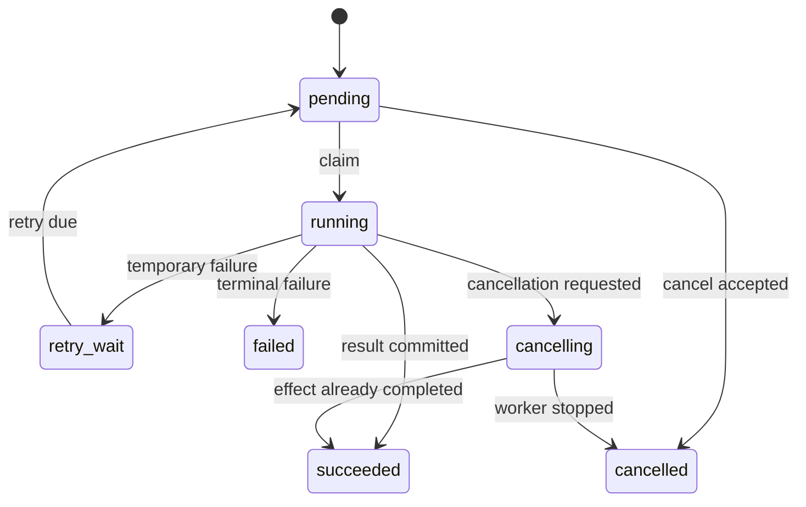
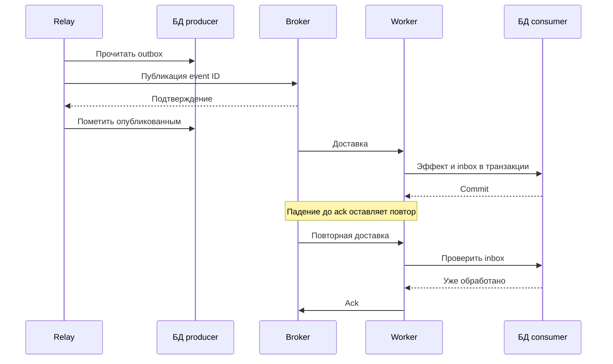

# Backend, API и распределённые приложения

> Глава 25 справочника Python Zero to Hero. Структура основной части соответствует README: 7 тем и 28 пунктов. Дата проверки источников и примеров: 21 октября 2026 года.

Backend принимает внешние запросы, проверяет полномочия, выполняет прикладные операции и координирует работу хранилищ и других сервисов. Трудности начинаются там, где заканчивается один вызов функции: клиент отключается, транзакция уже зафиксирована, сообщение доставляется повторно, кэш устарел, а worker продолжает работу после потери блокировки.

Эта глава соединяет HTTP, Python web framework и распределённые гарантии в одну модель. Сквозной пример — сервис заданий на выгрузку данных. Пользователь создаёт задание через API, читает его состояние и получает результат после фоновой обработки. В учебном проекте настоящая выгрузка заменена небольшим эффектом в БД: так можно воспроизвести сбои и проверить транзакционные свойства без внешних сервисов.

После изучения вы должны уметь объяснить не только успешный запрос, но и следующие ситуации:

- Клиент получил timeout, хотя задание уже создано.
- Два запроса с одним ключом идемпотентности пришли одновременно.
- Сообщение опубликовано, но подтверждение потерялось.
- Worker зафиксировал результат и упал до acknowledgement.
- Lease истёк, однако старый владелец продолжает выполнять код.
- БД доступна, а кэш или брокер недоступен.
- Длительное соединение удерживает ресурсы после отключения клиента.
- Старый клиент встречает новое поле, статус или значение enum.

**Предварительные знания.** Полезны главы об asyncio, сетевом программировании, БД, тестировании, архитектуре и безопасности. Здесь эти механизмы рассматриваются на границах веб-приложения. Процесс сборки и эксплуатации из главы 23 остаётся основой доставки сервиса.

**Версионная база.** Python 3.12+, Pydantic 2.x. Сквозной проект проверен с FastAPI 0.157.0, Starlette 1.9.0, Pydantic 2.14.1 и HTTPX 0.28.1. Это описание проверенной среды, а не обещание поддержки любой комбинации зависимостей. В конце приведены команды воспроизведения и границы проверки.

**Как читать примеры.** Код в теоретической части иллюстрирует отдельный механизм. Полностью собираемый учебный проект находится в разделе «Практикум». PostgreSQL, Redis, Celery и брокеры рассматриваются по документации; их реальные интеграционные сценарии нужно проверять отдельно.

## Содержание

1. [Серверная модель Python-приложения](#server-model)
2. [Проектирование API и моделей данных](#api-design)
3. [Безопасность веб-приложения](#web-security)
4. [Потоковые ответы и длительные соединения](#streaming)
5. [Фоновые задания и брокеры сообщений](#background-jobs)
6. [Кэширование и Redis](#caching)
7. [Согласованность между системами](#consistency)
8. [Практикум: API заданий, outbox и inbox](#practice)
9. [Проверка готовности и задания](#readiness)
10. [Источники](#sources)

<a id="server-model"></a>

## Серверная модель Python-приложения

### WSGI vs ASGI; request lifecycle и middleware

**Что соединяет web server и Python-код**

Браузер или SDK отправляет HTTP-запрос. HTTP server разбирает транспортный протокол и передаёт запрос приложению через согласованный интерфейс. Python framework выполняет маршрутизацию, зависимости и обработчик, после чего сервер отправляет ответ.

WSGI и ASGI описывают именно интерфейс сервера и приложения. Они не являются отдельными HTTP-методами, сетевыми протоколами или вариантами бизнес-архитектуры.

| Свойство | WSGI | ASGI |
|---|---|---|
| Основная модель | Синхронный callable | Асинхронный callable с событиями |
| Сигнатура | `application(environ, start_response)` | `application(scope, receive, send)` |
| HTTP body | Поток ввода и iterable байтов ответа | Сообщения получения и отправки |
| Длительные соединения | Возможности ограничены моделью и сервером | Естественно выражаются через события |
| WebSocket | В базовый WSGI не входит | Есть отдельный тип scope и события |
| Жизненный цикл приложения | Вне базового request API | Lifespan — отдельная спецификация |
| Политика конкурентности | Определяется сервером | Также определяется сервером и приложением |

WSGI-ответ может быть ленивым iterable. Поэтому ошибочно утверждать, что WSGI всегда сначала собирает весь ответ в памяти. Но синхронный streaming обычно удерживает соответствующий ресурс конкурентности сервера.

ASGI не делает блокирующую библиотеку неблокирующей. Если вызвать её из event loop, цикл всё равно будет занят.

**Минимальный ASGI-обработчик**

```python
async def application(scope, receive, send):
    if scope["type"] != "http":
        raise RuntimeError("This example handles only HTTP")

    body = b"ok"

    await send({
        "type": "http.response.start",
        "status": 200,
        "headers": [(b"content-type", b"text/plain; charset=utf-8")],
    })
    await send({
        "type": "http.response.body",
        "body": body,
        "more_body": False,
    })
```

Это иллюстрация HTTP-ветки ASGI. Для запуска с lifespan потребуется его реализация либо соответствующая настройка сервера.

**Жизненный цикл одного запроса**

Удобно разделять этапы:

1. Приём соединения и ограничение транспортного ввода.
2. Выполнение внешних middleware.
3. Определение маршрута.
4. Чтение и разбор тела в пределах бюджета.
5. Аутентификация, валидация и получение зависимостей.
6. Проверка прав и прикладная операция.
7. Commit или rollback там, где операция им владеет.
8. Формирование заголовков и тела.
9. Отправка ответа, включая streaming.
10. Освобождение ресурсов и запись итоговой телеметрии.

Framework может менять взаимный порядок некоторых шагов. Например, ранняя аутентификация на gateway и dependency authentication внутри framework — разные места. Измеряйте реальный lifecycle выбранного стека.

**Middleware оборачивает следующий компонент**

Если порядок обёрток `A(B(C(app)))`, запрос проходит A → B → C → app, а обратная часть — в противоположном порядке.

Порядок влияет на:

- наличие request ID в ошибках;
- CORS-заголовки у неуспешных ответов;
- обработку исключений;
- измерение streaming duration;
- доступность аутентифицированного principal;
- обработку forwarded headers.

Метрика времени до возврата объекта `StreamingResponse` не измеряет полную передачу тела. Для этого нужно наблюдать отправку последнего chunk и завершение приложения.

Не читайте тело запроса в каждом middleware независимо. ASGI receive — поток событий, а не бесконечно перечитываемый файл. Конкурирующие потребители могут нарушить протокол.

Для middleware, которому нужен точный контроль streaming, `contextvars` и ASGI-событий, полезен чистый ASGI-wrapper. У удобных HTTP middleware бывают дополнительные ограничения — их нужно читать в документации framework.

**Граница доверия reverse proxy**

Адрес клиента, исходная схема HTTPS и host нередко передаются в forwarded headers. Доверять им можно только от настроенного proxy. Иначе клиент сможет повлиять на абсолютные URL, аудит или правила ограничения по IP.

Источники: [PEP 3333](https://peps.python.org/pep-3333/), [ASGI HTTP/WebSocket](https://asgi.readthedocs.io/en/latest/specs/www.html).

### Синхронные и асинхронные обработчики; workers и thread pools

**`async def` не означает автоматическое ускорение**

Асинхронный обработчик полезен, когда он ждёт неблокирующий I/O и отдаёт event loop другим задачам.

```python
# Неверная модель для event loop.
async def bad_handler():
    import time
    time.sleep(2)
    return {"status": "done"}
```

Такой обработчик блокирует цикл. Аналогичная проблема возникает при синхронном HTTP-клиенте, тяжёлом JSON-преобразовании и CPU-цикле без точек кооперации.

В FastAPI обычные `def` endpoints и синхронные dependencies выполняются через thread pool. Но произвольная функция, вызванная непосредственно из вашего `async def`, не переносится в thread pool автоматически.

| Работа | Возможный вариант | Что ограничивать |
|---|---|---|
| Async HTTP/DB I/O | `async def` + async driver | Соединения, deadlines, concurrency |
| Короткий sync I/O | `def` endpoint или явный offload | Thread pool и timeout внешней операции |
| Длительный sync I/O | Отдельная очередь/worker либо ограниченный offload | Занятые потоки, очередь ожидания |
| CPU-bound Python | Процессы или специализированный worker | CPU, память, число задач |
| Нативное вычисление | Проверенный контракт библиотеки | GIL, thread safety, память |
| Долгая бизнес-операция | Durable job с отдельным статусом | Admission, retries, lifecycle |

Thread pool — ограниченный ресурс. В документированном Starlette/AnyIO-пути по умолчанию используется общий limiter на 40 tokens; его также могут использовать синхронные зависимости. Это настройка конкретного стека, а не универсальный лимит Python.

Увеличение числа потоков может увеличить давление на БД и память. Оно не исправляет бесконечно ожидающий внешний вызов.

**Отмена ожидания не останавливает поток**

Если coroutine перестала ждать функцию в thread pool, эта функция может продолжать работать. Особенно важно учитывать операции записи: HTTP-запрос уже завершён ошибкой, а внешний эффект всё ещё возможен.

Для настоящего ограничения нужны timeout самой библиотеки, кооперативная отмена или отдельный процесс с понятным протоколом.

**Процессы workers**

У каждого worker обычно собственные:

- event loop;
- глобальные Python-переменные;
- connection pools;
- локальный кэш;
- фоновые задачи;
- память модели или других крупных объектов.

Словарь `jobs = {}` в одном worker не становится общим хранилищем нескольких workers. `asyncio.Lock` и `threading.Lock` также не координируют независимые процессы.

Если работают 4 replicas по 3 workers, а pool каждой копии допускает 10 соединений и 5 overflow, теоретический верхний предел только этого приложения:

```text
4 × 3 × (10 + 5) = 180 соединений
```

К нему добавляются миграции, мониторинг и другие приложения.

**Вместимость и очередь**

Для устойчивого режима полезна оценка Little's Law:

```text
среднее число запросов в системе ≈ throughput × среднее время пребывания
```

При 200 запросах/с и среднем времени 0.25 с в системе находится примерно 50 запросов. Эта оценка не задаёт безопасный concurrency limit и не описывает хвосты распределения, но показывает, почему рост latency увеличивает число занятых ресурсов.

Нужны отдельные пределы:

- активных запросов;
- ожидающих thread-pool операций;
- обращений к каждой зависимости;
- задач tenant;
- длины внутренних очередей.

Источники: [FastAPI async](https://fastapi.tiangolo.com/async/), [Starlette thread pool](https://www.starlette.dev/threadpool/), [Uvicorn server behavior](https://www.uvicorn.org/server-behavior/).

### Django, Flask и FastAPI: выбор и глубокое изучение одного стека

Сравнивайте не только синтаксис маршрута. Важнее понять, какие задачи framework решает штатно и какие подсистемы вам придётся собирать самостоятельно.

| Стек | Сильная отправная точка | Что изучить глубоко |
|---|---|---|
| Django | Приложение с ORM, администрированием, пользователями и формами | ORM, транзакции, middleware, auth, migrations, sync/async границы |
| Flask | Небольшой или специализированный WSGI-сервис | Request/app context, extensions, lifecycle, WSGI deployment |
| FastAPI | Типизированный API на ASGI | Dependencies, Pydantic, OpenAPI, lifespan, streaming, sync offload |

Это не рейтинг производительности и не правило размера проекта.

Django может предоставлять API. Flask может обслуживать большое приложение. FastAPI может использоваться внутри модульного монолита. Подходящесть зависит от продукта и процесса разработки.

**Не переносите свойства между frameworks**

- В Flask поддержка `async` views не меняет базовую WSGI-модель: один запрос продолжает занимать worker. Созданные внутри view фоновые задачи не становятся durable jobs.
- Django под ASGI может использовать асинхронный request stack, но синхронные middleware и части ORM меняют поведение. Возможности транзакций и async ORM нужно проверять для выбранной версии.
- FastAPI не включает автоматически полную пользовательскую модель, администрирование, миграции и согласованность фоновых операций. Это отдельные проектные решения.

**Что означает «глубоко изучить один стек»**

Для выбранного framework реализуйте и объясните:

1. Маршрутизацию и преобразование параметров.
2. Разницу request validation и domain validation.
3. Общий формат ошибок.
4. Аутентификацию и object authorization.
5. Владельца DB transaction.
6. Dependency cleanup на успехе, исключении и streaming.
7. Поведение клиента при timeout и повторе.
8. Схему OpenAPI и её совместимость.
9. Тесты lifecycle и фоновых эффектов.
10. Deployment с несколькими workers.
11. Graceful shutdown.
12. Диагностику saturation и ошибок зависимостей.

**Принцип выбора**

Если продукт требует стандартных пользователей, back office и тесной работы с реляционными моделями, готовые подсистемы Django могут уменьшить стоимость реализации. Если приложение представляет специфический HTTP-adapter, небольшой core Flask может быть удобен. Для API с явными схемами FastAPI даёт короткий путь к типизированному контракту.

После первого выбора лучше освоить один стек достаточно глубоко, чтобы видеть ограничения. Переписывание между frameworks редко исправляет неограниченные очереди или неверную границу транзакции.

Источники: [Django async support, версия 5.2](https://docs.djangoproject.com/en/5.2/topics/async/), [Flask async/await](https://flask.palletsprojects.com/en/stable/async-await/), [FastAPI](https://fastapi.tiangolo.com/).

### Request-scoped ресурсы, startup/shutdown и обработка отключения клиента

**Ресурс должен иметь владельца**

| Ресурс | Обычная область жизни | Кто завершает |
|---|---|---|
| HTTP client pool | Lifespan worker | Shutdown worker |
| DB engine/pool | Lifespan worker | Shutdown worker |
| DB session/transaction | Прикладная операция | Владелец операции |
| Principal | Запрос или соединение | Request lifecycle |
| Файл streaming-ответа | Передача тела | Генератор/response cleanup |
| Durable job | Независим от HTTP | Worker и хранилище состояния |

Создание HTTP client на каждый запрос теряет преимущества pooling. Глобальная DB session, напротив, живёт слишком долго и смешивает независимые операции.

SQLAlchemy `AsyncSession` — изменяемое состояние одной транзакции. Её нельзя использовать одновременно из нескольких задач `gather` как универсальную общую сессию.

**Lifespan**

```python
from contextlib import asynccontextmanager

import httpx
from fastapi import FastAPI


@asynccontextmanager
async def lifespan(app: FastAPI):
    async with httpx.AsyncClient(
        timeout=httpx.Timeout(5.0, connect=1.0),
        limits=httpx.Limits(
            max_connections=100,
            max_keepalive_connections=20,
        ),
    ) as client:
        app.state.http = client
        yield


app = FastAPI(lifespan=lifespan)
```

Эта настройка задаёт ограничения клиента, но HTTPX timeout не является единственным общим deadline всей бизнес-операции. У него есть отдельные connect/read/write/pool составляющие.

Lifespan выполняется для каждого экземпляра приложения/worker. Поэтому миграцию схемы и однократный scheduler нельзя без анализа запускать как «один раз на весь deployment» в startup каждого worker.

**Dependencies с `yield`**

В актуальном FastAPI cleanup зависимости с `yield` по умолчанию связан с request scope и выполняется после отправки ответа. Есть `Depends(scope="function")`: cleanup заканчивается после обработчика, до передачи ответа.

Это важно для streaming:

- если генератор использует session, она должна оставаться живой;
- если session нужна только для проверки прав, можно закрыть её раньше;
- нельзя передать закрываемую request dependency в долгоживущую фоновую задачу.

У разных версий FastAPI это поведение менялось. Проверяйте его для своей закреплённой версии.

**Commit — до подтверждения успеха**

Не прячьте commit бизнес-операции в поздний cleanup после отправки успешного ответа. Если commit завершится ошибкой, клиент уже получит ложный успех.

Предпочтительно:

```text
начать транзакцию
→ проверить и изменить данные
→ commit
→ сформировать подтверждение клиенту
```

**Отключение клиента**

Disconnect не означает автоматический rollback всех действий. Возможны состояния:

- запрос ещё не прошёл валидацию;
- транзакция открыта;
- commit уже выполнен;
- внешний сервис принял команду;
- ответ частично отправлен.

Правило должно следовать состоянию операции. Для создания durable job отключение после commit не должно удалять принятое задание.

Очистку помещают в `finally` или контекстные менеджеры. Отмену не следует молча преобразовывать в успех. В asyncio `CancelledError` после локальной очистки обычно распространяют дальше.

**Shutdown**

Сначала прекращают принимать новую работу, затем дают завершиться допустимым активным операциям в пределах бюджета, после чего закрывают pools. Timeout shutdown и максимальная продолжительность операций должны быть согласованы с supervisor и orchestrator.

Источники: [FastAPI lifespan](https://fastapi.tiangolo.com/advanced/events/), [yield dependencies](https://fastapi.tiangolo.com/tutorial/dependencies/dependencies-with-yield/), [SQLAlchemy AsyncSession](https://docs.sqlalchemy.org/en/20/orm/extensions/asyncio.html), [HTTPX timeouts](https://www.python-httpx.org/advanced/timeouts/).
<a id="api-design"></a>

## Проектирование API и моделей данных

### HTTP semantics, методы, статусы, ошибки и идемпотентность

**Ресурс и команда**

Ресурс описывает адресуемое состояние: `/v1/jobs/{job_id}`. Команда просит выполнить действие: создать задание или отменить его. Хороший контракт объясняет, когда команда принята и какое состояние можно наблюдать.

| Метод | Типичная семантика | Безопасный | Идемпотентный по HTTP |
|---|---|---|---|
| GET | Получить представление | Да | Да |
| HEAD | Получить заголовки без тела | Да | Да |
| POST | Обработать переданное представление | Нет | Не гарантируется |
| PUT | Установить состояние указанного ресурса | Нет | Да |
| PATCH | Применить описанное изменение | Нет | Зависит от операции |
| DELETE | Удалить связь/ресурс по контракту | Нет | Да |

Безопасность здесь означает отсутствие запрошенного изменения прикладного состояния; диагностическое логирование GET не запрещается.

Идемпотентность относится к предполагаемому эффекту повторения. Повторный DELETE может вернуть 404 вместо первого 204, сохраняя идемпотентную семантику.

`PATCH {"increment": 1}` и `PATCH {"status": "archived"}` имеют разные свойства. Семантика определяется форматом изменения.

**Статус должен соответствовать моменту операции**

| Статус | Что объяснить клиенту |
|---|---|
| 200 | Операция выполнена, есть представление |
| 201 | Создан ресурс; обычно уместен Location |
| 202 | Работа принята, завершение ещё не подтверждено |
| 204 | Успех без тела ответа |
| 400 | Некорректный запрос по выбранному контракту |
| 401 | Нужна действительная аутентификация; важен challenge |
| 403 | Установленной идентичности запрещено действие |
| 404 | Ресурс не найден либо его существование скрыто политикой |
| 409 | Конфликт с текущим состоянием |
| 412 | Не выполнено условие, например If-Match |
| 413 | Слишком большое содержимое |
| 422 | Содержимое разобрано, но не удовлетворяет контракту |
| 429 | Превышен лимит клиента |
| 503 | Сервис временно не может обслужить запрос |

В нашем проекте POST возвращает 202 только после commit задания и outbox. Это выбранная гарантия сервиса, более конкретная, чем сам статус.

**Потеря ответа**

Клиент не может различить по одному timeout:

- сервер не получил запрос;
- сервер получил запрос, но ещё не выполнил;
- сервер выполнил commit, но ответ потерялся.

Поэтому повтор не должен безусловно создавать новую работу.

Контракт `Idempotency-Key` должен определить:

1. Область ключа: principal/tenant, операция и версия.
2. Максимальную длину и допустимый формат.
3. Нормализацию команды и fingerprint.
4. Конкурентное выполнение одинаковых запросов.
5. Повтор с другим содержимым.
6. Сохраняемые статусы и тело ответа.
7. Срок хранения и поведение после истечения.
8. Повторную проверку полномочий.

Ключ — часть прикладного протокола конкретного API. Не предполагайте, что любой сервер распознаёт такой заголовок.

В практикуме одинаковая команда возвращает сохранённый первоначальный ответ, конфликтующее содержимое — 409. Создание задания, запись ключа и outbox находятся в одной транзакции. Уникальное ограничение БД защищает от конкурентного создания.

Произвольный хеш сырых JSON-байтов может различить документы с разным порядком ключей. Поэтому fingerprint считают по определённому нормализованному представлению. Правила нормализации нужно сохранять при развитии версии контракта.

**Ошибки как контракт**

RFC 9457 задаёт формат Problem Details с `application/problem+json`:

```json
{
  "type": "https://api.example.test/problems/idempotency-conflict",
  "title": "Idempotency key conflict",
  "status": 409,
  "detail": "The key was already used for another command.",
  "request_id": "6e7337b84554404f84bb789aa37723fc8"
}
```

`request_id` — расширение приложения. Клиент должен ориентироваться на стабильный тип/код, а не разбирать человекочитаемый текст. Стек, SQL, токены и содержимое приватных полей не должны попадать в публичную ошибку.

HTTP status в теле и реальный статус ответа должны совпадать.

**Защита от lost update**

Если два клиента редактируют один ресурс, ключ идемпотентности не решает конфликт версий.

Возможный контракт: сервер выдаёт ETag, клиент отправляет `If-Match`, а БД изменяет строку условно по версии:

```sql
UPDATE jobs
SET description = :description, version = version + 1
WHERE id = :job_id
  AND tenant_id = :tenant_id
  AND version = :expected_version;
```

Ноль изменённых строк требует различить отсутствие/запрет и конфликт согласно политике API. Проверка версии до отдельного безусловного UPDATE оставляет гонку.

Источники: [RFC 9110](https://www.rfc-editor.org/rfc/rfc9110.html), [RFC 9457](https://www.rfc-editor.org/rfc/rfc9457.html).

### Pydantic: strict mode, validators, serializers и nested models

Pydantic проверяет и преобразует данные. Он не заменяет аутентификацию, разрешения, DB constraints и общий бюджет разбора запроса.

**Coercion и strict mode**

В нестрогом режиме строка `"123"` может быть преобразована в число. Это бывает удобно для конфигурации, но неожиданно для JSON API.

```python
from pydantic import BaseModel, ConfigDict, Field, ValidationError


class Command(BaseModel):
    model_config = ConfigDict(strict=True, extra="forbid")
    row_limit: int = Field(ge=1, le=100_000)


assert Command(row_limit=10).row_limit == 10

try:
    Command(row_limit="10")
except ValidationError:
    pass
else:
    raise AssertionError("Strict integer expected")
```

Обратите внимание на `bool`: в Python это подкласс `int`, но для параметра «количество строк» обычно нужен именно integer-контракт, а не `True`.

Строгость зависит от пути валидации. Python-объекты и сырой JSON имеют разные представления дат, UUID и других значений. `model_validate_json(..., strict=True)` может допускать строковую JSON-форму там, где `model_validate` требует уже типизированный Python-объект.

FastAPI обычно разбирает JSON до вызова Pydantic. Поэтому тестируйте реальный endpoint, особенно для `date`, `datetime` и UUID. Успех самостоятельного `model_validate_json` не доказывает идентичного поведения HTTP-пути.

**Вложенные модели**

```python
from typing import Self

from pydantic import BaseModel, ConfigDict, Field, field_validator, model_validator


class StrictModel(BaseModel):
    model_config = ConfigDict(strict=True, extra="forbid")


class RowRange(StrictModel):
    first: int = Field(ge=0)
    stop: int = Field(gt=0)

    @model_validator(mode="after")
    def valid_range(self) -> Self:
        if self.stop <= self.first:
            raise ValueError("stop must exceed first")
        if self.stop - self.first > 100_000:
            raise ValueError("range is too large")
        return self


class ExportRequest(StrictModel):
    dataset: str = Field(min_length=1, max_length=64)
    selection: RowRange

    @field_validator("dataset")
    @classmethod
    def known_dataset(cls, value: str) -> str:
        if value not in {"orders", "customers"}:
            raise ValueError("unknown dataset")
        return value
```

`extra="forbid"` действует там, где задан. Если вложенная модель наследует другой permissive base, внешний запрет лишних полей не превращает её автоматически в строгую схему.

**Этапы validators**

- `before` получает ещё не приведённое значение; подходит для осознанной нормализации.
- `after` работает после обычной проверки типа.
- `wrap` управляет вызовом внутренней проверки; требует более осторожного контракта.
- Model validator проверяет отношения между полями.

Не выполняйте сетевые вызовы в обычном синхронном validator. Проверка наличия ресурса и полномочий относится к прикладному сценарию. Кроме задержки, внешний вызов создаёт race между проверкой и последующим изменением.

Если validator меняет значение, fingerprint команды должен рассчитываться по согласованной семантической форме.

**Serialization — отдельная ответственность**

`model_dump()` возвращает Python-представление. `model_dump(mode="json")` приводит значения к JSON-совместимой форме. `model_dump_json()` создаёт строку JSON.

Пример явного денежного представления:

```python
from decimal import Decimal

from pydantic import BaseModel, Field, field_serializer


class Price(BaseModel):
    amount: Decimal = Field(ge=0, max_digits=12, decimal_places=2)

    @field_serializer("amount", when_used="json")
    def amount_as_text(self, value: Decimal) -> str:
        return format(value, ".2f")


assert Price(amount=Decimal("10.10")).model_dump(mode="json") == {
    "amount": "10.10"
}
```

Это выбранный контракт: десятичная сумма передаётся строкой. Клиент должен знать валюту и допустимую точность; serializer сам по себе их не задаёт.

**Что ещё ограничивать**

Даже корректная схема может дорого стоить. Нужны ограничения:

- байтов тела до полного разбора;
- длины строк;
- числа элементов;
- глубины вложенности;
- допустимых discriminator/union вариантов;
- вычислительной стоимости validators;
- размера сформированного ответа.

Источники: [strict mode](https://docs.pydantic.dev/latest/concepts/strict_mode/), [validators](https://docs.pydantic.dev/latest/concepts/validators/), [serialization](https://docs.pydantic.dev/latest/concepts/serialization/).

### Входные модели vs выходные; отсутствие поля vs null

**Вход и выход меняются по разным причинам**

Входная модель описывает разрешённую команду. Выходная — представление, которое сервис обещает клиенту.

Внутренняя ORM-модель может содержать:

- tenant ID;
- ownership;
- служебный статус;
- внутренние ошибки;
- credentials;
- optimistic-lock version;
- данные аудита.

Не все эти поля можно принимать от клиента или отдавать наружу.

Плохой путь — преобразовать весь входной `dict` в атрибуты ORM. Так возникает mass assignment: клиент передаёт `owner_id` или `is_admin`, а приложение меняет привилегированные поля.

Лучше использовать отдельные модели `JobCreate`, `JobPatch` и `JobRead`. Tenant и principal берутся из проверенной идентичности.

**Отсутствие и null — разные команды**

Для PATCH удобно различать:

| JSON | Возможная семантика |
|---|---|
| `{}` | Не менять поле |
| `{"description": null}` | Очистить поле |
| `{"description": "new"}` | Установить значение |

```python
from pydantic import BaseModel, ConfigDict, Field


class JobPatch(BaseModel):
    model_config = ConfigDict(strict=True, extra="forbid")
    description: str | None = Field(default=None, max_length=500)


missing = JobPatch.model_validate({})
cleared = JobPatch.model_validate({"description": None})

assert missing.model_dump(exclude_unset=True) == {}
assert cleared.model_dump(exclude_unset=True) == {"description": None}
assert "description" not in missing.model_fields_set
assert "description" in cleared.model_fields_set
```

`exclude_none=True` не заменяет `exclude_unset=True`. Он удалит явно переданный null и может уничтожить команду очистки.

В Pydantic 2 аннотация `str | None` означает допустимость None, но без default не делает поле необязательным по присутствию.

**PATCH не равен merge любого словаря**

Нужно определить:

- разрешённые поля;
- возможность очистки;
- изменение вложенных объектов;
- поведение массивов;
- обработку неизвестных полей;
- бизнес-переходы состояния;
- optimistic concurrency.

Например, изменение `status` из `succeeded` в `running` не становится допустимым только потому, что строка прошла Pydantic.

**Выходная модель — часть защиты, но не единственная**

`response_model` может ограничить отдаваемые поля. Но секрет уже мог попасть в лог, кэш или событие до сериализации ответа.

Выходной объект лучше формировать явным маппингом. Для ORM учитывайте lazy loading: сериализация не должна неожиданно запускать множество SQL-запросов или обращаться к уже закрытой session.

Источники: [Pydantic models](https://docs.pydantic.dev/latest/concepts/models/), [исключение unset-полей](https://docs.pydantic.dev/latest/concepts/serialization/).

### OpenAPI/JSON Schema, версии контракта и совместимость клиентов

**Схема — исполняемая часть договора**

OpenAPI описывает HTTP-операции, параметры, тела, ответы и security schemes. JSON Schema описывает структуру и ограничения данных. Это связанные, но разные документы.

По состоянию на дату подготовки опубликована OpenAPI 3.2.1. Однако конкретный framework или SDK generator может выпускать и поддерживать другой уровень. Проверяйте поле `openapi` реального документа и возможности инструментов.

Не меняйте одну строку версии схемы, чтобы объявить поддержку формата, которому документ фактически не соответствует.

**Чего не видно из автоматически сгенерированной схемы**

Обычно отдельно нужны:

- правила Idempotency-Key;
- срок хранения результата;
- состояние после timeout;
- гарантии очереди;
- лимиты и стоимость операции;
- консистентность чтения;
- правила доступа к конкретному объекту;
- семантика отмены;
- поведение во время миграций.

Если runtime заменил стандартный validation response на Problem Details, OpenAPI тоже должен измениться. В практикуме это покрывается тестом: ответ 422 документирован как `application/problem+json`.

**Совместимость зависит от направления**

| Изменение | Возможный риск |
|---|---|
| Добавить обязательное поле запроса | Старые клиенты не отправляют его |
| Ужесточить диапазон | Ранее допустимые команды отклоняются |
| Удалить поле ответа | Клиент больше не получает нужные данные |
| Добавить поле ответа | Строгий decoder может запретить неизвестные поля |
| Добавить enum-значение | Клиент с исчерпывающим switch может упасть |
| Изменить nullability | Ломается предположение о наличии значения |
| Изменить значение default | Меняется семантика старого запроса |
| Изменить точность/единицы | Тип может сохраниться, смысл — измениться |

Поэтому «добавили поле — всегда обратно совместимо» слишком сильное утверждение.

**Версии**

Путь `/v1` — удобная граница major-контракта. Но он не заменяет политику:

- сроков поддержки;
- предупреждения о прекращении;
- миграции клиентов;
- стабильности enum;
- совместимости событий.

Версия HTTP API и `schema_version` сообщения в брокере могут развиваться независимо.

**Expand/contract**

Для изменения хранилища и API часто подходят этапы:

1. Добавить новую возможность без удаления старой.
2. Выпустить код, понимающий оба представления.
3. Перенести данные и клиентов.
4. Проверить прекращение использования старого пути.
5. Удалить старое в согласованной версии.

Во время rolling deployment соседние версии должны понимать данные друг друга. Это относится к заданиям и сообщениям, созданным до обновления worker.

**Проверки**

Храните snapshot или артефакт OpenAPI, выполняйте структурный diff и прогоняйте значимые SDK против тестового сервера. Сравнение схем не обнаружит смену смысла поля `total` с копеек на рубли: для этого нужны контрактные примеры.

Источники: [OpenAPI](https://spec.openapis.org/oas/latest.html), [JSON Schema 2020-12](https://json-schema.org/draft/2020-12/json-schema-core.html).

### Pagination, filtering, rate limits и client SDK

**Pagination определяет порядок**

`LIMIT` без устойчивого `ORDER BY` не задаёт воспроизводимой страницы.

Offset pagination удобна для простых интерфейсов, но глубокий offset может дорого стоить, а вставки между запросами сдвигают границы.

Для keyset pagination выбирают устойчивый ключ:

```sql
SELECT id, created_at, status
FROM jobs
WHERE tenant_id = :tenant_id
  AND (created_at, id) < (:last_created_at, :last_id)
ORDER BY created_at DESC, id DESC
LIMIT :page_size_plus_one;
```

Это PostgreSQL-пример. Нужен соответствующий индекс, например по tenant и ключу сортировки. Дополнительная строка позволяет определить наличие следующей страницы.

Timestamp не всегда уникален, поэтому добавлен `id`. Порядок должен использовать неизменяемые поля. Если сортировать по изменяемому status, элементы могут перескакивать между страницами.

**Cursor — часть контракта**

Он может включать:

- версию;
- последнюю пару ключей;
- hash фильтров;
- tenant/scope;
- срок действия;
- при необходимости snapshot boundary.

Base64 — кодирование, а не защита от подделки. Если курсор влияет на доверенные параметры, нужен MAC или иной проверяемый механизм. При этом даже подписанный cursor не отменяет object authorization.

Keyset pagination не предоставляет snapshot всех страниц автоматически. Если нужен экспорт согласованного среза, требуется отдельный механизм snapshot/version/watermark.

**Filtering**

Ограничьте:

- поля;
- операции;
- длину списков `IN`;
- диапазон дат;
- сортировки;
- общий limit;
- стоимость запроса.

Значения передаются SQL-параметрами. Имена столбцов и направления сортировки выбираются из allowlist: обычный placeholder не параметризует SQL identifier.

Проверяйте планы запросов. API с корректной типизацией всё равно может создавать дорогостоящий full scan.

**Rate limit и concurrency limit**

Rate limit ограничивает количество или стоимость запросов за время. Concurrency limit — одновременно выполняемую работу. Очередь ожидания — третий бюджет.

100 запросов в минуту может быть допустимо для дешёвого GET и опасно для выгрузки по терабайту.

Алгоритмы:

- fixed window — прост, но возможен всплеск на границе;
- sliding window — точнее, дороже;
- token bucket — позволяет ограниченный burst;
- weighted quota — учитывает стоимость операции.

В многопроцессном сервисе локальный счётчик не задаёт общий лимит deployment. Распределённое обновление должно быть атомарным, а политика при недоступности limiter — явной.

Для превышения используется 429; `Retry-After` может сообщать время следующей попытки. Для общей перегрузки сервиса часто уместнее 503.

**SDK — клиент распределённой системы**

В SDK нужны:

- connection pooling;
- connect/read/write/pool timeouts;
- общий deadline;
- ограниченные retries;
- обработка Retry-After;
- сохранение Idempotency-Key;
- typed errors и request ID;
- управление lifecycle клиента;
- ограничения размера ответа;
- явная обработка неизвестных enum.

Новый ключ на каждой попытке уничтожает серверную дедупликацию.

Если A вызывает B, B — C, а каждый слой делает по 3 попытки, один исходный запрос может породить до 27 обращений к C. Бюджет retries нужно согласовывать по цепочке.

**Timeout не является дедлайном всей операции**

Читатель, получающий по байту перед истечением read timeout, может удерживать соединение значительно дольше этого значения. Общий deadline ограничивает полную операцию.

Для локального бюджета используйте monotonic clock. Внешний deadline должен быть проверен и ограничен серверной политикой; нельзя принимать произвольный клиентский срок как право занимать ресурс бесконечно.

Источники: [PostgreSQL SELECT](https://www.postgresql.org/docs/current/sql-select.html), [RFC 6585](https://www.rfc-editor.org/rfc/rfc6585.html), [HTTPX timeouts](https://www.python-httpx.org/advanced/timeouts/).

### gRPC/Protobuf и GraphQL: применимость и ограничения

Эти технологии решают разные задачи и могут сосуществовать с HTTP JSON API.

| Подход | Подходит | Основные ограничения |
|---|---|---|
| HTTP + JSON | Публичные API, простая диагностика, широкий круг клиентов | Эволюция контракта, размер данных, ручная семантика |
| gRPC + Protobuf | Типизированный service-to-service RPC, streaming | Toolchain, proxy/browser support, deadlines и совместимость |
| GraphQL | Клиенту нужен управляемый граф связанных данных | Стоимость запроса, N+1, field authorization, caching |

**gRPC и Protobuf**

```protobuf
syntax = "proto3";

package exports.v1;

message CreateExportRequest {
  string dataset = 1;
  int32 row_limit = 2;
  string idempotency_key = 3;
}

message ExportJob {
  string id = 1;
  string status = 2;
}

service ExportService {
  rpc CreateExport(CreateExportRequest) returns (ExportJob);
}
```

Номера полей — часть двоичного контракта. Удалённые номера и имена резервируют, а не используют повторно для другого смысла.

Для scalar fields нужно понимать presence: отсутствие и значение по умолчанию могут различаться в зависимости от декларации и используемой редакции Protobuf. Binary compatibility и ProtoJSON compatibility также различаются.

Protobuf не проверяет автоматически, что `row_limit` положителен и не превышает бизнес-лимит.

gRPC имеет статусы RPC и deadlines. Отмена RPC не отменяет уже выполненный внешний эффект. Сервер должен остановить порождённую работу, если она действительно отменяема.

Поддержка gRPC в браузере обычно требует соответствующего клиентского/прокси-решения; нельзя считать любой браузер прямым универсальным gRPC-клиентом.

**GraphQL**

```graphql
query JobWithOwner($id: ID!) {
  job(id: $id) {
    id
    status
    owner {
      displayName
    }
  }
}
```

Клиент выбирает поля, но сервер по-прежнему определяет:

- кто может видеть job;
- кто может видеть owner;
- какие поля доступны principal;
- сколько стоит запрос;
- какое число объектов разрешено получить.

Проверка доступа только в верхнем resolver недостаточна, если до объекта можно добраться другим путём графа.

**N+1**

Список из 100 jobs и отдельная загрузка owner для каждого может создать 101 запрос. Batched loaders помогают объединить чтение, но их кэш должен учитывать request/tenant scope и полномочия.

**Контроль стоимости**

Ограничивают depth, breadth, размер страниц, aliases, batching и вычислительную сложность. Один HTTP-запрос GraphQL может содержать значительно больше работы, чем один простой REST GET.

Persisted/trusted operations упрощают контроль, если набор клиентов известен.

Успешный HTTP-статус сам по себе не означает отсутствие ошибок GraphQL: ответ может содержать частичные `data` и `errors`. Клиент должен понимать оба уровня.

Источники: [gRPC deadlines](https://grpc.io/docs/guides/deadlines/), [Protobuf proto3](https://protobuf.dev/programming-guides/proto3/), [GraphQL specification](https://spec.graphql.org/September2025/), [GraphQL security](https://graphql.org/learn/security/).
<a id="web-security"></a>

## Безопасность веб-приложения

### Аутентификация vs авторизация; сессии, cookies и токены

**Идентичность и разрешение**

Аутентификация устанавливает, от чьего имени выполняется запрос. Авторизация решает, разрешено ли этой идентичности конкретное действие над конкретным ресурсом.

«Пользователь вошёл» не означает «ему доступны все jobs». «Есть scope export:read» не означает «можно читать выгрузки другого tenant».

Полезная модель principal:

```python
from dataclasses import dataclass


@dataclass(frozen=True)
class Principal:
    tenant_id: str
    user_id: str
    scopes: frozenset[str]
```

Поля формируются после проверенной аутентификации. `tenant_id` из произвольного клиентского заголовка не должен молча заменять доверенный tenant.

**Session**

Частый браузерный вариант:

1. Пользователь аутентифицируется.
2. Сервер создаёт session.
3. Браузер хранит случайный session identifier в cookie.
4. Сервер связывает identifier с пользовательским состоянием.

Для session важны энтропия идентификатора, срок действия, ротация при изменении привилегий, logout/revocation и ограничения числа активных sessions.

Подписанная cookie может содержать данные клиента. Подпись защищает целостность, но не обязательно скрывает содержимое. Нельзя записывать туда секрет, рассчитывая только на подпись.

**Cookie**

Пример набора атрибутов для HTTPS-приложения:

```http
Set-Cookie: __Host-session=<random-value>; Path=/; Secure; HttpOnly; SameSite=Lax
```

- `Secure` ограничивает отправку защищённым транспортом.
- `HttpOnly` закрывает прямое чтение cookie из JavaScript.
- `SameSite` влияет на cross-site отправку.
- Префикс `__Host-` предъявляет дополнительные требования, включая отсутствие Domain.

HttpOnly не мешает XSS выполнять запросы от имени пользователя. SameSite не заменяет весь анализ CSRF, особенно при сложной доменной архитектуре.

**Bearer token**

В API токен часто передаётся в `Authorization`:

```http
Authorization: Bearer <access-token>
```

Любой обладатель bearer token может использовать его в пределах полномочий и срока действия. Нужны TLS, безопасное хранение и отсутствие токена в URL/логах.

Opaque token требует серверной проверки или introspection. JWT может проверяться локально, но усложняет отзыв, ротацию ключей и оценку свежести полномочий.

**Выбор хранения в браузере**

Нет одного расположения токена, которое автоматически решает все угрозы:

| Вариант | Что учитывать |
|---|---|
| HttpOnly cookie | Автоматическая отправка и CSRF, domain/path policy |
| Память JavaScript | XSS и восстановление после перезагрузки |
| localStorage | Доступность для исполняющегося JS и длительное хранение |
| Backend for frontend | Дополнительный серверный session lifecycle |

Выбор должен соответствовать архитектуре приложения и модели угроз.

**Секреты в телеметрии**

Не включайте Authorization, session cookie и refresh token в обычный request log. Редактирование чувствительных заголовков должно происходить до записи. Request ID не должен быть производной от секрета.

Учебный проект использует заранее заданные bearer tokens для проверки principal и прав. Это упрощённый локальный authentication adapter, не реализация OAuth/OIDC.

Источник: [OWASP Authorization](https://cheatsheetseries.owasp.org/cheatsheets/Authorization_Cheat_Sheet.html).

### OAuth 2.0/OIDC, проверка claims и управление сроком действия

**Разные задачи**

OAuth 2.0 задаёт делегированный доступ. OIDC добавляет идентификационный слой.

В типичном сценарии:

- authorization server аутентифицирует пользователя и выдаёт токены;
- client получает разрешение;
- resource server принимает access token для своего API;
- ID token сообщает клиенту результат аутентификации пользователя.

ID token нельзя автоматически использовать как access token произвольного API. Одинаковый формат JWT не делает токены взаимозаменяемыми.

**Поток входа**

Для подходящих интерактивных клиентов используют Authorization Code с PKCE и проверками redirect URI, state и, в OIDC-контексте, nonce согласно выбранному flow. Эти значения решают разные задачи.

Не стоит копировать старый password grant как стандартный путь нового приложения: актуальный OAuth Security BCP запрещает его использование. Implicit flow также не является рекомендуемой отправной точкой.

Для machine-to-machine применимость client credentials определяется тем, от чьего имени работает сервис. Это не замена пользовательской сессии.

**JWT: декодирование не равно проверка**

До установления principal необходимо проверить:

| Условие | Что предотвращает |
|---|---|
| Допустимый алгоритм | Подмену алгоритма и algorithm confusion |
| Подпись доверенным ключом | Изменение claims |
| Точный issuer | Токен другого издателя |
| Ожидаемый audience | Токен другого API |
| exp и применимые временные claims | Использование вне срока |
| Тип токена и профиль | Смешение ID/access и других JWT |
| Требуемые claims | Недостаточный контекст идентичности |
| Scope/permissions | Действие вне выданного доступа |

Профиль RFC 9068 предъявляет дополнительные требования к JWT access token, в том числе к `typ`. Не переносите их механически на все токены любого провайдера: сначала определите поддерживаемый профиль.

Непроверенный payload разрешено использовать лишь как недоверенные данные технического разбора. Он не должен становиться основанием разрешения.

**JWKS и ротация**

Адрес issuer/JWKS берётся из доверенной конфигурации или проверенного discovery, а не из произвольного URL внутри токена.

`kid` выбирает ключ среди доверенных кандидатов. Это не путь к локальному файлу и не разрешение выполнить HTTP-запрос на указанный клиентом адрес.

Нужны:

- кэш доверенных ключей;
- ограниченный refresh;
- обработка неизвестного kid;
- защита от refresh storm;
- ротационный overlap;
- понятное поведение при недоступности identity provider.

Проверка подписи старым доверенным ключом не означает, что его нужно хранить без срока после отзыва.

**Время**

JWT time claims обычно используют wall-clock UTC. Внутренний timeout операции лучше измерять monotonic clock. Это разные часы.

Clock skew допускают в небольших явно определённых пределах. Большой leeway увеличивает фактическое время использования токена.

Access token обычно живёт ограниченное время. Для refresh token нужны защищённое хранение, rotation/reuse detection или другой предусмотренный профиль защиты.

**Отзыв и свежесть полномочий**

Локально проверяемый JWT может оставаться криптографически действительным после увольнения пользователя или изменения роли. Возможные механизмы:

- короткий срок access token;
- introspection;
- session/version check;
- denylist для согласованного класса угроз;
- дополнительная проверка критических прав в БД.

Каждый вариант меняет latency, зависимость от identity provider и поведение при сбоях.

Права на конкретный объект проверяются после token validation. Подпись token не доказывает ownership произвольного job ID.

Источники: [OAuth Security BCP, RFC 9700](https://www.rfc-editor.org/rfc/rfc9700.html), [OIDC Core](https://openid.net/specs/openid-connect-core-1_0.html), [JWT BCP, RFC 8725](https://www.rfc-editor.org/rfc/rfc8725.html), [JWT access token profile, RFC 9068](https://www.rfc-editor.org/rfc/rfc9068.html).

### CSRF, CORS, XSS и безопасная обработка загрузок

Эти механизмы защищают разные границы.

| Понятие | Основной вопрос |
|---|---|
| CSRF | Может ли чужой сайт инициировать авторизованное действие браузера? |
| CORS | Разрешает ли браузер скрипту читать cross-origin ответ? |
| XSS | Может ли внешнее содержимое исполняться в контексте доверенного сайта? |
| Upload security | Может ли файл нарушить границы хранения, разбора и ресурсов? |

**CSRF**

Cookie часто отправляется браузером автоматически. Чужой сайт может инициировать запрос, который браузер снабдит доступными credentials.

Защита выбирается под session-модель: CSRF token, проверка Origin/Referer там, где применимо, SameSite и отсутствие изменений через GET.

CSRF token должен быть связан с соответствующим контекстом. Простое наличие произвольного заголовка не заменяет серверную проверку всей политики.

Если bearer token добавляется доверенным JS вручную, классический cookie-based CSRF-сценарий меняется. Но XSS, CORS и другие автоматически отправляемые credentials остаются отдельными угрозами.

**CORS**

CORS не является authentication или firewall.

Он не запрещает небраузерному клиенту обратиться к API. Некоторые cross-origin запросы могут быть отправлены без preflight, даже если браузер затем запретит читать ответ. Поэтому CORS не должен быть единственной защитой от side effect.

Для credentialed запросов используют конкретные разрешённые origins. Нельзя комбинировать произвольное отражение Origin с credentials как универсальную политику.

Origin включает scheme, host и port. Site и origin — разные понятия; это важно для SameSite cookies.

Если ответ зависит от Origin, кэш должен корректно учитывать эту зависимость. Для браузерного SDK также нужно явно разрешить чтение нестандартных response headers, например request ID.

WebSocket требует собственной проверки Origin и аутентификации; обычную HTTP CORS-политику нельзя считать полной защитой handshake.

**XSS**

Защита зависит от контекста вывода:

- HTML text;
- HTML attribute;
- JavaScript;
- URL;
- CSS.

Одна универсальная функция экранирования не подходит для всех контекстов. Шаблонизатор с autoescaping помогает, но ручной `safe` и вставка в JS могут обойти защиту.

Если продукт разрешает HTML, нужен специализированный sanitizer с явной политикой. CSP — дополнительный слой, а не замена корректной обработки.

JSON API тоже может участвовать в XSS: например, отдавать активный пользовательский HTML под доверенным origin или выдавать неверный Content-Type.

**Файлы**

Обработка upload — многоэтапный pipeline:

1. Аутентифицировать и проверить право загрузки.
2. Ограничить тело и multipart до полного разбора.
3. Ограничить число частей, файлов и полей.
4. Использовать серверное имя и безопасное расположение.
5. Проверить допустимый тип и фактическую структуру.
6. Обработать в пределах CPU/памяти/времени.
7. При необходимости выполнить карантин и сканирование.
8. Опубликовать результат по отдельной политике доступа.

`Content-Type` и расширение сообщает клиент. Magic bytes также не доказывают безвредность содержимого.

Не используйте исходное имя как доверенный путь. Архивы требуют ограничений распаковки: суммарные байты, количество файлов, глубина, пути, symlinks и время.

Если endpoint читает `UploadFile` порциями, это ещё не доказывает, что framework до этого не принял и не распарсил слишком большой multipart. Ограничения должны действовать на каждом слое.

Для выдачи пользовательских файлов могут понадобиться attachment disposition, корректный Content-Type и отдельный origin без пользовательских credentials.

Источники: [OWASP CSRF](https://cheatsheetseries.owasp.org/cheatsheets/Cross-Site_Request_Forgery_Prevention_Cheat_Sheet.html), [MDN CORS](https://developer.mozilla.org/en-US/docs/Web/HTTP/Guides/CORS), [OWASP XSS](https://cheatsheetseries.owasp.org/cheatsheets/Cross_Site_Scripting_Prevention_Cheat_Sheet.html), [OWASP File Upload](https://cheatsheetseries.owasp.org/cheatsheets/File_Upload_Cheat_Sheet.html).

### Проверка прав на объект и защитные ограничения ресурсов

**Object-level authorization**

Непредсказуемый UUID не заменяет проверку прав.

Правильная область выборки:

```sql
SELECT id, status, created_at
FROM jobs
WHERE id = :job_id
  AND tenant_id = :verified_tenant
  AND user_id = :verified_user;
```

Это пример ownership-модели. Если есть администраторы, совместный доступ и группы, нужна явная политика отношений, а не удаление tenant-фильтра в удобном месте.

Права проверяют для чтения, изменения, удаления, скачивания результата и подписки на события.

Если список фильтруется правильно, а `GET /jobs/{id}` читает только по ID, изоляция нарушена.

**TOCTOU**

Проверка «можно изменить» отдельно от записи может устареть.

Для критических переходов авторизационный predicate, состояние и версия должны учитываться в той же транзакции или условной записи.

После изменения владельца долго живущий worker не должен автоматически сохранять старое право на новый внешний эффект. Политика должна определить, какие полномочия фиксируются при принятии задания, а какие перепроверяются при исполнении.

**Защитные бюджеты**

| Ресурс | Возможное ограничение |
|---|---|
| HTTP body | Максимум байтов и время чтения |
| JSON/GraphQL | Глубина, размер коллекций, стоимость |
| SQL | Statement timeout, диапазон, допустимые сортировки |
| Фоновые jobs | Число pending/running на tenant |
| Экспорт | Строки, байты, время, стоимость |
| Соединения | Per-user/tenant/global concurrency |
| Исходящие запросы | Allowlist назначения, deadline, pool |
| Архив/документ | Распакованный размер и CPU budget |
| Ответ | Максимальный объём и частота |

Rate limit не заменяет эти ограничения. Один разрешённый запрос тоже способен исчерпать ресурсы.

**Квота должна выдерживать конкуренцию**

Последовательность «посчитать active jobs → сравнить → вставить» при обычной изоляции может пропустить несколько параллельных запросов.

Возможные решения:

- атомарное изменение quota row с условием;
- блокировка строки бюджета;
- ограничение схемой;
- serializable transaction с корректным retry;
- отдельный admission controller с определённой гарантией.

Не делайте сетевой вызов на несколько минут под DB row lock только ради квоты. Резервация ресурса и выполнение работы — разные этапы.

**Негативные тесты**

Проверяйте не только «Alice читает свой job», но и:

- Bob из того же tenant читает Alice job;
- Carol из другого tenant подставляет этот ID;
- пользователь меняет tenant в body;
- истёкший token используется при скачивании;
- объект стал недоступен после выдачи ссылки;
- массовая операция содержит один чужой объект;
- cursor и cache key относятся к другому scope.

Источник: [OWASP Authorization Cheat Sheet](https://cheatsheetseries.owasp.org/cheatsheets/Authorization_Cheat_Sheet.html).
<a id="streaming"></a>

## Потоковые ответы и длительные соединения

### Streaming responses, SSE и WebSocket

**Streaming меняет жизненный цикл ответа**

Обычный JSON-ответ часто строится до отправки. Streaming позволяет выдавать части постепенно.

Это уменьшает потребность в полной буферизации, но увеличивает время жизни:

- обработчика;
- соединения;
- генератора;
- подписки;
- файлового дескриптора;
- иногда DB cursor или transaction.

| Механизм | Направление | Формат | Пример |
|---|---|---|---|
| HTTP streaming | Обычно сервер → клиент | Определяет приложение | Файл, NDJSON |
| SSE | Сервер → клиент | `text/event-stream` | Прогресс job, уведомления |
| WebSocket | Двунаправленный | Сообщения протокола приложения | Интерактивная сессия |

HTTP chunk не является бизнес-сообщением. Один JSON-документ может быть разрезан на несколько chunks, а несколько документов — оказаться в одном чтении.

Для NDJSON границу задаёт перевод строки. Для произвольного бинарного потока нужна другая framing-схема.

**SSE**

SSE подходит для односторонних событий поверх HTTP. Браузерный `EventSource` умеет переподключаться и использовать event ID.

Фрагмент:

```text
id: 42
event: job.progress
data: {"job_id":"abc","completed":100}

```

Пустая строка завершает событие. `data` не следует формировать простой вставкой недоверенного текста с произвольными переводами строк.

Самодостаточный учебный endpoint:

```python
import asyncio
import json
from typing import Annotated

from fastapi import FastAPI, Query, Request
from fastapi.responses import StreamingResponse


app = FastAPI()


@app.get("/ticks")
async def ticks(
    request: Request,
    count: Annotated[int, Query(ge=1, le=100)] = 3,
):
    async def generate():
        try:
            for index in range(count):
                if await request.is_disconnected():
                    return

                payload = json.dumps({"tick": index}, separators=(",", ":"))
                yield (
                    f"id: {index}\n"
                    "event: tick\n"
                    f"data: {payload}\n\n"
                ).encode("utf-8")

                await asyncio.sleep(0.01)
        finally:
            # Здесь закрывают принадлежавшую генератору подписку.
            pass

    return StreamingResponse(
        generate(),
        media_type="text/event-stream",
        headers={
            "Cache-Control": "no-store",
            "X-Accel-Buffering": "no",
        },
    )
```

Здесь ID локален одному соединению. Пример не реализует восстановление истории, durable subscription и авторизацию. `X-Accel-Buffering` относится к определённым proxy-конфигурациям; он не гарантирует отключение буферизации во всей цепочке.

Для реального прогресса нужно определить:

- какой пользователь видит job;
- откуда берутся события;
- насколько долго они сохраняются;
- что означает resume cursor;
- что делать при пропуске истории;
- как обрабатывать истечение сессии.

Нативный browser `EventSource` не предоставляет обычный интерфейс добавления произвольного Authorization header. Нужно выбрать совместимый способ аутентификации: например, cookie-политику или клиент на fetch с обработкой потока. Не переносите долгоживущий bearer token в URL без анализа утечек в логах и истории.

**WebSocket**

WebSocket удобен, когда клиент регулярно отправляет сообщения в том же соединении.

Но приложение должно определить собственный протокол:

- тип и версию сообщения;
- максимальный размер;
- correlation ID;
- подтверждение бизнес-команды;
- допустимую частоту;
- authentication/reauthentication;
- close reasons;
- reconnect/resume.

Установленный socket не означает, что пользователь навсегда сохранил право на подписку. Для долгой сессии нужна политика истечения и отзыва полномочий.

Ping/pong подтверждает состояние транспорта в определённых пределах. Он не доказывает, что бизнес-команда выполнена.

**Ошибки после начала ответа**

После отправки заголовков и части тела нельзя надёжно заменить начальный 200 на новый HTTP 500.

Варианты зависят от протокола:

- завершить поток;
- отправить предусмотренное error event;
- записать ошибку в состояние job;
- разрешить клиенту дочитать результат через status endpoint.

Проверку прав и очевидную валидацию выполняют до начала streaming.

Источники: [ASGI HTTP/WebSocket](https://asgi.readthedocs.io/en/latest/specs/www.html), [Starlette responses](https://www.starlette.dev/responses/), [SSE standard](https://html.spec.whatwg.org/multipage/server-sent-events.html), [RFC 6455](https://www.rfc-editor.org/rfc/rfc6455.html).

### Отключение клиента, backpressure и контроль буферов

**Медленный потребитель — нормальная ситуация**

Производитель может создавать данные быстрее, чем сеть и клиент их принимают. Если складывать всё в неограниченный `list` или очередь, streaming превращается в накопление памяти.

Backpressure означает, что невозможность отправить дальше влияет на скорость приёма или производства.

В ASGI `await send(...)` позволяет серверу задерживать приложение при заполнении транспортного буфера. Но upstream producer может продолжать работать в другой задаче. Для него нужна отдельная граница.

**Ограниченная очередь**

```python
import asyncio


async def produce(queue: asyncio.Queue[bytes]) -> None:
    for index in range(100):
        payload = f"{index}\n".encode()
        await queue.put(payload)
    await queue.put(b"")


async def consume(queue: asyncio.Queue[bytes]):
    while True:
        payload = await queue.get()
        try:
            if payload == b"":
                return
            yield payload
        finally:
            queue.task_done()
```

Это фрагменты общей модели. Чтобы использовать их вместе, владелец должен создать очередь с `maxsize`, запустить producer и при завершении/отмене consumer остановить и дождаться producer.

Иначе producer может навсегда ждать `put` после исчезновения потребителя.

Также `maxsize=100` ограничивает число элементов, а не байты. Если каждый элемент способен занимать 100 MiB, предел недостаточен. Нужны максимальный chunk и, при необходимости, byte budget.

**Политика переполнения**

| Вид данных | Возможная политика |
|---|---|
| Последний процент прогресса | Заменять старое новым |
| Телеметрия best effort | Ограниченно отбрасывать с метрикой |
| Финансовая или иная обязательная команда | Не терять; сохранять durable и отклонять новую нагрузку по правилам |
| История событий | Сохранять отдельно, передавать cursor |
| Большая выгрузка | Тормозить чтение или создавать объектный результат |

Нельзя применять drop-oldest к данным, потеря которых нарушает контракт.

**Disconnect и cancellation**

ASGI описывает disconnect event и ошибки отправки в закрытое соединение. Между событиями есть гонки: отправка может узнать о разрыве раньше чтения disconnect.

Реализация должна корректно завершаться по обоим путям. Не считайте polling одним достаточным механизмом.

Очистка должна закрыть:

- upstream response;
- subscription;
- generator;
- файловый дескриптор;
- порождённые задачи.

Не используйте несколько независимых потребителей `receive` для чтения body и проверки disconnect без протокольной координации.

**Ресурсы БД**

Держать transaction открытой во время десятиминутной передачи клиенту может быть дорого:

- занято соединение;
- удерживается snapshot;
- продлевается lifetime версии данных;
- увеличивается воздействие медленного клиента.

Для больших результатов часто лучше отделить вычисление от скачивания: job создаёт durable artifact, HTTP выдаёт ограниченный доступ к нему.

Если cursor действительно нужен, его lifetime и отмена должны быть явными.

**Возобновление**

SSE `Last-Event-ID` сообщает cursor, но не создаёт историю автоматически.

Сервер должен иметь:

- устойчивые ID;
- хранение событий;
- порядок;
- retention;
- проверку принадлежности cursor;
- поведение при слишком старом cursor.

Браузерное получение события и подтверждение прикладной обработки — разные факты. Если требуется бизнес-ack, его нужно добавить отдельным протоколом.

**Проверяйте реальную цепочку**

Тест in-process не показывает buffering reverse proxy, HTTP timeout load balancer или поведение медленного клиента. Нужны тесты через тот же путь, которым пользуется клиент, с ограниченной скоростью чтения и принудительным разрывом.

Источники: [ASGI disconnect/send](https://asgi.readthedocs.io/en/latest/specs/www.html), [Starlette request](https://www.starlette.dev/requests/), [Uvicorn flow control](https://www.uvicorn.org/server-behavior/).
<a id="background-jobs"></a>

## Фоновые задания и брокеры сообщений

### Task queues vs event streams; Celery и выбор брокера

**Задание и событие**

Задание — просьба выполнить работу: «построй выгрузку». Событие — сообщение о случившемся: «задание создано».

Одна и та же бизнес-система может использовать оба вида:

- API создаёт job и событие `export.requested`.
- Worker выполняет обработку.
- После commit появляется `export.completed`.
- Несколько независимых consumers обновляют уведомления и аналитические представления.

| Свойство | Task queue | Event stream |
|---|---|---|
| Основной смысл | Распределить работу | Хранить и читать историю |
| Потребители | Конкурируют за выполнение | Группы могут читать независимо |
| Завершение | Ack/reject по контракту | Позиция/offset группы |
| Повторное чтение | Зависит от механизма | Обычно часть модели retention |
| Порядок | Ограничен queue/concurrency/redelivery | Обычно в пределах partition |
| Типичный инструмент | Celery с RabbitMQ/Redis | Kafka, Redis Streams и другие |

Это логическое сравнение, а не запрет использовать один продукт в нескольких ролях.

**Celery**

Celery предоставляет task execution framework:

- именованные задачи;
- routing;
- workers;
- retries;
- scheduling;
- разные concurrency pools;
- наблюдение выполнения.

Broker доставляет сообщения. Result backend хранит результаты/состояния в модели Celery. Прикладная БД хранит бизнес-состояние job.

Эти роли нельзя считать одной транзакцией.

Если API обещает durable job, бизнес-статус не должен зависеть только от временной записи result backend с истекающим TTL.

**Выбор broker**

| Вариант | На что смотреть |
|---|---|
| RabbitMQ | Acknowledgements, publisher confirms, routing, queue type, policies |
| Redis transport | Persistence, eviction, visibility timeout, failover, transport semantics |
| Kafka как event log | Partitioning, offsets, retention, replay, idempotent/transactional producer |
| Redis Streams | Consumer groups, pending entries, reclamation, retention |
| Managed queue | Visibility, quotas, ordering model, DLQ и ограничения SDK |

В документации Celery 5.6 RabbitMQ и Redis обозначены стабильными transport-вариантами, а Kafka transport — экспериментальным. Наличие Kafka в инфраструктуре не означает, что его автоматически следует выбирать broker для Celery.

**Нельзя смешивать свойства Redis API**

Redis Pub/Sub, Lists и Streams имеют разные модели доставки. Публикация в Pub/Sub не создаёт durable replay для отключённого consumer.

В Streams группа ведёт pending entries; `XACK` подтверждает обработку для группы, а `XAUTOCLAIM` помогает передавать зависшую работу. Это не снимает необходимость идемпотентного consumer.

Redis transport Celery имеет собственную реализацию и настройки. Не переносите на него свойства Streams только потому, что оба используют Redis.

**BackgroundTasks и `create_task`**

FastAPI/Starlette background tasks и `asyncio.create_task` выполняются в процессе web worker. Они удобны для допустимой best-effort работы, но:

- могут потеряться при остановке;
- не образуют общий scheduler replicas;
- не гарантируют durable retry;
- зависят от lifecycle процесса.

Для обязательной обработки job сначала сохраняется намерение в durable storage. После этого worker может продолжить независимо от HTTP.

Источники: [Celery brokers](https://docs.celeryq.dev/en/stable/getting-started/backends-and-brokers/index.html), [Redis transport](https://docs.celeryq.dev/en/stable/getting-started/backends-and-brokers/redis.html), [Kafka design](https://kafka.apache.org/41/design/design/), [Redis XACK](https://redis.io/docs/latest/commands/xack/), [Redis XAUTOCLAIM](https://redis.io/docs/latest/commands/xautoclaim/).

### Acknowledgement, redelivery и at-most-once/at-least-once

**Два разных подтверждения**

1. Publisher confirm: broker принял ответственность в пределах выбранного протокола и конфигурации.
2. Consumer acknowledgement: consumer сообщает broker, что delivery можно считать обработанной.

Publisher confirm не означает выполнение бизнес-операции. Consumer ack не является commit транзакции БД.

Конкретная durability зависит от типа очереди, persistence, replication и обработанных ошибок маршрутизации. Например, подтверждение публикации само по себе нельзя без проверки трактовать как попадание сообщения в нужную очередь.

**Где поставить ack**

| Момент ack | Сбой после ack | Сбой до ack |
|---|---|---|
| До эффекта | Работа может потеряться | Возможна повторная доставка |
| После эффекта | Эффект уже выполнен | Возможен повтор эффекта при redelivery |
| После commit эффекта и inbox | Повтор определяется durable inbox | Незавершённая транзакция откатывается |

At-most-once допускает потерю, зато не требует повторной доставки для восстановления.

At-least-once допускает повтор и предполагает механизм повторной доставки при оговорённых сбоях. Это не обещание доставки при любых разрушениях инфраструктуры.

**Неопределённость после commit**

Сценарий:

```text
получить сообщение
→ изменить БД
→ commit
→ процесс упал
→ broker не получил ack
→ сообщение доставлено ещё раз
```

Это нормальное окно, которое должен выдерживать consumer.

Следующая последовательность неверна для durable эффекта:

```text
ack
→ изменить БД
→ crash
```

Broker уже считает delivery завершённой.

**Celery `acks_late`**

В Celery late ack позволяет отложить acknowledgement до окончания задачи. Но одной настройки недостаточно для всех сценариев.

Документация отдельно описывает ack при завершении дочернего процесса, в том числе при включённом late ack. `task_reject_on_worker_lost` меняет часть поведения и может привести к бесконечной повторной доставке задачи, которая стабильно убивает worker.

Также обычное необработанное исключение не следует считать автоматическим retry любого сообщения. Есть отдельные правила ack/failure и явный retry.

**Redis visibility timeout**

Если transport возвращает неподтверждённую задачу после visibility timeout, слишком короткий timeout может привести к параллельному исполнению долгой работы.

Слишком большой timeout увеличивает время восстановления после настоящего падения. Настройка должна согласовываться с длительностью и моделью задач.

Бесконечное увеличение не заменяет heartbeat/lease-политику и идемпотентность.

**Prefetch**

Worker может зарезервировать больше задач, чем исполняет. Это влияет на:

- распределение нагрузки;
- latency коротких задач;
- время возврата задач при остановке;
- объём памяти;
- видимый queue depth.

`worker_prefetch_multiplier=1` ограничивает предварительное резервирование относительно concurrency, но не является универсальной гарантией «ровно одна задача на весь worker».

Источники: [RabbitMQ confirms and acknowledgements](https://www.rabbitmq.com/docs/confirms), [Celery tasks](https://docs.celeryq.dev/en/stable/userguide/tasks.html), [Celery Redis caveats](https://docs.celeryq.dev/en/stable/getting-started/backends-and-brokers/redis.html).

### Идемпотентность, дедупликация и ограничения exactly-once

**Разные уровни идентификаторов**

| Идентификатор | Что он представляет |
|---|---|
| Request ID | Одну техническую попытку HTTP |
| Idempotency-Key | Одну логическую клиентскую команду |
| Job ID | Прикладное задание |
| Event ID | Одно логическое событие |
| Delivery/attempt ID | Одну доставку или попытку |
| Aggregate version | Порядок изменения конкретной сущности |

Новый request ID при retry нормален. Новый Idempotency-Key для той же команды обычно разрушает нужную гарантию.

**Dedup не равен идемпотентному эффекту**

Dedup отвечает: «видел ли consumer этот event ID?»

Идемпотентность эффекта отвечает: «что будет, если применить ту же бизнес-команду повторно?»

Если producer создаёт новый event ID для того же списания или выгрузки, dedup по event ID не распознает бизнес-повтор. Поэтому полезны оба слоя:

- inbox по consumer/event ID;
- уникальный бизнес-ключ эффекта, например job ID.

**Inbox должен фиксироваться вместе с эффектом**

Неправильно:

1. Записать event ID как обработанный.
2. Выполнить эффект.
3. Упасть между шагами.

После redelivery consumer пропустит невыполненную работу.

Тоже неправильно:

1. Выполнить эффект.
2. Отдельно записать event ID.
3. Упасть между шагами.

После redelivery эффект повторится.

Если эффект и inbox находятся в одной БД, их можно включить в одну локальную транзакцию. Именно это проверяет практикум.

Имя consumer в inbox обозначает логическую обработку. Если менять его на каждом deployment, старые сообщения могут снова стать «новыми». Изменение identity должно быть осознанным, например при построении нового read model.

**Payload collision**

Одинаковый event ID с другим payload — нарушение контракта, а не нормальный duplicate. Можно хранить fingerprint и переводить такой случай в диагностику/карантин.

**Срок хранения dedup**

Удаление inbox через час не гарантирует дедупликацию сообщения, которое восстановят из DLQ через неделю.

Retention должен учитывать:

- broker retention;
- задержанные retries;
- резервные копии;
- manual replay;
- допустимую длительность восстановления.

Бессрочное хранение тоже имеет стоимость. Политика определяется бизнес-ключами и восстановлением.

**Границы exactly-once**

Некоторые системы предоставляют exactly-once свойства в конкретной области: например, запись результатов и offsets в поддерживаемой транзакционной модели Kafka.

Это не включает автоматически внешнюю отправку письма, произвольный HTTP API или запись в другой DB.

Для внешнего эффекта нужны собственные механизмы:

- идемпотентный API получателя;
- conditional write;
- уникальный effect ID;
- transactional sink;
- reconciliation;
- допустимая компенсация.

«Consumer получил сообщение ровно один раз» и «пользователь увидел ровно один результат» — разные утверждения.

Для реальной выгрузки в object storage можно использовать детерминированный artifact key и manifest в БД. Но crash между созданием объекта и commit manifest оставляет orphan. Нужны повторяемая публикация результата и очистка, а не скрытое предположение об общей транзакции.

### Retry, DLQ, poison messages и порядок обработки

**Повторяйте только подходящие ошибки**

| Ошибка | Типичная реакция |
|---|---|
| Некорректная схема | Не повторять неизменённый payload |
| Нет прав | Завершить по политике |
| Неизвестная версия события | Карантин/совместимый обработчик |
| Временная недоступность DB/broker | Ограниченный retry |
| Rate limit зависимости | Учесть Retry-After и deadline |
| Дефект кода | Диагностика; бесконечный retry не исправит |
| Неопределённый результат внешнего эффекта | Проверить effect ID/идемпотентность |

Ошибка 500 может быть как временной, так и стабильным дефектом. Классифицировать только по общему семейству статуса часто недостаточно.

**Backoff и jitter**

Для попытки k можно использовать full jitter:

```python
import random


def retry_delay(attempt: int, base: float = 0.5, cap: float = 30.0) -> float:
    if attempt < 0:
        raise ValueError("attempt must be nonnegative")
    ceiling = min(cap, base * (2 ** min(attempt, 20)))
    return random.uniform(0.0, ceiling)
```

Ограничивайте также общее число попыток и deadline. Ровные интервалы большого числа workers могут синхронизировать повторную нагрузку.

**Poison message**

Сообщение может стабильно приводить к ошибке: неверный формат, неподдерживаемая версия или вход, вызывающий падение парсера.

Нельзя бесконечно немедленно делать requeue. Это создаёт горячий цикл и вытесняет полезную работу.

Политика должна учитывать delivery count, а не только явные application retries. Например, повторная доставка после потери worker может не увеличивать тот счётчик Celery retry, который вы ожидали.

**DLQ**

DLQ — не мусорная корзина. Для неё нужны:

- ограниченный доступ;
- срок хранения;
- метрики;
- причина отказа без утечки секретов;
- исходный event ID;
- версия payload;
- процедура исправления и replay.

Dead-lettering зависит от broker и конфигурации. Failed Celery task не обязательно автоматически попадает в RabbitMQ DLQ.

Если приложение само публикует в DLQ и затем подтверждает исходную delivery, здесь снова появляется окно между двумя действиями. Публикация должна получить требуемое подтверждение, а replay должен выдерживать duplicate.

**Порядок**

Queue dispatch order не равен completion order.

Два consumers, retry и prefetch могут изменить фактический порядок эффектов. В partitioned log порядок обычно определён внутри partition, а не глобально.

Для порядка по job/aggregate используют:

- partition key;
- aggregate version;
- последовательную обработку ключа;
- обнаружение пропусков;
- явную стратегию устаревших событий.

Временная метка сама по себе не заменяет version: часы могут расходиться, а несколько событий иметь одинаковое время.

Если событие версии 8 пришло до 7, нужно решить: ждать, повторно загрузить актуальное состояние, отложить или отклонить. Применение «как пришло» подходит не для всех доменов.

Источники: [Celery retry](https://docs.celeryq.dev/en/stable/userguide/tasks.html), [RabbitMQ dead lettering](https://www.rabbitmq.com/docs/dlx), [Kafka design](https://kafka.apache.org/41/design/design/).

### Graceful shutdown, зависшие задания и наблюдаемость workers

**Процесс жив, работа может не продвигаться**

Heartbeat worker не доказывает прогресс конкретной задачи. Она может ждать внешний сервис, DB lock или бесконечный цикл.

Для долгой работы полезно хранить:

- состояние;
- attempt ID;
- время начала;
- последний progress/heartbeat;
- deadline;
- ownership/lease;
- причину последнего отказа.

**Машина состояний**



Это пример модели, а не обязательная схема каждого сервиса. В практикуме используется сокращение до pending/succeeded.

Запрос на отмену и состоявшаяся отмена различаются. Если эффект уже произошёл, выставить `cancelled` без объяснения нельзя.

**Shutdown worker**

1. Прекратить получение новой работы.
2. Обозначить readiness по политике.
3. Дать активным задачам завершиться в бюджете.
4. Отменить кооперативные операции там, где это допустимо.
5. Зафиксировать результаты.
6. Ack только завершённые delivery.
7. Закрыть соединения.
8. После истечения бюджета применить выбранный принудительный сценарий.

Warm/soft/cold shutdown и сигналы в Celery зависят от версии, pool и платформы. Проверяйте их, а не моделируйте весь lifecycle одним `kill -9`.

Hard time limit может оборвать процесс в неудобный момент. Он не является транзакционным rollback внешнего мира.

**Восстановление зависших jobs**

Нужен reconciler, который ищет нарушения инвариантов:

- pending слишком долго без опубликованного события;
- running без heartbeat;
- результат есть, а статус не финализирован;
- сообщение в DLQ, а job всё ещё выглядит активным;
- артефакт отсутствует или не соответствует manifest.

Повторный claim должен учитывать старого worker. Он может ожить после паузы. Для эффектов нужна версия попытки, fencing или идемпотентность целевого хранилища.

**Метрики**

Минимально полезны:

- queue depth и возраст старейшего сообщения;
- число active/reserved/unacked;
- скорость успехов и ошибок;
- retry count по причине;
- DLQ depth и возраст;
- длительность и queue wait;
- lag outbox;
- число dedup hits;
- jobs без прогресса;
- нагрузка зависимостей.

Queue depth без возраста недостаточен: сто свежих задач и сто зависших сутки — разные состояния.

Job ID, event ID, attempt ID и trace context помогают связать HTTP и worker. Не используйте каждое уникальное значение как label метрики: это создаёт высокую cardinality.

Источник: [Celery workers guide](https://docs.celeryq.dev/en/stable/userguide/workers.html).
<a id="caching"></a>

## Кэширование и Redis

### Cache-aside, TTL, инвалидация и согласованность

**Кэш хранит производное представление**

В cache-aside приложение:

1. Ищет значение в кэше.
2. При miss читает источник.
3. Кладёт результат в кэш.
4. Возвращает значение.

Источник истины и допустимая устарелость должны быть определены заранее. Если запись существует только в кэше, это уже другой тип хранилища с собственными требованиями durability.

**Ключ выражает весь контекст результата**

Например:

```text
job-view:v2:tenant-a:alice:job-123
```

В зависимости от операции также учитывают фильтры, сортировку, locale и версию правил доступа. Общий ключ `job:123` опасен, если сериализованное представление содержит поля, доступные лишь владельцу.

Не включайте bearer token в key. Такой ключ может попасть в диагностику Redis.

**Miss и пустое значение**

`None` может означать:

- кэша нет;
- сущность отсутствует;
- поле сущности равно null.

Если все случаи закодированы одинаково, negative caching будет работать неверно. Используйте явный envelope или отдельный sentinel.

**TTL**

TTL ограничивает срок присутствия конкретной записи. Он не гарантирует:

- немедленную согласованность;
- обновление при изменении источника;
- наличие записи до TTL при eviction;
- безопасность устаревших прав;
- корректное восстановление после failover.

Различайте hard TTL, после которого данные нельзя использовать, и soft TTL, после которого допустим фоновый refresh.

Кэш разрешений требует отдельного анализа: пять минут устарелости цены и пять минут сохранения отозванного доступа имеют разные последствия.

**Инвалидация после commit**

Частый вариант:

```text
изменить БД
→ commit
→ удалить cache key
```

Удаление до commit позволяет другому запросу прочитать старую БД и заполнить кэш заново.

Но и удаление после commit не закрывает все гонки.

| Шаг | Reader A | Writer B |
|---|---|---|
| 1 | Cache miss | |
| 2 | Прочитал старое значение БД | |
| 3 | | Записал новое и commit |
| 4 | | Удалил key |
| 5 | Положил старое значение в cache | |
| 6 | Другие readers видят старое до refresh/expiry | |

Это stale fill.

Возможные механизмы:

- versioned keys;
- проверка версии при записи кэша;
- согласованная invalidation pipeline;
- ограниченный TTL как бизнес-компромисс;
- чтение критических данных из authoritative store.

Delayed double delete уменьшает некоторые окна, но без модели задержек не является доказательством согласованности.

**Сбой инвалидации**

Если БД зафиксирована, а Redis недоступен, простой rollback БД уже невозможен. Можно сохранить invalidation event в outbox той же DB transaction и повторять удаление.

Это обеспечивает возможность восстановления при оговорённых условиях, но между commit и invalidation остаётся окно устарелости.

**HTTP cache и application cache**

Redis-кэш объекта и HTTP cache — разные слои.

`Cache-Control: no-store` запрещает хранение ответа соответствующим HTTP-кэшем. `no-cache` разрешает хранить, но требует revalidation перед использованием. `private` ограничивает использование shared cache.

Правильная политика особенно важна для персональных результатов и signed URLs.

Источники: [RFC 9111](https://www.rfc-editor.org/rfc/rfc9111.html), [Redis eviction](https://redis.io/docs/latest/develop/reference/eviction/).

### Cache stampede, negative caching и ограничение памяти

**Stampede**

Популярный key истёк. Тысяча запросов одновременно начинает дорогую загрузку из БД.

Проблема не только в числе запросов. Они конкурируют за один и тот же ресурс, увеличивают latency, после чего клиенты делают retries.

Механизмы могут сочетаться:

| Механизм | Что даёт | Ограничение |
|---|---|---|
| TTL jitter | Разносит expiry разных keys | Не решает один очень горячий key |
| Singleflight | Объединяет одинаковые загрузки | Область процесса/кластера должна быть ясна |
| Stale-while-revalidate | Быстро отдаёт допустимо старое | Требуется bounded stale policy |
| Refresh ahead | Обновляет до expiry | Нужны координация и бюджет |
| Lease на refresh | Сокращает параллельную работу | Потеря lease не запрещает старый refresh |
| Admission/concurrency limit | Защищает источник | Часть запросов ждёт или получает отказ |

`asyncio.Lock` объединяет работу только в одном event loop. В deployment из 12 workers останется до 12 независимых loaders, если нет другого механизма.

**Повторная проверка после ожидания**

Если запрос ждал lock, после получения нужно снова проверить кэш. Другой loader уже мог заполнить значение.

Даже lock на refresh не доказывает отсутствие stale fill при конкурентной записи источника. Для этого нужен version contract.

**Negative caching**

Кэширование отсутствия уменьшает нагрузку при запросах несуществующих ID.

Но нужны:

- короткий осознанный TTL;
- правильная область principal;
- invalidation при создании объекта;
- различение «не существует» и «нет доступа»;
- защита от случайных ключей, заполняющих память.

Слишком долгий negative TTL может скрывать только что созданный ресурс.

Не кэшируйте все 500 как «объект отсутствует». Недоступность БД и отсутствие данных — разные состояния.

**Fail-open и fail-closed**

Если cache недоступен, fallback в БД может быть допустим. Но тысячи fallback одновременно способны перегрузить источник.

Нужны ограничение конкурентности, load shedding и наблюдение hit ratio.

Для auth/session, quota или lock роль Redis отличается от обычного ускоряющего cache. Автоматический fail-open может нарушить безопасность или корректность.

**Память**

Redis хранит не только полезный payload. Есть overhead ключей, структур, allocator и служебных механизмов. RSS и configured data limit — не одно число.

Определите:

- maxmemory;
- eviction policy;
- допустимый размер key/value;
- срок хранения;
- cardinality;
- бюджет per tenant;
- поведение при отказе записи.

`noeviction` не создаёт бесконечную память: при лимите часть записей будет отклоняться. Eviction может удалить key до TTL.

Нельзя хранить критический dedup/lock/session state в том же режиме, где произвольное вытеснение допустимо, и сохранять прежние гарантии.

Разные logical DB одного Redis не обязательно дают независимый бюджет памяти и изоляцию отказов.

**Метрики**

Полезны hit/miss, load duration, stale serves, evicted keys, rejected writes, used memory, крупнейшие keys и число concurrent loaders.

Hit ratio сам по себе не доказывает полезность: кэш с 99% hits может удерживать некорректные данные.

Источник: [Redis key eviction](https://redis.io/docs/latest/develop/reference/eviction/).

### Распределённые блокировки: leases, fencing и пределы гарантий

**Lease — временное право, а не остановка процесса**

Частый Redis-приём:

```text
SET lock:job-123 <random-owner-token> NX PX 30000
```

Операция пытается установить key при отсутствии, с TTL.

Однако владелец может:

- попасть в долгую pause;
- потерять сеть;
- не успеть продлить lease;
- продолжить работу после expiry.

Другой worker уже получит новый lease. В один момент два процесса могут исполнять код, который они считают критическим.

**Проверка времени не закрывает окно**

Последовательность «проверить lease → выполнить запись» содержит race. Процесс может остановиться между шагами и продолжить после утраты права.

Watchdog помогает в нормальном режиме, но не запрещает долгую паузу или partition.

**Owner token нужен для release**

Случайный token связывает release с владельцем. Он не является fencing token.

Нельзя делать `GET` и затем отдельный `DEL`: между ними lease может истечь и key получит новый владелец.

Атомарная Lua-иллюстрация:

```lua
if redis.call("GET", KEYS[1]) == ARGV[1] then
    return redis.call("DEL", KEYS[1])
end
return 0
```

Она предотвращает удаление чужого текущего key при release. Она не предотвращает запоздалый внешний эффект старого владельца.

**Fencing**

Сервис выдаёт монотонно возрастающий token каждому новому праву.

Пример:

1. A получил token 41.
2. A остановился.
3. Lease A истёк.
4. B получил token 42.
5. Ресурс принял запись B с 42.
6. A продолжил и прислал 41.
7. Ресурс отклонил устаревший token.

Защищённый ресурс должен сам проверять token. Если хранилище игнорирует его, fencing не работает.

Иллюстрация условной записи:

```sql
UPDATE export_manifest
SET payload = :payload, last_fence = :token
WHERE job_id = :job_id
  AND last_fence <= :token;
```

Равенство позволяет несколько операций одного владельца. Поэтому fencing не является дедупликацией операции: для неё нужен effect ID или иной механизм.

Такая проверка отклоняет token ниже уже принятого. Она не магически сообщает ресурсу об expiry lease до того, как ресурс увидел новое право. Требования к строгой модели владения нужно согласовывать с протоколом ресурса.

**Источник tokens**

Монотонность должна сохраняться при рассматриваемых сбоях. Счётчик, теряющий подтверждённые значения после failover, может нарушить предположение.

Клиент также не должен самостоятельно выбирать token 999999 и блокировать остальных. Выдача и проверка должны принадлежать доверенному протоколу.

**Когда lock вообще не нужен**

Часто лучше использовать:

- UNIQUE constraint;
- условный UPDATE;
- compare-and-swap по версии;
- локальную DB transaction;
- идемпотентный API;
- partitioned single writer.

Для защиты единственного эффекта в БД уникальный бизнес-ключ обычно проще распределённого lease вокруг двух независимых запросов.

Redis lock может быть полезной оптимизацией против stampede. Делать его единственным основанием необратимого эффекта существенно сложнее.

Источники: [Redis distributed locks](https://redis.io/docs/latest/develop/clients/patterns/distributed-locks/), [Redis SET](https://redis.io/docs/latest/commands/set/), [Hazelcast FencedLock](https://docs.hazelcast.com/hazelcast/5.5/data-structures/fencedlock).
<a id="consistency"></a>

## Согласованность между системами

### Transactional outbox, inbox и граница транзакции

**Проблема dual write**

Прикладной сценарий должен:

1. Создать job в БД.
2. Сообщить worker о работе.

Если сначала commit, затем publish, процесс может упасть между ними. Job останется без сообщения.

Если сначала publish, затем commit, consumer может получить сообщение о job, который не зафиксирован или будет откатан.

Перестановка двух независимых операций не делает их атомарными.

**Outbox**

В одной локальной транзакции сохраняются:

- бизнес-изменение;
- запись о событии, которое нужно доставить.

```sql
BEGIN;

INSERT INTO jobs (id, tenant_id, status)
VALUES (:job_id, :tenant_id, 'pending');

INSERT INTO outbox (event_id, aggregate_id, event_type, payload)
VALUES (:event_id, :job_id, 'export.requested', :payload);

COMMIT;
```

Это иллюстрация PostgreSQL-схемы, не DDL учебного проекта.

Outbox гарантирует атомарность бизнес-изменения и намерения отправки в пределах выбранной БД. Для фактической доставки нужен relay/CDC и работающая инфраструктура.

**Relay**

Relay:

1. Выбирает неподтверждённые записи.
2. Публикует сообщение.
3. Получает требуемое broker confirmation.
4. Помечает публикацию.

Сбой между 3 и 4 приводит к повторной публикации. Поэтому outbox не обещает отсутствия duplicates.

Нельзя помечать сообщение опубликованным до фактической попытки и подтверждения.

**Параллельные relay**

`FOR UPDATE SKIP LOCKED` позволяет workers разбирать доступные строки, не ожидая уже заблокированные. Это полезно для queue-like таблиц, но выдаёт неполное конкурентное представление, не общий согласованный snapshot.

Необязательно держать DB transaction открытой на всё время сетевой публикации. Возможный протокол:

1. Короткой транзакцией claim batch.
2. Сохранить owner, claim version и lease_until.
3. Commit.
4. Публиковать вне DB transaction.
5. Условно завершить по owner/version.
6. После expiry разрешить новый claim.

Иллюстрация claim:

```sql
WITH picked AS (
    SELECT event_id
    FROM outbox
    WHERE published_at IS NULL
      AND next_attempt_at <= now()
      AND (lease_until IS NULL OR lease_until < now())
    ORDER BY created_at, event_id
    FOR UPDATE SKIP LOCKED
    LIMIT 100
)
UPDATE outbox AS o
SET lease_owner = :owner,
    lease_until = now() + interval '30 seconds',
    claim_version = claim_version + 1
FROM picked
WHERE o.event_id = picked.event_id
RETURNING o.*;
```

Значения 30 секунд и 100 — иллюстрация, а не универсальная настройка. Завершение должно проверять claim version. При потере lease старая публикация всё ещё может состояться: consumers обязаны выдерживать повтор.

Нужный порядок событий по aggregate не получается автоматически из SKIP LOCKED. Его обеспечивают отдельным протоколом partition/sequence или выбранным CDC-путём.

**Polling и CDC**

Polling проще внедрить и наблюдать, но требует индексов, частоты опроса и очистки.

CDC читает изменения через механизм журнала БД. Debezium outbox router помогает превратить специальную таблицу в сообщения. При этом остаются schema compatibility, retention, offsets, recovery и duplicate handling.

**Inbox**

В системе consumer отдельная локальная транзакция включает:

- бизнес-эффект;
- запись consumer/event ID;
- при необходимости новое outbox-событие.

Ack выполняется после commit.



Подтверждение broker и commit каждой БД — отдельные границы. Между ними нет общей магической транзакции.

**Три разных атомарных участка**

| Участок | Что входит |
|---|---|
| Producer DB transaction | Job + idempotency record + outbox |
| Broker protocol | Публикация/хранение/доставка по конфигурации |
| Consumer DB transaction | Эффект + inbox + новое outbox, если нужно |

В практикуме producer и consumer используют один SQLite-файл для простоты, но их операции всё равно выполняются отдельными транзакциями. Сетевая публикация моделируется callback-адаптером.

Источники: [Transactional outbox](https://microservices.io/patterns/data/transactional-outbox.html), [Debezium outbox router](https://debezium.io/documentation/reference/stable/transformations/outbox-event-router.html), [PostgreSQL SELECT](https://www.postgresql.org/docs/current/sql-select.html).

### БД, кэш и брокер: частичные сбои и восстановление

**Частичный отказ — штатная часть модели**

Один компонент может быть доступен, второй — нет. Операция могла выполниться, хотя инициатор не получил подтверждения.

Нужно записать инварианты. Для нашего сервиса:

- подтверждённое создание job имеет durable запись;
- для job есть намерение обработки;
- повтор команды не создаёт новый job;
- бизнес-результат уникален по job ID;
- succeeded связан с зафиксированным результатом;
- отсутствие Redis не превращает чужой job в доступный.

**Матрица сбоев**

| Момент сбоя | Наблюдаемое состояние | Восстановление |
|---|---|---|
| До producer commit | Job/outbox отсутствуют | Повторить команду с прежним ключом |
| После commit до HTTP-ответа | Job есть, клиент не знает | Повтор вернёт прежний результат |
| Broker недоступен | Outbox ожидает | Relay повторяет в бюджете |
| Broker принял, confirm потерялся | Возможна повторная публикация | Сохранить event ID, consumer dedup |
| Confirm получен, отметка не сохранена | Сообщение есть, outbox не закрыт | Повтор + consumer dedup |
| Consumer упал до commit | Эффект/inbox откатились | Redelivery |
| Consumer commit выполнен, ack потерян | Эффект/inbox есть | Пропустить duplicate и ack |
| Cache invalidation не прошла | Производное представление устарело | Повтор invalidation, bounded stale policy |
| Результат создан вне БД, commit не выполнен | Возможен orphan | Reconciliation и идемпотентная публикация |

**Admission при недоступном broker**

Outbox позволяет API принимать работу во время краткого отказа broker. Но очередь в БД не бесконечна.

Определите:

- максимальный размер/возраст backlog;
- резерв диска;
- число pending jobs на tenant;
- допустимый срок исполнения;
- реакцию API на превышение.

При отказе в приёме важно не вернуть 202 для незафиксированного задания.

**Read-your-writes**

Если POST пишет primary, а GET читает lagging replica, сразу после успешного ответа клиент может увидеть 404.

Варианты:

- вернуть достаточное представление из POST;
- читать job с primary в определённом сценарии;
- использовать causal/version marker;
- документировать и ограничить eventual visibility.

Клиентский sleep на фиксированные 100 мс не доказывает устранения lag.

**Транзакционный retry**

Serializable failure или deadlock иногда требуют повторить всю локальную транзакцию. Это допустимо, если повторяемый участок не содержит незащищённый внешний эффект.

Если внутри transaction уже отправили письмо, rollback БД не «отправит его назад». Именно поэтому намерения внешних эффектов выносят через outbox.

**Reconciliation**

Reconciler периодически проверяет инварианты и исправляет восстанавливаемые нарушения.

Примеры запросов и сигналов:

- старый pending с неопубликованным outbox;
- долгое published без progress;
- succeeded без manifest;
- artifact без зарегистрированного результата;
- слишком старый lease;
- DLQ без отражения в job status.

Reconciler должен быть идемпотентным и не создавать гонку со здоровым worker. Для repair используются условные transitions и версии.

**Срок хранения связан с восстановлением**

Если outbox очищается раньше, чем возможен recovery, а inbox уже удалён, replay может заново выполнить старые эффекты.

Backup/restore тоже способен вернуть consumer в состояние «не видел событие». Проверка восстановления должна учитывать повторное чтение из broker и уникальность бизнес-эффекта.

Источники: [PostgreSQL transaction isolation](https://www.postgresql.org/docs/current/transaction-iso.html), [RabbitMQ confirms](https://www.rabbitmq.com/docs/confirms), [Transactional outbox](https://microservices.io/patterns/data/transactional-outbox.html).

### Sagas, компенсации и eventual consistency

**Когда одной транзакции недостаточно**

Представим pipeline:

1. Зарезервировать квоту.
2. Создать большой artifact.
3. Опубликовать manifest.
4. Отправить уведомление.

Участники могут хранить состояние в разных системах. Локальный rollback одной БД не откатит остальные.

Saga представляет процесс как последовательность локальных шагов и, где возможно, компенсирующих действий.

| Шаг | Эффект | Возможная компенсация |
|---|---|---|
| ReserveQuota | Резерв ресурсов | ReleaseQuota |
| BuildArtifact | Создание временного объекта | DeleteTemporaryArtifact |
| PublishManifest | Результат становится доступным | RevokePublishedResult по политике |
| Notify | Пользователь получил сообщение | Обычно нельзя «отменить получение» |

Компенсация — новая бизнес-операция, а не возврат времени назад.

Удаление опубликованного файла не удалит уже скачанную копию. Поэтому требования к отмене нужно формулировать заранее.

**Orchestration и choreography**

- Orchestrator хранит состояние процесса и выдаёт команды.
- Choreography связывает шаги событиями между участниками.

Первый вариант облегчает наблюдение общего процесса, но вводит владельца координации. Второй уменьшает прямое управление, но может скрыть зависимости в графе событий.

Ни один вариант не устраняет duplicates и частичные отказы.

**Durable state machine**

Состояние saga должно переживать рестарт:

- текущий шаг;
- version;
- operation ID;
- выполненные эффекты;
- deadline;
- попытки;
- причина отказа;
- состояние компенсации.

Команда на шаг и изменение состояния coordinator должны публиковаться согласованно, например через его outbox.

**Повторы и запоздалые сообщения**

Возможны:

- повтор ReserveQuota;
- Complete после принятой Cancel;
- ответ старой попытки;
- повтор компенсации;
- timeout coordinator при уже выполненном шаге.

Нужны correlation ID, step/attempt version и допустимые transitions. Просто присвоить status из последнего пришедшего сообщения небезопасно.

**Компенсация тоже может упасть**

После неуспешного ReleaseQuota требуется retry, диагностическое состояние и при необходимости ручное разрешение.

Состояние `compensating` не должно незаметно висеть вечно. Для него нужны deadline, метрика и runbook.

**Eventual consistency — условное свойство**

«Когда-нибудь станет согласованно» имеет смысл только при предположениях:

- сообщения не теряются сверх принятой модели;
- обработчики снова становятся доступны;
- retries продолжаются;
- poison messages обнаруживаются;
- версии совместимы;
- есть способ устранить исключения.

Во время промежуточного состояния UI/API должны показывать правду: accepted, processing, compensating или failed. Нельзя отвечать succeeded только потому, что первый шаг завершён.

**Необходимость saga нужно доказать**

Если несколько операций естественно принадлежат одной БД и команде, обычная transaction может быть проще.

Разделение таблиц на микросервисы без требования независимого владения добавляет протоколы и failure modes.

Источник: [Saga pattern](https://microservices.io/patterns/data/saga.html).

### Контрактные и интеграционные тесты распределённых сценариев

**Разные уровни уверенности**

| Проверка | Что подтверждает | Чего не подтверждает |
|---|---|---|
| Unit | Локальное правило | Поведение broker и БД |
| Model/schema | Допустимую структуру | Бизнес-смысл |
| HTTP in-process | Routing, validation, auth, response | TCP, proxy, реальный disconnect |
| DB integration | Transaction и constraints выбранной БД | Эквивалентность другой БД |
| Broker integration | Ack/redelivery выбранного transport | Все аварии инфраструктуры |
| End-to-end | Согласованный путь компонентов | Все расписания конкуренции |
| Fault injection | Конкретное окно сбоя | Отсутствие остальных окон |
| Recovery rehearsal | Восстановление из выбранной копии | Любую возможную потерю |

Mock не должен утверждать гарантию, которой нет у реального продукта.

**Что ломать намеренно**

Полезны точки:

1. После job INSERT, до outbox INSERT.
2. После producer commit, до HTTP-ответа.
3. После broker accept, до confirm у publisher.
4. После confirm, до отметки outbox.
5. После effect SQL, до consumer commit.
6. После consumer commit, до ack.
7. После expiry lease, до пробуждения старого владельца.
8. Во время cache invalidation.
9. На границе старой и новой схемы.
10. При shutdown с активной задачей.

В практикуме часть окон моделируется исключениями. Настоящее завершение процесса и потеря сети — дополнительные проверки, не заменяемые этим моделированием.

**Проверяйте инварианты, а не только число вызовов**

Пример утверждений:

- создан ровно один job для одной логической команды;
- результат уникален по job ID;
- duplicate не меняет финальный результат;
- inbox отсутствует после rollback эффекта;
- чужой principal не читает результат;
- outbox остаётся доступным после неуспешной публикации;
- job не остаётся в ложном succeeded;
- backlog после восстановления уменьшается.

**Тестировать нужно выбранную БД**

SQLite удобен для локального примера. Он не воспроизводит locking, isolation, SQL types и планы PostgreSQL.

Если production использует PostgreSQL, интеграционные тесты transaction/claim запускают на PostgreSQL нужной версии. Аналогично, fake Redis не доказывает поведение failover настоящего Redis.

**Проверка совместимости**

Сценарии:

- старый producer → новый consumer;
- новый producer → старый consumer, если это поддерживается;
- отложенное сообщение до deployment;
- SDK предыдущей версии → новый API;
- unknown enum;
- отсутствующее optional поле;
- nullable поле;
- одинаковый event ID с разным payload.

**Управляйте временем**

Произвольные `sleep` делают тесты медленными и нестабильными.

Предпочтительны:

- явные barriers/events;
- управляемые часы для прикладных deadlines;
- polling с жёстким deadline;
- тестовый hook в определённой точке;
- изолированные namespaces и ресурсы.

Для backoff проверяют допустимый диапазон и бюджет, а не конкретное случайное число.

**Критерий завершения проверки**

Нужно знать, какие свойства доказаны реальным запуском, какие проверены только по коду и какие ещё требуют production-like среды. Эта граница входит в инженерный результат.
<a id="practice"></a>

## Практикум: API заданий, outbox и inbox

### Цель и границы

Соберём локальный сервис:

- `POST /v1/jobs` принимает создание задания.
- `Idempotency-Key` защищает логическую команду от повторного создания.
- Проверенный principal определяет tenant и пользователя.
- `GET /v1/jobs/{id}` проверяет ownership.
- Job, idempotency record и outbox создаются одной транзакцией.
- Relay публикует сообщения в отдельное локальное хранилище.
- Consumer фиксирует результат и inbox одной транзакцией.
- Отдельное acknowledgement завершает delivery.
- Повтор после потери acknowledgement не дублирует результат.

**Настоящая выгрузка здесь не выполняется.** Эффект — запись тестового количества строк в `results`. Это позволяет проверить транзакции, не притворяясь, что запись файла/object storage участвует в той же БД-транзакции.

**LocalBroker — учебная очередь в отдельном SQLite-файле.** Она переживает повторное открытие и завершение процесса, но не реализует сетевой протокол, replication, delivery leases, ACL, DLQ и производственную конкуренцию. Это модель границы двух хранилищ, а не замена RabbitMQ или Redis.

API использует локальные bearer tokens, переданные конфигурацией. Это authentication adapter для упражнения. OAuth/OIDC, TLS, body-size middleware, rate limiting и полноценная система пользователей здесь не реализованы.

### Файлы

Создайте пустую директорию проекта и сохраните блоки с соответствующими именами:

```text
core.py
api.py
pump.py
test_demo.py
requirements.txt
```

Файлы лежат в одной директории. Поэтому импорты `from core import ...` работают из неё. Если превращаете пример в пакет, измените импорты согласованно.

### requirements.txt

Это снимок среды проверки. Он фиксирует и прямые, и транзитивные версии, но не является lockfile с hashes и отдельными платформенными наборами.

```text
annotated-doc==0.0.5
annotated-types==0.8.0
anyio==4.15.1
certifi==2026.10.19
click==8.5.0
fastapi==0.157.0
h11==0.16.0
httpcore==1.0.9
httpx==0.28.1
idna==3.20
iniconfig==2.3.1
opentelemetry-api==1.45.1
packaging==26.3
pluggy==1.7.0
pydantic==2.14.1
pydantic_core==2.50.1
Pygments==2.21.0
pytest==9.1.1
starlette==1.9.0
typing-inspection==0.4.4
typing_extensions==4.16.0
uvicorn==0.54.0
```

В проверенной комбинации Starlette выдаёт предупреждение, что интеграция TestClient с пакетом `httpx` deprecated и следует перейти на `httpx2`. Тесты с указанными версиями выполняются успешно. Переход клиента нужно проверять отдельно, сохраняя этот снимок как воспроизводимую базу.

В production development-зависимости и серверные зависимости обычно разделяют.

### core.py: модели, transaction boundary, outbox и inbox

```python
from __future__ import annotations

import hashlib
import json
import sqlite3
import uuid
from contextlib import contextmanager
from dataclasses import dataclass
from datetime import UTC, datetime
from pathlib import Path
from typing import Literal

from pydantic import BaseModel, ConfigDict, Field


class JobCreate(BaseModel):
    model_config = ConfigDict(strict=True, extra="forbid")

    dataset: Literal["orders", "customers"]
    format: Literal["csv", "jsonl"] = "jsonl"
    row_limit: int = Field(default=1000, ge=1, le=100_000)


class JobRead(BaseModel):
    id: str
    dataset: str
    format: str
    row_limit: int
    status: Literal["pending", "succeeded"]
    created_at: str
    row_count: int | None


class ExportEvent(BaseModel):
    model_config = ConfigDict(strict=True, extra="forbid")

    schema_version: Literal[1]
    type: Literal["export.requested"]
    event_id: str = Field(pattern=r"^[0-9a-f]{32}$")
    job_id: str = Field(pattern=r"^[0-9a-f]{32}$")
    tenant_id: str = Field(min_length=1, max_length=64)


@dataclass(frozen=True)
class Principal:
    tenant_id: str
    user_id: str


class IdempotencyConflict(Exception):
    pass


class SimulatedCrash(Exception):
    pass


def canonical(value: dict) -> str:
    return json.dumps(
        value, sort_keys=True, separators=(",", ":"), ensure_ascii=False
    )


def digest(value: dict) -> str:
    return hashlib.sha256(canonical(value).encode("utf-8")).hexdigest()


SCHEMA = """
CREATE TABLE IF NOT EXISTS jobs (
    id TEXT PRIMARY KEY,
    tenant_id TEXT NOT NULL,
    user_id TEXT NOT NULL,
    dataset TEXT NOT NULL,
    format TEXT NOT NULL,
    row_limit INTEGER NOT NULL CHECK(row_limit BETWEEN 1 AND 100000),
    status TEXT NOT NULL CHECK(status IN ('pending', 'succeeded')),
    created_at TEXT NOT NULL
);
CREATE TABLE IF NOT EXISTS idempotency (
    tenant_id TEXT NOT NULL,
    user_id TEXT NOT NULL,
    operation TEXT NOT NULL,
    key TEXT NOT NULL,
    fingerprint TEXT NOT NULL,
    job_id TEXT NOT NULL REFERENCES jobs(id),
    response TEXT NOT NULL,
    PRIMARY KEY (tenant_id, user_id, operation, key)
);
CREATE TABLE IF NOT EXISTS outbox (
    event_id TEXT PRIMARY KEY,
    job_id TEXT NOT NULL UNIQUE REFERENCES jobs(id),
    payload TEXT NOT NULL,
    created_at TEXT NOT NULL,
    published INTEGER NOT NULL DEFAULT 0 CHECK(published IN (0, 1))
);
CREATE TABLE IF NOT EXISTS inbox (
    consumer TEXT NOT NULL,
    event_id TEXT NOT NULL,
    payload_hash TEXT NOT NULL,
    PRIMARY KEY (consumer, event_id)
);
CREATE TABLE IF NOT EXISTS results (
    job_id TEXT PRIMARY KEY REFERENCES jobs(id),
    row_count INTEGER NOT NULL CHECK(row_count >= 0)
);
"""


class Store:
    def __init__(self, path: str | Path):
        self.path = str(path)

    @contextmanager
    def connection(self):
        connection = sqlite3.connect(
            self.path, timeout=1.0, isolation_level=None
        )
        connection.row_factory = sqlite3.Row
        connection.execute("PRAGMA foreign_keys=ON")
        try:
            yield connection
        finally:
            connection.close()

    @contextmanager
    def transaction(self):
        with self.connection() as connection:
            connection.execute("BEGIN IMMEDIATE")
            try:
                yield connection
                connection.commit()
            except BaseException:
                connection.rollback()
                raise

    def initialize(self) -> None:
        with self.connection() as connection:
            connection.execute("PRAGMA journal_mode=WAL")
            connection.executescript(SCHEMA)

    def create_job(
        self, principal: Principal, key: str, command: JobCreate
    ) -> tuple[dict, bool]:
        fingerprint = digest(command.model_dump(mode="json"))
        scope = (principal.tenant_id, principal.user_id, "POST:/v1/jobs", key)

        with self.transaction() as connection:
            existing = connection.execute(
                """SELECT fingerprint, response FROM idempotency
                   WHERE tenant_id=? AND user_id=? AND operation=? AND key=?""",
                scope,
            ).fetchone()

            if existing is not None:
                if existing["fingerprint"] != fingerprint:
                    raise IdempotencyConflict
                return json.loads(existing["response"]), True

            job_id = uuid.uuid4().hex
            event_id = uuid.uuid4().hex
            now = datetime.now(UTC).isoformat()
            response = {
                "id": job_id,
                "dataset": command.dataset,
                "format": command.format,
                "row_limit": command.row_limit,
                "status": "pending",
                "created_at": now,
                "row_count": None,
            }

            connection.execute(
                "INSERT INTO jobs VALUES (?, ?, ?, ?, ?, ?, ?, ?)",
                (
                    job_id, principal.tenant_id, principal.user_id,
                    command.dataset, command.format, command.row_limit,
                    "pending", now,
                ),
            )
            event = ExportEvent(
                schema_version=1,
                type="export.requested",
                event_id=event_id,
                job_id=job_id,
                tenant_id=principal.tenant_id,
            )
            connection.execute(
                """INSERT INTO outbox
                   (event_id, job_id, payload, created_at) VALUES (?, ?, ?, ?)""",
                (event_id, job_id, canonical(event.model_dump()), now),
            )
            connection.execute(
                "INSERT INTO idempotency VALUES (?, ?, ?, ?, ?, ?, ?)",
                (*scope, fingerprint, job_id, canonical(response)),
            )

        return response, False

    def get_job(self, principal: Principal, job_id: str) -> dict | None:
        with self.connection() as connection:
            row = connection.execute(
                """SELECT j.id, j.dataset, j.format, j.row_limit, j.status,
                          j.created_at, r.row_count
                   FROM jobs AS j LEFT JOIN results AS r ON r.job_id=j.id
                   WHERE j.id=? AND j.tenant_id=? AND j.user_id=?""",
                (job_id, principal.tenant_id, principal.user_id),
            ).fetchone()
            return dict(row) if row is not None else None

    def pending_events(self, limit: int = 100) -> list[tuple[str, str]]:
        if not 1 <= limit <= 1000:
            raise ValueError("invalid batch size")
        with self.connection() as connection:
            rows = connection.execute(
                """SELECT event_id, payload FROM outbox WHERE published=0
                   ORDER BY created_at, event_id LIMIT ?""",
                (limit,),
            ).fetchall()
            return [(row["event_id"], row["payload"]) for row in rows]

    def mark_published(self, event_id: str) -> None:
        with self.transaction() as connection:
            connection.execute(
                "UPDATE outbox SET published=1 WHERE event_id=?", (event_id,)
            )

    def consume(self, payload: str, *, crash_after_effect: bool = False) -> bool:
        if len(payload.encode("utf-8")) > 4096:
            raise ValueError("message is too large")
        event = ExportEvent.model_validate_json(payload)
        payload_hash = digest(event.model_dump())
        consumer = "export-worker-v1"

        with self.transaction() as connection:
            existing = connection.execute(
                "SELECT payload_hash FROM inbox WHERE consumer=? AND event_id=?",
                (consumer, event.event_id),
            ).fetchone()
            if existing is not None:
                if existing["payload_hash"] != payload_hash:
                    raise ValueError("event ID reused with another payload")
                return False

            job = connection.execute(
                "SELECT dataset, row_limit FROM jobs WHERE id=? AND tenant_id=?",
                (event.job_id, event.tenant_id),
            ).fetchone()
            if job is None:
                raise ValueError("unknown job or tenant")

            # Учебный эффект в той же БД. Настоящая выгрузка здесь не выполняется.
            row_count = min(
                {"orders": 10, "customers": 3}[job["dataset"]], job["row_limit"]
            )
            connection.execute(
                """INSERT INTO results(job_id, row_count) VALUES (?, ?)
                   ON CONFLICT(job_id) DO NOTHING""",
                (event.job_id, row_count),
            )
            connection.execute(
                "UPDATE jobs SET status='succeeded' WHERE id=?", (event.job_id,)
            )
            if crash_after_effect:
                raise SimulatedCrash("failure before inbox and commit")

            connection.execute(
                "INSERT INTO inbox VALUES (?, ?, ?)",
                (consumer, event.event_id, payload_hash),
            )
        return True


def relay_once(store: Store, publish) -> int:
    """publish должен вернуться только после подтверждения выбранного брокера."""
    count = 0
    for event_id, payload in store.pending_events():
        publish(payload)
        store.mark_published(event_id)
        count += 1
    return count
```

**Разбор ключевых решений**

- `strict=True` отклоняет строку в `row_limit`; неизвестные поля запрещены.
- `Literal` ограничивает dataset и format вместо произвольного SQL/пути.
- Idempotency scope включает tenant, user и операцию.
- Fingerprint считается по нормализованной команде с defaults.
- `BEGIN IMMEDIATE` сериализует конкурирующих writers SQLite.
- UNIQUE/PRIMARY KEY выражают инварианты в самой схеме.
- Внутри producer transaction нет сетевого I/O.
- Ответ создания сохраняется до commit.
- Повтор возвращает первоначальный snapshot, а не текущее состояние job.
- После обработки snapshot создания может оставаться pending; текущее состояние возвращает GET.
- `finally` закрывает каждое соединение.
- Эффект и inbox находятся в одной consumer transaction.
- Дополнительный UNIQUE по job ID защищает бизнес-результат и от нового event ID.
- Одинаковый event ID с другим нормализованным payload отклоняется.
- Сетевой publish вынесен за DB transaction.
- Отметка outbox выполняется только после возврата адаптера publish.

В реальном broker-адаптере возврат должен соответствовать выбранной гарантии подтверждения и маршрутизации. Получение Python-объекта `AsyncResult` не следует автоматически считать доказательством durable публикации.

Политика idempotency в примере хранит успешное принятие job. Ошибки validation и конфликт не становятся сохранённым успешным результатом. Для другого контракта правила кэширования ошибок нужно задать отдельно.

### api.py: HTTP adapter и права

```python
import os
import secrets
import sqlite3
from contextlib import asynccontextmanager
from http import HTTPStatus
from pathlib import Path
from typing import Annotated
from uuid import uuid4

from fastapi import Depends, FastAPI, Header, HTTPException, Request, Response
from fastapi.exceptions import RequestValidationError
from fastapi.responses import JSONResponse
from fastapi.security import HTTPAuthorizationCredentials, HTTPBearer
from pydantic import BaseModel
from starlette.exceptions import HTTPException as FrameworkHTTPException

from core import IdempotencyConflict, JobCreate, JobRead, Principal, Store


class Problem(BaseModel):
    type: str
    title: str
    status: int
    request_id: str
    errors: list[dict] | None = None


def create_app(db_path: str | Path, identities: dict[str, Principal]) -> FastAPI:
    identities = dict(identities)
    if not identities or any(not token for token in identities):
        raise ValueError("nonempty demo credentials are required")

    store = Store(db_path)

    @asynccontextmanager
    async def lifespan(app: FastAPI):
        # Только учебная инициализация. В production миграции выполняют отдельно.
        store.initialize()
        app.state.store = store
        yield

    problem_responses = {
        code: {
            "description": HTTPStatus(code).phrase,
            "content": {
                "application/problem+json": {"schema": Problem.model_json_schema()}
            },
        }
        for code in (401, 404, 409, 422, 503)
    }
    app = FastAPI(
        title="Export Jobs Demo", version="1.0.0", lifespan=lifespan,
        responses=problem_responses,
    )
    bearer = HTTPBearer(auto_error=False)

    @app.middleware("http")
    async def request_context(request: Request, call_next):
        request.state.request_id = uuid4().hex
        response = await call_next(request)
        response.headers["X-Request-ID"] = request.state.request_id
        response.headers["Cache-Control"] = "no-store"
        return response

    def problem(request: Request, status: int, title: str, *, headers=None, errors=None):
        body = {
            "type": "about:blank",
            "title": title,
            "status": status,
            "request_id": request.state.request_id,
        }
        if errors is not None:
            body["errors"] = errors
        return JSONResponse(
            body, status_code=status, media_type="application/problem+json",
            headers=headers,
        )

    @app.exception_handler(FrameworkHTTPException)
    async def handle_http_error(request: Request, exception: FrameworkHTTPException):
        return problem(
            request, exception.status_code, str(exception.detail),
            headers=exception.headers,
        )

    @app.exception_handler(RequestValidationError)
    async def handle_validation_error(request: Request, exception: RequestValidationError):
        errors = [
            {"location": list(error["loc"]), "type": error["type"]}
            for error in exception.errors()
        ]
        return problem(request, 422, "Unprocessable Content", errors=errors)

    @app.exception_handler(IdempotencyConflict)
    async def handle_conflict(request: Request, exception: IdempotencyConflict):
        return problem(request, 409, "Conflict")

    @app.exception_handler(sqlite3.OperationalError)
    async def handle_database_busy(request: Request, exception: sqlite3.OperationalError):
        if exception.sqlite_errorcode not in {sqlite3.SQLITE_BUSY, sqlite3.SQLITE_LOCKED}:
            raise exception
        return problem(request, 503, "Service Unavailable", headers={"Retry-After": "1"})

    def authenticate(
        credentials: Annotated[HTTPAuthorizationCredentials | None, Depends(bearer)],
    ) -> Principal:
        if credentials is not None and len(credentials.credentials) <= 512:
            supplied = credentials.credentials.encode("utf-8")
            for token, principal in identities.items():
                if secrets.compare_digest(supplied, token.encode("utf-8")):
                    return principal
        raise HTTPException(
            status_code=401, detail="Unauthorized",
            headers={"WWW-Authenticate": "Bearer"},
        )

    @app.post("/v1/jobs", response_model=JobRead, status_code=202)
    def create_job(
        command: JobCreate,
        response: Response,
        principal: Annotated[Principal, Depends(authenticate)],
        key: Annotated[
            str, Header(alias="Idempotency-Key", min_length=8, max_length=128,
                        pattern=r"^[A-Za-z0-9._:-]+$")
        ],
    ):
        body, replayed = store.create_job(principal, key, command)
        response.headers["Location"] = f"/v1/jobs/{body['id']}"
        response.headers["Idempotency-Replayed"] = str(replayed).lower()
        return body

    @app.get("/v1/jobs/{job_id}", response_model=JobRead)
    def get_job(
        job_id: str,
        principal: Annotated[Principal, Depends(authenticate)],
    ):
        result = store.get_job(principal, job_id)
        if result is None:
            raise HTTPException(status_code=404, detail="Not Found")
        return result

    return app


def app_factory() -> FastAPI:
    token = os.environ["DEMO_API_TOKEN"]
    path = os.environ.get("DEMO_DB_PATH", "jobs.sqlite3")
    return create_app(path, {token: Principal("demo", "alice")})
```

**Почему обработчики синхронные**

Стандартный `sqlite3` — синхронный драйвер. `def` endpoints FastAPI выполняются через thread pool, поэтому короткие операции не запускаются непосредственно внутри event loop.

Соединение создаётся и используется внутри одной операции Store, а не передаётся между потоками.

Это не способ получить неограниченный throughput: SQLite writers сериализуются, а timeout ожидания ограничен. Для производственного PostgreSQL-adapter потребуются его транзакции, pool и интеграционные проверки.

**Почему schema ошибок задана явно**

Runtime возвращает Problem Details. В OpenAPI явно описано `application/problem+json` для соответствующих ошибок, чтобы generated SDK не ожидал стандартный body FastAPI там, где приложение отдаёт другой формат.

Ошибки validation не включают исходное значение поля. Это уменьшает риск утечки секрета через ошибку.

**Ограничения примера**

- Нет квоты на число jobs и retention idempotency/inbox/outbox.
- Startup выполняет учебное создание таблиц, а не управляемые migrations.
- Dataset разрешён общей allowlist; отдельной dataset ACL нет.
- Principal задаётся статической конфигурацией.
- Значимые owner/tenant поля не берутся из body.
- Пример использует локальные доверенные файлы БД.
- Нет streaming endpoint: его lifecycle рассмотрен отдельно.
- Необработанный дефект кода остаётся ошибкой сервера, а не скрывается под успешным статусом.

### pump.py: durable локальная публикация и acknowledgement

```python
import argparse
import sqlite3
from contextlib import closing

from core import Store, relay_once


class LocalBroker:
    """Учебная durable очередь в отдельном файле, без сети и delivery leases."""

    def __init__(self, path):
        self.path = str(path)
        with closing(sqlite3.connect(self.path)) as connection:
            connection.execute("""CREATE TABLE IF NOT EXISTS deliveries (
                id INTEGER PRIMARY KEY AUTOINCREMENT,
                payload TEXT NOT NULL,
                acknowledged INTEGER NOT NULL DEFAULT 0
            )""")
            connection.commit()

    def publish(self, payload: str) -> None:
        with closing(sqlite3.connect(self.path)) as connection:
            connection.execute("INSERT INTO deliveries(payload) VALUES (?)", (payload,))
            connection.commit()

    def pending(self) -> list[tuple[int, str]]:
        with closing(sqlite3.connect(self.path)) as connection:
            return connection.execute(
                """SELECT id, payload FROM deliveries WHERE acknowledged=0
                   ORDER BY id LIMIT 100"""
            ).fetchall()

    def acknowledge(self, delivery_id: int) -> None:
        with closing(sqlite3.connect(self.path)) as connection:
            connection.execute(
                "UPDATE deliveries SET acknowledged=1 WHERE id=?", (delivery_id,)
            )
            connection.commit()


def pump_once(store: Store, broker: LocalBroker) -> dict[str, int]:
    published = relay_once(store, broker.publish)
    applied = 0
    duplicates = 0

    for delivery_id, payload in broker.pending():
        if store.consume(payload):
            applied += 1
        else:
            duplicates += 1
        broker.acknowledge(delivery_id)

    return {"published": published, "applied": applied, "duplicates": duplicates}


def main():
    parser = argparse.ArgumentParser()
    parser.add_argument("--state", default="jobs.sqlite3")
    parser.add_argument("--broker", default="broker.sqlite3")
    args = parser.parse_args()
    print(pump_once(Store(args.state), LocalBroker(args.broker)))


if __name__ == "__main__":
    main()
```

Выполняются три независимые фиксации:

1. Publish добавляет delivery в broker-файл.
2. Consumer фиксирует effect и inbox в state-файле.
3. Acknowledge меняет delivery в broker-файле.

Между ними возможны сбои. Код допускает повтор, вместо того чтобы предполагать одновременный commit двух файлов.

`pump_once` обрабатывает ограниченный batch. Это одна итерация, не daemon scheduler. Для постоянного worker понадобятся ожидание, shutdown, backoff, telemetry и политика неуспешных сообщений.

Важное ограничение: при poison message текущая итерация завершится исключением. Следующий запуск без исправления встретит его снова. Это намеренно не скрытая «готовая DLQ». Добавление карантина — отдельное упражнение.

### test_demo.py: проверки контракта и окон отказа

```python
import json
import sqlite3
import subprocess
import sys
from pathlib import Path
from uuid import uuid4
from concurrent.futures import ThreadPoolExecutor

import pytest
from fastapi.testclient import TestClient

from api import create_app
from core import IdempotencyConflict, JobCreate, Principal, SimulatedCrash, Store, relay_once
from pump import LocalBroker, pump_once


ALICE = Principal("tenant-a", "alice")
BOB = Principal("tenant-a", "bob")
CAROL = Principal("tenant-b", "carol")


@pytest.fixture
def store(tmp_path):
    instance = Store(tmp_path / "jobs.sqlite3")
    instance.initialize()
    return instance


def counts(store):
    with store.connection() as connection:
        return tuple(
            connection.execute(query).fetchone()[0]
            for query in (
                "SELECT COUNT(*) FROM jobs",
                "SELECT COUNT(*) FROM outbox",
                "SELECT COUNT(*) FROM inbox",
                "SELECT COUNT(*) FROM results",
            )
        )


def test_create_and_replay(store):
    command = JobCreate(dataset="orders")
    first, replayed = store.create_job(ALICE, "request-001", command)
    second, replayed_again = store.create_job(ALICE, "request-001", command)
    assert first == second
    assert replayed is False and replayed_again is True
    assert counts(store) == (1, 1, 0, 0)


def test_conflicting_reuse(store):
    store.create_job(ALICE, "request-001", JobCreate(dataset="orders"))
    with pytest.raises(IdempotencyConflict):
        store.create_job(ALICE, "request-001", JobCreate(dataset="customers"))
    assert counts(store) == (1, 1, 0, 0)


def test_concurrent_idempotency(store):
    def create(_):
        return store.create_job(ALICE, "request-001", JobCreate(dataset="orders"))[0]["id"]

    with ThreadPoolExecutor(max_workers=4) as executor:
        ids = list(executor.map(create, range(8)))
    assert len(set(ids)) == 1
    assert counts(store) == (1, 1, 0, 0)


def test_scoped_keys_and_object_authorization(store):
    first, _ = store.create_job(ALICE, "request-001", JobCreate(dataset="orders"))
    second, _ = store.create_job(CAROL, "request-001", JobCreate(dataset="orders"))
    assert first["id"] != second["id"]
    assert store.get_job(BOB, first["id"]) is None
    assert store.get_job(CAROL, first["id"]) is None


def test_publication_failure_keeps_outbox(store):
    store.create_job(ALICE, "request-001", JobCreate(dataset="orders"))

    def unavailable(payload):
        raise ConnectionError("broker unavailable")

    with pytest.raises(ConnectionError):
        relay_once(store, unavailable)
    assert len(Store(store.path).pending_events()) == 1


def test_ambiguous_publish_produces_duplicate(store):
    store.create_job(ALICE, "request-001", JobCreate(dataset="orders"))
    messages = []

    def accepted_but_confirmation_lost(payload):
        messages.append(payload)
        raise ConnectionError("confirmation lost")

    with pytest.raises(ConnectionError):
        relay_once(store, accepted_but_confirmation_lost)
    assert relay_once(Store(store.path), messages.append) == 1
    assert messages[0] == messages[1]
    assert store.consume(messages[0]) is True
    assert store.consume(messages[1]) is False
    assert counts(store) == (1, 1, 1, 1)


def test_effect_and_inbox_rollback_together(store):
    job, _ = store.create_job(ALICE, "request-001", JobCreate(dataset="orders"))
    payload = store.pending_events()[0][1]
    with pytest.raises(SimulatedCrash):
        store.consume(payload, crash_after_effect=True)
    assert counts(store) == (1, 1, 0, 0)
    assert store.get_job(ALICE, job["id"])["status"] == "pending"
    assert Store(store.path).consume(payload) is True
    assert counts(store) == (1, 1, 1, 1)


def test_duplicate_after_commit_and_restart(store):
    job, _ = store.create_job(ALICE, "request-001", JobCreate(dataset="orders"))
    payload = store.pending_events()[0][1]
    assert store.consume(payload) is True
    restarted = Store(store.path)
    assert restarted.consume(payload) is False
    assert restarted.get_job(ALICE, job["id"])["row_count"] == 10


def test_same_event_id_different_payload_is_rejected(store):
    store.create_job(ALICE, "request-001", JobCreate(dataset="orders"))
    payload = store.pending_events()[0][1]
    store.consume(payload)
    altered = json.loads(payload)
    altered["tenant_id"] = "another-tenant"
    with pytest.raises(ValueError, match="reused"):
        store.consume(json.dumps(altered))


def test_new_event_id_does_not_duplicate_business_result(store):
    store.create_job(ALICE, "request-001", JobCreate(dataset="orders"))
    payload = store.pending_events()[0][1]
    assert store.consume(payload) is True
    repeated_business_command = json.loads(payload)
    repeated_business_command["event_id"] = uuid4().hex
    assert store.consume(json.dumps(repeated_business_command)) is True
    assert counts(store) == (1, 1, 2, 1)


def test_job_is_rolled_back_when_outbox_insert_fails(store):
    with store.connection() as connection:
        connection.execute("""CREATE TRIGGER reject_outbox BEFORE INSERT ON outbox
                            BEGIN SELECT RAISE(ABORT, 'simulated failure'); END""")
    with pytest.raises(sqlite3.IntegrityError):
        store.create_job(ALICE, "request-001", JobCreate(dataset="orders"))
    assert counts(store) == (0, 0, 0, 0)


def test_replay_preserves_original_response(store):
    command = JobCreate(dataset="orders")
    original, _ = store.create_job(ALICE, "request-001", command)
    store.consume(store.pending_events()[0][1])
    replay, flag = Store(store.path).create_job(ALICE, "request-001", command)
    assert flag is True
    assert replay == original
    assert replay["status"] == "pending"
    assert store.get_job(ALICE, original["id"])["status"] == "succeeded"


def test_http_contract_and_security(tmp_path):
    app = create_app(tmp_path / "http.sqlite3", {"alice-test": ALICE, "bob-test": BOB})
    headers = {"Authorization": "Bearer alice-test", "Idempotency-Key": "request-001"}

    with TestClient(app) as client:
        unauthenticated = client.get("/v1/jobs/unknown")
        assert unauthenticated.status_code == 401
        assert unauthenticated.headers["www-authenticate"] == "Bearer"
        assert unauthenticated.headers["content-type"].startswith("application/problem+json")

        created = client.post("/v1/jobs", headers=headers, json={"dataset": "orders"})
        assert created.status_code == 202
        assert created.headers["cache-control"] == "no-store"
        assert created.headers["idempotency-replayed"] == "false"
        job_id = created.json()["id"]
        assert created.headers["location"] == f"/v1/jobs/{job_id}"

        replay = client.post("/v1/jobs", headers=headers, json={"dataset": "orders"})
        assert replay.json() == created.json()
        assert replay.headers["idempotency-replayed"] == "true"

        conflict = client.post("/v1/jobs", headers=headers, json={"dataset": "customers"})
        assert conflict.status_code == 409
        assert conflict.json()["status"] == 409

        invalid = client.post("/v1/jobs", headers=headers,
                              json={"dataset": "orders", "row_limit": "10"})
        assert invalid.status_code == 422
        assert "input" not in json.dumps(invalid.json())

        extra = client.post("/v1/jobs", headers=headers,
                            json={"dataset": "orders", "tenant_id": "tenant-b"})
        assert extra.status_code == 422

        bob = client.get(f"/v1/jobs/{job_id}", headers={"Authorization": "Bearer bob-test"})
        assert bob.status_code == 404
        assert "request_id" in bob.json()

        schema = client.get("/openapi.json").json()
        assert "/v1/jobs" in schema["paths"]
        assert "202" in schema["paths"]["/v1/jobs"]["post"]["responses"]
        error_content = schema["paths"]["/v1/jobs"]["post"]["responses"]["422"]["content"]
        assert "application/problem+json" in error_content


def test_durable_queue_and_job_completion(store, tmp_path):
    job, _ = store.create_job(ALICE, "request-001", JobCreate(dataset="orders"))
    broker = LocalBroker(tmp_path / "broker.sqlite3")
    assert pump_once(store, broker) == {"published": 1, "applied": 1, "duplicates": 0}
    assert LocalBroker(broker.path).pending() == []
    assert Store(store.path).get_job(ALICE, job["id"])["status"] == "succeeded"


def test_process_exit_after_commit_before_ack(store, tmp_path):
    store.create_job(ALICE, "request-001", JobCreate(dataset="orders"))
    broker = LocalBroker(tmp_path / "broker.sqlite3")
    relay_once(store, broker.publish)
    script = """
import os
import sys
from core import Store
from pump import LocalBroker
broker = LocalBroker(sys.argv[2])
delivery_id, payload = broker.pending()[0]
Store(sys.argv[1]).consume(payload)
os._exit(73)
"""
    result = subprocess.run(
        [sys.executable, "-c", script, store.path, broker.path],
        cwd=Path(__file__).parent, capture_output=True, timeout=10,
    )
    assert result.returncode == 73, result.stderr.decode()
    assert counts(store) == (1, 1, 1, 1)
    assert len(broker.pending()) == 1
    assert pump_once(Store(store.path), LocalBroker(broker.path)) == {
        "published": 0, "applied": 0, "duplicates": 1,
    }
    assert broker.pending() == []


def test_durable_publish_with_lost_confirmation(store, tmp_path):
    store.create_job(ALICE, "request-001", JobCreate(dataset="orders"))
    broker = LocalBroker(tmp_path / "broker.sqlite3")

    def accepted_but_confirmation_lost(payload):
        broker.publish(payload)
        raise ConnectionError("lost confirmation")

    with pytest.raises(ConnectionError):
        relay_once(store, accepted_but_confirmation_lost)
    assert pump_once(Store(store.path), LocalBroker(broker.path)) == {
        "published": 1, "applied": 1, "duplicates": 1,
    }
    assert counts(store) == (1, 1, 1, 1)
```

Проверка с `os._exit(73)` выполняется только в специально созданном дочернем процессе. Она моделирует завершение после commit и до acknowledgement. Основной процесс тестирования продолжает работу и проверяет durable состояние.

Это реальное завершение дочернего процесса, но не моделирование отказа диска, потери питания, сетевого partition или протокола RabbitMQ.

### Запуск

Создайте виртуальное окружение и установите зависимости:

```bash
python -m venv .venv
source .venv/bin/activate
python -m pip install -r requirements.txt
python -m pytest -q
```

PowerShell использует собственную команду активации:

```powershell
py -3.12 -m venv .venv
.\.venv\Scripts\Activate.ps1
python -m pip install -r requirements.txt
python -m pytest -q
```

Не меняйте системную execution policy только ради примера: при необходимости запускайте `.\.venv\Scripts\python.exe` напрямую.

**Терминал API, Bash**

```bash
export DEMO_API_TOKEN="$(python -c 'import secrets; print(secrets.token_hex(32))')"
export DEMO_DB_PATH="$PWD/jobs.sqlite3"

python -m uvicorn api:app_factory \
  --factory \
  --host 127.0.0.1 \
  --port 8000
```

Запускайте пример только на локальном интерфейсе. Публикация сервиса требует остальных механизмов безопасности и эксплуатации.

**Терминал API, PowerShell**

```powershell
$env:DEMO_API_TOKEN = python -c "import secrets; print(secrets.token_hex(32))"
$env:DEMO_DB_PATH = Join-Path (Get-Location) "jobs.sqlite3"

python -m uvicorn api:app_factory --factory --host 127.0.0.1 --port 8000
```

Для клиента используйте тот же локальный token через конфигурацию своего терминала или запустите клиент из оболочки с соответствующим окружением. Не отправляйте token в чат и не храните его в репозитории.

**Создание задания**

Bash/curl, в клиентском терминале с тем же `DEMO_API_TOKEN`:

```bash
curl -i http://127.0.0.1:8000/v1/jobs \
  -X POST \
  -H "Authorization: Bearer $DEMO_API_TOKEN" \
  -H "Idempotency-Key: export-demo-001" \
  -H "Content-Type: application/json" \
  --data '{"dataset":"orders","format":"jsonl","row_limit":1000}'
```

Ожидается 202 и Location. Повторите запрос с тем же ключом: ID и body останутся прежними. При изменении dataset с прежним ключом ожидается 409.

**Обработка**

В другом терминале той же директории, с активным окружением:

```bash
python pump.py --state jobs.sqlite3 --broker broker.sqlite3
```

Для одного нового задания:

```text
{'published': 1, 'applied': 1, 'duplicates': 0}
```

Это показанный при проверке тип результата; числа зависят от текущего содержимого файлов.

**Чтение состояния**

Скопируйте ID из ответа создания:

```bash
curl -i http://127.0.0.1:8000/v1/jobs/JOB_ID \
  -H "Authorization: Bearer $DEMO_API_TOKEN"
```

Замените `JOB_ID` фактическим значением. После pump статус станет succeeded, row_count для orders — 10 при выбранном лимите.

Повтор POST по прежнему ключу всё ещё вернёт исходный snapshot pending. Это намеренно: повтор команды и чтение текущего ресурса имеют разные контракты.

### Зафиксированные результаты проверки

На Python 3.12.14:

- 16 pytest-тестов пройдены.
- Есть одно предупреждение о deprecated HTTPX-интеграции TestClient, описанное выше.
- Проверен отдельный процесс, завершившийся после consumer commit до ack.
- Проверен реальный локальный HTTP-путь через Uvicorn.
- Проверен CLI `pump.py` с отдельным broker-файлом.
- Проверен replay POST после завершения job.
- Схема из проверенного FastAPI имеет OpenAPI 3.1.0.

Последний пункт показывает различие версии опубликованного стандарта OpenAPI и документа, который реально выпускает конкретный framework.

**Не проверялись запуском:** PostgreSQL, RabbitMQ, Kafka, Redis, Celery, TLS/proxy, browser CORS/CSRF, реальный OAuth provider, длительный streaming и failover инфраструктуры. Для них в главе описаны механизмы и план интеграционных тестов.

### Как развивать пример

1. Заменить SQLite adapter на PostgreSQL с migrations.
2. Ввести durable claim и bounded retry relay.
3. Подключить выбранный broker с publisher confirmation и обработкой routing errors.
4. Реализовать consumer ack/reject и DLQ-policy.
5. Добавить pending/running/retry_wait/failed/cancelled.
6. Вынести настоящий artifact в object storage с идемпотентным manifest.
7. Добавить quota и retention.
8. Подключить OIDC/access-token verifier.
9. Ввести SSE progress с resume protocol.
10. Добавить production-like fault injection и наблюдаемость.

Каждый шаг должен сохранять уже проверенные инварианты. Замена SQLite на PostgreSQL не должна уничтожить атомарность idempotency/job/outbox.
<a id="readiness"></a>

## Проверка готовности и задания

### Карта гарантий сквозного сервиса

| Гарантия | Механизм | Граница |
|---|---|---|
| Одна логическая команда → один job | Scoped key + fingerprint + transaction + unique constraint | Пока сохранена idempotency record |
| Job не отделяется от намерения обработки | Producer outbox в одной transaction | Локальная БД |
| Потерянная публикация повторяется | Неотмеченный outbox | При работающем relay и принятой durability |
| Повторный event не дублирует DB-результат | Inbox + effect в одной transaction | Локальная БД consumer |
| Новый event ID не создаёт второй result job | Unique business key | Выбранная таблица результата |
| Чужой principal не читает job | Ownership predicate | Все пути доступа должны соблюдать policy |
| После timeout можно повторить создание | Тот же key и та же команда | SDK обязан сохранить key |
| Ошибки соответствуют schema | Problem Details + HTTP/schema test | Проверенные response paths |
| Внешний artifact создаётся один раз | В примере не реализовано | Нужен отдельный effect protocol |

Гарантия считается понятной, когда названы и механизм, и её граница. Слова «надёжно» и «exactly-once» без границы недостаточны.

### Упражнение 1. Общий deadline и SDK

Напишите async SDK для `POST /v1/jobs`.

Требования:

- клиент управляет одним `httpx.AsyncClient`;
- один Idempotency-Key используется во всех попытках;
- общий deadline включает ожидание и backoff;
- число попыток ограничено;
- 401/403/409/422 не повторяются без изменения причины;
- 429/503 рассматриваются согласно политике и Retry-After;
- неизвестная ошибка ответа не превращается в успех;
- request ID доступен в исключении;
- размер ответа ограничен;
- cancellation распространяется вызывающему.

Проверьте через тестовый transport:

1. 503, затем 202.
2. Connect error.
3. Read timeout после возможного принятия запроса.
4. Недопустимо большой Retry-After.
5. Общий deadline истёк во время backoff.
6. Ответ 409.
7. Некорректное тело 202.
8. Cancellation.

**Ориентир:** серверная идемпотентность защищает эффект, но не даёт клиенту права бесконечно занимать ресурсы.

### Упражнение 2. Pagination и изоляция

Добавьте `GET /v1/jobs` с keyset pagination.

Требования:

- стабильный порядок `created_at, id`;
- предел page size;
- фильтр tenant/ownership в SQL;
- проверяемый cursor;
- cursor связан с фильтрами и версией;
- unknown sort/filter отклоняется;
- duplicate timestamps не пропускают данные.

Проверьте вставку новых jobs между страницами и поясните, почему это ещё не snapshot export.

### Упражнение 3. PostgreSQL и claim

Перенесите Store на PostgreSQL.

Сохраните существующие инварианты. Добавьте:

- migrations;
- pool budget;
- statement/lock timeout;
- concurrent idempotency;
- claim outbox через row locking;
- claim version;
- bounded retries сериализации/deadlock;
- тест двух relay.

Остановите один relay после claim. Убедитесь, что другой сможет продолжить после expiry, а consumer выдержит повторную публикацию.

### Упражнение 4. Poison message и DLQ

Добавьте карантин сообщений.

Требования:

- отделить временную инфраструктурную ошибку от невалидного payload;
- сохранить event ID и диагностическую причину;
- ограничить размер записываемой диагностики;
- не сохранять секреты;
- не ack исходное сообщение до требуемого сохранения карантина;
- дать безопасный replay после исправления;
- повторный replay не дублирует бизнес-эффект.

Поясните, почему exception task и RabbitMQ DLQ — не одно действие.

### Упражнение 5. Cache stale fill

Воспроизведите race из раздела cache-aside через barriers, без случайных sleep:

1. Reader прочитал старую БД и остановлен.
2. Writer записал новое значение и инвалидировал key.
3. Reader продолжил и заполнил cache старым.
4. Новый reader увидел stale.

Реализуйте выбранную version policy и опишите, какая устарелость остаётся допустимой.

### Упражнение 6. Lease и fencing

Запустите два worker:

- A получает 41 и останавливается.
- B получает 42 и записывает результат.
- A продолжает с 41.

Проверьте, что целевой ресурс отклоняет устаревший token. Затем покажите, почему случайный Redis owner token и корректный Lua release не решают эту задачу самостоятельно.

### Упражнение 7. SSE progress

Добавьте события прогресса:

- авторизация job;
- bounded queue и chunk size;
- heartbeat;
- disconnect cleanup;
- event retention;
- Last-Event-ID;
- gap policy;
- ограничение соединений;
- проверка через реальный proxy.

Проверьте медленного читателя, повторное соединение и удаление прав во время подписки.

### Упражнение 8. Saga и компенсация

Спроектируйте резервирование квоты, создание artifact и публикацию manifest.

Зафиксируйте:

- локальные транзакции;
- команды и события;
- operation/step/attempt IDs;
- допустимые transitions;
- идемпотентные компенсации;
- deadline;
- ручное разрешение;
- observability.

Включите сценарий «artifact создан, ответ потерян» и объясните, как избежать публикации второго независимого результата.

### Вопросы для самопроверки

1. Какова граница между HTTP server, WSGI/ASGI и framework?
2. Почему `async def` не делает `time.sleep` неблокирующим?
3. Чем ограничение thread pool отличается от pool БД?
4. Почему глобальный dict не хранит jobs всего deployment?
5. Почему request DB session нельзя передать долгой фоновой задаче?
6. В какой момент безопасно вернуть 202 для выбранного job-контракта?
7. Почему timeout не доказывает отсутствие commit?
8. Чем request ID отличается от Idempotency-Key?
9. Как обработать один key с двумя payload одновременно?
10. Когда `str | None` остаётся обязательным полем?
11. Чем exclude_unset отличается от exclude_none?
12. Почему схема ошибок должна соответствовать runtime handler?
13. Может ли добавление enum-значения сломать клиента?
14. Что подписанный cursor не заменяет?
15. Почему rate limit не заменяет лимит размера одной операции?
16. Чем ID token отличается от access token?
17. Почему алгоритм JWT нельзя выбирать только по недоверенному header?
18. Почему CORS не блокирует все cross-origin side effects?
19. Почему UUID job не является авторизацией?
20. Что происходит с HTTP-статусом после первого отправленного chunk?
21. Почему queue maxsize не всегда ограничивает память достаточно?
22. Что на самом деле подтверждает publisher confirm?
23. Почему late ack требует идемпотентного consumer?
24. Что не гарантирует `acks_late` при потере worker?
25. Почему dedup по event ID не распознаёт все бизнес-повторы?
26. Где атомарно фиксируются effect и inbox?
27. Почему Redis lease не останавливает прежнего владельца?
28. Кто обязан проверять fencing token?
29. Как stale fill появляется после корректного cache invalidation?
30. Почему outbox не устраняет duplicate publish?
31. Что происходит при failover/restore после удаления inbox?
32. Чем компенсация saga отличается от DB rollback?
33. Почему heartbeat worker не доказывает прогресс job?
34. Какую часть системы не проверяет in-process TestClient?
35. Почему SQLite-тест не доказывает isolation PostgreSQL?
36. Какие условия нужны, чтобы eventual consistency действительно наступила?

### Ориентиры к ответам

- У каждого concurrency primitive есть область: coroutine, thread, process или распределённый протокол.
- Успех подтверждается только после необходимой локальной фиксации.
- Повтор логической команды должен сохранять identity.
- Schema validation, authorization и resource admission решают разные задачи.
- Каждый внешний эффект требует своего ответа на неопределённость.
- Ack и commit не становятся одной операцией от близости строк кода.
- Lease полезен только в пределах сформулированной модели; корректность эффекта должна выдерживать старого владельца.
- Recovery, retention и replay проектируют вместе.

### Минимальный эксплуатационный runbook

| Симптом | Что проверить | Чего не делать без анализа |
|---|---|---|
| Растёт latency API | Event loop lag, thread pool, DB pool, dependency latency | Бесконечно увеличивать workers |
| Растёт возраст outbox | Relay, broker, routing, retry budget | Удалять outbox как «старые строки» |
| Jobs pending без прогресса | Delivery, worker, DLQ, schema version | Создавать новые jobs вместо repair |
| Растёт duplicate count | Confirm loss, ack loss, lease expiry | Отключать dedup |
| Cache miss storm | TTL, hot keys, fallback concurrency | Снимать пределы DB pool |
| Redis OOM | Eviction policy, cardinality, большие values | Смешивать критические keys с cache eviction |
| Worker heartbeat есть, job висит | Deadline, I/O timeout, locks, progress | Считать heartbeat доказательством здоровья |
| Saga compensating слишком долго | Ошибка compensation, версия, повтор | Ставить success вручную без инвариантов |
| После restore повторились эффекты | Inbox retention, business key, replay | Обещать exactly-once без нового анализа |

### Критерии инженерной готовности

Для собственного сервиса подготовьте короткие документы и доказательства:

- Контракт HTTP/сообщений и правила совместимости.
- Модель principal и object authorization.
- Таблицу ресурсов и владельцев lifecycle.
- Бюджеты времени, concurrency, памяти и backlog.
- Границы транзакций и внешних эффектов.
- Idempotency/dedup/replay policy.
- State machine задач и отмены.
- Recovery matrix для частичных отказов.
- Тесты важных окон сбоя.
- Метрики, alerts и runbook.
- Проверку установки/запуска поставленного артефакта.
- Отчёт, отделяющий выполненные проверки от оставшихся.

<a id="sources"></a>
